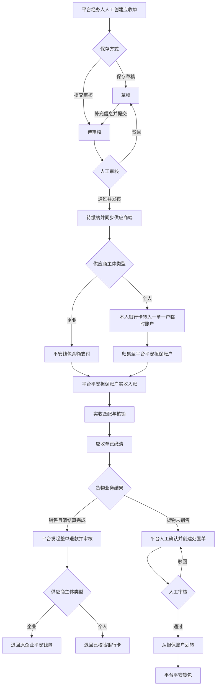
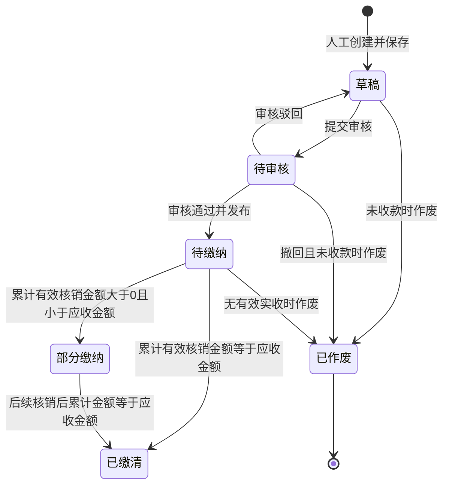
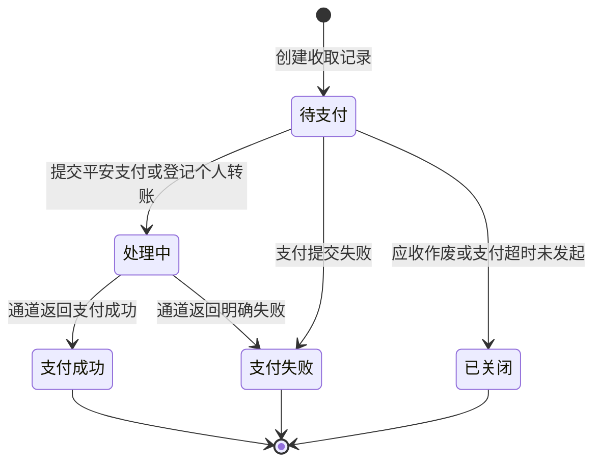
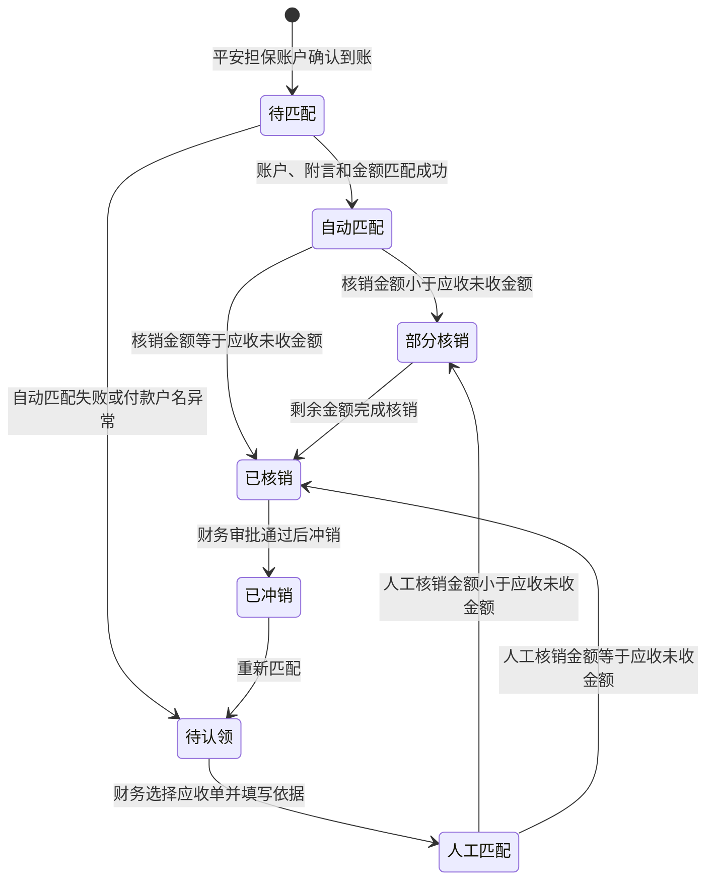
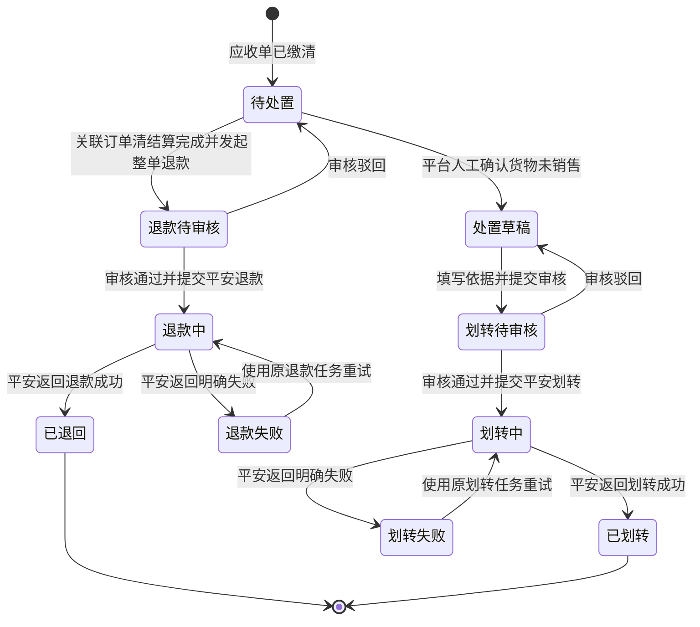
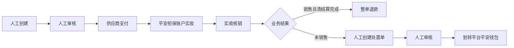

# 代储代销差价补偿金需求文档

> 版本：V1.1（稳定版·状态流转校正版）  
> 日期：2026-07-30  
> 状态：业务口径已确认，可进入开发评审  
> 涉及系统：金融助手、无仓平台 PC、市场助手小程序、平安支付通道

## 1. 文档目的

本文档基于已确认的业务方案及三端原型，固化代储代销差价补偿金的本期需求，作为产品、设计、开发、测试、财务及业务验收的统一依据。

对应原型：

- `金融助手-代储代销-整合版-2.8.html`
- `无仓平台-代储代销-2.8.html`
- `市场助手-服务页面-2.8.html`

## 2. 业务背景

现有代储代销业务中，平台在货物入库、仓单生效后向供应商拨付保证金。为覆盖货物价格变化及未销售处置风险，新增差价补偿金业务。

金融助手由平台人员人工创建差价补偿金应收单，经人工审核后发布。供应商在无仓平台 PC 或市场助手小程序查看并支付。资金实际进入平台在平安体系下开立的担保账户后，完成应收核销。

货物销售并完成清结算后，差价补偿金整单退回；货物未销售时，由平台人员手工发起处置并审核，将相应资金划转至平台平安钱包。

## 3. 名词及资金方向

| 名词 | 定义 | 资金方向 |
|---|---|---|
| 保证金拨付 | 平台根据入库货值向供应商支付的保证金 | 平台 → 供应商 |
| 差价补偿金 | 供应商根据平台应收单缴纳的风险补偿资金 | 供应商 → 平台平安担保账户 |
| 平安担保账户 | 平台在平安体系下开立的担保账户 | 承接差价补偿金实收 |
| 平台平安钱包 | 平台自有平安钱包 | 接收未销售人工处置后的资金 |
| 专属临时账户 | 为个人供应商每张应收单分配的临时收款账户 | 一张应收单一个账户 |
| 收取记录 | 供应商发起支付或转账形成的支付行为记录 | 不代表已经实收入账 |
| 实收信息 | 平安钱包或银行实际到账的资金流水 | 财务核销依据 |

保证金拨付与差价补偿金必须使用不同菜单、单据、状态和资金流水，不得混用。

## 4. 本期业务口径

1. 应收单仅支持平台人员人工创建、手动填写。
2. 本期不支持自动生成、自动计算、定时扫描或自动补缴。
3. 所有应收单必须人工审核，审核通过后才能向供应商发布。
4. 差价补偿金逾期不限制供应商发起新的代储代销申请，新申请继续按既有流程独立审核。
5. 货物销售后的退款触发点为关联代储订单“清结算完成”。
6. 本期不按 SKU、销售数量或货物比例部分退款；清结算完成后按应收单整单退款。
7. 货物未销售的平台处置采用手工处理，不自动识别、不自动生成处置单、不自动划转。
8. 个人供应商采用“一单一户”，每张应收单分配一个专属临时账户。
9. 个人退款银行卡换卡后必须重新校验。
10. 本期不建设差价补偿金收据、发票或其他票据功能。
11. 企业/个人供应商身份由其他系统判断并同步，本系统不允许人工修改。
12. 企业供应商使用平安钱包余额支付；个人供应商从本人银行卡转账至专属临时账户。
13. 个人资金进入临时账户后归集至平台平安担保账户。
14. 支付成功不等于已缴清；实收入账并核销后，应收单才更新为已缴清。

## 5. 总体流程



## 6. 角色与权限

| 角色 | 权限 |
|---|---|
| 平台业务经办人 | 创建应收、保存草稿、提交审核、催缴、发起整单退款、创建未售处置单 |
| 平台审核人员 | 审核应收单、驳回应收单、审核退款、审核未售处置 |
| 平台财务人员 | 查看收取记录、查看及认领实收、核销、对账、查看退款与划转结果 |
| 平台管理员 | 查看全部数据、配置权限、查看审计日志 |
| 企业供应商 | 查看本人应收账单、使用平安钱包余额支付、查看退款结果 |
| 个人供应商 | 查看本人应收账单、获取专属临时账户、银行转账、查看银行卡退款结果 |

退款、未售划转、人工实收认领应执行经办与审核分离。操作人不得审核本人发起的资金操作。

## 7. 金融助手需求

### 7.1 菜单结构

金融助手新增“保证金管理”菜单组：

```text
保证金管理
├── 保证金拨付
├── 差价补偿金应收
├── 收取记录
└── 实收信息
```

“保证金拨付”为现有功能；其余三个页面为本期新增。

### 7.2 差价补偿金应收页面

#### 7.2.1 查询区

| 字段 | 类型 | 说明 |
|---|---|---|
| 应收单号 | 输入框 | 支持完整或模糊查询 |
| 供应商 | 输入框 | 查询企业名称或个人姓名 |
| 应收状态 | 下拉框 | 全部、草稿、待审核、待缴纳、部分缴纳、已缴清、已退回、已划转 |

按钮：

- 查询：按已填写条件查询，并反馈当前查询条件。
- 重置：清空全部条件，状态恢复为“全部”。
- 导出：按当前查询结果生成应收清单。

#### 7.2.2 列表字段

| 字段 | 说明 |
|---|---|
| 应收单号 | 可点击查看详情 |
| 代储订单编码 | 关联代储订单 |
| 供应商 | 企业名称或个人姓名 |
| 主体类型 | 企业/个人，由其他系统同步 |
| 应收金额 | 本单应缴金额 |
| 已收金额 | 已完成有效核销金额 |
| 缴款期限 | 人工创建时填写 |
| 应收状态 | 当前应收主状态 |
| 资金处置 | 待处置、可退款、退款中、已退回、划转中、已划转等 |
| 操作 | 根据状态显示审核、详情、催缴、未售处置、整单退款 |

#### 7.2.3 新增应收单

经办人点击“新增应收单”进入创建弹窗。

| 字段 | 必填 | 规则 |
|---|---|---|
| 供应商 | 是 | 选择供应商，主体类型由其他系统带出 |
| 代储订单编码 | 是 | 选择有效代储订单 |
| 关联仓单 | 是 | 填写或选择对应仓单 |
| 应收金额 | 是 | 手工填写，必须大于 0，保留两位小数 |
| 缴款期限 | 是 | 手工选择 |
| 货物说明 | 否 | 描述关联货物 |
| 生成原因及计算依据 | 是 | 由经办人手工填写 |
| 附件 | 否 | 上传业务依据文件 |

操作：

- 取消：关闭页面，不保存。
- 保存草稿：保存当前信息，状态为草稿；允许稍后编辑。
- 提交审核：校验必填项和金额，状态更新为待审核。

#### 7.2.4 应收审核

点击待审核记录的“审核”打开审核页面，不使用浏览器简单确认框。

审核页面展示：

- 应收单号、审核状态。
- 供应商、主体类型。
- 代储订单、关联仓单。
- 应收金额、缴款期限。
- 生成原因、计算依据和附件。
- 审核意见。

操作：

- 取消：关闭审核页面，不改变状态。
- 驳回：审核意见必填；应收单退回草稿，由创建人修改。
- 审核通过并发布：审核意见必填；状态更新为待缴纳，同步供应商端。

审核通过后列表不再显示“审核”，改为“详情”和“催缴”。

#### 7.2.5 应收详情

详情展示：应收单、代储订单、仓单、供应商、主体类型、应收/已收金额、缴款期限、应收状态、资金处置状态、生成原因及操作记录。

#### 7.2.6 催缴

仅待缴纳、部分缴纳或逾期未缴清记录显示“催缴”。点击后向供应商发送缴款提醒，并记录操作日志。

逾期不限制供应商新申请。

### 7.3 收取记录页面

收取记录表示支付行为，不表示资金已经实收入账。

#### 7.3.1 查询及导出

查询字段：收取记录号、应收单号、支付状态。

支付状态：待支付、处理中、支付成功、支付失败。

按钮：查询、重置、导出。

#### 7.3.2 列表及详情

| 字段 | 说明 |
|---|---|
| 收取记录号 | 可点击查看详情 |
| 应收单号 | 关联应收单 |
| 供应商 | 付款供应商 |
| 支付端 | 市场助手/无仓 PC |
| 付款方式 | 平安钱包余额/临时账户转账 |
| 发起金额 | 本次支付发起金额 |
| 通道流水号 | 平安或银行通道流水 |
| 支付状态 | 当前支付动作状态 |
| 发起时间 | 支付发起时间 |
| 操作 | 详情；处理中记录增加“查询结果” |

“查询结果”用于主动查询平安通道最终状态。通道超时保持“处理中”，不得直接判定失败或重复扣款。

详情展示支付端、付款方式、金额、通道流水、支付状态、发起/完成时间及处理说明。

### 7.4 实收信息页面

实收信息以平安钱包或银行实际到账流水为准，是应收核销、退款和划转的资金依据。

#### 7.4.1 查询及导出

查询字段：实收流水号、匹配状态。

匹配状态：待认领、自动匹配、人工匹配、已核销。

按钮：查询、重置、导出。

#### 7.4.2 列表及详情

| 字段 | 说明 |
|---|---|
| 实收流水号 | 可点击查看详情 |
| 银行流水号 | 平安/银行实际流水号 |
| 应收单号 | 已匹配应收单；未匹配显示“-” |
| 付款户名 | 实际付款人 |
| 到账账户 | 平台平安担保账户 |
| 到账金额 | 实际到账金额 |
| 到账时间 | 实际到账时间 |
| 匹配状态 | 待认领、已核销等 |
| 处置状态 | 退款或划转状态 |
| 操作 | 详情；待认领记录显示“认领” |

#### 7.4.3 人工认领

待认领流水点击“认领”，展示实收流水号、付款户名和到账金额。

经办人必须：

1. 选择需要匹配的应收单。
2. 填写付款人与应收主体的关系及认领依据。
3. 提交认领并核销。

同一实收金额不得重复认领或重复核销。

### 7.5 整单退款

#### 7.5.1 触发条件

- 关联代储订单已完成清结算。
- 应收资金已实收入账并完成核销。
- 应收资金尚未退款、尚未划转。
- 本期按应收单整单退款，不支持按 SKU 或数量部分退款。

#### 7.5.2 退款渠道

- 企业：退回原平安钱包。
- 个人：退回已实名认证并校验的银行卡。
- 个人换卡后必须重新校验。

退款页面展示应收单号、供应商、退款金额、退款渠道和退款说明。提交后进入人工审核。

### 7.6 未销售人工处置

系统不自动判断货物是否未销售，不自动创建处置单，不自动划转。

平台人员人工确认后点击“未售处置”，填写：

| 字段 | 必填 | 说明 |
|---|---|---|
| 应收单号 | 自动 | 当前应收单 |
| 供应商 | 自动 | 当前供应商 |
| 可处置金额 | 自动 | 当前可划转余额 |
| 划转金额 | 是 | 人工填写，不得超过可处置金额 |
| 处置原因及依据 | 是 | 填写未销售情况和核实过程 |
| 划转账户 | 自动 | 预配置的平台平安钱包，不允许临时修改 |
| 处置凭证 | 是 | 上传人工处置依据 |

提交后进入人工审核，审核通过后从平台平安担保账户划转至平台平安钱包。

## 8. 无仓平台 PC 需求

### 8.1 入口

顶部供应商区域新增“补偿金账单”入口，并展示待处理数量。

### 8.2 账单列表

字段：应收单号、代储订单编码、主体类型、生成原因、应收金额、未缴金额、缴款期限、状态、操作。

企业账单显示“企业钱包支付”；个人账单显示“个人转账支付”。两种支付必须进入不同页面，不得混合显示。

### 8.3 企业支付页面

展示：

- 应收单号、代储订单编码。
- 应付金额。
- 主体类型：企业。
- 企业平安钱包脱敏账号。
- 平安钱包可用余额。
- 资金进入平台平安担保账户的说明。

操作：

- 取消：关闭支付页面。
- 确认支付：供应商确认使用平安钱包余额支付。

余额不足时不得提交支付，应提示充值或稍后再试。支付提交成功后显示“等待担保账户到账确认”。

### 8.4 个人支付页面

个人供应商不使用钱包余额支付。页面展示：

- 应收单号、代储订单编码。
- 付款人姓名及个人主体类型。
- 应转金额。
- 专属临时账户收款户名、开户银行、账号。
- 唯一转账附言。
- 账户有效期说明。
- 使用本人银行卡、付款户名一致、金额一致的提示。

操作：

- 取消：关闭页面。
- 复制转账信息：复制户名、开户行、临时账号、金额和附言。
- 我已完成转账：登记供应商操作，账单显示“等待银行到账确认”，不得直接更新为已缴清。

专属临时账户必须“一单一户”。资金到账后归集至平台平安担保账户。

### 8.5 账单状态展示

供应商可查看待缴纳、缴纳中、已缴清、已退回和已划转状态。

供应商端只展示平台处置结果，不提供未售处置操作。

## 9. 市场助手小程序需求

### 9.1 入口

在服务首页“我的申请”区域增加“差价补偿金”卡片，展示：

- 待缴笔数。
- 待缴总金额。
- “去处理”入口。

存在待缴账单时显示突出提醒。

### 9.2 账单页面

展示账单号、代储订单、主体类型、应缴金额、已缴金额、未缴金额、缴款期限和状态。

### 9.3 企业支付

企业供应商显示“平安钱包余额支付”，确认支付后提示等待平台平安担保账户到账及核销。

### 9.4 个人支付

个人供应商展示一单一户临时账户转账信息，包括收款户名、开户银行、账号、金额和附言，并支持复制。

个人转账后显示“等待到账确认”，不能立即标记为已缴清。

### 9.5 结果展示

小程序展示支付处理中、支付成功、已缴清、退款中、已退回、划转中和已划转等结果。

销售完成并清结算后，企业退款至平安钱包，个人退款至已校验银行卡。未销售处置仅展示平台最终结果。

## 10. 状态设计

### 10.1 应收状态



应收状态校验规则：

- “已缴清”只能由有效实收核销结果驱动，不能由支付回调直接更新。
- “部分缴纳”后不得作废；如需调整，必须走退款或财务异常处理。
- “已作废”为终态，作废后不得继续支付、认领或核销。
- 逾期是“待缴纳”或“部分缴纳”的附加标识，不是互斥主状态，也不限制新申请。
- 已收金额不得超过应收金额；多付部分进入异常资金处理，不计入本单已收金额。

### 10.2 收取状态



收取状态校验规则：

- 通道超时或回调缺失时保持“处理中”，通过主动查询获取最终结果。
- “支付成功”仅表示本次支付动作成功，不代表担保账户已实收，也不直接更新应收为“已缴清”。
- 支付失败后再次支付应创建新的收取记录，原记录保持失败终态。
- 幂等号相同的重复请求不得生成多条有效收取记录或发生重复扣款。

### 10.3 实收匹配状态



实收状态校验规则：

- 实收流水只能在平台平安担保账户确认到账后生成。
- 同一实收流水的累计核销金额不得超过实际到账金额。
- 同一应收单的累计有效核销金额不得超过应收金额。
- 人工认领必须填写认领依据并记录经办人；已核销流水不得重复认领。
- 冲销必须经过财务审批，并同步回退对应应收单的已收金额及主状态。

### 10.4 资金处置状态



资金处置状态校验规则：

- 只有“已缴清”的应收单才能进入“待处置”。
- 整单退款必须以关联代储订单“清结算完成”为前提。
- 未销售处置必须由平台人员人工创建并人工审核，系统不得自动进入处置流程。
- 同一可用资金只能选择退款或划转一条分支；进入任一审核状态后，另一分支必须锁定。
- “已退回”和“已划转”为互斥终态，同一资金不得重复退款、重复划转或先退后划。
- 退款/划转超时保持处理中；只有通道返回明确失败才能进入失败状态。

### 10.5 跨状态一致性

| 业务事件 | 收取记录 | 实收信息 | 应收状态 | 资金处置状态 |
|---|---|---|---|---|
| 应收审核通过 | 无变化 | 无变化 | 待缴纳 | 无 |
| 企业钱包支付提交 | 处理中 | 尚未生成 | 待缴纳 | 无 |
| 个人点击“已完成转账” | 处理中 | 尚未生成 | 待缴纳 | 无 |
| 通道支付成功但担保账户未确认到账 | 支付成功 | 尚未生成 | 待缴纳 | 无 |
| 担保账户到账但仅部分核销 | 支付成功或处理中 | 部分核销 | 部分缴纳 | 无 |
| 担保账户到账并足额核销 | 支付成功或处理中 | 已核销 | 已缴清 | 待处置 |
| 清结算完成并提交退款审核 | 无变化 | 已核销 | 已缴清 | 退款待审核 |
| 退款成功 | 无变化 | 已核销 | 已缴清 | 已退回 |
| 未销售处置提交审核 | 无变化 | 已核销 | 已缴清 | 划转待审核 |
| 划转成功 | 无变化 | 已核销 | 已缴清 | 已划转 |

## 11. 编码建议

| 单据 | 编码规则 |
|---|---|
| 差价补偿金应收单 | BCAR + YYYYMMDD + 4 位流水号 |
| 收取记录 | BCPAY + YYYYMMDD + 4 位流水号 |
| 实收流水 | BCREC + YYYYMMDD + 4 位流水号 |
| 退款单 | BCREF + YYYYMMDD + 4 位流水号 |
| 未售处置单 | BCDSP + YYYYMMDD + 4 位流水号 |

所有业务请求和通道请求必须使用唯一业务号及幂等号。

## 12. 数据及接口要求

### 12.1 核心数据对象

- 差价补偿金应收单。
- 应收关联订单及仓单信息。
- 收取记录。
- 实收流水。
- 核销明细。
- 退款单。
- 未售人工处置单。
- 审核及操作日志。

### 12.2 外部交互

| 交互 | 方向 | 内容 |
|---|---|---|
| 主体类型同步 | 其他系统 → 金融助手 | 企业/个人身份 |
| 应收发布 | 金融助手 → 无仓平台/市场助手 | 应收单及待缴状态 |
| 企业钱包支付 | 供应商端 → 平安 | 钱包扣款指令 |
| 临时账户分配 | 金融助手 → 平安 | 一单一户账户申请 |
| 支付结果通知 | 平安 → 金融助手 | 支付状态、通道流水 |
| 到账及归集通知 | 平安 → 金融助手 | 实收流水、担保账户入账结果 |
| 清结算结果 | 清结算中心 → 金融助手 | 订单清结算完成状态 |
| 退款指令 | 金融助手 → 平安 | 企业钱包或个人银行卡退款 |
| 平台划转 | 金融助手 → 平安 | 担保账户至平台钱包划转 |
| 状态同步 | 金融助手 → 供应商端 | 支付、实收、退款和划转状态 |

接口必须验签、防重放、幂等。回调先保存原始报文，再处理业务状态。

## 13. 异常处理

| 异常 | 处理 |
|---|---|
| 企业钱包余额不足 | 不发起扣款，提示余额不足 |
| 重复点击企业支付 | 幂等拦截，不重复扣款 |
| 个人少付 | 部分核销，保留未缴金额 |
| 个人多付 | 应收额内核销，超额进入人工处理，不自动抵扣其他单据 |
| 个人付款户名不一致 | 进入待认领及人工复核 |
| 临时账户过期后到账 | 挂账并进入人工处理 |
| 临时账户归集失败 | 显示到账处理中，自动重试并告警 |
| 通道回调丢失 | 主动查询通道结果并补偿处理 |
| 支付成功但未实收 | 保持支付成功或处理中，不更新为已缴清 |
| 退款失败 | 不扣减可退金额，使用原退款任务重试 |
| 划转失败 | 保持资金可用，人工查明原因后重试 |
| 实收重复认领 | 系统拦截，不允许重复核销 |

## 14. 通知要求

- 应收审核通过并发布时通知供应商。
- 到期前和逾期后可进行缴款提醒。
- 企业支付提交、个人转账登记、实收入账、核销完成时通知供应商。
- 退款成功、划转完成和处理失败时通知供应商。
- 通知中不展示完整钱包账号、银行卡号或临时账户敏感信息。

## 15. 安全与审计

- 钱包、担保账户、临时账户和银行卡号脱敏展示、加密存储。
- 企业支付由平安钱包完成授权验证。
- 个人退款银行卡必须实名认证并校验一致性。
- 人工创建、审核、驳回、发布、认领、退款和划转必须记录操作日志。
- 未销售处置原因、依据、附件、经办人、审核人和时间必须完整留痕。
- 平台钱包只能从预配置账户库选择，不允许经办人临时输入任意收款账户。

## 16. 验收标准

### 16.1 金融助手

1. 保证金管理菜单及三个新增页面可以正常切换。
2. 查询、重置、导出按钮均有正确反馈。
3. 新增应收单可以保存草稿，提交审核前校验必填项及金额。
4. 审核按钮打开完整审核页面；驳回和通过均要求审核意见。
5. 审核通过后应收状态更新为待缴纳，并显示详情、催缴操作。
6. 应收、收取、实收编号均可点击查看对应完整详情。
7. 处理中收取记录可主动查询通道结果。
8. 待认领实收可选择应收单、填写依据并提交核销。
9. 清结算完成后可发起整单退款，不出现按 SKU 部分退款入口。
10. 未销售处置只能人工创建，必须填写处置依据并提交审核。

### 16.2 无仓平台 PC

1. 补偿金账单入口展示待处理数量。
2. 列表明确展示企业和个人主体类型。
3. 企业支付打开平安钱包余额支付页面。
4. 个人支付打开专属临时账户转账页面。
5. 个人页面支持复制账户、金额及附言。
6. 个人点击已完成转账后显示等待到账确认，不显示已缴清。
7. 两种支付页面不得混用支付信息。

### 16.3 市场助手小程序

1. 服务首页显示待缴笔数和待缴金额。
2. 可以进入补偿金账单页面查看应收信息。
3. 企业显示钱包余额支付，个人显示一单一户转账。
4. 支付、到账、缴清、退款及划转状态展示正确。

### 16.4 资金一致性

1. 同一支付请求不能重复扣款。
2. 同一实收流水不能重复核销。
3. 同一资金不能同时退款和划转。
4. 支付成功但未实收到担保账户时不能更新为已缴清。
5. 三端的应收金额、已收金额和状态最终一致。

## 17. 本期不做

- 差价补偿金自动生成。
- 系统自动计算应收金额。
- 定期重估和自动补缴。
- 按 SKU、销售数量或比例部分退款。
- 未销售自动识别、自动处置和自动划转。
- 差价补偿金票据及发票。
- 逾期限制新申请。
- 计息、多币种或供应商主动提现。

## 18. 稳定性结论

本需求已完成业务口径确认及三端原型调整。本期稳定流程为：



后续开发及测试应以本文档和同目录三份 2.8 原型为基线。如需增加自动生成、部分退款或自动处置，必须作为新版本需求单独评审，不得直接扩展本期范围。
