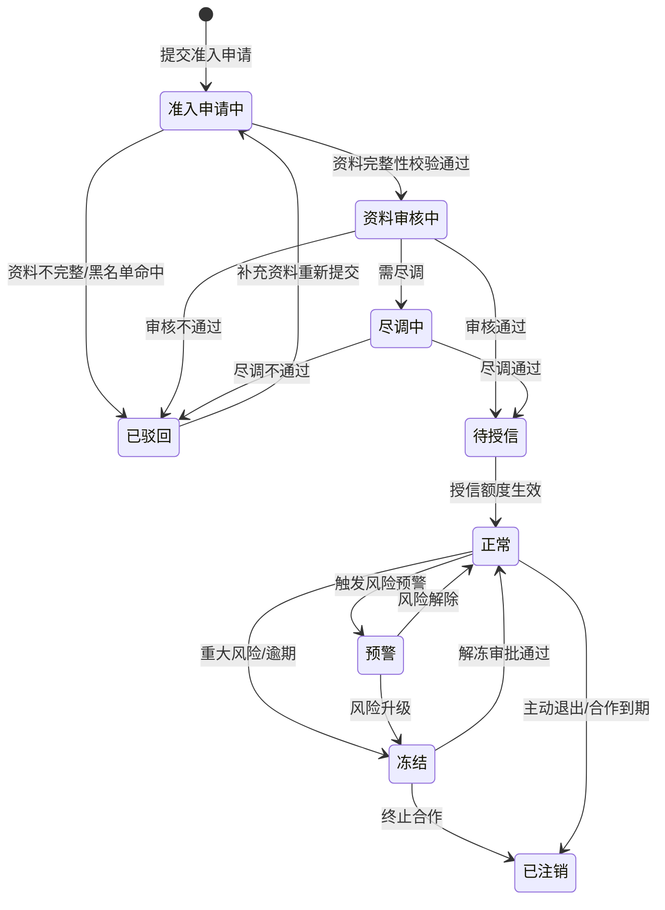

# PRD_客户管理.md

## 一、前言

### 1.1 文档版本

V1.0

### 1.2 修订记录

| 版本 | 日期 | 修订人 | 修订内容 |
|------|------|--------|----------|
| V1.0 | 2026-04-24 | 产品部 | 初始版本，基于原始业务文档3.1客户管理章节编制 |

### 1.3 相关文档

| 文档名称 | 说明 |
|----------|------|
| 《供应链金融平台解决方案文档》 | 原始业务素材，本文档核心规则与业务逻辑来源 |
| 《PRD_通用方案——跨文档待确认事项补充》 | 跨模块通用方案，含接口规范、费率、税务、资金账户等已确认参数 |
| 《核心企业推荐确认制度》 | 待运营部编制，规范推荐确认流程（运营策略层面） |
| 《客户准入资料清单》 | 待运营部编制，明确必交材料和格式要求（运营策略层面） |
| 《证照有效期管理制度》 | 待运营部编制，要求提前30天更新证照（运营策略层面） |
| 《核心企业推荐激励制度》 | 待运营部编制，含推荐佣金+质量奖金+协同催收奖励（运营策略层面） |
| 《推荐质量评估标准》 | 待运营部编制，通过率/首贷率/逾期率加权计分（运营策略层面） |

### 1.4 术语表

| 术语 | 英文 | 说明 |
|------|------|------|
| 核心企业 | Core Enterprise | 供应链中的链主企业，为下游经销商提供信用背书和数据支持 |
| 经销商/融资企业 | Dealer/Financing Enterprise | 资金需求方，基于真实贸易背景发起融资 |
| 推荐码 | Referral Code | 核心企业预先生成的唯一编码，用于验证推荐关系 |
| 推荐质量得分 | Referral Quality Score | 综合评估核心企业推荐质量的量化指标 |
| 差异化准入矩阵 | Differentiated Admission Matrix | 根据核心企业等级和经销商信用等级匹配不同审批流程的规则矩阵 |
| 相对质押率 | Relative Pledge Rate | 当前质押率/品类上限*100%，用于跨品类统一度量风险 |
| 首贷率 | First Loan Rate | 推荐客户中首次成功获得融资的比例 |
| M3+逾期 | M3+ Overdue | 逾期90天以上的贷款 |
| 白名单 | White List | 经平台审核通过的优质客户名单 |
| 黑名单 | Black List | 存在重大风险或违规记录的客户名单 |
| 授信额度 | Credit Limit | 平台授予客户的最大融资金额 |
| 尽调 | Due Diligence | 尽职调查，对申请客户进行的深度资质审核 |
| WMS | Warehouse Management System | 仓储管理系统，用于货物实时监控 |
| ERP | Enterprise Resource Planning | 企业资源计划系统，核心企业用于管理经销商数据和供货记录 |

---

## 二、项目成员

| 角色 | 人员 | 职责 |
|------|------|------|
| 产品负责人 | 待确认 | 需求定义、PRD编写、项目推进 |
| 项目经理 | 待确认 | 项目计划、资源协调、进度跟踪 |
| 业务专家/客户经理 | 待确认 | 业务规则确认、运营策略制定 |
| 风控负责人 | 待确认 | 风控规则审核、准入标准制定 |
| 后端开发负责人 | 待确认 | 服务端架构设计、接口开发 |
| 前端开发负责人 | 待确认 | 页面交互设计、前端开发 |
| 测试负责人 | 待确认 | 测试方案制定、质量保障 |
| UI设计师 | 待确认 | 页面视觉设计、交互原型 |
| 运营配置人员 | 待确认 | 后台配置、参数维护、日常运营 |

---

## 三、需求背景

### 3.1 问题现状

#### 3.1.1 用户/业务侧

1. **缺乏核心企业推荐质量的量化评估**：无法识别优质合作伙伴并差异化管理。例如核心企业A推荐客户不良率1.5%，核心企业B高达6.8%，但平台采用相同合作政策，导致低质量客户占比过高，拉升整体不良率。

2. **准入流程缺乏核心企业实时推荐确认环节**：无法核验经销商与核心企业的真实合作关系。某经销商伪造与核心企业合作关系，准入后逾期损失80万元。

3. **经销商经营异常缺乏与核心企业的信息共享机制**：平台无法及时获知客户风险变化。某B级客户销售额从月均200万降至50万，平台3个月后才发现，期间新增融资150万最终逾期。

4. **缺乏标准化的资料提交规范**：客户不清楚需要准备哪些材料，约50%申请因资料不完整需补充，平均沟通2-3轮。

5. **缺乏量化的推荐质量评估标准和激励政策**：核心企业推荐意愿参差不齐，部分核心企业重数量轻质量。

#### 3.1.2 系统侧

1. **客户信息分散在多个系统或Excel**：准入审核流程冗长（平均5天），无统一的客户信息管理平台。

2. **资料上传缺乏完整性校验**：资料不完整仍可提交，导致反复沟通。

3. **证照到期需手工逐个通知**：易遗漏，某客户营业执照到期后继续融资，事后发现合规风险。

4. **经销商准入时需电话或邮件联系核心企业确认合作关系**：耗时长且无法留存证据，供货合同、销售数据等需逐一核验真伪。

5. **缺乏自动化的推荐质量计算和评估报告输出**：无法每季度自动输出核心企业评估报告。

#### 3.1.3 竞品对比

| 维度 | 本平台（现状） | 京东供应链金融 | 平安银行存货融资 |
|------|---------------|---------------|-----------------|
| 准入时效 | 平均5天 | 1-2天 | 2-3天 |
| 推荐机制 | 无系统化推荐确认 | 依托京东生态数据 | 依托银行自有征信 |
| 资料完整性校验 | 人工核对 | 系统前置校验 | 系统前置校验 |
| 核心企业数据联动 | 电话/邮件确认 | 生态内数据自动同步 | 需线下对接 |
| 差异化审批 | 无 | 有（基于京东等级） | 有（基于银行评级） |

### 3.2 需求目标

#### 3.2.1 解决什么问题

1. 建立标准化的客户准入和分层管理体系，优先引入有核心企业信用背书的优质经销商。
2. 优化准入审核流程，减少资料不完整导致的反复沟通。
3. 建立推荐激励和约束机制，提高核心企业推荐积极性和推荐质量。
4. 建立统一的客户信息管理平台，实现客户全生命周期管理。

#### 3.2.2 期望效果

1. 准入审核时效从5天缩短至2天。
2. 优质客户占比从现状提升至大于等于60%。
3. 资料一次性完整率从50%提升至90%。
4. 准入通过率稳定在60-70%。
5. 核心企业推荐质量可量化评估，差异化合作政策落地。

#### 3.2.3 数据指标目标

| 指标 | 现状 | 目标值 | 优先级 |
|------|------|--------|--------|
| 优质客户占比 | 未明确 | 大于等于60% | P0 |
| 客户不良率 | 未明确 | 小于等于2% | P0 |
| 准入时效 | 平均5天 | 小于等于2天 | P0 |
| 资料一次完整率 | 50% | 大于等于90% | P0 |
| 准入通过率 | 未明确 | 60-70% | P1 |
| 证照到期预警及时率 | 人工通知 | 100% | P1 |
| 核心企业推荐响应率 | 电话/邮件 | 100%在线确认 | P1 |
| 核心企业推荐质量评估覆盖率 | 无 | 100%每季度评估 | P2 |

---

## 四、需求概述

### 4.1 需求点拆分

| 序号 | 需求点 | 优先级 | 受众端 | 类型 | 说明 |
|------|--------|--------|--------|------|------|
| 1 | 客户准入审核流程 | P0 | 企业端/运营端/服务端 | 重点功能 | 在线申请-推荐码验证-核心企业确认-资料校验-平台审核-结果闭环 |
| 2 | 推荐码生成与管理 | P0 | 运营端/企业端/服务端 | 重点功能 | 核心企业预生成推荐码，经销商申请时填写 |
| 3 | 核心企业数据联动 | P0 | 服务端 | 重点功能 | 验证通过后自动获取经销商供货记录、信用评级等数据 |
| 4 | 差异化准入矩阵 | P0 | 运营端/服务端 | 重点功能 | 根据核心企业等级+经销商信用等级匹配不同审批流程 |
| 5 | 企业客户档案管理 | P0 | 运营端/服务端 | 基础功能 | 已准入客户的档案维护、分级、授信额度、风险标签 |
| 6 | 核心企业档案与分级 | P1 | 运营端/服务端 | 基础功能 | 核心企业档案维护、推荐质量评估、分级管理 |
| 7 | 银行机构管理 | P1 | 运营端/服务端 | 基础功能 | 机构档案、产品目录、额度分配 |
| 8 | 仓储合作方管理 | P1 | 运营端/服务端 | 基础功能 | 企业档案、监管能力评估、仓库管理 |
| 9 | 证照有效期自动监控 | P1 | 服务端 | 基础功能 | 自动监控证照有效期，提前30天预警 |
| 10 | 核心企业推荐激励机制 | P1 | 运营端/服务端 | 基础功能 | 推荐质量得分自动计算、季度评估报告 |
| 11 | 与核心企业ERP集成 | P1 | 服务端 | 系统集成 | 推荐码验证、数据同步、风险预警推送。**已确认：HTTPS RESTful API，OAuth 2.0+JWT，8个标准接口**（详见《通用方案》第一章） |
| 12 | 与征信系统集成 | P1 | 服务端 | 系统集成 | 客户征信数据查询与校验。**已确认：企查查（主）+天眼查（备）双源策略**（详见《通用方案》第二章） |
| 13 | 客户管理报表 | P2 | 运营端 | 报表 | 客户准入统计、核心企业推荐质量报表 |
| 14 | 行为埋点 | P2 | 全端 | 数据 | 关键用户行为埋点 |

### 4.2 本期不做的事项

| 序号 | 事项 | 备注 |
|------|------|------|
| 1 | 移动端独立APP | 延后，本期通过H5/小程序覆盖企业端功能 |
| 2 | AI智能尽调（自动尽调报告生成） | 延后，本期保留人工尽调环节 |
| 3 | 区块链电子仓单存证 | 延后，仓单管理在货权管理模块单独规划 |
| 4 | 核心企业协同催收功能 | 延后，归属贷后管理模块 |
| 5 | 客户自助修改档案信息 | 延后，本期客户档案变更需经平台审核 |
| 6 | 多语言/国际化支持 | 延后，本期仅支持中文 |
| 7 | 客户画像AI预测模型 | 延后，本期基于规则引擎评估 |
| 8 | 第三方数据市场对接（除征信和核心企业ERP外） | 延后，待后续规划 |

### 4.3 核心业务流程图

#### 4.3.1 客户准入审核总流程（ASCII）

```
+-----------------------------------------------------------------------------+
|                          客户准入审核总流程                                   |
+-----------------------------------------------------------------------------+

经销商（企业端）                    平台（运营端）                    核心企业（企业端）
    |                                   |                                   |
    |  1.在线提交准入申请                |                                   |
    |  （基本信息+推荐码+资料上传）       |                                   |
    |  >------------------------------> |                                   |
    |                                   |                                   |
    |                                   |  2.验证推荐码                      |
    |                                   |  （有效性/有效期/额度）             |
    |                                   |                                   |
    |                                   |  3.向核心企业发起推荐确认           |
    |                                   |  >------------------------------> |
    |                                   |                                   |
    |                                   |  4.核心企业在线确认推荐             |
    |                                   |  + 提供经销商数据                  |
    |                                   |  <------------------------------  |
    |                                   |                                   |
    |                                   |  5.系统自动校验                    |
    |                                   |  +- 资料完整性                    |
    |                                   |  +- 黑名单命中                    |
    |                                   |  +- 证照有效期                    |
    |                                   |  +- 征信查询                      |
    |                                   |                                   |
    |                                   |  [校验不通过]                      |
    |  5a.返回驳回原因                   |  <-------+                         |
    |  <------------------------------  |          |                         |
    |  （补充资料后重新提交）             |          |                         |
    |  >------------------------------> |  --------+                         |
    |                                   |                                   |
    |                                   |  [校验通过]                        |
    |                                   |  6.匹配差异化审批流程               |
    |                                   |  （根据核心企业等级+经销商等级）     |
    |                                   |                                   |
    |                                   |  +-----------------------------+  |
    |                                   |  | S级+A+经销商 -> 快速通道      |  |
    |                                   |  | 其他 -> 标准/加强审批流程      |  |
    |                                   |  +-----------------------------+  |
    |                                   |                                   |
    |                                   |  [快速通道]                        |
    |                                   |  7a.简化审批（1-2级）              |
    |                                   |                                   |
    |                                   |  [标准/加强流程]                    |
    |                                   |  7b.平台审核+尽调                  |
    |                                   |  （风控专员审核）                   |
    |                                   |                                   |
    |                                   |  [需尽调]                          |
    |                                   |  7c.发起尽职调查                   |
    |                                   |  （实地核查/电话访谈）              |
    |                                   |                                   |
    |                                   |  8.审批决策                        |
    |                                   |  （通过/驳回/需补充资料）           |
    |                                   |                                   |
    |  9a.审批结果通知                   |                                   |
    |  <------------------------------  |                                   |
    |  （通过：开通账号+授信额度）        |                                   |
    |  （驳回：说明原因）                |                                   |
    |                                   |                                   |
    |                                   |  9b.审批结果反馈核心企业            |
    |                                   |  （纳入推荐质量评估）               |
    |                                   |  >------------------------------> |
    |                                   |                                   |
```

#### 4.3.2 核心企业推荐码生命周期（ASCII）

```
+-----------------------------------------------------------------------------+
|                        核心企业推荐码生命周期                                 |
+-----------------------------------------------------------------------------+

核心企业登录企业端
    |
    v
[推荐码管理页面]
    |
    +-- 生成推荐码 --> 系统生成唯一推荐码 --> 设置有效期/数量上限
    |                          |
    |                          v
    |               [推荐码状态：有效]
    |                          |
    |                          +-- 经销商使用 --> [推荐码状态：已使用]
    |                          |                         |
    |                          |                         v
    |                          |              系统发起推荐确认请求
    |                          |                         |
    |                          |              核心企业确认/拒绝
    |                          |                         |
    |                          |                         v
    |                          |              [推荐码状态：已确认/已作废]
    |                          |
    |                          +-- 过期未使用 --> [推荐码状态：已过期]
    |                          |
    |                          +-- 主动作废 --> [推荐码状态：已作废]
    |
    +-- 查看推荐码使用统计 --> 使用率/通过率/转化率
```

#### 4.3.3 企业客户状态流转（Mermaid）



---

## 五、需求详情

### 5.1 客户准入审核（重点功能）

#### 5.1.1 功能概述

客户准入审核是平台获客的第一道关卡，通过嵌入核心企业推荐确认环节，利用核心企业对下游经销商的了解，从源头把控资产质量。本功能覆盖经销商在线申请、推荐码验证、核心企业确认、系统自动校验、平台差异化审批、结果闭环的全流程。

#### 5.1.2 业务流程详细说明

**步骤1：经销商在线提交准入申请**
- 经销商通过企业端填写基本信息、上传准入资料、填写推荐码

**步骤2：验证推荐码**
- 系统校验推荐码有效性（是否存在、是否过期、是否已达使用上限）

**步骤3：核心企业确认推荐**
- 系统向核心企业发起推荐确认请求
- 核心企业在线确认推荐关系并提供经销商数据

**步骤4：系统自动校验**
- 资料完整性校验、黑名单命中校验、证照有效期校验、征信查询

**步骤5：平台差异化审批**
- 根据核心企业等级和经销商信用等级匹配审批流程
- S级核心企业推荐的A+经销商可走快速通道

**步骤6：审批结果闭环**
- 审批结果通知经销商，同时反馈核心企业纳入推荐质量评估

---

#### 5.1.3 后台/运营需求

##### 5.1.3.1 准入资料清单配置

| 配置项 | 字段名 | 类型 | 必填 | 说明 |
|--------|--------|------|------|------|
| 资料项ID | doc_item_id | String(32) | 是 | 系统生成唯一标识 |
| 资料项名称 | doc_item_name | String(100) | 是 | 如营业执照、法人身份证 |
| 适用客户类型 | apply_to | Enum | 是 | 经销商/核心企业/银行/仓储方 |
| 是否必填 | is_required | Boolean | 是 | true=必填，false=选填 |
| 文件格式限制 | file_formats | String(100) | 否 | 如pdf,jpg,png，多个用逗号分隔 |
| 文件大小限制 | file_size_limit | Int(MB) | 否 | 默认10MB |
| 有效期校验 | need_validity_check | Boolean | 否 | true=需校验证照有效期 |
| 提前预警天数 | warn_days_before | Int | 否 | 证照到期前多少天预警，默认30天 |
| 启用状态 | status | Enum | 是 | 启用/停用 |
| 排序号 | sort_order | Int | 是 | 展示顺序 |
| 创建时间 | created_at | DateTime | 是 | 系统生成 |
| 更新时间 | updated_at | DateTime | 是 | 系统生成 |

**联动关系：**
- need_validity_check=true时，warn_days_before必填且大于等于7天
- 资料项停用后，新申请无需提交该资料，但历史已提交资料保留
- 不同客户类型的资料清单相互独立，同一资料项可配置给多个客户类型

#### 5.1.3.1a 标准客户准入资料清单（经销商）

以下为经销商准入的**标准资料清单**，运营人员可通过配置中心动态调整各资料的必填/选填属性：

**一、企业一般信息**

| 序号 | 资料名称 | 是否必填 | 格式要求 | 有效期校验 | 说明 |
|------|----------|----------|----------|-----------|------|
| 1 | 营业执照 | 是 | PDF/JPG/PNG，≤10MB | 是 | 需包含正本，清晰可辨 |
| 2 | 营业执照副本 | 否 | PDF/JPG/PNG，≤10MB | 是 | 副本作为补充 |
| 3 | 开户许可证/基本存款账户信息 | 是 | PDF/JPG/PNG，≤10MB | 否 | 银行开户基本信息 |
| 4 | 组织机构代码证（如未三证合一） | 条件必填 | PDF/JPG/PNG，≤10MB | 是 | 未完成三证合一的企业需提交 |
| 5 | 税务登记证（如未三证合一） | 条件必填 | PDF/JPG/PNG，≤10MB | 是 | 未完成三证合一的企业需提交 |
| 6 | 公司章程 | 是 | PDF，≤20MB | 否 | 需加盖公章，含股权结构 |
| 7 | 经营场所证明 | 是 | PDF/JPG/PNG，≤10MB | 否 | 房产证/租赁合同，证明实际经营地址 |
| 8 | 企业简介及主营业务说明 | 是 | PDF/DOC，≤10MB | 否 | 含主营品类、销售渠道、年营业额 |

**二、法人/实际控制人信息**

| 序号 | 资料名称 | 是否必填 | 格式要求 | 有效期校验 | 说明 |
|------|----------|----------|----------|-----------|------|
| 9 | 法定代表人身份证（正反面） | 是 | JPG/PNG，≤5MB | 是 | 身份证有效期需≥6个月 |
| 10 | 法定代表人个人征信授权书 | 是 | PDF，≤5MB | 否 | 签字盖章，授权平台查询征信 |
| 11 | 实际控制人身份证（正反面） | 条件必填 | JPG/PNG，≤5MB | 是 | 如实际控制人与法人不一致 |
| 12 | 实际控制人个人征信授权书 | 条件必填 | PDF，≤5MB | 否 | 如实际控制人与法人不一致 |
| 13 | 法人/实控人简历 | 否 | PDF/DOC，≤5MB | 否 | 含从业经历、行业背景 |

**三、征信与合规信息**

| 序号 | 资料名称 | 是否必填 | 格式要求 | 有效期校验 | 说明 |
|------|----------|----------|----------|-----------|------|
| 14 | 企业征信报告 | 系统自动 | - | - | 系统自动调取企查查/天眼查 |
| 15 | 无重大诉讼证明/涉诉说明 | 是 | PDF，≤5MB | 否 | 如有涉诉需说明案件情况及标的 |
| 16 | 无失信被执行记录证明 | 系统自动 | - | - | 系统自动校验 |
| 17 | 纳税信用等级证明 | 否 | PDF/JPG，≤5MB | 否 | A/B/C/D级，A级优先 |
| 18 | 近2年无重大违法违规声明 | 是 | PDF，≤5MB | 否 | 法人签字+企业盖章 |

**四、财务信息**

| 序号 | 资料名称 | 是否必填 | 格式要求 | 有效期校验 | 说明 |
|------|----------|----------|----------|-----------|------|
| 19 | 近一年度审计报告 | 是 | PDF，≤30MB | 否 | 需会计师事务所盖章 |
| 20 | 近一年度财务报表（资产负债表、利润表、现金流量表） | 是 | PDF/Excel，≤10MB | 否 | 每季度更新 |
| 21 | 近6个月银行流水 | 是 | PDF/Excel，≤20MB | 否 | 主要结算账户，体现真实经营流水 |
| 22 | 纳税申报表（近一年） | 是 | PDF，≤20MB | 否 | 增值税/企业所得税纳税申报表 |
| 23 | 近期主要购销合同（3-5份） | 是 | PDF，≤20MB | 否 | 证明真实贸易背景 |
| 24 | 近一年增值税发票汇总 | 否 | Excel，≤10MB | 否 | 进销项发票汇总，辅助验证营收 |

**五、供应链合作信息**

| 序号 | 资料名称 | 是否必填 | 格式要求 | 有效期校验 | 说明 |
|------|----------|----------|----------|-----------|------|
| 25 | 核心企业推荐码 | 是 | 文本 | 否 | 核心企业预先生成，验证推荐关系 |
| 26 | 与核心企业合作协议/采购合同 | 是 | PDF，≤20MB | 否 | 证明与核心企业的真实合作关系 |
| 27 | 近一年向核心企业采购记录 | 是 | Excel/PDF，≤10MB | 否 | 采购订单/发票/付款记录 |
| 28 | 下游销售渠道证明 | 否 | PDF/JPG，≤10MB | 否 | 门店照片、电商平台店铺、分销协议 |

**六、担保/增信信息（如需）**

| 序号 | 资料名称 | 是否必填 | 格式要求 | 有效期校验 | 说明 |
|------|----------|----------|----------|-----------|------|
| 29 | 连带责任担保函 | 条件必填 | PDF，≤10MB | 否 | 法人/实控人提供个人连带担保 |
| 30 | 担保人身份证明 | 条件必填 | JPG/PNG，≤5MB | 是 | 如存在第三方担保 |
| 31 | 担保人资产证明 | 条件必填 | PDF，≤10MB | 否 | 房产/车辆/存款证明 |
| 32 | 保证金缴纳凭证 | 条件必填 | PDF/JPG，≤5MB | 否 | 按授信额度的5-10%缴纳 |

**资料完整性校验规则**：

```
必填资料全部上传 → 校验通过，允许提交申请
必填资料缺失    → 系统列出缺失清单，禁止提交
资料格式不符    → 提示重新上传（如超出大小、格式错误）
证照即将过期    → 允许提交但标记"临期预警"，审批时重点提示
证照已过期      → 禁止提交，提示更新证照
```

> **说明**：上述清单为标准配置，运营人员可通过"准入资料清单配置"功能动态调整各资料的必填/选填属性、文件格式限制、大小限制、有效期校验规则。不同客户类型（经销商/核心企业/银行/仓储方）的资料清单相互独立。

##### 5.1.3.2 核心企业分级配置

| 配置项 | 字段名 | 类型 | 必填 | 说明 |
|--------|--------|------|------|------|
| 等级编码 | level_code | Enum | 是 | S/A/B/C |
| 等级名称 | level_name | String(20) | 是 | 如S级-战略合作伙伴 |
| 合作年限要求 | min_cooperation_years | Int | 否 | 单位：年，S级大于等于3年 |
| 推荐质量分要求 | min_quality_score | Int | 否 | 单位：分，S级大于等于90分 |
| 年融资规模要求 | min_annual_financing | Decimal(18,2) | 否 | 单位：万元，S级大于等于5000万 |
| 推荐码有效期 | referral_code_validity | Int | 是 | 单位：天，S级60天 |
| 单月推荐上限 | monthly_referral_limit | Int | 否 | 空=无限制，B级连续2季度限制为10家 |
| 授信额度上浮比例 | credit_limit_uplift | Decimal(5,2) | 否 | 百分比，S级20% |
| 是否允许推荐 | allow_referral | Boolean | 是 | C级连续2季度暂停时为false |
| 创建时间 | created_at | DateTime | 是 | 系统生成 |
| 更新时间 | updated_at | DateTime | 是 | 系统生成 |

**联动关系：**
- 核心企业等级由系统每季度根据推荐质量得分自动评估，运营人员可人工复核调整
- 等级调整时，历史已生成的推荐码不受影响，新生成的推荐码按新等级规则执行
- allow_referral=false时，核心企业无法生成新的推荐码，但已生成的有效推荐码仍可使用

##### 5.1.3.3 差异化准入矩阵配置

| 配置项 | 字段名 | 类型 | 必填 | 说明 |
|--------|--------|------|------|------|
| 矩阵ID | matrix_id | String(32) | 是 | 系统生成唯一标识 |
| 核心企业等级 | core_level | Enum | 是 | S/A/B/C |
| 经销商信用等级 | dealer_credit_level | Enum | 是 | A+/A/B/C |
| 审批流程模板 | approval_flow_template | String(32) | 是 | 关联审批流程模板ID |
| 是否快速通道 | is_fast_track | Boolean | 是 | true=简化审批 |
| 建议授信额度范围 | suggest_credit_range | String(50) | 否 | 如10-50万 |
| 质押率上限 | pledge_rate_limit | Decimal(5,2) | 否 | 百分比，如0.80 |
| 是否需要尽调 | need_due_diligence | Boolean | 是 | |
| 启用状态 | status | Enum | 是 | 启用/停用 |
| 创建时间 | created_at | DateTime | 是 | 系统生成 |
| 更新时间 | updated_at | DateTime | 是 | 系统生成 |

**差异化准入矩阵规则（素材来源）：**

| 核心企业等级 / 经销商等级 | A+ | A | B | C |
|--------------------------|-----|-----|-----|-----|
| **S级** | 快速通道（2级审批） | 标准流程（3级审批） | 标准流程+尽调 | 加强流程（5级审批） |
| **A级** | 标准流程（3级审批） | 标准流程（3级审批） | 标准流程+尽调 | 加强流程（5级审批） |
| **B级** | 标准流程（3级审批） | 标准流程+尽调 | 加强流程（5级审批） | 加强流程（5级审批）+ 额度限制 |
| **C级** | 标准流程+尽调 | 加强流程（5级审批） | 加强流程+额度限制 | 暂停准入（待重新评估） |

**建议授信额度范围与质押率上限参考值**：

| 核心企业等级 / 经销商等级 | A+（视为A级） | A | B | C |
|--------------------------|---------------|-----|-----|-----|
| **S级** | 100-500万 / 品类上限+5% | 50-300万 / 品类上限 | 30-100万 / 品类上限-5% | 10-50万 / 品类上限-10% |
| **A级** | 50-300万 / 品类上限 | 30-200万 / 品类上限 | 20-80万 / 品类上限-5% | 10-50万 / 品类上限-10% |
| **B级** | 30-200万 / 品类上限 | 20-100万 / 品类上限-5% | 10-50万 / 品类上限-10% | 5-30万 / 品类上限-15% |
| **C级** | 20-100万 / 品类上限-5% | 10-50万 / 品类上限-10% | 5-30万 / 品类上限-15% | 暂停准入 |

> **说明**：
> - 上述矩阵审批流程为基于素材推导的标准行业做法。
> - **建议授信额度范围**和**质押率上限**为参考值（`待风控负责人最终确认`），系统支持配置化调整，运营人员可在管理后台修改各单元格参数。
> - "品类上限"指通用方案中定义的品类质押率上限（3C电子70%、白酒80%、食品75%、家电80%）。
>
> **等级映射规则（跨模块一致性）**：
> - **经销商信用评级A+级**：由核心企业评定，表示最优质经销商。在平台侧（融资、结算、风控模块）**A+级视为A级**，享受A级对应的审批通道、费率政策和监控阈值。
> - **经销商信用评级A/B/C级**：与平台侧客户等级直接对应，无需映射。
> - **核心企业等级S/A/B/C级**：在各模块中保持一致，影响推荐码有效期、授信额度上浮、分润质量系数等。

##### 5.1.3.4 审批流程模板配置

| 配置项 | 字段名 | 类型 | 必填 | 说明 |
|--------|--------|------|------|------|
| 模板ID | template_id | String(32) | 是 | 系统生成唯一标识 |
| 模板名称 | template_name | String(100) | 是 | 如快速通道-2级审批 |
| 审批级数 | approval_levels | Int | 是 | 2/3/5 |
| 审批节点配置 | nodes_config | JSON | 是 | 各节点的审批角色、审批人分配策略 |
| 适用条件 | apply_conditions | String(500) | 否 | 描述性文字 |
| 超时提醒时间 | timeout_warn_hours | Int | 是 | 默认24小时 |
| 超时自动升级时间 | timeout_escalate_hours | Int | 否 | 空=不自动升级 |
| 启用状态 | status | Enum | 是 | 启用/停用 |

