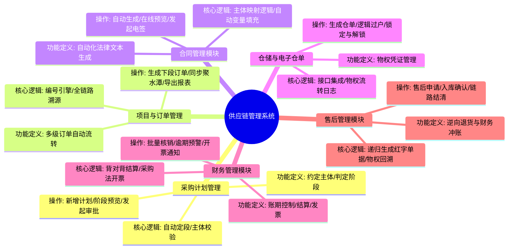
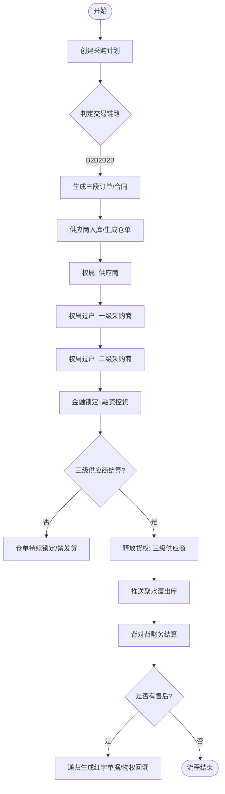
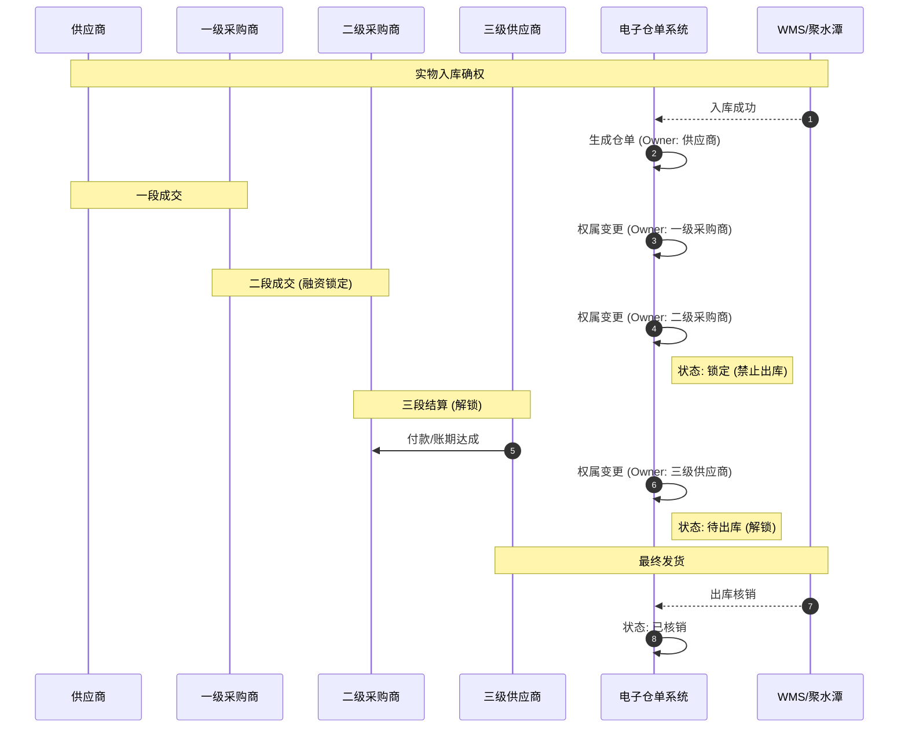

# 供应链管理系统 (B2B2B2B) 需求规格说明书

## 1. 文档概述
### 1.1 项目背景
本系统旨在解决多主体参与下的供应链协同问题。通过**采购计划**驱动，实现从“供应商”到“三级供应商”的全链路交易自动化。系统核心解决物权控货（电子仓单）、背对背结算、多级合同自动签署及递归售后对账等复杂场景。

### 1.2 角色定义 (B2B2B2B)
| 角色名称 | 简称 | 业务职能 |
| :--- | :--- | :--- |
| **供应商** | S | 原始货源提供方 |
| **一级采购商** | B1 | 中间贸易/代持方 |
| **二级采购商** | B2 | 中间贸易/可以去融资的企业 |
| **三级采购商** | B3 | 末端执行方，对接最终销售或执行 |

---

## 2. 系统功能脑图
以下是基于业务梳理的系统功能全景：

---

## 3. 业务流程与逻辑

### 3.1 核心业务流程图
展示从计划启动到财务结算、售后的闭环流程。

---

## 4. 详细功能模块需求

### 4.1 采购计划管理 (系统引擎)
*   **功能定义**：全链路的起点，通过勾选参与主体（S, B1, B2, S3）决定交易的深度。
*   **核心逻辑**：
    *   **自动定段**：全选则为三段模式；若跳过 B1/B2 则自动缩减为二段或一段模式。
    *   **主体校验**：若存在二级采购商（融资方），必须前置一级采购商（代持方）。
*   **列表字段**：计划编号、项目标题、供应商、一级采购商、二级采购商、三级供应商、判定阶段（一段/二段/三段）、预计总额、状态。
*   **按钮功能**：【新增计划】、【阶段预览】（可视化链路图）、【发起审批】。

### 4.2 项目与订单管理
*   **功能定义**：管理 XM 项目下的所有 CG（采购）与 XS（销售）单据。
*   **核心逻辑**：
    *   **全链路溯源**：点击任意单据可可视化查看从 XM 到三级单据的关联状态。
    *   **自动递归**：前段销售单确认后，自动触发后段采购单生成。
*   **列表字段**：订单编号、来源项目号、买卖双方主体、商品总数、订单总额、关联上级单号、单据状态。
*   **按钮功能**：【生成下段订单】、【同步聚水潭】、【批量导出/打印】。

### 4.3 仓储与电子仓单 (物权风控)
*   **核心逻辑**：**物权（Ownership）逻辑转移**。实物不动，权属人在系统内阶梯流转。
*   **权属流转时序图**：

### 4.4 财务管理模块
*   **应付/应收管理**：
    *   **核心逻辑**：**背对背（Back-to-Back）支付**。支持配置“只有收到三级供应商货款后，才允许向二级/一级采购商发起付款申请”。
    *   **列表字段**：账单号、关联项目、交易阶段、买卖双方、待收/付金额、到期日、逾期天数、背对背状态。
*   **发票管理**：基于“采购法”逻辑，自动从采购订单提取商品信息，发送通知要求供应商开票给指定主体。

### 4.5 售后管理模块 (逆向闭环)
*   **核心逻辑**：
    *   **逆向递归**：三级供应商发起退货申请 -> 系统自动递归生成 TH003 (三段退)、TH002 (二段退)、TH001 (一段退)。
    *   **价格回溯**：自动调取原订单单价，确保退款金额与原交易一致。
    *   **红字单据**：自动生成红字应收/应付，抵消财务欠款。
*   **按钮功能**：【发起售后申请】、【退货入库确认】、【一键链路结清】。

---

## 5. 非功能需求
1.  **权限隔离**：各主体（S, B1, B2, S3）仅能查询与自身相关的订单、合同与账单数据。
2.  **日志审计**：电子仓单的每一次过户、锁定、解锁必须记录操作人、时间戳及关联业务单据。
3.  **系统集成**：支持与聚水潭 WMS 标准 API 对接，实时同步入库、出库及退货状态。

---
**文档说明**：本 MD 文档结合了业务执行流、物权流与资金流，可直接作为系统架构与产品开发的逻辑依据。