# 供应链管理系统 (B2B2B2B) 产品需求文档

| **版本号** | **作者** | **操作** | **日期** | **说明** |
| :--- | :--- | :--- | :--- | :--- |
| V1.0 | — | 创建 | 2026-05-31 | 初版，覆盖采购计划、订单、合同、仓单、财务、售后全链路 |
| **V1.1** | — | **修订** | **2026-05-31** | **确认遗留问题：商品主数据由S统一维护、融资利率由资金方线下核定、法大大为签章平台、不实现部门级权限；聚水潭API文档待后续提供** |
| **V2.0** | — | **修订** | **2026-05-31** | **新增加价规则（按段配置、所有商品统一比例、四舍五入）；订单增加品牌/类别/SKU等字段及无仓平台接收接口；财务去掉逾期预警，增加应收/发票管理及付款状态/附件字段；售后去掉人工审核，改为无仓接口自动递归生成；新增订单接收/售后接收接口；补全全部模块状态机说明** |
| **V2.1** | — | **修订** | **2026-05-31** | **细化开票与付款流程：并行开票（各段独立开票无需等待上下游）、背对背付款链路（B3→B2→B1→S）、部分付款按比例解锁仓单、付款凭证上传、发票影像上传与核验；补充开票时序图及付款流程图至方案概述和用例** |
| **V2.2** | — | **修订** | **2026-05-31** | **细化合同签署全流程：法大大上传→短信+邮件通知→实名认证在线签署→回调存档；新增合同签署时序图（含自动生成→上传法大大→发送链接→签署→回调→存档）；新增全流程四流融合（商流/物流/资金流/信息流）关系图至方案概述** |
| **V3.0** | — | **修订** | **2026-05-31** | **全文档逻辑补全与异常处理强化**：新增交易数据快照机制（订单/合同生成时字段级冻结）；加价规则支持按 SKU 特化配置；仓单部分付款释放支持手动选 SKU 或按金额折算；背对背死结手动解除（风控审批）；并行开票税务风险提示；付款凭证免责声明 + 管理员复核；递归退货中断回滚 + 争议工单；外部故障兜底方案（手动确认/离线签署）；新增§6.7业务极端情况处理规范 + §6.8账户体系初始化；金额精度统一为中间4位最终2位 |

---

## 一. 文档概述

### 1.1 愿景及目标

#### 业务现状与痛点

当前多主体（供应商 → 一级采购商 → 二级采购商 → 三级采购商）的供应链协同普遍存在以下问题：

- **链路割裂**：各段交易独立管理，订单、合同、结算信息不互通，上下游对账困难。
- **物权风控薄弱**：实物货物在多级流转中权属不清，融资方无法有效控货。
- **结算效率低**：上游付款依赖下游回款，但缺乏背对背结算的自动约束机制。
- **合同签署周期长**：多段合同的生成、审批、签署依赖线下流程，耗时数天。
- **售后处理成本高**：末端退货需要人工逐级通知上游，递归生成逆向单据费时费力。

#### 系统建设目标

1. **采购计划驱动全链路**：一次配置参与主体（S/B1/B2/B3），自动判定交易段数。
2. **多级订单自动流转**：前段确认后自动触发后段生成，实现全链路溯源。
3. **电子仓单控货**：物权在系统内阶梯流转，实物不动，支持融资锁定与解锁。
4. **背对背结算**：下级回款后才允许向上级付款，控制资金风险。
5. **合同自动生成与电签**：各段合同一键生成，对接电子签章平台完成在线签署。
6. **售后递归处理**：末端退货自动生成各级逆向单与红字单据，完成链路结清。

#### 涉众列表

| 角色 | 简称 | 期望与利益 | 优先级 |
| :--- | :--- | :--- | :--- |
| **供应商** | S | 及时收到货款，发货后不再承担物权风险 | P0 |
| **一级采购商** | B1 | 资金代持安全，物权过渡清晰，背对背结算不垫资 | P0 |
| **二级采购商** | B2 | 融资控货有保障，仓单锁定/解锁机制透明 | P0 |
| **三级采购商** | B3 | 便捷发起出库和售后，全链路状态可视可查 | P0 |
| **平台管理员** | Admin | 全局数据可审计、权限可控、异常流程可人工介入 | P1 |

### 1.2 全局约束

1. **状态枚举规范**：核心业务对象的状态按业务流程顺序编排（0=初始/草稿、4=已完成、9=异常/已取消），异常状态统一使用 9。
2. **编号规则**：所有单据编号格式统一为 `前缀 + YYYYMMDD + 4位流水号`，前缀按业务类型定义（详见数据设计章节）。
3. **列表页规范**：所有列表页支持分页（10/50/100/行可选）、支持勾选/反选、支持批量操作。
4. **权限隔离**：各主体仅能查询与自身相关的订单、合同与账单数据，数据级权限由后台配置。
5. **操作审计**：所有核心操作（审批、过户、锁定、核销）必须记录操作人、时间戳、IP 及关联业务单据 ID。
6. **传输安全**：涉及金额、合同内容的数据传输使用 HTTPS，敏感字段存储加密。
7. **交易数据快照**：在订单生成及合同生成瞬间，系统必须对商品名称、规格、单价等主数据进行字段级快照，后续主数据变更不影响已生成的单据。
8. **金额计算精度**：所有涉及金额的计算，中间过程保留 4 位小数，最终展示和结算保留 2 位（四舍五入）。

### 1.3 名词定义

| 术语 | 释义 |
| :--- | :--- |
| **一段交易** | S → B1 的直接交易 |
| **二段交易** | S → B1 → B2 的链式交易 |
| **三段交易** | S → B1 → B2 → B3 的全链路交易 |
| **采购计划** | 全链路的起点，定义参与主体和交易段数 |
| **电子仓单** | 记录货物权属的电子凭证，物权转移的唯一依据 |
| **权属过户** | 仓单所有权人变更，实物货物不移动 |
| **背对背结算** | 上级付款以下级回款为前提条件 |
| **红字单据** | 财务冲账使用的负数金额单据，抵消原正向单据 |
| **递归退货** | 末端退货后，系统自动生成各级对应的逆向单据 |
| **聚水潭/WMS** | 外部仓储管理系统，处理实物出入库 |
| **链路灯** | 可视化的单据流转状态标识（绿/黄/红） |
| **可开票** | 各段卖方根据系统开票通知向下一段买方开具发票的行为 |
| **并行开票** | 各段开票独立进行，无需等待上游发票到账后再开给下游 |
| **背对背付款** | 上级付款以下级回款为前提条件，收齐下级货款后上级才可发起付款 |
| **部分付款** | 允许按比例支付部分货款，对应比例释放仓单货权 |
| **付款凭证** | 银行回单/转账凭证的影像件，作为付款完成的依据 |
| **发票影像** | 纸质发票的扫描件/照片，上传至系统作为财务凭证 |
| **无仓平台** | 外部订单系统，作为原始订单和售后数据的来源方 |
| **交易数据快照** | 订单/合同生成时对商品主数据（名称、规格、单价）进行的字段级冻结，后续主数据变更不追溯已生成单据 |
| **手动解除锁定** | 在背对背付款死结时，由高权限风控人员审批后手动解除付款链路阻塞的干预机制 |
| **离线签署** | 电子签章平台不可用时，线下签署纸质合同后上传 PDF 扫描件激活流程的兜底方案 |
| **免责声明** | 付款凭证上传时声明"系统仅做凭证留存，不验证凭证真实性"的法律责任确认交互 |

### 1.4 参考资料

| 参考内容 | 说明 |
| :--- | :--- |
| 聚水潭 WMS 开放 API 文档（已有现成接口） | 对接出入库、库存查询接口 |
| 自建 WMS 接口规范（已有现成接口） | 对接出入库、库存查询接口 |
| 法大大 电子签章 API | 合同签署、回执回调接口 |
| 采购法相关业务规范 | 发票管理：各段卖方直接向买方开票 |

---

## 二. 业务概述

### 2.1 业务蓝图

#### 核心业务流程图

以下流程图展示从计划启动到财务结算、售后的完整闭环。

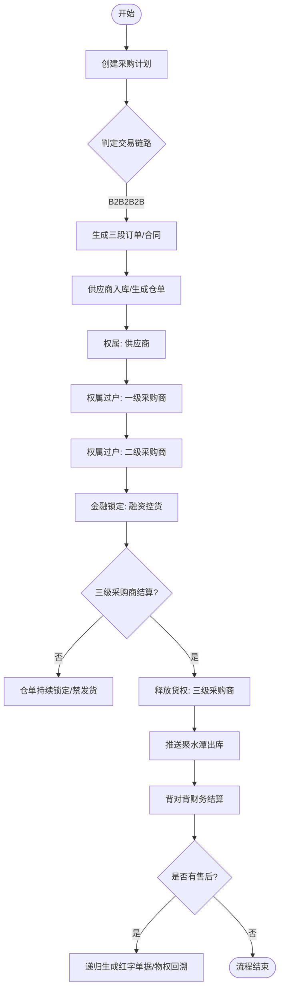

#### 逆向退货流程图

展示售后逆向递归的处理逻辑。

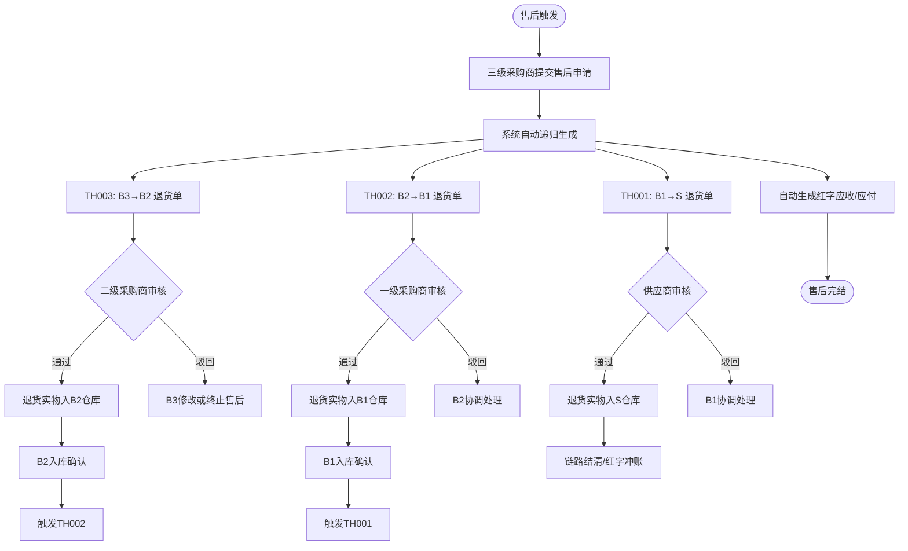

### 2.2 业务需求

| 编号 | 需求领域 | 需求项 | 涉及系统 | 重要级 |
| :--- | :--- | :--- | :--- | :--- |
| BR-01 | 采购计划管理 | 支持多主体选择、自动定段、审批流 | 本系统 | P0 |
| BR-02 | 订单管理 | 多级订单自动递归生成、全链路溯源 | 本系统 | P0 |
| BR-03 | 合同管理 | 多段合同自动生成、模板填充、电子签章 | 本系统 + 签章平台 | P0 |
| BR-04 | 电子仓单 | 权属阶梯过户、融资锁定/解锁、出库核销 | 本系统 + 聚水潭 | P0 |
| BR-05 | 财务管理 | 背对背结算、逾期预警、发票管理 | 本系统 | P0 |
| BR-06 | 售后管理 | 逆向递归退货、红字冲账、链路结清 | 本系统 | P0 |
| BR-07 | 系统集成 | 聚水潭 WMS 出入库同步 | 本系统 + 聚水潭 | P0 |
| BR-08 | 系统集成 | 电子签章平台对接 | 本系统 + 签章平台 | P1 |

### 2.3 方案概述

#### 产品结构图

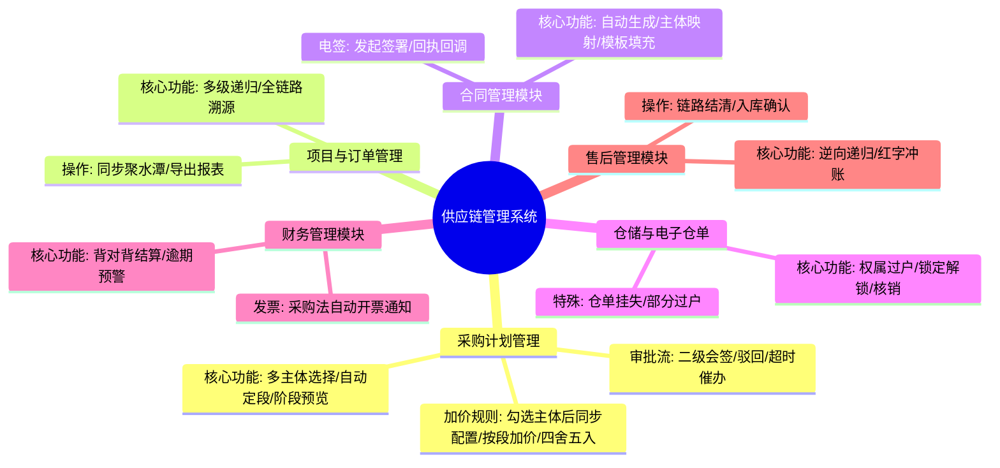

#### 资金流时序图

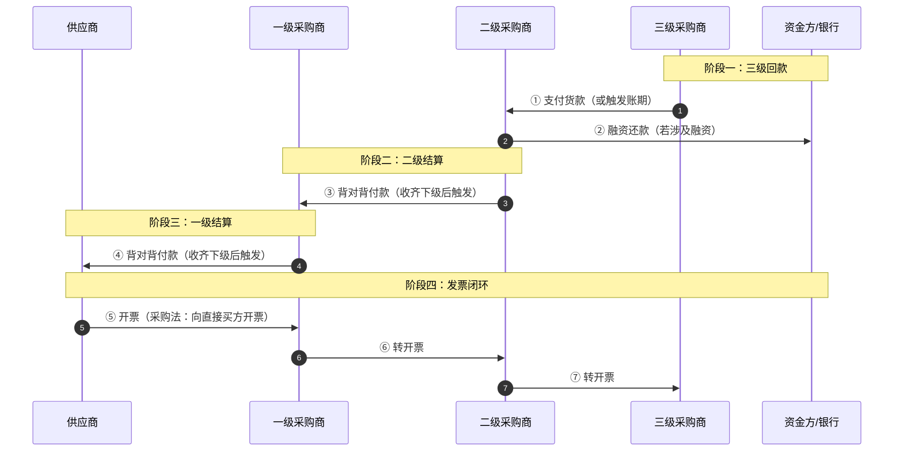

#### 开票时序图（并行开票）

各段卖方根据系统开票通知独立向下一段买方开票，无需等待上下游，互不依赖。

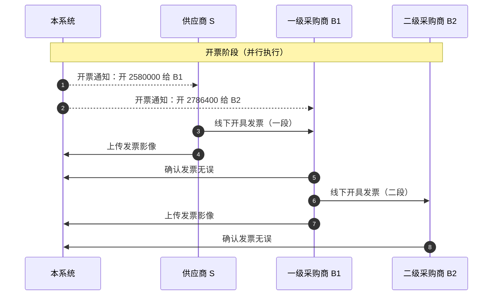

#### 付款流程说明

背对背付款：B3 付款 → B2 收齐后付 B1 → B1 收齐后付 S。每笔付款上传银行回单凭证。

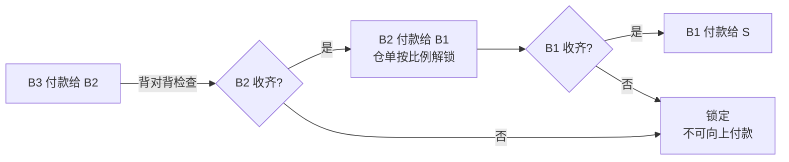

#### 全流程四流融合图

展示商流、物流、资金流、信息流在整条供应链中的并行流转关系。

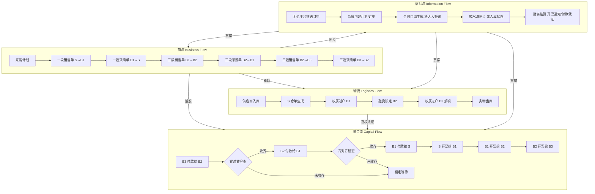

**四流关系说明**：
- **商流**（交易链）：采购计划→各段销售/采购订单，是整条链路的驱动引擎
- **物流**（实物流）：实物入库→仓单生成→阶梯权属过户→锁定/解锁→最终出库
- **资金流**（资金链）：B3→B2→B1→S 背对背逐级付款，各段独立并行开票
- **信息流**（数据链）：无仓平台订单接收→计划/订单生成→合同签署→WMS 同步→财务结算，贯穿全链路

#### 系统集成边界图

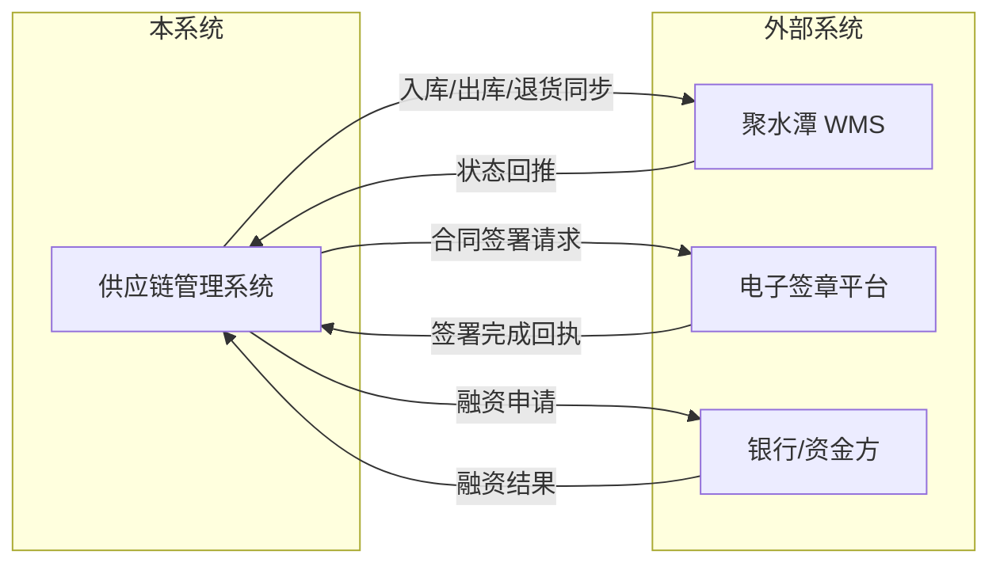

#### 系统用例清单

| 用例编号 | 系统用例名称 | 需求类型 | 简述 |
| :--- | :--- | :--- | :--- |
| UC-PLAN-001 | 采购计划管理 | 功能需求 | 创建采购计划、自动定段、发起审批 |
| UC-ORDER-001 | 项目与订单管理 | 功能需求 | 多级订单递归生成、全链路溯源 |
| UC-CONTRACT-001 | 合同管理 | 功能需求 | 多段合同自动生成、电子签章 |
| UC-EWR-001 | 电子仓单管理 | 功能需求 | 权属过户、锁定解锁、出库核销 |
| UC-FIN-001 | 财务管理 | 功能需求 | 背对背结算、逾期预警、开票管理 |
| UC-AFTERSALE-001 | 售后管理 | 功能需求 | 逆向递归退货、红字冲账、链路结清 |

---

## 三. 系统用例需求

### 3.1 功能用例

---

#### UC-PLAN-001 采购计划管理

| 字段 | 内容 |
| :--- | :--- |
| **用例名称** | 采购计划管理 |
| **用例编号** | UC-PLAN-001 |
| **用例简述** | 作为采购计划的创建入口，通过勾选参与主体自动判定交易链路段数，经审批后驱动后续订单与合同生成 |
| **用例图** | 见下方状态机 |
| **主执行者** | B1/B2/B3 业务操作员 |
| **辅助执行者** | 审批人（业务负责人、风控负责人） |
| **涉众利益** | S 关注计划中有无涉及自身；B1/B2 关注交易链路是否完整 |
| **前置条件** | 操作员已登录系统并具备采购计划新增权限 |
| **事件流–主要路径** | ① 操作员点击【新增计划】→② 填写项目标题、选择 S/B1/B2/B3 参与主体→③ 系统根据勾选主体同步显示各段加价配置（如勾选 S/B1/B2 则显示 S→B1 和 B1→B2 两段加价规则）→④ 操作员填写各段加价比例（所有商品用同一套加价规则，四舍五入）→⑤ 系统自动判定阶段并展示预览→⑥ 操作员点击【发起审批】→⑦ 系统生成审批任务，推送通知至业务负责人和风控负责人→⑧ 两级审批人分别审核通过→⑨ 计划状态变更为"已生效" |
| **替代流程** | 3a. 主体校验不通过（如存在 B2 但未填 B1），系统提示"二级采购商前必须有一级采购商"并阻止提交；6a. 任一审批人驳回，计划退回"草稿"状态，修改后可重新提交；6b. 审批超时 48 小时，系统自动推送催办通知 |
| **页面交互图** | 菜单路径：采购计划管理→计划列表→新增计划 |
| **后置条件** | 计划状态变更为"已生效"，后续可在此计划下生成订单 |
| **字段列表** | 参考数据字典-采购计划表 |
| **业务规则** | ① 自动定段规则：全选 B1/B2/B3 为三段；仅选 B1/B3 为二段（跳过 B2）；仅选 B1 为一段；② 主体校验规则：B2 存在时 B1 必填；③ 编号规则：PD + YYYYMMDD + 4位流水；④ **加价规则**：勾选参与主体后同步显示各段加价配置，**默认所有商品统一比例**，支持按商品分类或单个 SKU 特化配置，各段独立配置加价比例（百分比），金额四舍五入，中间计算保留 4 位小数 |

**状态机说明**

采购计划的状态沿「草稿 → 审批中 → 已生效 → 执行中 → 已完成」正向流转，驳回回退至草稿，管理员可手动关闭。

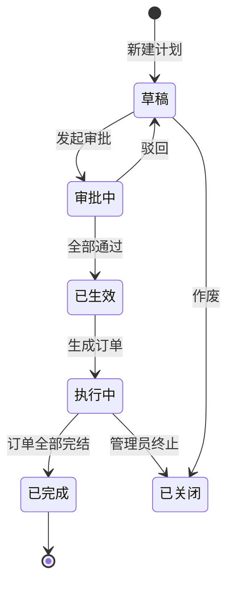

---

#### UC-ORDER-001 项目与订单管理

| 字段 | 内容 |
| :--- | :--- |
| **用例名称** | 项目与订单管理 |
| **用例编号** | UC-ORDER-001 |
| **用例简述** | 管理 XM 项目下的所有采购与销售单据，支持多级订单自动递归生成和全链路溯源 |
| **用例图** | 见下方状态机 |
| **主执行者** | B1/B2/B3 业务操作员 |
| **辅助执行者** | 聚水潭 WMS（出库状态回推） |
| **涉众利益** | 各主体仅能看到自身涉及的订单 |
| **前置条件** | 采购计划已生效 |
| **事件流–主要路径** | ① 无仓平台推送订单数据至本系统接收接口，系统自动创建订单→② 系统根据生效采购计划自动生成一级销售单（S→B1）和一级采购单（B1→S），**同时对商品名称、规格、单价等主数据进行字段级快照**→③ B1 确认收货后，系统自动触发二级销售单（B1→B2）和二级采购单（B2→B1），**执行快照**→④ B2 确认收货后，系统自动触发三级销售单（B2→B3）和三级采购单（B3→B2），**执行快照**→⑤ 操作员可点击任意单据查看全链路溯源图→⑥ 操作员可点击【同步聚水潭/WMS】将出库单推送至 WMS→⑦ WMS 回传出库状态，订单流转至"已发货" |
| **替代流程** | ②a. B1 超过 7 天未确认收货，系统自动催确认；②b. 任一交易方可在"待确认"状态下取消订单 |
| **页面交互图** | 菜单路径：项目与订单→订单列表→订单详情（全链路溯源图） |
| **后置条件** | 末段订单完成后，触发财务结算流程 |
| **字段列表** | 订单编号、项目编号、品牌、类别、商品名称、SKU、SKU编码、商品数量、**商品单价、商品总价**、来源项目号、买卖双方主体、订单总额、关联上级单号、单据状态 |
| **业务规则** | ① 编号规则：XM/CG/XS + YYYYMMDD + 4位流水；② 自动递归触发时机：上段销售单被买方"确认收货"时触发；③ 各段订单的买卖双方按主体映射规则匹配（见 UC-CONTRACT-001）；④ 原始订单数据通过订单接收接口从无仓平台获取，接口接收后自动创建系统订单 |

**状态机说明**

订单沿「待确认 → 已确认 → 已发货 → 已签收 → 已完成」正向流转，「待确认」状态下可取消。

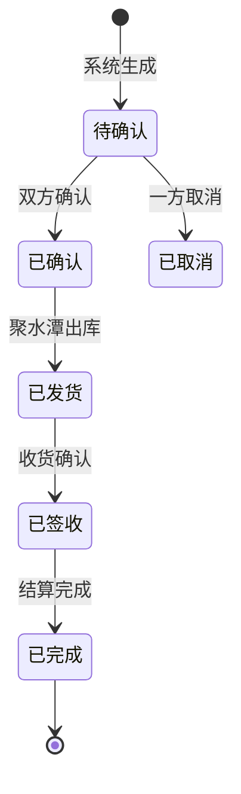

---

#### UC-CONTRACT-001 合同管理

| 字段 | 内容 |
| :--- | :--- |
| **用例名称** | 合同管理 |
| **用例编号** | UC-CONTRACT-001 |
| **用例简述** | 基于采购计划自动生成各段交易合同，通过法大大平台完成在线签署，支持模板变量填充、在线预览 |
| **用例图** | 见下方合同签署时序图 |
| **主执行者** | B1/B2/B3 业务操作员 |
| **辅助执行者** | 法大大电子签章平台 |
| **涉众利益** | 各段合同仅涉及买卖双方；S 只需签署一段合同，B1 需签署一段和二段合同 |
| **前置条件** | 采购计划已生效 |
| **事件流–主要路径** | ① 系统根据生效采购计划自动生成各段合同（一段/B1←S、二段/B2←B1、三段/B3←B2），**同时对商品主数据进行字段级快照**→② 系统从企业信息库和采购计划中提取变量填充合同模板（主体信息、货品信息、金额信息，货品信息取自快照）→③ 操作员点击【预览】在线查看 PDF，确认合同内容无误→④ 操作员点击【发起签署】，系统通过法大大 API 上传合同文件并创建签署流程→⑤ 法大大向签署方发送签署链接（短信 + 邮件）→⑥ 签署方点击链接进入法大大页面，完成实名认证后在线签署→⑦ 每完成一方签署，法大大回调通知本系统，更新签署状态为"部分签署"→⑧ **当一方签署完成触发下一方签署**：S 签署一段后→B1 收到签署通知→B1 依次签署一段和二段合同→⑨ 全部签署完毕后法大大回调最终结果→⑩ 系统下载已签署的 PDF 合同存档，合同状态更新为"已完成" |
| **替代流程** | ⑥a. 一方拒绝签署 → 法大大回调拒签结果，合同退回"待修改"状态，通知另一方协商修改；⑥b. 发起后 3 天未签署 → 系统自动催签通知；⑥c. 7 天未签署 → 系统自动标记"已失效"；⑨a. 法大大回调超时（30 分钟未收到回调）→ 系统主动轮询法大大签署状态（每 30 分钟一次，最多 48 小时） |
| **页面交互图** | 菜单路径：合同管理→合同列表→合同详情（预览/签署）→法大大签署页面跳转 |
| **后置条件** | 各段合同签署完成后，触发电子仓单生成流程 |
| **字段列表** | 合同编号、合同段、甲方、乙方、合同金额、签署状态（待生成/待签署/部分签署/已完成/已失效/待修改）、签署时间 |
| **业务规则** | ① 主体映射：一段-B1(甲方)←S(乙方)；二段-B2(甲方)←B1(乙方)；三段-B3(甲方)←B2(乙方)；甲方=付款方(买方)，乙方=收款方(卖方)；② 模板变量：主体信息从企业信息库读取，货品信息从采购计划关联数据读取，金额信息从订单计算得出；③ 签署通知：通过短信+邮件双通道发送签署链接；④ 签署顺序无强制要求，任何一方先签均可，系统根据回调进度更新状态；⑤ 已签署合同由本系统永久存档 PDF 文件；⑥ 法大大对接方式：API 上传合同 + 创建签署流程 + 接收回调通知 |

**合同签署时序图**

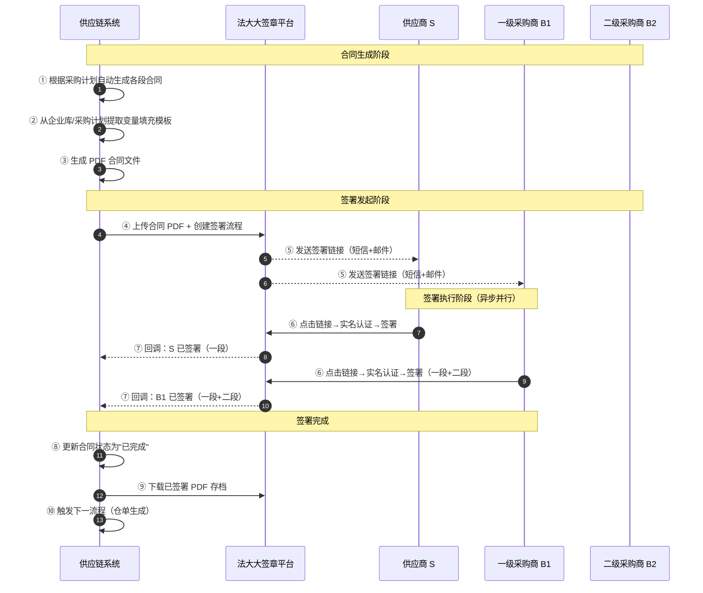

**状态机说明**

合同沿「待生成 → 待签署 → 部分签署 → 已完成」正向流转，一方拒签回退至待修改，超期 7 天自动失效。

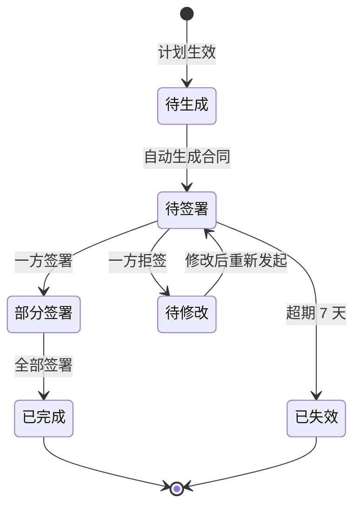

---

#### UC-EWR-001 电子仓单管理

| 字段 | 内容 |
| :--- | :--- |
| **用例名称** | 仓储与电子仓单管理 |
| **用例编号** | UC-EWR-001 |
| **用例简述** | 管理货物的物权凭证，实现权属在 S→B1→B2→B3 阶梯流转，支持融资锁定及出库核销 |
| **用例图** | 见下方权属流转时序图及状态机 |
| **主执行者** | 管理员 (S/B1/B2/B3 仅查看涉及部分) |
| **辅助执行者** | 聚水潭 WMS |
| **涉众利益** | B2（融资方）需确权锁定保障融资安全；B3 需解锁后才能发货 |
| **前置条件** | ① 订单已确认；② 聚水潭入库完成并回传成功 |
| **事件流–主要路径** | ① 聚水潭回传入库成功→② 系统生成仓单（Owner: S）→③ 一段合同签署完成后，权属过户至 B1→④ 二段合同签署完成后，权属过户至 B2 并自动锁定→⑤ B3 付款后，权属过户至 B3 并解锁→⑥ 操作员点击【推送聚水潭出库】→⑦ 聚水潭出库后回传状态→⑧ 系统更新仓单状态为"已核销" |
| **替代流程** | ③a~④a. 非三段模式跳过对应过户步骤；④b. B2 可部分付款按比例解锁部分货权；⑤a. 仓单挂失：管理员操作后仓单作废，需重新入库 |
| **页面交互图** | 菜单路径：仓储管理→电子仓单→仓单详情（权属流转日志） |
| **后置条件** | 仓单核销后，触发财务结算流程 |
| **字段列表** | 参考数据字典-电子仓单表 |
| **业务规则** | ① 编号规则：EWR + YYYYMMDD + 4位流水；② 每个过户/锁定/解锁操作均需记录操作人、时间戳及关联单据 ID；③ 锁定期间禁止出库；④ 部分过户按数量比例分摊价格（子仓单价 = 原仓单价，加权平均计算）；⑤ 部分付款释放货权时支持两种模式： **手动选择 SKU 及数量**（指定哪些 SKU 解锁）或 **按金额贡献度自动折算**（系统根据各 SKU 金额占比自动计算解锁数量）；⑥ 部分过户时中间计算保留 4 位小数 |

**权属流转时序图**

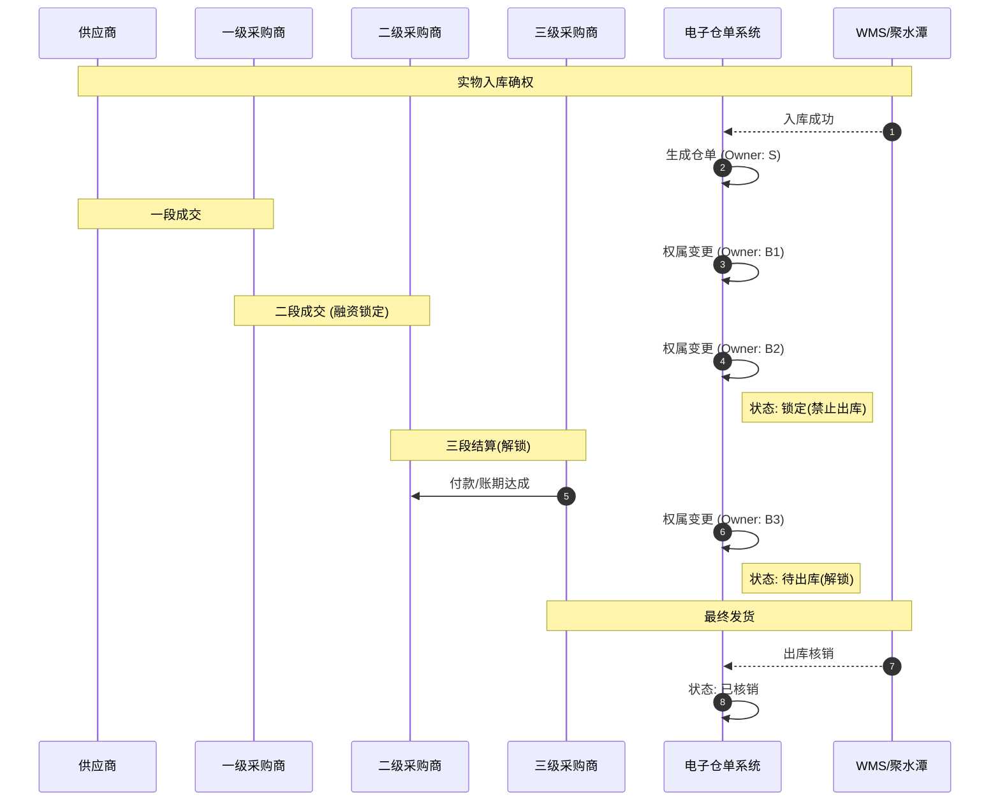

**状态机说明**

仓单沿「已生成 → 已过户 → 已锁定/已解锁 → 待出库 → 已核销」正向流转，锁定后禁止出库，支持仓单挂失异常状态。

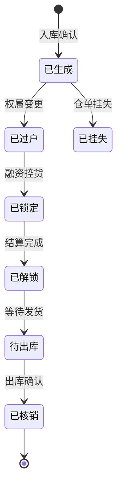

---

#### UC-FIN-001 财务管理

| 字段 | 内容 |
| :--- | :--- |
| **用例名称** | 财务管理 |
| **用例编号** | UC-FIN-001 |
| **用例简述** | 管理各段交易的应收/应付账单，执行背对背结算，管理发票开立 |
| **用例图** | 见下方开票时序图及付款流程图 |
| **主执行者** | B1/B2/B3 财务操作员 |
| **辅助执行者** | — |
| **涉众利益** | S 关注应收货款；B1/B2 关注背对背支付链不垫资；B3 关注按期付款解锁货权 |
| **前置条件** | 订单已完成（已签收状态），各段合同已签署 |
| **事件流–主要路径** | **开票流程**：① 系统根据各段已确认订单自动生成开票通知→② 开票通知发送至各段卖方（S 开给 B1、B1 开给 B2、B2 开给 B3），告知开票金额和收票方→③ 各段卖方线下开具发票后，将发票影像（扫描件/照片）上传至系统→④ 系统记录发票编号、开票方、收票方、金额、开票日期，更新发票状态为"已上传"→⑤ 收票方在线查看发票影像，确认无误后标记"发票已确认"→**付款流程**：⑥ 系统根据完成订单自动生成各段应收/应付账单→⑦ B3 财务操作员发起付款至 B2，上传付款凭证附件，更新 B3→B2 账单为"已付款"→⑧ B2 收齐 B3 回款后（检查背对背状态），B2 可向 B1 发起付款，上传付款凭证→⑨ B1 收齐 B2 回款后，B1 可向 S 发起付款，上传付款凭证→⑩ 应收管理：按各段汇总应收/应付数据，支持批量核销 |
| **替代流程** | ②a. B3 超过账期 30 天未付款，B2 可申请强制结算（需风控审批）；②b. B3 破产/失联导致**背对背死结**时，Admin 或风控审批后可**手动解除锁定**，允许上级先行付款；③a. 各段开票并行执行，无需等待上游发票到手再开票；⑧a. B2 可申请部分付款（按比例释放对应货权），部分付款时仓单按比例解锁，支持手动选择 SKU 或按金额折算；⑧b. B3 付 50% 货款 → B2 可向 B1 付 50% → B1 可向 S 付 50%，仓单 50% 数量解锁 |
| **页面交互图** | 菜单路径：财务管理→应收/应付列表→账单详情（含付款上传、发票上传入口） |
| **后置条件** | 全部结算完成后，订单状态变更为"已完成" |
| **字段列表** | 账单编号、采购单号、交易阶段、买卖双方、待收/付金额、付款状态（未付款/部分付款/已付款）、付款日期、到期日、附件（付款凭证/发票影像） |
| **业务规则** | ① **开票规则（并行开票）**：各段卖方根据系统开票通知独立开具发票，各段开票无需等待上下游；开票通知包含金额和收票方信息；发票影像上传后收票方可在线核验；**税务风险提示**：B1 给 B2 开票时若尚未确认收到 S 的发票影像，系统给出"暂无进项税抵扣风险"提示；② **背对背付款规则**：B3→B2→B1→S 依次付款，上一级收齐回款后下一级才可发起付款；③ **部分付款规则**：允许按比例付款，付款比例对应解锁仓单比例，支持手动选择 SKU 解锁或按金额折算；④ **付款凭证**：每笔付款必须上传银行回单/转账凭证影像件，上传时需勾选**免责声明**（"系统仅做凭证留存，不验证凭证真实性"），凭证需经管理员复核；⑤ **发票管理**：支持发票影像上传、在线核验、状态跟踪（待开票/已上传/已确认）；⑥ **应收管理**：按各段汇总应收/应付数据，支持批量核销；⑦ **手动解除背对背锁定**：B3 破产/失联/超账期 30 天时，由 Admin 或风控角色审批后，允许上级先行付款 |

**开票时序图**

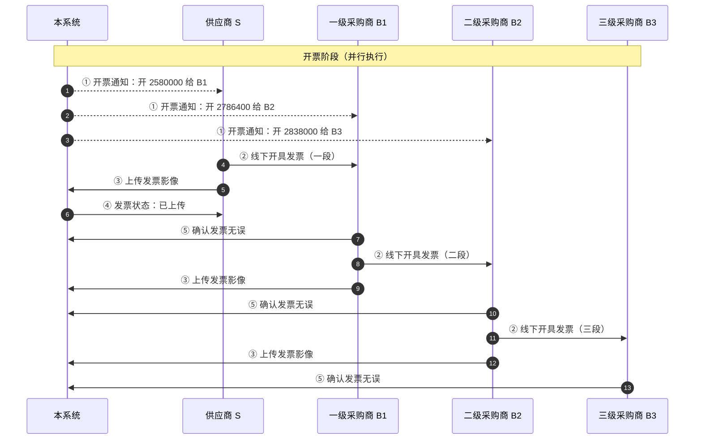

**付款流程图**

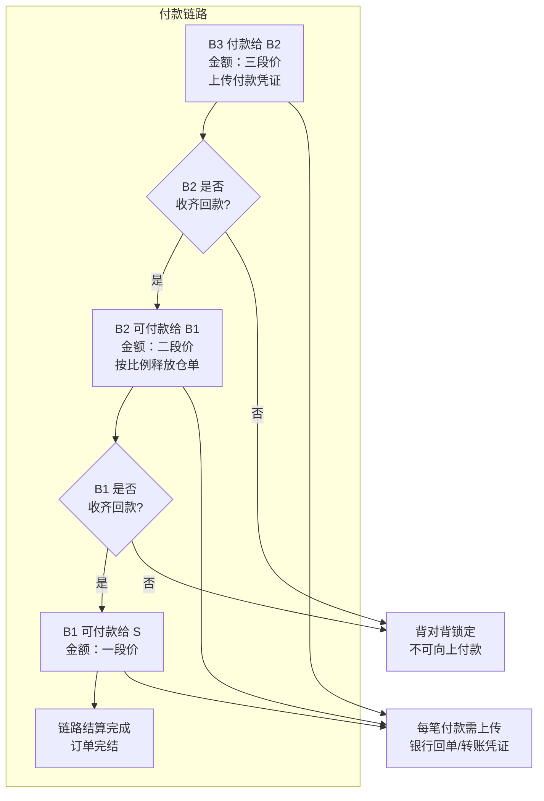

**状态机说明**

账单沿「待付款 → 已付款 → 已核销」正向流转，支持部分付款状态，超期自动标记已逾期。

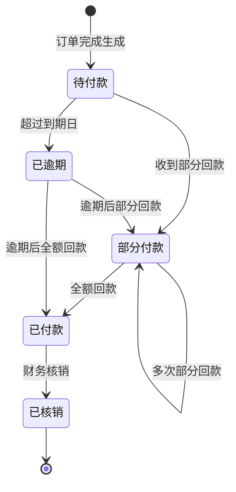

---

#### UC-AFTERSALE-001 售后管理

| 字段 | 内容 |
| :--- | :--- |
| **用例名称** | 售后管理 |
| **用例编号** | UC-AFTERSALE-001 |
| **用例简述** | 接收外部售后订单数据，系统自动递归生成各级逆向退货单和红字单据，完成全链路结清 |
| **用例图** | 见下方状态机 |
| **主执行者** | B3 操作员（发起售后） |
| **辅助执行者** | B2/B1/S（各段审核方） |
| **涉众利益** | B3 需要便捷地发起退货退款；S/B1/B2 需要审核确认后执行逆向流程 |
| **前置条件** | 订单已完成（已签收状态） |
| **事件流–主要路径** | ① 无仓平台推送售后订单数据至本系统接收接口→② 系统自动递归生成 TH003（B3→B2）、TH002（B2→B1）、TH001（B1→S）→③ 实物退回 B2 仓库，B2 操作员入库质检→④ 质检通过后入库确认→⑤ 触发 TH002，B1 入库确认→⑥ 触发 TH001，S 入库确认→⑦ 系统自动生成各段红字应收/应付→⑧ 操作员点击【一键链路结清】完成 |
| **替代流程** | ③a. 任意段审核方超时 3 天未处理，自动催办；④a. 入库数量与原单不一致时按实际入库数量结算；⑤a. **中间环节拒收中断**：B2 入库质检发现货物受损时拒绝收货，系统中断 TH002/TH001 后续递归，TH003 回滚至"待退货"状态，触发**争议工单**由运营/客服人工介入，S 段退货单自动撤回；⑤b. B2 拒收后 B3 可修改售后申请（如改为部分退货）后重新发起 |
| **页面交互图** | 菜单路径：售后管理→售后列表→发起售后申请→链路结清 |
| **后置条件** | 链路结清完成，对应原订单的应收/应付被红字冲抵 |
| **字段列表** | 参考数据字典-售后单表 |
| **业务规则** | ① 编号规则：TH + 段号(001/002/003) + YYYYMMDD + 4位流水；② 价格回溯取原订单单价 × 退货数量，中间计算保留 4 位小数；③ 退货数量不可超过原订单未出库数量；④ 红字自动生成逻辑：系统收到售后订单数据后自动递归生成各段红字应收/应付，抵消原正向账单；⑤ 售后订单数据通过接口从无仓平台接收，接收后自动生成链路售后订单；⑥ **中断回滚**：中间环节拒收时中断后续递归，已触发的下级退货单自动撤回，系统记录争议工单 |

**状态机说明**

售后单沿「待退货 → 待入库 → 待退款 → 已完成」正向流转，系统接收售后数据后自动进入待退货状态，无需人工审核。

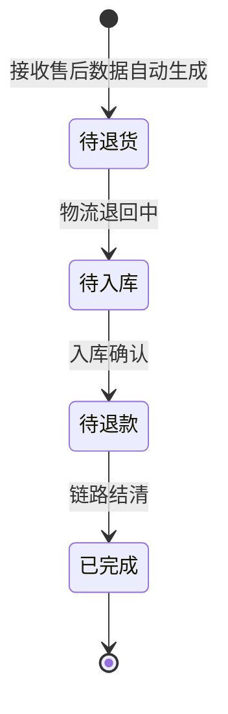

### 3.2 接口定义

#### WMS 接口（聚水潭 / 自建 WMS）

聚水潭和自建 WMS 的接口均已存在现成规范，两套接口功能对等。系统同时支持对接聚水潭和自建 WMS，按配置切换。

| 接口名称 | 方向 | 触发时机 | 说明 | 请求方式 |
| :--- | :---: | :--- | :--- | :---: |
| 入库单推送 | 本系统 → WMS | 订单确认后 | 推送入库单，通知仓库收货 | POST |
| 入库状态回推 | WMS → 本系统 | 仓库实收入库 | 回传入库结果，触发仓单生成 | POST（回调） |
| 出库单推送 | 本系统 → WMS | 仓单解锁后 | 推送出库单通知发货 | POST |
| 出库状态回推 | WMS → 本系统 | 仓库实出库 | 回传出库结果，触发仓单核销 | POST（回调） |
| 库存查询 | 本系统 → WMS | 按需实时查询 | 查询指定商品/仓库实时库存 | GET |
| 退货单同步 | 本系统 → WMS | 售后入库 | 推送退货入库指令 | POST |
| 退货状态回推 | WMS → 本系统 | 退货入库完成 | 回推退货入库结果 | POST（回调） |

> 注：聚水潭和自建 WMS 的接口规范均已存在，开发阶段根据实际部署的 WMS 类型选择对应接口实现。接口具体字段映射请参考各自的开放 API 文档。

**同步机制**：
- 实时推送（同步调用），超时时间 10s
- 失败自动重试 3 次，间隔 5 分钟
- 最终失败：写入告警表，运营人员手动触发补推
- **外部故障兜底**：
  - **WMS 长时间故障**（>30 分钟）：提供"手动确认入库/出库"开关，运营人员在 WMS 修复后补录操作，系统记录"人工干预"标记
  - **法大大签章平台不可用**：支持离线签署——线下签署纸质合同后上传 PDF 扫描件，由管理员确认后手动推进流程
  - **手动状态同步**：提供手动触发状态同步按钮，运营人员可在系统恢复后发起批量状态补回

#### 订单接收接口（无仓平台 → 本系统）

| 接口名称 | 方向 | 触发时机 | 说明 | 请求方式 |
| :--- | :---: | :--- | :--- | :---: |
| 订单数据推送 | 无仓平台 → 本系统 | 无仓平台订单生成/变更时 | 接收原始订单数据（含商品信息、数量、金额等），创建系统订单 | POST（回调） |
| 订单状态回传 | 本系统 → 无仓平台 | 订单状态变更时 | 回传订单处理状态至无仓平台 | POST |

**说明**：原始订单数据从无仓平台推送至本系统，本系统作为订单接收方自动创建订单并启动后续链路流程。

#### 售后订单接收接口（无仓平台 → 本系统）

| 接口名称 | 方向 | 触发时机 | 说明 | 请求方式 |
| :--- | :---: | :--- | :--- | :---: |
| 售后数据推送 | 无仓平台 → 本系统 | 无仓平台发起售后时 | 接收售后订单数据，系统自动递归生成各段链路售后订单 | POST（回调） |
| 售后状态回传 | 本系统 → 无仓平台 | 链路结清完成时 | 回传售后处理结果至无仓平台 | POST |

**说明**：无仓平台推送售后数据后，本系统自动生成 TH003/TH002/TH001 链路售后订单，无需人工审核。

#### 电子签章平台接口

| 接口名称 | 方向 | 说明 | 请求方式 |
| :--- | :---: | :--- | :---: |
| 合同上传 | 本系统 → 签章平台 | 上传生成的 PDF 合同文件 | POST |
| 签署发起 | 本系统 → 签章平台 | 指定签署方，发起签署流程 | POST |
| 签署链接获取 | 本系统 → 签章平台 | 获取短信/邮件签署链接 | GET |
| 签署状态回调 | 签章平台 → 本系统 | 签署完成/拒签的回调通知 | POST（回调） |
| 合同下载 | 本系统 → 签章平台 | 下载已签署的合同存档 | GET |

---

## 四. 非功能性需求

### 4.1 上线方案

**初始化数据要求**：
- 企业信息（S/B1/B2/B3 的公司信息、联系人、资质）需在系统上线前完成录入。
- **商品主数据由 S 统一维护**，上线前需完成首批商品信息的录入（品名、规格、SKU、单位、参考单价）。
- 合同模板需在法大大电子签章平台预先配置，并在本系统建立模板与业务类型的映射关系。
- 聚水潭 WMS 的仓库信息需与本系统同步，建立仓库 ID 映射表。

**历史数据处理**：
- 上线前存在的存量交易：不入本系统，走线下流程完成收尾。
- 上线后新交易：全部通过本系统发起，从采购计划开始的全链路管理。

**分阶段上线建议**：
- 一期：采购计划 + 订单管理 + 电子仓单（核心链路打通）
- 二期：合同自动生成 + 电子签章 + 财务管理（结算自动化）
- 三期：售后管理 + 消息通知体系 + 权限精细化

### 4.2 兼容性要求

- 本系统为 PC 端管理后台，推荐使用 Chrome / Edge 最新版本浏览器访问。
- 页面分辨率适配 1366×768 及以上。
- 导出文件格式支持 Excel (.xlsx) 和 PDF。

### 4.3 性能要求

| 要求项 | 指标 |
| :--- | :---: |
| 列表页加载 | ≤ 2s |
| 详情页加载 | ≤ 1.5s |
| 并发用户 | ≥ 200 |
| 数据导出 | 5 万行 ≤ 10s |
| 批量核销 | ≥ 1000 条/次 |
| 仓单查询 | ≤ 1.5s（含关联单据） |

### 4.4 监控/埋点需求

**核心业务监控**：

| 监控点 | 触发条件 | 告警方式 | 接收人 |
| :--- | :--- | :--- | :--- |
| 仓单流转异常 | 过户/锁定/解锁操作失败 | 站内信 + 邮件 | 运营 |
| 聚水潭接口失败 | 重试 3 次后仍失败 | 站内信 + 邮件 | 运营 |
| 审批超时 | 审批任务超过 48 小时未处理 | 站内信 + 邮件 + 短信 | 审批人 + 发起人 |
| 合同签署超时 | 发起后 7 天未完成签署 | 站内信 + 邮件 | 签署双方 |

**日志审计要求**：
- 每个核心操作（审批、过户、锁定、解锁、核销、作废）记录操作日志。
- 日志字段：操作人 ID、操作人姓名、操作时间、IP 地址、操作类型、关联单据 ID、操作前状态、操作后状态。
- 日志保留周期：≥ 180 天，支持导出归档。

---

## 五. 风险分析

| 风险 | 可能性 | 严重性 | 应对策略 | 可应对性 |
| :--- | :---: | :---: | :--- | :---: |
| 聚水潭接口不稳定导致出入库同步失败 | 中 | 高 | 自动重试 + 人工补推机制 + 异步告警 | 高 |
| 电子签章平台签署流程耗时过长 | 中 | 中 | 合同发起后 3 天催签、7 天失效，避免流程挂起 | 高 |
| 多级主体中某一方不配合退货 | 低 | 高 | 争议工单机制 + 人工介入；运营/客服兜底 | 中 |
| 仓单物权纠纷（如重复融资） | 低 | 极高 | 仓单数据哈希链防篡改 + 全链路操作日志审计 | 高 |
| 背对背结算超期导致上游资金链紧张 | 中 | 高 | 强制结算审批机制 + 逾期预警推送 | 中 |
| 审批人缺席导致流程停滞 | 中 | 中 | 代理人机制 + 超时自动转交上级 | 高 |

---

## 六. 后端/供应链金融专项

### 6.1 业务用例设计（后端视角）

**用例分类**：

| 分类 | 涉及用例 | 操作对象 |
| :--- | :--- | :--- |
| 采购计划驱动 | UC-PLAN-001 | B1/B2/B3 操作员 |
| 订单流转 | UC-ORDER-001 | S/B1/B2/B3 |
| 物权控货 | UC-EWR-001 | S/B1/B2/B3、管理员 |
| 结算与融资 | UC-FIN-001 | B1/B2/B3、资金方 |
| 逆向处理 | UC-AFTERSALE-001 | B3/B2/B1/S |

### 6.2 业务规则

**全局规则**：
1. 各主体**必须**在系统中完成企业信息注册后方可参与交易。
2. **商品主数据由供应商（S）统一维护**，其他主体（B1/B2/B3）可引用但不可修改核心规格。
3. **加价规则采用按段配置**：勾选参与主体后同步显示各段加价输入框，按段配置加价比例，支持按商品分类或单个 SKU 特化配置（默认统一比例）。
4. 电子仓单**禁止**在锁定状态下执行出库操作。
5. 背对背结算**允许**部分付款，但需明确对应解锁的货权比例。
6. 售后申请**不得**人工审核通过/驳回，系统根据外部数据自动递归生成。
7. **交易数据快照**：订单及合同生成时自动对商品名称、规格、单价等主数据进行字段级快照，后续主数据变更不追溯已生成单据。
8. **金额精度**：中间计算过程保留 4 位小数，最终展示和结算保留 2 位（四舍五入）。

**局部规则**（按模块）：

| 模块 | 规则 |
| :--- | :--- |
| 采购计划 | B2 存在时 B1 必须同时存在，禁止跳过一级采购商 |
| 商品管理 | 商品主数据由 S 统一维护，B1/B2/B3 可引用查看但不可修改；价格模型支持加成定价/独立定价；订单/合同生成时对商品主数据进行字段级快照 |
| 加价规则 | 勾选参与主体后同步显示各段加价配置；**默认所有商品统一比例**，支持按商品分类或单个 SKU 特化配置；每段独立配置加价比例（百分比），金额四舍五入；中间计算保留 4 位小数 |
| 订单 | 原始订单数据从无仓平台接收；前段销售单确认收货后自动触发后段采购单，不可手动重复生成；订单生成时对商品名称、规格、单价执行快照 |
| 合同 | 各段合同中的金额必须与该段订单金额一致；对接法大大电子签章平台；合同生成时对商品信息执行快照 |
| 仓单 | 每次过户后系统自动记录权属变更日志，不可修改或删除；部分付款释放货权时支持 **手动选择 SKU 及数量** 或按 **金额贡献度自动折算** |
| 财务 | B1 向 S 付款前必须先确认 B2 已向 B1 付款（或已获得强制结算审批）；融资利率和额度由资金方线下核定后录入系统；付款状态分未付款/部分付款/已付款，支持上传凭证附件；**并行开票**且 B1 给 B2 开票时提示暂无进项抵扣风险；上传凭证需勾选免责声明；**支持风控审批后手动解除背对背锁定** |
| 售后 | 售后订单数据从无仓平台接收，系统自动递归生成链路售后订单，无需人工审核通过与驳回；**中间环节拒收**（如 B2 发现货物受损）时，中断后续递归，回滚至上一状态并触发争议工单；红字单据自动冲抵原正向账单 |

### 6.3 数据设计

#### 核心表关联关系

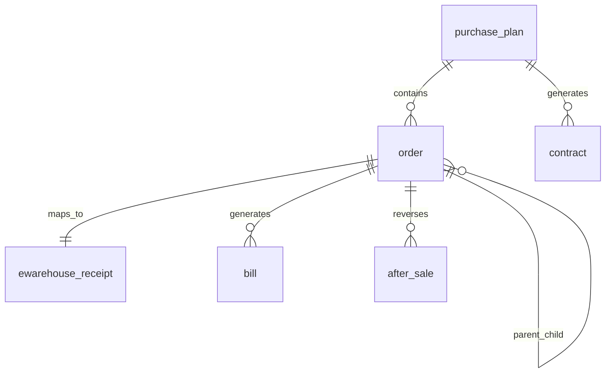

#### 采购计划表 (purchase_plan)

| 字段名 | 类型 | 长度 | 必填 | 默认值 | 说明 |
| :--- | :--- | :---: | :---: | :--- | :--- |
| id | bigint | 20 | 是 | 自增 | 主键 ID |
| plan_no | varchar | 32 | 是 | — | 计划编号，PD + YYYYMMDD + 4位流水 |
| title | varchar | 200 | 是 | — | 项目标题 |
| supplier_id | bigint | 20 | 是 | — | 供应商(S) ID，关联企业表 |
| buyer1_id | bigint | 20 | 否 | NULL | 一级采购商(B1) ID，一段必填 |
| buyer2_id | bigint | 20 | 否 | NULL | 二级采购商(B2) ID，二段必填 |
| buyer3_id | bigint | 20 | 否 | NULL | 三级采购商(B3) ID，三段必填 |
| stage_type | tinyint | 4 | 是 | — | 判定阶段：1=一段 / 2=二段 / 3=三段 |
| total_amount | decimal | 18,2 | 是 | 0.00 | 预计总额 |
| status | tinyint | 4 | 是 | 0 | 状态：0=草稿 / 1=审批中 / 2=已生效 / 3=执行中 / 4=已完成 / 9=已关闭 |
| submitter | bigint | 20 | 是 | — | 提交人 ID |
| created_at | datetime | — | 是 | CURRENT_TIMESTAMP | 创建时间 |
| updated_at | datetime | — | 是 | CURRENT_TIMESTAMP ON UPDATE | 更新时间 |

#### 订单表 (order)

| 字段名 | 类型 | 长度 | 必填 | 默认值 | 说明 |
| :--- | :--- | :---: | :---: | :--- | :--- |
| id | bigint | 20 | 是 | 自增 | 主键 ID |
| order_no | varchar | 32 | 是 | — | 订单编号，CG/XS + YYYYMMDD + 4位流水 |
| order_type | tinyint | 4 | 是 | — | 类型：1=采购(CG) / 2=销售(XS) |
| plan_id | bigint | 20 | 是 | — | 关联采购计划 ID，外键 |
| parent_order_id | bigint | 20 | 否 | NULL | 上级订单 ID，用于全链路关联 |
| seller_id | bigint | 20 | 是 | — | 卖方主体 ID |
| buyer_id | bigint | 20 | 是 | — | 买方主体 ID |
| total_quantity | int | 11 | 是 | — | 商品总数 |
| total_amount | decimal | 18,2 | 是 | — | 订单总额 |
| status | tinyint | 4 | 是 | 0 | 状态：0=待确认 / 1=已确认 / 2=已发货 / 3=已签收 / 4=已完成 / 9=已取消 |
| stage | tinyint | 4 | 是 | — | 所属段：1=一段 / 2=二段 / 3=三段 |
| sync_wms | tinyint | 1 | 否 | 0 | 是否已同步聚水潭：0=否 / 1=是 |
| created_at | datetime | — | 是 | CURRENT_TIMESTAMP | 创建时间 |

#### 电子仓单表 (ewarehouse_receipt)

| 字段名 | 类型 | 长度 | 必填 | 默认值 | 说明 |
| :--- | :--- | :---: | :---: | :--- | :--- |
| id | bigint | 20 | 是 | 自增 | 主键 ID |
| receipt_no | varchar | 32 | 是 | — | 仓单编号，EWR + YYYYMMDD + 4位流水 |
| owner_id | bigint | 20 | 是 | — | 当前权属人 ID |
| warehouse_id | bigint | 20 | 是 | — | 仓库 ID，关联聚水潭仓库映射 |
| order_id | bigint | 20 | 是 | — | 关联订单 ID，外键 |
| quantity | decimal | 18,2 | 是 | — | 数量/重量 |
| lock_status | tinyint | 4 | 是 | 0 | 锁定状态：0=未锁定 / 1=已锁定 |
| status | tinyint | 4 | 是 | 0 | 状态：0=已生成 / 1=已过户 / 2=已锁定 / 3=已解锁 / 4=待出库 / 5=已核销 / 9=已挂失 |
| created_at | datetime | — | 是 | CURRENT_TIMESTAMP | 生成时间 |
| locked_at | datetime | — | 否 | NULL | 锁定时间 |
| unlocked_at | datetime | — | 否 | NULL | 解锁时间 |
| written_off_at | datetime | — | 否 | NULL | 核销时间 |

#### 账单表 (bill)

| 字段名 | 类型 | 长度 | 必填 | 默认值 | 说明 |
| :--- | :--- | :---: | :---: | :--- | :--- |
| id | bigint | 20 | 是 | 自增 | 主键 ID |
| bill_no | varchar | 32 | 是 | — | 账单编号，BL + YYYYMMDD + 4位流水 |
| order_id | bigint | 20 | 是 | — | 关联订单 ID，外键 |
| payer_id | bigint | 20 | 是 | — | 付款方 ID |
| payee_id | bigint | 20 | 是 | — | 收款方 ID |
| amount | decimal | 18,2 | 是 | — | 账单金额 |
| due_date | date | — | 是 | — | 到期日 |
| overdue_days | int | 11 | 否 | 0 | 逾期天数 |
| b2b_status | tinyint | 4 | 是 | 0 | 背对背状态：0=等待下级 / 1=可付款 / 2=已付款 |
| status | tinyint | 4 | 是 | 0 | 状态：0=待付款 / 1=已付款 / 2=已核销 / 3=已逾期 |
| created_at | datetime | — | 是 | CURRENT_TIMESTAMP | 创建时间 |

#### 售后单表 (after_sale)

| 字段名 | 类型 | 长度 | 必填 | 默认值 | 说明 |
| :--- | :--- | :---: | :---: | :--- | :--- |
| id | bigint | 20 | 是 | 自增 | 主键 ID |
| return_no | varchar | 32 | 是 | — | 售后单号，TH + 段号 + YYYYMMDD + 4位流水 |
| original_order_id | bigint | 20 | 是 | — | 原订单 ID，外键 |
| stage | tinyint | 4 | 是 | — | 所属段：1/2/3 |
| applicant_id | bigint | 20 | 是 | — | 申请人 ID |
| quantity | decimal | 18,2 | 是 | — | 退货数量 |
| amount | decimal | 18,2 | 是 | — | 退款金额 |
| reason | varchar | 500 | 是 | — | 退货原因 |
| status | tinyint | 4 | 是 | 0 | 状态：0=待处理（系统自动生成）/ 1=待退货 / 2=待入库 / 3=待退款 / 4=已完成 |
| parent_return_id | bigint | 20 | 否 | NULL | 上级售后单 ID，递归关联 |
| created_at | datetime | — | 是 | CURRENT_TIMESTAMP | 创建时间 |

#### 枚举取值范围一览表

**状态枚举规范**：各表 `status` 字段 0~4 按业务流程正向编排，9 表示异常/取消/关闭/驳回等终止态。

| 枚举字段 | 表名 | 取值范围 |
| :--- | :--- | :--- |
| `plan.status` | purchase_plan | 0=草稿 / 1=审批中 / 2=已生效 / 3=执行中 / 4=已完成 / 9=已关闭 |
| `order.status` | order | 0=待确认 / 1=已确认 / 2=已发货 / 3=已签收 / 4=已完成 / 9=已取消 |
| `order.order_type` | order | 1=采购(CG) / 2=销售(XS) |
| `ewr.status` | ewarehouse_receipt | 0=已生成 / 1=已过户 / 2=已锁定 / 3=已解锁 / 4=待出库 / 5=已核销 / 9=已挂失 |
| `bill.status` | bill | 0=待付款 / 1=已付款 / 2=已核销 / 3=已逾期 |
| `bill.b2b_status` | bill | 0=等待下级 / 1=可付款 / 2=已付款 |
| `after_sale.status` | after_sale | 0=待处理（系统自动生成）/ 1=待退货 / 2=待入库 / 3=待退款 / 4=已完成 |
| `stage_type` | purchase_plan | 1=一段 / 2=二段 / 3=三段 |

#### 数据校验规则

| 校验场景 | 规则 |
| :--- | :--- |
| 主体选择 | B2 存在时 B1 必须存在，否则拦截 |
| 商品数量 | 非称重商品不允许录入小数点；称重商品小数最多四位 |
| 退款金额 | 不可超过原订单未结清金额 |
| 仓单数量 | 部分过户时子仓单数量总和不得大于原仓单数量 |
| 订单单价 | 各段合同金额须与该段订单金额一致 |
| 日期校验 | 仓单锁定时间不可晚于解锁时间；到期日不可早于账单生成日 |

### 6.4 异常处理规范

| 异常类型 | 处理逻辑 | 日志记录 |
| :--- | :--- | :--- |
| 聚水潭入库接口调用失败 | 自动重试 3 次(间隔 5 分钟)，失败后写入告警表，运营人工补推 | 记录订单号、接口名、错误码、错误信息、时间 |
| 聚水潭出库接口调用失败 | 同上，仓单状态保持"待出库"不变 | 同上 |
| 电子签章回调超时 | 系统每 30 分钟轮询签章平台签署状态，最多轮询 48 小时 | 记录合同号、发起时间、轮询结果 |
| 审批驳回 | 计划回退草稿，数据保留 | 记录计划编号、驳回人、驳回原因、时间 |
| 仓单挂失 | 仓单状态变更为"已挂失"，锁定不可操作；重新入库后生成新仓单 | 记录仓单号、操作人、挂失原因、时间 |

### 6.5 分阶段实现规范

| 阶段 | 范围 | 功能要点 | 过渡处理 |
| :--- | :--- | :--- | :--- |
| **一期** | 核心链路 | 采购计划 + 订单管理 + 电子仓单 + 聚水潭出入库 | 合同线下签署、财务线下结算 |
| **二期** | 自动化 | 合同自动生成 + 电子签章 + 背对背结算 + 开票管理 | 售后走线下流程 |
| **三期** | 完善 | 售后逆向递归 + 消息通知体系 + 权限精细化 + 监控告警 | — |

### 6.6 多端适配规范

- 本系统为 **PC 端管理后台**，不涉及 PDA 端适配。
- 所有功能在 Chrome / Edge 浏览器下保持一致的行为和数据校验。
- 导出报表统一为 `.xlsx` 格式，合同为 `.pdf` 格式。
- 列表页分页组件支持翻页和页码跳转，筛选条件在页面切换时保留。

### 6.7 业务极端情况处理规范

| 极端场景 | 处理方式 | 触发条件 | 责任人 |
| :--- | :--- | :--- | :--- |
| **背对背付款死结** | 支持**手动解除背对背锁定**功能，由 Admin 或风控角色审批后，允许上级在下级未付清的情况下先行付款 | B3 破产/失联/超账期 30 天且强制结算未果 | 风控负责人 |
| **递归退货中途中断** | 中间环节（如 B2）发现货物受损拒绝收货时，系统中断后续递归，回滚至上一状态，触发**争议工单**由人工介入；S 段退货单自动撤回 | B2 入库质检不合格 | 运营/客服 |
| **聚水潭接口长时间故障** | 提供**手动确认入库/出库**开关，运营人员可在 WMS 修复后补录操作；系统记录"人工干预"标记备审计 | 接口连续失败超过 30 分钟 | 运营 |
| **法大大签章平台不可用** | 支持**离线签署**：线下签署纸质合同后上传 PDF 扫描件，由管理员确认后手动推进流程至下一状态 | 签章平台宕机/网络不可达 | 管理员 |
| **主数据变更追溯** | 订单/合同生成后 S 修改商品主数据，系统展示历史数据时以**快照为准**，并在商品详情页标注"历史快照" | S 端修改已生成订单的商品信息 | 系统自动 |

### 6.8 账户体系初始化

**主体入驻流程**：

**关键规则**：
1. **账号由平台统一管理**，不支持自注册。各主体的账号由平台管理员创建并分配初始密码。
2. 每个主体可创建多个子账号（如财务操作员、业务操作员），权限由企业管理员在角色模板范围内分配。
3. **手机号强制绑定**：企业管理员首次登录后必须修改初始密码并强制绑定手机号，后续密码修改需短信验证。此手机号将用于法大大签署环节的短信验证和通知接收，是签署流程的前置条件。
4. 法大大电子签章平台的企业实名认证与系统账号绑定，签署时以企业实名信息为准。
5. 入驻完成后，该主体方可被选入采购计划参与交易。

---

## 七. 文档维护

### 7.1 遗留问题

| 编号 | 问题描述 | 影响范围 | 待确认方 | 优先级 | 状态 |
| :--- | :--- | :--- | :--- | :---: | :--- |
| TODO-01 | 商品主数据的维护入口—由 S 统一维护还是各主体各自维护 | 商品与价格管理 | 业务方 | P1 | **已解决**：由 S 统一维护，B1/B2/B3 可引用不可修改 |
| TODO-02 | 融资利率和融资额度计算规则 | 财务管理 | 资金方 | P1 | **已解决**：资金方线下核定后录入系统 |
| TODO-03 | 聚水潭对接的具体 API 版本和字段映射 | 集成接口 | 聚水潭实施 | P2 | **已解决**：接口已存在现成规范，开发时按部署的 WMS 类型选择对应接口实现 |
| TODO-04 | 电子签章平台的选型（e签宝 / 法大大 / 其他） | 合同管理 | 业务方 | P2 | **已解决**：选用法大大 |
| TODO-05 | 各主体内部的部门级权限是否需要系统支持 | 权限管理 | 业务方 | P2 | **已确认**：不需要，系统不支持部门级权限 |

### 7.2 文档更新规范

- **触发条件**：功能优化、业务规则变更、接口调整、问题修复后及时更新。
- **更新审核**：修改后需经审批人确认，同步至版本历史章节。
- **版本号规则**：功能优化升次版本号（V1.0 → V1.1），重大重构升主版本号（V1.x → V2.0）。

---

**文档说明**：本文档按照 PRD 规范（prd-q）标准结构撰写，涵盖文档概述、业务概述、系统用例需求、非功能性需求、风险分析、后端专项及文档维护七个部分，可作为系统架构与产品开发的完整逻辑依据。
