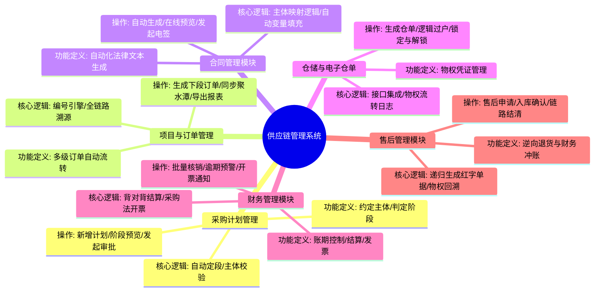
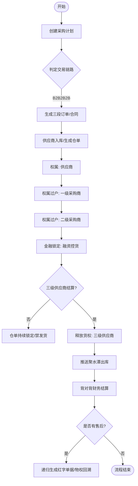
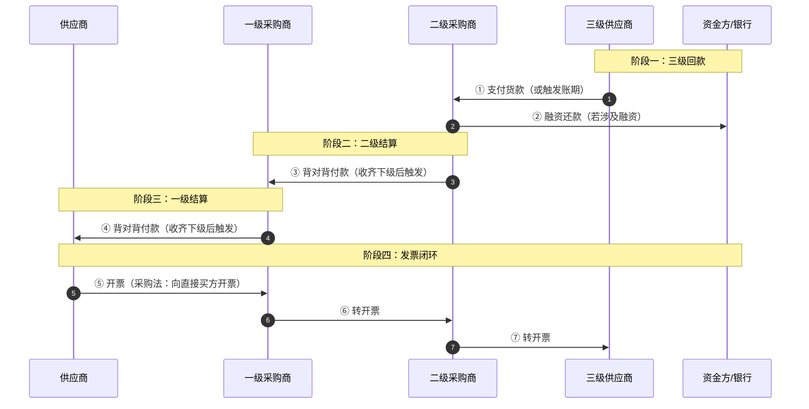
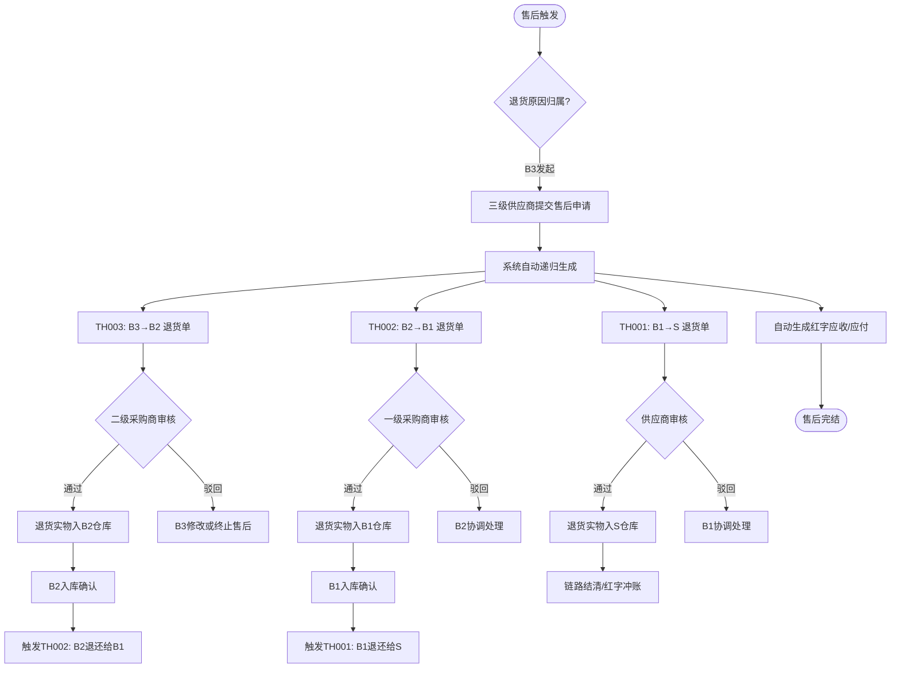
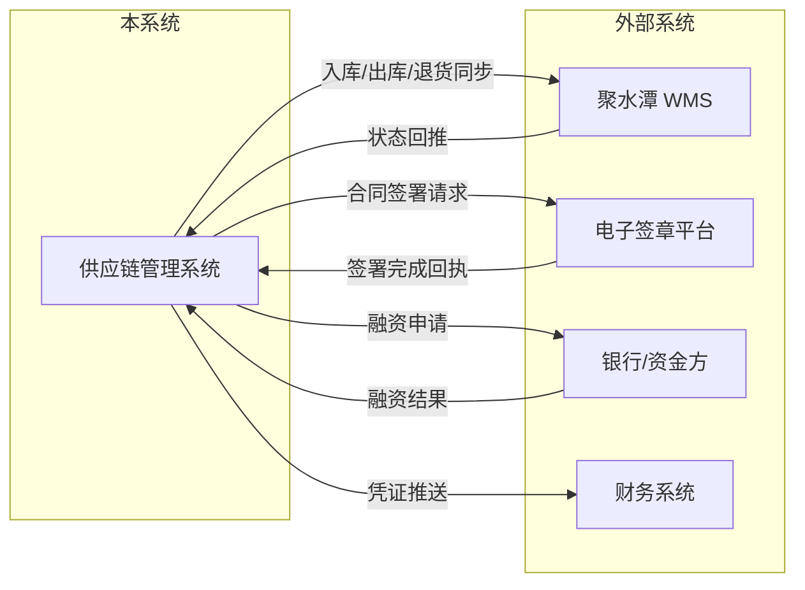
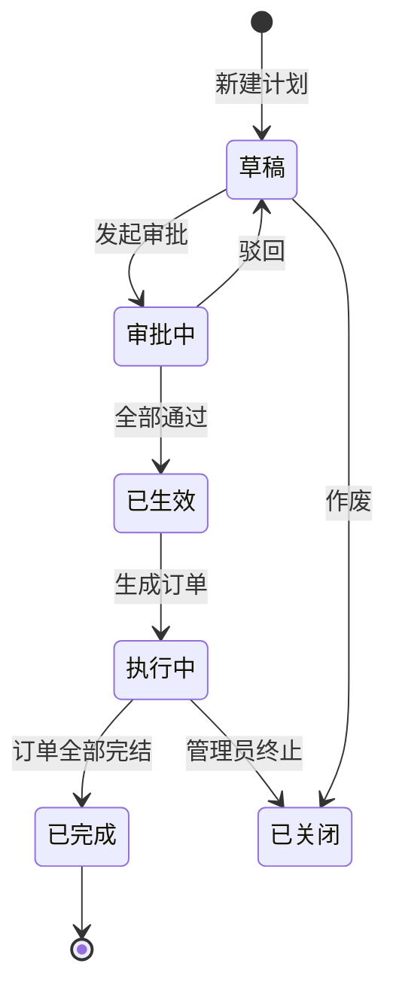
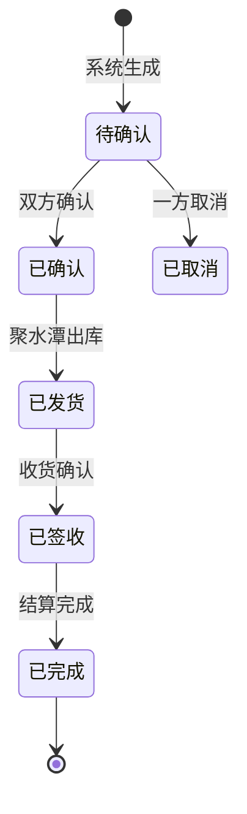
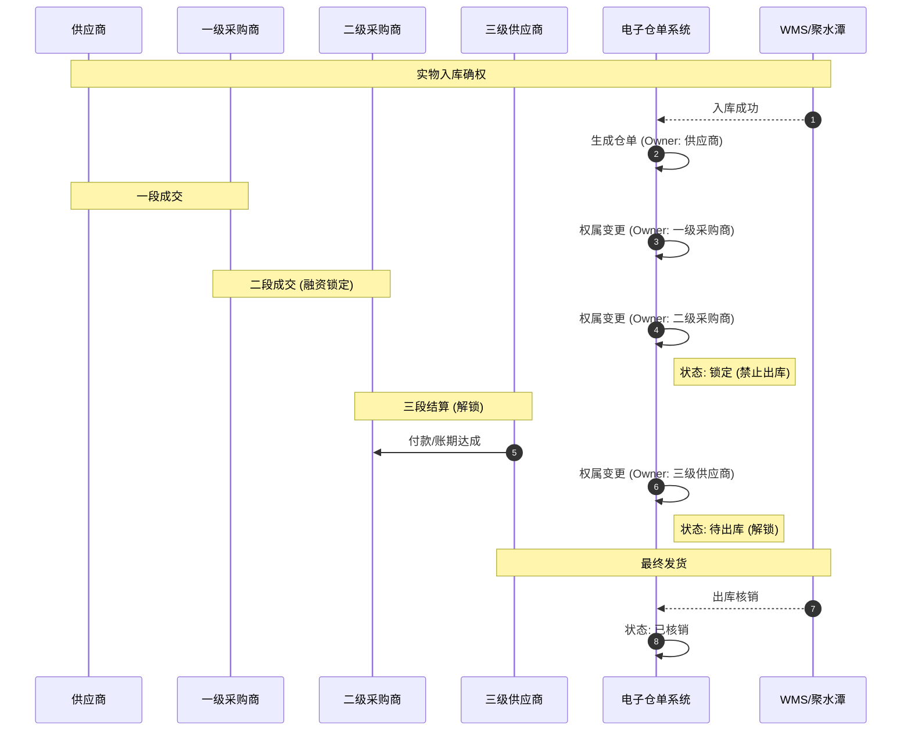
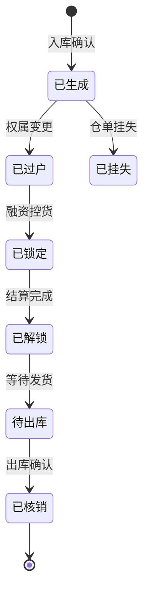
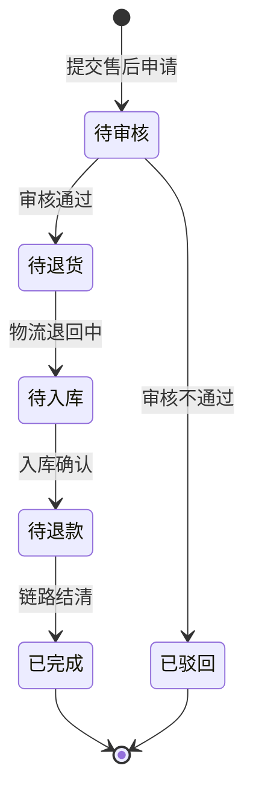

# 供应链管理系统 (B2B2B2B) 需求规格说明书 v2.0

> **版本历史**
> | 版本 | 日期 | 修订内容 | 修订人 |
> | :--- | :--- | :--- | :--- |
> | v1.0 | — | 初版 | — |
> | **v2.0** | **2026-05-31** | **全面补充：合同管理章节、全局状态机、数据字典、权限矩阵、异常流程、接口定义、非功能需求、术语表、补充流程图** | — |

---

## 1. 文档概述

### 1.1 项目背景

本系统旨在解决多主体参与下的供应链协同问题。通过**采购计划**驱动，实现从"供应商"到"三级供应商"的全链路交易自动化。系统核心解决物权控货（电子仓单）、背对背结算、多级合同自动签署及递归售后对账等复杂场景。

### 1.2 角色定义 (B2B2B2B)

| 角色名称 | 简称 | 业务职能 | 典型场景 |
| :--- | :--- | :--- | :--- |
| **供应商** | S | 原始货源提供方 | 实物发货、接收货款 |
| **一级采购商** | B1 | 中间贸易/代持方 | 资金代持、物权过渡 |
| **二级采购商** | B2 | 中间贸易/可以去融资的企业 | 融资控货、账期管理 |
| **三级采购商** | B3 | 末端执行方，对接最终销售或执行 | 终端付款、发起出库、发起售后 |

### 1.3 术语表

> ⭐ *v2.0 新增：统一业务术语，避免歧义。*

| 术语 | 释义 |
| :--- | :--- |
| **一段交易** | S → B1 的直接交易 |
| **二段交易** | S → B1 → B2 的链式交易 |
| **三段交易** | S → B1 → B2 → B3 的全链路交易 |
| **电子仓单** | 记录货物权属的电子凭证，物权转移的唯一依据 |
| **权属过户** | 仓单所有权人变更，实物货物不移动 |
| **背对背结算** | 上级付款以下级回款为前提条件 |
| **红字单据** | 财务冲账使用的负数金额单据，抵消原正向单据 |
| **递归退货** | 末端退货后，自动生成各级对应的逆向单据 |
| **链路灯** | 可视化的单据流转状态标识（绿/黄/红） |
| **聚水潭** | 外部 WMS 系统，处理实物出入库 |

---

## 2. 系统功能脑图

以下是基于业务梳理的系统功能全景：

---

## 3. 业务流程与逻辑

### 3.1 核心业务流程图

展示从计划启动到财务结算、售后的闭环流程。

### 3.2 资金流时序图

> ⭐ *v2.0 新增：展示资金从末端向上游回流的过程。*

### 3.3 逆向退货流程图

> ⭐ *v2.0 新增：售后逆向递归的全流程链路。*

### 3.4 系统集成边界图

> ⭐ *v2.0 新增：系统与外部的集成关系。*

---

## 4. 详细功能模块需求

### 4.1 采购计划管理 (系统引擎)

- **功能定义**：全链路的起点，通过勾选参与主体（S, B1, B2, B3）决定交易的深度。
- **核心逻辑**：
  - **自动定段**：全选则为三段模式；若跳过 B1/B2 则自动缩减为二段或一段模式。
  - **主体校验**：若存在二级采购商（融资方），必须前置一级采购商（代持方）。
  - **编号规则**：`PD + YYYYMMDD + 4位流水号`，如 `PD202605310001`。
- **列表字段**：计划编号、项目标题、供应商、一级采购商、二级采购商、三级供应商、判定阶段（一段/二段/三段）、预计总额、状态。
- **按钮功能**：【新增计划】、【阶段预览】（可视化链路图）、【发起审批】。
- **审批流定义**：> ⭐ *v2.0 新增*
  - **审批级别**：二级审批（业务负责人 → 风控负责人）
  - **审批方式**：会签（两级均通过方可生效）
  - **驳回处理**：驳回至"草稿"状态，修改后可重新提交
  - **超时处理**：超过 48 小时未审批，系统自动推送催办通知
- **状态机**：> ⭐ *v2.0 新增*

### 4.2 项目与订单管理

- **功能定义**：管理 XM 项目下的所有 CG（采购）与 XS（销售）单据。
- **核心逻辑**：
  - **全链路溯源**：点击任意单据可可视化查看从 XM 到三级单据的关联状态。
  - **自动递归**：前段销售单确认后，自动触发后段采购单生成。
  - **编号规则**：
    - 项目编号：`XM + YYYYMMDD + 4位流水号`
    - 采购单号：`CG +段号（001/002/003）+ YYYYMMDD + 4位流水号`
    - 销售单号：`XS + 段号（101/102/103）+YYYYMMDD + 4位流水号`
- **列表字段**：订单编号、来源项目号、买卖双方主体、商品总数、订单总额、关联上级单号、单据状态。
- **按钮功能**：【生成下段订单】、【同步聚水潭】、【批量导出/打印】。
- **状态机**：> ⭐ *v2.0 新增*

### 4.3 合同管理模块

> ⭐ *v2.0 新增：本章节在 v1.0 脑图中存在但无正文，现完整补充。*

- **功能定义**：基于采购计划自动生成多级交易合同，支持在线预览、电子签章。
- **核心逻辑**：
  - **主体映射**：
    | 合同段 | 甲方（买方） | 乙方（卖方） |
    | :--- | :--- | :--- |
    | 一段合同 | B1 | S |
    | 二段合同 | B2 | B1 |
    | 三段合同 | B3 | B2 |
  - **模板变量填充**：
    - 主体信息（公司名、统一社会信用代码、地址）→ 从企业信息库读取
    - 货品信息（品名、规格、数量、单价）→ 从采购计划关联数据读取
    - 金额信息（总价、税率、账期天数）→ 从订单计算得出
- **操作**：
  - **自动生成**：审批通过后自动生成各段合同
  - **在线预览**：支持 PDF 在线预览，标注关键条款
  - **发起电签**：对接电子签章平台（e签宝 / 法大大），推送签署任务
  - **签署回执**：接收签署完成通知，更新合同状态
- **列表字段**：合同编号、合同段（一段/二段/三段）、甲乙双方、合同金额、签署状态（待签署/部分签署/已完成/已作废）、签署时间。
- **按钮功能**：【预览】、【下载PDF】、【发起签署】、【查看签章记录】。
- **异常处理**：
  - 一方拒绝签署 → 通知另一方，合同退回"待修改"状态
  - 合同过期未签（3天） → 自动催签通知

### 4.4 仓储与电子仓单 (物权风控)

- **核心逻辑**：**物权（Ownership）逻辑转移**。实物不动，权属人在系统内阶梯流转。
- **权属流转时序图**：

- **状态机**：> ⭐ *v2.0 新增*

- **特殊场景**：> ⭐ *v2.0 新增*
  - **仓单挂失/损毁**：仅管理员可操作，操作后仓单作废，需重新入库生成新仓单
  - **部分过户**：支持按数量/重量拆分过户，生成子仓单

### 4.5 财务管理模块

- **应付/应收管理**：
  - **核心逻辑**：**背对背（Back-to-Back）支付**。支持配置"只有收到三级供应商货款后，才允许向二级/一级采购商发起付款申请"。
  - **列表字段**：账单号、关联项目、交易阶段、买卖双方、待收/付金额、到期日、逾期天数、背对背状态。
- **发票管理**：基于"采购法"逻辑，自动从采购订单提取商品信息，发送通知要求供应商开票给指定主体。
- **逾期预警**：> ⭐ *v2.0 新增*
  - 到期前 7 天：黄色预警（系统通知）
  - 到期前 3 天：橙色预警（邮件 + 系统通知）
  - 到期后：红色预警（邮件 + 短信 + 系统通知）
- **批量核销**：支持多笔账单批量勾对勾销。

### 4.6 售后管理模块 (逆向闭环)

- **核心逻辑**：
  - **逆向递归**：三级供应商发起退货申请 -> 系统自动递归生成 TH003 (三段退)、TH002 (二段退)、TH001 (一段退)。
  - **价格回溯**：自动调取原订单单价，确保退款金额与原交易一致。
  - **红字单据**：自动生成红字应收/应付，抵消财务欠款。
  - **编号规则**：`TH + 段号(001/002/003) + YYYYMMDD + 4位流水号`
- **按钮功能**：【发起售后申请】、【退货入库确认】、【一键链路结清】。
- **状态机**：> ⭐ *v2.0 新增*

### 4.7 异常流程与边界处理

> ⭐ *v2.0 新增：补充核心异常场景的处理规则。*

| 异常场景 | 处理方式 | 责任人 |
| :--- | :--- | :--- |
| **审批驳回** | 计划退回"草稿"状态，保留已填写数据，修改后可重新提交 | 提交人 |
| **一方拒绝签署合同** | 订单暂停，通知对方协商，3 天内未处理自动标记"合同异常" | 双方 |
| **仓单损毁/挂失** | 管理员操作"挂失"，仓单冻结，需重新入库生成新仓单 | 管理员 |
| **跨主体退货不配合** | 上游不配合退货时触发"争议流程"，系统记录争议工单，人工介入 | 运营/客服 |
| **聚水潭同步失败** | 自动重试 3 次(间隔 5 分钟)，仍失败则推送告警，人工手动同步 | 运营 |
| **背对背超期** | 下级超过账期 30 天未付款，上级可申请"强制结算"或终止交易 | 风控 |
| **部分退款/退货** | 支持按数量部分退货，系统按比例计算退款金额，仅退回未出库部分 | 运营 |
| **电签过期** | 合同发起后 3 天未签署，自动催签，7 天未签署自动失效 | 系统自动 |

---

## 5. 角色权限矩阵

> ⭐ *v2.0 新增：定义各角色的数据可见范围和操作权限。*

| 功能模块 | 操作 | S | B1 | B2 | B3 | 管理员 |
| :--- | :--- | :---: | :---: | :---: | :---: | :---: |
| **采购计划** | 查看 | 仅涉及 | 仅涉及 | 仅涉及 | 仅涉及 | 全部 |
| | 新增 | — | ✓ | ✓ | ✓ | ✓ |
| | 编辑 | — | 仅己方 | 仅己方 | 仅己方 | 全部 |
| | 发起审批 | — | ✓ | ✓ | ✓ | ✓ |
| **订单管理** | 查看 | 仅涉及 | 仅涉及 | 仅涉及 | 仅涉及 | 全部 |
| | 确认订单 | ✓（S） | ✓ | ✓ | ✓ | ✓ |
| | 生成下段 | — | ✓ | ✓ | ✓ | ✓ |
| | 同步WMS | — | — | — | ✓（B3） | ✓ |
| **合同管理** | 查看 | 仅涉及 | 仅涉及 | 仅涉及 | 仅涉及 | 全部 |
| | 签署 | ✓ | ✓ | ✓ | ✓ | 代签 |
| | 作废 | — | — | — | — | ✓ |
| **电子仓单** | 查看 | 仅涉及 | 仅涉及 | 仅涉及 | 仅涉及 | 全部 |
| | 权属过户 | — | ✓（接收） | ✓（接收） | ✓（接收） | ✓ |
| | 锁定/解锁 | — | — | ✓（B2） | — | ✓ |
| | 出库核销 | — | — | — | ✓ | ✓ |
| **财务管理** | 查看应收/付 | 仅涉及 | 仅涉及 | 仅涉及 | 仅涉及 | 全部 |
| | 发起付款 | — | ✓ | ✓ | ✓ | ✓ |
| | 开票 | ✓ | ✓ | ✓ | — | ✓ |
| | 核销 | ✓ | ✓ | ✓ | ✓ | ✓ |
| **售后管理** | 发起售后 | — | — | — | ✓ | ✓ |
| | 审核售后 | — | ✓（B1段） | ✓（B2段） | — | ✓ |
| | 入库确认 | — | ✓（B1段） | ✓（B2段） | ✓（B3段） | ✓ |
| | 链路结清 | — | — | — | — | ✓ |

---

## 6. 数据字典

> ⭐ *v2.0 新增：核心实体字段定义。*

### 6.1 采购计划表 (purchase_plan)

| 字段名 | 类型 | 长度 | 必填 | 说明 |
| :--- | :--- | :---: | :---: | :--- |
| id | bigint | 20 | 是 | 主键 ID |
| plan_no | varchar | 32 | 是 | 计划编号，规则 PD + YYYYMMDD + 4位流水 |
| title | varchar | 200 | 是 | 项目标题 |
| supplier_id | bigint | 20 | 是 | 供应商(S) ID |
| buyer1_id | bigint | 20 | 否 | 一级采购商(B1) ID，一段交易时必填 |
| buyer2_id | bigint | 20 | 否 | 二级采购商(B2) ID，二段交易时必填 |
| buyer3_id | bigint | 20 | 否 | 三级供应商(B3) ID，三段交易时必填 |
| stage_type | tinyint | 4 | 是 | 判定阶段：1=一段 / 2=二段 / 3=三段 |
| total_amount | decimal | 18,2 | 是 | 预计总额 |
| status | tinyint | 4 | 是 | 状态：0=草稿 / 1=审批中 / 2=已生效 / 3=执行中 / 4=已完成 / 9=已关闭 |
| submitter | bigint | 20 | 是 | 提交人 |
| created_at | datetime | — | 是 | 创建时间 |
| updated_at | datetime | — | 是 | 更新时间 |

### 6.2 订单表 (order)

| 字段名 | 类型 | 长度 | 必填 | 说明 |
| :--- | :--- | :---: | :---: | :--- |
| id | bigint | 20 | 是 | 主键 ID |
| order_no | varchar | 32 | 是 | 订单编号，CG/XS + YYYYMMDD + 4位流水 |
| order_type | tinyint | 4 | 是 | 类型：1=采购(CG) / 2=销售(XS) |
| plan_id | bigint | 20 | 是 | 关联采购计划 ID |
| parent_order_id | bigint | 20 | 否 | 上级订单 ID，用于全链路关联 |
| seller_id | bigint | 20 | 是 | 卖方主体 ID |
| buyer_id | bigint | 20 | 是 | 买方主体 ID |
| total_quantity | int | 11 | 是 | 商品总数 |
| total_amount | decimal | 18,2 | 是 | 订单总额 |
| status | tinyint | 4 | 是 | 状态：0=待确认 / 1=已确认 / 2=已发货 / 3=已签收 / 4=已完成 / 9=已取消 |
| stage | tinyint | 4 | 是 | 所属段：1=一段 / 2=二段 / 3=三段 |
| sync_wms | tinyint | 1 | 否 | 是否已同步聚水潭：0=否 / 1=是 |
| created_at | datetime | — | 是 | 创建时间 |

### 6.3 电子仓单表 (ewarehouse_receipt)

| 字段名 | 类型 | 长度 | 必填 | 说明 |
| :--- | :--- | :---: | :---: | :--- |
| id | bigint | 20 | 是 | 主键 ID |
| receipt_no | varchar | 32 | 是 | 仓单编号，EWR + YYYYMMDD + 4位流水 |
| owner_id | bigint | 20 | 是 | 当前权属人 ID |
| warehouse_id | bigint | 20 | 是 | 仓库 ID |
| order_id | bigint | 20 | 是 | 关联订单 ID |
| quantity | decimal | 18,2 | 是 | 数量/重量 |
| lock_status | tinyint | 4 | 是 | 锁定状态：0=未锁定 / 1=已锁定 |
| status | tinyint | 4 | 是 | 状态：0=已生成 / 1=已过户 / 2=已锁定 / 3=已解锁 / 4=待出库 / 5=已核销 / 9=已挂失 |
| created_at | datetime | — | 是 | 生成时间 |
| locked_at | datetime | — | 否 | 锁定时间 |
| unlocked_at | datetime | — | 否 | 解锁时间 |
| written_off_at | datetime | — | 否 | 核销时间 |

### 6.4 账单表 (bill)

| 字段名 | 类型 | 长度 | 必填 | 说明 |
| :--- | :--- | :---: | :---: | :--- |
| id | bigint | 20 | 是 | 主键 ID |
| bill_no | varchar | 32 | 是 | 账单编号 |
| order_id | bigint | 20 | 是 | 关联订单 ID |
| payer_id | bigint | 20 | 是 | 付款方 ID |
| payee_id | bigint | 20 | 是 | 收款方 ID |
| amount | decimal | 18,2 | 是 | 账单金额 |
| due_date | date | — | 是 | 到期日 |
| overdue_days | int | 11 | 否 | 逾期天数 |
| b2b_status | tinyint | 4 | 是 | 背对背状态：0=等待下级 / 1=可付款 / 2=已付款 |
| status | tinyint | 4 | 是 | 状态：0=待付款 / 1=已付款 / 2=已核销 / 3=已逾期 |
| created_at | datetime | — | 是 | 创建时间 |

### 6.5 售后单表 (after_sale)

| 字段名 | 类型 | 长度 | 必填 | 说明 |
| :--- | :--- | :---: | :---: | :--- |
| id | bigint | 20 | 是 | 主键 ID |
| return_no | varchar | 32 | 是 | 售后单号，TH + 段号 + YYYYMMDD + 4位流水 |
| original_order_id | bigint | 20 | 是 | 原订单 ID |
| stage | tinyint | 4 | 是 | 所属段：1/2/3 |
| applicant_id | bigint | 20 | 是 | 申请人 ID |
| quantity | decimal | 18,2 | 是 | 退货数量 |
| amount | decimal | 18,2 | 是 | 退款金额 |
| reason | varchar | 500 | 是 | 退货原因 |
| status | tinyint | 4 | 是 | 状态：0=待审核 / 1=待退货 / 2=待入库 / 3=待退款 / 4=已完成 / 9=已驳回 |
| parent_return_id | bigint | 20 | 否 | 上级售后单 ID，用于递归关联 |
| created_at | datetime | — | 是 | 创建时间 |

---

## 7. 集成接口定义

> ⭐ *v2.0 新增：详细定义外部系统对接接口。*

### 7.1 聚水潭 WMS 接口

| 接口名称 | 方向 | 触发时机 | 说明 |
| :--- | :---: | :--- | :--- |
| 入库单推送 | 本系统 → 聚水潭 | 仓单生成后 | 推送入库单，通知仓库收货 |
| 入库状态回推 | 聚水潭 → 本系统 | 仓库实收入库 | 回传入库结果，触发仓单生成 |
| 出库单推送 | 本系统 → 聚水潭 | 仓单解锁后 | 推送出库单通知发货 |
| 出库状态回推 | 聚水潭 → 本系统 | 仓库实出库 | 回传出库结果，触发仓单核销 |
| 库存查询 | 本系统 → 聚水潭 | 按需实时查询 | 查询指定商品/仓库实时库存 |
| 退货单同步 | 本系统 → 聚水潭 | 售后入库 | 推送退货入库指令 |
| 退货状态回推 | 聚水潭 → 本系统 | 退货入库完成 | 回推退货入库结果 |

**同步机制**：
- 实时推送（同步调用），超时时间 10 秒
- 失败自动重试 3 次，间隔 5 分钟
- 最终失败：写入告警表，运营人员手动触发补推

### 7.2 电子签章平台接口

| 接口名称 | 方向 | 说明 |
| :--- | :---: | :--- |
| 合同上传 | 本系统 → 签章平台 | 上传生成的 PDF 合同文件 |
| 签署发起 | 本系统 → 签章平台 | 指定签署方，发起签署流程 |
| 签署链接获取 | 本系统 → 签章平台 | 获取短信/邮件签署链接 |
| 签署状态回调 | 签章平台 → 本系统 | 签署完成/拒签的回调通知 |
| 合同下载 | 本系统 → 签章平台 | 下载已签署的合同存档 |

---

## 8. 非功能需求

> ⭐ *v2.0 大幅扩展。*

### 8.1 安全性

| 要求项 | 说明 |
| :--- | :--- |
| 数据加密 | 核心敏感数据（金额、合同内容）传输使用 HTTPS；敏感字段存储加密 |
| 操作日志 | 所有核心操作（审批、过户、锁定、核销）记录操作人、时间戳、IP 及关联单据 ID |
| 数据脱敏 | 合同中的法定代表人身份证号、银行账号等敏感信息展示时脱敏 |
| 防篡改 | 电子仓单数据采用数字签名或哈希链防篡改 |

### 8.2 性能

| 要求项 | 指标 |
| :--- | :---: |
| 页面加载 | 列表页 ≤ 2s，详情页 ≤ 1.5s |
| 并发用户 | 系统支持 ≥ 200 并发用户 |
| 数据导出 | 5 万行以内 ≤ 10s 导出完成 |
| 批量操作 | 批量核销 ≥ 1000 条/次 |

### 8.3 可靠性

| 要求项 | 说明 |
| :--- | :--- |
| 幂等性 | 核心操作（审批、过户、核销）必须支持幂等，防止重复提交产生脏数据 |
| 事务一致性 | 涉及多表操作的关键流程（如仓单过户）需保证事务一致性 |
| 数据备份 | 每日全量备份，每周异地备份 |
| 容灾恢复 | RTO ≤ 4 小时，RPO ≤ 1 小时 |

### 8.4 可维护性

| 要求项 | 说明 |
| :--- | :--- |
| 参数化配置 | 账期天数、逾期预警阈值、自动重试次数等可后台配置 |
| 告警机制 | 接口调用失败、审批超时、逾期产生时系统自动告警 |
| 操作审计 | 所有变更操作记录审计日志，可追溯至具体操作人 |

---

## 9. 附录

### 9.1 编号规则汇总

| 单据类型 | 前缀 | 格式示例 |
| :--- | :---: | :--- |
| 采购计划 | PD | PD202605310001 |
| 项目编号 | XM | XM202605310001 |
| 采购单 | CG | CG202605310001 |
| 销售单 | XS | XS202605310001 |
| 合同编号 | CT | CT202605310001 |
| 仓单编号 | EWR | EWR202605310001 |
| 账单编号 | BL | BL202605310001 |
| 售后单 | TH+段号 | TH003202605310001 |

### 9.2 全局状态码汇总

| 状态码 | 含义 |
| :---: | :--- |
| 0 | 初始/草稿/待处理 |
| 1 | 审批中/待确认/已过户/待退货 |
| 2 | 已生效/待发货/已锁定/待入库 |
| 3 | 执行中/已发货/已解锁/待退款 |
| 4 | 已完成/已签收/待出库/已完成 |
| 5 | 已核销 |
| 9 | 已取消/已关闭/已驳回/已挂失/已作废 |

---

**文档说明**：本 v2.0 版本在 v1.0 基础上补充了合同管理章节、全局状态机、数据字典、角色权限矩阵、异常流程处理、集成接口定义、扩展的非功能需求及术语表，可直接作为系统架构与产品开发的完整逻辑依据。
