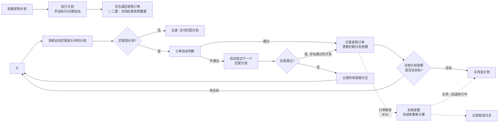
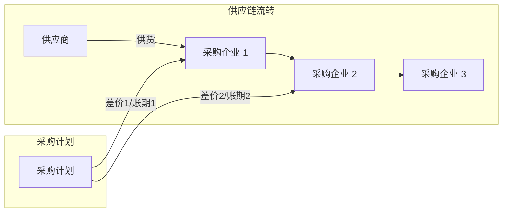
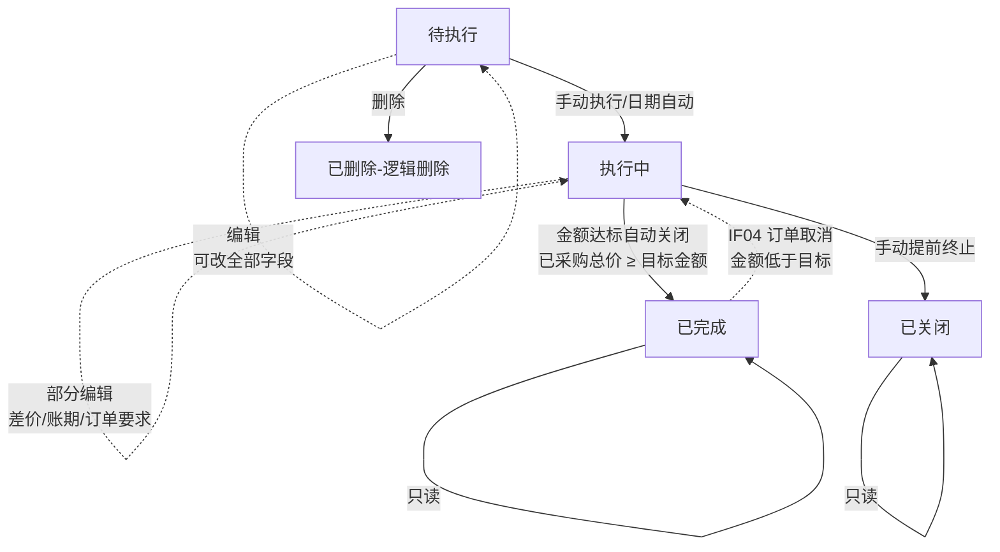
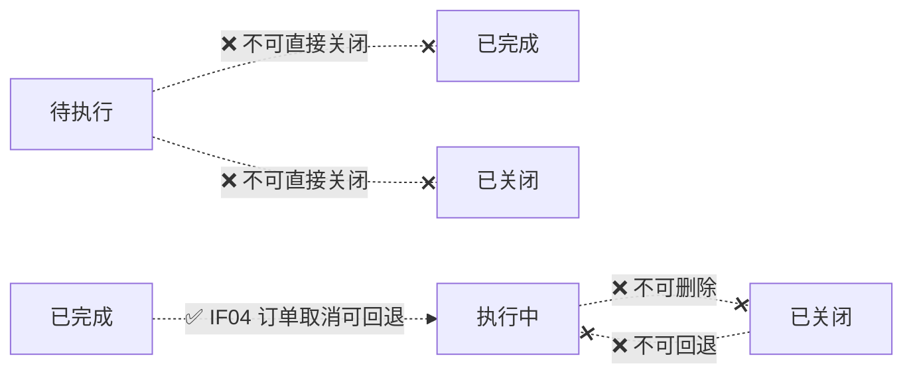
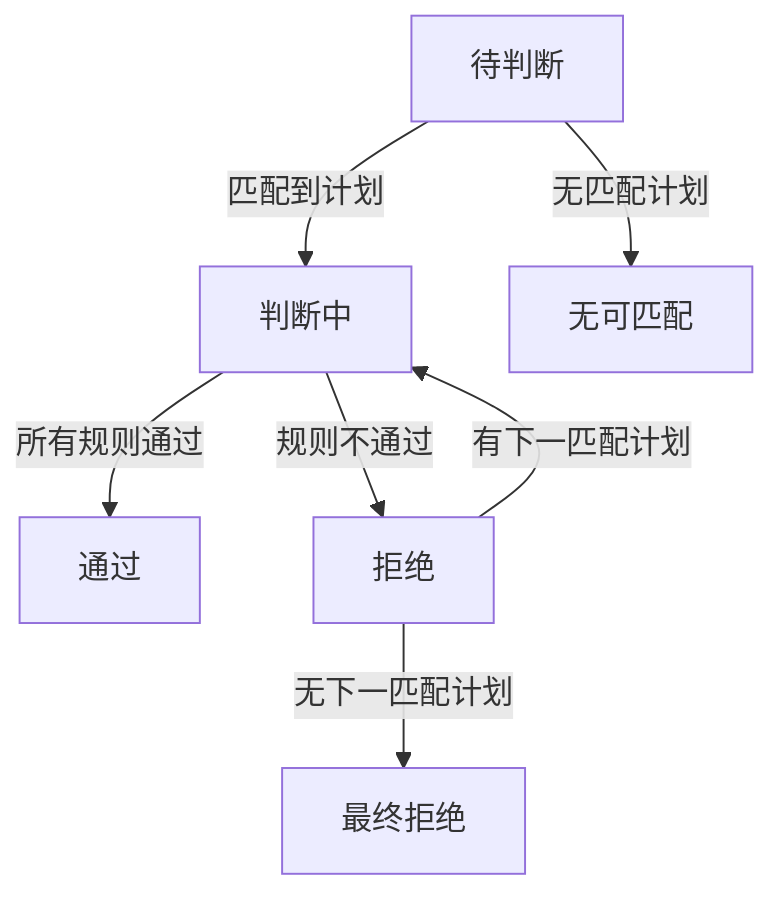
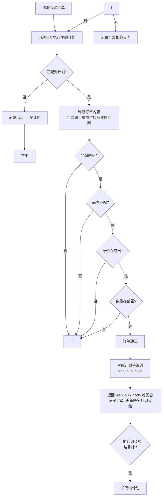
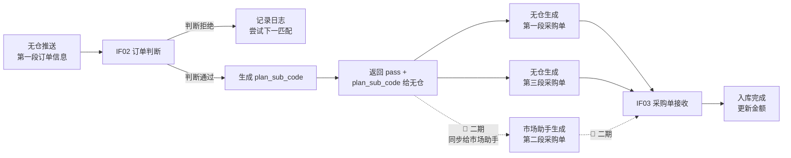

# 采购计划管理系统 - 产品需求文档

> ⚠️ **本文件已归档，请勿在此继续编辑。**
>
> 2026-10-16 已将其内容并入 `采购计划管理-PRD.md`（在本目录的上一级），后者是本系统**唯一 PRD**。
> 本文件与 `采购计划管理-PRD.md` 曾经是**并行分叉**、各有对方没有的内容，并非新旧版本关系。
> 合并时的取舍逐条记在该文档的 `§6.2 合并取舍记录`；本文件仅保留用于追溯，其独有设计分歧（`付款方式`、`所属企业`、`匹配说明`、`采购单号`、`查看`按钮命名等）**均未采纳**。

## 一、文档概述

### 1.1 愿景及目标

**业务现状**：目前采购业务中，采购计划的创建、执行、跟踪缺乏系统化管理，计划与采购订单之间的关联依赖人工维护，订单判断缺乏自动化规则支撑，导致采购执行效率低、容易出错。

**建设目标**：
1. 实现采购计划的全生命周期管理（创建 → 执行 → 关闭）
2. 建立采购计划与采购订单的自动关联，打通计划到订单的执行链路
3. 引入自动化订单判断规则，对订单条件进行系统校验（🔄 二期：增加供应商资质校验）
4. 对接外部平台（无仓），实现采购计划自动推送和订单回传

**涉众分析**：

| 涉众角色 | 期望与利益 | 优先级 |
|---------|-----------|-------|
| 采购经理 | 制定采购计划，跟踪执行进度，确保采购目标达成 | 高 |
| 采购员 | 根据采购计划执行采购，查看推送的采购订单 | 高 |
| 财务人员 | 关注采购金额、差价、账期等财务数据 | 中 |
| 系统管理员 | 维护系统配置，监控接口运行状态 | 低 |

### 1.2 全局约束

- 页面字体使用微软雅黑，标题 14 号，正文 12 号
- 状态枚举值按业务流程顺序编排（1、2、3…），异常状态用 99
- 日期选择器统一使用 YYYY-MM-DD 格式
- 金额字段统一保留两位小数，以元为单位
- 列表页默认分页 20 条/页，支持 10/50/100 切换
- 搜索条件保持页面刷新后重置
- 品牌、品类必须从字典中选择，不支持自由输入，避免同一品牌/品类因命名差异导致数据混乱
- 采购层级决定供应链长度：二级采购只涉及企业1和企业2，三级采购涉及企业1、企业2和企业3

### 1.3 名词定义

| 术语 | 说明 |
|-----|------|
| 采购计划 | 预先制定的采购方案，包含品牌、品类、金额目标、时间范围等信息 |
| 无仓 | 外部采购订单管理平台，接收采购计划推送并返回采购订单数据；🔄 二期：供应商资质数据由无仓提供 |
| 采购层级 | 控制供应链采购链条长度。二级采购：供应商→企业1→企业2；三级采购：供应商→企业1→企业2→企业3 |
| 采购企业 1 | 向供应商采购货物的企业（供应商 → 采购企业 1） |
| 采购企业 2 | 向采购企业 1 采购货物的企业（采购企业 1 → 采购企业 2） |
| 采购企业 3 | 向采购企业 2 采购货物的企业（采购企业 2 → 采购企业 3） |
| 差价 1 | 采购企业 2 与采购企业 1 之间的差价，支持比例或固定金额；比例用百分数，固定用元；比例差价计算公式：采购企业1的采购价*差价比例 |
| 差价 2 | 采购企业 3 与采购企业 2 之间的差价，支持比例或固定金额；比例用百分数，固定用元；比例差价计算公式：采购企业2的采购价*差价比例 |
| 账期 1 | 采购企业 2 与采购企业 1 之间的付款信用期限（天/自然日） |
| 账期 2 | 采购企业 3 与采购企业 2 之间的付款信用期限（天/自然日） |
| 完成率 | 已完成采购金额 / 采购总金额 × 100%；已完成的采购金额=采购企业1采购的总金额 |
| 计划子编码 | 计划的一次执行批次标识，格式 `{计划编码}-{6位流水号}`，判断通过时生成，三段采购单共享 |
| 订单判断 | 系统根据预设规则自动校验采购订单是否满足计划要求 |

### 1.4 参考资料

- 无仓平台对接接口规范
- 品牌、品类字典数据由无仓底层提供，本系统直接调用

---

## 二、业务概述

### 2.1 业务蓝图

**供应关系**：


**核心流程**：



**跨部门泳道**：

| 步骤 | 采购经理 | 系统 | 无仓平台 |
|------|---------|------|---------|
| 1 | 创建采购计划 | 存储计划并校验唯一性 | - |
| 2 | 执行计划（手动） | 状态变更为"执行中"，记录执行日期；预计开始日期到达时自动执行 | - |
| 3 | - | - | 返回采购订单（订单不带计划编码）；🔄 二期：含供应商资质数据 |
| 5 | - | 自动匹配执行中的计划；未匹配到 → 记录"无可匹配计划" | - |
| 6 | - | 匹配到 → 判断订单内容（品牌/品类/单价/数量/总价）；🔄 二期：增加供应商资质判断 | - |
| 7 | - | 通过 → 生成计划子编码、返回给无仓、记录订单、更新金额；拒绝 → 尝试下一个匹配 | - |
| 8 | - | 无仓收到子编码后生成第一段和第三段采购单，通过 IF03 回传入库；🔄 二期：同步给市场助手生成第二段采购单 | - |
| 9 | - | 监控全链采购总额，达目标后关闭对应计划 | - |
| 10 | - | 订单取消 → 扣减已完成金额、重新计算完成率、必要时回退计划状态 | 无仓通过 IF04 通知取消 |

**供应链关系流向**：



### 2.2 业务需求

| 编号 | 需求领域 | 需求项 | 涉及系统 | 重要级 |
|-----|---------|-------|---------|-------|
| BR01 | 计划管理 | 采购计划 CRUD 及状态流转 | 采购计划管理 | 高 |
| BR02 | 计划执行 | 采购计划手动执行/自动执行 | 采购计划管理 | 高 |
| BR03 | 订单判断 | 采购订单自动校验规则引擎 | 采购计划管理 | 高 |
| BR04 | 订单管理 | 采购订单查询和管理 | 采购计划管理 | 中 |
| BR05 | 日志管理 | 订单判断日志记录和查询 | 采购计划管理 | 中 |
| BR06 | 接口对接 | 与无仓平台的数据交互 | 采购计划管理 ↔ 无仓 | 高 |

### 2.3 方案概述

**系统用例图**：

```
采购计划管理系统
├── 采购计划管理
│   ├── 创建采购计划
│   ├── 删除采购计划
│   ├── 修改采购计划（本期无）
│   ├── 变更计划状态（本期无）
│   ├── 执行采购计划
│   └── 关闭采购计划
├── 采购订单管理
│   ├── 查看采购订单
│   └── 查询采购订单
├── 订单判断
│   ├── 自动订单判断
│   └── 查看判断日志
└── 接口对接（系统间）
    ├── 订单判断接口
    ├── 采购单接收
    ├── 订单取消接口（IF04）
    └── 订单完成通知接口（IF05）
```

**系统用例列表**：

| 用例编号 | 系统用例名称 | 需求类型 | 简述 |
|---------|------------|---------|------|
| UC01 | 创建采购计划 | 功能需求 | 填写计划信息，创建新的采购计划 |
| UC02 | 执行采购计划 | 功能需求 | 将采购计划变更为执行中状态，开始采购流程 |
| UC03 | 关闭采购计划 | 功能需求 | 手动或自动关闭已完成的采购计划 |
| UC04 | 采购订单判断 | 功能需求 | 系统自动校验采购订单是否符合规则 |
| UC05 | 采购订单查询 | 功能需求 | 查看和管理三段供应链的全部采购订单数据 |
| UC06 | 判断日志查询 | 功能需求 | 查询订单判断的历史记录 |
| UC07 | 采购计划推送（本期无） | 接口需求 | 采购计划推送至无仓平台 |
| UC08 | 订单判断接口 | 接口需求 | 无仓回传订单进行判断 |
| UC09 | 采购单接收接口 | 接口需求 | 接收无仓推送的采购单 |
| UC10 | 订单取消接口 | 接口需求 | 无仓通知订单取消，系统扣减金额、必要时回退计划状态 |
| UC11 | 订单完成通知接口 | 接口需求 | 无仓通知订单已完成，系统更新订单完成状态 |

---

## 三、系统用例需求

### 3.1 功能用例

#### UC00 采购计划管理列表

| 字段 | 说明 |
|------|------|
| 用例名称 | 采购计划管理列表 |
| 用例编号 | UC00 |
| 用例简述 | 查看采购计划列表，支持搜索、筛选、分页浏览，对列表中的计划进行操作 |
| 主执行者 | 采购经理 |
| 前置条件 | 用户已登录系统 |
| 菜单路径 | 采购计划管理 → 采购计划列表 |

**页面交互**：

- 页面默认展示所有采购计划，按创建时间倒序排列
- 顶部展示统计卡片（计划总数、执行中、已完成、已完成总金额）
- 中间为搜索条件栏，底部为表格分页

**查询条件**：

| 序号 | 查询条件 | 是否必须 | 模糊查询 | 备注 |
|------|---------|---------|---------|------|
| 1 | 采购计划编码 | 否 | 是 | — |
| 2 | 品牌 | 否 | — | 下拉选择，从字典取值 |
| 3 | 品类 | 否 | — | 下拉选择，从字典取值 |
| 4 | 采购层级 | 否 | — | 下拉选择：全部 / 二级采购 / 三级采购 |
| 5 | 执行状态 | 否 | — | 下拉选择：全部 / 待执行 / 执行中 / 已完成 / 已关闭 |
| 6 | 预计开始日期（起） | 否 | — | 日期输入 |
| 7 | 预计开始日期（止） | 否 | — | 日期输入 |

**列表字段**：

| 列名 | 说明 | 数据来源 |
|------|------|---------|
| 采购计划编码 | 系统生成，可点击进入编辑 | plan.code |
| 采购层级 | 蓝色标签=三级 / 橙色标签=二级 | plan.level |
| 品牌 | — | plan.brand |
| 品类 | — | plan.category |
| 采购总金额 | 格式化金额 ¥X,XXX | plan.totalAmount |
| 已完成金额 | 格式化金额 ¥X,XXX（允许超过采购总金额一点） | plan.completedAmount |
| 完成率 | 进度条 + 百分比 | plan.completionRate |
| 采购企业 | 列表显示：1:企业名 2:企业名（3:企业名） | plan.company1/2/3 |
| 预计日期 | 起: YYYY-MM-DD / 止: YYYY-MM-DD | plan.startDate/endDate |
| 执行日期 | 执: 实际执行时间 / 完: 实际结束时间 | plan.execDate/finishDate |
| 执行状态 | 标签：待执行-橙 / 执行中-蓝 / 已完成-绿 / 已关闭-灰 | plan.execStatus |
| 计划状态 | 标签：启动-绿 / 关闭-灰 | plan.planStatus |
| 操作 | 按钮组，根据执行状态显示不同操作项 | 见下方按钮说明 |

**按钮说明**：

按钮的显示和可用性取决于计划当前的执行状态：

| 执行状态 | 可用按钮 | 说明 |
|---------|---------|------|
| 待执行 | 执行、编辑、删除、复制 | 执行：状态→执行中（不同步给无仓）；预计开始日期到达时自动执行；编辑：打开编辑弹窗；删除：软删除；复制：以该计划为模板新建（见 UC01-A） |
| 执行中 | 关闭、查看、复制 | 关闭：手动提前终止，状态→已关闭；复制：以该计划为模板新建（见 UC01-A） |
| 已完成 | 查看、复制 | 只读详情；复制：以该计划为模板新建（见 UC01-A） |
| 已关闭 | 查看、复制 | 只读详情；复制：以该计划为模板新建（见 UC01-A） |

- 操作列按钮使用颜色区分：执行=绿色、关闭=橙色、删除=红色、编辑=默认、查看=默认、复制=紫色
- 鼠标悬停时显示按钮文字提示
- 点击「采购计划编码」链接等同于点击编辑按钮

**按钮状态矩阵**：

```text
            待执行  执行中  已完成  已关闭
执行按钮      ✅     ❌     ❌     ❌
编辑按钮      ✅     ❌     ❌     ❌
删除按钮      ✅     ❌     ❌     ❌
关闭按钮      ❌     ✅     ❌     ❌
查看按钮      ❌     ✅     ✅     ✅
复制按钮      ✅     ✅     ✅     ✅
```

#### UC01 创建采购计划

| 字段 | 说明 |
|------|------|
| 用例名称 | 创建采购计划 |
| 用例编号 | UC01 |
| 用例简述 | 采购经理填写采购计划信息，创建新的采购计划 |
| 主执行者 | 采购经理 |
| 前置条件 | 用户已登录系统并具有采购计划创建权限 |
| 后置条件 | 系统生成一条唯一采购计划编码，计划状态为"待执行" |

**主要路径**：

1. 用户点击"创建采购计划"按钮
2. 系统展示采购计划创建表单
3. 用户选择**采购层级**（二级采购 / 三级采购），系统根据层级动态展示/隐藏企业3、差价2、账期2字段
4. 用户填写其余采购计划信息（品牌、品类、采购总金额、采购企业、差价、账期、预计日期范围、订单要求（最低/最高单价、最低/最高数量、最低总价）、供应商资质要求等）
5. 系统校验必填字段（校验规则跟随采购层级）
6. 系统对 **计划状态 ≠ 关闭** 的有效计划进行唯一性校验：
   - **二级采购**唯一键：`品牌 + 品类 + 采购企业 1 + 采购企业 2 + 预计开始日期 + 预计结束日期`
   - **三级采购**唯一键：`品牌 + 品类 + 采购企业 1 + 采购企业 2 + 采购企业 3 + 预计开始日期 + 预计结束日期`
7. 系统保存采购计划，生成唯一计划编码，状态置为"待执行"
8. 系统返回创建成功提示

**替代流程**：

- 6a. 唯一性校验不通过：提示"存在相同条件的采购计划（编码: XXXXX，状态: XXX），请检查后重新填写"，拒绝保存
- 3a. 用户取消创建：返回计划列表页

**字段列表**：

| 字段 | 类型 | 长度 | 必填 | 说明 |
|------|------|------|------|------|
| 采购计划编码 | 字符串 | 32 | 自动 | 系统自动生成，唯一标识 |
| 品牌 | 字符串 | 64 | 是 | 计划采购的品牌，从字典选择 |
| 品类 | 字符串 | 64 | 是 | 计划采购的品类，从字典选择 |
| 采购层级 | 枚举 | - | 是 | 二级采购 / 三级采购，控制供应链长度 |
| 采购总金额 |  Decimal(18,2) | - | 是 | 计划采购的总目标金额 |
| 已完成总金额 |  Decimal(18,2) | - | 自动 | 已完成的采购金额，默认 0 |
| 完成率 |  Decimal(5,2) | - | 自动 | 完成率 = 已完成总金额 / 采购总金额 × 100% |
| 采购企业 1 | 字符串 | 64 | 是 | 采购执行主体 1，向供应商采购 |
| 采购企业 2 | 字符串 | 64 | 是 | 采购执行主体 2，向企业1采购 |
| 采购企业 3 | 字符串 | 64 | 二级：不填；三级：必填 | 采购执行主体 3，向企业2采购；二级采购时隐藏/禁用 |
| 差价 1 类型 | 枚举 | - | 是 | 比例 / 固定；选择"比例"时填写差价1比例，选择"固定"时填写差价1金额 |
| 差价 1 比例（%） | Decimal(18,2) | - | 类型=比例时必填 | 采购企业 2 与采购企业 1 的差价比例，如 5 表示 5% |
| 差价 1 金额（元） | Decimal(18,2) | - | 类型=固定时必填 | 采购企业 2 与采购企业 1 的固定差价金额 |
| 差价 2 类型 | 枚举 | - | 二级：不填；三级：必填 | 同上；二级采购时隐藏/禁用 |
| 差价 2 比例（%） | Decimal(18,2) | - | 二级：不填；三级：类型=比例时必填 | 采购企业 3 与采购企业 2 的差价比例；二级采购时隐藏/禁用 |
| 差价 2 金额（元） | Decimal(18,2) | - | 二级：不填；三级：类型=固定时必填 | 采购企业 3 与采购企业 2 的固定差价金额；二级采购时隐藏/禁用 |
| 账期 1 | 整数 | - | 是 | 采购企业 2 与采购企业 1 的账期（天），默认0 |
| 账期 2 | 整数 | - | 二级：不填；三级：必填 | 采购企业 3 与采购企业 2 的账期（天），默认0；二级采购时隐藏/禁用 |
| 预计开始日期 | 日期 | - | 是 | 预计开始执行的日期 |
| 预计结束日期 | 日期 | - | 是 | 预计结束的日期 |
| 实际执行日期 | 日期 | - | 自动 | 实际执行时间，执行时记录 |
| 实际结束日期 | 日期 | - | 自动 | 实际关闭时间 |
| 执行状态 | 枚举 | - | 自动 | 1-待执行、2-执行中、3-已完成、4-已关闭 |
| 计划状态 | 枚举 | - | 自动 | 1-启动、2-关闭 |
| 子编码流水号 | 整数 | - | 自动 | IF02 通过时自动 +1，从 0 开始，用于生成 plan_sub_code |
| 订单最低单价 | Decimal(18,2) | - | 否 | 订单单价下限，0 表示不限制 |
| 订单最高单价 | Decimal(18,2) | - | 否 | 订单单价上限，0 表示不限制 |
| 订单最低数量 | 整数 | - | 否 | 订单数量下限，0 表示不限制 |
| 订单最高数量 | 整数 | - | 否 | 订单数量上限，0 表示不限制 |
| 订单最低总价 | Decimal(18,2) | - | 否 | 订单总价下限，0 表示不限制 |

**业务规则**：

- **计划唯一性约束**：
  - **二级采购**唯一键：`品牌 + 品类 + 采购企业 1 + 采购企业 2 + 预计开始日期 + 预计结束日期`
  - **三级采购**唯一键：`品牌 + 品类 + 采购企业 1 + 采购企业 2 + 采购企业 3 + 预计开始日期 + 预计结束日期`
  - 仅对 **计划状态 ≠ 关闭** 的有效计划进行校验（已关闭/已删除的计划不参与，允许重建）
  - 采购总金额不参与唯一性校验，允许直接编辑调整
  - 差价、账期不参与唯一性校验，属于计划参数
- **预计结束日期**必须大于预计开始日期
- **采购总金额**必须大于 0
- **差价类型**二选一：差价类型=比例时，只能填写差价比例（%）；差价类型=固定时，只能填写差价金额（元）。比例和金额不能同时有值，也不能同时为空
- **完成率计算口径**：已完成总金额 = 计划下所有通过订单判断的订单总价之和（采购企业1采购累加）；完成率 = 已完成总金额 / 采购总金额 × 100%
- **订单要求校验规则**：各下限/上限字段以 0 表示"不限制"，不为 0 时严格执行数值比较；订单最高单价 ≥ 订单最低单价（若均不为 0）；订单最高数量 ≥ 订单最低数量（若均不为 0）
- **删除约束**：仅 **待执行** 状态的计划允许删除；已执行的计划只能关闭，不可物理删除；删除采用软删除（逻辑标记删除）
- **修改约束**：
  - **待执行**状态：允许修改全部字段（包括采购层级；切换层级时联动清空企业3、差价2、账期2，或恢复可填）
  - **执行中**状态：本期不允许修改：-- 不允许修改差价类型/比例/金额、账期、订单最低/最高单价、订单最低/最高数量、订单最低总价、🔄 供应商资质要求（二期）；不允许修改采购层级、品牌、品类、采购企业、采购总金额、预计日期
  - **已完成/已关闭**状态：不允许修改

---

#### UC01-A 复制采购计划

| 字段 | 说明 |
|------|------|
| 用例名称 | 复制采购计划 |
| 用例编号 | UC01-A |
| 用例简述 | 采购经理以一条已有采购计划为模板，快速创建条件相同或相近的新计划 |
| 主执行者 | 采购经理 |
| 前置条件 | 用户已登录系统并具有采购计划创建权限；列表中已存在至少一条采购计划 |
| 后置条件 | 系统生成一条新的采购计划编码，新计划执行状态为"待执行"、计划状态为"启动"；**源计划不受任何影响** |

**主要路径**：

1. 用户在采购计划列表的操作列点击「复制」
2. 系统打开采购计划**创建表单**，标题显示「复制采购计划（源：{源计划编码}）」
3. 系统将源计划的**业务配置**预填到表单（见下方「字段处理规则」）
4. 系统同时执行**执行态重置**：计划编码重新生成、已完成金额与完成率归零、执行状态置「待执行」、计划状态置「启动」
5. 系统**清空预计开始日期与预计结束日期**，要求用户重新填写
6. 用户核对并按需调整各字段，补填预计日期
7. 用户点击「保存」，系统按 UC01 的校验规则进行校验
8. 校验通过，系统保存为新计划，提示「已复制采购计划 {新编码}（源 {源编码}）」

**替代流程**：

- 6a. 用户关闭弹窗或点击「取消」：不产生任何数据，返回计划列表
- 7a. 校验不通过：按 UC01 的替代流程处理，拒绝保存

**可复制的源计划范围**：

| 源计划执行状态 | 是否允许复制 |
|------|------|
| 待执行 | ✅ |
| 执行中 | ✅ |
| 已完成 | ✅ |
| 已关闭 | ✅ |

> 复制是全状态可用的操作，不同于「执行 / 编辑 / 删除 / 关闭」等受执行状态限制的操作。已完成、已关闭的计划往往是最有价值的模板来源。

**字段处理规则**：

| 处理方式 | 字段 |
|------|------|
| **复制**（业务配置） | 采购层级、品牌、品类、采购总金额、采购企业 1/2/3、差价 1 类型/比例/金额、差价 2 类型/比例/金额、账期 1/2、订单最低/最高单价、订单最低/最高数量、订单最低总价、最低开票率 / 最低合作期限 / 最低贸易金额（二期字段） |
| **重置**（执行态） | 采购计划编码（重新生成）、已完成总金额（→0）、完成率（→0.00%）、执行状态（→待执行）、计划状态（→启动）、实际执行日期、实际结束日期、子编码流水号（→0） |
| **清空**（需用户重填） | 预计开始日期、预计结束日期 |

**业务规则**：

- **预计日期不予复制**：一律清空并要求用户重新填写。原因有二：
  1. 预计日期是采购计划唯一键的组成部分（见 UC01 业务规则），原样复制必然导致唯一性校验冲突
  2. 源计划的预计开始日期若已过期，新计划会被"预计开始日期到达时自动执行"规则置为「执行中」，产生非预期状态
- **执行态不予复制**：新计划必须是全新的「待执行 / 启动」状态，已完成金额与完成率一律归零
- **源计划只读**：复制过程不得修改源计划的任何字段
- **不新增校验逻辑**：复制出的计划即普通新计划，完全沿用 UC01 的必填校验与唯一性校验，不引入额外规则
- **与编辑的区别**：编辑作用于源计划本身（编码不变，走更新）；复制生成新计划（编码重新生成，走新建）

---

#### UC02 执行采购计划

| 字段 | 说明 |
|------|------|
| 用例名称 | 执行采购计划 |
| 用例编号 | UC02 |
| 用例简述 | 将待执行的采购计划变更为执行中状态，开始采购流程；执行数据不同步给无仓 |
| 主执行者 | 经理（手动）/ 系统（自动：预计开始日期到达时） |
| 前置条件 | 采购计划状态为"待执行" |
| 后置条件 | 计划状态变更为"执行中"，记录实际执行日期 |

**主要路径**（手动执行）：

1. 用户选择一条"待执行"的采购计划，点击"执行"按钮
2. 系统记录实际执行日期
3. 计划状态变更为"执行中"
4. 系统记录执行日志（操作人、执行时间）

**替代流程**（自动执行）：

- 系统每日检查所有"待执行"计划，将预计开始日期 ≤ 当前日期的计划自动变更为"执行中"
- 自动执行时记录执行日志（执行人=系统，执行时间=系统时间）

**执行日志**（系统记录每次执行操作）：

| 字段 | 来源 |
|------|------|
| 采购计划编码 | 采购计划.编码 |
| 执行方式 | 手动 / 自动 |
| 操作人/执行人 | 当前登录用户（手动）或"系统"（自动） |
| 执行时间 | 系统时间 |
| 执行结果 | 成功 |

---

#### UC03 关闭采购计划

| 字段 | 说明 |
|------|------|
| 用例名称 | 关闭采购计划 |
| 用例编号 | UC03 |
| 用例简述 | 执行中的采购计划因金额达标或手动提前终止而关闭 |
| 触发条件 | 1. 手动关闭：用户主动点击关闭；2. 自动关闭：系统检测到已采购总价超过目标金额 |

**主要路径**（金额达标自动关闭）：

1. 系统检测到已采购总价 ≥ 采购总金额（目标金额）
2. 系统校验当前计划状态为"执行中"
3. 系统关闭采购计划，执行状态变更为"已完成"，计划状态变更为"关闭"
4. 记录实际结束日期
5. 记录关闭原因：金额达标

**替代流程**（手动提前终止）：

- 1a. 用户主动点击"关闭"按钮
- 2a. 系统校验计划状态是否为"执行中"
  - 非执行中：提示"当前计划状态不允许关闭"
  - 执行中：执行状态变更为"已关闭"，计划状态变更为"关闭"，记录关闭原因：手动关闭

**状态说明**：

| 结束方式 | 执行状态 | 含义 |
|---------|---------|------|
| 金额达标自动关闭 | 已完成 | 采购目标达成，正常结束 |
| 手动提前终止 | 已关闭 | 未达目标但主动终止，非正常结束 |

---

### 3.2 状态机设计

#### 3.2.1 采购计划执行状态机（核心）

**状态定义**：

| 状态 | 枚举值 | 含义 | 是否可操作 |
|------|--------|------|-----------|
| 待执行 | 1 | 已创建未执行，等待推送 | 可编辑、可删除、可执行 |
| 执行中 | 2 | 已推送至无仓，计划正在执行 | 可关闭 |
| 已完成 | 3 | 金额达标，正常结束 | 只读 |
| 已关闭 | 4 | 手动提前终止，非正常结束 | 只读 |

**状态流转图**：



**流转规则**：

| 源状态 | 目标状态 | 触发条件 | 执行者 | 校验 |
|--------|---------|---------|-------|------|
| 待执行 | 执行中 | 点击"执行"按钮、定时任务触发 | 经理 / 系统 | 计划信息完整、品牌品类已填、企业已选、日期正确 |
| 待执行 | 已删除 | 点击"删除"按钮 | 经理 | 软删除（逻辑标记） |
| 执行中 | 已完成 | 已采购总价 ≥ 采购总金额 | 系统（自动） | 仅当金额达标时触发 |
| 执行中 | 已关闭 | 点击"关闭"按钮 | 经理 | 仅执行中的计划可手动关闭 |
| 已完成（自动） | 执行中（回退） | IF04 订单取消导致金额低于目标 | 系统（自动） | 扣减后 completedAmount < totalAmount 时触发 |
| 已完成 | — | 终止态，不允许其他变更 | — | 只读（IF04 回退除外） |
| 已关闭 | — | 终止态，不允许任何变更 | — | 只读 |

**非法流转**（系统需禁止）：



**说明**：已完成→执行中 回退仅由 IF04 订单取消触发，系统自动执行，其他情况仍禁止。

#### 3.2.2 采购计划状态（辅助状态）

**状态定义**：

| 状态 | 枚举值 | 含义 |
|------|--------|------|
| 启动 | 1 | 计划处于活跃状态，可参与订单匹配 |
| 关闭 | 2 | 计划已终止，不参与订单匹配 |

**与执行状态的映射关系**：

| 执行状态 | 计划状态 | 是否参与唯一性校验 | 是否参与订单匹配 |
|---------|---------|-----------------|---------------|
| 待执行 | 启动 | ✅ | ❌（尚未推送） |
| 执行中 | 启动 | ✅ | ✅ |
| 已完成 | 关闭 | ❌ | ❌ |
| 已关闭 | 关闭 | ❌ | ❌ |
| 已删除 | 关闭（逻辑） | ❌ | ❌ |

#### 3.2.3 订单判断状态（判断结果）

| 状态 | 含义 | 后续操作 |
|------|------|---------|
| 待判断 | 订单已到达，正在匹配计划中 | — |
| 通过 | 订单通过所有判断规则 | 触发 IF03 采购单接收 |
| 拒绝 | 某条判断规则不通过 | 记录拒绝原因、尝试下一匹配计划 |
| 无可匹配 | 未找到符合条件的执行中计划 | 记录匹配失败原因 |

**流转规则**：



#### 3.2.4 订单接收状态（IF03）

| 状态 | 含义 |
|------|------|
| 待接收 | IF02 已通过，等待 IF03 回传入库 |
| 已接收 | IF03 回传成功，入库完成 |
| 接收失败 | IF03 回传失败，需人工介入 |

**说明**：订单接收状态不影响采购计划的金额统计。IF02 通过时即累加金额，IF03 失败时需人工处理，但不回退金额。

---

#### UC04 采购订单判断

| 字段 | 说明 |
|------|------|
| 用例名称 | 采购订单自动判断 |
| 用例编号 | UC04 |
| 用例简述 | 无仓回传采购订单后，系统自动匹配执行中的采购计划，并对订单进行规则校验 |
| 触发条件 | 无仓平台回传采购订单 |

**第一步：自动匹配计划**

无仓推送的订单不携带计划编码，系统根据订单信息自动匹配符合条件的执行中计划。

**匹配条件**（需全部满足）：

| 条件 | 说明 |
|------|------|
| 计划状态 | 必须是 **执行中** 状态 |
| 品牌一致 | 订单品牌与计划品牌完全一致 |
| 品类一致 | 订单品类与计划品类完全一致 |
| 剩余额度充足 | 计划目标金额 − 已完成金额 ≥ 订单总价 |
| 单价范围 | 计划定义了最低/最高单价时，订单单价必须在范围内 |
| 数量范围 | 计划定义了最低/最高数量时，订单数量必须在范围内 |

**匹配优先级**（找到多个时）：

```
第 1 层：执行时间升序 — 最早执行的最优先
第 2 层：完成率降序 — 完成率越高越优先
第 3 层：剩余金额升序 — 剩余越少越优先
```

**计划子编码生成**：

判断通过时生成计划子编码，作为本次三段采购的共享批次标识。

| 规则 | 说明 |
|------|------|
| 生成时机 | IF02 判断通过时，由金融助手生成 |
| 格式 | `{计划编码}-{6位流水号}`，如 `PL202606280001-000001` |
| 流水号规则 | 每个计划独立计数，从 000001 开始，每次判断通过 +1 |
| 共享范围 | 三段采购单（企业1/2/3）共享同一个子编码 |
| 使用方式 | 随 IF02 返回参数给到无仓，无仓和/or 市场助手生成采购单时携带 |

**数据关系示例**：

同一计划下，每次 IF02 通过产生一个子编码，三段采购单共享：

| 匹配计划 | 计划子编码 | 所属企业 | 订单号 |
|---------|-----------|---------|-------|
| PL202606280001 | PL202606280001-000001 | 采购企业 1 | ORD001 |
| PL202606280001 | PL202606280001-000001 | 采购企业 2 | ORD002 |
| PL202606280001 | PL202606280001-000001 | 采购企业 3 | ORD003 |
| — | — | — | — |
| PL202606280001 | PL202606280001-000002 | 采购企业 1 | ORD004 |
| PL202606280001 | PL202606280001-000002 | 采购企业 2 | ORD005 |

```text
第1-3行：第一批，子编码 -000001，包含企业1/2/3 各一单，共用子编码
第5-6行：第二批，子编码 -000002，企业1/2 订单已到，企业3 待确认
```

**跨计划重试**：

当订单在匹配到的计划中判断**拒绝**时，系统自动按优先级尝试下一个匹配计划，直至找到通过的计划或全部拒绝。每次尝试均记录判断日志，同一判断批次号关联所有尝试。

全部拒绝时，IF02 返回 `reject_detail` 数组，逐条记录每个计划的拒绝原因，`reason` 字段汇总所有拒因（以「/」分隔），方便无仓一次性了解全部问题。

**第二步：订单判断**

匹配到计划后，针对该计划执行订单判断规则。

**判断流程**：



**判断规则详情**：

| 判断阶段 | 判断维度 | 判断逻辑 |
|---------|---------|---------|
| 订单归属 | 🔄 二期：企业标识 | IF02 请求中不再携带 enterprise，匹配计划后自动确定所属企业；二期增加供应商资质时需同步传入 enterprise 字段 |
| 订单内容 | 品牌 | 订单品牌与采购计划品牌一致 |
| 订单内容 | 品类 | 订单品类与采购计划品类一致 |
| 订单内容 | 单价 | 订单单价 ≥ 最低单价 且（最高单价=0 或 订单单价 ≤ 最高单价）；若最低单价和最高单价均为 0，则跳过该判断 |
| 订单内容 | 数量 | 订单数量 ≥ 最低数量 且（最高数量=0 或 订单数量 ≤ 最高数量）；若最低数量和最高数量均为 0，则跳过该判断 |
| 订单内容 | 总价 | 订单总价 ≥ 最低总价 且 订单总价 = 单价 × 数量（校验计算正确性）；若最低总价为 0，则仅校验计算正确性 |
| 金额监控 | 已采购总价 | 计划下所有通过判断的订单总价之和超过目标金额时自动关闭计划 |
| 🔄 二期 | 供应商资质 | 开票率 ≥ 计划要求最低开票率；合作期限 ≥ 计划要求最低合作期限；贸易金额 ≥ 计划要求最低贸易金额 |

---

#### UC05 采购订单查询

| 字段 | 说明 |
|------|------|
| 用例名称 | 采购订单查询与管理 |
| 用例编号 | UC05 |
| 用例简述 | 查看和管理全部采购订单数据 |
| 数据来源 | 无仓平台返回采购订单（不含计划编码）。系统通过IF02判断后，通过的订单自动关联至匹配的计划。订单管理展示的"所属计划编码"来自IF02匹配结果 |

**页面交互**：
- 菜单路径：采购计划管理 → 采购订单
- 查询条件：

| 序号 | 查询条件 | 是否必须 | 模糊查询 | 备注 |
|------|---------|---------|---------|------|
| 1 | 匹配计划编码 | 否 | 是 | IF02 自动匹配到的计划编码 |
| 2 | 计划子编码 | 否 | 是 | 判断通过时生成的批次标识 |
| 3 | 品牌 | 否 | 是 | - |
| 4 | 品类 | 否 | 是 | - |
| 5 | SKU 编码 | 否 | 是 | - |
| 6 | 订单号 | 否 | 是 | - |
| 7 | 所属企业 | 否 | 否 | 下拉选择，选项根据计划采购层级动态变化：二级采购显示企业1/企业2；三级采购显示企业1/企业2/企业3 |
| 8 | 下单时间 | 否 | 否 | 日期范围选择（开始 - 结束） |

**列表字段**：

| 字段 | 说明 |
|------|------|
| 匹配计划编码 | IF02 自动匹配到的计划编码（订单本身不携带） |
| 计划子编码 | 同一次 IF02 判断通过时生成的批次标识，三段采购单共享一个子编码 |
| 所属企业 | 订单所属的采购环节（采购企业1 / 采购企业2 / 采购企业3） |
| 品牌 | - |
| 品类 | - |
| 商品名称 | - |
| 商品 SKU | - |
| SKU 编码 | - |
| 订单号 | 无仓平台订单号 |
| 订单单价 | - |
| 订单数量 | - |
| 总价 | - |
| 供应商 | 该段订单的供货方 |
| 采购商 | 该段订单的采购方 |
| 下单时间 | - |
| 下单人 | - |
| 付款方式 | - |

**导出功能**：

- 订单列表页提供"导出"按钮，支持将当前查询条件下的订单数据导出为 Excel/CSV 文件
- 导出的字段与列表显示字段一致（匹配计划编码、计划子编码、所属企业、品牌、品类、商品名称、SKU编码、订单号、订单单价、订单数量、总价、供应商、采购商、下单时间、下单人、付款方式）
- 导出受查询条件影响：不筛选时导出全部，筛选后仅导出筛选结果
- 导出文件命名格式：`采购订单_YYYYMMDD_HHmmss.xlsx`
- **一期**：同步导出，数据量较小时直接返回文件
- **二期**：异步导出，数据量大时后台生成文件，完成后提供下载链接
- 同步导出性能要求：导出 5000 条记录在 10s 内完成

---

#### UC06 判断日志查询

| 字段 | 说明 |
|------|------|
| 用例名称 | 订单判断日志查询 |
| 用例编号 | UC06 |
| 用例简述 | 查询订单自动判断的历史记录，了解订单被接收或拒绝的原因，支持钻取查看逐条规则判断详情 |

**页面交互**：
- 菜单路径：采购计划管理 → 订单判断日志
- 查询条件：

| 序号 | 查询条件 | 是否必须 | 模糊查询 | 备注 |
|------|---------|---------|---------|------|
| 1 | 匹配计划编码 | 否 | 是 | 根据订单信息自动匹配到的计划 |
| 2 | 计划子编码 | 否 | 是 | 判断通过时生成的批次标识 |
| 3 | 订单号 | 否 | 是 | — |
| 4 | 品牌 | 否 | 是 | — |
| 5 | 所属企业 | 否 | 否 | 下拉选择：采购企业1 / 采购企业2 / 采购企业3 |
| 6 | 判断结果 | 否 | 否 | 下拉选择：通过 / 拒绝 / 已取消（IF04）/ 无可匹配 |
| 7 | 拒绝原因 | 否 | 否 | 下拉选择：品牌不匹配 / 品类不匹配 / 单价超出范围 / 数量超出范围 / 总价不符合 / 🔄 二期：供应商开票率不足 / 合作期限未达标 / 贸易金额不足 |
| 8 | 判断时间 | 否 | 否 | 日期范围选择 |

**日志字段**（列表展示）：

| 字段 | 说明 |
|------|------|
| 匹配计划编码 | 本次判断实际匹配到的计划编码；无可匹配计划时为「—」 |
| 计划子编码 | 判断通过时生成的批次标识，三段采购单共享；未通过或无匹配时为「—」 |
| 匹配说明 | 匹配结果说明；如"无符合条件的执行中计划""品牌无匹配计划""金额额度不足"等 |
| 品牌 | 被判断订单的品牌，从订单带入 |
| 品类 | 被判断订单的品类 |
| 所属企业 | 该订单属于供应链的哪一段（采购企业1 / 采购企业2 / 采购企业3） |
| 订单金额 | 被判断的订单总价 |
| 订单号 | 被判断的订单号 |
| 判断结果 | 通过 / 拒绝 / 无可匹配 / 🔄 已取消（IF04） |
| 拒绝原因 | 拒绝时记录的具体原因；跨计划重试全部拒绝时汇总多条拒因（以「/」分隔）；通过时为空 |
| 采购单号 | IF02 通过后触发 IF03 生成的采购单号；拒绝或无可匹配时为空 |
| 判断时间 | 系统自动判断的时间戳 |

**详情钻取**（点击展开）：

每条日志可点击展开查看逐条规则的判断明细。跨计划重试全部拒绝时，详情中增加「全部拒因汇总」板块，展示每个被尝试计划的拒绝原因。

**通过日志详情**：

```json
{
  "供应商资质": [
    { "规则": "开票率 ≥ 80%", "实际值": "85%", "结果": "通过" },
    { "规则": "合作期限 ≥ 12月", "实际值": "24月", "结果": "通过" },
    { "规则": "贸易金额 ≥ 100,000", "实际值": "500,000", "结果": "通过" }
  ],
  "订单内容": [
    { "规则": "品牌匹配", "实际值": "华为", "结果": "通过" },
    { "规则": "品类匹配", "实际值": "手机", "结果": "通过" },
    { "规则": "单价 ¥300 ≤ ¥500", "实际值": "¥300", "结果": "通过" },
    { "规则": "数量 200 ≥ 50", "实际值": "200", "结果": "通过" },
    { "规则": "总价 ¥60,000 ≥ ¥10,000", "实际值": "¥60,000", "结果": "通过" }
  ],
  "金额监控": [
    { "规则": "已采购 ¥450,000 < 目标 ¥1,000,000", "实际值": "¥450,000", "结果": "通过" }
  ],
  "最终结果": "通过"
}
```

**跨计划拒绝日志详情**（新增「全部拒因汇总」板块）：

```json
{
  "全部拒因汇总": [
    { "计划": "PL202606280001", "拒绝原因": "品牌不匹配" },
    { "计划": "PL202606280002", "拒绝原因": "开票率不足" },
    { "计划": "PL202606280003", "拒绝原因": "单价超出范围" }
  ],
  "订单内容": [
    { "规则": "品牌匹配", "实际值": "华为", "结果": "不通过" }
  ],
  "金额监控": [
    { "规则": "已采购 ¥100,000 < 目标 ¥1,000,000", "实际值": "¥100,000", "结果": "通过" }
  ],
  "最终结果": "拒绝",
  "汇总原因": "品牌不匹配 / 开票率不足 / 单价超出范围"
}
```

---

### 3.3 接口定义

#### IF01 采购计划推送接口（本期无）

**说明**：执行计划时不同步信息给无仓，无仓通过 IF02 回传订单时由系统自动匹配计划。因此本接口本期不使用。

#### IF02 订单判断接口

| 字段 | 说明 |
|------|------|
| 接口名称 | 订单判断接口 |
| 接口描述 | 无仓将采购订单发送至系统，系统自动匹配执行中的计划并判断；🔄 二期：含供应商资质数据 |
| 调用方 | 无仓平台 |
| 被调用方 | 采购计划管理系统 |

**请求参数**：

| 字段名称 | 字段描述 | 示例 | 必填 |
|---------|---------|------|------|
| brand | 品牌 | 华为 | 是 |
| category | 品类 | 手机 | 是 |
| unit_price | 订单单价 | 100.00 | 是 |
| quantity | 订单数量 | 100 | 是 |
| total_price | 订单总价 | 10000.00 | 是 |
| supplier | 供应商信息（供应商名称） | 供应商 A | 是 |
| sku_name | 商品名称 | 商品 A | 是 |
| sku_code | 商品SKU编码 | SKU001 | 是 |
| supplier_qualification | 🔄 二期：供应商资质信息（含开票率、合作期限、贸易金额） | {"invoice_rate":85,"cooperation_months":24,"trade_amount":500000} | 一期不传或传空 |

**返回参数**：

| 字段名称 | 字段描述 | 示例 | 备注 |
|---------|---------|------|------|
| code | 返回码 | 200 | - |
| result | 判断结果 | pass / reject / no_match | pass 通过，reject 拒绝，no_match 无可匹配计划 |
| reason | 拒绝原因汇总 | 品牌不匹配 / 单价超出范围 | 拒绝时必填；有多条拒因时以「/」分隔汇总 |
| matched_plan_code | 匹配到的计划编号 | PL202606280001 | result=pass 时必填 |
| plan_sub_code | 计划子编号 | PL202606280001-000001 | result=pass 时必填 |
| company1 | 采购商 1 | 深圳华强供应链有限公司 | result=pass 时必填 |
| company2 | 采购商 2 | 广州恒通贸易有限公司 | result=pass 时必填 |
| company3 | 采购商 3（三级采购时有值，二级采购时为空） | 东莞鑫源电子有限公司 | result=pass 时返回 |
| diff1_amount | 差价 1 金额（元） | 5000.00 | result=pass 时必填；根据计划差价类型计算后的实际金额 |
| diff2_amount | 差价 2 金额（元）（三级采购时有值，二级采购时为 0） | 3000.00 | result=pass 时返回 |
| term1 | 账期 1（自然日） | 60 | result=pass 时必填 |
| term2 | 账期 2（自然日）（三级采购时有值，二级采购时为 0） | 45 | result=pass 时返回 |
| match_reason | 匹配失败时的说明 | 无符合条件的执行中计划 | no_match 时必填 |
| reject_detail | 全部拒绝原因详情 | [{"plan":"PL001","reason":"品牌不匹配"}] | 跨计划重试全部拒绝时必填；pass/no_match 时为空 |

**接口超时**：10s，超时按失败处理

#### IF03 采购单接收接口

| 字段 | 说明 |
|------|------|
| 接口名称 | 采购单接收接口 |
| 接口描述 | 无仓平台将已确认的采购单推送至系统进行入库，采购单携带计划子编码；🔄 二期：市场助手推送第二段采购单 |
| 调用方 | 无仓平台 |
| 被调用方 | 采购计划管理系统 |

**请求参数**：

| 字段名称 | 字段描述 | 必填 |
|---------|---------|------|
| plan_code | 采购计划编码 | 是 |
| plan_sub_code | 计划子编码（IF02 通过时生成） | 是 |
| order_no | 订单号（无仓生成）；🔄 二期：市场助手生成第二段订单号 | 是 |
| enterprise | 所属企业（1/2/3） | 是 |
| purchase_order_no | 采购单号 | 是 |
| order_items | 采购单明细列表 | 是 |

**返回参数**：

| 字段名称 | 字段描述 | 示例 | 备注 |
|---------|---------|------|------|
| code | 返回码 | 200 | - |
| message | 返回消息 | 接收成功 | - |

**接口间调用关系**：



- IF02 判断通过时生成 `plan_sub_code`，返回给无仓
- 无仓收到结果后，生成第一段和第三段采购单，通过 IF03 回传入库
- 🔄 二期：无仓同步信息给市场助手生成第二段采购单
- 三段采购单均携带同一 `plan_sub_code`
- IF02 返回 `reject` 时不触发 IF03

---

### 3.4 订单取消反向流程

**背景**：IF02 判断通过后，已完成金额已累加，但无仓侧可能因供应商缺货、价格变动等原因取消订单。此时需要做反向处理：核对原始数据与完成数据是否一致，按规则扣减金额、必要时回退计划状态。

**扣减规则**：

撤销时直接按订单金额扣减，无仓传入被撤销的订单金额。

| 计划状态 | 处理逻辑 |
|---------|---------|
| 执行中 | 直接扣减撤销订单金额；对应的计划子编码标记为作废 |
| 已完成 | ① 计算：已完成金额 - 撤销订单金额 - 目标金额<br>② ≥ 0：仅修改已完成金额（已完成金额 - 撤销订单金额）<br>③ < 0：修改已完成金额（已完成金额 - 撤销订单金额），并将计划状态回退为"执行中"，同时清空执行完成时间<br>④ 对应的计划子编码标记为作废 |
| 待执行/已关闭 | 不处理 |

#### IF04 订单取消接口

| 字段 | 说明 |
|------|------|
| 接口名称 | 订单取消接口 |
| 调用方 | 无仓平台 |
| 被调用方 | 采购计划管理系统 |
| 触发条件 | 无仓侧订单被取消 |

**请求参数**：

| 字段名称 | 字段描述 | 必填 |
|---------|---------|------|
| order_no | 被取消的订单号 | 是 |
| plan_sub_code | 关联的计划子编码 | 是 |
| diff_amount | 撤销订单金额 | 是 |
| cancel_reason | 取消原因（如：供应商缺货、价格变动、重复提交） | 是 |
| cancel_time | 取消时间 | 是 |

**返回参数**：

| 字段名称 | 字段描述 |
|---------|---------|
| code | 200 成功 |
| message | 处理结果说明 |
| plan_reopened | true/false 是否触发了计划回退 |

**处理逻辑**：

1. 校验 `order_no + plan_sub_code` 是否存在且已通过判断
2. 获取当前计划的执行状态：
   - **执行中**：直接执行扣减逻辑
   - **已完成**：执行扣减逻辑后，按规则判断是否需要回退
   - **其他状态**：不处理，返回错误
3. 扣减逻辑：
   - `completedAmount -= diff_amount`（按撤销订单金额扣减）
   - 重新计算完成率
   - 对应的 `plan_sub_code` 标记为作废
4. 回退判断（仅计划状态为"已完成"时触发）：
   - 计算 `剩余 = completedAmount - totalAmount`
   - **剩余 ≥ 0**：仅更新已完成金额，计划保持"已完成"
   - **剩余 < 0**：计划回退为"执行中"，清空 `finishDate`（实际结束日期）
5. 记录取消日志（关联原判断批次号和作废的子编码）

#### 与二期货款退款的关系

| 场景 | 触发时机 | 处理方式 |
|------|---------|---------|
| **订单取消（本期 IF04）** | 判断通过后、采购执行前 | 核对金额、扣减差价、子编码作废、必要时回退计划状态 |
| **退货/退款（二期）** | 采购执行后、入库后 | 扣减金额、回退计划状态（扩展 IF04 或新增接口） |

---

### 3.5 订单完成通知接口（IF05）

**背景**：无仓侧订单执行完成后，通知本系统更新订单的完成状态，标记该笔订单已完结。

| 字段 | 说明 |
|------|------|
| 接口名称 | 订单完成通知接口 |
| 调用方 | 无仓平台 |
| 被调用方 | 采购计划管理系统 |
| 触发条件 | 无仓侧订单执行完成 |

**请求参数**：

| 字段名称 | 字段描述 | 必填 |
|---------|---------|------|
| plan_code | 采购计划编码 | 是 |
| plan_sub_code | 计划子编码 | 是 |
| order_no | 订单号 | 是 |
| unit_price | 订单单价 | 是 |
| quantity | 订单数量 | 是 |
| total_price | 订单总价 | 是 |

**返回参数**：

| 字段名称 | 字段描述 |
|---------|---------|
| code | 200 成功 |
| message | 处理结果说明 |

**处理逻辑**：

1. 校验 `plan_code + plan_sub_code + order_no` 组合是否存在且状态为判断通过
2. 校验传入的单价、数量、总价与判断通过时的订单信息一致
3. 更新该订单状态为"已完成"
4. 记录完成日志

---

## 四、非功能性需求

### 4.1 上线方案

- 需初始化采购计划的基础数据（品牌、品类字典）
- 历史采购计划数据由业务方确认是否需要导入系统
- 与无仓平台的接口联调测试通过后方可上线
- 建议灰度切换：先选择 1-2 个采购计划试运行

### 4.2 性能要求

- 采购计划列表查询响应时间 ≤ 2s
- 订单判断接口响应时间 ≤ 3s（含规则判断逻辑）
- 支持日处理 5000+ 条订单判断
- 系统支持 50 个用户同时在线使用
- 一期：订单同步导出 5000 条记录在 10s 内完成；🔄 二期：异步导出支持更大数据量

### 4.3 监控/埋点需求

- 采购计划推送成功率监控，失败需告警通知
- 订单判断接口调用失败需记录日志并告警
- 🔄 二期：定时任务执行状态监控

---

## 五、风险分析

| 风险 | 可能性 | 严重性 | 应对策略 | 可应对性 |
|------|-------|-------|---------|---------|
| 无仓平台接口不稳定导致推送失败 | 中 | 高 | 推送失败自动重试，记录失败日志，人工介入处理 | 中 |
| 订单判断规则不完善导致误判 | 低 | 高 | 规则配置化，支持灵活调整；提供人工复核通道 | 高 |
| 采购计划唯一性约束不够严谨导致重复计划 | 低 | 中 | 根据业务反馈逐步完善唯一性约束条件 | 高 |
| 🔄 二期：供应商资质信息不准确影响判断结果 | 中 | 中 | 对接供应商管理系统，确保资质数据实时同步 | 中 |

---

## 六、遗留问题

> 以下遗留问题已确认关闭。

| 问题描述 | 结论 |
|---------|------|
| 采购企业 1/2/3 的角色和分工需要进一步明确 | ✅ **已确认**：采购企业 1 向供应商采购；采购企业 2 向采购企业 1 采购；采购企业 3 向采购企业 2 采购 |
| 差价 1/2、账期 1/2 的具体计算逻辑待明确 | ✅ **已确认**：差价 1 和账期 1 为采购企业 2 与采购企业 1 之间的差价/账期；差价 2 和账期 2 为采购企业 3 与采购企业 2 之间的差价/账期 |
| 无仓平台的对接方式（同步/异步）待确认 | ✅ **已确认**：同步方式对接 |
| 供应商资质数据的来源系统待确认 | 🔄 **二期确认**：供应商资质数据由无仓平台在回传订单时一并提供 |
| "执行状态"和"计划状态"的枚举值列表需业务方确认 | ✅ **已确认**：执行状态 1-待执行、2-执行中、3-已完成、4-已关闭；计划状态 1-启动、2-关闭 |
| 定时任务的执行频率（多久推送一次）待确认 | 🔄 **二期确认** |
