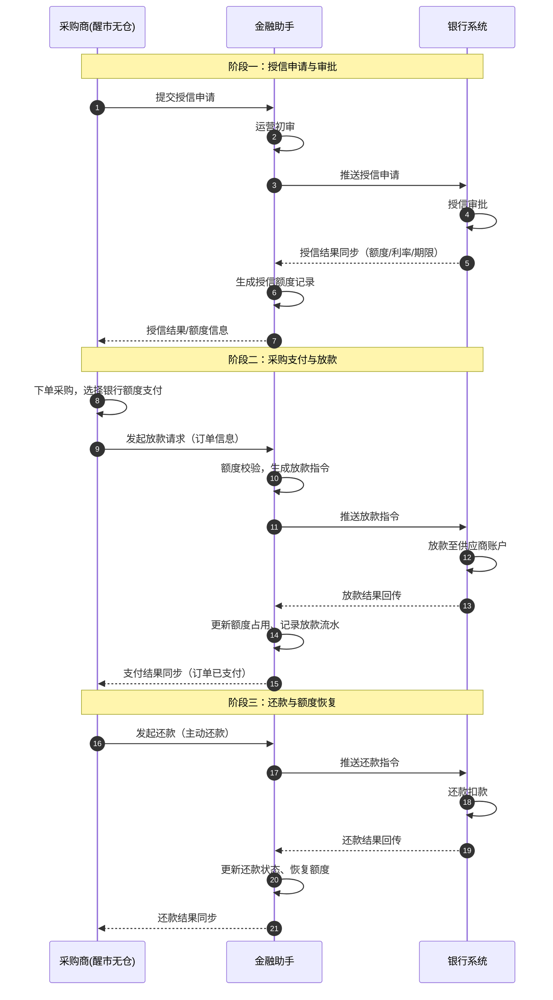

# 供应链金融-采购贷 整体业务方案

**文档版本**：V1.0
**撰写日期**：2026-08-14
**文档状态**：初稿（整体方案，待业务评审）
**适用对象**：产品经理、研发工程师、测试工程师、UI设计师、运营人员

---

## 1. 需求背景与目标

### 1.1 业务背景

平台现有供应链金融业务（信贷业务/货押）以"货押融资"和"赊销融资"为主，融资方需提供实物质押或核心企业担保，资金方为平台自有资金或合作资金方。

本次引入**采购贷**业务，为**采购商**（平台下游买家）提供银行直连的信用贷款服务：

- 采购商向**银行**发起授信申请，银行独立审批；
- 授信通过后，采购商在平台采购下单时，可直接使用**银行授信额度**支付货款；
- 银行将货款**直接放款给供应商**，实现"先提货、后还款"的采购融资闭环。

采购贷与现有信贷业务的核心差异：

| 维度 | 现有信贷/货押业务 | 采购贷 |
|------|------------------|--------|
| 融资主体 | 融资企业（经销商） | 采购商（下游买家） |
| 资金方 | 平台自有资金/合作资金方 | 银行（直连） |
| 风控方式 | 实物质押+平台审核 | 银行独立授信审批 |
| 资金流向 | 平台放款给融资方 | 银行直接放款给供应商 |
| 还款方式 | 还款后解质押 | 银行代扣/主动还款，额度恢复 |
| 申请入口 | 金融助手（运营代录） | 醒市无仓采购端自助 |

### 1.2 需求目标

| 目标 | 说明 | 衡量指标 |
|------|------|----------|
| 打通银行授信链路 | 实现采购商→平台→银行授信申请、审批、额度同步全流程 | 授信申请流转成功率 |
| 支持银行额度支付 | 采购下单可选银行额度支付，支付即触发银行放款 | 支付-放款闭环成功率 |
| 额度可视化管理 | 采购商可实时查询授信额度、可用额度、已用额度 | 额度数据一致性100% |
| 完整还款闭环 | 支持主动还款、到期还款、额度自动恢复 | 还款准确率100% |
| 兼容多银行 | 标准银行接口抽象，支持后续接入多家银行 | 新银行接入工作量最小化 |

### 1.3 名词定义

| 名词 | 定义 |
|------|------|
| 采购贷 | 平台为采购商提供的、基于银行授信额度的采购付款服务 |
| 采购商 | 在醒市无仓平台采购货物的下游企业，融资主体 |
| 供应商 | 在醒市无仓平台销售货物的上游企业，收款方 |
| 醒市无仓 | B2B交易平台（含采购商端/供应商端），下单、支付、交易查询 |
| 金融助手 | 平台供应链金融运营端（PC后台），授信审核、银行对接、放款与还款管理 |
| 银行接口层 | 金融助手内的标准银行对接适配层，统一各家银行接口差异 |
| 授信额度 | 银行审批通过后授予采购商的可用信用额度 |
| 银行额度支付 | 采购商使用银行授信额度作为支付方式结算采购货款 |

---

## 2. 角色与系统职责

### 2.1 参与角色

| 角色 | 所属端 | 职责 |
|------|--------|------|
| 采购商 | 醒市无仓采购端 | 提交授信申请、查询额度、下单选择银行额度支付、发起还款、查看账单 |
| 平台运营 | 金融助手 | 授信申请初审、银行推送、放款指令确认、还款处理、对账、异常处理 |
| 平台风控 | 金融助手 | 采购贷业务准入校验、风险监控（可选） |
| 银行客户经理/审批 | 银行系统 | 授信审批、额度维护、放款、还款扣款 |
| 供应商 | 醒市无仓供应商端 | 接收货款、查看收款记录 |

### 2.2 系统职责划分

| 系统 | 定位 | 核心职责 | 本期新增能力 |
|------|------|----------|--------------|
| 醒市无仓（含市场助手） | 交易平台 | 商品交易、订单、支付、物流 | 采购商授信申请入口、额度查询页、银行额度支付方式、还款入口 |
| 金融助手 | 供应链金融运营后台 | 授信审核、额度管理、放款/还款管理、银行对接、对账 | 银行授信申请管理、银行额度管理、采购放款管理、还款管理、银行接口管理 |
| 银行系统 | 外部资金方 | 授信审批、放款、还款 | 标准接口对接（授信同步/放款/还款/结果回传） |

> 注：醒市无仓为外部系统（已在其他系统实现），本期采购贷以**金融助手能力建设**为主，同时定义醒市无仓侧所需的页面与接口。

---

## 3. 整体业务流程

### 3.1 端到端主流程

```
┌─────────────────────────────────────────────────────────────────────┐
│                     采购贷 端到端业务流程                              │
└─────────────────────────────────────────────────────────────────────┘

  采购商(醒市无仓)            金融助手(运营端)                银行系统
      │                            │                          │
      │  ① 提交授信申请             │                          │
      │───────────────────────────▶│                          │
      │                            │  ② 运营初审               │
      │                            │                          │
      │                            │  ③ 推送授信申请           │
      │                            │─────────────────────────▶│
      │                            │                          │  ④ 授信审批
      │                            │◀─────────────────────────│
      │  ⑥ 查看额度/申请结果        │  ⑤ 同步授信额度结果        │
      │◀───────────────────────────│                          │
      │                            │                          │
      │  ⑦ 下单采购，选择银行额度支付                            │
      │───────────────────────────▶ (醒市无仓内部生成采购订单)    │
      │  ⑧ 发起放款请求             │                          │
      │───────────────────────────▶│                          │
      │                            │  ⑨ 校验额度/生成放款指令    │
      │                            │  ⑩ 推送放款指令            │
      │                            │─────────────────────────▶│
      │                            │                          │  ⑪ 放款至供应商
      │                            │◀─────────────────────────│
      │  ⑬ 支付完成/订单发货        │  ⑫ 同步放款结果+额度占用    │
      │◀───────────────────────────│                          │
      │                            │                          │
      │  （还款期）                                            │
      │  ⑭ 发起还款/到期还款                                    │
      │───────────────────────────▶│                          │
      │                            │  ⑮ 推送还款指令            │
      │                            │─────────────────────────▶│
      │                            │◀─────────────────────────│
      │  ⑰ 查看已结清/额度恢复       │  ⑯ 同步还款结果+额度释放    │
      │◀───────────────────────────│                          │
```

### 3.2 授信申请流程（银行授信前）

```
采购商发起授信申请
      │
      ▼
┌────────────────────────────────────────────────┐
│ 醒市无仓-采购商端「采购贷授信申请」              │
│ 1. 企业信息（名称/信用代码/法人/联系方式）        │
│ 2. 申请额度/期望利率/贷款用途/预计还款来源       │
│ 3. 资料上传（营业执照/法人证件/财务报表/征信授权）│
└────────────────────────────────────────────────┘
      │ 提交
      ▼
┌────────────────────────────────────────────────┐
│ 金融助手-授信申请管理                           │
│ 1. 生成授信申请单（状态：待审核）                │
│ 2. 运营初审：资料完整性/企业准入/额度合理性       │
│ 3. 初审通过 → 状态：待推送银行                   │
└────────────────────────────────────────────────┘
      │ 推送
      ▼
┌────────────────────────────────────────────────┐
│ 银行系统                                       │
│ 1. 银行接收授信申请（采购商企业信息+申请额度）    │
│ 2. 银行独立审批（信用评估/额度审批）              │
│ 3. 审批通过 → 授予授信额度                       │
└────────────────────────────────────────────────┘
      │ 审批结果同步（银行→金融助手）
      ▼
┌────────────────────────────────────────────────┐
│ 金融助手-银行授信管理                           │
│ 1. 接收授信结果（额度/利率/期限/循环/生效日）     │
│ 2. 生成/更新授信额度记录（状态：生效中）          │
│ 3. 同步授信结果至醒市无仓                        │
└────────────────────────────────────────────────┘
      │
      ▼
┌────────────────────────────────────────────────┐
│ 醒市无仓-采购商端                               │
│ 采购商可查询：总额度/可用额度/已用额度/利率/期限   │
└────────────────────────────────────────────────┘
```

### 3.3 采购支付（放款）流程

```
采购商在醒市无仓下单
      │
      ▼
┌────────────────────────────────────────────────┐
│ 醒市无仓-下单结算                               │
│ 1. 生成采购订单（含商品明细/订单金额/供应商）     │
│ 2. 选择支付方式：银行额度支付                    │
│ 3. 系统校验：采购商存在生效授信额度且可用额度充足  │
└────────────────────────────────────────────────┘
      │ 发起放款请求（含订单信息）
      ▼
┌────────────────────────────────────────────────┐
│ 金融助手-采购放款管理                           │
│ 1. 生成放款指令（状态：待放款）                  │
│ 2. 额度校验：订单金额 ≤ 可用额度                 │
│ 3. 冻结/预占额度（可选）                         │
│ 4. 推送放款指令至银行                           │
└────────────────────────────────────────────────┘
      │
      ▼
┌────────────────────────────────────────────────┐
│ 银行系统                                       │
│ 1. 银行执行放款（资金直接划转至供应商账户）        │
│ 2. 生成放款流水                               │
└────────────────────────────────────────────────┘
      │ 放款结果回传
      ▼
┌────────────────────────────────────────────────┐
│ 金融助手-采购放款管理                           │
│ 1. 接收放款结果（成功/失败/金额/流水号）          │
│ 2. 更新放款指令状态                              │
│ 3. 更新授信额度：占用额度 = 已用额度 + 放款金额    │
│ 4. 记录放款流水，同步支付结果至醒市无仓            │
└────────────────────────────────────────────────┘
      │
      ▼
┌────────────────────────────────────────────────┐
│ 醒市无仓-订单支付                               │
│ 1. 订单支付状态更新为：已支付（银行额度）          │
│ 2. 通知供应商发货                                │
└────────────────────────────────────────────────┘
```

### 3.4 还款流程

```
还款触发（二选一）
      │
      ├── 采购商主动还款（醒市无仓发起）
      └── 到期自动还款（银行扣款）
      │
      ▼
┌────────────────────────────────────────────────┐
│ 醒市无仓-还款入口 / 银行到期扣款                │
│ 1. 展示应还账单（本金/利息/期次/到期日）          │
│ 2. 采购商确认还款金额/还款账户                    │
└────────────────────────────────────────────────┘
      │
      ▼
┌────────────────────────────────────────────────┐
│ 金融助手-还款管理                               │
│ 1. 生成还款申请（状态：待还款）                  │
│ 2. 校验应还金额                                  │
│ 3. 推送还款指令至银行（主动还款 / 代扣）          │
└────────────────────────────────────────────────┘
      │
      ▼
┌────────────────────────────────────────────────┐
│ 银行系统                                       │
│ 1. 银行执行还款扣款（从采购商还款账户扣款）        │
│ 2. 更新贷款余额                                │
└────────────────────────────────────────────────┘
      │ 还款结果回传
      ▼
┌────────────────────────────────────────────────┐
│ 金融助手-还款管理                               │
│ 1. 接收还款结果（成功/失败/金额/流水号）          │
│ 2. 更新还款状态：已结清 / 部分还款 / 失败          │
│ 3. 更新授信额度：可用额度恢复                     │
│ 4. 更新还款计划（剩余期次）                       │
│ 5. 同步还款结果至醒市无仓                         │
└────────────────────────────────────────────────┘
      │
      ▼
┌────────────────────────────────────────────────┐
│ 醒市无仓-采购商端                               │
│ 采购商查看：还款记录/剩余应还/可用额度已恢复       │
└────────────────────────────────────────────────┘
```

### 3.5 系统时序图



---

## 4. 整体架构设计

### 4.1 系统架构

```
┌──────────────────────────────────────────────────────────────────┐
│                            采购商端                              │
│                    醒市无仓 / 市场助手                           │
│   授信申请 │ 额度查询 │ 下单支付(银行额度) │ 还款 │ 账单查询       │
└───────────────────────────┬──────────────────────────────────────┘
                            │ 开放接口(内部API/消息)
                            ▼
┌──────────────────────────────────────────────────────────────────┐
│                        金融助手（供应链金融运营端）                  │
│                                                                  │
│  ┌────────────┐ ┌────────────┐ ┌────────────┐ ┌────────────┐    │
│  │ 授信申请管理 │ │ 银行授信管理 │ │ 采购放款管理 │ │  还款管理   │    │
│  └────────────┘ └────────────┘ └────────────┘ └────────────┘    │
│  ┌────────────┐ ┌────────────┐ ┌────────────┐                   │
│  │ 银行合作管理 │ │  对账管理   │ │  风险监控   │                   │
│  └────────────┘ └────────────┘ └────────────┘                   │
│                                                                  │
│  ┌────────────────────────────────────────────────────────────┐ │
│  │                银行接口适配层（Bank Adapter）                 │ │
│  │  授信申请│授信结果│放款指令│放款结果│还款指令│还款结果│对账查询    │ │
│  │  ┌────────┐ ┌────────┐ ┌────────┐ ┌────────┐               │ │
│  │  │ 银行A   │ │ 银行B   │ │ 银行C   │ │ 报文转换 │               │ │
│  │  │适配器   │ │适配器   │ │适配器   │ │/加解密  │               │ │
│  │  └────────┘ └────────┘ └────────┘ └────────┘               │ │
│  └────────────────────────────────────────────────────────────┘ │
└───────────────────────────┬──────────────────────────────────────┘
                            │ 银企直连API（HTTPS/证书/报文签名）
                            ▼
┌──────────────────────────────────────────────────────────────────┐
│                        银行系统（外部）                            │
│       授信审批 │ 额度管理 │ 放款 │ 还款扣款 │ 对账查询              │
└──────────────────────────────────────────────────────────────────┘
```

### 4.2 架构设计要点

| 要点 | 说明 |
|------|------|
| 银行接口适配层 | 屏蔽各银行接口差异，统一封装为标准报文；新银行接入仅需新增适配器 |
| 报文安全 | 采用 HTTPS + 数字证书双向认证 + 报文摘要签名；敏感信息（证件号/银行账号）脱敏存储 |
| 异步+幂等 | 银行放款/还款采用异步处理，所有指令与回调接口实现幂等（按业务编号幂等），防止重复放款/扣款 |
| 资金流与信息流分离 | 银行资金直接划转，平台只记录指令与结果，不触碰资金 |
| 对账兜底 | 每日对账（放款/还款流水与银行明细核对），差异自动告警 |
| 额度强一致 | 额度占用/释放基于数据库事务+乐观锁，保障并发下单不超用额度 |

---

## 5. 金融助手功能模块设计

> 本期核心是**金融助手**能力建设。以下为功能模块清单与详细设计。

### 5.1 功能清单

| 一级菜单 | 二级菜单 | 功能说明 | 优先级 |
|---------|---------|---------|--------|
| 采购贷授信 | 授信申请管理 | 采购商授信申请列表、初审、推送银行、查看银行审批结果 | P0 |
| 采购贷授信 | 银行授信管理 | 银行同步的授信额度查询、额度变更、冻结/解冻、额度明细 | P0 |
| 采购贷放款 | 采购放款管理 | 放款指令列表、放款详情、额度占用记录、放款流水查询 | P0 |
| 采购贷还款 | 还款管理 | 还款计划、还款申请、还款处理、还款记录、逾期监控 | P0 |
| 采购贷还款 | 还款计划管理 | 按授信/放款单生成还款计划，展示应还本息 | P0 |
| 银行管理 | 银行合作方管理 | 合作银行配置（对接参数、接口开关、额度上限） | P0 |
| 银行管理 | 银行接口日志 | 与银行的报文请求/响应日志、异常重发、补单 | P0 |
| 对账中心 | 放款对账 | 平台放款流水与银行流水核对 | P1 |
| 对账中心 | 还款对账 | 平台还款流水与银行流水核对 | P1 |
| 对账中心 | 对账差异处理 | 差异明细、人工核对、差错调整 | P1 |
| 风险监控 | 采购贷风险监控 | 逾期预警、额度使用率、银行放款失败率（看板） | P1 |

### 5.2 授信申请管理

**页面**：授信申请列表 / 授信申请详情 / 审核操作

**列表字段**：

| 字段 | 说明 |
|------|------|
| 授信申请编号 | 系统生成，如 `CR202608140001` |
| 采购商名称 | 授信主体企业 |
| 统一社会信用代码 | — |
| 申请额度 | 采购商申请的授信额度 |
| 申请日期 | — |
| 申请渠道 | 醒市无仓（采购商端自助） |
| 银行 | 推送到哪家银行 |
| 审批状态 | 待审核 / 待推送 / 银行审批中 / 已通过 / 已拒绝 / 已驳回 |
| 操作 | 审核 / 推送银行 / 查看详情 |

**运营审核操作**：

| 操作 | 说明 | 前置条件 |
|------|------|----------|
| 审核通过 | 资料齐全、准入通过，进入"待推送银行" | 待审核状态 |
| 审核驳回 | 填写驳回原因，通知采购商补充/修改 | 待审核状态 |
| 推送银行 | 将授信申请推送至所选合作银行 | 待推送状态 |
| 撤销推送 | 撤销已推送的申请（银行未处理时） | 银行审批中状态 |

**关键规则**：
- 授信申请来源：醒市无仓采购商端提交（自动生成申请单）；支持运营代录（采购商线下申请场景）。
- 采购商准入校验：企业已在客户管理中存在且状态正常（复用 `fa_customer`）。
- 推送银行时携带采购商资质资料，银行审批期间申请状态为"银行审批中"。

### 5.3 银行授信管理

**页面**：银行授信列表 / 授信详情 / 额度变更记录

**列表字段**：

| 字段 | 说明 |
|------|------|
| 授信编号 | 银行授予的授信编号 + 平台侧授信记录编号 |
| 采购商名称 | 授信主体 |
| 授信银行 | — |
| 授信总额度 | 银行审批的总额度 |
| 已用额度 | 已放款未还款占用的额度 |
| 可用额度 | 总额度 - 已用额度 |
| 授信期限 | 起止日期 |
| 循环标志 | 是否循环授信 |
| 年化利率 | 银行设定的利率 |
| 状态 | 生效中 / 已冻结 / 已失效 |
| 操作 | 查看 / 冻结 / 解冻 / 额度明细 |

**额度变更记录**（额度流水）：

| 字段 | 说明 |
|------|------|
| 变更编号 | 唯一 |
| 变更类型 | 初始授予 / 放款占用 / 还款释放 / 额度调增 / 额度调减 / 冻结 |
| 变更金额 | 变更的额度数值（正/负） |
| 变更前可用额度 | — |
| 变更后可用额度 | — |
| 关联单号 | 放款指令号 / 还款号 / 银行调额通知号 |
| 变更时间 | — |

**关键规则**：
- 授信额度数据以**银行同步结果为准**，平台侧额度变动仅记录，不修改银行侧额度。
- 银行回调"额度变更通知"时，平台更新总额度并记录额度流水。
- 额度冻结/解冻：银行主动通知或运营人工发起（需在银行侧同步操作）。

### 5.4 采购放款管理

**页面**：放款指令列表 / 放款详情

**列表字段**：

| 字段 | 说明 |
|------|------|
| 放款指令号 | 平台生成，如 `DL202608140001` |
| 采购订单号 | 醒市无仓采购订单号 |
| 采购商名称 | — |
| 供应商名称 | 放款收款方 |
| 放款金额 | 订单支付金额 |
| 关联授信编号 | — |
| 放款状态 | 待放款 / 放款中 / 放款成功 / 放款失败 |
| 放款时间 | — |
| 银行流水号 | 银行回传的放款流水号 |
| 操作 | 查看详情 / 重发（失败时） |

**放款详情**：
- 订单信息（订单号/商品明细/订单金额/供应商收款账户）
- 额度信息（关联授信/本次占用/占用后可用额度）
- 银行交互记录（推送报文/响应/回调报文）
- 状态流转时间线

**关键规则**：
- 放款指令由醒市无仓放款请求触发，金额=采购订单应付金额。
- 放款前校验：授信生效中、可用额度≥放款金额、供应商收款账户有效。
- 额度占用时机：**放款成功回调后**占用（不预占），或**推送放款指令时预占**（防超用）。本期建议推送即预占，回调成功确认占用、失败释放预占。
- 放款失败：平台标记失败、释放预占额度、通知醒市无仓，采购商可重新发起或更换支付方式。
- 银行回调实现幂等：同一放款指令多次回调只处理一次。

### 5.5 还款管理

**页面**：还款计划列表 / 还款申请列表 / 还款处理

**还款计划**（按放款单生成）：

| 字段 | 说明 |
|------|------|
| 还款计划号 | — |
| 关联放款指令号 | — |
| 期次 | 第几期 |
| 应还本金 | — |
| 应还利息 | 按银行利率计算 |
| 应还总额 | 本金+利息 |
| 应还日期 | — |
| 状态 | 待还款 / 部分还款 / 已结清 / 已逾期 |

**还款处理**：

| 字段 | 说明 |
|------|------|
| 还款单号 | 平台生成 |
| 还款方式 | 主动还款（采购商发起）/ 银行代扣（到期自动） |
| 还款金额 | 本次还款金额（本金+利息） |
| 还款状态 | 待还款 / 还款中 / 还款成功 / 还款失败 |
| 银行流水号 | — |
| 还款时间 | — |

**关键规则**：
- 主动还款：醒市无仓发起 → 金融助手生成还款申请 → 推送银行扣款。
- 到期还款：银行按约定自动扣款，结果回调平台。
- 还款成功后：更新还款计划、释放额度占用（可用额度恢复）、同步醒市无仓。
- 还款失败：平台标记失败并通知，支持重试或线下处理。
- 逾期处理：逾期后触发预警，本期仅做逾期状态标记与列表筛选，催收流程二期。

### 5.6 银行合作方管理

**页面**：合作银行列表 / 银行对接配置

| 字段 | 说明 |
|------|------|
| 银行名称 | — |
| 银行编号 | 平台内唯一编码 |
| 对接模式 | 银企直连API / 报文文件交换 |
| 对接状态 | 启用 / 停用 |
| 接口地址 | 测试/生产环境地址 |
| 证书/密钥 | 证书引用、加解密配置（加密存储） |
| 授信总额上限 | 银行给平台的整体合作额度（可选） |
| 支持产品 | 采购贷授信 / 放款 / 还款 |
| 接口开关 | 授信同步、放款、还款、对账等接口是否启用 |

**关键规则**：
- 银行准入、评级、退出等管理复用货押模块《银行合作方管理方案》能力（见附录）。
- 银行对接配置化，新增银行仅需新增适配器+配置，不改业务流程。

### 5.7 对账管理

**放款对账 / 还款对账**：

| 字段 | 说明 |
|------|------|
| 对账日期 | — |
| 对账类型 | 放款 / 还款 |
| 银行侧流水数/金额 | 银行回传的日终对账文件 |
| 平台侧流水数/金额 | 平台记录的放款/还款流水 |
| 差异明细 | 有差异的单据列表（平台有银行无 / 银行有平台无 / 金额不一致） |
| 对账结果 | 一致 / 有差异 |
| 处理状态 | 待处理 / 已处理 |

**关键规则**：
- 每日日终对账，银行提供对账文件或对账接口。
- 差异单据进入差异处理列表，支持人工核对与差错调整。
- 对账差异在T+1日完成处理。

### 5.8 菜单结构

**一级菜单**：采购贷

**二级菜单**：

| 菜单名称 | 功能说明 | 入口路径 |
|---------|---------|---------|
| 授信申请管理 | 采购商授信申请审核与银行推送 | 采购贷 → 授信申请管理 |
| 银行授信管理 | 银行授信额度查询与管理 | 采购贷 → 银行授信管理 |
| 采购放款管理 | 放款指令与放款记录管理 | 采购贷 → 采购放款管理 |
| 还款管理 | 还款计划、还款申请与处理 | 采购贷 → 还款管理 |
| 银行合作方管理 | 合作银行配置与维护 | 系统管理 → 银行合作方管理 |
| 银行接口日志 | 银行报文交互日志与重发 | 系统管理 → 银行接口日志 |
| 对账中心 | 放款/还款对账与差异处理 | 对账中心 → 放款对账 / 还款对账 |

---

## 6. 数据模型设计

### 6.1 核心表清单

| 表名 | 说明 | 是否复用一期 |
|------|------|--------------|
| fa_customer | 客户基础信息（采购商企业档案） | ✅ 复用 |
| fa_upload_file | 上传材料 | ✅ 复用 |
| fa_audit_info | 审批信息 | ✅ 复用 |
| fa_bank | 合作银行配置 | 🆕 新增 |
| fa_credit_apply | 授信申请（采购贷） | ⚠️ 扩展（新增银行来源字段）或新建 |
| fa_credit | 银行授信额度 | 🆕 新增（区别于平台自有授信） |
| fa_credit_quota_log | 额度变动流水 | 🆕 新增 |
| fa_loan_apply | 放款指令 | 🆕 新增 |
| fa_loan_apply_goods | 放款商品明细 | 🆕 新增 |
| fa_repay | 还款申请 | ⚠️ 扩展或新建 |
| fa_repay_plan | 还款计划 | 🆕 新增 |
| fa_bank_interface_log | 银行接口日志 | 🆕 新增 |
| fa_reconcile | 对账记录 | 🆕 新增 |

### 6.2 关键表结构

> 字段为主设计，最终以详设为准。金额统一 `decimal(18,2)`，金额字段在存储层按"分"存储、展示层转"元"（避免浮点误差）。

#### 6.2.1 合作银行配置 `fa_bank`

| 字段 | 类型 | 说明 |
|------|------|------|
| id | bigint | 主键 |
| bank_code | varchar(32) | 银行编码（平台内唯一） |
| bank_name | varchar(100) | 银行名称 |
| adapter_class | varchar(200) | 适配器实现类 |
| cert_id | varchar(100) | 证书标识 |
| api_base_url | varchar(200) | 接口基础地址 |
| support_product | varchar(50) | 支持产品（授信/放款/还款） |
| interface_switch | json | 各接口开关 |
| status | tinyint | 0停用 1启用 |
| create_time/update_time | datetime | 时间戳 |
| deleted | tinyint | 逻辑删除 |

#### 6.2.2 采购贷授信申请 `fa_credit_apply`（扩展一期）

一期已有字段基础上，新增采购贷/银行相关字段：

| 字段 | 类型 | 说明 |
|------|------|------|
| id | bigint | 主键 |
| credit_apply_no | varchar(50) | 授信申请编号 |
| customer_id | bigint | 采购商客户id |
| bank_id | bigint | 合作银行id |
| apply_amount | decimal(18,2) | 申请额度 |
| apply_term | int | 申请期限（月） |
| loan_purpose | varchar(250) | 贷款用途 |
| repay_source | varchar(250) | 预计还款来源 |
| source | tinyint | 申请来源 1醒市无仓 2运营代录 |
| bank_apply_no | varchar(100) | 银行侧申请编号 |
| apply_status | tinyint | 申请状态（见状态机） |
| audit_status | tinyint | 平台审核状态 |
| bank_audit_status | tinyint | 银行审批状态 |
| refuse_reason | varchar(500) | 驳回/拒绝原因 |
| push_time | datetime | 推送银行时间 |
| audit_time | datetime | 银行审批完成时间 |
| create_time/update_time | datetime | 时间戳 |
| deleted | tinyint | 逻辑删除 |

#### 6.2.3 银行授信额度 `fa_credit`

| 字段 | 类型 | 说明 |
|------|------|------|
| id | bigint | 主键 |
| credit_no | varchar(50) | 平台授信编号 |
| bank_credit_no | varchar(100) | 银行授信编号 |
| customer_id | bigint | 采购商客户id |
| bank_id | bigint | 合作银行id |
| credit_apply_no | varchar(50) | 关联授信申请编号 |
| total_limit | decimal(18,2) | 授信总额度 |
| used_limit | decimal(18,2) | 已用额度 |
| remain_limit | decimal(18,2) | 可用额度 |
| rate | decimal(18,4) | 年化利率（%） |
| credit_start | date | 授信生效日期 |
| credit_end | date | 授信截止日期 |
| is_loop | tinyint | 是否循环 0否 1是 |
| is_frozen | tinyint | 是否冻结 |
| status | tinyint | 状态 1生效 2冻结 3失效 |
| create_time/update_time | datetime | 时间戳 |
| deleted | tinyint | 逻辑删除 |

#### 6.2.4 额度变动流水 `fa_credit_quota_log`

| 字段 | 类型 | 说明 |
|------|------|------|
| id | bigint | 主键 |
| credit_id | bigint | 授信id |
| change_type | tinyint | 1初始授予 2放款占用 3还款释放 4调增 5调减 6冻结 7解冻 |
| change_amount | decimal(18,2) | 变更额度（正/负） |
| before_remain | decimal(18,2) | 变更前可用额度 |
| after_remain | decimal(18,2) | 变更后可用额度 |
| ref_no | varchar(50) | 关联单号（放款指令/还款/银行通知） |
| remark | varchar(250) | 备注 |
| create_time | datetime | 创建时间 |

#### 6.2.5 放款指令 `fa_loan_apply`

| 字段 | 类型 | 说明 |
|------|------|------|
| id | bigint | 主键 |
| loan_apply_no | varchar(50) | 放款指令号 |
| credit_id | bigint | 授信id |
| purchase_order_no | varchar(50) | 醒市无仓采购订单号 |
| customer_id | bigint | 采购商客户id |
| supplier_id | bigint | 供应商客户id |
| supplier_account_id | bigint | 供应商收款账户（关联fa_customer_bank） |
| loan_amount | decimal(18,2) | 放款金额 |
| loan_status | tinyint | 状态（见状态机） |
| bank_loan_no | varchar(100) | 银行放款流水号 |
| fail_reason | varchar(500) | 失败原因 |
| push_time | datetime | 推送银行时间 |
| result_time | datetime | 银行结果时间 |
| create_time/update_time | datetime | 时间戳 |
| deleted | tinyint | 逻辑删除 |

#### 6.2.6 还款计划 `fa_repay_plan`

| 字段 | 类型 | 说明 |
|------|------|------|
| id | bigint | 主键 |
| loan_apply_no | varchar(50) | 关联放款指令号 |
| period | int | 期次 |
| due_date | date | 应还日期 |
| repay_principal | decimal(18,2) | 应还本金 |
| repay_interest | decimal(18,2) | 应还利息 |
| repay_total | decimal(18,2) | 应还总额 |
| repaid_amount | decimal(18,2) | 已还金额 |
| status | tinyint | 1待还款 2部分还款 3已结清 4已逾期 |
| create_time/update_time | datetime | 时间戳 |

#### 6.2.7 还款申请 `fa_repay`

| 字段 | 类型 | 说明 |
|------|------|------|
| id | bigint | 主键 |
| repay_no | varchar(50) | 还款单号 |
| loan_apply_no | varchar(50) | 关联放款指令号 |
| repay_plan_id | bigint | 关联还款计划id |
| repay_type | tinyint | 1主动还款 2银行代扣 |
| repay_amount | decimal(18,2) | 还款金额 |
| repay_status | tinyint | 1待还款 2还款中 3成功 4失败 |
| bank_repay_no | varchar(100) | 银行还款流水号 |
| fail_reason | varchar(500) | 失败原因 |
| push_time | datetime | 推送银行时间 |
| result_time | datetime | 银行结果时间 |
| create_time/update_time | datetime | 时间戳 |
| deleted | tinyint | 逻辑删除 |

#### 6.2.8 银行接口日志 `fa_bank_interface_log`

| 字段 | 类型 | 说明 |
|------|------|------|
| id | bigint | 主键 |
| bank_id | bigint | 银行id |
| interface_type | varchar(50) | 接口类型（授信推送/放款/还款/回调） |
| biz_no | varchar(50) | 关联业务编号 |
| direction | tinyint | 1请求 2响应 3回调 |
| request_msg | text | 请求报文（脱敏） |
| response_msg | text | 响应报文（脱敏） |
| status | tinyint | 处理结果 |
| retry_count | int | 重试次数 |
| create_time | datetime | 创建时间 |

---

## 7. 系统间接口设计

### 7.1 金融助手 ↔ 银行（标准接口）

> 统一抽象为标准接口，通过适配层适配各银行；所有接口支持**幂等**，回调采用 HTTPS 通知 + 主动查询兜底。

| 序号 | 接口 | 方向 | 说明 | 同步/异步 |
|------|------|------|------|-----------|
| 1 | 授信申请提交 | 金融助手→银行 | 推送采购商授信申请（企业信息+申请额度+资料） | 异步 |
| 2 | 授信审批结果通知 | 银行→金融助手 | 授信通过/拒绝，通过时携带额度/利率/期限/循环标志 | 异步回调 |
| 3 | 额度变更通知 | 银行→金融助手 | 额度调增/调减/冻结/解冻/失效 | 异步回调 |
| 4 | 授信查询 | 金融助手→银行 | 查询授信状态/额度（对账与兜底） | 同步 |
| 5 | 放款指令提交 | 金融助手→银行 | 推送放款指令（订单信息+供应商收款账户+金额） | 异步 |
| 6 | 放款结果通知 | 银行→金融助手 | 放款成功/失败，携带银行流水号/金额 | 异步回调 |
| 7 | 放款查询 | 金融助手→银行 | 放款结果主动查询（兜底） | 同步 |
| 8 | 还款指令提交 | 金融助手→银行 | 推送还款指令（主动还款/到期代扣） | 异步 |
| 9 | 还款结果通知 | 银行→金融助手 | 还款成功/失败，携带银行流水号/金额 | 异步回调 |
| 10 | 还款查询 | 金融助手→银行 | 还款结果主动查询（兜底） | 同步 |
| 11 | 日终对账文件/接口 | 银行→金融助手 | 放款/还款日终流水（对账） | 日终批量 |

**回调接口通用规范**：
- 幂等键：业务编号（授信申请号/放款指令号/还款单号）+ 接口类型。
- 回调报文验签：验证银行签名，防伪造。
- 通知失败处理：重试N次，仍失败转人工补单（查银行侧流水）。

### 7.2 醒市无仓 ↔ 金融助手（内部接口）

| 序号 | 接口 | 方向 | 说明 |
|------|------|------|------|
| 1 | 授信申请提交 | 醒市无仓→金融助手 | 采购商提交授信申请（含企业资料） |
| 2 | 授信申请状态查询 | 醒市无仓→金融助手 | 采购商查询申请进度 |
| 3 | 授信额度查询 | 醒市无仓→金融助手 | 采购商查询可用额度/利率/期限 |
| 4 | 授信结果通知 | 金融助手→醒市无仓 | 授信通过/拒绝后通知采购商 |
| 5 | 放款请求提交 | 醒市无仓→金融助手 | 采购订单选择银行额度支付后发起放款 |
| 6 | 放款/支付结果通知 | 金融助手→醒市无仓 | 放款成功/失败后同步订单支付状态 |
| 7 | 还款请求提交 | 醒市无仓→金融助手 | 采购商主动还款 |
| 8 | 还款结果通知 | 金融助手→醒市无仓 | 还款成功后同步还款状态与额度 |
| 9 | 还款账单/计划查询 | 醒市无仓→金融助手 | 采购商查看应还账单 |

---

## 8. 状态机设计

### 8.1 授信申请状态

```
         ┌──────────┐
         │  待审核   │◀──────── 醒市无仓提交 / 运营代录
         └────┬─────┘
       通过   │  驳回
         ▼    │    ▼
  ┌─────────┐  ┌─────────┐
  │ 待推送银行 │  │  已驳回  │
  └────┬────┘  └─────────┘
       │ 推送银行
       ▼
  ┌─────────────┐
  │ 银行审批中   │
  └────┬────────┘
    通过│        │拒绝
       ▼        ▼
  ┌─────────┐  ┌─────────┐
  │ 已通过   │  │ 已拒绝   │
  │(生成额度) │  └─────────┘
  └─────────┘
```

### 8.2 授信额度状态

```
  生效中 ──冻结──▶ 已冻结
     ▲             │
     └────解冻──────┘
     │
     └────到期/失效────▶ 已失效
```

### 8.3 放款指令状态

```
  ┌────────┐  提交银行   ┌────────┐  放款成功   ┌────────┐
  │ 待放款  │──────────▶│ 放款中  │──────────▶│ 放款成功 │
  │(预占额度)│           └────────┘           └────────┘
  └────────┘               │
      │                    │ 放款失败(释放预占)
      │ 校验不通过          ▼
      ▼                 ┌────────┐   重发
  ┌────────┐            │ 放款失败 │◀────────┐
  │ 校验失败 │            └────────┘         │
  └────────┘                 │              │
      │                      └──────────────┘
      └── 关闭(取消) ──▶ ┌────────┐
                         │ 已关闭  │
                         └────────┘
```

### 8.4 还款状态

```
  ┌────────┐  推送银行   ┌────────┐  成功   ┌────────┐
  │ 待还款  │──────────▶│ 还款中  │───────▶│ 还款成功 │──▶ 释放额度/更新计划
  └────────┘           └────────┘        └────────┘
      │                    │ 失败              │
      │                    ▼                  ▼
      │                ┌────────┐        ┌────────┐
      └── 撤销 ──▶      │ 还款失败 │──重试─▶│ 还款成功 │
                        └────────┘        └────────┘
```

---

## 9. 页面清单（原型规划）

### 9.1 金融助手（运营端）

| 页面 | 功能要点 |
|------|----------|
| 授信申请列表 | 筛选（状态/银行/时间/采购商）、列表、详情入口 |
| 授信申请详情 | 采购商资料、申请信息、资料预览、审核操作、银行审批结果 |
| 银行授信列表 | 授信额度列表、筛选、详情入口 |
| 银行授信详情 | 额度信息、额度变动记录、冻结/解冻操作 |
| 采购放款列表 | 放款指令列表、筛选、详情入口 |
| 采购放款详情 | 订单信息、额度占用、银行交互记录、状态流转 |
| 还款计划列表 | 按授信/放款查看还款计划、应还汇总 |
| 还款列表 | 还款申请、还款处理、筛选 |
| 还款详情 | 还款单信息、银行交互记录 |
| 银行合作方列表/配置 | 银行列表、对接参数配置 |
| 银行接口日志 | 报文查询、异常重发 |
| 对账中心 | 放款/还款对账、差异列表、差异处理 |

### 9.2 醒市无仓（采购商端）

| 页面 | 功能要点 |
|------|----------|
| 授信申请页 | 企业信息、申请额度、贷款用途、资料上传、提交 |
| 授信进度/结果页 | 申请状态、授信结果、授信额度信息 |
| 我的额度页 | 总额度/可用额度/已用额度、利率、期限、额度明细 |
| 下单支付页 | 支付方式选择（含"银行额度支付"）、余额校验提示 |
| 还款中心 | 应还账单、还款计划、主动还款、还款记录 |

---

## 10. 风险与待确认事项

### 10.1 待确认事项

| 序号 | 事项 | 当前建议 | 建议确认方 |
|------|------|----------|-----------|
| 1 | 首批对接银行及银行接口规范 | 先按标准接口抽象设计，具体银行规范待技术确认 | 技术+业务 |
| 2 | 授信申请是否需运营初审，还是直接推送银行 | 建议运营初审（资料完整性+准入）后再推送 | 产品+风控 |
| 3 | 放款额度占用时机：预占 or 成功后占用 | 建议推送指令时预占，防超用 | 产品+技术 |
| 4 | 供应商收款账户信息来源（醒市无仓/金融助手维护） | 建议由醒市无仓提供并校验 | 产品+技术 |
| 5 | 还款方式：主动还款+银行代扣，代扣授权如何签署 | 主动还款本期必做，代扣授权机制待确认 | 产品+法务 |
| 6 | 利息计算规则（按日/按月、基准）及入账归属 | 以银行账单为准，平台仅展示 | 产品+财务 |
| 7 | 逾期催收流程是否本期实现 | 本期仅逾期状态标记，催收二期 | 产品+风控 |
| 8 | 醒市无仓侧页面与接口是否由平台侧开发 | 醒市无仓为外部系统，接口与页面开发归属待确认 | 产品+技术 |
| 9 | 授信申请资料清单与银行要求是否一致 | 以银行要求为准，动态配置 | 产品+银行 |
| 10 | 对账文件获取方式（银行文件/接口） | 按银行能力，适配层支持两种 | 技术+银行 |

### 10.2 风险点

| 风险 | 影响 | 应对措施 |
|------|------|----------|
| 银行接口联调周期长 | 项目延期 | 提前获取接口文档，标准适配层先行开发 |
| 额度并发超用 | 放款失败/风险敞口 | 额度占用数据库事务+乐观锁，下单时强校验 |
| 回调丢失/重复 | 状态不一致/重复放款 | 幂等处理+主动查询兜底+对账 |
| 银行侧额度与平台不一致 | 授信管理失真 | 以银行同步为准，每日对账 |
| 资金安全问题 | 合规风险 | 资金全程银行直连，平台不碰资金 |

---

## 11. 与现有业务的关系（附录）

### 11.1 与信贷业务的关系

- 信贷业务为平台自有资金/合作资金方的货押、赊销融资；采购贷为**银行直连**的采购付款融资。
- 采购贷复用信贷业务的客户管理（`fa_customer`）、上传材料（`fa_upload_file`）、审批记录（`fa_audit_info`）等基础能力。
- 授信额度区分**平台授信**（信贷业务）与**银行授信**（采购贷），数据独立，互不占用。

### 11.2 与货押模块的关系

- 货押模块已有《银行合作方管理方案》与银行端业务审批原型，采购贷的**银行合作方准入/评级/退出**管理直接复用该方案。
- 采购贷的放款/还款交互与货押银行端放款管理原型结构类似，可参考其交互设计（确认放款、结果回传、失败处理）。

### 11.3 二期规划（建议）

| 模块 | 说明 |
|------|------|
| 逾期催收管理 | 催收任务、催收记录、黑名单 |
| 采购贷还款计划试算 | 平台侧利息试算工具（当前以银行账单为准） |
| 多银行智能路由 | 按银行额度/评级自动路由授信申请与放款 |
| 采购商额度自助调额 | 采购商在线申请调额，银行审批 |

---

> **文档结束**
