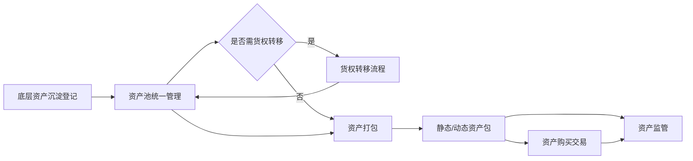
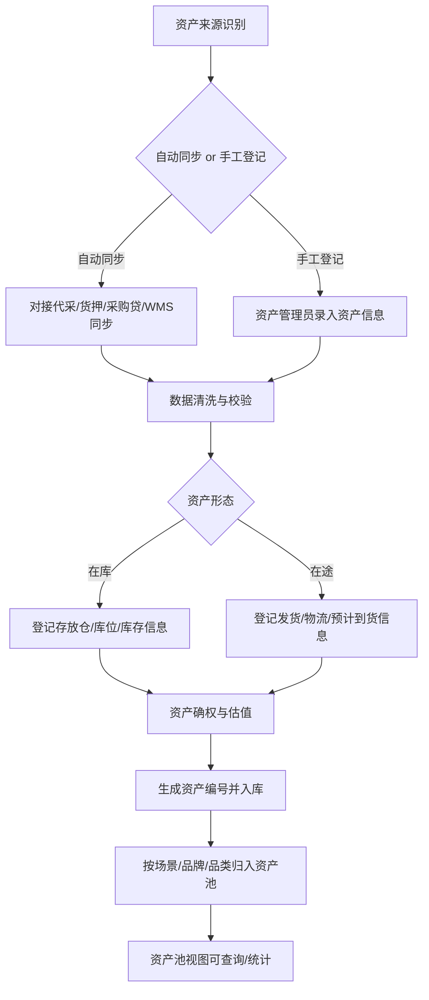
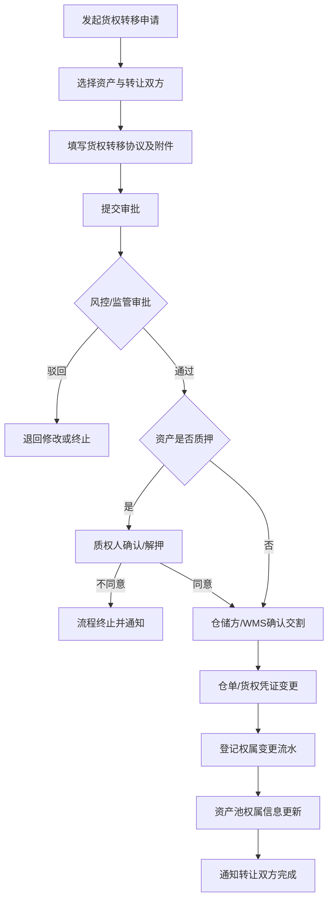
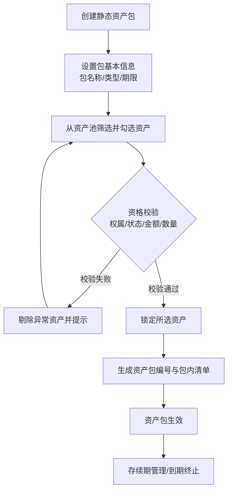
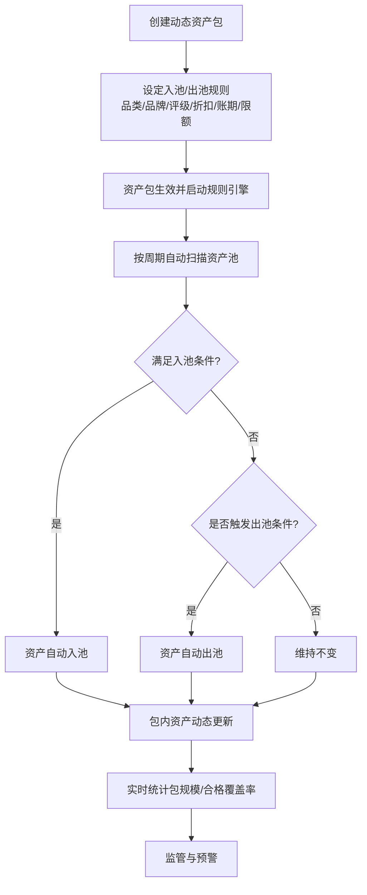
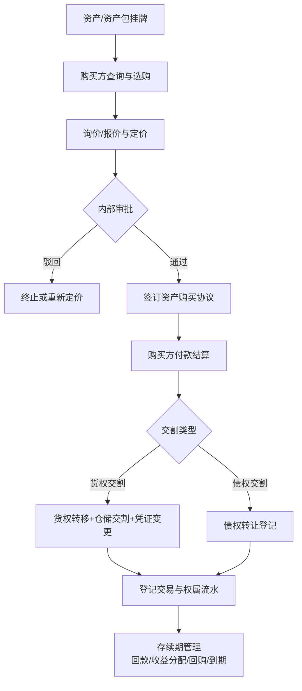
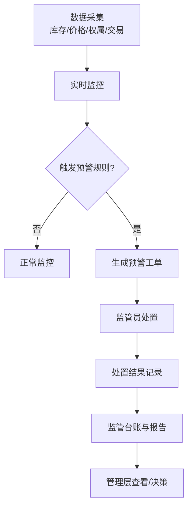

# 底层资产打包管理 - 建设方案

**文档版本**：V1.0（方案初稿）
**撰写日期**：2026-08-21
**文档状态**：待评审

---

## 1. 需求背景与目标

### 1.1 业务背景

当前平台已具备货押融资、代采垫资、采购贷三类供应链金融业务，业务过程中沉淀了大量可确权、可估值的基础资产（在库货物、质押物、应收账款等）。但这些资产目前**分散在各业务模块中管理，没有统一的资产视图、无法跨业务进行权属流转、无法按投资/融资需求进行组合打包，也无法对外进行资产买卖**。

为支撑"资产沉淀 → 资产池 → 资产包 → 资产交易"的进阶业务模式，需新建**底层资产打包管理系统**，对全平台底层资产进行统一登记、管理、流转、打包与交易，为后续对接资金方/投资方、开展资产证券化（ABS）、资产再融资等业务奠定基础。

### 1.2 建设目标

| 目标 | 说明 |
|------|------|
| 统一资产管理 | 全平台底层资产集中登记，形成资产池，支持按场景、品牌、品类、仓库、权属、状态等多维度管理 |
| 支持货权流转 | 底层资产可进行货权转移，权属变更全程留痕、可追溯、可审批 |
| 支持资产打包 | 支持生成**静态资产包**与**动态资产包**，并提供包内资产管理、状态管理、统计报表 |
| 强化资产监管 | 对底层资产及资产包进行实时监控、货值/质押率预警、监管台账与报告 |
| 支持资产购买 | 底层资产/资产包可作为交易标的**转让给外部资金方**，实现资产变现与再融资 |

### 1.3 名词定义

| 名词 | 定义 |
|------|------|
| 底层资产 | 平台上可确权、可估值、可流转的基础资产单元。范围涵盖**在库资产**与**在途资产**两类货物资产；后续可扩展应收账款、仓单等资产类型 |
| 资产池 | 底层资产的统一集合管理视图，按场景、品牌、品类等维度对资产进行分组、筛选、统计与管理 |
| 货权转移 | 底层资产的所有权从一方转移至另一方，伴随权属变更、凭证变更与审批留痕 |
| 静态资产包 | 明确选定一组底层资产并锁定打包，包内资产固定、总额确定，作为**转让给外部资金方的交易标的** |
| 动态资产包 | 设定入池/出池规则，由系统按规则自动滚动纳入、移出资产，包内资产动态更新，适合循环购买式融资场景 |
| 资产购买 | 购买方（资金方/投资方/企业）对单笔资产或资产包进行认购、结算、交割与存续期管理 |
| 资产监管 | 对底层资产和资产包的实时状态监控、价值预警、异常预警与监管台账管理 |

---

## 2. 角色与系统职责

### 2.1 参与角色

| 角色 | 职责 | 使用系统 |
|------|------|---------|
| 资产管理员 | 底层资产登记、资产池维护、打包、货权转移操作 | 金融助手（运营后台） |
| 风控/审批人员 | 货权转移审批、资产包审批、交易审批 | 金融助手 |
| 监管/货权监控员 | 资产与包的状态监控、预警处置、监管报告 | 金融助手 |
| 仓储方 | 实物货权交割确认、库存信息提供 | WMS / 仓储方系统 |
| 质权人（银行/资金方） | 质押资产转移时出具同意/解押意见 | 银行系统 / 线下 |
| 购买方（资金方/投资方/企业） | 认购资产或资产包、签约付款、接收交割 | 交易端 / 线下签约 |
| 财务人员 | 交易结算、资金划转、发票、账务处理 | 金融助手 + 财务系统 |

### 2.2 系统定位

```
                       ┌─────────────────────────────┐
                       │      银行 / 资金方 / 投资方    │
                       └──────────────┬──────────────┘
                                      │ 资金 / 确权
┌───────────┐  资产沉淀    ┌──────────▼──────────┐
│ 代采/货押 │ ──────────→ │   底层资产打包管理系统  │ ←→ 仓储方/WMS
│ 采购贷等   │             │ 资产池/货权/资产包/监管  │
└───────────┘             └──────────┬──────────┘
                                      │ 数据共享
                              ┌───────▼───────┐
                              │  醒市无仓 / 金融助手  │
                              └───────────────┘
```

- **资产来源**：承接代采垫资（资产管理）、货押（存货质押）、无仓资产等业务沉淀的资产，并支持手工登记。
- **依托现有**：复用现有企业档案、品牌/品类、仓库、用户与权限、审批中心等基础能力。
- **对接外部**：对接 WMS/仓储方获取库存与货权交割确认；对接银行/资金方完成确权与资金结算。

---

## 3. 整体建设规划

### 3.1 总体架构

```
┌───────────────────────────────────────────────────────────┐
│                        基础数据层                          │
│   企业档案 / 品牌 / 品类 / 场景 / 仓库 / 商品SKU / 用户权限    │
└───────────────────────────────┬───────────────────────────┘
                                │
┌───────────────────────────────▼───────────────────────────┐
│                      核心业务层                            │
│  ┌────────────┬────────────┬────────────┬──────────────┐  │
│  │ 底层资产池  │ 货权管理    │ 资产包管理   │ 资产监管       │  │
│  │ ·资产登记   │ ·货权转移   │ ·静态资产包  │ ·实时监控      │  │
│  │ ·池视图管理 │ ·仓单/凭证  │ ·动态资产包  │ ·货值/质押预警  │  │
│  │ ·入池/出池 │ ·权属流水   │ ·包内资产管理 │ ·监管台账/报告  │  │
│  └────────────┴────────────┴────────────┴──────────────┘  │
│  ┌────────────────────────────────────────────────────┐   │
│  │                    资产交易层                       │   │
│  │    资产挂牌 → 购买 → 定价 → 签约 → 交割 → 存续期管理     │   │
│  └────────────────────────────────────────────────────┘   │
└───────────────────────────────┬───────────────────────────┘
                                │
┌───────────────────────────────▼───────────────────────────┐
│                    集成与外部交互层                        │
│   代采/货押/采购贷系统 · WMS/仓储方 · 银行/资金方 · 财务系统   │
└───────────────────────────────────────────────────────────┘
```

### 3.2 功能模块清单

| 模块 | 子功能 | 说明 |
|------|--------|------|
| 底层资产池 | 资产登记 | 从业务系统同步或手工录入底层资产 |
| | 资产分类 | 按场景、品牌、品类、仓库、权属、状态等维度管理 |
| | 池视图/筛选/统计 | 资产池列表、多维筛选、汇总统计 |
| | 入池/出池 | 资产进入或移出特定资产池 |
| 货权管理 | 货权转移 | 发起转移申请、审批、交割、流水登记 |
| | 仓单/货权凭证 | 凭证生成、变更、作废 |
| | 权属变更流水 | 资产全生命周期权属追溯 |
| 资产包管理 | 静态资产包 | 选资产、锁定、打包、生效 |
| | 动态资产包 | 规则设定、自动入池/出池、实时统计 |
| | 包内资产 | 包内清单查看、手工调整（如允许） |
| | 包状态管理 | 生效/存续/到期/终止等状态流转 |
| 资产监管 | 实时监控 | 资产与包的状态、货值、质押率实时查看 |
| | 预警中心 | 货值下跌、质押率超标、异常异动预警 |
| | 监管台账 | 入库/出库/盘点/对账台账 |
| | 监管报告 | 周期性监管报表 |
| 资产交易 | 资产挂牌 | 单笔资产/资产包对外挂牌 |
| | 购买认购 | 购买方选购、报价 |
| | 签约/结算 | 交易协议签订、资金结算 |
| | 资产交割 | 货权/债权交割 |
| | 存续期管理 | 回款、收益分配、回购、到期 |

### 3.3 分阶段建设规划

| 阶段 | 范围 | 目标 |
|------|------|------|
| 一期 | 底层资产池 + 货权管理 + 资产监管 | 先把资产"管起来、管清楚"：统一登记入池、支持货权流转、实现监控预警 |
| 二期 | 资产包管理（静态 + 动态） | 支持资产组合打包，为融资/交易提供标的 |
| 三期 | 资产交易（购买） | 打通挂牌、购买、交割、存续期，实现资产变现与再融资 |

> 已确认：底层资产范围含**在库与在途**两类货物资产；资产包用途为**转让给外部资金方**。货权转移规则等其余事项见第 6 章待确认清单。

---

## 4. 全流程逻辑

### 4.1 端到端主流程



### 4.2 底层资产登记与入池流程



### 4.3 货权转移流程



### 4.4 静态资产包生成流程



### 4.5 动态资产包生成流程



### 4.6 资产购买流程



### 4.7 监管管理流程



---

## 5. 核心功能模块说明

### 5.1 底层资产池

- **资产登记**：支持从代采、货押、采购贷、WMS 等来源同步，也支持手工登记；登记字段含资产编号、业务来源、场景、品牌、品类、SKU、批次、数量、单价/货值、货权归属、权属状态、质押状态等。**在库资产**记录存放仓/库位/库存信息；**在途资产**记录发货/物流信息（发货方、物流单号、运输方式、当前运输节点、预计到货时间）。
- **资产分类**：按**场景**（代采/货押/采购/其他）、**品牌**、**品类**、**仓库**、**货权归属**、**权属状态**（自有/质押/冻结/锁定）、**资产形态**（在库/在途）等维度组织。
- **池视图**：支持多条件组合筛选、汇总统计（总货值、总数量、按维度分布），并可下钻查看单笔资产明细。
- **入池/出池**：支持将资产划入或移出指定资产池，记录池变更流水。

### 5.2 货权管理

- **货权转移**：发起转移申请（选资产、选转让双方、上传货权转移协议），走审批流；质押资产需质权人确认或先解押；仓储方/WMS 确认实物交割后，完成仓单/凭证变更，登记权属变更流水，资产池权属信息同步更新。**在途资产转移**时，交割确认以发货/物流状态为准（如运单变更、提货权让渡），需同步物流方确认信息。
- **仓单/货权凭证**：支持凭证的生成、变更、作废，作为货权确权依据。
- **权属变更流水**：记录资产从入库至今的每一次权属变更（时间、转出方、转入方、依据凭证），支持全链路追溯。

### 5.3 资产包管理

**静态资产包**
- 由操作员明确选择一组资产，校验通过后锁定打包，包内资产固定、包金额确定。
- 支持包状态管理：创建 → 生效 → 存续 → 到期/终止。

**动态资产包**
- 设定入池/出池规则（如品类、品牌、评级、折扣率、账期、合格资产限额等）。
- 规则引擎按周期自动扫描资产池，自动入池/出池，包内资产动态更新，实时统计包规模与合格资产覆盖率。

**通用能力**
- 包内资产清单查看、包详情、包统计报表、包操作留痕。
- 资产包作为**转让给外部资金方的交易标的**对外挂牌（三期），挂牌前需确保包内资产权属清晰、无重复质押、无冻结。

### 5.4 资产监管管理

- **实时监控**：资产与资产包的状态（在库/在途/质押/冻结/锁定）、货值、质押率、包覆盖率等实时可见。
- **预警中心**：货值下跌、质押率超标、库存异动、权属异常、账期逾期等触发预警并生成处置工单。
- **监管台账**：入库、出库、盘点、对账等台账记录。
- **监管报告**：按周期输出监管报表，支持导出。

### 5.5 资产购买（交易）

- **资产挂牌**：将单笔资产或资产包对外挂牌（含资产信息、定价、期限、增信说明）。
- **购买认购**：购买方选购并报价，内部审批通过后进入签约。
- **签约/结算**：签订资产购买协议，购买方付款，平台完成资金结算与账务处理。
- **资产交割**：货权交割（走货权转移流程）或债权交割（债权转让登记）。
- **存续期管理**：回款跟踪、收益分配、回购处理、到期结清。

---

## 6. 需要确定的信息（待确认清单）

> 以下问题需在正式设计前由业务方/产品负责人确认，分为五类。

### 6.1 业务范围类

| # | 待确认事项 | 建议默认方案 | 说明 |
|---|-----------|-------------|------|
| 1 | 底层资产的范围是否仅限货物资产？是否纳入应收账款、仓单？ | ✅ 已确认：**在库 + 在途**两类货物资产；应收/仓单不纳入 | 在途资产需补充物流跟踪与风险字段 |
| 2 | 资产来源：自动同步哪些系统？是否支持手工录入？ | 代采/货押/采购贷/WMS 同步 + 手工录入兜底 | 在库资产同步仓储库存；在途资产同步采购在途/物流信息；需确认各来源字段映射与同步频率 |
| 3 | "场景、品牌、品类"的分类口径是否复用现有档案？ | 复用现有品牌/品类档案，场景按业务来源定义 | 需确认场景枚举值 |
| 4 | 资产估值方式：按采购成本、集采含税价、市场价、还是按评级模型？ | 一期按账面货值（采购成本），后续接入估值模型 | 估值影响资产包规模与质押率计算 |

### 6.2 货权转移规则类

| # | 待确认事项 | 建议默认方案 | 说明 |
|---|-----------|-------------|------|
| 5 | 货权转移的审批链与权限（谁来审、几级审）？ | 业务发起 → 风控审批 → 监管复核 | 需确认各角色审批上限 |
| 6 | 质押资产转移：是否需要质权人书面同意？是否支持先解押再转移？ | 质权人同意或先解押 | 涉及银行，需确认线上/线下配合方式 |
| 7 | 货权转移是否要求仓储方/WMS 线上确认交割？ | 要求线上确认 | 需确认仓储方接入方式 |
| 8 | 货权转移的法律效力形式：仓单变更、货权转移协议、是否需确权登记/公证？ | 仓单变更 + 货权转移协议存档 | 需法务确认 |
| 9 | 货权转移费用与税率如何处理？ | 待定 | 涉及财务 |

### 6.3 资产包规则类

| # | 待确认事项 | 建议默认方案 | 说明 |
|---|-----------|-------------|------|
| 10 | 资产包的用途定位：内部融资标的、对外转让、ABS 基础资产、还是循环购买？ | ✅ 已确认：**转让给外部资金方** | 需配套：外部资金方准入、估值、交割、存续期管理 |
| 11 | 静态资产包：最小/最大资产数、最小包金额、是否允许包内替换？ | 允许设置参数，默认不替换 | 需确认上下限 |
| 12 | 动态资产包：入池/出池规则参数（品类、品牌、评级、折扣率、账期、限额）由谁维护？ | 业务管理员配置 | 需确认规则集 |
| 13 | 资产包状态流转（创建/生效/存续/到期/终止）是否需审批？ | 创建与终止需审批 | 需确认审批流 |
| 14 | 资产包是否需要增信/担保措施（如差额补足、回购承诺）？ | 按资产包属性配置 | 需业务确认 |
| 15 | 在途资产是否允许入资产包？运输风险/货损责任如何承担？ | 建议在途资产暂不入包或设置折扣 | 涉及交付风险，需风控/法务确认 |

### 6.4 交易定价类

| # | 待确认事项 | 建议默认方案 | 说明 |
|---|-----------|-------------|------|
| 16 | 资产购买的价格机制：平价、折价、按折扣率定价、还是按评级定价？ | 支持折价与折扣率定价 | 需确认定价审批权限 |
| 17 | 外部资金方的具体类型与准入条件（银行/资管/保理/其他）？ | 待定 | 已确认购买方为外部资金方；具体类型与准入需业务确认 |
| 18 | 结算方式：全款、分期、保证金+尾款？ | 支持多种，一期全款 | 需财务确认 |
| 19 | 存续期收益分配、回购条件与违约处置规则？ | 按协议约定 | 需法务/风控确认 |

### 6.5 技术数据类

| # | 待确认事项 | 建议默认方案 | 说明 |
|---|-----------|-------------|------|
| 20 | 与 WMS、代采、货押、采购贷、银行、财务系统的接口清单与数据字典？ | 一期先接入代采/货押/WMS | 需排期 |
| 21 | 数据追溯与审计要求（权属流水保留期限、监管报告归档）？ | 流水长期保留 | 需合规确认 |
| 22 | 是否需要电子签章（货权转移协议、资产购买协议）？ | 接入现有电子签能力 | 需确认 |
| 23 | 预警规则参数（货值跌幅、质押率阈值、异动阈值）如何配置与审批？ | 配置化 + 审批 | 需风控确认 |

---

## 7. 风险与合规提示

| 风险 | 说明 | 建议 |
|------|------|------|
| 货权确权风险 | 货权转移若缺乏仓储方/监管方确认，存在"一货多权"风险 | 强制 WMS/仓储交割确认，凭证统一管理 |
| 法律合规风险 | 资产转让、债权转移、质押资产处置涉及合同与登记要求 | 法务参与协议模板与流程设计 |
| 估值偏差风险 | 货值波动导致资产包价值与质押率失真 | 建立货值重估与预警机制 |
| 重复融资风险 | 同一资产被重复打包、重复融资 | 资产唯一编号 + 锁定/冻结状态 + 全覆盖监控 |
| 数据一致风险 | 跨系统同步不一致导致资产台账失真 | 建立对账机制与异常预警 |
| 操作风险 | 手工登记/调整带来操作失误 | 关键操作留痕、审批管控、权限分离 |

---

## 8. 与现有业务的关系（附录）

| 现有业务 | 与底层资产系统的关系 |
|----------|---------------------|
| 代采垫资（资产管理） | 采购入库后的商品可作为底层资产登记入池，承接销售/回款信息 |
| 货押融资（5.货押） | 质押物作为底层资产，货押的质押率/出库审批逻辑可复用到资产监管；质押资产转移需质权人确认 |
| 采购贷（11-采购贷） | 采购形成的可确权资产作为底层资产来源之一（二期扩展应收） |
| 醒市无仓 / 金融助手 | 复用企业档案、商品档案、权限与审批中心；资产交易对接财务结算 |
| 仓储方 / WMS | 提供库存与货权交割确认，是货权转移与监管的关键数据源 |

---

## 9. 术语表

| 术语 | 释义 |
|------|------|
| 底层资产 | 平台上可确权、可估值、可流转的基础资产单元 |
| 资产池 | 底层资产的统一集合管理视图 |
| 货权转移 | 资产所有权从一方转移至另一方 |
| 静态资产包 | 选定并锁定的一组固定资产 |
| 动态资产包 | 按规则自动滚动入池/出池的资产集合 |
| 质押率 | 融资金额 ÷ 资产货值 |
| 合格资产覆盖率 | 动态资产包内合格资产规模 ÷ 包目标规模 |
