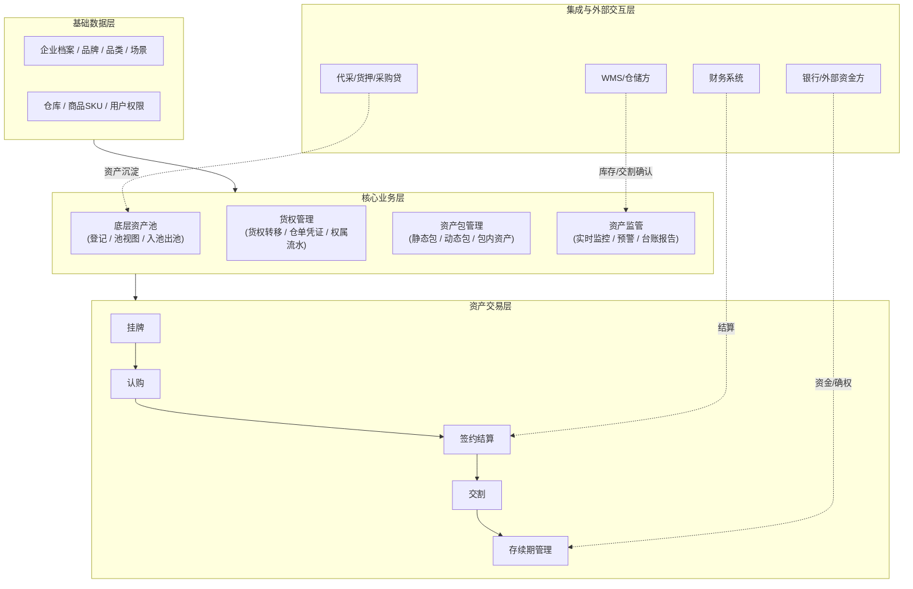
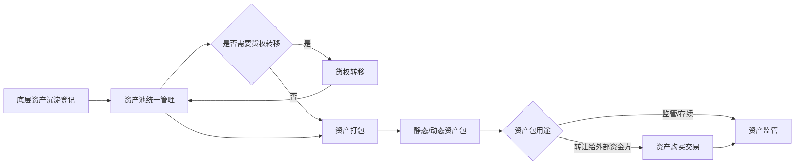
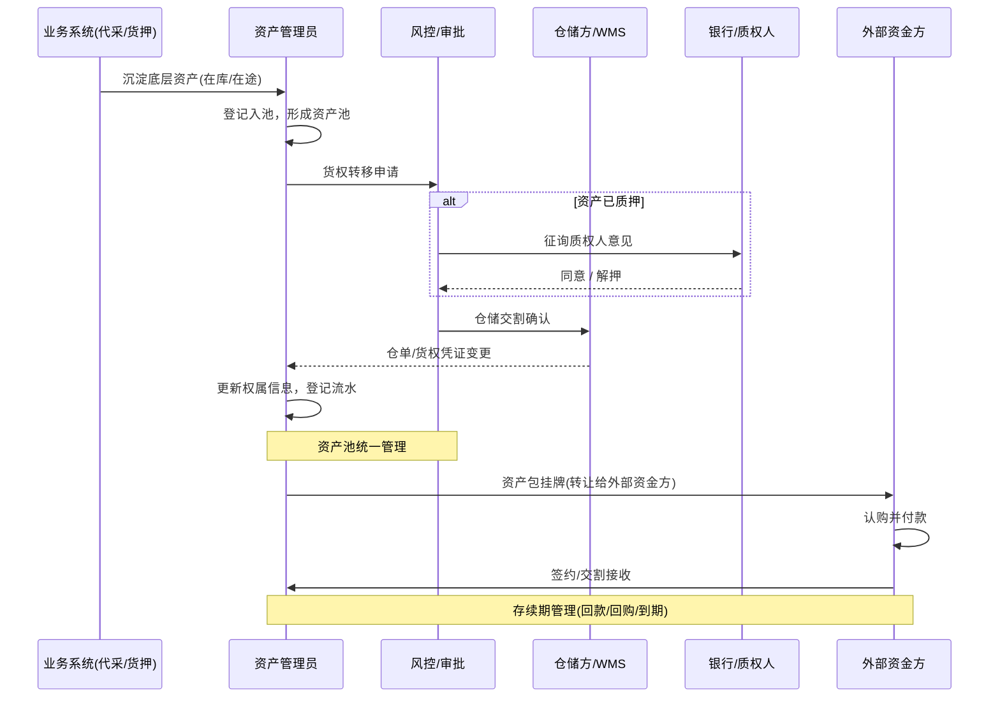
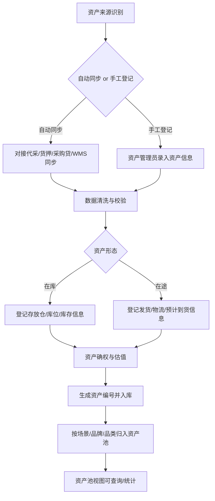
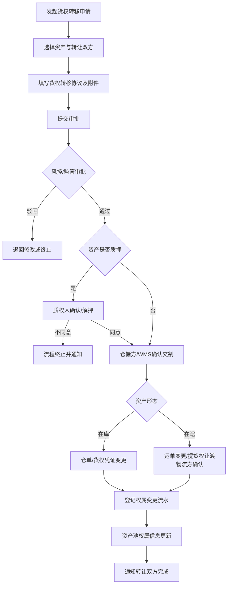
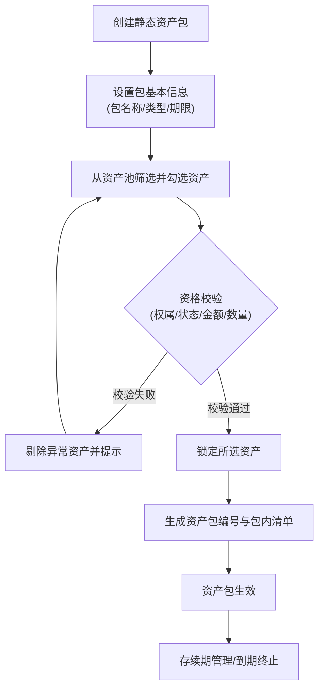
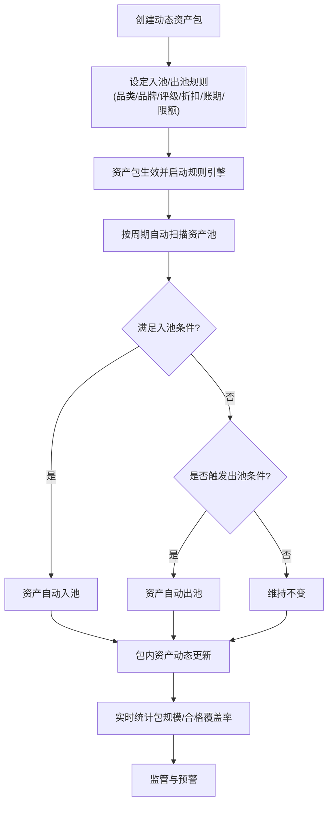
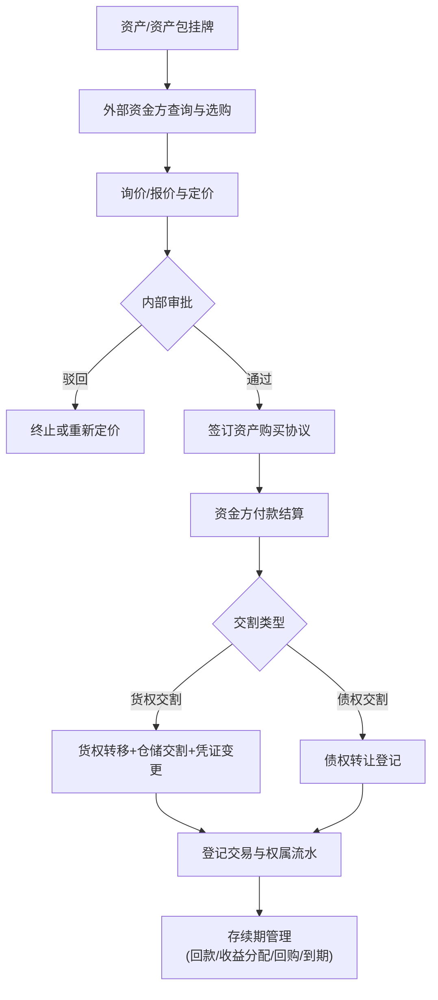
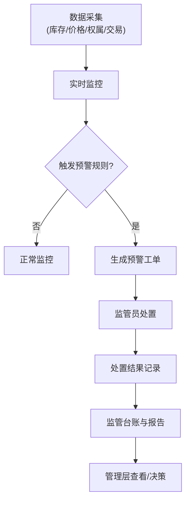

# 底层资产打包管理 - 架构与流程图

**来源文档**：《底层资产打包管理-建设方案-V1.0.md》
**生成日期**：2026-08-21
**说明**：本文件包含系统总体架构图、整体流程图与各子流程图，均使用 Mermaid 代码绘制，可直接复制到支持 Mermaid 的文档/工具（Markdown 编辑器、语雀、Notion、GitLab 等）中渲染。

---

## 一、总体架构图

**说明**：基础数据层为上层提供档案支撑；核心业务层承载资产池、货权、资产包、监管四大模块；资产交易层支撑资产/资产包转让给外部资金方；集成层对接现有业务系统、WMS、银行/资金方与财务系统。

---

## 二、整体流程图

### 2.1 端到端主流程

### 2.2 角色协作时序图

---

## 三、子流程图

### 3.1 资产登记与入池流程

### 3.2 货权转移流程

### 3.3 静态资产包生成流程

### 3.4 动态资产包生成流程

### 3.5 资产购买流程（转让给外部资金方）

### 3.6 监管管理流程

