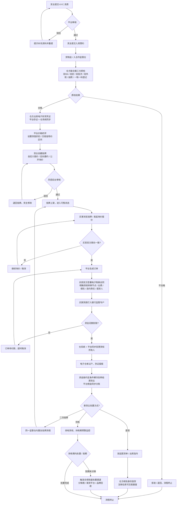
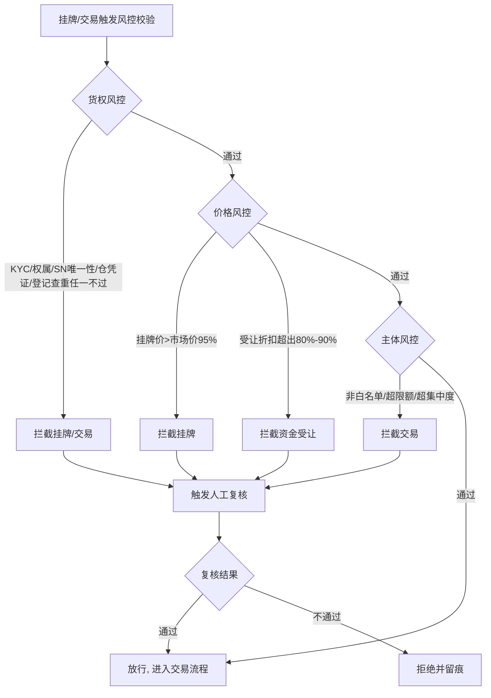

# 动产货权贸易金融撮合平台 — MVP 功能级 PRD

> **文档版本**：V1.0　|　**编制日期**：2026-08-21
> **需求来源**：《动产货权贸易金融撮合平台.docx》业务方案 + 解析分析文档
> **覆盖范围**：MVP / Phase1（纯货权转让闭环），不含 Phase2 贸易金融撮合
> **终端形态**：买卖方 PC Web 管理后台、平台运营 PC 后台、仓管 PC 后台
> **角色体系**：三端（买卖方用户端 / 平台运营·风控后台 / 仓管端）

---

## 一、需求背景

### 1.1 业务现状与问题

- **资产端痛点**：持有合规货权的货主（品牌、代理商、贸易商、渠道）普遍存在"在库现货货权变现慢、库存占压资金、账期长"的问题，缺少高效、可信、合规的盘活通道。
- **资金端痛点**：渠道、经销商、电商卖家有补货 / 实物分销需求，但线下撮合依赖熟人关系，信息不对称、货权真实性难核验、资金安全无保障。
- **市场缺口**：缺乏"中立、只做撮合、不碰资金不碰货"的现货货权转让平台；同时权益类交易平台合规红线极严（38/37 号文），需要"先确权、再交易、资金银行监管"的合规架构。

### 1.2 机会点（为什么从全新 3C / 家电切入）

| 维度 | 有利因素 |
| --- | --- |
| 可确权 | 全球唯一序列号 SN、品牌型号标准、SKU 颗粒度清晰，可一物一码验真确权 |
| 可估值 | 流通盘大、公开市场价（京东 / 苏宁 / 渠道批价）可得，可盯市 |
| B2B 活跃 | 单价高、批发活跃，经销商库存占压资金痛点强烈 |
| 可控货 | 标准化仓储存放、非危、适合区域监管仓集中控货 |

### 1.3 MVP 边界（必须遵守）

**只做**：原厂未拆封国行全新正品 + 入指定第三方监管仓 + 带完整票证 + 短持有期货权转让。

**不做（明确排除）**：二手、翻新、开箱、水货、串货、电池类高危、停产退市机型、无票货物、在途货、门店自存货、返修机。

**功能上不做**：自动撮合、行情 K 线、二级市场高频交易、区块链大投入、多仓全网打通、面向自然人开放、平台自营买卖 / 定价做市 / 资金池 / 放贷担保 / 标准化份额拆分 / 集中竞价。

---

## 二、需求目标

### 2.1 核心目标

1. **跑通闭环**：3-4 个月内上线 MVP，跑通"货权先确权 → 挂牌 → 撮合 → 电子签约 → 监管资金付款 → 货权过户存证 → 提货出库"的完整交易闭环。
2. **资金隔离**：交易货款全部进入银行监管专户，按节点解冻分账，平台账户零资金沉淀，杜绝资金池。
3. **货权真实唯一**：实现一物一码 SN 台账 + 第三方监管仓电子存货凭证 + 过户存证留痕，杜绝一货多挂、重复质押。
4. **风控量化拦截**：落地四层风控（货权 / 价格贬值 / 交易主体 / 履约兜底）的量化阈值拦截，关键风险节点系统强校验。
5. **为二期预留**：仓单结构、订单状态机、资金分账模型支持 Phase2（仓单二次转让、机构资金专区）扩展。

### 2.2 非目标

- 不做自动撮合引擎、不做行情 K 线、不做高频二级交易；
- 不做区块链大投入、不做多仓全网打通；
- 不面向自然人开放交易、不做任何自营 / 做市 / 担保 / 放贷业务。

---

## 三、需求核心业务流程图

### 3.1 端到端主流程（MVP 全链路）

### 3.2 四层风控拦截流程

---

## 四、需求功能清单

> 终端说明：**买卖方PC**（买卖方用户端 Web）/ **平台运营PC**（平台运营·风控后台 Web）/ **仓管PC**（监管仓管理端 Web）/ **后端服务**（核心交易与对接服务）。

### 4.1 买卖方用户端（PC Web）

| 终端 | 模块 | 功能 | 描述 |
| --- | --- | --- | --- |
| 买卖方PC | 账号与认证 | 注册登录 | 手机号 + 验证码 / 密码登录，角色绑定（卖家 / 买家） |
| 买卖方PC | 账号与认证 | -KYC 资质认证 | 提交企业证照、采购凭证、发票、权属承诺、无抵押无查封声明，审核后准入 |
| 买卖方PC | 资产与入库 | -资产提交 | 提交待交易货物批次信息，发起入库预约 |
| 买卖方PC | 资产与入库 | -入库进度查看 | 查看入库预约 → 验收 → 入仓 → 出证全链路状态 |
| 买卖方PC | 挂牌管理 | -创建挂牌 | 选择已确权仓单批次，设置报价方式与价格、持有期限、提货规则 |
| 买卖方PC | 挂牌管理 | -挂牌列表管理 | 上架 / 下架 / 修改挂牌，查看审核状态与成交状态 |
| 买卖方PC | 询价报价 | -挂牌浏览 | 浏览在售挂牌，按品类 / 品牌 / 价格筛选，查看仓单与质检信息 |
| 买卖方PC | 询价报价 | -询价 / 报价 | 买家发起询价与报价，卖家接受 / 还价，定向匹配达成意向 |
| 买卖方PC | 订单管理 | -订单列表 | 按状态筛选查看订单（待签约 / 待付款 / 已过户 / 已完成等） |
| 买卖方PC | 订单管理 | -订单详情 | 查看批次、金额、合同、付款进度、过户状态、提货信息 |
| 买卖方PC | 电子合同 | -合同查看签署 | 在线查看电子购销合同并完成电子签 |
| 买卖方PC | 仓单管理 | -仓单查看 | 查看名下电子存货凭证、SN 清单、过户历史 |
| 买卖方PC | 提货管理 | -提货单申请 | 发起出库指令，指定提货人、提货数量与配送方式 |

### 4.2 核心交易后端服务

| 终端 | 模块 | 功能 | 描述 |
| --- | --- | --- | --- |
| 后端服务 | 撮合交易 | -意向撮合服务 | 记录询价报价、匹配买卖意向、生成订单、维护订单状态机 |
| 后端服务 | 电子合同 | -合同生成与签署对接 | 按模板生成购销合同，对接电子签平台，留存签署存证 |
| 后端服务 | 资金监管 | -银行专户对接 | 对接银行监管专户：冻结 / 解冻 / 分账 / 受托支付，平台零资金沉淀 |
| 后端服务 | 资金监管 | -佣金分账 | 按约定费率计算并同步分账平台佣金 |
| 后端服务 | 货权过户 | -过户存证服务 | 电子仓单所有权变更登记、存证留痕、防一货多挂锁定 |
| 后端服务 | 提货出库 | -出库指令服务 | 接收提货单、校验身份与货权、通知仓方放货、注销可交易额度 |
| 后端服务 | 存证 | -数据存证对接 | 关键业务动作（合同 / 仓单 / 过户 / 放货）接入第三方存证 |

### 4.3 仓协同（仓管端 PC）

| 终端 | 模块 | 功能 | 描述 |
| --- | --- | --- | --- |
| 仓管PC | 入库管理 | -入库预约接收 | 接收平台入库预约单，确认收 / 拒 |
| 仓管PC | 入库管理 | -入库验收 | 联合第三方质检：验 SN / 验封 / 验批次 / 验外观 / 拍照，录入一物一码台账 |
| 仓管PC | 仓单管理 | -电子存货凭证出具 | 验收合格后出具电子存货凭证，同步平台存证 |
| 仓管PC | 仓单管理 | -SN 台账 | 维护一物一码 SN 台账，支持查询 / 导出 / 变更留痕 |
| 仓管PC | 仓单管理 | -仓单同步 | 仓系统与平台仓单状态双向同步（确权 / 冻结 / 过户 / 注销） |
| 仓管PC | 出库管理 | -出库放货核验 | 核验提货人身份与提货单，放货并注销在库可交易额度 |
| 仓管PC | 库存管理 | -盘点对账 | 定期盘点，与平台台账对账，差异上报 |

### 4.4 风控后台（平台运营 PC）

| 终端 | 模块 | 功能 | 描述 |
| --- | --- | --- | --- |
| 平台运营PC | 白名单管理 | -品牌 / 品类白名单 | 维护可交易品牌、品类、SKU 白名单与准入规则 |
| 平台运营PC | 白名单管理 | -监管仓白名单 | 维护签约监管仓名单与协议有效期 |
| 平台运营PC | 价格风控 | -价格行情录入 | 日度录入渠道批发价 / 电商价，形成行情库 |
| 平台运营PC | 价格风控 | -挂牌价格审核 | 校验挂牌价 ≤ 市场价 95%、资金受让折扣 80%-90%，超限拦截 |
| 平台运营PC | 交易审核 | -准入审核 | 审核买卖双方 KYC 资料与适当性（资金端限机构 / 产业） |
| 平台运营PC | 交易审核 | -挂牌审核 | 审核挂牌批次、货权凭证、价格区间 |
| 平台运营PC | 预警中心 | -跌价预警 | 市价 -5% 预警、-10% 限制新增挂牌并提示处置 |
| 平台运营PC | 预警中心 | -持有期预警 | 手机 >30 天 / 家电 >45 天超期预警，限制二次挂牌 |
| 平台运营PC | 预警中心 | -集中度预警 | 单仓集中度 / 单 SKU 持仓上限预警 |
| 平台运营PC | 基础报表 | -交易报表 | 挂牌 / 成交 / 金额 / 佣金等基础统计报表 |
| 平台运营PC | 基础报表 | -台账报表 | 仓单台账、SN 台账、资金流水对账报表 |

### 4.5 系统基础与对接能力

| 终端 | 模块 | 功能 | 描述 |
| --- | --- | --- | --- |
| 后端服务 | 基础能力 | -电子签对接 | 对接第三方电子签（合同签署 / 验签） |
| 后端服务 | 基础能力 | -存证服务 | 对接第三方存证，关键动作留痕可追溯 |
| 后端服务 | 基础能力 | -消息通知 | 短信 / 站内信 / 邮件通知关键节点（审核、到账、过户、放货） |
| 后端服务 | 基础能力 | -权限与审计 | RBAC 权限体系，操作日志留痕审计 |

---

## 五、需求功能详述

> 各功能核心逻辑中的量化阈值（95% / 80%-90% / 30 天 / 45 天 / -5% / -10%）均取自原业务方案，为标准参数，后台可配置。
> **篇幅约定**：埋点需求、技术难点分析仅对存在关键交互或复杂逻辑的功能给出；其余为标准表单 / 列表类功能，默认不赘述，其验收标准与测试用例已覆盖核心行为。

### 5.1 买卖方用户端（PC Web）

---

#### 5.1.1 买卖方PC — 账号与认证 — 注册登录

**原型描述**：登录页居中卡片，含手机号输入框、验证码/密码切换、登录按钮、注册入口；登录后按角色进入对应工作台（卖家/买家）。

**用户故事**：
> 作为一个货主/采购方，我想要用手机号注册登录，以便于进入平台开展货权交易。

**前置条件**：
- 用户有有效手机号；平台已开通注册通道。

**核心逻辑**：
- 手机号 + 短信验证码或密码登录；首次登录默认绑定角色（卖家 / 买家，可申请双角色）。
- 登录后按角色渲染菜单；双角色用户可切换工作台视图。
- 登录态有效期 7 天，支持多端会话管理（踢下线）。

**边界条件与异常处理**：
- 边界：验证码 5 分钟内有效，60 秒内不可重发；连续 5 次错误密码锁定 30 分钟。
- 异常：短信通道超时提示重试；异地登录触发风控验证（滑块/二次验证）。

**埋点需求**：
- 事件 ID：`EVENT_LOGIN`，触发时机：登录成功，上报参数：`user_id`、`role`、`source`。

**技术难点分析**：
- 短信通道限流与防刷；多端会话一致性。

**验收标准 (Acceptance Criteria)**：
- 🎯 **成功场景**：输入正确手机号与验证码，登录成功并跳转对应工作台。
- ✔️ **校验场景**：验证码错误 / 过期，提示重新获取；格式非法（非 11 位手机号）即时拦截。
- ❌ **异常场景**：短信服务不可用，提示"获取失败，请稍后重试"并记录失败日志。

**测试用例（MECE）**：
- 正确手机号+验证码登录成功
- 错误验证码登录被拦截
- 验证码过期提示重新获取
- 60 秒内重复发送被限流
- 连续 5 次密码错误锁定
- 双角色用户工作台切换
- 异地登录触发二次验证

---

#### 5.1.2 买卖方PC — 账号与认证 — KYC 资质认证

**原型描述**：资质认证页分企业信息、证照上传、权属材料三块；左侧进度条显示提交/审核/通过状态；附件支持图片/PDF 预览。

**用户故事**：
> 作为一个货主或采购方，我想要提交企业资质与权属材料，以便于通过平台准入、获得交易资格。

**前置条件**：
- 已注册登录；企业身份资料齐全。

**核心逻辑**：
- 卖方必传：营业执照、采购凭证、发票、权属承诺、无抵押无查封声明、联系人信息。
- 买方必传：营业执照、经营证明；资金型买方需提供持牌 / 机构证明。
- 提交后进入"审核中"；审核通过后具备挂牌/交易资格；驳回可编辑重提，驳回原因必填可见。
- 材料有效期按证照有效期管理，到期前 30 天预警续期。

**边界条件与异常处理**：
- 边界：单个附件 ≤20MB，支持 jpg/png/pdf；最多 10 个附件。
- 异常：证照 OCR 识别失败时允许手动填写并标记"人工校验"。

**埋点需求**：
- 事件 ID：`EVENT_KYC_SUBMIT`，触发时机：提交审核，上报参数：`user_id`、`material_count`、`result`。

**技术难点分析**：
- 证照 OCR 与真伪校验；多类型材料的结构化归档与追溯。

**验收标准 (Acceptance Criteria)**：
- 🎯 **成功场景**：材料齐全提交，状态变"审核中"，后台可审核。
- ✔️ **校验场景**：缺必传材料时提示清单并禁止提交；附件超限拦截。
- ❌ **异常场景**：审核接口超时，前端提示重试，不丢已填数据。

**测试用例（MECE）**：
- 材料齐全提交进入审核中
- 缺必传材料禁止提交
- 附件超 20MB 被拦截
- 驳回后编辑重提成功
- 驳回原因必填且可见
- 证照 OCR 失败转人工
- 资质到期前触发预警

---

#### 5.1.3 买卖方PC — 资产与入库 — 资产提交

**原型描述**：资产提交页表单包含品类/品牌/型号/SKU/数量/单件SN/批次/发票信息/仓库选择，支持导入模板批量填写。

**用户故事**：
> 作为一个货主，我想要提交在库现货批次信息并预约入库，以便于货物进入监管仓确权、具备挂牌资格。

**前置条件**：
- 卖方资质审核通过；已签署仓储服务协议；选择平台白名单内监管仓。

**核心逻辑**：
- 提交批次信息（品类、品牌、型号、SKU、数量、SN 清单、批次号、发票号、期望仓库）。
- 提交后生成入库预约单，状态：待仓方确认 → 待送货 → 验收中 → 验收合格/拒收。
- 非白名单品牌 / SKU 在提交时即拦截（前置校验）。
- 批次与 SKU 粒度：最小交易单位为整批，禁止拆零散。

**边界条件与异常处理**：
- 边界：数量必须 >0 且为整数；SN 清单批量校验去重、格式校验。
- 异常：SN 与已有台账重复时提示"疑似一货多挂"并拦截。

**技术难点分析**：
- 批量 SN 解析与去重校验；与仓管端入库预约单的数据联动。

**验收标准 (Acceptance Criteria)**：
- 🎯 **成功场景**：批次信息提交成功，生成入库预约单并推送给对应监管仓。
- ✔️ **校验场景**：非白名单品牌 / SKU 前置拦截；SN 重复拦截。
- ❌ **异常场景**：推送仓管端失败，标记重试并保留草稿。

**测试用例（MECE）**：
- 白名单批次提交生成预约单
- 非白名单品牌前置拦截
- SN 重复提示一货多挂
- 数量为 0 或负数拦截
- 导入模板批量提交成功
- 仓管拒收后流程终止

---

#### 5.1.4 买卖方PC — 资产与入库 — 入库进度查看

**原型描述**：进度时间轴页，展示预约→送货→验收→入仓→出证的节点状态与时间；异常节点红色高亮并附说明。

**用户故事**：
> 作为一个货主，我想要实时查看货物入库确权进度，以便于安排挂牌计划。

**前置条件**：已有入库预约单。

**核心逻辑**：按入库预约单 ID 聚合各节点状态与时间戳；节点含待仓方确认 / 待送货 / 验收中 / 验收合格 / 已入仓 / 已出证 / 拒收退回；异常节点展示原因。

**边界条件与异常处理**：无预约单时展示空态引导；节点状态未同步时展示"处理中"。

**验收标准 (Acceptance Criteria)**：
- 🎯 **成功场景**：展示全链路进度时间轴与当前状态。
- ✔️ **校验场景**：无预约单显示空态引导创建。
- ❌ **异常场景**：状态同步失败展示"处理中"并可刷新。

**测试用例（MECE）**：
- 全节点时间轴展示正确
- 无预约单显示空态
- 状态未同步显示处理中
- 拒收节点红色高亮

---

#### 5.1.5 买卖方PC — 挂牌管理 — 创建挂牌

**原型描述**：挂牌创建页选择已确权仓单批次，配置报价方式（固定价/议价/定向邀约/公开询价）、单价、可售数量、持有期限、提货规则、质保说明；右侧展示价格指导区间与风控校验结果。

**用户故事**：
> 作为一个货主，我想要把已确权货物创建为挂牌，以便于向买家展示并撮合成交。

**前置条件**：
- 该批次已入库确权并取得电子存货凭证；货物在可交易额度内（未过户未冻结）。

**核心逻辑**：
- 仅可选择状态"已确权-可交易"的仓单批次挂牌；单批次内可设定可售数量。
- 报价方式：自定义报价 / 定向邀约（指定买家）/ 公开询价；不支持自动撮合。
- 挂牌价风控预校验：挂牌价 ≤ 当日市场价 × 95%，超限红色提示并禁止提交。
- 持有期限默认按品类规则（手机 ≤30 天 / 家电 ≤45 天）。
- 提交后进入"待审核"，风控后台审核通过后上架。

**边界条件与异常处理**：
- 边界：可售数量 ≤ 仓单在库可交易数量；价格两位小数。
- 异常：批次已被冻结 / 过户，创建时提示"该批次不可交易"。

**技术难点分析**：价格指导区间实时计算；与仓单可交易额度的一致性锁定（防超卖）。

**验收标准 (Acceptance Criteria)**：
- 🎯 **成功场景**：挂牌创建成功进入待审核，可售数量不超可交易额度。
- ✔️ **校验场景**：挂牌价超市场价 95% 拦截；非可交易批次不可选。
- ❌ **异常场景**：提交时批次被并发冻结，返回冲突提示并刷新。

**测试用例（MECE）**：
- 已确权批次创建挂牌成功
- 挂牌价超95%被拦截
- 可售数量超额度被拦截
- 已冻结批次不可选
- 定向邀约指定买家成功
- 提交并发冻结返回冲突

---

#### 5.1.6 买卖方PC — 挂牌管理 — 挂牌列表管理

**原型描述**：挂牌列表页含状态筛选（待审核/在售/已成交/下架/审核驳回）、关键字搜索、批量下架；卡片展示品类、品牌、数量、单价、指导价区间。

**用户故事**：
> 作为一个货主，我想要管理我的挂牌，以便于控制上架状态与响应撮合。

**前置条件**：已有挂牌记录。

**核心逻辑**：
- 状态机：草稿 → 待审核 → 在售 → 已成交 / 下架；待审核 → 驳回（可编辑重提）。
- 在售挂牌支持手动下架；有进行中订单（已签约/已付款）时禁止下架，提示"存在未完成订单"。
- 已成交挂牌自动关闭，不可复用，可基于同仓单批次重新挂牌。

**边界条件与异常处理**：批量下架含进行中订单时整批拒绝并逐条提示原因。

**验收标准 (Acceptance Criteria)**：
- 🎯 **成功场景**：挂牌状态流转正确，可筛选 / 搜索 / 下架。
- ✔️ **校验场景**：有进行中订单的挂牌禁止下架。
- ❌ **异常场景**：批量操作部分失败逐条提示。

**测试用例（MECE）**：
- 挂牌状态机流转正确
- 有进行中订单禁下架
- 驳回挂牌编辑重提
- 批量下架含进行中订单被拒
- 已成交挂牌自动关闭

---

#### 5.1.7 买卖方PC — 询价报价 — 挂牌浏览

**原型描述**：市场挂牌浏览页顶部条件筛选栏（品类/品牌/价格区间/仓库），列表展示在售挂牌，行内可查看仓单详情、质检报告、SN 摘要。

**用户故事**：
> 作为一个买家，我想要浏览在售挂牌，以便于找到符合补货需求的货权批次。

**前置条件**：买方资质审核通过；挂牌处于"在售"状态。

**核心逻辑**：
- 仅展示状态"在售"的挂牌；卖方信息按脱敏规则展示。
- 列表含品类、品牌、型号、SKU、数量、单价、指导价区间、监管仓。
- 支持按品类 / 品牌 / 价格区间 / 监管仓筛选排序。
- 查看详情可展示电子仓单编号、质检结论、SN 数量（明细脱敏）。

**边界条件与异常处理**：查询无结果显示空态与推荐引导。

**验收标准 (Acceptance Criteria)**：
- 🎯 **成功场景**：在售挂牌按条件正确筛选并展示。
- ✔️ **校验场景**：仅展示在售状态挂牌。
- ❌ **异常场景**：接口超时展示加载失败可重试。

**测试用例（MECE）**：
- 按品类筛选结果正确
- 在售状态外挂牌不可见
- 无结果展示空态
- 详情展示仓单与质检信息
- SN 明细脱敏展示

---

#### 5.1.8 买卖方PC — 询价报价 — 询价 / 报价

**原型描述**：挂牌详情页底部含"询价"按钮，询价弹窗填写目标单价与数量、留言；卖家端收到询价可接受/还价/拒绝。

**用户故事**：
> 作为一个买家/卖家，我想要发起询价或响应报价，以便于达成定向匹配的交易意向。

**前置条件**：挂牌在售；买卖双方均已准入；非同一主体交易。

**核心逻辑**：
- 买家对在售挂牌发起询价（目标单价、数量、留言）；卖家收到后接受 / 还价 / 拒绝。
- 还价后买家可再接受 / 拒绝；接受即达成意向，生成订单（状态：待确认）。
- 意向匹配为"逐笔一对一"，不产生匿名连续撮合。
- 询价记录全链路留痕，支持撤销（一方未接受前）。

**边界条件与异常处理**：
- 边界：报价须在挂牌指导价区间内提示（可超限提交但标记风控关注）；数量 ≤ 可售数量。
- 异常：一方已成交 / 下架，对方操作提示"该挂牌已失效"。

**技术难点分析**：多方并发议价的一致性与意向幂等。

**验收标准 (Acceptance Criteria)**：
- 🎯 **成功场景**：买家询价 → 卖家还价 → 买家接受，生成订单。
- ✔️ **校验场景**：数量超可售、非在售挂牌操作被拦截。
- ❌ **异常场景**：并发操作返回冲突并刷新最新状态。

**测试用例（MECE）**：
- 询价还价接受生成订单
- 数量超可售被拦截
- 挂牌失效后操作提示
- 一方成交后另一询价失效
- 意向撤销成功不留痕异常

---

#### 5.1.9 买卖方PC — 订单管理 — 订单列表

**原型描述**：订单列表页按状态 Tab 分组（全部/待签约/待付款/待过户/已过户/待提货/已完成/已取消/争议），支持订单号与日期搜索。

**用户故事**：
> 作为一个买卖双方，我想要查看订单列表，以便于跟进每个交易的当前进度。

**前置条件**：存在订单记录。

**核心逻辑**：
- 订单状态机：待确认 → 待签约 → 待付款 → 已付款 → 待过户 → 已过户 → 待提货 → 已完成；及已取消 / 争议处理分支。
- 卖家与买家视角订单一致，操作项按角色控制。
- 超时规则：待签约超 24h、待付款超 48h 自动取消（可后台配置）。

**边界条件与异常处理**：无订单空态引导；分页加载。

**验收标准 (Acceptance Criteria)**：
- 🎯 **成功场景**：按状态筛选展示订单列表。
- ✔️ **校验场景**：状态过滤逻辑正确。
- ❌ **异常场景**：加载失败可重试。

**测试用例（MECE）**：
- 各状态Tab筛选正确
- 超时订单自动取消
- 角色操作权限区分
- 订单号搜索精确匹配
- 空态引导创建

---

#### 5.1.10 买卖方PC — 订单管理 — 订单详情

**原型描述**：订单详情页分区块：基本信息、货物批次（含仓单号）、金额明细（货款/仓费/保险/佣金）、资金进度（监管账户状态时间线）、合同入口、过户状态、提货信息。

**用户故事**：
> 作为一个买卖双方，我想要查看订单详情，以便于掌握资金、合同、过户与提货的完整进度。

**前置条件**：存在订单。

**核心逻辑**：聚合订单全生命周期信息；资金进度展示银行监管专户冻结/解冻状态；操作项按角色与状态控制（签署合同、去付款、查看仓单、申请提货）。

**边界条件与异常处理**：资金状态未同步时展示"银行处理中"。

**验收标准 (Acceptance Criteria)**：
- 🎯 **成功场景**：完整展示订单各维度信息与进度。
- ✔️ **校验场景**：操作项按角色与状态正确显隐。
- ❌ **异常场景**：资金状态未同步展示处理中。

**测试用例（MECE）**：
- 详情区块信息完整
- 操作项按状态显隐
- 资金状态同步异常提示
- 合同跳转正确

---

#### 5.1.11 买卖方PC — 电子合同 — 合同查看签署

**原型描述**：合同页内嵌电子合同预览（PDF/HTML），含签署人信息、盖章位、签署按钮；签署后展示存证编号与验签入口。

**用户故事**：
> 作为一个买卖双方，我想要在线签署电子购销合同，以便于固定货权转移节点、仓费、保险、违约责任等条款。

**前置条件**：订单处于"待签约"；双方已完成 KYC 准入。

**核心逻辑**：
- 合同由平台按标准化模板生成，字段取自订单（批次、金额、仓费、保险、货权转移节点、违约责任、提货人）。
- 对接第三方电子签：发起签署 → 双方签署 → 签署完成留存证编号。
- 双方均签署后订单进入"待付款"；单方签署可撤回，双方签署后不可撤销。
- 卖方需填写提货人信息（默认自身，可指定）。

**边界条件与异常处理**：电子签服务异常时合同保持"签署中"，可重试；签署超时（24h）自动关闭订单。

**技术难点分析**：合同模板变量渲染；与电子签平台的幂等与回调对账。

**验收标准 (Acceptance Criteria)**：
- 🎯 **成功场景**：双方签署完成，生成存证编号，订单进入待付款。
- ✔️ **校验场景**：未签署完成订单不可进入付款。
- ❌ **异常场景**：电子签失败可重试不重复生成合同。

**测试用例（MECE）**：
- 双方签署后订单进入待付款
- 单方签署可撤回
- 签署超时自动关闭
- 存证编号生成成功
- 电子签异常重试不重复

---

#### 5.1.12 买卖方PC — 仓单管理 — 仓单查看

**原型描述**：仓单列表与详情页，展示电子存货凭证编号、品类、数量、SN、出具仓、确权/过户历史时间线。

**用户故事**：
> 作为一个买卖双方，我想要查看名下电子仓单，以便于确权、过户与提货。

**前置条件**：名下存在电子存货凭证。

**核心逻辑**：
- 展示名下全部电子仓单；状态：待确权 / 已确权（可交易）/ 冻结 / 已过户 / 已注销。
- 过户历史展示所有权变更链（原货主 → 新货主、时间、订单号、存证号）。
- SN 明细按角色脱敏展示。

**边界条件与异常处理**：无仓单空态；仓单同步延迟展示"同步中"。

**验收标准 (Acceptance Criteria)**：
- 🎯 **成功场景**：正确展示名下仓单与过户链。
- ✔️ **校验场景**：已过户仓单不再显示可操作入口。
- ❌ **异常场景**：同步延迟展示同步中。

**测试用例（MECE）**：
- 名下仓单列表正确
- 过户链展示完整
- 已注销仓单无操作入口
- SN 明细脱敏

---

#### 5.1.13 买卖方PC — 提货管理 — 提货单申请

**原型描述**：提货申请页选择名下已过户仓单、填写提货数量、提货人、证件、配送方式、期望时间；提交后生成提货单并推送给监管仓。

**用户故事**：
> 作为一个新货主，我想要发起提货申请，以便于从监管仓提货出库。

**前置条件**：订单已过户，名下仓单可提货。

**核心逻辑**：
- 提货数量 ≤ 名下在库可提数量；支持分批提货。
- 提货单状态：待仓方核验 → 核验通过放货 → 已放货 / 核验拒绝（附原因）。
- 放货后系统注销对应在库可交易额度。
- 提货人可为本人或指定第三人，须填写身份证 / 授权信息。

**边界条件与异常处理**：提货数量超在库量拦截；分批提货后剩余额度递减。

**验收标准 (Acceptance Criteria)**：
- 🎯 **成功场景**：提货单提交成功推送仓方，放货后额度注销。
- ✔️ **校验场景**：数量超限拦截；非本人名下仓单不可提。
- ❌ **异常场景**：仓方核验拒绝，展示原因并支持修改重提。

**测试用例（MECE）**：
- 提货单提交推送仓方
- 数量超在库量拦截
- 分批提货额度递减
- 核验拒绝可修改重提
- 放货后额度注销

---

### 5.2 核心交易后端服务

---

#### 5.2.1 后端服务 — 撮合交易 — 意向撮合服务

**原型描述**：无页面（后端服务）。提供询价、报价、意向、订单的 RPC/API 与状态机流转。

**用户故事**：
> 作为一个平台，我想要维护询价报价与订单状态机，以便于撮合流程可控可追溯。

**前置条件**：前后端调用服务；数据库事务一致。

**核心逻辑**：
- 询价报价：记录全链路（发起人、对象、单价、数量、时间、结果）。
- 意向幂等：同一询价单唯一对应一次撮合；防重复生成订单。
- 订单状态机集中管理，状态迁移带权限与前置校验。
- 超时任务调度：签约/付款超时自动取消。

**边界条件与异常处理**：并发下单防重（唯一索引 + 乐观锁）；状态迁移非法返回明确错误码。

**技术难点分析**：并发一致性与幂等；状态机扩展性（二期二次转让复用）。

**验收标准 (Acceptance Criteria)**：
- 🎯 **成功场景**：意向达成唯一生成订单，状态机正确流转。
- ✔️ **校验场景**：重复请求幂等拦截。
- ❌ **异常场景**：并发冲突返回冲突码并回滚。

**测试用例（MECE）**：
- 意向达成唯一生成订单
- 重复请求幂等拦截
- 非法状态迁移被拒
- 超时任务自动取消

---

#### 5.2.2 后端服务 — 电子合同 — 合同生成与签署对接

**原型描述**：无页面（后端服务）。模板渲染、签署流转、存证回调。

**用户故事**：
> 作为一个平台，我想要自动生成并驱动电子合同签署，以便于快速进入付款环节。

**前置条件**：订单已确认；双方准入有效；电子签服务可用。

**核心逻辑**：
- 标准化模板 + 订单变量渲染；合同编号唯一。
- 驱动签署流转：发起 → 双方签署 → 完成；回调更新订单状态。
- 存证：合同快照与签署记录写入第三方存证，返回存证编号。

**边界条件与异常处理**：回调幂等；电子签超时重试策略；合同版本只读不可篡改。

**技术难点分析**：与第三方电子签的异步回调对账与幂等。

**验收标准 (Acceptance Criteria)**：
- 🎯 **成功场景**：合同生成、签署完成、存证编号返回、订单推进。
- ✔️ **校验场景**：回调重复处理幂等。
- ❌ **异常场景**：签署失败订单停留在待签约。

**测试用例（MECE）**：
- 合同模板渲染字段正确
- 回调重复处理幂等
- 签署失败订单停留待签约
- 存证编号唯一生成

---

#### 5.2.3 后端服务 — 资金监管 — 银行专户对接

**原型描述**：无页面（后端服务）。对接银行监管专户的冻结、解冻、分账、受托支付 API。

**用户故事**：
> 作为一个平台，我想要对接银行监管专户，以便于货款安全隔离、平台零资金沉淀。

**前置条件**：已签署资金监管分账协议；银行接口联调完成。

**核心逻辑**：
- 买方付款资金进入银行监管专户（非平台账户），资金指令由平台发起、银行执行。
- 付款冻结：订单付款时发起冻结指令，生成冻结流水。
- 解冻分账：过户完成后按约定节点解冻，货款划转原货主，佣金同步分账至平台。
- 失败回滚：任何一步失败终止后续，资金停留在原账户，不产生资金损失。
- 每日与银行对账，差异告警。

**边界条件与异常处理**：银行接口超时进入"处理中"并自动查询；对账不平触发人工介入；金额精度两位小数。

**技术难点分析**：资金指令幂等与对账；银行接口异常补偿；资金流与订单流强一致。

**验收标准 (Acceptance Criteria)**：
- 🎯 **成功场景**：付款冻结 → 过户后解冻划转 → 佣金分账，流水齐全。
- ✔️ **校验场景**：金额不一致拒绝指令。
- ❌ **异常场景**：银行超时进入处理中并自动补偿查询。

**测试用例（MECE）**：
- 付款冻结指令成功
- 过户后解冻划转正确
- 佣金分账金额正确
- 金额校验不一致拒绝
- 银行超时自动补偿
- 对账不平触发告警

---

#### 5.2.4 后端服务 — 货权过户 — 过户存证服务

**原型描述**：无页面（后端服务）。仓单所有权变更、存证、防一货多挂。

**用户故事**：
> 作为一个平台，我想要安全地完成货权过户并存证，以便于货权唯一且可追溯。

**前置条件**：资金足额到账；合同双方签署完成；仓单处于可过户状态。

**核心逻辑**：
- 过户前置校验：资金已冻结足额、合同完成、仓单未冻结未过户。
- 过户动作：仓系统 + 平台同步变更仓单所有权人；生成过户记录（含原/新货主、订单号、存证号）。
- 过户后锁定原可交易额度，禁止一货多挂。
- 存证：过户记录写入第三方存证。

**边界条件与异常处理**：过户并发冲突（同一仓单）互斥；过户失败资金不划转、仓单回滚。

**技术难点分析**：仓单状态互斥与并发安全；与仓系统数据一致性。

**验收标准 (Acceptance Criteria)**：
- 🎯 **成功场景**：过户成功，所有权变更，存证生成，资金解冻。
- ✔️ **校验场景**：未付款 / 未签约不可过户。
- ❌ **异常场景**：过户失败整体回滚。

**测试用例（MECE）**：
- 过户成功所有权变更
- 未足额付款禁过户
- 并发过户互斥
- 过户失败整体回滚
- 存证记录生成

---

#### 5.2.5 后端服务 — 提货出库 — 出库指令服务

**原型描述**：无页面（后端服务）。接收提货单、校验、通知仓方、注销额度。

**用户故事**：
> 作为一个平台，我想要驱动提货出库指令，以便于货权交割与额度注销闭环。

**前置条件**：仓单已过户至提货人名下。

**核心逻辑**：
- 接收提货单 → 校验提货人身份与货权归属 → 生成出库指令推送仓方。
- 仓方确认放货后，平台注销对应在库可交易额度。
- 分批提货支持多次指令，剩余额度递减。

**边界条件与异常处理**：额度不足拒绝指令；仓方超时未处理告警。

**验收标准 (Acceptance Criteria)**：
- 🎯 **成功场景**：出库指令推送、放货、额度注销成功。
- ✔️ **校验场景**：非货主提货被拒。
- ❌ **异常场景**：仓方拒绝放货，指令置失败并通知。

**测试用例（MECE）**：
- 出库指令推送成功
- 非货主提货被拒
- 分批提货额度递减
- 放货后额度注销
- 仓方超时告警

---

### 5.3 仓协同（仓管端 PC）

---

#### 5.3.1 仓管PC — 入库管理 — 入库预约接收

**原型描述**：预约单列表页按待确认/待收货/验收中/已完成/已拒绝分组，详情含批次、数量、SN 摘要、预约时间。

**用户故事**：
> 作为一个仓管，我想要接收并确认入库预约，以便于安排收货计划。

**前置条件**：平台推送入库预约单；仓管账号已绑定监管仓。

**核心逻辑**：确认收单 / 拒绝（附原因）；确认后生成收货任务；超时未处理（24h）平台提醒。

**边界条件与异常处理**：重复确认幂等；拒收后流程终止并通知货主。

**验收标准 (Acceptance Criteria)**：
- 🎯 **成功场景**：确认预约生成收货任务。
- ✔️ **校验场景**：重复确认幂等。
- ❌ **异常场景**：拒收通知货主并终止。

**测试用例（MECE）**：
- 确认预约生成收货任务
- 重复确认幂等
- 拒收通知货主
- 超时未处理平台提醒

---

#### 5.3.2 仓管PC — 入库管理 — 入库验收

**原型描述**：验收作业页按批次展示待验清单，逐件/逐箱录入验 SN、验封、验批次、验外观结果并拍照上传，异常件标记原因。

**用户故事**：
> 作为一个仓管，我想要联合第三方完成入库质检，以便于确认真实、合格、可交易的货物入仓。

**前置条件**：预约已确认、货物已到仓。

**核心逻辑**：
- 质检维度：验 SN（与申报一致）、验封（原厂未拆封）、验批次、验外观（拍照留档）。
- 逐件登记一物一码 SN 台账；异常件标记拒收并记录原因。
- 验收结果汇总：全部合格 → 验收合格；存在不合格 → 按批次 / 逐件退回。

**边界条件与异常处理**：SN 与申报不符拦截并提示；拍照必填校验。

**技术难点分析**：SN 批量快速录入（扫码 / 导入）；质检留痕可追溯。

**验收标准 (Acceptance Criteria)**：
- 🎯 **成功场景**：合格货物入仓，生成 SN 台账。
- ✔️ **校验场景**：SN 不符拦截。
- ❌ **异常场景**：拒收件流程终止并通知货主。

**测试用例（MECE）**：
- 全部合格入仓生成台账
- SN 与申报不符拦截
- 异常件标记拒收
- 照片缺失禁止提交
- 拒收通知货主

---

#### 5.3.3 仓管PC — 仓单管理 — 电子存货凭证出具

**原型描述**：出证页展示可出证批次，含仓单编号、货主、品类、数量、SN、出具时间；支持预览与正式出具。

**用户故事**：
> 作为一个仓管，我想要为验收合格的货物出具电子存货凭证，以便于货物具备可交易货权。

**前置条件**：入库验收合格；仓单信息完整。

**核心逻辑**：
- 验收合格后自动生成待出证批次，仓方确认出具。
- 凭证含：仓单编号、出具仓、货主、品类、品牌、型号、SKU、数量、SN 清单、质检结论、出具时间。
- 出证后同步平台存证与仓系统，锁定为"已确权-可交易"。

**边界条件与异常处理**：出证后不可修改；重复出证幂等；与平台同步失败重试。

**技术难点分析**：仓单编号唯一性规则；与平台存证同步的一致性。

**验收标准 (Acceptance Criteria)**：
- 🎯 **成功场景**：凭证出具成功，状态变为已确权-可交易。
- ✔️ **校验场景**：未验收合格不可出证。
- ❌ **异常场景**：同步失败重试成功。

**测试用例（MECE）**：
- 验收合格后出证成功
- 未合格批次禁出证
- 重复出证幂等
- 同步失败重试
- 出证后不可修改

---

#### 5.3.4 仓管PC — 仓单管理 — SN 台账

**原型描述**：SN 台账页支持按仓单/批次/状态筛选，列表展示 SN、型号、状态（在库/冻结/已出库）、出入库时间；支持导出。

**用户故事**：
> 作为一个仓管，我想要维护一物一码 SN 台账，以便于全程追溯货物状态。

**前置条件**：存在已入仓 SN 记录。

**核心逻辑**：SN 状态机（在库-可交易 / 冻结 / 已过户 / 已出库）；状态变更留痕（操作人、时间、订单号）；支持筛选、查询、导出。

**边界条件与异常处理**：SN 状态变更并发锁；导出大文件异步生成。

**验收标准 (Acceptance Criteria)**：
- 🎯 **成功场景**：SN 台账正确维护并可导出。
- ✔️ **校验场景**：状态变更记录留痕。
- ❌ **异常场景**：并发变更锁冲突提示重试。

**测试用例（MECE）**：
- SN 状态机流转正确
- 状态变更留痕完整
- 导出文件生成成功
- 并发变更锁冲突提示

---

#### 5.3.5 仓管PC — 仓单管理 — 仓单同步

**原型描述**：同步状态页展示平台与仓系统的仓单状态差异，含最近同步时间与失败重试按钮。

**用户故事**：
> 作为一个仓管，我想要保障仓单状态与平台一致，以便于确权、过户、放货准确无误。

**前置条件**：仓系统与平台已对接。

**核心逻辑**：双向同步确权 / 冻结 / 过户 / 注销状态；以仓系统实物状态为准；失败自动重试并告警。

**边界条件与异常处理**：同步失败标记差异并告警；人工校准入口。

**技术难点分析**：状态一致性与冲突处理策略。

**验收标准 (Acceptance Criteria)**：
- 🎯 **成功场景**：仓单状态双向一致。
- ✔️ **校验场景**：差异列表可人工校准。
- ❌ **异常场景**：同步失败重试并告警。

**测试用例（MECE）**：
- 双向同步状态一致
- 差异可人工校准
- 失败自动重试
- 同步差异告警

---

#### 5.3.6 仓管PC — 出库管理 — 出库放货核验

**原型描述**：出库核验页展示待放货提货单，含提货人、证件、数量、SN；核验后确认放货并填写放货信息。

**用户故事**：
> 作为一个仓管，我想要核验提货身份并放货，以便于货物安全出库。

**前置条件**：收到平台出库指令；提货人到仓。

**核心逻辑**：
- 核验提货单、提货人身份（身份证 / 授权）、货权归属。
- 核验通过 → 放货，通知平台注销可交易额度；拒绝 → 附原因回传平台。
- 放货记录留痕（时间、操作人、凭证）。

**边界条件与异常处理**：身份不符拒绝并通知；重复放货幂等。

**验收标准 (Acceptance Criteria)**：
- 🎯 **成功场景**：放货成功并通知平台注销额度。
- ✔️ **校验场景**：身份不符拒绝。
- ❌ **异常场景**：重复放货幂等。

**测试用例（MECE）**：
- 放货成功通知平台
- 身份不符拒绝放货
- 重复放货幂等
- 拒绝原因回传

---

#### 5.3.7 仓管PC — 库存管理 — 盘点对账

**原型描述**：盘点任务页创建盘点单，逐 SKU 实物清点并录入，与平台台账对账生成差异报告。

**用户故事**：
> 作为一个仓管，我想要定期盘点对账，以便于确保实物与台账一致。

**前置条件**：存在在库货物；盘点权限。

**核心逻辑**：创建盘点任务 → 逐 SKU 清点录入 → 与平台台账对账 → 差异报告；差异须说明原因并提交平台运营确认。

**边界条件与异常处理**：盘点期间相关 SN 锁定；差异未处理时限制出证 / 过户。

**验收标准 (Acceptance Criteria)**：
- 🎯 **成功场景**：盘点对账完成，差异报告生成。
- ✔️ **校验场景**：差异须说明原因。
- ❌ **异常场景**：差异未处理限制后续业务。

**测试用例（MECE）**：
- 盘点对账生成差异报告
- 差异原因必填
- 盘点期间SN锁定
- 差异未处理限制出证

---

### 5.4 风控后台（平台运营 PC）

---

#### 5.4.1 平台运营PC — 白名单管理 — 品牌/品类/SKU 白名单

**原型描述**：白名单管理页按品牌/品类/SKU 三档维护，含启用/停用、生效时间、备注；支持批量导入。

**用户故事**：
> 作为一个风控运营，我想要维护可交易白名单，以便于把准入控制在合规范围内。

**前置条件**：运营账号具备白名单管理权限。

**核心逻辑**：
- 品牌、品类、SKU 三级白名单，下级受上级约束。
- 停用后新挂牌不可创建，存量在售挂牌提示处置。
- 变更留痕（操作人、时间、原因）。

**边界条件与异常处理**：停用中的 SKU 挂牌处理策略可配置（强制下架 / 到期自然关闭）。

**验收标准 (Acceptance Criteria)**：
- 🎯 **成功场景**：白名单新增 / 停用生效，挂牌前置校验同步。
- ✔️ **校验场景**：停用后禁创建挂牌。
- ❌ **异常场景**：变更失败回滚并提示。

**测试用例（MECE）**：
- 新增白名单生效
- 停用后禁创建挂牌
- 三级白名单继承正确
- 变更留痕完整

---

#### 5.4.2 平台运营PC — 白名单管理 — 监管仓白名单

**原型描述**：监管仓列表维护仓名、协议有效期、状态（合作中/暂停）、联系方式。

**用户故事**：
> 作为一个风控运营，我想要维护签约监管仓，以便于只认可平台签约仓出具的凭证。

**前置条件**：运营权限。

**核心逻辑**：仅合作中监管仓可出具凭证；协议到期前 30 天预警续签；暂停后禁新增入库预约。

**验收标准 (Acceptance Criteria)**：
- 🎯 **成功场景**：监管仓白名单维护生效。
- ✔️ **校验场景**：非白名单仓不可出证。
- ❌ **异常场景**：协议到期预警。

**测试用例（MECE）**：
- 合作中仓可出证
- 非白名单仓禁出证
- 协议到期前预警
- 暂停后禁新增预约

---

#### 5.4.3 平台运营PC — 价格风控 — 价格行情录入

**原型描述**：行情录入页按 SKU 维护渠道批发价、电商价、历史成交价，支持批量导入与自动抓取占位。

**用户故事**：
> 作为一个风控运营，我想要维护日度价格行情，以便于盯市估值与价格风控。

**前置条件**：运营权限。

**核心逻辑**：按 SKU 维护日度行情价；形成行情库，供挂牌校验、估值、预警使用；行情价更新留痕。

**边界条件与异常处理**：当日无行情数据时挂牌按最新可用行情；行情异常（跳变）标记待复核。

**技术难点分析**：行情数据源稳定性与抓取规则（二期可自动化）。

**验收标准 (Acceptance Criteria)**：
- 🎯 **成功场景**：行情录入生效并参与挂牌校验。
- ✔️ **校验场景**：无行情时降级提示。
- ❌ **异常场景**：行情跳变标记复核。

**测试用例（MECE）**：
- 行情录入生效
- 无行情降级提示
- 行情跳变标记复核
- 批量导入成功

---

#### 5.4.4 平台运营PC — 价格风控 — 挂牌价格审核

**原型描述**：审核列表展示待审挂牌与价格比对（挂牌价 vs 市场价×95%），通过/驳回操作。

**用户故事**：
> 作为一个风控运营，我想要审核挂牌价格，以便于控制跌价风险。

**前置条件**：挂牌提交待审核。

**核心逻辑**：
- 自动校验挂牌价 ≤ 市场价 × 95%；超限自动打回或转人工（可配置）。
- 资金受让折扣校验在 80%-90% 区间。
- 审核结论留痕。

**边界条件与异常处理**：审核超时（24h）自动转人工提醒。

**验收标准 (Acceptance Criteria)**：
- 🎯 **成功场景**：超限挂牌被拦截或人工打回。
- ✔️ **校验场景**：折扣超区间拦截。
- ❌ **异常场景**：审核超时提醒。

**测试用例（MECE）**：
- 超限挂牌自动打回
- 折扣超区间拦截
- 人工审核通过
- 审核结论留痕

---

#### 5.4.5 平台运营PC — 交易审核 — 准入审核

**原型描述**：准入审核列表展示待审企业 KYC 材料与适当性标签，通过/驳回（附原因）。

**用户故事**：
> 作为一个风控运营，我想要审核买卖双方准入，以便于资金端只开放机构/产业。

**前置条件**：用户提交 KYC。

**核心逻辑**：审核企业证照、权属材料；资金型买方需持牌/机构证明，初期不开放自然人；审核结论留痕。

**边界条件与异常处理**：材料过期需重提；驳回原因必填。

**验收标准 (Acceptance Criteria)**：
- 🎯 **成功场景**：审核通过后用户具备交易资格。
- ✔️ **校验场景**：无资质材料驳回。
- ❌ **异常场景**：材料过期重提提醒。

**测试用例（MECE）**：
- 审核通过开放交易资格
- 无资质材料驳回
- 驳回原因必填
- 自然人资金端拦截

---

#### 5.4.6 平台运营PC — 交易审核 — 挂牌审核

**原型描述**：挂牌审核列表展示待审挂牌（批次、凭证、价格），通过/驳回。

**用户故事**：
> 作为一个风控运营，我想要审核挂牌，以便于只允许确权合规货物上架。

**前置条件**：挂牌提交待审核。

**核心逻辑**：校验仓单已确权、可交易额度、白名单、价格区间；通过后上架。

**验收标准 (Acceptance Criteria)**：
- 🎯 **成功场景**：通过后挂牌上架。
- ✔️ **校验场景**：未确权批次驳回。
- ❌ **异常场景**：审核操作并发幂等。

**测试用例（MECE）**：
- 通过后挂牌上架
- 未确权批次驳回
- 并发审核幂等

---

#### 5.4.7 平台运营PC — 预警中心 — 跌价预警

**原型描述**：预警列表按风险等级展示（市价 -5% 预警 / -10% 处置），支持导出与处理状态更新。

**用户故事**：
> 作为一个风控运营，我想要接收跌价预警，以便于及时干预处置。

**前置条件**：行情库存在可比较数据。

**核心逻辑**：
- 行情相对挂牌成本价跌幅 ≥5% → 黄色预警（通知货主关注）。
- 跌幅 ≥10% → 红色预警，系统自动限制新增挂牌、要求补仓 / 降价处置。
- 处置记录留痕（处理人、方案、结果）。

**边界条件与异常处理**：行情缺失跳过该 SKU 预警并标记数据缺口。

**验收标准 (Acceptance Criteria)**：
- 🎯 **成功场景**：达到阈值触发对应等级预警与处置动作。
- ✔️ **校验场景**：-10% 自动限制新增挂牌。
- ❌ **异常场景**：行情缺失跳过并标记缺口。

**测试用例（MECE）**：
- 跌幅5%触发黄色预警
- 跌幅10%触发红色处置
- 10%后限制新增挂牌
- 行情缺失跳过标记
- 处置记录留痕

---

#### 5.4.8 平台运营PC — 预警中心 — 持有期预警

**原型描述**：持有期预警列表按到期天数排序，展示持有超期/临期仓单与限制状态。

**用户故事**：
> 作为一个风控运营，我想要监控持有期，以便于控制 3C 跌价风险。

**前置条件**：存在在售/持有仓单。

**核心逻辑**：手机 ≤30 天、家电 ≤45 天；临期（≤3 天）提醒，超期预警并限制二次挂牌、提示处置。

**验收标准 (Acceptance Criteria)**：
- 🎯 **成功场景**：超期触发预警并限制二次挂牌。
- ✔️ **校验场景**：临期提醒。
- ❌ **异常场景**：无持有期配置按默认执行。

**测试用例（MECE）**：
- 超期触发预警
- 超期限制二次挂牌
- 临期3天提醒
- 无配置走默认值

---

#### 5.4.9 平台运营PC — 预警中心 — 集中度预警

**原型描述**：集中度看板展示单仓 / 单 SKU 持仓占比，超限高亮预警。

**用户故事**：
> 作为一个风控运营，我想要监控持仓集中度，以便于分散风险。

**前置条件**：存在持仓数据。

**核心逻辑**：单仓集中度、单 SKU 持仓上限可配置；超限触发预警并限制新增同 SKU 挂牌。

**验收标准 (Acceptance Criteria)**：
- 🎯 **成功场景**：超限触发预警并限制新增。
- ✔️ **校验场景**：未超限放行。
- ❌ **异常场景**：配置缺失用默认值。

**测试用例（MECE）**：
- 超限触发预警
- 超限限制新增挂牌
- 未超限放行
- 配置缺失用默认

---

#### 5.4.10 平台运营PC — 基础报表 — 交易报表

**原型描述**：报表页含挂牌数、成交数、成交额、佣金、成交率等指标，支持时间筛选与导出。

**用户故事**：
> 作为一个运营，我想要查看交易报表，以便于评估平台业务量。

**前置条件**：存在交易数据。

**核心逻辑**：按日/周/月聚合挂牌、成交、金额、佣金指标；口径与订单状态机一致（已过户/已完成计入成交）。

**边界条件与异常处理**：大区间查询分页或异步导出。

**验收标准 (Acceptance Criteria)**：
- 🎯 **成功场景**：报表指标正确生成。
- ✔️ **校验场景**：口径与订单状态一致。
- ❌ **异常场景**：异步导出生成文件。

**测试用例（MECE）**：
- 成交统计口径正确
- 时间筛选生效
- 异步导出成功

---

#### 5.4.11 平台运营PC — 基础报表 — 台账报表

**原型描述**：台账报表页含仓单台账、SN 台账、资金流水对账报表。

**用户故事**：
> 作为一个运营，我想要查看台账报表，以便于对账与追溯。

**前置条件**：存在仓单/资金数据。

**核心逻辑**：仓单台账按状态聚合；资金流水与银行对账单核对，差异告警。

**验收标准 (Acceptance Criteria)**：
- 🎯 **成功场景**：台账与资金流水正确展示。
- ✔️ **校验场景**：差异告警。
- ❌ **异常场景**：对账数据同步延迟提示。

**测试用例（MECE）**：
- 仓单台账正确
- 资金流水对账一致
- 差异触发告警
- 同步延迟提示

---

### 5.5 系统基础与对接能力

---

#### 5.5.1 后端服务 — 基础能力 — 电子签对接

**核心逻辑**：对接第三方电子签平台（发起签署、签署回调、验签）；失败重试与幂等；签名证书管理。

**验收标准 (Acceptance Criteria)**：
- 🎯 **成功场景**：签署全流程可用，验签通过。
- ✔️ **校验场景**：回调幂等。
- ❌ **异常场景**：签名失败重试。

**测试用例（MECE）**：
- 签署流程可用
- 验签通过
- 回调幂等
- 签名失败重试

---

#### 5.5.2 后端服务 — 基础能力 — 存证服务

**核心逻辑**：合同、仓单、过户、放货等关键动作生成哈希快照写入第三方存证，返回存证编号；支持事后取证。

**验收标准 (Acceptance Criteria)**：
- 🎯 **成功场景**：关键动作存证成功并返回编号。
- ✔️ **校验场景**：存证编号唯一。
- ❌ **异常场景**：存证失败阻断后续流转并告警。

**测试用例（MECE）**：
- 关键动作存证成功
- 存证编号唯一
- 存证失败阻断并告警

---

#### 5.5.3 后端服务 — 基础能力 — 消息通知

**核心逻辑**：短信 / 站内信 / 邮件通知关键节点：资质审核结果、入库出证、挂牌上架、询价、签约、到账、过户、放货、预警、处置。模板化管理，支持重试。

**验收标准 (Acceptance Criteria)**：
- 🎯 **成功场景**：关键节点通知送达。
- ✔️ **校验场景**：通知失败重试。
- ❌ **异常场景**：通道不可用降级站内信。

**测试用例（MECE）**：
- 关键节点通知送达
- 失败自动重试
- 通道故障降级
- 模板正确渲染

---

#### 5.5.4 后端服务 — 基础能力 — 权限与审计

**核心逻辑**：RBAC 权限体系（买卖方 / 运营 / 风控 / 仓管角色 + 数据权限）；全量操作日志留痕，支持检索导出。

**验收标准 (Acceptance Criteria)**：
- 🎯 **成功场景**：角色权限正确隔离。
- ✔️ **校验场景**：越权访问被拒。
- ❌ **异常场景**：审计日志完整可追溯。

**测试用例（MECE）**：
- 角色权限隔离正确
- 越权访问被拒
- 操作日志完整
- 日志可检索导出

---

## 六、关键状态机定义（设计依据）

> 以下状态机为基于业务方案流程的功能设计推导，作为开发约束；如需调整以评审结论为准。

| 对象 | 状态流转 |
| --- | --- |
| 入库预约单 | 待仓方确认 → 待收货 → 验收中 → 验收合格（→出证）/ 拒收退回 |
| 仓单 | 待确权 → 已确权（可交易）→ 交易冻结 → 已过户 → 已注销（出库） |
| 挂牌 | 草稿 → 待审核 → 在售 → 已成交 / 下架；待审核 → 驳回（可重提） |
| 订单 | 待确认 → 待签约 → 待付款 → 已付款 → 待过户 → 已过户 → 待提货 → 已完成；已取消 / 争议处理 |
| 资金（监管专户） | 待冻结 → 已冻结 → 已解冻划转 → 分账完成 |
| 提货单 | 待仓方核验 → 核验通过放货 / 核验拒绝 |
| SN 台账 | 在库-可交易 → 冻结 → 已过户 → 已出库 |

## 七、需求依据与待确认事项

> 以下内容在原业务方案中未明确，为功能级设计推断，需产品 / 业务评审确认。

| 编号 | 待确认事项 | 当前设计假设 |
| --- | --- | --- |
| 1 | 订单签约 / 付款超时阈值 | 签约 24h、付款 48h 自动取消（可配置） |
| 2 | 平台佣金费率 | 佣金按成交金额比例分账，具体费率待商务确定（后台可配置） |
| 3 | 仓费 / 保险费承担方 | 默认买方承担，可在合同中约定；与仓方、保险方协议为准 |
| 4 | 分批提货最小粒度 | 支持按 SKU 整批分批，最小提货单位待确认 |
| 5 | 挂牌价与市场价比较口径 | 以当日行情库"渠道批发价"为基准 ×95% |
| 6 | 一物一码 SN 录入方式 | 扫码枪 + 批量导入（Excle），设备由仓方自理 |
| 7 | 争议处理流程细节 | MVP 阶段争议走"平台人工介入 + 履约准备金"兜底，具体仲裁流程待设计 |
| 8 | 与银行、电子签、存证的厂商选型 | 待商务与技术选型确认后再细化接口字段 |

---

> **文档结束** — 本文档为 MVP（Phase1 纯货权转让）功能级 PRD，Phase2 贸易金融撮合（仓单二次转让、机构资金专区、行情估值）不在本次范围内，待 MVP 上线后另行立项。
