# 财务库存中心（一期）单据处理全流程图

> 版本：v1.0（2026-09-21）
> 用途：回答一个问题——**一张单据的数据进来之后，到底经过了什么**。把《详细设计文档》v0.4 §3 的 PF0 / PF1 / PF9 / PF10 与《核算引擎设计要点》v1.3 的四层结构**拉直成一条线**，逐段标出输入、判断、输出去向与落点表。
> 关联文档：
> - 《财务库存中心（一期）详细设计文档》v0.4（§3.1 PF0–PF15 清单、§3.2 PF0 端到端、§3.3 PF1–PF5 正向、§3.4 PF6–PF8 逆向、§3.5 PF9–PF15 支撑、§4.2/4.3 表、§5.7 伪代码、§7.4/7.5 改单与幂等、§7.6 适配层接口、§9.1/9.2 对账）
> - 《核算引擎设计要点》v1.3（§1 定位、§2 四层、§3 delta、§4 顺序、§5 核算单元、§6 三种幂等、§7 校验前移）
> - 《货主分层口径分析与表述框架》v1.4（R1–R5、§4.5 一个数量两个金额）
> - 《出入库场景与数据交接对照》v1.0（§2.0 通用行字段、§7 全场景共同影响的面）
> - 《通用数据接口字段定义》v1.0（报文结构、错误码全集）
>
> 编号约定：本文用 **FL-xx**（Flow）标注全流程上的**环节**，与《详细设计文档》的 **PF0–PF15**（Process Flow，图编号）并列但**不同层**——PF 是"某类业务的流程图"，FL 是"所有业务共用的管线环节"。两者的对应关系见 §0.3。本文不新增决策项（E-01–E-10 已全锁定），也不新增字段（字段层已冻结）。

---

## 0. 怎么读

### 0.1 一句话

**一张单据进来，走的是一条固定的十二段管线**，全篇按「接入 / 计量 / 记账 / 出表」四段读（§1、§2 同此分组）：

| 段 | 环节 |
|---|---|
| **接入段** | FL-01 数据到达 · FL-02 校验与换算 · FL-03 落库与传输去重 · FL-04 期间闸门 · FL-05 排序键分配 |
| **计量段** | FL-06 分核算单元 · FL-07 计量 · FL-08 出口硬校验 |
| **记账段** | FL-09 记账 · FL-10 投影刷新 · FL-11 凭证 |
| **出表段** | FL-12 对账与月结 |

**计量段决定这张单值多少钱**（纯计算；其中 FL-08 是**唯一的出口硬闸门**）；**记账段决定这笔钱怎么进账**；**出表段决定这笔钱怎么被查出来**。

### 0.2 本文与《详细设计文档》§3 的关系（**不替代、不分叉**）

《详细设计文档》§3 已经有 16 张流程图（PF0–PF15）。本文**不重画它们**，做的是另一件事：把 PF0 的主线、PF1 的公共骨架、PF9 的接入、PF10 的调度这四张图**叠成一条**，并把每一段的**落点表、状态位、异常出口**补齐——因为那四张图各自都对，但**没有一张图告诉你"这一段的输出具体落到哪张表、哪个字段"**。

| 需要看什么 | 看哪份 |
|---|---|
| 某类单据（采购入库 / 销售出库 / 调拨 / 盘点 / 货权变更）的完整业务流程 | 《详细设计文档》§3.3 / §3.4 / §3.5 的 PF1–PF15 |
| 端到端的月度大图（含跌价、对账、月结） | 《详细设计文档》§3.2 的 PF0 |
| **所有单据共用的这条管线怎么走、每段落什么表、出错走哪条路** | **本文** |
| 四层架构（事件 / 计量 / 记账 / 投影）为什么这么分 | 《核算引擎设计要点》v1.3 §1–§3 |

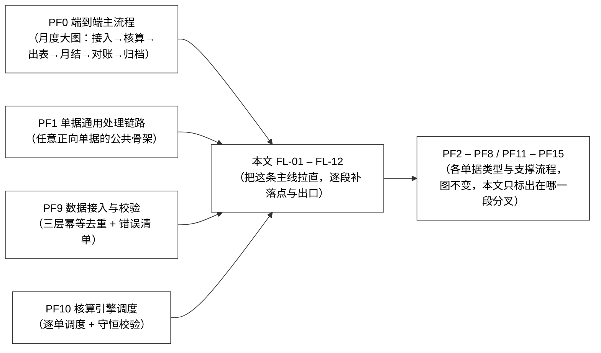

### 0.3 FL 与 PF 的对应关系

| 本文环节 | 对应《详细设计文档》 | 这一段的实质 |
|---|---|---|
| FL-01 数据到达 | PF9 前半 / §7.6 | 推（`receive`）/ 拉（`pull_*`）两种模式，协议无关 |
| FL-02 校验与换算 | PF9 中间 / §7.6 | 表头 → 行级 → 主数据 → 单位换算，**不过整单拒收** |
| FL-03 落库与传输去重 | PF9 后半 / PF0 前半 | 第一层幂等（`batch_id + doc_no + line_no`）；落 `PENDING` |
| FL-04 期间闸门 | PF0 / §3.4.3 | 第二道闸：`is_closed = 1` 直接拒收，两条出口见 §4.1 |
| FL-05 排序键分配 | PF10 / E-01 | `(biz_date, seq_in_day)` → `posting_seq`，**同日入库优先** |
| FL-06 分核算单元 | PF10 / E-05 | `(物料, 仓库, 一级货主)` 分组，组内串行组间并行 |
| FL-07 计量 | PF1 / §5.7 / E-06 | `measure(event, ctx) -> Posting`，**返回 delta 不返回余额** |
| FL-08 出口硬校验 | PF10 末 / §7 / `E-02` | `Σ alloc_amount = 一级层`、数量守恒 F12、金额守恒 F13、批次行均价一致性，**不平整单回滚** |
| FL-09 记账 | PF1 / §5.7 | `balance += delta` + `version` 乐观锁；写 `t_calc_log`；二级层同一笔增量写 `t_owner_allocation` + 投影 `t_owner_balance_l2` |
| FL-10 投影刷新 | PF0 / §7.7 | 余额、收发存、库龄、单价追溯；反向回传业务侧 |
| FL-11 凭证 | PF12 / §7.4 / §8 | 单据确认后或月结批量；导出金蝶、财务手工过账 |
| FL-12 对账与月结 | PF13 / PF14 | 数量日清 vs 业务快照；金额月结 vs 金蝶总账；锁账 |

### 0.4 一张单据"一生"的三个状态位（三条线：业务状态 / 红冲标记 / 核算状态）

全流程上真正决定"这张单能不能动"的只有三个状态位，分属三个不同的人。

| 状态位 | 在哪张表 | 谁定义 | 取值 | 决定什么 |
|---|---|---|---|---|
| `biz_status` | `t_document_header` | **业务**（B 级语义须双方一致） | `DRAFT` / `SUBMITTED` / `APPROVED` / `EFFECTIVE` / `VOID` | 这张单**业务上算不算数** |
| `cost_status` | `t_document_line` | **财务**（独立） | `PENDING` / `CALCULATED` / `ROLLED_BACK` | 这张单**算过账没有**——**作废与改单的闸门就是这个，不是"有无下游引用"** |
| `red_flag` | `t_document_line` | **财务**（独立） | 0 / 1（是否已被红冲） | 这张单**是否已被反向调整** |

**报表口径统一为**：`biz_status = EFFECTIVE AND red_flag = 0`。

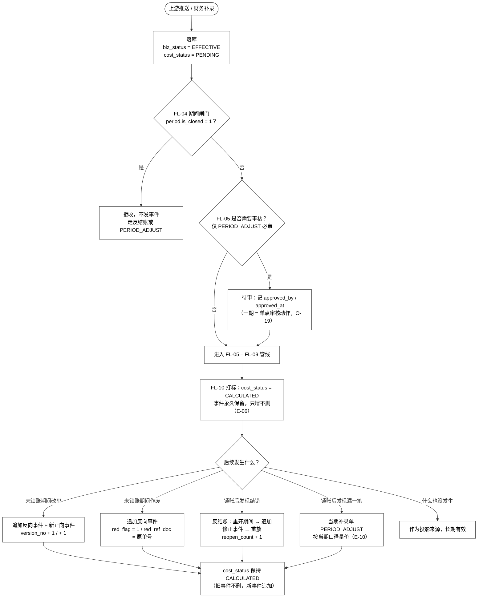

> **七个"状态"其实是三条独立的线**：业务线（`biz_status`）、财务核算线（`cost_status`）、红冲线（`red_flag`）。原文把三者揉在一个 `status` 字段里是设计缺陷（F12 已修正）——**揉在一起就说不清"作废闸门到底该看哪个"**，而作废闸门必须是 `cost_status`（是否已核算），不是业务状态，也不是"有无下游引用"。

### 0.5 全文口径约定

| 项 | 约定 |
|---|---|
| 数量精度 | 4 位（基本单位，`base_qty`） |
| 单价精度 | 6 位（移动平均） |
| 金额精度 | 2 位 |
| 采购金额口径 | 默认**不含税**；入账金额 = 不含税金额 + 本行分摊附加费用（`allocated_cost`） |
| 税额去向 | 只进「应交税费—应交增值税（进项税额）」，**不进存货成本** |
| 一级货主 | **即法人主体**（`owner_l1` = `legal_entity`） |
| 核算只用哪个数量 | **`base_qty`**（基本单位），`qty`（业务单位）只用于回显对账 |
| 时区与日切 | 业务日期取上游 `doc_date`；`doc_date_as_of` 是上游日切时点（F15） |

### 0.6 全文贯穿示例（三张单据，一条管线走一遍）

后文每一段的示例数字都取自这组数据，**口径一致可对照**（与《出入库计价事例拆解》CA-01.1 同基线）。

**主数据**：物料 `M0001`（基本单位「台」）· 仓库 `WH01` · 一级货主 `OWN-A`（法人 `OWN-A`）· 增值税率 13%

| 单据 | 类型 | `base_qty` | 上游给的金额 | 换算后的不含税金额 | 税额 |
|---|---|---|---|---|---|
| `D-001` | `PO_IN` 采购入库 | 100 | 含税 1,130.00 | **1,000.00** | 130.00 |
| `D-002` | `PO_IN` 采购入库 | 100 | 含税 1,356.00 | **1,200.00** | 156.00 |
| `D-003` | `SO_OUT` 销售出库 | 150 | **出库不给金额**（由本系统算） | — | — |

三张单据 `biz_date` 同为 `2026-09-10`，`seq_in_day` 依次为 1 / 2 / 3。

**管线跑完的终局**（后文逐段验证）：

| 时点 | `qty` | `amount` | `unit_price` |
|---|---|---|---|
| 期初 | 0 | 0.00 | — |
| `D-001` 后 | 100 | 1,000.00 | 10.000000 |
| `D-002` 后 | 200 | 2,200.00 | **11.000000** |
| `D-003` 后 | **50** | **550.00** | 11.000000（出库不改价） |

---

## 1. 一页全流程总图

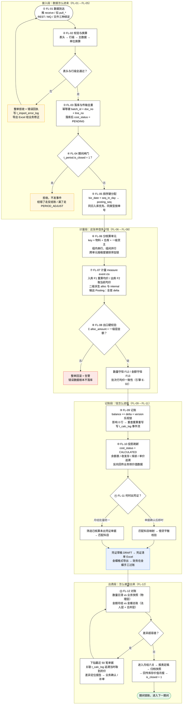

**这张图上有四个颜色，含义不同**：

| 颜色 | 位置 | 含义 |
|---|---|---|
| 黄（`#fef7e0`） | FL-02 不通过落回 FL-01、FL-04 撞锁账 | **退回类**——数据没进系统，业务侧修正后可重来 |
| 红（`#fce8e6`） | FL-08 出口硬校验不平 | **回滚类**——数据进了系统但被引擎挡在门外，**不落库** |
| 蓝（`#e8f0fe`） | FL-11 凭证出口 | **跨系统边界**——从本系统出去到金蝶，之后由人接手 |
| 绿（`#e6f4ea`） | FL-12 锁账完成 | **不可逆的时点**——之后只有反结账一条路 |

---

## 2. 为什么是这四层：钱在管线上的每一次转手

管线上每一段只做一件事，这是《核算引擎设计要点》§2 的四层结构落到流程上的样子。**看清每一段的"输入是什么、输出是什么"，就知道为什么不能合并**。

| 层 | 管线段（分组同 §0.1 / §1） | 输入 | 输出 | 谁拥有这一段 |
|---|---|---|---|---|
| ① 事件层（接入段） | FL-01 – FL-05 | 上游报文 / 文件 | **已定序、已带价、已快照的事件** | 接入适配层 + 调度 |
| ② 计量层（计量段） | FL-06 – FL-08 | `event` + `ctx`（只读快照） | `Posting`（全是 delta + trace，已过 FL-08 出口硬校验） | 策略类（一期 `MovingAverage` / `SpecificIdentification` / `Fifo`） |
| ③ 记账层（记账段） | FL-09 – FL-11 | `Posting` | 余额变动 + 投影 + 凭证 + `t_calc_log` | 引擎（**账的唯一写入者**） |
| ④ 投影层（出表段） | FL-12 | 事件 + 分录 | 余额表 / 报表 / 对账数据（可重建） | 查询侧，**只读** |

**三条不能破的边界**：

1. **计量层不知道余额会被谁改**。`measure()` 收到的 `ctx` 是**只读快照**，返回的是 delta。这是"重放逐位相同"的前提（结果幂等）。**接口里一旦出现"把余额传进来、算完传回去"，三种幂等会同时失效。**
2. **记账层不重算**。`balance += delta`，不做全量重算；`version` 不匹配就重查重算重写。
3. **投影层绝不写账**。报表、对账数据都是从事件流投影出来的，**删除任何一条 `t_calc_log` 都会让投影与真相不一致**（E-06）。

**计量层是策略化的：新增一种计价方法 = 加一个 `MeasureStrategy` 实现。** 一期 `MovingAverage` / `SpecificIdentification` / `Fifo` 三个策略实现并存。**记账层与投影层的对外口径、报表结构不变**；但新增方法需要记账层持久化**成本层**、投影层新增一条**成本层 ↔ 核算单元**一致性校验。三层**边界与接口不变**，这才是冻结 `measure(event, ctx) -> Posting` 的收益。

---

## 3. FL-01 / FL-02 / FL-03：数据怎么进来

### 3.1 推拉两种模式都实现，定了之后只是少调一个

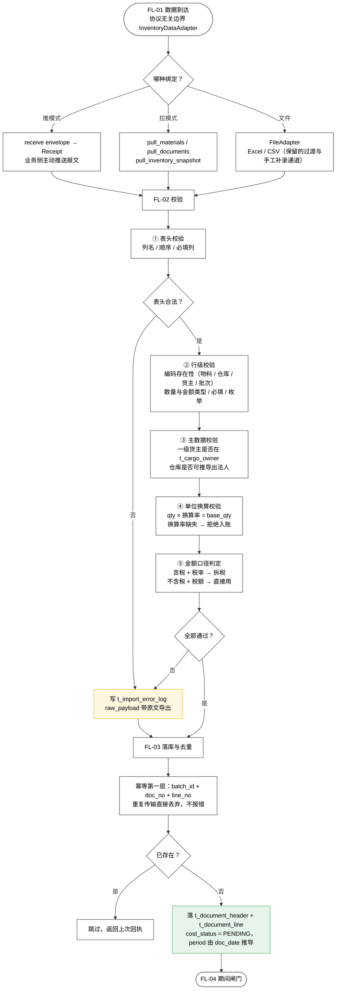

### 3.2 这一段的三个要点

**要点一：校验不过整单拒收，不做"跳过错误行继续"。** 一张单据的行之间是**有原子性的**（同批次多行必须同事务过账），跳行会让单据残缺却看起来合法。业务侧修好重推，走的是同一个 `batch_id` 去重键。

**要点二：两份适配器实现共用一套校验、幂等与错误回执。** API 对接（主）与 Excel 导入（保留）**不产生两套逻辑**，所以切换时不会出现口径漂移。**边界划在接口上，不划在功能上**。

**要点三：金额口径判定在接入段就做完，不留到引擎。** 引擎不查价目表、不做业务合法性判断——**取价是事件层的事**，价与 `price_source` 由单据**快照**进来。

| 上游给什么 | 本系统怎么处理 | 结果 |
|---|---|---|
| 含税金额 1,130.00 + 税率 13% | `1,130.00 / 1.13 = 1,000.00`；税额 `1,130.00 − 1,000.00 = 130.00` | 入账基数 1,000.00，税 130.00 只进进项税 |
| 不含税 1,000.00 + 税额 130.00 | 直接用，不重算 | 同上 |
| 不含税 1,000.00 + 运费 300.00 | 入账基数 = 不含税 + 本行分摊附加费用 | 入账 1,300.00（示例见《事例拆解》CA-01.5） |
| 出库单 | **上游不给金额**（业务侧没有金额权威） | 由 FL-07 按当前均价算 |

---

## 4. FL-04 / FL-05：过期间闸门，然后排队

### 4.1 期间闸门是第二道闸，只读取不修改

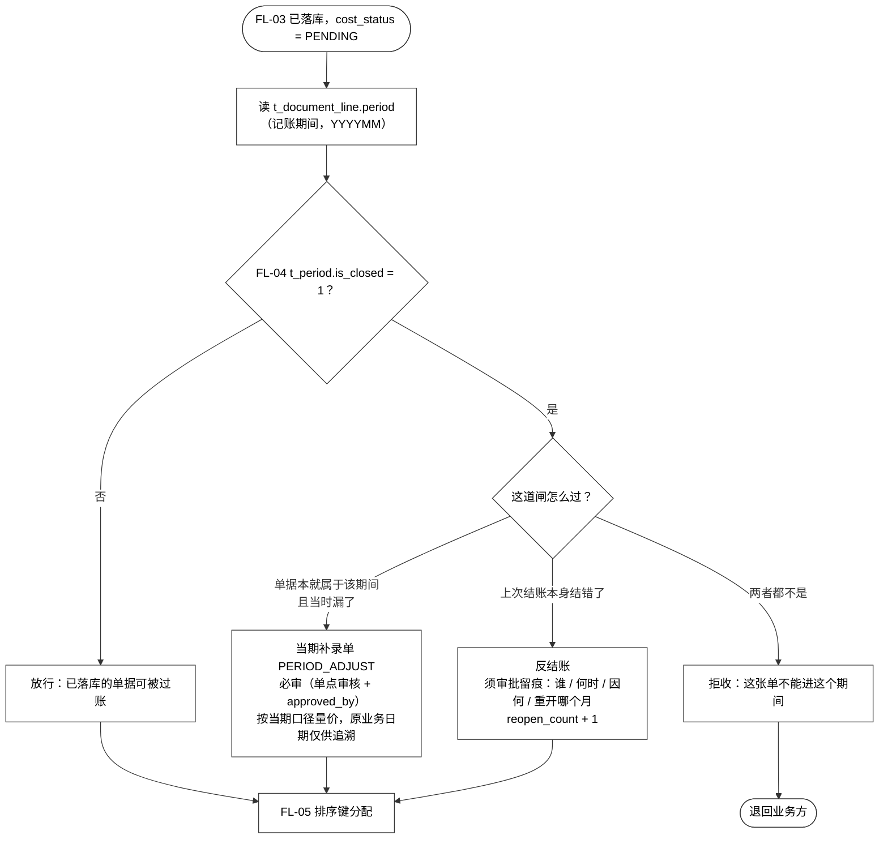

> **闸门是"读取"不是"动作"**：结账锁账是**运维动作**（打 `is_closed` 标志），引擎只读这个标志并拒绝越界过账——**引擎自己不结账**。
>
> **两条出口不能互相代替**（E-09 / E-10）：
> - **结错了 → 反结账**：语义是"上次的结账结果作废"。
> - **漏了一笔 → `PERIOD_ADJUST`**：语义是"这笔在原期间从未存在"。
>
> 混用会让审计**无法区分"错误"与"遗漏"**，而这两种情况的责任归属与是否需要追溯调整恰恰不同。两条路都经同一个 `ApprovalGateway`，但**单据类型、留痕字段、报表口径全部区分**。

### 4.2 排序键：全流程唯一决定"谁先谁后"的地方

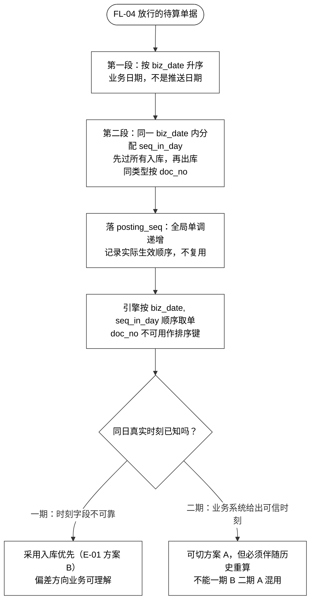

**为什么 `doc_no` 不能当排序键**：单号**不单调**（有补单、有外部系统单号、有前缀差异），业务系统改了单号规则历史数据就乱。**为什么同日要"入库优先"**：避免**当天补入的货被按旧均价出库**——这是业务最不能接受的差异；而"按单号"这种规则**无法向业务解释**。

**示例（本文贯穿示例的三张单，同日）**：

| 单据 | `doc_type` | `biz_date` | `seq_in_day` | `posting_seq` | 规则怎么起作用 |
|---|---|---|---|---|---|
| `D-001` | `PO_IN` | 2026-09-10 | 1 | 1 | 第一段：两张入库都排在出库之前 |
| `D-002` | `PO_IN` | 2026-09-10 | 2 | 2 | 第二段：同类型内部按 `doc_no` 升序 |
| `D-003` | `SO_OUT` | 2026-09-10 | 3 | 3 | 出库永远排在当日入库之后 |

**"入库优先"什么时候才看得出来**：只有当一张**入库单的单号字母序排在出库单之后**时，两条规则才会给出不同答案。例如同日有出库单 `D-003` 与入库单 `Z-009`：

| 排序方式 | 顺序 | 当日均价与出库成本 |
|---|---|---|
| 按单号序（已否决） | `D-003` → `Z-009`（**先出后入**） | 出库只能按**入库前**的旧均价结转 |
| **入库优先（E-01 采用）** | `Z-009` → `D-003`（**先入后出**） | 出库按**含当日入库**的新均价结转 |

**同一批单据、两种规则、两个结果**——这就是 E-01 必须被定义、且必须被测试覆盖的原因。一期数据来自 Excel / 业务系统推送，**时刻字段不可靠**，所以选"入库优先"：偏差方向是**业务可以理解的**（当天进的货当天出、按新均价结转是合理口径），比"按单号"这种无法解释的规则强。

---

## 5. FL-06：分组、加锁、并行

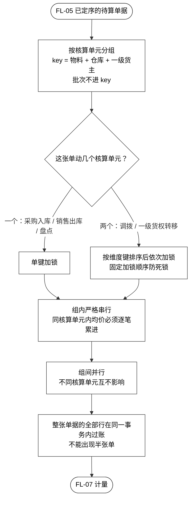

| 规则 | 为什么 |
|---|---|
| **锁的最小单位 = 核算单元** | 均价池就是核算单元。锁得比它大（整物料）会让无关仓库互相阻塞；比它小（批次）保护不了均价 |
| **跨单元单据必须按维度键排序加锁** | 调拨同时动 from / to 两个单元。并发下若 A 先锁 WH01 再锁 WH02、B 反向，直接死锁 |
| **整单同行同事务** | 一张调拨单是"1 张单 + 2 行"（调出腿 + 调入腿，两行 `doc_type` 都是 `TRANSFER`，靠 `warehouse_code` + `is_in` 区分，**共用 `doc_no`**）。拆成两张单会破坏 `doc_no` 唯一性与幂等键 |
| **批次不进锁 key** | 批次只影响库龄与跌价基数，**不影响均价**。按批次加锁会造出一堆互相独立的均价——那已经不是移动平均了 |

> **均价的所有者是核算单元，这句话必须写进表注释和代码**。写不清，实现就会退化成"每个批次行各自算各自的均价"。方案 (a) 下多加一条校验：**同一核算单元内所有批次行的 `unit_price` 必须相等**（**引擎决策 `E-02`**），日结时校验、不等即报错。
>
> **注意别借用错误码**：这是一项**引擎侧的日结硬校验**，不属《通用数据接口字段定义》v1.0 §2.7 的 14 个错误码——那 14 个**全部在过账之前产生**。**不要写成 `E-QTY-MISMATCH`**，该码的定义是 `qty × convert_rate ≠ base_qty`，指**单位换算不平**，与均价无关。

---

## 6. FL-07：计量——这张单值多少钱

### 6.1 一个入口，两个方向，三组输出

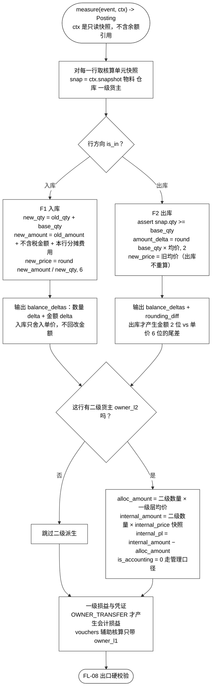

### 6.2 三组输出的语义（一个数量、两个金额）

| 输出 | 计算 | 能否加总回一级层 | 校验 |
|---|---|---|---|
| **一级层**（会计口径） | MA 公式 F1 / F2 | — | 数量守恒 F12、金额守恒 F13 |
| **`alloc_amount`**（二级会计分摊额） | 二级数量 × **一级层均价** | **能** —— `Σ alloc_amount = 一级层金额` | **硬校验，不平整单回滚** |
| **`internal_amount`**（二级内部结算额） | 二级数量 × `internal_price` 快照 | **不能** —— 差额 = 内部未实现毛利 | **不做等式校验** |

> **`internal_amount` 的差额不许做成"校验告警"**。它天然不等于一级层金额，做成告警会天天误报。
>
> **凭证里绝不出现二级货主**。二级不是法人、不是会计主体，`t_voucher_header` 里**没有 `OWNER_REASSIGN` 来源的单据**（R2 / R5）。

### 6.3 贯穿示例：三张单在计量段各算出什么

**`D-001` 采购入库（`seq_in_day = 1`）**

```
入账基数 = 不含税 1,000.00 + allocated_cost 0.00 = 1,000.00
new_qty    = 0 + 100      = 100
new_amount = 0.00 + 1,000.00 = 1,000.00
new_price  = round(1,000.00 / 100, 6) = 10.000000
Posting: delta_qty = +100, delta_amount = +1,000.00, rounding_diff = 0.00
```

**`D-002` 采购入库（`seq_in_day = 2`）**

```
入账基数 = 1,200.00
new_qty    = 100 + 100        = 200
new_amount = 1,000.00 + 1,200.00 = 2,200.00
new_price  = round(2,200.00 / 200, 6) = 11.000000     ← 均价在此重算
Posting: delta_qty = +100, delta_amount = +1,200.00, rounding_diff = 0.00
```

**`D-003` 销售出库（`seq_in_day = 3`）**

```
current_price = 11.000000        ← 取的是 D-002 之后的核算单元均价
raw_amount    = 150 × 11.000000 = 1,650.000000
out_amount    = round(1,650.000000, 2) = 1,650.00
rounding_diff = 1,650.00 − 1,650.000000 = 0.00       ← 本周转恰好无尾差
Posting: delta_qty = −150, delta_amount = −1,650.00, unit_price_after = 11.000000
```

> `rounding_diff` 在**出库**才产生（入库只舍入单价、不回改金额——入库金额是确定的入账数，回改会让金额守恒校验失效）。**单笔尾差量级为 ±0.01 或 0**，本例为 `0.00`；累计值进 `t_inventory_balance.rounding_diff_acc`，**月末统一结转**（F3）。

**如果 `D-003` 带二级货主 `owner_l2 = OWN-B`、`internal_price = 12.00`**

```
alloc_amount    = 150 × 11.000000 = 1,650.00   ← 按一级层均价
internal_amount = 150 × 12.00     = 1,800.00   ← 按内部结算价快照
internal_pl     = 1,800.00 − 1,650.00 = 150.00 ← 内部未实现毛利，管理口径
出口硬校验：Σ alloc_amount_delta (−1,650.00) == 一级层 amount_delta (−1,650.00)  ✓
```

> **注意符号一致**：出库的一级层 `amount_delta` 是负数，二级层的 `alloc_amount_delta` 也必须是同号的负数，否则硬校验过不了。**硬校验比的是同号同额的增量，不是绝对值。**

---

## 7. FL-08：出口硬校验——唯一的"挡在门外"的地方

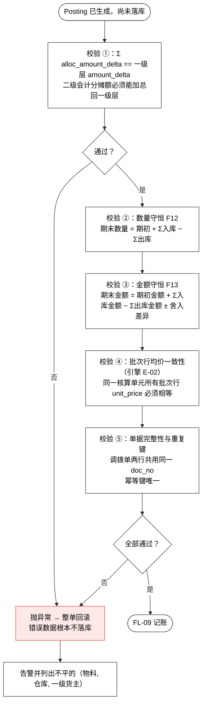

**"校验前移"是这套设计的核心收益之一**：

| 做法 | 后果 |
|---|---|
| 硬校验放在**引擎出口**（本系统采用） | 错误数据**根本不落库**。月末对账是**第二道网**，不是第一道 |
| 硬校验放在**月末对账**（原设计） | 错数据已经落库，只能靠人找；等发现时已经过了几个期间 |

**校验 ① 不过怎么办：整单回滚，不是记账后报警。** 上报一个"不平"的告警、账照记，等于把一道硬约束降级成一条日志——**账已经脏了，报警没有任何补救作用**。

---

## 8. FL-09：记账——delta 怎么落地

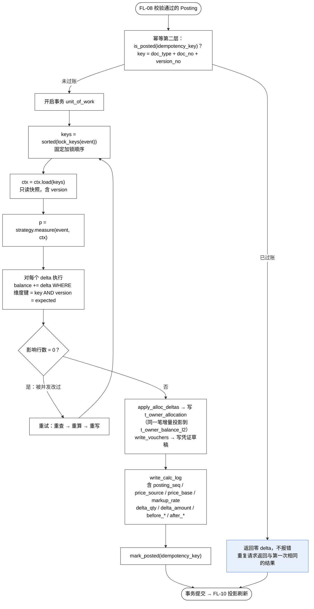

### 8.1 三种幂等是三层，不是一件事

| # | 层次 | 键 | 在哪一段拦 | 解决的问题 |
|---|---|---|---|---|
| 1 | **传输幂等** | `batch_id + doc_no + line_no` | FL-03 落库前 | 同一批数据推两次不重复入库 |
| 2 | **事件幂等** | `(doc_type, doc_no, version_no)` | FL-09 记账前 | 重试、消息重投、手工重跑、重放 |
| 3 | **结果幂等** | 纯函数 + 顺序确定 | FL-07 计量本身 | 重放逐位相同（审计、灾难恢复、口径验证） |

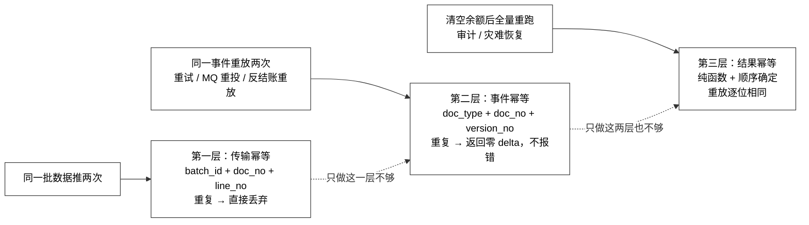

> **幂等不是"拒绝了重复请求"，而是"重复请求返回与第一次相同的结果"**（这里是零变化）。**返回错误会让上游以为失败而无限重试**，这是把幂等做成故障源的经典做法。
>
> **改单不能用"删了重来"**：改单 = `version_no + 1` 产生**新事件**，旧版本作为历史保留。这样重放时序列唯一、结果确定，`t_calc_log` 上能看到 v1 与 v2 各自的算式输入，并与货权变更单的"已核算不可撤、只能反向"保持同一套语义。

### 8.2 贯穿示例：三张单落库后的 `t_calc_log`

| `posting_seq` | `doc_no` | `doc_type` | `version_no` | `seq_in_day` | `delta_qty` | `delta_amount` | `before_unit_price` | `after_unit_price` | `rounding_diff` |
|---|---|---|---|---|---|---|---|---|---|
| 1 | `D-001` | `PO_IN` | 1 | 1 | +100 | +1,000.00 | — | 10.000000 | 0.00 |
| 2 | `D-002` | `PO_IN` | 1 | 2 | +100 | +1,200.00 | 10.000000 | 11.000000 | 0.00 |
| 3 | `D-003` | `SO_OUT` | 1 | 3 | −150 | −1,650.00 | 11.000000 | 11.000000 | 0.00 |

**余额表终局**：`(M0001, WH01, OWN-A)` → `qty = 50`，`amount = 550.00`，`unit_price = 11.000000`，`version = 3`，`rounding_diff_acc = 0.00`。

**守恒校验复核**：
- 数量：`0 + 100 + 100 − 150 = 50` ✓
- 金额：`0.00 + 1,000.00 + 1,200.00 − 1,650.00 = 550.00` ✓

> **`before_*` / `after_*` 是审计快照，不是回滚依据**。把这两列当作回滚输入，会让三种幂等、重放一致性、可审计性一起失效——**引擎没有"回滚"这个动作**，反向调整一律通过**追加反向事件**实现。

---

## 9. FL-10：投影刷新与反向回传

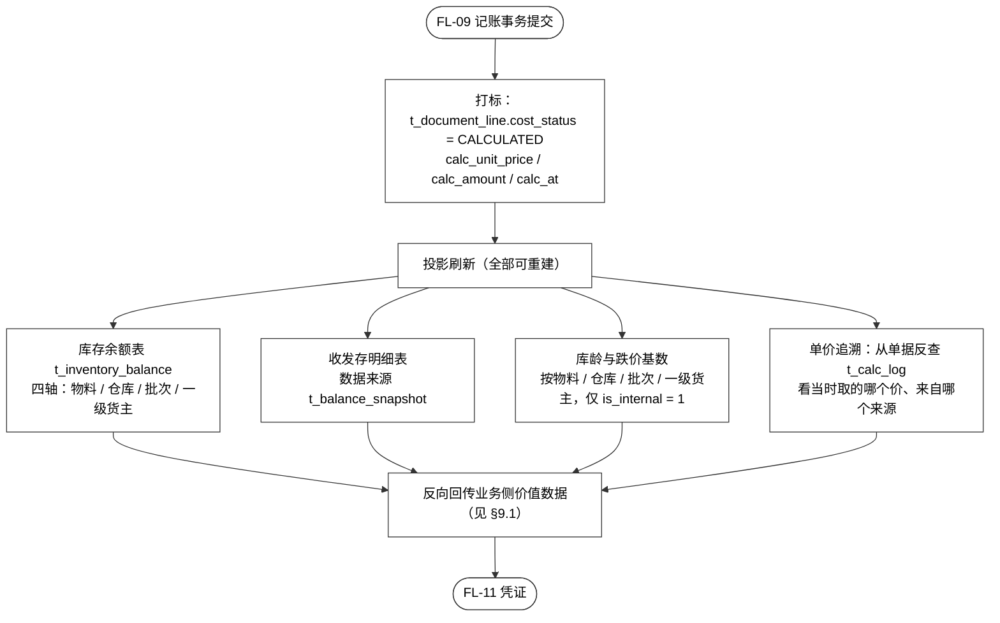

### 9.1 回传业务侧：两个金额口径必须成对出现

财务库存中心**反向回传**价值数据给业务库存中心，根治"双方各算一套成本"（红线三）。

| 回传指标 | 口径标注 | 业务侧能不能单独用 |
|---|---|---|
| 库存金额 | **一级货主层 · `is_internal = 1`** | **能**——这是对外唯一权威值 |
| 库存数量（权属口径） | 一级货主层 | 能 |
| 库存数量（在库口径） | 物理层（仓库, 批次） | 能——与数量对账基准一致 |
| 成本单价 | 核算单元（物料, 仓库, 一级货主） | 能 |
| 库龄 / 周转天数 | 批次层 / 一级货主层 | 能 |
| 跌价准备 | 一级货主层 · `is_internal = 1` | 能 |
| **内部结算金额** | **管理口径 · 非会计** | **不能**——必须与"库存金额（存货口径）"**成对出现**，单独使用即口径错误 |
| **内部结算损益** | **管理口径 · 非会计损益** | **不能**——同上 |

> **若不区分口径，业务侧必然挑一个当"库存金额"——红线三以新形式复发**，而且这次是"契约里写了、实现里没区分"。二级层是**一个数量、两个金额**：`alloc_amount` 能加总回一级层，`internal_amount` 不能加总。

---

## 10. FL-11：凭证——什么时候出，怎么出去

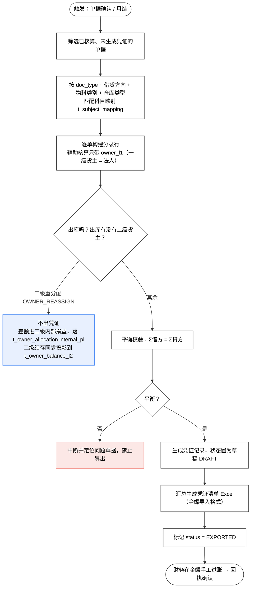

### 10.1 贯穿示例的凭证

| 来源单 | 借方 | 贷方 | 说明 |
|---|---|---|---|
| `D-001` | 库存商品 1,000.00<br/>应交税费—应交增值税（进项税额）130.00 | 应付账款 1,130.00 | 含税 1,130.00 拆税：`1,130.00 / 1.13 = 1,000.00` |
| `D-002` | 库存商品 1,200.00<br/>应交税费—应交增值税（进项税额）156.00 | 应付账款 1,356.00 | 含税 1,356.00 拆税：`1,356.00 / 1.13 = 1,200.00` |
| `D-003` | 主营业务成本 1,650.00 | 库存商品 1,650.00 | 出库成本 = `150 × 11.000000 = 1,650.00` |

**存货科目净变动校验**：借方 `1,000.00 + 1,200.00 = 2,200.00`，贷方 `1,650.00`，净额 `550.00` —— **与余额表 `amount = 550.00` 完全一致**。这就是金额对账要检查的东西。

### 10.2 两条口径要点

**要点一：核算先行、凭证后置。** 单据先完成成本计算并更新余额（日常随时可查），凭证生成集中在单据确认无误后进行，**避免"凭证已生成、成本又变动"的反复**。一期支持"单据确认后即时"与"月结批量统一"两种触发，**两条路用同一套科目映射与平衡校验**。

**要点二：二级重分配压根不产生凭证。** `t_voucher_header` 里**没有 `OWNER_REASSIGN` 来源的单据**——二级不是法人、不是会计主体（R2）。二期若把二级作价上到会计层，才在此处新增。

---

## 11. FL-12：对账与月结

### 11.1 数量日清、金额月结——两个不同的对手方

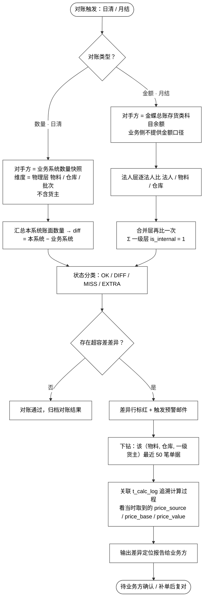

| 维度 | 数量对账（日清） | 金额对账（月结） |
|---|---|---|
| 对手方 | **业务系统数量快照**（`basis = BIZ_SNAPSHOT`） | **金蝶总账**（`basis = GL_BALANCE`） |
| 对账维度 | 物理层 `(物料, 仓库, 批次)` | **法人层** `(法人, 物料, 仓库)` + 合并层 `(物料, 仓库)` |
| 下钻维度 | 同上 | `(物料, 仓库, 一级货主)` |
| 频率 | **每日** | **月结** |
| 为什么这么定 | 业务侧有数量权威、**没有金额权威** | 金额的权威源是总账，不是业务系统 |

> **两处口径不能改**：
> ① 金额对账的对方**不是业务系统**（业务侧没有金额权威）；
> ② 维度**必须含法人**——原 `(物料, 仓库)` 少一维，**两个法人的余额被混在一起对**，差异互相抵消，永远查不出问题。
>
> **数量对账为什么停在物理层、不上货主层**（O-07）：业务侧的库存数量是否也建货主维度，**是外部协调项，不由我方单方决定**。一期先按物理层对账；若 O-07 确认业务侧也建货主维度，再升级为 `(物料, 仓库, 批次, 一级货主)`——**不预设结论**。

### 11.2 月结六关与锁账

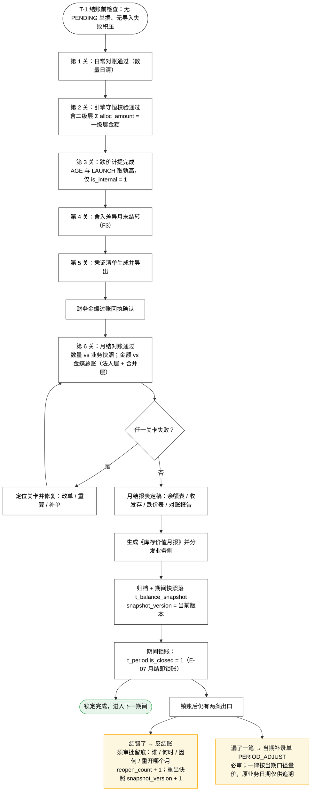

**"日结校验、月结锁账"是两条不同的动作，不能合并**：

| 动作 | 周期 | 做什么 | 要不要锁账 |
|---|---|---|---|
| 日结校验 | 每日 | 跑硬校验与对账（`Σ alloc = 一级层`、数量守恒 F12、金额守恒 F13、批次行均价一致性（引擎 E-02）） | **不锁**——发现问题当天报 |
| 月结锁账 | 每月 | 舍入差异结转（F3）、跌价计提（F6–F11）、数量金额对账、打 `is_closed` 标志 | **锁** |

> 日结锁账会让业务当天补单都做不到；但日结校验能在当天就抓到硬错误，不必等到月末。**"校验"与"锁账"分开，是这一条的全部要点。**

### 11.3 锁账之后的两条路，语义不同

| 情形 | 走哪条路 | 留痕落在哪 | 为什么不能混用 |
|---|---|---|---|
| 锁账后发现**上次结错了**（结账动作本身有误、计提/结转不对） | **反结账**（重新打开期间重算） | `t_period.reopen_count` / `last_reopen_at` / `last_reopen_by` / `last_reopen_reason`；`t_balance_snapshot.snapshot_version + 1` | 语义是"上次的结账结果作废" |
| 锁账后发现**漏了一笔**（业务单据迟到、当时没进来） | **当期补录单 `PERIOD_ADJUST`**（必审） | `t_document_header.approved_by` / `approved_at` | 语义是"这笔在原期间从未存在" |
| 未锁账期间发现错误 | **直接改单**（`version_no + 1` 新事件） | 事件流 + 红字凭证 | 期间还开着，不需要闸门 |

> **补录单为什么必须"按当期口径"量价**（E-10）：要知道"这一笔当时若在期内会排在第几位"，而排序键的当日序号是按当天分配序发的——**跨期回填复原不出那个序号**。硬做只能得到一个人为编造的顺序，**报得出来，但报的是假数**。宁可口径统一、口径写清。
>
> **一期用"当期补录单"换取"历史不可改"，用"反结账须批"换取"错误仍可修"**。这是拿精度换可审计性、拿流程换修正通道。

---

## 12. 异常出口一览

全流程上所有会让一张单"走不到头"的地方，汇总如下。**这张表是排查线上问题时最该先看的一张。**

| # | 在哪一段 | 触发条件 | 系统动作 | 数据落到哪 | 谁接手 |
|---|---|---|---|---|---|
| X-01 | FL-02 | 表头列名 / 顺序 / 必填列不符 | 整批拒绝，返回模板错误说明 | — | 业务方改文件重推 |
| X-02 | FL-02 | 行级校验不过（编码不存在、类型错、必填缺） | 整单拒收，错误行写错误清单 | `t_import_error_log`（`raw_payload` 带原文） | 业务方修正后重推 |
| X-03 | FL-02 | 单位换算率缺失 | **拒绝入账**（不猜换算率） | `t_import_error_log` | 主数据维护方补换算率 |
| X-04 | FL-02 | 主数据缺失（货主不在 `t_cargo_owner`、仓库推不出法人） | 拒绝入账 | `t_import_error_log` | 主数据维护方 |
| X-05 | FL-03 | 同一批数据重复推送 | 直接丢弃，返回上次回执 | — | 无 |
| X-06 | FL-04 | `t_period.is_closed = 1`，单据属该期间 | 拒收，不发事件 | — | 财务：走反结账或 `PERIOD_ADJUST` |
| X-07 | FL-06 | 调拨单两侧仓库属**不同一级货主** | **拒绝并回执，要求业务改推 `OWNER_TRANSFER`**；适配层**不做自动升级** | 回执报文 | 业务方改推单据类型 |
| X-08 | FL-07 | 出库数量 > 当前库存 − 容差 | 抛 `RejectError`，拒绝过账 | — | 业务方查库存差异 |
| X-09 | FL-07 | 出库数量 > 当前库存但在容差内（`NEGATIVE_STOCK_TOLERANCE`，默认 0） | **允许过账 + 出 `NEGATIVE_STOCK` 告警** | `t_calc_log` + 告警记录 | 财务关注，月末清理 |
| X-10 | FL-07 | 入库后总数量为 0 | 抛 `RejectError`，拒绝过账 | — | 业务方 |
| X-11 | FL-08 | `Σ alloc_amount_delta ≠ 一级层 amount_delta` | **整单回滚**，错误数据不落库 | 告警（列出不平的核算单元） | 研发排查（属引擎缺陷或数据问题） |
| X-12 | FL-08 | 数量 / 金额守恒不平、批次行均价不一致 | **整单回滚** | 告警 | 研发 / 财务 |
| X-13 | FL-09 | 乐观锁 `version` 不匹配（被并发改过） | **重试**：重查 → 重算 → 重写 | — | 无（自动） |
| X-14 | FL-09 | 同一 `(doc_type, doc_no, version_no)` 重复提交 | **返回零 delta，不报错** | — | 无 |
| X-15 | FL-10 | 单据已核算，业务侧要求改单 / 作废（期间**未**锁） | 追加反向事件（`version_no + 1`）；已出凭证则先红冲 | `t_calc_log` + `red_flag` / `red_ref_doc` | 财务 |
| X-16 | FL-10 | 单据已核算，行业务侧要求改单 / 作废（期间**已**锁） | **拒绝**，走反结账或 `PERIOD_ADJUST` | — | 财务（须审批） |
| X-17 | FL-11 | 借贷不平衡 | **中断，禁止导出** | 定位问题单据 | 财务 + 研发 |
| X-18 | FL-12 | 对账差异超容差 | 标红 + 预警邮件 + 下钻最近 50 笔 + 关联 `t_calc_log` | `t_reconcile_result` | 业务方确认 / 补单 |

**三类异常的区别**（颜色含义同 §1）：

| 类别 | 编号 | 数据状态 | 补救方式 |
|---|---|---|---|
| **退回类**（黄） | X-01 – X-07 | **没进系统** | 业务方修正后重推，走同一个幂等键 |
| **回滚类**（红） | X-08、X-10 – X-12、X-17 | **进了系统但被挡在门外，不落库** | 修正数据或修引擎缺陷 |
| **容忍类**（蓝） | X-09、X-13、X-14 | **已通过或已自动处理** | 无需人工；X-09 月末清理 |

> **X-14 特别说明**：幂等命中**不是异常**，是正常路径。**返回错误会让上游以为失败而无限重试**——这是把幂等做成故障源的经典做法。

---

## 13. 十一类单据在全流程上的分叉点

**所有单据共用 FL-01 – FL-12 这条管线**，区别只在 FL-06 / FL-07 / FL-11 三处。

> **本文不覆盖 C 组（虚进虚出）的判定**：C 组是**账面进出、实物不动**的一族——直发（`XY-1`）/ 库内转手（`XY-2`）/ 纯空转（`XY-3`）。其判定规则见《出入库场景与数据交接对照》**§5.1 与 §9**（`XY-1` 落 `PO_IN` + `SO_OUT` 两笔、`XY-2` 应走 `OWNER_TRANSFER`、`XY-3` 不应确认收入）；本文只说明它们在管线上走到哪一段，不重复判定口径。

| `doc_type` | 中文 | 动了几个核算单元 | FL-07 计量的特殊处 | FL-11 凭证 | 全流程上的关键分叉 |
|---|---|---|---|---|---|
| `PO_IN` | 采购入库 | 1（入） | F1 重算均价；含税先拆税 | 库存商品 + 进项税额 / 应付账款（8.1.1） | **唯一会改均价的日常单据之一** |
| `PO_RET` | 采购退货出库 | 1（出） | F2 按**当前均价**结转（不是原采购价） | 应付账款 / 库存商品（8.1.8） | 若原期间已锁账，走 `PERIOD_ADJUST` |
| `SO_OUT` | 销售出库 | 1（出） | F2 取当前均价；可带 `owner_l2` 产生二级分摊 | 主营业务成本 / 库存商品（8.1.2） | **跨一级货主且跨二级货主时**，一级余额与二级分摊同时动 |
| `SO_RET` | 销售退货入库 | 1（入） | **按原出库价冲回**（不是按当前均价！） | 库存商品 / 主营业务成本（8.1.9） | 按错价会差出金额，见下 §13.1 |
| `TRANSFER` | 调拨 | **2**（from / to） | 两条腿：先调出（取调出仓均价）再调入（按同额入库并重算调入仓均价） | **一律生成 `8.1.3` 调拨凭证**（一张单两行，同法人同额结转、不产生损益，但**仍出凭证**）；**跨法人直接拒绝** | **1 张单 + 2 行**，靠 `warehouse_code` + `is_in` 区分，**共用 `doc_no`** |
| `STOCKTAKE` | 盘点 | 1 | 不直接算：`diff_qty = 实盘 − 账面`，再生成盘盈入库 / 盘亏出库单进通用链路 | 待处理财产损溢（8.1.4 盘亏 / 8.1.5 盘盈） | **盘点单本身不产生 delta**，产生的是它派生出的出入库单 |
| `OTHER_IN` | 其他入库 | 1（入） | 按金额来源（5 类，见 §13.2） | 受赠 → **营业外收入（8.1.12）**；IN-3 / IN-4 **不出**（备查登记） | **金额来源必须显式给**，见 §13.2 |
| `OTHER_OUT` | 其他出库 | 1（出） | 按当前均价结转；`amount_ex_tax = 0` 是"只减数量不减金额"的标记 | 真费用三类 → **其他出库（8.1.13）**；OUT-4 / OUT-5 暂挂 / 转「发出商品」；OUT-6 **不出** | **六类分界点在 `is_recoverable` / `account_subject` / `amount_ex_tax`** |
| `OWNER_TRANSFER` | 一级货权转移 | **2**（跨法人） | 按 `transfer_price` **作价**出库 + 入库，两侧均价都重算 | **必出凭证**（视同销售 + 成本结转，8.1.10）；集团内加合并抵消（8.1.11） | **唯一同时改会计损益与均价的单据** |
| `OWNER_REASSIGN` | 二级重分配 | **0** | 只算 `alloc_amount` / `internal_amount` / `internal_pl`，**不动一级余额** | **不出凭证**（R2） | 出口硬校验仍需通过（`Σ alloc = 一级层`） |
| `PERIOD_ADJUST` | 跨期补录 | 1 | **一律按当期口径**（当期均价 / 建当期成本层） | 按当期价出（8.1.x 对应类型） | **必审**；原业务日期仅供追溯，**不用于取价** |

### 13.1 两处以"看起来一样、实际方向相反"闻名的分叉

| 场景 | 取值 | 为什么 |
|---|---|---|
| **销售退货入库** | 按**原出库价**冲回 | 退货是"撤销那笔销售"，金额必须回到原值。按当前均价会让均价被退货污染 |
| **采购退货出库** | 按**当前均价**结转 | 退货是"减少库存"，成本按当时的账面成本走，不是按原采购价 |

《出入库计价事例拆解》CA-02 给过量化差异。起点：`M0001` @ `WH01` / `OWN-A` 结存 **210 台 / 2,460.00 / 均价 11.714286**，退 10 台：

| 取值方式 | 冲回金额 | 冲回后结存 | 冲回后均价 | 与正确结果之差 |
|---|---|---|---|---|
| **按原出库价 11.000000 冲回（正确）** | 10 × 11.000000 = **110.00** | 220 台 / **2,570.00** | **11.681818** | — |
| 按当前均价 11.714286 冲回（错误） | 10 × 11.714286 = **117.14** | 220 台 / **2,577.14** | **11.714273** | **金额 7.14** · 均价 0.032455 |

**这 7.14 是"被重写出来的假数"**：一次退货把**已结转的历史成本**改写，当期损益被退货重写，前期报表也跟着变。它还会继续污染该核算单元的均价，进而污染后续每一笔出库的成本结转，最后在月末金额对账上与金蝶总账对不上。

> **两个版本的凭证借贷都是平的**（借库存商品 110.00 或 117.14 / 贷主营业务成本同额）。**平衡校验查不出这类错误**，只有金额对账与"批次行均价一致性"校验能查出来。这也说明为什么 `orig_so_doc`（原销售出库单号）必须必填——缺它整行拒绝入账，回执 `E-SRC-DOC-MISSING`。

### 13.2 其他入库的五类与金额来源（口径以《出入库场景与数据交接对照》§S-05 为准）

`OTHER_IN` 有五类，区别不在方向（都是入），而在**金额从哪来、权属属谁、要不要出凭证**：

| 类别 | 金额来源 | 一级货主 / `is_internal` | 科目去向 |
|---|---|---|---|
| **IN-1 原物归还** | 原借出 / 原送出的结转金额，**回冲、不重估** | 我方 · `is_internal = 1`（**进存货总额**） | 原科目反向 |
| **IN-2 受赠入库** | 供应商开票价 / **不含税公允价值**（业务给） | 我方 · `is_internal = 1` | **营业外收入（8.1.12）**——集团政策若选择冲减采购成本，在科目映射配置里替换 |
| **IN-3 受托代销 · 寄售** | 委托方代销价 / 对账单金额（**外部**给） | **外部法人** · `is_internal = 0`（不进存货总额） | **不出**（备查登记） |
| **IN-4 借入他方货物** | 出借方作价（**外部**给） | **外部法人** · `is_internal = 0`（不进存货总额） | **不出**（备查登记） |
| **IN-5 无对价杂项** | **财务手工估价** | 我方 · `is_internal = 1` | 营业外 / 待处理 |

> **"必须有估价金额"只对 IN-5 成立。** IN-1 是原单回冲、IN-2 是业务给的公允价、IN-3 / IN-4 是外部对方给的对账价——前四类都有真实金额，一律要求手工估价会让估出来的数与实际发生额对不上，还会凭空多出一笔损益。
>
> **盘盈不走这里。** 盘点后 `实盘 > 账面` 由盘点单 `STOCKTAKE`（S-06）自动派生盘盈入库单，走「待处理财产损溢」（8.1.5）——**`OTHER_IN` 不承载盘盈**，两者凭证科目完全不同。
>
> **IN-3 / IN-4 的 `is_internal = 0` 是硬标记**：外部法人的货"数量在库、金额不是我的"，不进存货总额（R4），**报表口径与跌价计提都以这个标记为界**。

---

## 14. 落点速查：每个环节往哪张表写什么

| 环节 | 写入 / 更新 | 关键字段 |
|---|---|---|
| FL-02 校验失败 | `t_import_error_log` | `raw_payload`（带原文）、错误码、行号 |
| FL-03 落库 | `t_document_header` / `t_document_line` | `biz_status = EFFECTIVE`、`cost_status = PENDING`、`period`、`base_qty`、`allocated_cost` |
| FL-04 期间闸门 | **只读** `t_period` | `is_closed` |
| FL-05 排序 | 更新 `t_document_header.seq_in_day`、`t_calc_log.posting_seq` | 排序键 `(biz_date, seq_in_day)` |
| FL-06 分单元 | 内存（锁 key 列表） | key = `(物料, 仓库, 一级货主)` |
| FL-07 计量 | **不写库**（纯函数） | 输出 `Posting`（全部是 delta） |
| FL-08 出口校验 | **不通过则不写库** | 硬校验 `Σ alloc = 一级层` |
| FL-09 记账 | `t_inventory_balance`（`+= delta` + `version`）、`t_calc_log`、`t_voucher_header` / `t_voucher_line`、`t_owner_allocation`（**增量事件账**）、**`t_owner_balance_l2`（二级货主结存投影，同一笔增量按二级货主落 `qty`）** | `delta_qty`、`delta_amount`、`price_source`、`price_base`、`markup_rate`、`price_value` |
| FL-10 投影 | `t_document_line.cost_status = CALCULATED`、`calc_unit_price`、`calc_amount` | 只读投影：余额表 / 收发存 / 库龄 |
| FL-11 凭证 | `t_voucher_header` / `t_voucher_line`、`t_subject_mapping`、导出 Excel | 状态 `DRAFT → EXPORTED` |
| FL-12 对账 | `t_reconcile_result` | `basis = BIZ_SNAPSHOT` / `GL_BALANCE`、状态 `OK` / `DIFF` / `MISS` / `EXTRA` |
| FL-12 月结 | `t_balance_snapshot`、`t_period`、`t_depreciation_result` | `snapshot_version`、`is_closed`、`reopen_count` |

**三张表是"只增不删"的**：

| 表 | 为什么只增不删 |
|---|---|
| `t_calc_log` | **事件为真相源**（E-06）。删除任何一行都会让重放结果与当前余额不一致。它不是"操作日志" |
| `t_balance_snapshot` | 反结账后重出快照时 `snapshot_version + 1`，**旧版本保留**——审计要能看到"改之前是什么样" |
| `t_document_line` | 改单 / 作废**追加反向事件**，原行保留，用 `red_flag` / `red_ref_doc` / `version_no` 留痕。**报表口径靠 `biz_status = EFFECTIVE AND red_flag = 0` 过滤** |

---

## 15. 五条最容易被漏掉、但漏掉就出事的约束

| # | 约束 | 漏掉的后果 |
|---|---|---|
| 1 | **过账顺序必须定义**（`biz_date, seq_in_day`，同日入库优先） | 移动平均**结果依赖处理顺序**。同一批单据先入后出与先出后入得到不同均价 → 不同存货金额 → **对账永远差一点，且差得没规律**。**`FIFO` 同样有顺序依赖**——层消耗次序由 `(biz_date, seq_in_day)` 决定 |
| 2 | **引擎返回 delta，不返回余额** | 读-改-写不幂等：余额已被改过再算一次，`old_qty` 变了、结果就变了。"同一笔单据重复计算结果一致"**做不到** |
| 3 | **硬校验放在引擎出口，不放月末对账** | 错数据已经落库，只能靠人找；等发现时已经过了几个期间 |
| 4 | **结账标志必须引入**（`t_period.is_closed`） | 没有"已定稿"的时点，**重放不收敛、历史随时能被改写、审计无从谈起** |
| 5 | **对账必须用独立实现**（不复用引擎代码） | 用 SQL 直接聚合单据流水算"应有余额"再比对。**复用引擎代码的对账只能证明"引擎和自己一致"——自洽的错误是最危险的错误** |

---

## 16. 变更记录

| 版本 | 日期 | 变更 |
|---|---|---|
| **v1.0** | 2026-09-21 | 首次成文。把 PF0 / PF1 / PF9 / PF10 叠成十二段管线 FL-01 – FL-12；逐段补齐输入 / 判断 / 输出去向 / 落点表；给出三张单据、一个核算单元的贯穿示例（与《出入库计价事例拆解》CA-01.1 同基线）；汇总 18 条异常出口（X-01 – X-18，按退回 / 回滚 / 容忍三类）；列出 11 类单据在管线上的分叉点与两处方向相反的分叉；给出三张只增不删的表与五条最易漏掉的约束 |
| **v1.0（修订）** | 2026-09-30 | **二级货主结存表进管线**（依据《一级与二级货主双维度结存设计方案 v1.0》与《详细设计文档》v0.4 本轮修订）。① **`§5` FL-09 记账 mermaid**：`apply_alloc_deltas → 写 t_owner_allocation` 节点补注「（**同一笔增量投影到 `t_owner_balance_l2`**）」——二级分摊账与二级结存表是**同一步、同一笔增量**的两个落点。② **`§14` 落点速查 FL-09 行**补 **`t_owner_balance_l2`（二级货主结存投影，同一笔增量按二级货主落 `qty`）**，并注明 `t_owner_allocation` 是**增量事件账**。③ **`§2` 十二段管线速查 FL-09 行**、**`§10` 凭证 mermaid 的 `OWNER_REASSIGN` 分叉节点**同步补注。④ **`§16` 收尾注的「E-01 – E-10 已全锁定」改为「E-01 – E-12」**——`E-11`（成本层一致性）与 `E-12`（二级结存投影不一致）已分别于 2026-09-28 / 2026-09-30 补登。 |

---

*本文为流程梳理稿。**不新增决策项**（E-01 – E-12 已全锁定）、**不新增字段**（字段层已冻结）。所有 mermaid 图沿用《详细设计文档》§3.1.1 的图形规范与样式前缀（白底节点 / 深灰边框 / 黑字 / 连线标签白底），与 PF0–PF15 视觉一致。示例数字与《财务库存中心（一期）出入库计价事例拆解_v1.0》CA-01.1 同基线，可互为校验。*
