# 财务库存中心（一期）详细设计文档

> 状态：v0.5 草稿（**开发基线候选**）｜ 本次**首次升版号**：二级产权人自有均价池（管理口径）——改写了 **R3**、解冻 3 个字段、变更引擎契约，见 `§14` 变更记录末行
> 上一版：v0.4（2026-09-15，口径级重构）
> 适用项目：财务库存中心（一期）
> 周期：8 周（W1 - W8）
> 读者：项目组、财务部、业务库存团队
> 关联文档：《货主分层口径分析与表述框架》v1.4（O-xx）·《核算引擎设计要点》v1.3（E-xx）·《业务与财务库存中心数据交接清单与一致性约定》v1.2 ·《财务库存中心（一期）项目待决策清单》v1.1（D-xx，**已按默认值全部锁定**）·《财务库存中心（一期）出入库场景与数据交接对照》v1.0（`IN-x` / `OUT-x` / `G-xx`）·《三份文档交叉审查与差距清单》v1.0（F-xx）·《七份文档一致性核对与遗漏清单》v1.0（C-xx）
>
> **v0.4 变更（本次为口径级重构，不是文字修订，逐项理由见上列四份清单）**
>
> 1. **引入货主分层（第四根库存轴）**——库存维度由 `(物料, 仓库, 批次)` 扩为 `(物料, 仓库, 批次, 一级货主)`；**存货核算单元** = `(物料, 仓库, 一级货主)`，均价池只在此层建立。一级货主 = 法人主体，与 `owner_l1` 是同一概念（DISC-F18 由此闭环）。二级货主不进存货总额，走独立分摊账。
> 2. **两级作价与"一个数量、三个金额"**——一级货权转移按 `transfer_price`（**交易数据**，不做配置，只取价 + 校验）作价、必出凭证、必确认会计损益；二级重分配按 `internal_price`（**政策数据**，带生效期的价目表 `t_internal_price`）作价，差额进二级内部损益（管理口径），**不出凭证**。二级层 `alloc_amount` 能加总回一级层（硬校验），`internal_amount` 不能加总（不做等式校验），`own_amount`（管理口径自有成本）也不能加总（差额 = 池化差异 $D$，**不影响会计**）。
> 3. **单据类型 5 类 → 11 类**——`其他出入库` 拆为 `OTHER_IN` / `OTHER_OUT` 两类；补 `PO_RET` / `SO_RET`（退货，DISC-F07）、`OWNER_TRANSFER` / `OWNER_REASSIGN`（货权变更单，产权交易中心一期不落地时的临时载体）、`PERIOD_ADJUST`（跨期补录单，E-08）。**5 类中"调拨"仍计一类**（`TRANSFER` 一个单据类型，调出/调入两行在适配层展开，见 `3.3.4`）；`6 + 5 = 11`。
> 4. **引入会计期间与锁账**——`t_period` + `is_closed`；**日结只做校验、月结锁账**（E-03 / E-07）；反结账**允许但须走审批并留痕**（E-09）；跨期补记走当期补录单 `PERIOD_ADJUST`，**一律按当期口径量价**（E-10）。原"一期未启用会计期间锁账"的表述全部作废。
> 5. **过账顺序改为 `(业务日期, 当日序号)`**——`doc_no` **不可用作排序键**（引擎 §4.1）；同日**入库优先**、同类型按单号（E-01）。
> 6. **核算引擎返回 `delta` 而非新余额**，改单 = `version+1` 新事件；**删除"回滚""删行重推""相当于撤销"等表述**——已核算一律不可撤，只能反向单 + 红字凭证。三层幂等（传输 / 事件 / 结果）。
> 7. **单据状态拆分**——头级 `biz_status`（业务事实，B 级）与行级 `red_flag` / `cost_status`（财务加工）分离（DISC-F12）。
> 8. **入库金额口径统一**——`入库入账金额 = 不含税金额 + 可计入存货成本的采购附加费用分摊额`；**删除 `5.2` 公式中的 `+ tax_amount`**；**舍入差异只在出库产生，入库不改金额**（DISC-F01 / DISC-F02）。
> 9. **金额对账改比金蝶总账**（业务侧不给金额），维度含法人，分"法人层 + 合并层"两段（DISC-F04）；数量对账维度是否上到货主层取决于 **O-07**（外部协调项）。
> 10. **补齐 14 张表**（**v0.4 新增 14 张，累计共 28 张**）——`t_cargo_owner`、`t_internal_price`、`t_unit_conversion`、`t_cost_allocation_rule`、`t_system_param`、`t_owner_transfer`、`t_owner_allocation`、`t_inventory_layer`、`t_balance_snapshot`、`t_initial_balance`、`t_period`、`t_depreciation_result`、`t_import_error_log`、`t_subject_mapping`（DISC-F17 / DISC-F09 / DISC-F10 / DISC-F20 / 框架 §8.3）。
> 11. **仓库类型枚举按画像重定义**——删"原料库/成品库/在制品库"（制造业术语，与 `0.1.1` 纯贸易画像矛盾），改为自营仓 / 平台仓 / 海外仓 / 在途 / 虚拟仓；**存货权属不再挂在仓库上，改由一级货主的 `is_internal` 决定**（DISC-F14 + 框架 §9）。
> 12. **凭证模板 7 个 → 13 个**（`8.1.1`–`8.1.13`）——补采购退货 / 销售退货 / 一级货权转移 / 集团内未实现损益抵消（含**售出转回与部分售出按比例拆分**）/ **其他入库（受赠）** / **其他出库（内部领用、报废毁损、赠出送样视同销售）**；新增"价差三分类"科目落点；并显式写明**二级内部结算价差不出凭证**、**补录单 `PERIOD_ADJUST` 不新增模板**（DISC-F07 / 框架 R1/R2/O-04/O-12）。
> 13. **新增价值数据回传出口**（财务 → 业务，`7.7`）——含两个金额口径的并列回传与口径标注要求（DISC-F16 + C-17）。
>
> v0.3.1 变更：第 3 章全部流程图去表名化——图中不再出现 t_xxx 物理表名，统一改为业务语言（如"单据落库""更新库存余额""记录计算日志"）；流程图文字统一黑色（白底节点、深灰边框），并同步更新图例说明。
> v0.3 变更：新增第 3 章「业务流程：流程图、计算公式与算例」——含主流程图（端到端）、正向流程图（采购入库/销售出库/调拨/盘点）、逆向流程图（改单/作废红冲/反结账重算）、次要流程图（数据接入校验/核算引擎/跌价计提/凭证生成/对账/月末结账）、计算公式汇总与 6 组数值算例；原第 3-12 章顺延为第 4-13 章，正文引用同步更新。
> v0.2 变更：新增业务画像与计价方法选型依据（附录 13.4）；二期范围调整为"个别计价 + FIFO（可选）"，取消标准成本；跌价准备升级为"库龄 + 3C 上市周期双轨"；数据模型补充 launch_date、rule_type 字段。
>
> **字段表列的排法**：第 4 章各数据模型表（`t_*`）的字段表**第一列是「中文字段」**、**第二列是「字段」**（物理列名）。中文名与《通用数据接口字段定义》v1.0 的「中文字段」列、`7.2` / `7.3` 的 **Excel 中文列名**指向同一套语义——**同一字段三处出现是同一件事，不是三套字段**；字段的权威定义（列名、类型、精度）以**本表的物理列名**为准，中文名只是同义词标签。**改物理列名时必须三处同步。**

---

## 0. 文档信息

### 0.1 文档目的

本文档描述财务库存中心（一期）的详细技术设计，作为后续开发、测试、上线的基线依据。

### 0.1.1 业务画像

| 维度 | 情况 |
|---|---|
| 业务模式 | 纯贸易 / 零售 / 电商（无自有生产环节） |
| 主营品类 | 3C 数码电子产品（以高值整机为主，SN/序列号管理）、出行商品 |
| 对计价的影响 | 无料工费核算需求 → **不引入标准成本**；高值整机适合**个别计价**，走量/平稳品类适合**移动加权平均** |
| 对跌价的影响 | 3C 贬值由"新品发布"驱动 → 需**上市周期**补充库龄法，取孰高 |

### 0.2 一期范围

> 本表是研发的施工图。**表中每一行都必须能在正文找到对应设计**——这是 DISC-F06 / DISC-F07 两条发现共同的教训（范围表写在正文之前，正文升级后范围表没跟上，研发照范围表建就会整块漏功能）。

| 维度 | 范围 |
|---|---|
| **库存维度** | **四轴**：`(物料, 仓库, 批次, 一级货主)`；**存货核算单元** = `(物料, 仓库, 一级货主)`（批次不进均价池，只影响库龄与跌价） |
| **货主分层** | 一级货主 = **法人主体**（`owner_l1` 同一概念）；二级货主 = 内部管理维度（部门/事业部/代采项目），**不进存货总额** |
| **核算主体** | **多法人**（一期已确认存在集团内跨法人转移，见 `0.5`）；取消 D-03 原"单主体、预留字段不开功能"的建议默认 |
| **计价方法** | **一期同时支持移动加权平均 `MA`（全局默认）/ 个别计价 `SI` / 先入先出法 `FIFO` 三种**，**按核算单元 `(物料, 仓库, 一级货主)` 粒度配置**；缺失回落全局默认 `MA` 并告警 |
| **作价来源** | 一级 `transfer_price`：**交易数据**，不配置，只取价 + 校验；二级 `internal_price`：**政策数据**，带生效期的价目表（固定价 / 成本加成率两种） |
| **跌价准备** | **库龄法 + 3C 上市周期法双轨，取孰高**（按物料类别配置）；**计提范围仅 `is_internal = 1`** |
| **会计期间** | 引入 `t_period` + `is_closed`；**日结只校验、月结锁账**；反结账须走审批并留痕；跨期补记走当期补录单 |
| **凭证处理** | 生成凭证清单 + Excel 导出（一期不直推金蝶）；含货权转移与集团内抵消，**不含二级内部结算价差** |
| **主数据** | 业务库存中心推送为主，财务可补维护；**一级货主编码 A 级、二级货主必须业务给** |
| **数据接入** | **一期直接 API 对接为主**（协议与鉴权待定），**Excel/CSV 导入保留**（过渡与手工补录）；两条通道**共用同一套字段 / 校验 / 幂等 / 错误回执**（见 `7.1` / `7.6`，字段层见《通用数据接口字段定义》v1.0） |
| **单据类型** | **11 类**：采购入库 `PO_IN`、采购退货出库 `PO_RET`、销售出库 `SO_OUT`、销售退货入库 `SO_RET`、调拨 `TRANSFER`、盘点 `STOCKTAKE`、其他入库 `OTHER_IN`、其他出库 `OTHER_OUT`、**一级货权转移 `OWNER_TRANSFER`**、**二级货权重分配 `OWNER_REASSIGN`**、**跨期补录 `PERIOD_ADJUST`** |
| **输出报表** | 库存余额表、收发存明细表、跌价表（双轨分列）、凭证清单、**库存价值月报（对外分发，见 7.7）** |
| **审批流** | **不建审批流引擎**，保留单据「待审 / 已审核」状态位 + 一个**审核动作**（记 `approved_by` / `approved_at`）；预留 `ApprovalGateway` 接口，一期单点直通实现（O-19） |

> **明确不做（一期）**：产权交易中心落地（由库存中心出临时货权变更单承载，二期搬迁）、多层级货主（一期两级）、二级层会计凭证、货押融资相关库存状态。

### 0.3 二期规划

- ~~标准成本~~：纯贸易/零售模式无生产环节，**不引入标准成本**
- 对接业务库存中心标准接口；接入真实审批流引擎（换 `ApprovalGateway` 实现，不动调用方）
- **产权交易中心落地**，货权变更单 `OWNER_TRANSFER` / `OWNER_REASSIGN` **搬迁**过去（不是重写——一期已按可剥离形态设计：自带价格与 `price_source`、`is_accounting_event` 显式分列一二级、不直接改余额只产生事件）
- 二级作价随交易中心迁移（价目表 `t_internal_price` 一并搬走）
- 直推金蝶总账（凭证自动过账）
- 移动加权平均按月结转版本（替代实时计算，提升性能）

### 0.4 货主分层与两级作价（一期新增，速览）

> 完整推导见《货主分层口径分析与表述框架》v1.4。此处只列设计与开发必须知道的规则，**R1–R5 是硬约束**。

| # | 规则 | 设计落点 |
|---|---|---|
| **R1** | 一级货权转移**必作价、必出凭证、必产生会计损益** | `t_owner_transfer` + 凭证模板 8.1.10 |
| **R2** | 二级重分配**必按内部结算价作价**，差额进二级内部损益（**管理口径**）；**不出会计凭证** | `t_owner_allocation` 的 `internal_amount` |
| **R3** | **存货**均价池**只在一级货主层**建立；二级另维护内部结算价 | `t_inventory_balance` 四轴 + `t_internal_price` |
| **R4** | 存货总额 = Σ 一级层中 `is_internal = 1` 的金额（**二级层绝不相加**） | 报表口径，见《货主分层口径分析与表述框架》§8.4「报表与指标的口径标注」 |
| **R5** | **二级内部结算价不影响会计**——一级层成本、存货总额、凭证、跌价基数均与其无关 | 引擎不读 `internal_price` |

> **口径标注示例**（与框架 §8.4 一致）：库存金额标注 `（存货口径·一级货主层·is_internal=1）`；库存数量标注 `（权属口径·一级货主层）` 或 `（物理口径·仓库）`；内部结算损益标注 `（管理口径·非会计损益）`。

**二级层"一个数量、三个金额"**：

| 中文字段 | 字段 | 算法 | 能否加总 | 用途 |
|---|---|---|---|---|
| 二级分摊金额 | `alloc_amount` | 数量 × **一级均价** | **能**——`Σ alloc_amount = 一级层金额`（引擎出口硬校验，不平整单回滚） | 二级数量与金额的成本还原 |
| 二级内部结算金额 | `internal_amount` | 按 `internal_price` 逐笔累计 | **不能**——差额 = 内部未实现毛利，**不做等式校验** | 二级内部考核、内部结算损益 |
| 自有结存金额 | `own_amount` | 按**该二级当期自有移动加权均价**逐笔累计 | **不能**——差额 = **池化差异** $D$，**不做会计等式校验**（管理口径 `M1`：`Σ own_amount + D = 一级层金额`） | 二级自有考核、解释池化差异（**不影响会计**） |

> **一条容易踩的边界**：产权交易中心「**不参与对外审计、开票**」**≠「不参与会计」**。集团内跨法人转移是**关联交易**——不开票，但按 R1 仍必须出凭证、确认损益、并在合并层抵消（O-12：**一期即需做**）。分工一句话：**交易中心决定"交易是否成立"，库存中心决定"会计怎么记"**。

**取价三条铁律**（两级通用）：**按业务日期取价** → **取到即快照**（写进单据行与 `t_calc_log`）→ **调价不追溯**（历史单据不重算）。

> 合规提醒：会计准则要求同类存货的计价方法保持一致，变更需披露。**一期即支持三种方法（`MA` / `SI` / `FIFO`）**，但方法切换**只对新物料类别自开账日启用，不对存量品类中途切换**。

### 0.5 术语表

| 术语 | 含义 |
|---|---|
| **一级货主** | **法人主体（公司主体）**，与 `owner_l1` / 账套是同一概念。存货均价池、凭证、损益、跌价基数都以它为准 |
| **二级货主** | 内部管理维度（部门 / 事业部 / 代采项目）。**不是法人、不是会计主体**，不进存货总额，只在二级分摊账里体现 |
| **存货核算单元** | `(物料, 仓库, 一级货主)`。移动平均均价池的**所有者**——均价属于核算单元，不属于批次行 |
| **库存维度（四轴）** | `(物料, 仓库, 批次, 一级货主)`。余额表的主键；批次只影响库龄与跌价，不进均价池 |
| **作价** | 货权转移时给转移的货定一个价格并生成凭证。一级用 `transfer_price`，二级用 `internal_price` |
| **内部结算价** | 二级重分配用的考核价（`internal_price`），是**政策数据**，来自带生效期的价目表；**不影响会计** |
| **`alloc_amount`** | 二级分摊金额 = 数量 × 一级均价。**能**加总回一级层 |
| **`internal_amount`** | 二级内部结算金额 = 按 `internal_price` 累计。**不能**加总，差额 = 内部未实现毛利 |
| **货权变更单** | 一期由库存中心出的临时单据：`OWNER_TRANSFER`（一级转移）/ `OWNER_REASSIGN`（二级重分配）。按**可剥离**形态设计，二期搬迁到产权交易中心 |
| **`is_internal`** | 是否内部交易标识。存货总额只累加 `is_internal = 1`；跌价只对 `is_internal = 1` 计提 |
| **会计期间** | 财务结账的最小时间单位（`YYYY-MM`）。**一期即引入** `t_period` + `is_closed`：日结只校验、月结锁账 |
| **反结账** | 重新打开已锁账期间。**允许，但必须走审批并留痕**（谁 / 何时 / 因何 / 重开哪个月）。与补录单语义不同，**不能互相代替** |
| **跨期补录单** | `PERIOD_ADJUST`。已结账期间发现遗漏时的唯一通道，**一律按当期口径量价**，原业务日期仅供追溯 |
| **过账顺序** | `(业务日期, 当日序号)`。同日**入库优先**、同类型按单号。`doc_no` **不可**用作排序键 |
| **delta** | 核算引擎返回的是**增量**（数量与金额的变化量），不是新余额；余额 = 累计 delta |
| **幂等（三层）** | 传输幂等 `batch_id + doc_no + line_no`；事件幂等 `(doc_type, doc_no, version_no)`；结果幂等（纯函数） |
| 移动加权平均（`MA`） | 每次入库时，用累计金额 ÷ 累计数量 更新单位成本（**在核算单元层**） |
| 个别计价 | 每件/每批存货按各自实际成本单独结转（`SI`，适用于 SN 管理的高值整机） |
| 先入先出法（`FIFO`） | 出库按最早入库批次成本逐层结转 |
| 库龄 | 物料在库天数，从入库日期起算 |
| 上市周期 | 3C 新品自上市日起算的天数，用于新品跌价计提 |
| 单据流水 | 业务系统推送的每一笔出入库记录 |
| 估值 | 用单位成本 × 数量 计算的库存金额 |
| 跌价准备 | 按库龄法 / 上市周期法对呆滞或贬值库存计提的减值 |
| 舍入差异 | 因金额精度处理产生的累计差额，需专门科目归集 |

---

## 1. 项目概述

### 1.1 背景

业务库存中心由另一团队负责搭建，财务库存中心作为独立模块同步建设。

财务库存中心的核心定位是 **存货核算**，解决以下问题：

1. ERP（金蝶）现有存货核算功能无法满足精细化成本管理需求
2. 业务库存中心管"实物"，财务库存中心管"价值"，二者职责分离
3. 财务部需要独立、灵活、可追溯的成本计算与凭证生成能力

### 1.2 关键约束

- **独立模块**：不依赖金蝶存货核算，数据自己接、自己算、自己存
- **并行搭建**：业务库存中心同期在建，财务需要应对"接口未就绪"的过渡期
- **8 周上线**：必须按 MVP 思维取舍范围

### 1.3 与周边系统边界

| 方向 | 系统 / 角色 | 接口方式（一期） | 数据内容 |
|---|---|---|---|
| 上游 | 业务库存中心（业务团队） | **API 对接为主**（协议待定）+ **Excel/CSV 导入保留**；数据库直连备选 | 单据流水、主数据；**含 `owner_l1` / `owner_l2`** |
| 上游 | 财务部 | 手工补录页面 | 物料补充属性、估价、**货权变更单、跨期补录单、内部价目表维护** |
| **上游（一期缺位）** | **产权交易中心** | **一期不落地**——由库存中心出临时货权变更单承载 | 二期搬迁：`OWNER_TRANSFER` / `OWNER_REASSIGN` 与其价目表 |
| 下游 | 金蝶总账 | 不推送，导出凭证 Excel | 财务手工过账。**金额对账以金蝶总账存货科目余额为基准**（见 9.2） |
| **下游** | **业务库存中心（价值回传）** | **《库存价值月报》随月结分发**（见 7.7） | 成本单价、库存金额、库龄、跌价准备等，**带口径标注** |

> **关于产权交易中心的分工**（容易踩的边界）：「不参与对外审计、开票」**≠「不参与会计」**。集团内跨法人转移是**关联交易**——不开票，但按 R1 仍必须出凭证、确认损益、并在合并层抵消（**一期即需做**，O-12）。一句话：**交易中心决定"交易是否成立"，库存中心决定"会计怎么记"**。

---

## 2. 总体架构

### 2.1 分层架构

```
┌──────────────────────────────────────────────────────────────┐
│ 展现层  报表界面、查询界面、补录界面、对账界面、货权变更单界面      │
├──────────────────────────────────────────────────────────────┤
│ 应用层  库存查询、收发存、跌价计算、凭证生成、对账、预警、价值回传  │
├──────────────────────────────────────────────────────────────┤
│ 核算引擎  ① 事件 Events → ② 计量 Measure → ③ 记账 Post → ④ 投影 Project │
│          移动平均计算器、库龄计算器、跌价计算器、舍入差异处理器     │
├──────────────────────────────────────────────────────────────┤
│ 数据接入层  BusinessApiAdapter（API，主）、FileAdapter（文件，保留）│
│            ApprovalGateway（一期单点直通，二期换实现）             │
├──────────────────────────────────────────────────────────────┤
│ 数据层  主数据、单据流水、库存余额（四轴）、货主分摊账、凭证、对账结果 │
└──────────────────────────────────────────────────────────────┘
                     ↑                 ↓
   业务库存中心(Excel/库) ──────→ 金蝶(导出Excel)
                     ↑                 ↓
            业务侧价值回传《库存价值月报》（见 7.7）
```

**核算引擎四层结构**（详版见《核算引擎设计要点》v1.3）

| 层 | 职责 | 关键约定 |
|---|---|---|
| ① 事件 Events | 接收核算事件，落 `t_calc_log` | 事件是**真相源**，余额是投影；事件只增不删 |
| ② 计量 Measure | `measure(event, ctx) -> Posting`，纯函数 | **返回 `delta` 而非新余额**；同样的输入必得同样的输出（结果幂等） |
| ③ 记账 Post | `balance += delta` + 乐观锁 `version` | **锁单位 = 核算单元**（`物料, 仓库, 一级货主`），跨单元按维度键顺序加锁防死锁 |
| ④ 投影 Project | 余额表、报表、快照 | 可随时由事件重放重建 |

> **引擎不做**的事（划清边界）：取价、业务合法性判断、报表、消息通知、对账、结账流程。取价由**应用层**完成并把 `price_source` 快照进事件；引擎只负责按已给定量价计算出 delta。

### 2.2 核心设计原则

1. **数据接入适配层统一**：所有外部数据进系统都经过适配层——一期两种实现（**API 为主 / 文件保留**）**共用同一套校验、幂等与错误回执**；新增绑定方式只加实现类，**调用方一行不改**
2. **核算引擎幂等，事件只增不删**：同一笔单据重复计算结果一致（三种幂等：传输 / 事件 / 结果）；**改单 = `version+1` 新事件，不是删了重来**；已核算一律不可撤，只能反向单 + 红字凭证
3. **成本可追溯**：每一笔库存金额都能反推到原始单据与当时的取价来源（`price_source` / `price_base` / `markup_rate`）
4. **精度可控**：单价、金额、舍入差异的处理规则集中定义；**入库不改金额，舍入差异只在出库产生**
5. **边界划在接口上，不划在功能上**：适配层（7.6）、审批网关 `ApprovalGateway`（O-19）、货权变更单（可剥离形态）三处同一套路——一期给单点直通实现，二期换实现不动调用方
6. **口径必须标注**：任何对外的数字都要能回答"这是存货口径还是管理口径、是哪个货主层"（见《货主分层口径分析与表述框架》§8.4「报表与指标的口径标注」）

### 2.3 技术选型建议

> 本文档不强制技术栈，但给出推荐方案，方便团队对齐。

| 类别 | 推荐方案 | 备选 |
|---|---|---|
| 后端语言 | Java / Python | Go |
| 数据库 | MySQL 8.0 | PostgreSQL |
| 报表 | 内部报表系统 / 飞书多维表格 / Excel 模板 | BI 工具 |
| 任务调度 | XXL-Job / Airflow | Cron |
| 文件存储 | MinIO / 本地 NAS | OSS |

---

## 3. 业务流程：流程图、计算公式与算例

> 本章是全系统的"流程总图集 + 公式速查 + 数值算例"。流程中涉及的库表结构见第 4 章，移动平均核算详版见第 5 章，跌价准备详版见第 6 章，凭证模板见第 8 章，对账与预警规则见第 9 章。
> 流程图使用 Mermaid 语法绘制，在支持 Mermaid 的 Markdown 阅读器中可直接渲染；各算例同时可作为内部 UAT 的测试用例蓝本。

### 3.1 流程图总览

| 编号 | 流程名称 | 类型 | 覆盖内容 | 位置 |
|---|---|---|---|---|
| PF0 | 端到端主流程 | 主流程 | 数据进入 → 核算 → 出表 → 月结 → 对账 → 归档 | 3.2 |
| PF1 | 单据通用处理链路 | 正向 | 任意正向单据的"校验-计算-更新-凭证"公共骨架 | 3.3.1 |
| PF2 | 采购入库正向 | 正向 | 含税拆额、移动平均重算、入库凭证 | 3.3.2 |
| PF3 | 销售出库正向 | 正向 | 取当前单价结转成本、余额扣减、出库凭证 | 3.3.3 |
| PF4 | 调拨正向 | 正向 | 调出仓先出、调入仓后入、同额移库 | 3.3.4 |
| PF5 | 盘点正向 | 正向 | 盘盈 / 盘亏自动生成单据 | 3.3.5 |
| PF6 | 单据改单 | 逆向 | 原单反向冲回 + 新单正向重算 | 3.4.1 |
| PF7 | 作废 / 红冲 | 逆向 | 红字冲销、余额回退、凭证冲销 | 3.4.2 |
| PF8 | 反结账 / 批量重算 | 逆向 | **反结账须审批留痕**，错误单据定位后按序重放（事件追加，非回滚） | 3.4.3 |
| PF9 | 数据接入与校验 | 次要 | **API 对接（主）+ Excel 导入（保留）**、三层幂等去重、错误清单 | 3.5.1 |
| PF10 | 核算引擎调度 | 次要 | 逐单调度、守恒校验 | 3.5.2 |
| PF11 | 跌价计提（双轨） | 次要 | AGE 与 LAUNCH 分算、取孰高、差异调整 | 3.5.3 |
| PF12 | 凭证生成与导出 | 次要 | 科目映射、借贷平衡、金蝶格式导出 | 3.5.4 |
| PF13 | 对账与差异定位 | 次要 | 数量（vs 业务快照）/ 金额（vs 金蝶总账）比对、状态分类、下钻 | 3.5.5 |
| PF14 | 月末结账 | 次要 | 结账里程碑编排 + **期间锁账** | 3.5.6 |
| **PF15** | **货权变更（一级转移 / 二级重分配）** | 次要 | 取价与快照、一级作价出凭证、二级只记分摊账、跨法人判定 | 3.5.7 |

#### 3.1.1 图例说明（Mermaid 图形规范）


- 流程图统一使用业务语言描述（如"单据落库""更新库存余额""记录计算日志"），不出现物理表名；对应的表结构见第 4 章数据模型。
- 图中文字统一为黑色（白底节点、深灰边框）；连线上的"是/否"标签同样为黑字白底。
- 红色箭头（`-->|是/否|`）标注分支结果；虚线表示跨流程引用。
- 本设计文档中所有"红冲 / 冲回 / 反向调整"均为**金额方向相反的调整单**或**红字凭证**，不物理删除原始记录（可追溯原则，见 5.6 特殊场景）。

### 3.2 主流程图（端到端）

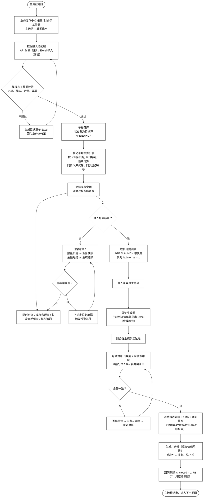

**主流程要点**

1. **数据只进一次**：所有外部数据经适配层（见 7.6）转换后落地单据表，后续核算、凭证、对账均从单据表读取，不再直接接触外部文件。
2. **核算先行、凭证后置**：单据先完成成本计算并更新余额（日常随时可查），凭证生成集中在单据确认无误后进行，避免"凭证已生成、成本又变动"的反复。
3. **月结是一个"关卡"而非"事件"**：日常对账合格是进入月结的前置条件；月结路径内的跌价、舍入结转、凭证导出均为批量任务，需全部成功且平衡校验通过后才能定稿（见 3.5.6）。
4. **月结之后期间锁账**（E-07）：锁账后该期间**禁止任何重算**。发现错误只有两条路——**结错了 → 反结账（须审批并留痕）**；**漏了一笔 → 当期补录单 `PERIOD_ADJUST`**。两条路语义不同，**不能互相代替**（E-09）。
5. **数量日清、金额月结**：数量对账比对**业务快照**（日清），金额对账比对**金蝶总账**存货科目余额（月结）——业务侧不提供金额口径（DISC-F04）。

### 3.3 正向流程图

> **正向流程定义**：单据按其业务语义增加或减少库存的**正常方向**处理 —— 入库增加数量与金额、出库减少数量并按当时成本结转金额、调拨先出后入、盘盈入库 / 盘亏出库。正向流程是系统日常运行的主路径。

#### 3.3.1 单据通用处理链路（正向骨架，PF1）

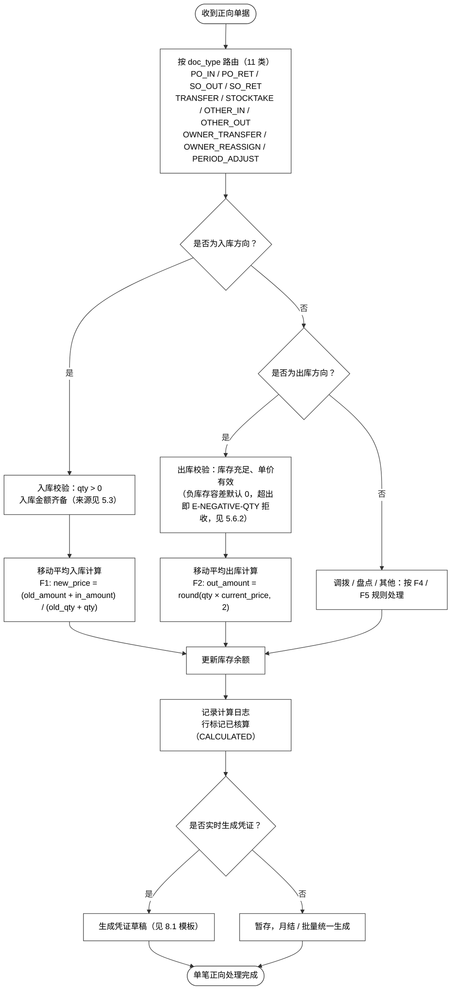

#### 3.3.2 采购入库正向流程（PF2）

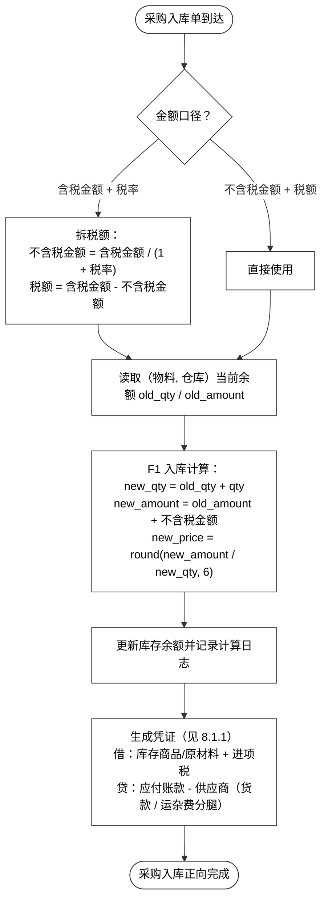

> 要点：采购入库是**唯一会改变移动平均单价**的单据方向；税额单独拆分以便进项税凭证；估价入库（其他入库）金额由财务手工维护（见 5.3）。

#### 3.3.3 销售出库正向流程（PF3）

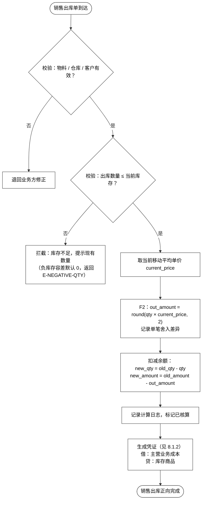

> 要点：出库按**出库时点**的移动平均价结转，出库本身**不改变单价**；跨月单据按业务日期进入对应库存口径（见 5.6）。

#### 3.3.4 调拨正向流程（PF4）

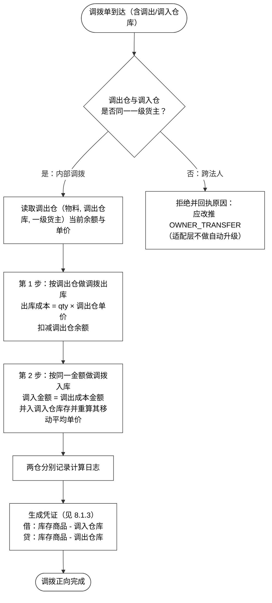

> 要点：调拨跨两个仓库维度记账，**先出后入**、金额同额，保证公司层面总库存金额不变；调入仓若已有同物料库存，移动平均单价会按合并后金额重算（数值见算例 3.7.6）。

**落库展开规则（DISC-F08）**：业务侧推 **1 张**调拨单（含调出/调入两个仓），**适配层展开为 2 行**——两行 `doc_type` **都是 `TRANSFER`**，靠 `warehouse_code` + `is_in`（**0 = 调出仓 / 1 = 调入仓**）区分，**共用同一个 `doc_no`、`line_no` 递增**。

| 选法 | 为什么 |
|---|---|
| **1 张单 + 2 行（★ 采用）** | 引擎与余额表**只见标准行**（每行一个仓库维度），调拨的两条腿天然在**同一事务**内过账——见 `3.5.2` "同批次多行的原子性" |
| ~~拆成两张单据~~ | **❌** 丢失"同一次调拨"的单一单号，改单/作废要同时处理两张；且传输幂等键 `batch_id + doc_no + line_no` 会对不上，**重推即重复入账** |

> **展开动作只在适配层做一次**（`7.6`），引擎不感知"这是一张调拨单拆出来的两行"。
>
> **为什么 `doc_type` 不设 `TRANSFER_OUT` / `TRANSFER_IN` 两个值**：调拨是**一张业务单据**，与 `OWNER_TRANSFER` 同一形态——转出/转入是**行上的属性**（`warehouse_code` + `is_in`），不是两个单据类型。`OWNER_TRANSFER` 同理：`from_owner_l1` / `to_owner_l1` 是 `4.2.3` 的**列**，不是两个 `doc_type`。**判据：`doc_type` 数的是一张单据从哪来、是干什么的，不是数它动了几行。** 这也是 §0.2 把调拨计为**一个**类型的原因（`5 类 → 11 类` 的加法见 §0.2 注）。

**调拨 vs 一级货权转移的判定规则（新增，必读）**

四轴引入后必然出现"调出仓与调入仓分属不同法人"的单子。**它不再是一笔调拨，而是一笔跨法人交易**——判定规则如下：

| 条件 | 单据类型 | 作价 | 凭证 | 会计损益 |
|---|---|---|---|---|
| 调出仓与调入仓**同一一级货主** | `TRANSFER`（两行：调出行 `is_in=0` / 调入行 `is_in=1`） | 按调出仓成本，**同额** | 借调入仓 / 贷调出仓 | **无** |
| 调出仓与调入仓**不同一级货主** | `OWNER_TRANSFER` | 按 `transfer_price`（**交易数据**） | 视同销售 + 成本结转（见 8.1.10） | **有**，且需在合并层抵消 |

> **适配层责任**：业务侧推出的 `TRANSFER` 若跨法人，适配层**拒绝并回执原因**，要求改推 `OWNER_TRANSFER`。**不做"自动升级"**——自动升级等于财务替业务定价，而一级作价的权威源是交易数据（框架 4.6）。
>
> 这条规则不写下来，开发遇到这张单只能猜，**猜错的后果是凭证方向错、损益不确认、合并抵消漏做**。

#### 3.3.5 盘点正向流程（PF5）

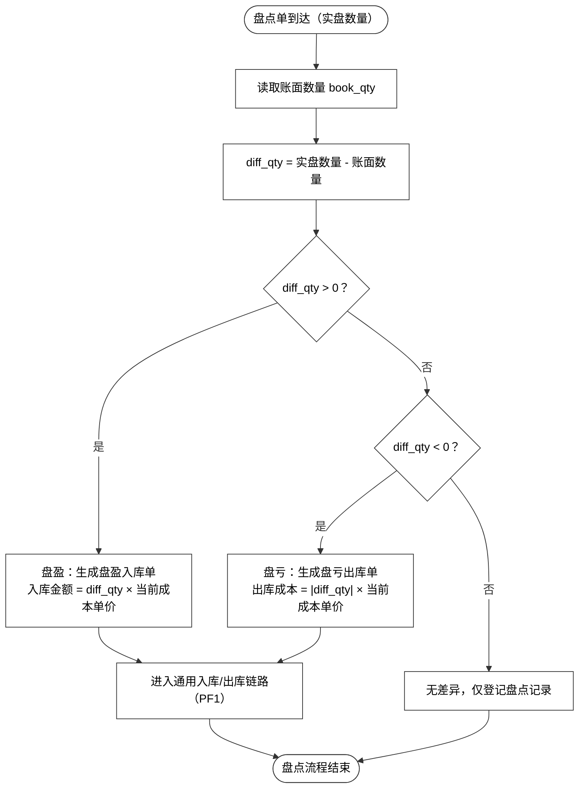

> 要点：盘点产生的盘盈 / 盘亏单走与正常单据相同的核算链路，凭证按"待处理财产损溢"过账（见 8.1.4 / 8.1.5）；差异须在当期内处理完毕，避免滚动到下一期。

### 3.4 逆向流程图

> **逆向流程定义**：对已核算、可能已过账的单据做**反向调整** —— 改单、作废红冲、反结账重算。核心原则：
> 1. 不物理删除原单据，用 `red_flag`、`red_ref_doc`、`version_no` 留痕（见 4.2.2 表）；
> 2. 已生成凭证必须先红字冲销或作废，再重算；
> 3. 任何反向调整都写入 `t_calc_log`，保证"每一分钱可追溯"。

#### 3.4.1 单据改单（变更）逆向流程（PF6）

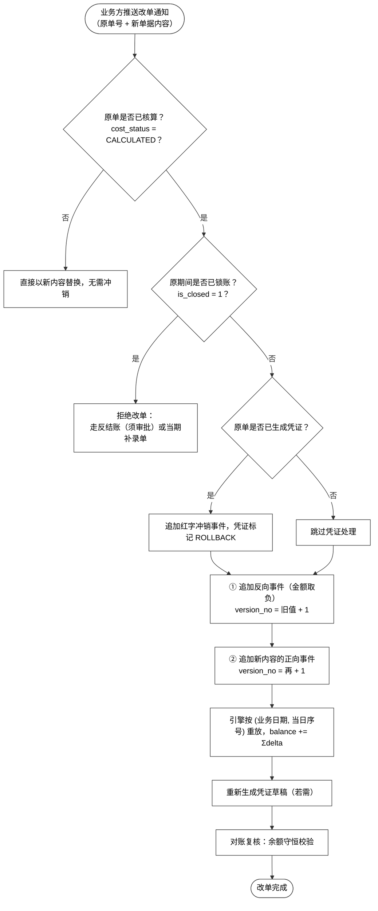

> 要点：**改单不是"撤销"，是追加两组事件**——① 对原内容追加一笔反向事件（`delta` 取负），② 对新内容追加一笔正向事件。原事件**保留不删**，`t_calc_log` 只增不写。这与"回滚/删行重推"是两种机制：后者会破坏引擎的幂等与可重放能力（见 C-01）。
>
> **期间已锁账则不能改单**（E-07）：结错了走反结账（须审批留痕，E-09），漏一笔走当期补录单（`PERIOD_ADJUST`，E-10）。

#### 3.4.2 单据作废 / 红冲逆向流程（PF7）

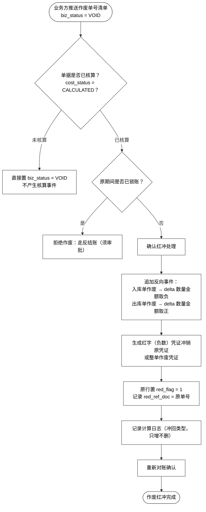

> 说明（**口径已按下表统一，勿再混用**）：

| 中文字段 | 字段 | 位置 | 来源 | 取值 | 一致性等级 |
|---|---|---|---|---|---|
| 业务状态 | `biz_status` | `t_document_header` | **业务** | `EFFECTIVE` 生效 / `VOID` 已作废 | **B 级**（语义须双方一致） |
| 红冲标记 | `red_flag` | `t_document_line` | **财务** | 0 / 1（是否已被红冲） | 财务独立 |
| 核算状态 | `cost_status` | `t_document_line` | **财务** | `PENDING` / `CALCULATED` / `ROLLED_BACK` | 财务独立 |

> **作废闸门 = 核算状态，不是"是否有下游引用"**（C-01）：**已核算的一律不可撤**，只能反向单 + 红字凭证。下游引用（凭证 / 对账）只作为**提示**，不作为是否允许的门槛。
>
> 一期红冲采用"红字冲销"口径（凭证金额为负、方向不变）；是否允许"蓝字反向"（借贷互换）由财务部在会计政策中确认。单据作废后其原流水保留，**报表口径统一为 `biz_status = EFFECTIVE AND red_flag = 0`**（DISC-F12）。

#### 3.4.3 反结账 / 批量重算逆向流程（PF8）

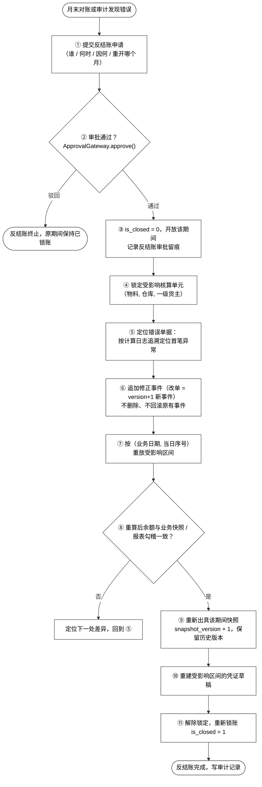

> **要点一：反结账不是"回滚"，是"重新打开期间 + 追加修正事件"**（C-01 / C-02）。原文的"从错误单据开始逆向撤销（利用 calc_log 的 before/after 快照）""补单 / **删行重推**"是**回滚式**做法——它把 `t_calc_log` 当成"可被改写的中间态"，会让引擎的三种幂等、重放一致性、可审计性一起失效。
>
> 正确做法：`t_calc_log` 是**只增不删的事件流**，是真相源；余额、报表、快照都只是它的**投影**。反结账的动作是 ③ 开期间 → ⑥ 追加修正事件 → ⑦ 重放 → ⑨ 重出快照。

**要点二：三条路，语义不同，不能互相代替**（E-09 / E-10）

| 情形 | 走哪条路 | 留痕 |
|---|---|---|
| **锁账后发现"上次结错了"** | **反结账**（重新打开期间重算） | 反结账审批单（谁 / 何时 / 因何 / 重开哪个月） |
| **锁账后发现"漏了一笔"** | **当期补录单 `PERIOD_ADJUST`**（必审） | 补录单 + `approved_by` / `approved_at`；原业务日期**仅供追溯** |
| 未锁账期间发现错误 | 直接改单（`version+1` 新事件，见 PF6） | 事件流 + 红字凭证 |

> **`PERIOD_ADJUST` 不能代替反结账**：反结账是"上次结错了"，补录是"漏了一笔"。混用会让审计无法区分"错误"与"遗漏"。
>
> 三条一起说清楚：**一期用"当期补录单"换取"历史不可改"，用"反结账须批"换取"错误仍可修"。**
>
> **补录单的量价口径（E-10 已锁定）**：**一律按当期口径**——补录出库按**当期均价**结转、建**当期成本层**；单据上仍保留原业务日期，但**仅用于追溯，不用于取价**。理由：排序键 `(业务日期, 当日序号)` 的当日序号是按当天分配序发的，跨期回填复原不出那个序号——按历史原值算，报得出来，但报的是假数。

#### 3.4.4 正向 / 逆向对照速查表

| 场景 | 正向动作 | 逆向动作 | 是否改单价 | 凭证处理 |
|---|---|---|---|---|
| 采购入库 | 入数量、入金额、重算单价 | 追加反向事件（delta 取负） | 是（重算） | 红字冲销进项税与应付 |
| 采购退货出库 | 出数量、按当前均价结转 | 追加反向事件 | 否 | 见 8.1.8 |
| 销售出库 | 出数量、结转成本 | 追加反向事件（delta 取正） | 否 | 红字冲销主营业务成本 |
| 销售退货入库 | 入数量、按原出库价冲回 | 追加反向事件 | 视金额而定 | 见 8.1.9 |
| 调拨（同法人） | 调出仓出 + 调入仓入 | 反调拨（原路退回） | 视调入仓合并而定 | 借贷反向红字 |
| **跨法人转移** | 按 `transfer_price` 作价出库 + 入库 | 追加反向事件 + 红字凭证 | **是（两侧都重算）** | 见 8.1.10，含合并抵消 |
| **二级重分配** | 写 `t_owner_transfer` 单据行（`4.2.3`）+ `t_owner_allocation` 分摊账，不动一级余额 | 反向分摊记录 | **否** | **不出凭证**（R2） |
| 盘点盘盈 | 盘盈入库 | 取消盘盈单 | 视情况 | 冲销待处理损溢 |
| 改单 | 追加正向事件 | 追加反向事件（`version+1`） | 是（重新按序） | 旧凭证红冲、新凭证重建 |
| 作废 | —— | 追加反向事件 + 红字 | 视单据方向 | 红字冲销 |
| **反结账** | —— | 开期间 → 追加修正事件 → 重放 → 重出快照 | 是（按新序） | 重建受影响区间凭证 |
| **跨期补录** | 按**当期口径**作价入账 | 反向补录单 | 是（用当期价） | 按当期价出凭证 |

### 3.5 次要流程图（支撑流程）

#### 3.5.1 数据接入与校验流程（PF9）

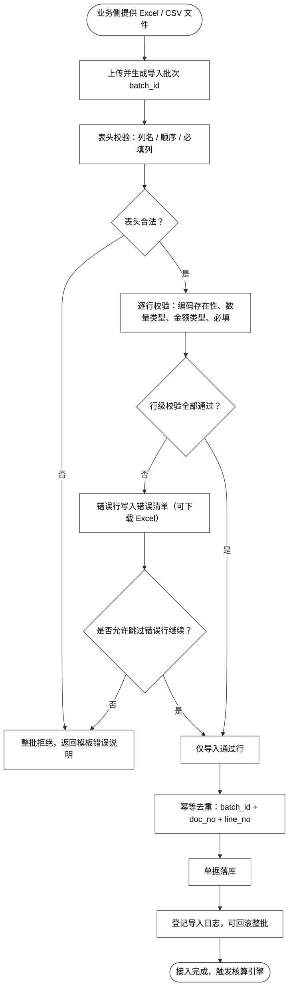

> 校验规则与 Excel 模板字段一一对应，模板定义见 7.2 / 7.3；导入失败率超过 5% 触发预警（见 9.4 规则表）。

#### 3.5.2 核算引擎调度流程（PF10）

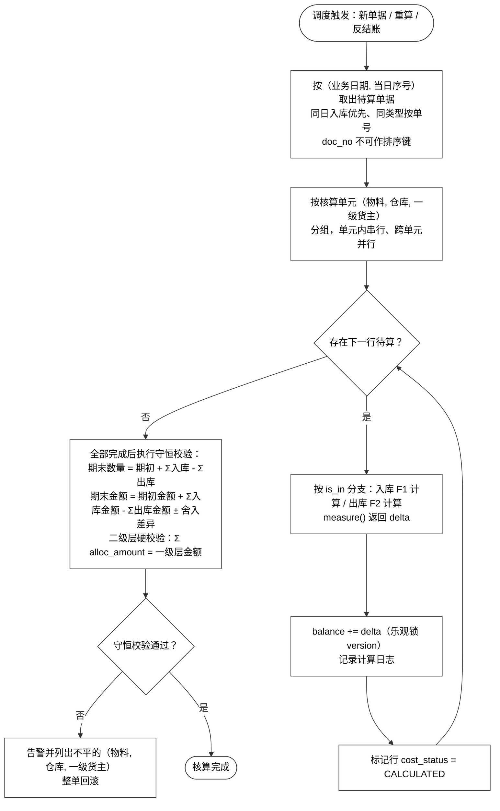

#### 3.5.3 跌价计提流程（AGE + LAUNCH 双轨，PF11）

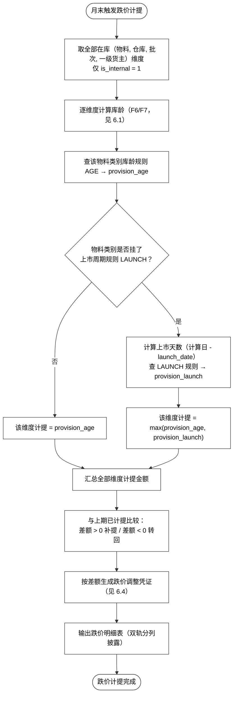

#### 3.5.4 凭证生成与导出流程（PF12）

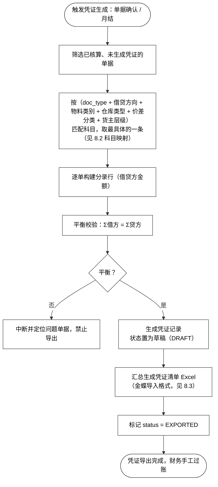

#### 3.5.5 对账与差异定位流程（PF13）

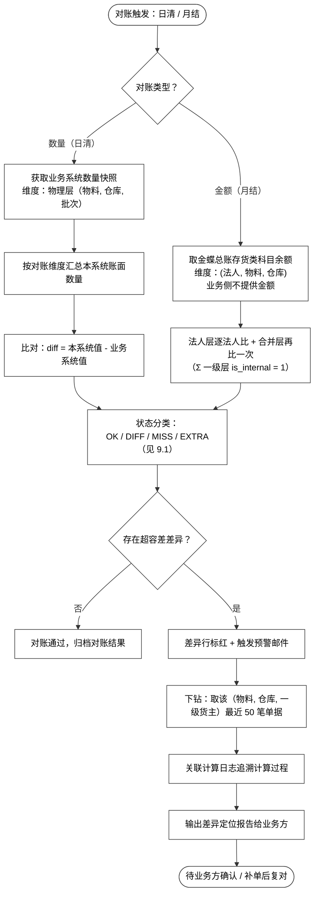

#### 3.5.6 月末结账流程（PF14）

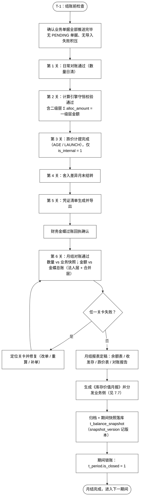

> **注（口径已改，原表述作废）**：**一期即引入会计期间与锁账**——`t_period` + `is_closed`；**日结只做校验不锁账，月结即锁账**（E-03 / E-07）。**月结之后该期间禁止任何重算**。
>
> 锁账后仍有两条出口（E-09，二者语义不同、不可互相代替）：
> - **结错了** → **反结账**：须走审批并留痕（谁 / 何时 / 因何 / 重开哪个月），重出该期间快照（`snapshot_version + 1`）。
> - **漏了一笔** → **当期补录单 `PERIOD_ADJUST`**：必审，**一律按当期口径量价**（E-10），原业务日期仅供追溯。
>
> 二期把期间升级为**完整会计期间**（含期间损益结转），并接入真实审批流引擎（换 `ApprovalGateway` 实现，不动调用方）。

#### 3.5.7 货权变更流程（一级转移 / 二级重分配，PF15）

> 产权交易中心一期不落地，由库存中心出**临时货权变更单**承载。按**可剥离形态**设计：单据自带价格与 `price_source`、`is_accounting_event` 显式分列一二级、**不直接改余额只产生事件**——二期是**搬迁不是重写**。

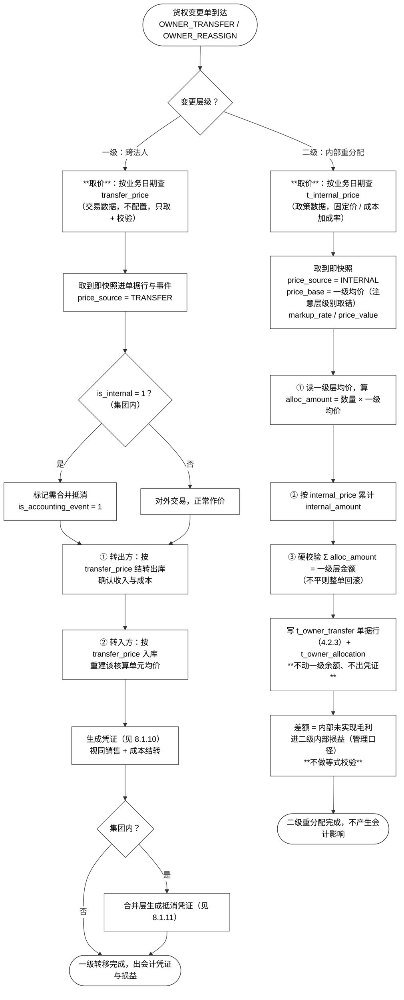

> **两个方向的差别（R1 / R2 / R5）**：
>
> | | 一级转移 `OWNER_TRANSFER` | 二级重分配 `OWNER_REASSIGN` |
> |---|---|---|
> | 是否法人 | 是 | **否**（不是会计主体） |
> | 作价来源 | `transfer_price`（**交易数据**） | `internal_price`（**政策数据**，价目表） |
> | 是否改一级余额 | **是**（转出减、转入增） | **否**（只写分摊账） |
> | 是否出凭证 | **是**（视同销售 + 成本结转） | **否**（R2） |
> | 是否影响存货总额 | 否（一减一增，同法人间则内部抵消） | **否**（二级层绝不相加） |
> | 会计损益 | **有**（关联交易，集团内需抵消） | 无（只有管理口径的内部损益） |
> | 取价三条铁律 | 按业务日期取价 → 取到即快照 → 调价不追溯 | 同左 |

### 3.6 计算公式汇总

#### 3.6.1 符号说明

| 符号 | 含义 | 说明 |
|---|---|---|
| qty / out_qty | 单据数量 / 出库数量 | 数量精度 4 位 |
| old_qty / new_qty | 计算前 / 后库存数量 | |
| old_amount / new_amount | 计算前 / 后库存金额 | 金额精度 2 位 |
| in_amount | 本次入库金额 | 不含税口径，见 F5 |
| current_price | 当前移动平均单价 | 单价精度 6 位 |
| rate | 跌价计提比例 | 来自 t_depreciation_rule |
| age_days | 库龄天数 | 计算日 - 入库日 |
| launch_days | 上市天数 | 计算日 - launch_date |

#### 3.6.2 移动平均（详版见 5.2）

```
F1 入库后单价重算：
   new_qty    = old_qty + in_qty          （in_qty 一律取 base_qty，见 DISC-F10 单位换算）
   new_amount = old_amount + in_amount    （in_amount 定义见 F5a）
   new_price  = round(new_amount / new_qty, 6)
   边界：old_qty = 0 时 new_price = round(in_amount / qty, 6)；new_qty = 0 禁止入库。

   ★ 关键：in_amount 的定义见 F5a——它是"不含税金额 + 分摊附加费用"，
     **不含税额**（DISC-F01）。且入库**只舍入单价、不回改金额**（DISC-F02）。

F2 出库成本结转：
   out_amount = round(out_qty × current_price, 2)
   出库不改变单价：new_price = current_price
   new_qty = old_qty - out_qty
   new_amount = round(old_amount - out_amount, 2)

F3 单笔舍入差异（**只在出库产生**）：
   rounding_diff = out_amount - out_qty × current_price   （按 6 位累计，月末结转）
   边界：**入库不产生舍入差异**。入库金额由业务价格与费用确定，属于"输入"，
        不允许被系统舍入改写（DISC-F02）。

F4 出清规则（数量清零时）：
   若出库后 new_qty = 0 且 new_amount ≠ 0，将剩余金额全额结转 / 转入舍入差异账户并清零余额
```

#### 3.6.3 税与金额口径

```
F5 含税 / 不含税换算（采购入库）：
   不含税金额 = 含税金额 / (1 + 税率)
   税额       = 含税金额 - 不含税金额
   入库入账金额（库存科目）= 不含税金额 + 本行分摊附加费用   ← 见 F5a

F5a 采购入库行成本（口径统一，DISC-F01）：
   行入账金额 = 不含税金额 + 本行分摊的采购附加费用
   分摊基准   = 金额 / 数量 / 重量（按 t_cost_allocation_rule 配置）
   适用单据   = **仅采购入库**（含采购退货，取负）

F5b 税额去向（DISC-F01）：
   税额**只进**「应交税费 - 应交增值税(进项税额)」科目，
   **不进入 new_amount**——含税进成本会虚增存货、少计进项税。
```

#### 3.6.4 跌价准备（详版见 6.3 / 6.5）

```
F6 库龄：
   age_days = 计算日 - 该层（批次）最早入库日期

F7 库存分层（无批次物料的库龄估算）：
   按入库时间先入先出排队分层：剩余库存 = Σ 各入库层剩余数量

F8 库龄法计提：
   provision_age = Σ ( 各层在库金额 × 该层库龄对应计提比例 )

F9 上市周期法计提（3C 品类）：
   launch_days = 计算日 - t_material.launch_date
   provision_launch = 当前在库金额 × 上市天数对应计提比例

F10 双轨取孰高（同物料同时挂 AGE 与 LAUNCH 规则时）：
   provision = max(provision_age, provision_launch)     （按 物料+仓库+批次+一级货主 维度逐项取，再汇总）

F11 本期跌价变动额：
   month_delta = 本期应计提 - 上期已计提
   正数 → 补提；负数 → 转回（红字）
```

#### 3.6.5 勾稽与对账（详版见 9.1 / 9.2）

```
F12 数量守恒：
   期末数量 = 期初数量 + Σ入库数量 - Σ出库数量

F13 金额守恒：
   期末金额 = 期初金额 + Σ入库金额 - Σ出库金额 + Σ舍入差异

F14 对账差异：
   diff = 本系统账面值 - 业务系统值
   |diff| ≤ 容差 → OK；否则按方向分类 DIFF / MISS / EXTRA（见 9.1）

F15 单价波动预警：
   波动率 = |当日单价 - 上一单价| / 上一单价 × 100%   （> 30% 触发，见 9.4）
```

### 3.7 算例（Worked Examples）

> 以下算例均可直接转成 UAT 用例。口径约定：单价保留 6 位、金额保留 2 位、数量保留 4 位；采购金额默认不含税。

#### 3.7.1 算例 1：移动平均正向全链路（含守恒勾稽）

物料 M0001 @ 仓库 WH01，期初 0 件 / 0.00 元。

| 日期 | 单据 | 方向 | 数量 | 单价/成本 | 金额 | 结存数量 | 结存金额 | 结存单价 |
|---|---|---|---|---|---|---|---|---|
| 期初 | — | — | — | — | — | 0 | 0.00 | — |
| 1/05 | PO-0001 采购入库 | 入 | 100 | 10.00 | 1,000.00 | 100 | 1,000.00 | 10.000000 |
| 1/10 | SO-0001 销售出库 | 出 | 40 | 10.00 | 400.00 | 60 | 600.00 | 10.000000 |
| 1/20 | PO-0002 采购入库 | 入 | 60 | 12.00 | 720.00 | 120 | 1,320.00 | **11.000000** |
| 1/25 | SO-0002 销售出库 | 出 | 80 | 11.00 | 880.00 | 40 | 440.00 | 11.000000 |
| 1/31 | OI-0001 其他入库 | 入 | 20 | 1.50 | 30.00 | 60 | 470.00 | **7.833333** |

**计算过程要点**

- 1/20 入库后单价重算：`(600.00 + 720.00) ÷ (60 + 60) = 1,320 ÷ 120 = 11.000000`——单价只在入库时变化。
- 1/25 出库按当时单价 11.00 结转：`80 × 11.00 = 880.00`，出库后单价保持 11.000000。
- 1/31 **入库**后重算：`470.00 ÷ 60 = 7.833333`（6 位）。（DISC-F23：原文误写为"出库后"——该行是 `OI-0001 其他入库`，方向为入。）

**守恒勾稽（F12/F13）**：

```
数量：0 + 100 + 60 + 20 - 40 - 80 = 60 ✓
金额：0 + 1,000 + 720 + 30 - 400 - 880 = 470 ✓
```

> 用途：该算例覆盖"入库重算单价、出库按当时价结转、单价更新节点"三个关键行为，可直接用作引擎单测基线。

#### 3.7.2 算例 2：舍入与尾差处理（单价 6 位 vs 金额 2 位）

物料 M0002，期初 0。

| 日期 | 业务 | 数量 | 计算过程 | 结存数量 | 结存金额 | 累计舍入差异 |
|---|---|---|---|---|---|---|
| 1/01 | 采购入库 | 3 | 金额 10.00 → 单价 = 10/3 = **3.333333** | 3 | 10.00 | 0.000000 |
| 1/02 | 销售出库 | 1 | 理论成本 3.333333 → 结转 **3.33** | 2 | 6.67 | -0.003333 |
| 1/03 | 销售出库 | 1 | 结转 3.33 | 1 | 3.34 | -0.006666 |

**月末结转**（1/31）：

```
累计舍入差异 ≈ -0.01（四舍五入到分）
借：财务费用 - 舍入差异        0.01
    贷：库存商品               0.01        （将库存金额调回理论值）
结转后：库存金额 = 3.34 - 0.01 = 3.33 = 1 × 3.333333 ✓，舍入账户清零
```

> 要点：每笔出库"实际结转金额"与"理论成本（数量 × 6 位单价）"之间存在 ±0.01 级尾差；日常不逐笔调整，累计到 `rounding_diff_acc`，月末随 F3 结转凭证一次性清理。数量清零时若仍有金额残留，按 F4 出清规则全额结转。

#### 3.7.3 算例 3：逆向流程 —— 改单 + 作废红冲

物料 M0003 @ WH01，期初 0。演示单据从"录入 → 改单 → 作废"全逆向路径下的余额连续性。

| 步骤 | 日期 | 业务 | 数量 | 金额/成本 | 结存数量 | 结存金额 | 备注 |
|---|---|---|---|---|---|---|---|
| 1 | 1/05 | PO-0001 采购入库 @10 | +100 | +1,000.00 | 100 | 1,000.00 | 单价 10.000000 |
| 2 | 1/10 | SO-0001 销售出库 | -40 | -400.00 | 60 | 600.00 | |
| 3 | 1/12 | **改单** SO-0001：40 件改为 30 件 | 冲回 +40 | +400.00 | 100 | 1,000.00 | 先原单反向 |
| 3' | 1/12 | 改单后新单出库 30 件 | -30 | -300.00 | 70 | 700.00 | 再新单正向；version 1→2 |
| 4 | 1/20 | PO-0002 采购入库 @15 | +100 | +1,500.00 | 170 | 2,200.00 | 单价 12.941176 |
| 5 | 1/25 | SO-0002 销售出库 50 件 | -50 | -647.06 | 120 | 1,552.94 | 50 × 12.941176 = 647.06 |
| 6 | 1/28 | **作废** SO-0001（改单后 30 件） | +30 | +300.00 | 150 | 1,852.94 | 红冲，red_flag = 1 |

**校验**

```
最终余额 = 期初 0 + Σ入库(1,000 + 1,500) - Σ有效出库成本(仅 SO-0002 的 647.06) = 1,852.94 ✓
最终数量 = 0 + (100 + 100) - 50 = 150 ✓   （SO-0001 两次调整相互抵消后不再影响）
```

**凭证逆向动作**

- 改单（步骤 3）：SO-0001 原凭证红字冲销（借：主营业务成本 -400 / 贷：库存商品 -400），新单按 30 件重建凭证（借：主营业务成本 300 / 贷：库存商品 300）。
- 作废（步骤 6）：SO-0001（version 2）凭证整体红字冲销，单据体 `red_flag = 1`、`red_ref_doc = SO-0001`。

> 要点：改单与红冲全程**不删除任何历史记录**，通过冲销 + 重算维持数量与金额守恒；所有中间态均可在 `t_calc_log` 追溯。

#### 3.7.4 算例 4：库龄法跌价计提

物料 M9001（配件类，仅挂 `AGE` 规则，档位见 6.2：0-180 天 0%、181-360 天 5%、361-720 天 30%、720 天以上 50%）。计算日 **2026-03-31**，库存按入库时间分层（F7）：

| 入库日 | 库龄（天） | 结存数量 | 结存金额 | 计提比例 | 计提金额 |
|---|---|---|---|---|---|
| 2025-10-01 | 181 | 50 | 500.00 | 5% | 25.00 |
| 2025-11-15 | 136 | 40 | 400.00 | 0% | 0.00 |
| 2026-01-20 | 70 | 60 | 600.00 | 0% | 0.00 |
| **合计** | — | **150** | **1,500.00** | — | **25.00** |

```
库龄 181 天 = 2026-03-31 - 2025-10-01（181 天区间取 5%）
本期应计提 = 25.00
假设上期已计提 10.00 → 本期补提 15.00（F11）
凭证：借 资产减值损失 - 存货跌价准备  15.00
          贷 存货跌价准备            15.00
```

> 用途：该算例演示"无批次物料如何分层估算库龄"以及"计提 / 补提 / 转回"三种情形的差额逻辑。

#### 3.7.5 算例 5：3C 上市周期 vs 库龄取孰高

物料 M9002（3C 整机，SN 管理），`launch_date = 2025-09-20`，同时挂 `AGE` 与 `LAUNCH` 规则。计算日 **2026-03-31**。

**场景 A：新款在库 116 天（库龄短、但已上市 192 天）**

| 规则 | 关键天数 | 对应档位 | 计提比例 | 计提金额 |
|---|---|---|---|---|
| AGE 库龄 | 2025-12-05 入库 → 116 天 | 0-180 天 | 0% | 0.00 |
| LAUNCH 上市 | 2025-09-20 → 192 天 | 181-365 天 | 25% | 20,000.00 |
| **取孰高** | — | — | — | **20,000.00** |

```
在库金额 = 10 台 × 8,000 = 80,000.00
provision_launch = 80,000 × 25% = 20,000.00
provision_age = 0（库龄仅 116 天）
计提 = max(0, 20,000) = 20,000.00
```

**场景 B：同料老批次滞销（库龄长）**

```
某批 SN 于 2024-12-01 入库 5 台，金额 20,000.00，库龄 485 天 → AGE 档 30% → 6,000.00
同批 LAUNCH = 20,000 × 25% = 5,000.00
计提 = max(6,000, 5,000) = 6,000.00（按库龄档）
```

> 结论：3C 新品在"库龄尚短但上市已久"时，纯库龄法几乎不计提、明显失真，必须叠加上市周期档；而当库存滞销超过 361 天后库龄档反超上市周期档。系统按（物料, 仓库, SN）维度逐项取孰高后汇总入账，报表需双列披露两套规则的计提明细（见 6.5）。

#### 3.7.6 算例 6：调拨跨仓成本

**场景一：调入仓无同物料库存**

```
WH01 → WH02 调拨 10 件，调出仓 WH01 当前单价 11.000000
第 1 步：WH01 调拨出库：成本 = 10 × 11.00 = 110.00
第 2 步：WH02 调拨入库：WH02 原无此料 → 金额 110.00，单价 = 110/10 = 11.000000
凭证：借 库存商品 - WH02   110.00
          贷 库存商品 - WH01   110.00
```

**场景二：调入仓已有同物料库存（合并重算均价）**

```
WH02 原结存：40 件 / 金额 400.00（单价 10.000000）
调入 10 件 / 110.00 后：
合并结存 = 50 件 / 510.00
新单价 = 510 / 50 = 10.200000   ← 调入后 WH02 移动平均价被拉高
```

> 要点：调拨只影响两个仓库维度的余额与单价，**不影响公司整体库存总额**（同额一出一入）；合并重算规则与采购入库一致（F1），在 UAT 中可用本算例验证跨仓一致性。

#### 3.7.7 算例 7：一级货权转移 + 二级重分配（新增）

> 覆盖 R1–R5 与"一个数量、三个金额"。**本算例可直接用作货权变更单的 UAT 基线。**

**起点**：法人 A（一级货主 `OWN-A`）仓库 `WH01`，物料 `M0001` 结存 **100 件 / 1,000.00**（均价 10.000000）。

**第一步：一级货权转移 `OWNER_TRANSFER`（A → B，跨法人）**

| 项 | 转出方 A | 转入方 B |
|---|---|---|
| 数量 | -40 | +40 |
| 作价 | `transfer_price = 12.00`（**交易数据**，只取价不配置） | 同左 |
| 结转成本 / 入库金额 | 40 × 10.00 = **400.00**（按 A 的一级均价） | 40 × 12.00 = **480.00** |
| 转入后均价 | 剩余 60 件 / 600.00 → **10.000000**（不变） | B 原无此料 → **12.000000** |

```
A 侧凭证（视同销售）：
  借：应收账款 - B                      480.00
      贷：主营业务收入                    480.00
  借：主营业务成本                      400.00
      贷：库存商品 - WH01                 400.00
  → A 确认毛利 80.00（= 40 × (12.00 - 10.00)）

集团内（is_internal = 1）→ 合并层抵消凭证（见 8.1.11）：
  借：主营业务收入                      480.00
      贷：主营业务成本                    480.00
  借：主营业务成本（未实现毛利转出）       80.00
      贷：库存商品 - WH02                  80.00
  → 合并层存货：B 侧 480.00 - 80.00 = 400.00，与 A 侧转出成本一致 ✓
  → **这就是 O-12「一期即需做抵消」的原因**：不做这步，集团存货虚增 80.00
```

**第二步：二级重分配 `OWNER_REASSIGN`（B 内部，一级货主仍为 `OWN-B`）**

政策价目表 `t_internal_price`：物料 `M0001` × 转入方二级货主 × 生效期内，`price_type = FIXED`，`price_value = 13.00`。

| 二级货主 | 数量 | `alloc_amount` = 数量 × **一级均价 12.00** | `internal_amount` = 数量 × **13.00** |
|---|---|---|---|
| `L2-1` | 25 | **300.00** | **325.00** |
| `L2-2` | 15 | **180.00** | **195.00** |
| **合计** | **40** | **480.00** | **520.00** |

```
硬校验（引擎出口，不平则整单回滚）：
  Σ alloc_amount = 480.00  =  一级层金额 480.00   ✓ 通过

不做等式校验（差异即内部未实现毛利）：
  Σ internal_amount - Σ alloc_amount = 520.00 - 480.00 = 40.00
  → 进二级内部损益（**管理口径**，非会计损益）

凭证：**不出**（R2——二级不是法人、不是会计主体）
一级余额：**不动**（B 的一级层仍为 40 件 / 480.00 / 均价 12.000000）
```

> **若改用成本加成率 `MARKUP`（r = 10%）**：`price_base` = 当时**该一级货主层**均价（注意层级别取错，这里是 B 的 12.000000，不是 A 的 10.000000），`markup_rate` = 0.10，`price_value` = 12.00 × 1.10 = **13.200000**。
> **一个价、三个数**：`price_base` + `markup_rate` + `price_value` 三者都要落库——只存 `price_value` 的话，日后无法回答"这个价是怎么来的"。`price_type` 是**行属性、不进主键**。

**关键校验点（UAT 用）**

| # | 校验 | 期望 |
|---|---|---|
| 1 | A 转出后均价 | 保持 10.000000（**出库不改单价**） |
| 2 | B 转入后均价 | 12.000000（按 `transfer_price` 重建，**不是** A 的 10.00） |
| 3 | `Σ alloc_amount` vs 一级层金额 | **必须相等**，否则整单回滚 |
| 4 | `Σ internal_amount` | **允许不等**，差额进二级内部损益 |
| 5 | 二级重分配是否生成凭证 | **不生成** |
| 6 | 一级货权转移是否影响存货总额 | 同法人间转移**不影响**；跨法人且集团内需**抵消 80.00** |

---

## 4. 数据模型

### 4.1 主数据

#### 4.1.1 物料表 `t_material`

| 中文字段 | 字段 | 类型 | 必填 | 说明 |
|---|---|---|---|---|
| 物料编码 | material_code | VARCHAR(32) | Y | 主键，物料编码 |
| 物料名称 | material_name | VARCHAR(128) | Y | 物料名称 |
| 物料类别编码 | category_code | VARCHAR(32) | N | 物料类别（用于计价/跌价规则匹配） |
| 计量单位 | unit | VARCHAR(16) | Y | 计量单位 |
| 规格 | spec | VARCHAR(128) | N | 规格 |
| 计价方法 | price_method | CHAR(2) | Y | 计价方法**默认值 / 兼容用途**。**实际取价一律按核算单元**——以 `4.1.6 t_price_method_config` 为准（见 `4.1.1` 表后说明）；本列仅在该核算单元无配置时兜底（一期三种方法 `MA`（移动加权平均，全局默认）/ `SI`（个别计价）/ `FIFO`（先入先出法）均可填；缺失时回落全局默认 `MA` 并告警） |
| 是否批次管理 | is_batch_managed | TINYINT | N | 是否批次管理（3C 高值整机建议开启） |
| 上市日期 | launch_date | DATE | N | 上市日期（3C 新品上市周期跌价计算用） |
| 是否启用 | is_active | TINYINT | Y | 是否启用 |
| 创建时间 | created_at | DATETIME | Y | |
| 更新时间 | updated_at | DATETIME | Y | |

> **`price_method` 两处能力重叠时的取舍**：`t_material.price_method`（按物料）与 `4.1.6 t_price_method_config`（按核算单元 `(物料, 仓库, 一级货主)`）**能力重叠**，**以 `t_price_method_config` 为准**；`t_material.price_method` 仅作**默认值与兼容用途**。实际取价一律按**核算单元**读 `t_price_method_config`（配置缺失时回落到本列默认值 `MA` 并告警），见 `4.1.6` / `5.1`。

#### 4.1.2 仓库表 `t_warehouse`

| 中文字段 | 字段 | 类型 | 必填 | 说明 |
|---|---|---|---|---|
| 仓库编码 | warehouse_code | VARCHAR(32) | Y | 主键 |
| 仓库名称 | warehouse_name | VARCHAR(64) | Y | |
| 仓库类型 | warehouse_type | VARCHAR(16) | Y | **物理/运营形态**：`SELF`自营仓 / `PLATFORM`平台仓 / `OVERSEA`海外仓 / `IN_TRANSIT`在途 / `VIRTUAL`虚拟仓 |
| 一级货主 | **`owner_l1`** | VARCHAR(32) | Y | **所属法人 / 账套（= 一级货主）** |
| 是否参与库存核算 | is_inventory_accounted | TINYINT | Y | 是否参与库存核算（虚拟仓、在途视策略） |
| 是否启用 | is_active | TINYINT | Y | |

> **变更说明（DISC-F14 + 框架 §9）**：
>
> 1. **删除原枚举"原料库 / 成品库 / 在制品库"**——这是**制造业**分类，与 `0.1.1` 业务画像（纯贸易 / 零售 / 电商，无生产环节）直接矛盾：在制品库在无生产业务下永远不会出现，而真正会出现的**平台仓、海外仓**原来没有。
> 2. **存货权属不再挂在仓库上**（C-12）。原 `DISC-F14` 建议的 `ownership_type`（自有/委托代销/受托代销/寄售）**不上移到仓库表**——四轴引入后，同一批货在不同一级货主下权属不同，**与仓库无关**；权属改由**一级货主的 `is_internal`** 决定（见 `4.1.8 t_cargo_owner`）。仓库只管物理形态。
> 3. `owner_l1` = **一级货主 / 法人**（`4.1.8`），此处存一份以便按仓库直接推导单据的法人归属（`t_document_header.owner_l1` 可由仓库推导）。

#### 4.1.3 供应商表 `t_supplier`

| 中文字段 | 字段 | 类型 | 必填 | 说明 |
|---|---|---|---|---|
| 供应商编码 | supplier_code | VARCHAR(32) | Y | 主键 |
| 供应商名称 | supplier_name | VARCHAR(128) | Y | |
| 纳税人识别号 | **`taxpayer_id`** | VARCHAR(32) | N | **纳税人识别号**（DISC-F11，影响进项税与发票匹配） |
| 是否关联方 | **`is_related_party`** | TINYINT | Y | **是否关联方**（DISC-F11，默认 0；决定内部交易抵消与视同销售判断） |
| 往来单位类型 | `partner_type` | VARCHAR(16) | N | 往来单位类型（DISC-F11） |
| 是否启用 | is_active | TINYINT | Y | |

#### 4.1.4 客户表 `t_customer`

| 中文字段 | 字段 | 类型 | 必填 | 说明 |
|---|---|---|---|---|
| 客户编码 | customer_code | VARCHAR(32) | Y | 主键 |
| 客户名称 | customer_name | VARCHAR(128) | Y | |
| 纳税人识别号 | **`taxpayer_id`** | VARCHAR(32) | N | **纳税人识别号**（DISC-F11） |
| 是否关联方 | **`is_related_party`** | TINYINT | Y | **是否关联方**（DISC-F11，默认 0） |
| 是否启用 | is_active | TINYINT | Y | |

> **为什么这两个字段"事前留一列成本为零、事后补录成本极高"**（DISC-F11）：`taxpayer_id` 缺失会让进项税与发票匹配只能靠名称模糊匹配；`is_related_party` 缺失则关联交易识别要靠人工定期扫，一旦漏判，跨法人转移既没抵消也没视同销售，**合并报表直接出错且当期发现不了**。

#### 4.1.5 批次表 `t_batch`（`SI` / `FIFO` 单元使用）

> 个别计价下，`batch_no` 直接承载 SN/序列号（一个 SN = 一条批次记录），出库按 SN 对应成本结转。
> **`FIFO` 核算单元的物料一律按批次 / 入库层管理**——`FIFO` 的成本层是「每次入库一层」，而 `t_inventory_balance_batch.batch_no` 非空，不按批次管理则成本层与批次余额表对不上；`SI` 天然满足（一个 SN = 一条批次记录）。

| 中文字段 | 字段 | 类型 | 必填 | 说明 |
|---|---|---|---|---|
| 批次号 | batch_no | VARCHAR(64) | Y | 主键 |
| 物料编码 | material_code | VARCHAR(32) | Y | |
| 仓库编码 | warehouse_code | VARCHAR(32) | Y | |
| 生产日期 | production_date | DATE | N | 生产日期 |
| 失效日期 | expiry_date | DATE | N | 失效日期 |

#### 4.1.6 计价方法配置表 `t_price_method_config`

> **粒度必须跟核算单元走（C-16）**：均值池、余额、凭证、跌价基数全在 `(物料, 仓库, 一级货主)` 上，计价方法不能挂在少一维的键上。

| 中文字段 | 字段 | 类型 | 必填 | 说明 |
|---|---|---|---|---|
| 物料编码 | material_code | VARCHAR(32) | Y | 联合主键 |
| 仓库编码 | warehouse_code | VARCHAR(32) | Y | 联合主键 |
| 一级货主 | **`owner_l1`** | VARCHAR(32) | Y | **联合主键，一级货主（C-16 新增）** |
| 计价方法 | price_method | CHAR(2) | Y | `MA`（移动加权平均，全局默认）/`SI`（个别计价）/`FIFO`（先入先出法） |
| 生效日期 | effective_from | DATE | Y | 生效日期 |
| 失效日期 | effective_to | DATE | N | 失效日期 |

> **为什么必须加这一维**：按品类配置不同计价方法时（3C 走个别计价、出行走移动加权平均），同一物料+仓库下会有多个法人并存。若键上少一级货主，一张表**表达不了"同一物料+仓库、A 法人走 MA、B 法人走 SI"**，只能整库统一——那等于计价方法被业务范围捆死。配置缺失时按**全局默认 `MA`** 处理并告警。

#### 4.1.7 跌价规则配置表 `t_depreciation_rule`

| 中文字段 | 字段 | 类型 | 必填 | 说明 |
|---|---|---|---|---|
| 规则编号 | rule_id | INT | Y | 主键 |
| 规则类型 | rule_type | VARCHAR(16) | Y | 规则类型：`AGE`（库龄）/ `LAUNCH`（上市周期） |
| 物料类别编码 | category_code | VARCHAR(32) | N | 适用物料类别，为空则全局默认 |
| 天数下限 | age_min_days | INT | Y | 天数下限（含）：库龄天数或上市天数，按 rule_type |
| 天数上限 | age_max_days | INT | N | 天数上限（含），NULL 表示无穷大 |
| 计提比例 | provision_rate | DECIMAL(8,4) | Y | 计提比例（0.0500 表示 5%） |
| 生效日期 | effective_from | DATE | Y | |
| 失效日期 | effective_to | DATE | N | |

> 同一物料类别可同时配置 `AGE` 与 `LAUNCH` 两条规则（如 3C 品类），计提时按两套分别计算、**取孰高**。

#### 4.1.8 货主表 `t_cargo_owner`（**新增**）

> 一级货主 = **法人主体**（与 `owner_l1` 同一概念）；二级货主 = 内部管理维度。**用自关联树表达，不硬编码两级**——一期只有两级，但结构上不写死。

| 中文字段 | 字段 | 类型 | 必填 | 说明 |
|---|---|---|---|---|
| 货主编码 | owner_code | VARCHAR(32) | Y | 主键，货主编码（**一级货主编码为 A 级主数据，须双方一致**） |
| 货主名称 | owner_name | VARCHAR(128) | Y | 货主名称 |
| 适用货主层级 | owner_level | TINYINT | Y | 1 = 一级（法人）；2 = 二级（内部管理维度） |
| 上级货主编码 | parent_owner_code | VARCHAR(32) | N | 上级货主（二级指向其一级；一级为空） |
| 是否法人主体 | **`is_legal_entity`** | TINYINT | Y | 是否法人主体（一级货主为 1） |
| 一级货主 | `owner_l1` | VARCHAR(32) | N | 对应账套标识（一级货主必填，供金蝶导出） |
| 是否内部交易 | **`is_internal`** | TINYINT | Y | **是否内部交易。存货总额只累加 `is_internal = 1`；跌价只对 `is_internal = 1` 计提** |
| 内部往来对方编码 | counterparty_code | VARCHAR(32) | N | 内部往来对方（集团内转移时指向对方一级货主） |
| 是否启用 | is_active | TINYINT | Y | |
| 生效日期 | effective_from | DATE | Y | |
| 失效日期 | effective_to | DATE | N | |

> **二级货主的两个"不进"**：**不进余额表主键**（走独立分摊账 `t_owner_allocation`）、**不进存货总额**（R4）。

#### 4.1.9 内部价目表 `t_internal_price`（**新增**）

> 二级作价的**政策数据**。一级作价（`transfer_price`）**不在这张表里**——它是交易数据，来自销售单/合同，财务只取价 + 校验。

| 中文字段 | 字段 | 类型 | 必填 | 说明 |
|---|---|---|---|---|
| 价目编号 | price_id | BIGINT | Y | 主键 |
| 物料编码 | material_code | VARCHAR(32) | N | 物料（与物料组二选一） |
| 物料类别 | material_category | VARCHAR(32) | N | 物料组 |
| 转入方二级货主 | **to_owner_code** | VARCHAR(32) | Y | **转入方二级货主** |
| 转出方货主 | from_owner_code | VARCHAR(32) | N | 转出方（可空，表示通用规则） |
| 作价方式 | **`price_type`** | CHAR(2) | Y | `FIXED` 固定价 / `MARKUP` 成本加成率 |
| 固定价 | `price_value` | DECIMAL(18,6) | N | 固定价时必填 |
| 加成率 | `markup_rate` | DECIMAL(8,4) | N | 加成率时必填（0.1000 = 10%） |
| 生效日期 | effective_from | DATE | Y | 生效期起 |
| 失效日期 | effective_to | DATE | N | 生效期止 |
| 状态 | status | CHAR(2) | Y | `A` 有效 / `I` 停用 |

> **唯一约束在 `(具体度 + 生效区间)` 上——`price_type` 是行属性、不进主键**。否则同一格子里两条行会互相竞争（框架 4.6）。
> **一个价、三个数**：实际取价时落库 `price_base`（当时该一级货主层均价）+ `markup_rate` + `price_value` 三列快照，只存 `price_value` 日后无法回答"这个价怎么来的"。

#### 4.1.10 单位换算表 `t_unit_conversion`（**新增，DISC-F10**）

| 中文字段 | 字段 | 类型 | 必填 | 说明 |
|---|---|---|---|---|
| 物料编码 | material_code | VARCHAR(32) | Y | 联合主键 |
| 业务单位 | from_unit | VARCHAR(16) | Y | 联合主键，业务单位（箱 / 托 / 板） |
| 基本单位 | to_unit | VARCHAR(16) | Y | 基本单位（件 / 个 / kg） |
| 换算率 | convert_rate | DECIMAL(18,6) | Y | 换算率，**一律"1 业务单位 = N 基本单位"** |
| 生效日期 | effective_from | DATE | Y | |
| 失效日期 | effective_to | DATE | N | |

> **铁律：入库、出库、余额、对账**全部以 `base_qty`（基本单位）计算，业务单位的 `qty` 只作展示与追溯。换算率缺失时**拒绝入账并回执**，不做"按 1:1 兜底"——静默兜底会让数量对账永远差一笔。

#### 4.1.11 费用分摊规则表 `t_cost_allocation_rule`（**新增，DISC-F09**）

| 中文字段 | 字段 | 类型 | 必填 | 说明 |
|---|---|---|---|---|
| 规则编号 | rule_id | INT | Y | 主键 |
| 单据类型 | doc_type | VARCHAR(16) | Y | 适用单据类型（一般 `PO_IN`） |
| 费用类型 | fee_type | VARCHAR(16) | Y | 费用类型：`FREIGHT`运费 / `TARIFF`关税 / `OTHER`其他 |
| 分摊基准 | alloc_basis | VARCHAR(8) | Y | 分摊基准：`AMOUNT`金额 / `QTY`数量 / `WEIGHT`重量 |
| 重量取数字段 | weight_field | VARCHAR(32) | N | `alloc_basis = WEIGHT` 时指定取数字段 |
| 生效日期 | effective_from | DATE | Y | |
| 失效日期 | effective_to | DATE | N | |

> **分摊结果落到单据行**（`t_document_line.allocated_cost`），**不留到月末统一分摊**——一经落行，成本就是确定的，月末再动会让已经出库结转的成本对不上。

#### 4.1.12 系统参数表 `t_system_param`（**新增，DISC-F20**）

| 中文字段 | 字段 | 类型 | 必填 | 说明 |
|---|---|---|---|---|
| 参数编码 | param_key | VARCHAR(64) | Y | 主键 |
| 参数值 | param_value | VARCHAR(128) | Y | |
| 参数说明 | param_desc | VARCHAR(255) | N | |

> 一期用到的参数：`NEGATIVE_STOCK_TOLERANCE`（负库存容差），**一期默认值 0**。**先出后入**在贸易/电商场景下是真实存在的（先发货、后到票），所以机制上**不是写死禁止，而是"容差内允许、超容差拦截 + 告警"**：容差内允许出库（成本按当前均价结转）、余额可为负；超容差**拒绝过账，返回 `E-NEGATIVE-QTY`**。**默认 0 即一期默认禁止负库存**，容差由财务部按品类确认后调高（`5.6.2`）。

### 4.2 单据流水

#### 4.2.0 单据字段的归层判据与扩展落点（**先读这一节**）

单据字段分**五层**，本节四张表就是这五层的物理落点：

| 层 | 装什么 | 落点 |
|---|---|---|
| **L0 报文信封** | 传输批号 / 来源系统 / 字段定义版本 / 业务对象 / 推送时间 / 记录条数 / 记录数组 | **不落库**（适配层用，见《通用数据接口字段定义》`§2.1`） |
| **L1 头级统一** | 单据号 / 类型 / 业务日期 / 状态 / 法人 / 往来单位 / 审核留痕 | `4.2.1` `t_document_header` |
| **L2 行级统一** | 行号 / 物料 / 仓库 / 方向 / 一级货主 / 二级货主 / 批次 / 数量族 / 金额族 / 分摊 / 暂估族 | `4.2.2` `t_document_line` |
| **L3 单据类型扩展** | 只有该 `doc_type` 才有的字段 | `t_document_header`（头级型）或 `t_document_line`（行级型）；**不再另建扩展表** |
| **L4 子场景扩展** | 同一 `doc_type` 内**按 `reason` 再分**的字段（仅 `OTHER_IN` / `OTHER_OUT`） | `4.2.2` `t_document_line`；**`reason` 必须是受控枚举**（字典见 `4.2.5`） |

**归层三问**（判据，与《通用数据接口字段定义》`§4.3` 同一套）：

1. **11 类每一类都必填、且含义完全相同？** 是 → L1 / L2；只有部分类型有 → L3。
2. **同一个 `doc_type` 内不同子场景取值不同？** 是 → L4（且该类型的 `reason` 必须受控枚举）。
3. **参与 SQL 校验 / 对账 / 报表吗？** 参与 → **加列到 `t_document_header` / `t_document_line`**；不参与（纯核算内部属性）→ 可留专表。

**为什么不像 `t_owner_transfer` 那样为每类建扩展表。** 11 类各建一张 `t_document_line_<type>` 的代价是 **9 张新表 + 每次查询多 11 路选 join**，报表与对账全要改；而加列的代价是**宽表多 `NULL`**——MySQL 的 `NULL` 存储开销极小（见 `4.2.2` 末注）。**判据**：**参与 SQL 校验 / 对账 / 报表的字段 → 加列；纯核算内部属性 → 可留专表。** 前者是"这笔业务是什么"，后者是"这笔业务怎么记"。`t_owner_transfer` 正是按这条判据被拆的——**行级字段并回 `t_document_line`，只留核算侧属性**。

> ⚠️ **必填性的三种来源**：**类型驱动**（进 L3）· **子场景驱动**（进 L4）· **主数据驱动**（**不进 L3 / L4**，由适配层查主数据判定，如 `batch_no` 依 `is_batch_managed` + 单元计价方法）。**把主数据驱动的规则写进类型表，会在换物料时静默失效。**

#### 4.2.1 单据头表 `t_document_header`

| 中文字段 | 字段 | 类型 | 必填 | 说明 |
|---|---|---|---|---|
| 单据号 | doc_no | VARCHAR(64) | Y | **联合主键（第 1 列）**，业务单据号 |
| 单据版本号 | **`version_no`** | INT | Y | **联合主键（第 2 列），单据版本号**；改单时 +1（`5.6.3` / `3.4.1`）——**版本纳入主键**，改单后新版本与历史版本并存、不做 UPDATE 覆盖（见本表后说明） |
| 单据类型 | doc_type | VARCHAR(16) | Y | **11 类**：`PO_IN`/`PO_RET`/`SO_OUT`/`SO_RET`/`TRANSFER`/`STOCKTAKE`/`OTHER_IN`/`OTHER_OUT`/`OWNER_TRANSFER`/`OWNER_REASSIGN`/`PERIOD_ADJUST` |
| 业务日期 | biz_date | DATE | Y | **业务日期**（A 级，排序键第一段） |
| 当日序号 | **`seq_in_day`** | INT | Y | **当日序号**（排序键第二段，见 3.5.2 E-01；`doc_no` 不可作排序键） |
| 供应商/客户编码 | biz_partner_code | VARCHAR(32) | N | 供应商/客户编码 |
| 一级货主 | **`owner_l1`** | VARCHAR(32) | Y | **所属法人 / 账套**（可由仓库推导；凭证按此归集） |
| 上游数据日切时点 | biz_date_as_of | DATETIME | N | 上游数据日切时点（DISC-F15，配合余额 `as_of_date` 使用） |
| 来源系统 | source_system | VARCHAR(32) | Y | 来源系统标识 |
| 业务状态 | **`biz_status`** | CHAR(2) | Y | **业务状态**（B 级）：`DRAFT`/`SUBMITTED`/`APPROVED`/`EFFECTIVE`/`VOID`（DISC-F12） |
| 审核人 | **`approved_by`** | VARCHAR(32) | N | 审核人（O-19 单点审核动作留痕） |
| 审核时间 | **`approved_at`** | DATETIME | N | 审核时间 |
| 来源单号 | source_doc_no | VARCHAR(64) | N | 来源单号（DISC-F13，C 级追溯） |
| 制单人 | created_by | VARCHAR(32) | N | 制单人（DISC-F13） |
| 创建时间 | created_at | DATETIME | Y | |
| 上游推送时间 | pushed_at | DATETIME | N | 上游推送时间（DISC-F15，迟到判定用） |
| 更新时间 | updated_at | DATETIME | N | 最后修改时间（DISC-F13） |
| **有无实物移动** | **`has_physical_movement`** | TINYINT | N | **`G-12`**：事实声明（`0` 货没动 / `1` 货动了），缺省 `1`。财务侧**不采信真伪、只采信声明并留痕** |
| **调出仓库编码** | **`out_warehouse_code`** | VARCHAR(32) | 条件 | **`TRANSFER` 头级字段**（报文形态）。落库时**另按 `4.2.0` 展开为 2 行**，本列保留原报文值供追溯 |
| **调入仓库编码** | **`in_warehouse_code`** | VARCHAR(32) | 条件 | 同上 |
| **补录事由** | **`adjust_reason`** | VARCHAR(255) | 条件 | **`PERIOD_ADJUST` 头级字段**（`G-08` 前已有）；**必审** |
| **原单据类型** | **`orig_doc_type`** | VARCHAR(16) | 条件 | **`PERIOD_ADJUST` 头级字段**：补录对应的原始 `doc_type`（决定按哪套量价口径回放） |

> **类型扩展的头级字段为什么落在这里**（`4.2.0` 归层判据第 3 条已定）：**调拨的 2 个仓库字段与补录的 2 个事由字段在报文里是头级**（一张单一个值），所以物理层落**头级表**；调拨**另外**按 `4.2.0` 展开出 2 条行级记录供核算。**这不是两份数据**——头级列是"业务推了什么"（追溯用），行级 2 行是"核算要动哪两个仓"（余额用）。**`G-03`（调拨报文形态歧义）由此关闭。**

> **两个字段名在本表用的是别名**（`4.2` 的规范名 → 本表列名）：`counterparty_code`（往来单位编码）→ **`biz_partner_code`**；`amount_ex_tax`（不含税金额）→ **`amount`**。**两者是同一列的两个名字**，由适配层映射；**改一处必须两处同步**（与文件绑定侧的中文列名同理）。已登记待统一项。

> **`status` 字段拆分（DISC-F12）**：原单列 `status`（`N`正常/`R`已红冲）把**业务状态**与**财务红冲标记**混在一个字段里。已拆为**头级 `biz_status`（B 级业务语义）** + **行级 `red_flag`（财务语义）** + **行级 `cost_status`（财务语义）**，语义与契约 B 级对齐，报表口径统一为 `biz_status = EFFECTIVE AND red_flag = 0`。作废闸门是**核算状态**（`cost_status`），不是"有无下游引用"——见 `3.4.2`。

> **改单后的版本留存（所选方案）**：改单 = `version_no + 1` 的**新事件**（追加反向事件 + 新正向事件，`5.6.3`），**不是删了重来**（E-06）。为让**每个版本的单据行都有处存放**，采用 **「版本纳入主键」方案**：`t_document_header` 主键 = `(doc_no, version_no)`、`t_document_line` 主键 = `(doc_no, line_no, version_no)`——**同号不同版本的行并存、历史版本原样保留**（append-only 语义），无需额外版本表或视图。**理由**：余额 / 凭证 / 对账都要**按具体版本**取数，且 `t_calc_log` 的事件幂等键就是 `(doc_type, doc_no, version_no)`（`4.3.2`）；主键含版本可让关联与幂等键直接命中，比"append-only + 当前版本视图"少一层映射。

#### 4.2.2 单据体表 `t_document_line`

| 中文字段 | 字段 | 类型 | 必填 | 说明 |
|---|---|---|---|---|
| 单据号 | doc_no | VARCHAR(64) | Y | 联合主键，外键 |
| 行号 | line_no | INT | Y | 联合主键 |
| 单据版本号 | **`version_no`** | INT | Y | **联合主键**，单据行版本号（与 `t_document_header.version_no` 同步 +1） |
| 物料编码 | material_code | VARCHAR(32) | Y | |
| 仓库编码 | warehouse_code | VARCHAR(32) | Y | |
| 批次号 | batch_no | VARCHAR(64) | N | |
| 一级货主 | **`owner_l1`** | VARCHAR(32) | Y | **一级货主（= 法人）**——四轴维度之一 |
| 二级货主 | **`owner_l2`** | VARCHAR(32) | **Y** | **二级货主**（内部管理维度）——**行级必填**，缺失即 `E-OWNER-L2-MISSING`（二级货主缺失）；**但不进四轴、不进核算单元键、不进会计均价池**（R3 / O-02）。**会计口径上**共用所属核算单元的均价；**管理口径上**另有**二级自有均价池**（`4.2.4` 的 `own_*` / `4.3.7` 的 `own_amount`），不影响会计 |
| 数量（业务单位） | qty | DECIMAL(18,4) | Y | 数量（**业务单位**，展示与追溯用） |
| 计量单位 | **`unit`** | VARCHAR(16) | N | 业务单位（DISC-F10） |
| 基本单位数量 | **`base_qty`** | DECIMAL(18,4) | Y | **基本单位数量**（DISC-F10）——入库/出库/余额/对账**一律以此为准** |
| 业务单价 | unit_price | DECIMAL(18,6) | N | 业务单价（采购入库时由对方推送） |
| 业务金额 | amount | DECIMAL(18,2) | N | 业务金额 |
| 运费 | **`freight_amount`** | DECIMAL(18,2) | N | 运费（DISC-F09，采购附加费用） |
| 关税 | **`tariff_amount`** | DECIMAL(18,2) | N | 关税（DISC-F09） |
| 其他费用 | **`other_cost_amount`** | DECIMAL(18,2) | N | 其他可计入存货成本的费用（DISC-F09） |
| 本行分摊附加费用 | **`allocated_cost`** | DECIMAL(18,2) | N | **本行分摊的附加费用合计**（DISC-F09）——入账金额 = 不含税金额 + 本行 |
| 出入库方向 | is_in | TINYINT | Y | 1=入库方向，0=出库方向 |
| 核算状态 | cost_status | CHAR(2) | Y | `PENDING`/`CALCULATED`/`ROLLED_BACK` |
| 计算后成本单价 | calc_unit_price | DECIMAL(18,6) | N | 计算后的成本单价 |
| 计算后成本金额 | calc_amount | DECIMAL(18,2) | N | 计算后的成本金额 |
| 结算状态 | **`settle_status`** | CHAR(2) | N | **结算状态**（DISC-F19）：`ESTIMATED`暂估 / `SETTLED`已结算 / `ADJUSTED`已冲回 |
| 暂估来源单号 | **`estimate_ref_doc`** | VARCHAR(64) | N | 暂估来源单号（DISC-F19，发票冲回时定位原暂估） |
| 所属记账期间 | **`period`** | CHAR(6) | Y | **所属记账期间**（DISC-F22，`YYYYMM`；补录单的 `period` 不同于 `biz_date` 所属期间） |
| 舍入差异 | rounding_diff | DECIMAL(18,6) | N | 舍入差异（**只在出库产生**，见 F3）。**按 6 位存储**（与 `F3` 的 6 位累计口径一致，见 `5.5`）；月末结转凭证时再舍入到 2 位 |
| 计算时间 | calc_at | DATETIME | N | 计算时间 |
| 红冲标记 | red_flag | TINYINT | Y | 是否红冲（0/1） |
| 红冲关联单据号 | red_ref_doc | VARCHAR(64) | N | 红冲关联单据号 |
| 来源行号 | source_line_no | INT | N | 来源行号（DISC-F13） |
| 账面数量 | **`book_qty`** | DECIMAL(18,4) | 条件 | 【类型扩展 · `STOCKTAKE`】账面数量 |
| 实盘数量 | **`actual_qty`** | DECIMAL(18,4) | 条件 | 【类型扩展 · `STOCKTAKE`】实盘数量；差异**自动生盘盈 / 盘亏单**，不直接改余额 |
| 事由 | **`reason`** | VARCHAR(32) | 条件 | 【类型扩展 · `OTHER_IN` / `OTHER_OUT`】**受控枚举**，取值表见 `4.2.5`；**未见值即拒绝**（`E-ENUM-INVALID`）。**`IN-x` / `OUT-x` 子场景层（L4）全靠它区分** |
| 转出一级货主 | **`from_owner_l1`** | VARCHAR(32) | 条件 | 【类型扩展 · `OWNER_TRANSFER`】 |
| 转入一级货主 | **`to_owner_l1`** | VARCHAR(32) | 条件 | 【类型扩展 · `OWNER_TRANSFER`】 |
| 转出二级货主 | **`from_owner_l2`** | VARCHAR(32) | 条件 | 【类型扩展 · `OWNER_REASSIGN`】 |
| 转入二级货主 | **`to_owner_l2`** | VARCHAR(32) | 条件 | 【类型扩展 · `OWNER_REASSIGN`】 |
| 一级转移作价 | **`transfer_price`** | DECIMAL(18,6) | 条件 | 【类型扩展 · `OWNER_TRANSFER`】**交易数据，不配置**——来自销售单 / 合同；取到即快照 |
| 二级内部结算价 | **`internal_price`** | DECIMAL(18,6) | 条件 | 【类型扩展 · `OWNER_REASSIGN`】**政策数据**，取 `t_internal_price`。**原设计让二级与一级共用 `transfer_price` 一列，现拆为独立列**——《字段定义》`§4.3.1` 已把两者命名为两个字段，合并列会让"报文两字段 / 库里一列"再次漂移 |
| 作价方式 | **`price_type`** | VARCHAR(8) | 条件 | 【类型扩展】`FIXED` / `MARKUP`。**注意：`CHAR(2)` 装不下（`MARKUP` 6 字符）——同类枚举列普遍存在的位数问题，本列定为 `VARCHAR(8)`** |
| 价格来源 | **`price_source`** | VARCHAR(16) | 条件 | 【类型扩展】一级：`TRANSFER` / `SALES_CONTRACT` 等；二级：`INTERNAL` |
| 取价基数 | **`price_base`** | DECIMAL(18,6) | 条件 | 【类型扩展】`MARKUP` 时必填 = 当时**该一级货主层**均价（**取到二级层全错**） |
| 加成率 | **`markup_rate`** | DECIMAL(10,7) | 条件 | 【类型扩展】`MARKUP` 时必填；**7 位** |
| 实际取价快照 | **`price_value`** | DECIMAL(18,6) | 条件 | 【类型扩展】`MARKUP` 时"**一个价、三个数**"，三个都要落库——只存 `price_value` 日后答不出"这个价怎么来的" |
| 是否关联方 | **`is_related_party`** | TINYINT | N | 【由 `t_owner_transfer` 并回】决定合并抵消 |
| 内部结算单据号 | **`settle_doc_no`** | VARCHAR(64) | N | 【由 `t_owner_transfer` 并回】关联交易开票 / 往来用 |
| 直发配对键 | **`link_doc_no`** | VARCHAR(64) | 条件 | 【`G-10`】**直发（`XY-1`）必填**——直发是"入库 + 出库"两笔，配对键在**行级**才能关联。**没有它，"入库 = 出库"这条校验做不了，数量对账会漏掉一笔** |
| 金额来源 | **`valuation_source`** | VARCHAR(16) | 条件 | 【子场景扩展 · `G-08`】`ORIG_DOC` / `EXTERNAL` / `FINANCE_ESTIMATE`，取值表见 `4.2.5`。**它决定财务是"取数"还是"估价"，也决定要不要审** |
| 估价依据 | **`valuation_basis`** | VARCHAR(255) | 条件 | 【子场景扩展 · `G-08`】**留痕用、不参与校验**；`FINANCE_ESTIMATE` 时**须含估价人** |
| 原单号 | **`orig_doc_no`** | VARCHAR(64) | 条件 | 【子场景扩展 · `G-08`】`IN-1` 原物归还的原单（例 `OT-202601-0005`） |
| 原数量 | **`orig_qty`** | DECIMAL(18,4) | 条件 | 【子场景扩展 · `G-08`】`IN-1` 原物归还的原数量 |
| 是否可收回 | **`is_recoverable`** | TINYINT | 条件 | 【子场景扩展 · `G-08`】**`OUT-4`（借出）与 `OUT-3`（赠出 / 送样）唯一的分界线** |
| 应归还日 | **`due_date`** | DATE | 条件 | 【子场景扩展 · `G-08`】`OUT-4` 借出，用于**超期清单** |
| 残值金额 | **`residual_amount`** | DECIMAL(18,2) | 条件 | 【子场景扩展 · `G-08`】`OUT-2` 报废：残值抵减损失 |
| 残值来源 | **`residual_source`** | VARCHAR(16) | 条件 | 【子场景扩展 · `G-08`】**条件必填**（填了 `residual_amount` 才必填），取值表见 `4.2.5` |
| 会计科目 | **`account_subject`** | VARCHAR(32) | 条件 | 【子场景扩展 · `G-08`】`OUT-5` 委托代销发出，**恒为「发出商品」** |
| 领用部门编码 | **`dept_code`** | VARCHAR(32) | 条件 | 【子场景扩展 · `G-08`】`OUT-1` 内部领用，**决定费用科目**（例 `D-ADMIN` → 管理费用） |
| 原货权转移单号 | **`orig_owner_transfer_doc`** | VARCHAR(64) | 条件 | 【子场景扩展 · `G-08`】`OUT-6` 货权已转 · 实物才出 |
| 税率 | **`tax_rate`** | DECIMAL(10,6) | N | 【补列】《字段定义》`§4.2` 已定义、本表原缺；缺省 `0.13` |
| 税额 | **`tax_amount`** | DECIMAL(18,2) | N | 【补列】《字段定义》`§4.2` 已定义、本表原缺；**不进 `amount`（不含税金额）** |

> **本次新增 30 列，本表从约 30 列增至约 60 列。** 这是**有意的取舍**：宽表大部分行大部分列为 `NULL`，但换来「**一次 join 出全部、一条 SQL 就能校验**」。**MySQL 的 `NULL` 存储开销极小**（`NULL` 位图，8 列的 NULL 标志只占 1 字节），而另建 9 张扩展表会让**报表与对账全部要改成 11 路选 join**。判据见 `4.2.0`。

> **必填列标 `条件` 的含义**：这些列**不是"随便填"**——它们的必填性由 `4.2.0` 的**三种来源**决定（类型驱动 / 子场景驱动 / 主数据驱动），**明细规则表见《通用数据接口字段定义》`§4.6`**。**不要把规则表的条件必填清单抄进 DDL**——规则会变，DDL 不会。`NOT NULL` 只给"11 类每一类都必填"的列（L1 / L2）。

> **`qty` 与 `base_qty` 并存是有意的**（DISC-F10）：`qty` 是业务单位（"3 箱"），`base_qty` 是基本单位（"36 件"）。**核算只用 `base_qty`**，`qty` 只用于回显对账与人工核对。单位换算率缺失时**拒绝入账**（见 `4.1.10`）。

#### 4.2.3 货权变更单核算属性 `t_owner_transfer`（一级转移 `OWNER_TRANSFER` / 二级重分配 `OWNER_REASSIGN`）

> **本表已按 `4.2.0` 的判据第 3 条瘦身**：原表的**行级业务字段**（`from_owner_l1` / `to_owner_l1` / `from_owner_l2` / `to_owner_l2` / `transfer_price` / `internal_price` / `price_source` / `price_base` / `markup_rate` / `price_value` / `is_related_party` / `settle_doc_no`）**已并回 `t_document_line`（`4.2.2`）**——它们**参与 SQL 校验 / 对账 / 报表**，属"这笔业务是什么"。本表**只保留核算侧属性**，即"这笔业务**怎么记**"。

| 中文字段 | 字段 | 类型 | 必填 | 说明 |
|---|---|---|---|---|
| 单据号 | doc_no | VARCHAR(64) | Y | 联合主键，外键至单据头 |
| 行号 | line_no | INT | Y | 联合主键 |
| 是否产生会计影响 | **`is_accounting_event`** | TINYINT | Y | **核算侧开关**：`1` = 产生会计影响（出凭证）；二级重分配**一律 0** |

> **为什么 `is_accounting_event` 留在这里、不从 `doc_type` 推导。** 它**目前**与类型一一对应（`OWNER_TRANSFER` → 1、`OWNER_REASSIGN` → 0），但它是**核算侧的决定**、不是业务事实：将来若出现"一级转移但不出凭证"的情形（如关联方内部划转的免确认处理），改动应该落在**核算开关**上，而不是让核算层去反推 `doc_type`。**能从业务事实推导的字段进 `t_document_line`；核算侧的决定留专表**——这正是 `4.2.0` 判据第 3 条的分界。

> **二级重分配 `OWNER_REASSIGN` 仍复用本表**（不另建表），靠 `doc_type` 区分一级转移与二级重分配——两者是**同一张"货权变更单"单据的两个层级形态**，拆两张表会把这一**可剥离单元**割裂，二期搬迁到产权交易中心时反而要重新合并。
>
> - **层级差异现在落在 `t_document_line` 的列上**：一级 `OWNER_TRANSFER` 用 `transfer_price`（`price_source` = 交易价来源）、二级 `OWNER_REASSIGN` 用 **`internal_price`**（`price_source = INTERNAL`，取 `t_internal_price`）。**两列分设、不再共用**——《字段定义》`§4.3.1` 已把两者命名为两个字段，合并列会让"报文两字段 / 库里一列"再次漂移。
> - **二级重分配不出凭证**（R2 / R5）：`is_accounting_event = 0` 即会计上无影响；差额（内部未实现毛利）**进二级内部损益、属管理口径**，落 `t_owner_allocation.internal_pl`（`4.2.4`）。
> - **二级重分配同时写分摊账**：除 `t_document_line` 的单据行外，另写 `t_owner_allocation`——单据行记"货权变更"这一**动作**，分摊账记二级层的**两个金额**（同一笔业务的"单据行 + 分摊明细"，不是二选一）。

#### 4.2.4 二级货主分摊账 `t_owner_allocation`（**新增**）

> 二级货主**不进余额表**，独立记这张账。**一个数量、三个金额**：`alloc_amount` 按一级均价分摊（**能**加总回一级层），`internal_amount` 按 `internal_price` 累计（**不能**加总，差额 = 内部未实现毛利），`own_amount` 按**二级自有移动加权均价**累计（**不能**加总，差额 = **池化差异** `D`，管理口径、**不影响会计**）。

| 中文字段 | 字段 | 类型 | 必填 | 说明 |
|---|---|---|---|---|
| 分摊编号 | alloc_id | BIGINT | Y | 主键 |
| 单据号 | doc_no | VARCHAR(64) | Y | 来源货权变更单 |
| 行号 | line_no | INT | Y | |
| 一级货主 | **`owner_l1`** | VARCHAR(32) | Y | 一级货主（法人，不变） |
| 二级货主 | **`owner_l2`** | VARCHAR(32) | Y | 二级货主（分摊对象） |
| 物料编码 | material_code | VARCHAR(32) | Y | |
| 仓库编码 | warehouse_code | VARCHAR(32) | Y | |
| 批次号 | batch_no | VARCHAR(64) | N（**条件必填**） | 计价批次号。**批次管理品类（`is_batch_managed = 1`）的行必填**、非批次管理品类为 `NULL`——即《通用数据接口字段定义》`§4.3`「**主数据驱动的条件必填**」在**本表上的同一口径**，**不写成静态 `Y`**（否则换物料时静默失效）；禁止 `"N/A"` / `"-"` 占位符。**用途**：P16（余额管理报表 · **批次余额**页签）按 $(核算单元, batch\_no, owner\_l2)$ 归集本表取数，故**同一批次**须满足 $\sum_{owner\_l2} qty$ = 批次层结存数量（见下方不变量表末行）。2026-09-30 补注必填口径与用途，见 `§14` 变更记录。 |
| 数量（业务单位） | qty | DECIMAL(18,4) | Y | **一个数量**（基本单位）；**带符号**——二级层数量增加为正、减少为负（见下方「符号与两行展开」） |
| 一级层均价 | **`alloc_unit_price`** | DECIMAL(18,6) | Y | 一级层均价（分摊用） |
| 二级分摊金额 | **`alloc_amount`** | DECIMAL(18,2) | Y | 数量 × 一级均价。**硬校验 `Σ alloc_amount = 一级层金额`，不平整单回滚** |
| 内部结算价 | **`internal_price`** | DECIMAL(18,6) | Y | 内部结算价（取 `t_internal_price`） |
| 二级内部结算金额 | **`internal_amount`** | DECIMAL(18,2) | Y | 数量 × `internal_price`。**不做等式校验**，差额 = 内部未实现毛利 |
| 自有结转单价 | **`own_unit_price`** | DECIMAL(18,6) | N | 二级自有池在该笔上的**出/入池单价**。入库行 = 该笔实际成本单价；出库行 = 该二级当期自有均价；重分配转出/转入行 = **转出方当期自有均价** |
| 自有结转金额 | **`own_amount`** | DECIMAL(18,2) | N | `qty × own_unit_price`（**带符号**，与 `qty` 同向）。**不做会计等式校验**；`Σ own_amount` 与一级层金额的差即 `D`（`§4.2.4` 不变量表末行） |
| 取价基数 | **`price_base`** | DECIMAL(18,6) | N | 加成率基数（当时该一级货主层均价，`MARKUP` 时必填） |
| 加成率 | `markup_rate` | DECIMAL(8,4) | N | 加成率（`MARKUP` 时必填） |
| 作价方式 | price_type | CHAR(2) | Y | `FIXED` / `MARKUP` |
| 内部未实现毛利 | **`internal_pl`** | DECIMAL(18,2) | N | **内部未实现毛利**，进二级内部损益（管理口径，**不出凭证**）。**仅转入行记录** = `qty × (internal_price − alloc_unit_price)`；**转出行恒为 `0`**——理由见下方「符号与两行展开」 |
| 所属记账期间 | period | CHAR(6) | Y | 所属记账期间 |
| 创建时间 | created_at | DATETIME | Y | |

> **三个金额的分工**（R2 / R4 / R5）：`alloc_amount` 是**能对上会计的那一列**——它按一级层均价算，所以 `Σ` 必然回到一级层金额，这个等式是**硬校验**；`internal_amount` 是**内部结算口径的那一列**——它按内部结算价算，天然加总不回去，差额就是内部未实现毛利，**不做等式校验**；`own_amount` 是**二级自有成本口径的那一列**——它按该二级自己这本账的移动加权均价算，同样加总不回去，差额就是**池化差异 `D`**（`Σ_二级 own_amount + D = 一级层金额`），是**管理口径的解释项**（《二级产权人自有均价池设计方案》`§2.2`）。**三列中只有 `alloc_amount` 参与会计对平**；**二级层绝不相加进存货总额**（R4），内部结算价与自有均价也**都不影响会计**（R5）。

> **`qty` 的符号与「一次事件、逐行展开」（`G-06` 关闭）**：分摊账是**增量账**——由 `apply_alloc_deltas` 与 `t_inventory_balance` 的 `+= delta` **同一步落库**（《单据处理全流程图》`FL-09`），**每个事件都写**（二级侧的分摊账之于一级侧，正如 `t_calc_log` 之于余额表）。**每次事件按「受影响的二级货主」逐行写**，用 `qty` 的符号表达增减：
>
> - **一级层事件**（入库 / 出库 / 一级货权转移）：按**当时该核算单元的二级分摊比例**、把本笔量价的增减展开到各二级货主——一行一个二级货主、`owner_l2` 不变，入库 `qty` 为正、出库为负。
> - **`OWNER_REASSIGN`（二级重分配）**：一次动**两个**二级货主，故**展开为两行**（报文仍是「一条 `from → to`」，展开在引擎侧）：
>   - **转出行**：`owner_l2 = from`，`qty` 为**负**，`alloc_amount` / `internal_amount` / `own_amount` 同向取负，**`internal_pl` = `0`**；
>   - **转入行**：`owner_l2 = to`，`qty` 为**正**，`alloc_amount` / `internal_amount` 同向取正，**`internal_pl` = `qty × (internal_price − alloc_unit_price)`**；`own_amount` 取正、且**额等于转出行的绝对值**（两行同用**转出方当期自有均价**）——即自有池在本核算单元内**同额平移**，不产生差异。
>
> **为什么 `internal_pl` 只记转入行**：内部未实现毛利是**持有方**的属性——货转出去，未实现毛利随货转移，**不在转出行确认**。两行都记（各 ± 同额）会互相抵消成 `0`，那就再也算不出框架案例 `7.2` 的「二级内部损益 `+20.00`」——**这正是 `G-06` 原先的症状**。
>
> **由此得到的不变量**（`9.4` 日结校验的 `E-12`）：
>
> | 不变量 | 范围 | 含义 |
> |---|---|---|
> | `Σ qty = Δ 一级层数量` | **逐事件** | 二级侧数量随一级侧同向变动；在**重分配事件**上退化为 `Σ qty = 0` |
> | `Σ alloc_amount = Δ 一级层金额` | **逐事件** | 即上表 `alloc_amount` 行那条硬校验（V3 的逐事件形式） |
> | `Σ_事件 Σ_{owner_l2} alloc_amount = 一级层金额` | **余额层** | V3 本身——二级维度金额**恒等于**一级层金额 |
> | `SUM(qty) GROUP BY (核算单元, owner_l2)` **即**二级结存 | **余额层** | 分摊账是该结存表的真相源（`4.3.7`） |
> | `SUM(qty) GROUP BY (核算单元, owner_l2, batch_no)` **按批次合并** = 批次层结存数量 | **余额层** | 即「同一批次的 $\sum_{owner\_l2} qty$ = `t_inventory_balance_batch.qty`」。**这是 `batch_no` 条件必填（批次管理品类必填）的直接理由**——该列为空时这条等式无从计算；也是 P16（余额管理报表 · **批次余额**页签）两条恒等式之一（另一条即上一行的二级结存） |
> | `Σ internal_amount = 0`、`Σ internal_pl = 二级内部损益` | **仅重分配事件** | 内部结算账**自身零和**；转入行逐笔累计 = 利润表口径的二级内部损益（框架 `7.2`） |
> | `Σ own_amount = 0` | **仅重分配事件** | 自有池在同一核算单元内**同额平移**，不产生差异（《二级产权人自有均价池设计方案》`§2.1` 规则 3） |
> | `Σ_二级 own_amount + D = 一级层金额` | **余额层** | 池化差异 $D$ 的**定义式**（即 `M1`，同上 `§3.2`）。注意**不是** `Σ own_amount = 一级层金额`——两者恰好相等只是 $D = 0$ 的特例 |
>
> **逐行校验**：同一行里 `qty` 与 `alloc_amount` / `internal_amount` / `own_amount` 的**符号必须同向**——否则"数量守恒"与"金额守恒"会各自成立却互相矛盾（净额对得上、明细反向）。这是**逐行**校验，不是求和后才校验。自有列另有一条**逐行**校验 `E-13`（出池行 `own_amount_delta = delta_qty × 该二级当期 own_unit_price`），见 `§9.4`。

#### 4.2.5 单据扩展字段枚举字典（**L4 的钥匙**）

`t_document_line` 的四个枚举列**必须是受控取值**——**未见值即拒绝入账**，回执 `E-ENUM-INVALID`（枚举取值非法）。**`reason` 尤其关键**：`IN-x` / `OUT-x` 子场景层（L4）**完全靠它区分**，它过去是自由文本，所以子场景层挂不上去。规范取值表见《通用数据接口字段定义》`§4.3.2`，本表是**落库侧的同一份字典**。

**① `reason`（事由）· `doc_type = OTHER_IN`**

| 取值 | 中文 | 归属子场景 |
|---|---|---|
| `RETURN_BORROW` | 归还借入物 | `IN-1` |
| `RETURN_SAMPLE` | 归还样品 | `IN-1` |
| `GIFT_RECEIVED` | 受赠入库 | `IN-2` |
| `CONSIGNMENT_IN` | 受托代销 / 寄售入库 | `IN-3` |
| `BORROW_IN` | 借入他方货物 | `IN-4` |
| `RECOVERED_STOCK` | 找回货 | `IN-5` |
| `UNMATCHED_RETURN` | 无原单退回 | `IN-5` |

**② `reason`（事由）· `doc_type = OTHER_OUT`**

| 取值 | 中文 | 归属子场景 |
|---|---|---|
| `INTERNAL_USE` | 内部领用 / 自用 | `OUT-1` |
| `SCRAP_DAMAGE` | 报废（毁损） | `OUT-2` |
| `SCRAP_EXPIRED` | 报废（过期） | `OUT-2` |
| `GIFT_OUT` | 赠出 | `OUT-3` |
| `SAMPLE_OUT` | 送样 | `OUT-3` |
| `LEND_OUT` | 借出（可归还） | `OUT-4` |
| `CONSIGNMENT_OUT` | 委托代销发出 | `OUT-5` |
| `SHIP_FOR_OWNER` | 货权已转 · 实物才出 | `OUT-6` |

**③ `valuation_source`（金额来源）**——`G-08` 建议新增，**决定财务是"取数"还是"估价"，也决定要不要审**

| 取值 | 中文 | 含义 | 出现于 |
|---|---|---|---|
| `ORIG_DOC` | 原单回冲 | 按原单据成本**原额回冲**，不重新估价 | `IN-1`（恒为代表值） |
| `EXTERNAL` | 外部给价 | 依据外部凭据（供应商开票价 / 对账单 / 合同） | `IN-2` · `IN-3` · `IN-4` |
| `FINANCE_ESTIMATE` | 财务估价 | **无外部依据，由财务估定**——`valuation_basis` 须含**估价人** | `IN-5`（五类里唯一） |

**④ `residual_source`（残值来源）**——`G-08` 建议新增，**条件必填**（填了 `residual_amount` 才必填）

| 取值 | 中文 |
|---|---|
| `SCRAP_SALE` | 残料变卖 |
| `INSURANCE` | 保险赔付 |
| `EMPLOYEE` | 责任人赔偿 |
| `SUPPLIER_COMP` | 供应商赔偿 |

> ⚠️ **`residual_source` 的四个取值为暂拟**（对齐《出入库场景与数据交接对照》`§S-12` 的举例），须业务侧在 W1 会上确认是否够用（登记在《字段定义》`§10` 待定项第 9 条）。

> **枚举列一律用 `VARCHAR`，不用 `CHAR(n)`。** 本目录既有的 `CHAR(2)` 枚举列存在**位数装不下**的问题（`price_type` 的 `MARKUP` 是 6 字符、`biz_status` 的 `EFFECTIVE` 是 9 字符）——**同类问题已登记待统一**。本次新增的 4 个枚举列**全部用 `VARCHAR`**。

> **`reason` 的取值域按 `doc_type` 隔离**：`OTHER_IN` 与 `OTHER_OUT` 各有各的取值表，**不许串用**（`GIFT_RECEIVED` 出现在 `OTHER_OUT` 上是非法值）。**`price_type` / `price_source` / `valuation_source` / `residual_source` 同样按 `doc_type` 限定适用范围**。

---

### 4.3 库存余额

#### 4.3.1 物料库存余额表 `t_inventory_balance`（**存储层拆为「均价表 + 批次表」两张**）

> **逻辑模型 = 四轴 `(物料, 仓库, 批次, 一级货主)`**（E-02）。**保留批次行**是因为库龄与跌价要按批次算；但 **均价只归核算单元 `(物料, 仓库, 一级货主)`**——**均价行 = `batch_no IS NULL` 的那一行**，批次行只是拆分明细。
>
> **E-02 的表述与理由（已重述，原理由作废）**：`unit_price` 是**核算单元的派生值**（= 核算单元结存金额 ÷ 核算单元结存数量），三种计价方法下都成立——`MA` 单元它就是移动平均单价，是 `F1` / `F2` 的计价输入、本单元唯一权威；`SI` / `FIFO` 单元它**仅供对账与展示、不参与计价**（权威成本在 `t_inventory_layer.layer_unit_cost`，`4.3.3`）。因此 **E-02「同一核算单元内所有批次行 `unit_price` 必须相等」继续对所有方法生效，不缩小到 `MA`**——它与「批次行金额之和 = 均价行金额」是同一等式的两种写法；缩小范围会让 `SI` / `FIFO` 单元的批次表与均价表失去等式约束、各自漂移。
>
> **与原「(a)/(b) 之争」是两码事**：方案 (b) 要解决的「均价行 `batch_no` 必须为 NULL」，是**存储层主键问题**，已由本节**物理拆表**解决（`t_inventory_balance_unit` 均价表三轴 + `t_inventory_balance_batch` 批次表四轴，均价行 = `batch_no IS NULL` 行），与「E-02 取 (a) 还是 (b)」无关。**E-02 保持方案 (a)**，不走 (b)；原把 (b) 注为「一期就要动余额表和全部报表」，作为 (b) 的**代价描述**仍成立、保留。
>
> **为什么在存储层拆表（不是字段层）**：字段层已冻结，**`batch_no IS NULL` 表示均价行是既定约定**，且字段层明确 **`'-'`、`"N/A"` 之类占位符为非法值**（见《通用数据接口字段定义》§2.4）——故**不引入任何哨兵值**。真正的冲突在存储层：关系库**主键列不可为 NULL**，而均价行的 `batch_no` 必须为空。本方案把逻辑四轴余额拆成两张物理表：
>
> - **`t_inventory_balance_unit`（均价表，三轴）**：键 `(物料, 仓库, 一级货主)`，**不含 `batch_no`**，承载均价池——天然无 NULL 问题；
> - **`t_inventory_balance_batch`（批次表，四轴）**：键 `(物料, 仓库, 批次, 一级货主)`，`batch_no` **非空**，承载批次拆分、库龄与跌价基数。
>
> 两张表**共用同一套 delta 记账逻辑**：引擎按核算单元计算出均价表的 delta，再按批次拆出各批次行的 delta，一次落两张表。**逻辑上等价于原四轴单表**——本文其余章节提到的 `t_inventory_balance`，一律指这两张表的**逻辑整体**（四轴余额视图）。
>
> **`4.3.7` 的二级货主结存表 `t_owner_balance_l2` 不属于这个逻辑整体。** 它**不进四轴**（四轴只到一级货主）、**不进核算单元键**、**不进会计均价池**（管理口径的自有均价池见 `4.2.4` / `4.3.7`，不在此列）；它是挂在核算单元**之下**的二级分摊投影，只被应用层的"二级产权人"维度读取。**它绝不参与 V2 / 存货总额**（R3 / R4）。
>
> **备选方案（未采用）**：保留单表四轴，把主键降为 **NULL-safe 唯一索引**（如 PostgreSQL 15+ 的 `UNIQUE NULLS NOT DISTINCT`）。**本系统目标库为 MySQL 8.0**（`2.3`），MySQL 唯一索引允许多个 NULL、起不到约束作用，故不采用。
>
> **同源约定**：凡键含 `batch_no` 的其余余额类表——`4.3.4 t_balance_snapshot` / `4.3.5 t_initial_balance` / `4.6.1 t_depreciation_result`——遵循**同一约定**：均价行以 **`batch_no IS NULL`** 表示，存储层同样按"均价 / 批次分列"避免主键为 NULL（其中 `t_depreciation_result` 若逐行皆为真实批次、不含均价行，则 `batch_no` 直接非空）。

**`t_inventory_balance_unit`（均价表，三轴）**

| 中文字段 | 字段 | 类型 | 必填 | 说明 |
|---|---|---|---|---|
| 物料编码 | material_code | VARCHAR(32) | Y | 联合主键（第 1 轴） |
| 仓库编码 | warehouse_code | VARCHAR(32) | Y | 联合主键（第 2 轴） |
| 一级货主 | **`owner_l1`** | VARCHAR(32) | Y | **联合主键（第 3 轴），一级货主（= 法人 / 账套）**——即"均价行"，键中**不含 `batch_no`** |
| 数量（业务单位） | qty | DECIMAL(18,4) | Y | 当前数量（基本单位） |
| 业务金额 | amount | DECIMAL(18,2) | Y | 当前金额 |
| 移动平均单价 | **`unit_price`** | DECIMAL(18,6) | Y | 当前移动平均单价（该核算单元均价） |
| 乐观锁版本号 | **`version`** | BIGINT | Y | **乐观锁版本号**——引擎返回 `delta`，落库走 `balance += delta` + `version` 比对，不做全量重算 |
| 累计入库数量 | total_in_qty | DECIMAL(18,4) | Y | 累计入库数量（用于核对） |
| 累计入库金额 | total_in_amount | DECIMAL(18,2) | Y | 累计入库金额 |
| 累计出库数量 | total_out_qty | DECIMAL(18,4) | Y | 累计出库数量 |
| 累计出库金额 | total_out_amount | DECIMAL(18,2) | Y | 累计出库金额 |
| 累计舍入差异 | rounding_diff_acc | DECIMAL(18,6) | Y | 累计舍入差异（按 6 位累计，见 F3；月末结转时舍入到 2 位） |
| 数据日期 | as_of_date | DATE | Y | 数据日期（日切时点，DISC-F15） |
| 更新时间 | updated_at | DATETIME | Y | |

**`t_inventory_balance_batch`（批次表，四轴）**

| 中文字段 | 字段 | 类型 | 必填 | 说明 |
|---|---|---|---|---|
| 物料编码 | material_code | VARCHAR(32) | Y | 联合主键（第 1 轴） |
| 仓库编码 | warehouse_code | VARCHAR(32) | Y | 联合主键（第 2 轴） |
| 批次号 | batch_no | VARCHAR(64) | Y | 联合主键（第 3 轴），**批次号，非空**（均价不由本表承载） |
| 一级货主 | **`owner_l1`** | VARCHAR(32) | Y | **联合主键（第 4 轴），一级货主（= 法人 / 账套）** |
| 数量（业务单位） | qty | DECIMAL(18,4) | Y | 当前数量（基本单位） |
| 业务金额 | amount | DECIMAL(18,2) | Y | 当前金额 |
| 移动平均单价 | **`unit_price`** | DECIMAL(18,6) | Y | **必须等于同一核算单元均价表 `t_inventory_balance_unit.unit_price`**（即均价行 = `batch_no IS NULL` 那一行的均价）；日结**逐行校验**，不相等即**报错**（校验规则见 `9.4`）。本列是**核算单元派生值**（结存金额 ÷ 结存数量）：`MA` 单元它即移动平均单价、是计价输入；`SI` / `FIFO` 单元它**仅供对账与展示、不参与计价**。批次行**不独立建均价池** |
| 入库日期 | in_date | DATE | Y | 入库日期（库龄起点、跌价基数） |
| 乐观锁版本号 | **`version`** | BIGINT | Y | **乐观锁版本号**（与均价表同一套 `balance += delta` 逻辑） |
| 更新时间 | updated_at | DATETIME | Y | |

> **为什么批次行不建均价池**（E-02）：批次是**成本层的明细**，不是**计价层的单位**。若按批次建均价池，同一核算单元内会出现多个互相独立的均价，出库时到底取哪个批次池的价就成了不可判定的问题。所以——**均价归核算单元，批次只做拆分与库龄/跌价基数**；`SI` / `FIFO` 单元的批次层成本由 `t_inventory_layer`（`4.3.3`）承担，批次行 `unit_price` 仍**必须等于**核算单元均价。**E-02 对 `MA` / `SI` / `FIFO` 三种方法一律生效**（理由见 `4.3.1` 表前说明）。

#### 4.3.2 成本计算日志 `t_calc_log`

> **事件为真相源**（E-06）。这张表不是"操作日志"，是**可重放的事件流**——删除任何一行都会让重放结果与当前余额不一致。

| 中文字段 | 字段 | 类型 | 必填 | 说明 |
|---|---|---|---|---|
| 日志编号 | log_id | BIGINT | Y | 主键自增 |
| 单据号 | doc_no | VARCHAR(64) | Y | |
| 行号 | line_no | INT | Y | |
| 单据类型 | **`doc_type`** | VARCHAR(16) | Y | 单据类型（11 类） |
| 单据版本号 | **`version_no`** | INT | Y | 单据版本号。**事件幂等键 = `(doc_type, doc_no, version_no)`** |
| 业务日期 | **`biz_date`** | DATE | Y | 业务日期（**排序键第 1 段**） |
| 当日序号 | **`seq_in_day`** | INT | Y | **当日序号（排序键第 2 段）**。`(biz_date, seq_in_day)` 是唯一的过账顺序 |
| 全局过账序号 | **`posting_seq`** | BIGINT | Y | **全局过账序号**（单调递增），记录实际生效顺序，供审计与重放对齐 |
| 传输幂等键 | **`idempotency_key`** | VARCHAR(128) | Y | **传输幂等键** = `batch_id + doc_no + line_no`；重复传输直接丢弃 |
| 计算类型 | calc_type | VARCHAR(16) | Y | **方法无关**：`INIT`/`IN`/`OUT`/`LAYER_CONSUME`/`LAYER_RECTIFY`/`ROLLBACK`/`REVALUE`（**不把方法名写进类型**——否则加 `SI` / `FIFO` 会组合爆炸） |
| 一级货主 | **`owner_l1`** | VARCHAR(32) | Y | 本事件作用的一级货主（核算单元键之一） |
| 触发策略 | **`strategy`** | VARCHAR(16) | Y | **触发策略**：`PO`/`SO`/`TRANSFER`/`REVALUE`/`RED`/`ADJUST` 等。**注意与计价方法不同义**——本列是"什么业务触发"，计价方法见下一列 |
| 计价方法 | **`price_method`** | CHAR(2) | Y | 本事件所用计价方法：`MA`（移动加权平均）/`SI`（个别计价）/`FIFO`（先入先出法）。**与 `t_price_method_config.price_method` 同名**（`4.1.6`）——原设计把 `MA` 编码进 `calc_type`、把 `MA`/`SI`/`FIFO` 想放进 `strategy`，此处一次拆分纠正 |
| 作价来源 | **`price_source`** | CHAR(2) | N | 本行作价来源：`TRANSFER`（一级交易价）/ `INTERNAL`（二级内部结算价） |
| 取价基数 | **`price_base`** | DECIMAL(18,6) | N | 加成率基数（当时核算单元均价） |
| 加成率 | **`markup_rate`** | DECIMAL(8,4) | N | 加成率 |
| 固定价 | **`price_value`** | DECIMAL(18,6) | N | 最终作价（= `price_base × (1 + markup_rate)` 或固定价） |
| 计算前数量 | before_qty | DECIMAL(18,4) | N | |
| 计算前金额 | before_amount | DECIMAL(18,2) | N | |
| 计算前单价 | before_unit_price | DECIMAL(18,6) | N | |
| 数量增量 | **`delta_qty`** | DECIMAL(18,4) | Y | **本事件的数量增量**（引擎返回的是 delta 不是新余额） |
| 金额增量 | **`delta_amount`** | DECIMAL(18,2) | Y | **本事件的金额增量** |
| 落库后数量 | after_qty | DECIMAL(18,4) | N | 落库后余额（**冗余记录便于审计，不是真相源**） |
| 落库后金额 | after_amount | DECIMAL(18,2) | N | |
| 落库后单价 | after_unit_price | DECIMAL(18,6) | N | |
| 计算时间 | calc_at | DATETIME | Y | |

> **`before_*` / `after_*` 的定位**：它们是**审计快照**，不是"回滚依据"。原文案中"利用 calc_log 的 before/after 快照回滚"是**回滚式做法**——正确做法是**追加反向事件**（`3.4.3`）。把这两列当作回滚输入，会让三种幂等、重放一致性、可审计性一起失效。

#### 4.3.3 库存层级表 `t_inventory_layer`（**新增，一期启用，仅 `SI` / `FIFO` 单元写入**）

| 中文字段 | 字段 | 类型 | 必填 | 说明 |
|---|---|---|---|---|
| 层级编号 | layer_id | BIGINT | Y | 主键 |
| 物料编码 | material_code | VARCHAR(32) | Y | |
| 仓库编码 | warehouse_code | VARCHAR(32) | Y | |
| 一级货主 | owner_l1 | VARCHAR(32) | Y | 一级货主 |
| 批次号 | batch_no | VARCHAR(64) | N | 批次 / SN |
| 入库日期 | in_date | DATE | Y | 入库日期（FIFO 排序键） |
| 层剩余数量 | layer_qty | DECIMAL(18,4) | Y | 层剩余数量 |
| 层单位成本 | layer_unit_cost | DECIMAL(18,6) | Y | 层单位成本 |
| 层剩余金额 | layer_amount | DECIMAL(18,2) | Y | 层剩余金额 |
| 是否未耗尽 | is_open | TINYINT | Y | 是否未耗尽 |
| 单据号 | doc_no | VARCHAR(64) | Y | 来源单据 |

> **一期启用，仅 `SI` / `FIFO` 单元写入**（`MA` 单元不写成本层）。`SI` / `FIFO` 的批次 / SN 级成本由本表承载；成本层是核算单元的**内部成本明细**，**不改变任何报表的粒度与结构**——三种方法对外都是核算单元 `(物料, 仓库, 一级货主)` 粒度。`FIFO` 按 `in_date` 排序取层、`SI` 按 SN 定位层；层变动由记账层 `apply_layer_deltas()` 持久化，并由投影层校验 `E-11`（`9.4`）。

#### 4.3.4 余额期间快照 `t_balance_snapshot`（**新增**）

| 中文字段 | 字段 | 类型 | 必填 | 说明 |
|---|---|---|---|---|
| 快照版本号 | snapshot_version | INT | Y | 联合主键，快照版本号（反结账重出时 +1） |
| 所属记账期间 | period | CHAR(6) | Y | 联合主键，`YYYYMM` |
| 物料编码 | material_code | VARCHAR(32) | Y | 联合主键 |
| 仓库编码 | warehouse_code | VARCHAR(32) | Y | 联合主键 |
| 批次号 | batch_no | VARCHAR(64) | N | 联合主键（**均价行时为空**，即 `batch_no IS NULL`，见 `4.3.1`） |
| 一级货主 | **`owner_l1`** | VARCHAR(32) | Y | 联合主键，法人 |
| 期初数量 | begin_qty | DECIMAL(18,4) | Y | 期初数量 |
| 期初金额 | begin_amount | DECIMAL(18,2) | Y | 期初金额 |
| 本期入库数量 | in_qty | DECIMAL(18,4) | Y | 本期入库数量 |
| 本期入库金额 | in_amount | DECIMAL(18,2) | Y | 本期入库金额 |
| 本期出库数量 | out_qty | DECIMAL(18,4) | Y | 本期出库数量 |
| 本期出库金额 | out_amount | DECIMAL(18,2) | Y | 本期出库金额 |
| 期末数量 | end_qty | DECIMAL(18,4) | Y | 期末数量 |
| 期末金额 | end_amount | DECIMAL(18,2) | Y | 期末金额 |
| 期末均价 | end_unit_price | DECIMAL(18,6) | N | 期末均价 |
| 创建时间 | created_at | DATETIME | Y | |

> 三个用途：① 月结"归档 + 快照备份"的载体；② `0.2` 收发存明细表的数据来源；③ 守恒校验（`期初 + 入 - 出 = 期末`）的期初/期末落点。**反结账后重出快照时 `snapshot_version + 1`**，旧版本保留——审计要能看到"改之前是什么样"。

#### 4.3.5 期初余额表 `t_initial_balance`（**新增**）

| 中文字段 | 字段 | 类型 | 必填 | 说明 |
|---|---|---|---|---|
| 所属记账期间 | period | CHAR(6) | Y | 联合主键，启用期间 |
| 物料编码 | material_code | VARCHAR(32) | Y | 联合主键 |
| 仓库编码 | warehouse_code | VARCHAR(32) | Y | 联合主键 |
| 批次号 | batch_no | VARCHAR(64) | N | 联合主键（**均价行时为空**，即 `batch_no IS NULL`，见 `4.3.1`） |
| 一级货主 | owner_l1 | VARCHAR(32) | Y | 联合主键，一级货主 |
| 期初数量 | init_qty | DECIMAL(18,4) | Y | 期初数量 |
| 期初金额 | init_amount | DECIMAL(18,2) | Y | 期初金额 |
| 期初单价 | init_unit_price | DECIMAL(18,6) | Y | 期初单价 |
| 原始批次号 | batch_no_origin | VARCHAR(64) | N | 原始批次号（上游口径） |
| 导入批次 | import_batch_id | VARCHAR(64) | Y | 导入批次（可追溯、可整批撤销） |
| 创建时间 | created_at | DATETIME | Y | |

> 上线初始化专用。`import_batch_id` 是必须的——期初导错要能**整批撤销重导**，不能靠人工逐行改。**货主维度必须导**：期初是所有存量成本（`PO_IN`）的第一笔事件，若有货但没落货主，四轴从第一天就是坏的。

#### 4.3.6 会计期间表 `t_period`（**新增，E-03**）

| 中文字段 | 字段 | 类型 | 必填 | 说明 |
|---|---|---|---|---|
| 所属记账期间 | period | CHAR(6) | Y | 主键，`YYYYMM` |
| 期间起 | begin_date | DATE | Y | 期间起 |
| 期间止 | end_date | DATE | Y | 期间止 |
| 是否已锁账 | **`is_closed`** | TINYINT | Y | **是否已锁账**（E-03 / E-07）。1 = 禁止任何重算、改单、作废 |
| 锁账时间 | closed_at | DATETIME | N | 锁账时间 |
| 锁账人 | closed_by | VARCHAR(32) | N | 锁账人 |
| 反结账次数 | **`reopen_count`** | INT | Y | **反结账次数**（E-09，留痕；> 0 的期间在报表上标记） |
| 最近反结账时间 | last_reopen_at | DATETIME | N | 最近一次反结账时间 |
| 最近反结账审批人 | last_reopen_by | VARCHAR(32) | N | 最近一次反结账审批人 |
| 反结账原因 | last_reopen_reason | VARCHAR(255) | N | 反结账原因（审批单摘要） |

#### 4.3.7 二级货主结存表 `t_owner_balance_l2`（**新增**）

> **它是什么**：核算单元 `(物料, 仓库, 一级货主)` **之下**的二级分摊结存——一行 = 一个二级产权人在该单元下的结存数量。**它不在四轴里**（四轴只到一级货主），是 `4.2.4` 分摊账的**物化投影**：`qty` 与 `own_amount` 由 `t_owner_allocation` 增量累加、**不做全量重算**，与余额表用同一套 `version` 乐观锁，**可从 `t_owner_allocation` 重放重建**（对应关系一如 `t_calc_log` → 余额表。本条即「重算 ≡ 投影」两列：`Σ qty` 与 `Σ own_amount`）。
>
> **会计口径金额是派生的、自有口径金额是落库的**——两列性质相反，不可混看。**会计口径**金额 `alloc_amount` **不落库**，一律**派生**为 `qty × 该核算单元当期一级层均价`。理由：一级层均价是**核算单元**的属性（R3），同一核算单元内多个二级货主**在会计口径上共用同一个均价**——若把逐笔 `alloc_amount` 求和落库，则不同时点进入该单元的二级货主会各自带出隐含的不同单价，等于在二级层偷偷建了第二个**会计**均价池。派生写法让「共用同一个均价」**由构造保证**，并把 V3 退化为 V1（一条硬校验守住两个等式）。**自有口径**金额 `own_amount` 则**必须落库**——它是这个二级**自己**这本账的移动加权结存，`Σ own_amount + D = 一级层金额`（`4.2.4` 不变量表末行），恰恰在会计口径下**不**共用均价。**这是本次新增的唯一一处「二级层自带金额」**，它的均价 `own_unit_price` 仍**派生、不落库**（= `own_amount ÷ qty`）。
>
> **管理口径金额只落自有这一列**：`internal_amount` / `internal_pl`（内部结算口径）只留在分摊账 `4.2.4`，**本表不复制**；二级维度报表给**会计口径**（`alloc_amount`）与**自有口径**（`own_amount`）**并排两列**，内部结算口径**始终不展示**。三者不混列、不加总。
>
> **本表为什么不带 `batch_no`，以及要看「批次 × 二级货主」时怎么取数**：主键**不含批次**——批次是核算单元内部的成本明细，不构成二级维度的分组轴（`需求文档` `§一.5.2`：「批次号在结存余额口径下三个维度都恒为 `—`」）。**要看批次层的二级分摊**（`P16` 余额管理报表 · **批次余额**页签）时，**回到发生额账 `4.2.4`** 按 `(核算单元, batch_no, owner_l2)` 归集——它是本表的真相源，也是**唯一同时带这两条轴**的表（本表缺批次轴、`t_inventory_balance_batch` 缺二级轴）。由此得第二条不变量：同一批次的 $\sum_{owner\_l2} qty$ = 批次层结存数量（见 `4.2.4` 不变量表）——这也是 `batch_no` 在**批次管理品类**下必须填的原因。

| 中文字段 | 字段 | 类型 | 必填 | 说明 |
|---|---|---|---|---|
| 物料编码 | material_code | VARCHAR(32) | Y | 联合主键 |
| 仓库编码 | warehouse_code | VARCHAR(32) | Y | 联合主键 |
| 一级货主 | **`owner_l1`** | VARCHAR(32) | Y | 联合主键；一级货主（法人主体）编码 |
| 二级货主 | **`owner_l2`** | VARCHAR(32) | Y | 联合主键；二级产权人编码（可为个人 / 部门 / 事业部 / 代采项目） |
| 资产类型 | **`asset_type`** | CHAR(2) | Y | 联合主键；资产类型：`OWN`（自有）/ `CONSIGNMENT`（受托代管） |
| 结存数量 | **`qty`** | DECIMAL(18,4) | Y | **结存数量**（带符号；负 = 超分摊，即二级层视角的负库存） |
| 自有结存金额 | **`own_amount`** | DECIMAL(18,2) | N（默认 `0`） | 二级层**管理口径**自有结存金额（`4.2.4` 分摊账的物化投影之一）。均价 `own_unit_price` **派生** = `own_amount ÷ qty`（**不落库**，与一级层余额表同构）。**不参与任何会计等式**；`Σ_二级 own_amount` 与一级层金额的差即 $D$ |
| 版本号 | **`version`** | INT | Y | **乐观锁版本**，与 `t_inventory_balance` 共用同一套重试机制 |
| 最后更新时间 | updated_at | DATETIME | Y | |

```sql
CREATE TABLE t_owner_balance_l2 (
  material_code  VARCHAR(32)   NOT NULL COMMENT '商品编码',
  warehouse_code VARCHAR(32)   NOT NULL COMMENT '仓库编码',
  owner_l1       VARCHAR(32)   NOT NULL COMMENT '一级货主（法人主体）编码',
  owner_l2       VARCHAR(32)   NOT NULL COMMENT '二级产权人编码（可为个人 / 部门 / 事业部 / 代采项目）',
  asset_type     CHAR(2)       NOT NULL COMMENT '资产类型：OWN（自有）/ CONSIGNMENT（受托代管）',
  qty            DECIMAL(18,4) NOT NULL DEFAULT 0 COMMENT '结存数量（带符号；负=超分摊，即负库存）',
  own_amount     DECIMAL(18,2) NOT NULL DEFAULT 0 COMMENT '自有结存金额（管理口径，二级自有均价池物化投影；不影响会计）',
  version        INT           NOT NULL DEFAULT 0 COMMENT '乐观锁版本（与余额表同一套重试机制）',
  updated_at     DATETIME      NOT NULL COMMENT '最后更新时间',
  PRIMARY KEY (material_code, warehouse_code, owner_l1, owner_l2, asset_type)
) ENGINE=InnoDB DEFAULT CHARSET=utf8mb4 COLLATE=utf8mb4_bin COMMENT='二级货主结存表：核算单元下的二级分摊结存，物化投影，可由 t_owner_allocation 重放重建';
```

> **主键为什么是这五列**：与《需求文档》`§一.5.2` 的**二级产权人维度聚合键**逐列一致——`(amiba_owner_id, legal_owner_id, warehouse_code, sku_code, asset_type)`，本表按核算单元顺序重排为 `(material_code, warehouse_code, owner_l1, owner_l2, asset_type)`。三个维度 tab **必须同拆分粒度**，故 `asset_type` 与仓库维度、一级货主维度**同款携带**。
>
> **`owner_l2` 进的是这张表的键，不是核算单元的键**——R3 / R4 / R5 约束的是后者，两者不冲突。同一核算单元下多个二级货主、多种资产类型各占一行；**会计口径**上它们仍**共用同一个均价**，**自有口径**上则**各有其价**（`own_amount` ÷ `qty`）。
>
> ⚠️ **不要把本表主键与 `财务库存方案.md` 的 `uk_account_dim` 类比。** 那份文档是**另一代设计（口径 B）**——它把 `amiba_owner_id` 写进了**存货账户实时余额表** `inv_account_balance` 的唯一键（`:954`），等于「每个二级货主各持一份**会计**结存均价」，即**在会计口径上于二级层自建均价池**，与 R3 / R4 直接冲突；《二级货主必填化变更影响清单_v1.0》`§6` 已把它列为**唯一未决项**。**本次改动对该未决项的结论是「会计口径仍不采纳、管理口径采纳其形态」**：《二级产权人自有均价池设计方案_v1.0》在**管理口径**上确实给了每个二级一份自有金额（`own_amount`），但它 ① 不改会计对平式（硬校验① / V3 一字未动）、② 不进存货总额（R4）、③ 不出凭证（R5）、④ `uk_account_dim` 仍未采纳——**采纳的是「二级各有其价」这个管理诉求，不是它的会计建模**。本表的会计口径部分仍与口径 B 的建模意图相反：**会计金额是从属投影、无会计均价列**。
>
> **与外层的关系（三条红线逐条核对）**：**R3**——**会计**均价池只在一级层，本表**会计口径**无均价列、无 `unit_price`，**自有口径**的 `own_unit_price` 是**派生值**、显式标注「管理口径 · 非计价依据」，不构成会计均价池；**R4**——本表两列金额**绝不进存货总额**（`alloc_amount` 的 `Σ` 等于一级层金额，是**核对**关系而非**相加**关系；`own_amount` 更只服务管理口径）；**R5**——本表**不出凭证**，二级内部结算价与自有均价都不影响会计。
>
> **它属于余额投影层，不属于事件层**：与 `4.3.1` 两张余额表同一层——`t_calc_log` / `t_owner_allocation` 是真相源，本表可重建。**重算 ≡ 投影** 的自检（`9.5`）对二级层同样成立、且**对两列都成立**：由 `t_owner_allocation` 重放出的 `qty` **与 `own_amount`** 必须分别等于本表现值（后者即日结校验 `E-13` 的第二条，见 `§9.4`）。

### 4.4 凭证

#### 4.4.1 凭证头表 `t_voucher_header`

| 中文字段 | 字段 | 类型 | 必填 | 说明 |
|---|---|---|---|---|
| 凭证字号 | voucher_no | VARCHAR(64) | Y | 主键（系统生成） |
| 凭证日期 | voucher_date | DATE | Y | 凭证日期 |
| 单据类型 | doc_type | VARCHAR(16) | Y | 来源单据类型 |
| 单据号 | doc_no | VARCHAR(64) | N | 来源单据号 |
| 一级货主 | **`owner_l1`** | VARCHAR(32) | Y | **所属法人 / 账套**（凭证按法人归集导出金蝶） |
| 所属记账期间 | **`period`** | CHAR(6) | Y | 所属记账期间 |
| 凭证来源 | **`voucher_source`** | VARCHAR(16) | Y | 凭证来源：`SINGLE`单法人 / `CONSOLIDATE`集团内合并抵消 / `PERIOD_ADJUST`跨期补录（`8.1`，套用对应模板、仅标记不同） |
| 凭证摘要 | summary | VARCHAR(256) | Y | 摘要 |
| 借方合计 | total_debit | DECIMAL(18,2) | Y | 借方合计 |
| 贷方合计 | total_credit | DECIMAL(18,2) | Y | 贷方合计 |
| 状态 | status | CHAR(2) | Y | `DRAFT`/`EXPORTED`/`POSTED`/`REVERSED` |
| 是否红字凭证 | **`is_red`** | TINYINT | Y | 是否红字凭证（冲销用，**不修改原凭证**） |
| 被冲销原凭证号 | **`red_ref_voucher`** | VARCHAR(64) | N | 被冲销的原凭证号 |
| 创建时间 | created_at | DATETIME | Y | |
| 导出时间 | exported_at | DATETIME | N | |

#### 4.4.2 凭证体表 `t_voucher_line`

| 中文字段 | 字段 | 类型 | 必填 | 说明 |
|---|---|---|---|---|
| 凭证字号 | voucher_no | VARCHAR(64) | Y | 联合主键 |
| 行号 | line_no | INT | Y | 联合主键 |
| 科目编码 | subject_code | VARCHAR(32) | Y | 科目编码 |
| 科目名称 | subject_name | VARCHAR(128) | Y | |
| 借贷方向 | dc_direction | CHAR(1) | Y | `D`借/`C`贷 |
| 业务金额 | amount | DECIMAL(18,2) | Y | |
| 一级货主 | **`owner_l1`** | VARCHAR(32) | N | **辅助核算：货主**（一级货主；跨法人转移与合并抵消必带） |
| 物料编码 | material_code | VARCHAR(32) | N | 辅助核算：物料 |
| 仓库编码 | warehouse_code | VARCHAR(32) | N | 辅助核算：仓库 |
| 批次号 | batch_no | VARCHAR(64) | N | 辅助核算：批次 |
| 辅助核算：供应商/客户 | partner_code | VARCHAR(32) | N | 辅助核算：供应商/客户 |

> **二级重分配不产生凭证**（R2 / R5）：`t_voucher_header` 里**没有 `OWNER_REASSIGN` 来源的单据**——二级不是法人、不是会计主体。差额进二级内部损益（管理口径），落在 `t_owner_allocation.internal_pl`，**不进凭证**。二期若把二级作价上到会计层，才在此处新增。

### 4.5 对账

#### 4.5.1 对账结果表 `t_reconcile_result`

| 中文字段 | 字段 | 类型 | 必填 | 说明 |
|---|---|---|---|---|
| 对账编号 | reconcile_id | BIGINT | Y | 主键 |
| 对账日期 | reconcile_date | DATE | Y | 对账日期 |
| 所属记账期间 | **`period`** | CHAR(6) | Y | 所属期间（金额对账按月） |
| 对账类型 | dim_type | VARCHAR(16) | Y | `QTY`/`AMOUNT` |
| 一级货主 | **`owner_l1`** | VARCHAR(32) | N | **所属法人**（金额对账必填；数量对账为空） |
| 对账维度键 | dim_key | VARCHAR(128) | Y | 对账维度键：数量 → `(物料, 仓库, 批次)`；金额 → `(法人, 物料, 仓库)` |
| 对账基准 | **`basis`** | VARCHAR(16) | Y | **对账基准**：`BIZ_SNAPSHOT`（业务数量快照）/ `GL_BALANCE`（金蝶总账） |
| 系统账面值 | sys_value | DECIMAL(18,4) | Y | 系统账面值 |
| 对方值 | biz_value | DECIMAL(18,4) | Y | 对方值（业务快照 / 金蝶总账） |
| 差异 | diff_value | DECIMAL(18,4) | Y | 差异 |
| 差异状态 | diff_status | CHAR(2) | Y | `OK`/`DIFF`/`MISS`/`EXTRA` |
| 容差 | tolerance | DECIMAL(18,4) | Y | 容差 |
| 报表层 | **`report_layer`** | CHAR(2) | N | 报表层：`LE`法人层 / `CG`合并层（金额对账分别出） |
| 创建时间 | created_at | DATETIME | Y | |

> **两类对账的基准不同**（DISC-F04 / C-19 / PF13）：**数量对账 vs 业务数量快照**（物理层 `(物料, 仓库, 批次)`，日清）；**金额对账 vs 金蝶总账**（法人层 `(法人, 物料, 仓库)`，月结），且金额对账要**分别出法人层与合并层**两组结果。原设计把两者混在 `(物料, 仓库)` 一维上，既对不上业务（少批次），也对不上总账（少法人）。

> **对账阈值与 SLA 不由单方设定**（DISC-F21）：`tolerance` 的取值须双方书面确认，写入契约（见契约 §7），设计文档不给默认值。单方设定的阈值会让"差异是否可接受"变成一方说了算。

### 4.6 跌价计提

#### 4.6.1 跌价计提结果表 `t_depreciation_result`（**新增**）

| 中文字段 | 字段 | 类型 | 必填 | 说明 |
|---|---|---|---|---|
| 所属记账期间 | period | CHAR(6) | Y | 联合主键，计提期间 |
| 物料编码 | material_code | VARCHAR(32) | Y | 联合主键 |
| 仓库编码 | warehouse_code | VARCHAR(32) | Y | 联合主键 |
| 批次号 | batch_no | VARCHAR(64) | N | 联合主键（**均价行时为空**，即 `batch_no IS NULL`，见 `4.3.1`） |
| 一级货主 | **`owner_l1`** | VARCHAR(32) | Y | **联合主键，一级货主**（跌价只在 `is_internal = 1` 上计提） |
| 库龄天数 | age_days | INT | N | 库龄天数 |
| 上市天数 | launch_days | INT | N | 上市天数 |
| 库龄法计提额 | **`provision_by_age`** | DECIMAL(18,2) | N | 按库龄规则算出的计提额 |
| 上市周期法计提额 | **`provision_by_launch`** | DECIMAL(18,2) | N | 按上市周期规则算出的计提额 |
| 实际计提额 | **`provision_amount`** | DECIMAL(18,2) | Y | **实际计提额 = 两套规则取孰高** |
| 上期已计提 | **`prev_provision_amount`** | DECIMAL(18,2) | N | **上期已计提**（本期计提 = 本期应有 - 上期已计提） |
| 金额增量 | **`delta_amount`** | DECIMAL(18,2) | Y | 本期计提变动额（进损益） |
| 命中的库龄规则 | rule_id_age | INT | N | 命中的库龄规则 |
| 命中的上市周期规则 | rule_id_launch | INT | N | 命中的上市周期规则 |
| 计提基数 | base_amount | DECIMAL(18,2) | Y | 计提基数（存货金额） |
| 创建时间 | created_at | DATETIME | Y | |

> **为什么必须有"上期已计提"列**：跌价准备是**余额科目**，本期凭证只能记**变动额**（`delta_amount`）。只存当期应有额，无法回答"本期该提多少"——这正是原设计缺这张表时算不出来的地方。
> **一套规则两条线各自出明细**：`6.5` 要求报表同时披露库龄法与上市周期法的计提明细，所以 `provision_by_age` / `provision_by_launch` **两列都留**，不能只留取孰高后的结果——否则无法解释"为什么提这么多"。

### 4.7 数据接入

#### 4.7.1 导入错误日志 `t_import_error_log`（**新增**）

| 中文字段 | 字段 | 类型 | 必填 | 说明 |
|---|---|---|---|---|
| 错误编号 | error_id | BIGINT | Y | 主键 |
| 导入批次 | batch_id | VARCHAR(64) | Y | 导入批次（与 `idempotency_key` 前缀一致） |
| 出错行号 | row_no | INT | N | 出错行号 |
| 错误码 | error_code | VARCHAR(32) | Y | 错误码 |
| 错误说明 | error_msg | VARCHAR(255) | Y | 错误说明 |
| 原始报文 | raw_payload | TEXT | N | 原始报文（便于业务修正后重推） |
| 是否已处理 | resolved | TINYINT | Y | 是否已处理 |
| 创建时间 | created_at | DATETIME | Y | |

> `7.5` 已引用此表（"失败记录写入 `t_import_error_log`，导出 Excel 供业务修正"），但此前未定义。`raw_payload` 是必须的——**报错行要能带着原文导出**，否则业务不知道哪一行错了。

### 4.8 科目映射

#### 4.8.1 科目映射表 `t_subject_mapping`（**新增**）

| 中文字段 | 字段 | 类型 | 必填 | 说明 |
|---|---|---|---|---|
| 映射编号 | map_id | INT | Y | 主键 |
| 单据类型 | doc_type | VARCHAR(16) | Y | 单据类型（11 类） |
| 借贷方向 | dc_direction | CHAR(1) | Y | `D`借 / `C`贷 |
| 物料类别 | material_category | VARCHAR(32) | N | 物料类别（可空，表示通用） |
| 仓库类型 | warehouse_type | VARCHAR(16) | N | 仓库类型（可空） |
| 价差分类 | **`variance_type`** | VARCHAR(16) | N | **价差分类**（O-04）：`PRICE`价差 / `QTY`量差 / `RATE`汇率差 |
| 适用货主层级 | **`owner_level`** | TINYINT | N | 适用货主层级（1 / 2；二级一律无科目，见 R2） |
| 科目编码 | subject_code | VARCHAR(32) | Y | 科目编码 |
| 科目名称 | subject_name | VARCHAR(128) | Y | |
| 生效日期 | effective_from | DATE | Y | |
| 失效日期 | effective_to | DATE | N | |

> `8.2` 已引用此表（"科目配置存储在 `t_subject_mapping` 表"），但此前未定义。**`variance_type` 是 O-04 价差三分类的落点**——价差不是一笔糊涂账，要拆成价差 / 量差 / 汇率差分别落科目（见 `8.2`）。
> **`owner_level = 2` 的行不配科目**（R2）：二级重分配不出凭证，配了也无处用。此列保留是为了**显式表达"二级无科目"这个结论**，而不是留白让人猜。

---

## 5. 移动平均核算逻辑

### 5.1 计价方法配置

**每个核算单元 `(物料, 仓库, 一级货主)` 对应一种计价方法**（C-16）——不是 `(物料, 仓库)`。**一期即支持三种：移动加权平均 `MA`（全局默认）、个别计价 `SI`、先入先出法 `FIFO`**；配置表记录当前与历史方法，便于按品类切换时追溯。三种方法**对外都是核算单元粒度**，`SI` / `FIFO` 只额外启用成本层 `t_inventory_layer`（`4.3.3`）承载批次 / SN 级成本。

> **为什么粒度是核算单元不是 `(物料, 仓库)`**：均值池、余额、凭证、跌价基数全部建在核算单元上。若计价方法还挂在少一维的键上，"3C 走个别计价、出行走移动加权平均"就无法表达——同一物料+仓库下两个法人会互相覆盖配置。

### 5.2 核心公式

#### 入库（**不含税金额 + 附加费用**，DISC-F01）

入库后单位成本计算公式：

```
new_amount = old_amount + in_amount          # ★ 注意：没有 + tax_amount
new_qty    = old_qty    + in_qty             # in_qty 一律取 base_qty（基本单位，DISC-F10）
new_price  = round(new_amount / new_qty, 6)  # 保留 6 位小数
```

其中 `in_amount` 的定义（F5a）：

```
in_amount = 不含税金额 + 本行分摊的采购附加费用
```

> **`tax_amount` 不进存货成本**（DISC-F01）：税额**只进**「应交税费 - 应交增值税(进项税额)」科目。原公式的 `+ tax_amount` 会**虚增存货、少计进项税**——存货资产与税金同时错，且两端互相掩盖，月末对账看不出来（总账平，只是两个科目都错）。
> 当 `old_qty = 0` 且 `new_qty > 0` 时：`new_price = round(in_amount / in_qty, 6)`
> 当 `new_qty = 0` 时：不允许入库（系统拒绝）
> **入库只舍入单价，不回改金额**（DISC-F02）——见 `5.5`。

#### 出库

出库金额计算公式：

```
out_amount = round(out_qty * current_unit_price, 2)
out_amount_with_rounding = out_qty * current_unit_price   # 未舍入
rounding_diff = out_amount - out_amount_with_rounding      # 累计到舍入差异科目
```

```
new_qty   = old_qty - out_qty
new_amount = old_amount - out_amount
new_price = current_unit_price   # 出库不改变单价
```

> 当 `old_qty < out_qty`：按**负库存容差**处理（`5.6.2`）——容差内允许并告警，超容差**拒绝并返回 `E-NEGATIVE-QTY`**。**容差默认 0，即一期默认禁止负库存**；不再是写死的"一律不允许"（DISC-F20）。

### 5.3 入库场景处理

| 单据类型 | 业务金额来源 | 入账金额口径 | 特殊处理 |
|---|---|---|---|
| 采购入库 | 业务推送的采购金额（**不含税** + 税额分列） | **不含税金额 + 本行分摊附加费用**（F5a） | 税额**不入成本**（DISC-F01）；运费/关税按 `t_cost_allocation_rule` 分摊到行（DISC-F09） |
| 采购退货出库 | 同上（取负） | 同上（取负） | 按原入库口径反向，见 `8.1.8` |
| 销售退货入库 | 原销售成本（取负） | **按原出库成本回冲** | 单价取原出库时的成本，不重算，见 `8.1.9` |
| 其他入库 | 财务手工维护的估价 | 估价金额 | 必须有估价金额 |
| 调拨入库 | 来源仓库出库计算的成本金额 | 同额 | 来源仓库计算后才能入库；**同额、无损益**（`3.3.4`） |
| 货权转移入库 | 一级：`transfer_price`（交易数据） | 按 `transfer_price` 重建均价 | 见 `3.5.7`；跨法人需合并抵消 |
| 暂估入库 | 暂估价 | 暂估金额 | `settle_status = ESTIMATED`，见 `5.6.6` |

> **附加费用不留到月末分摊**（DISC-F09）：一经落行（`allocated_cost`）成本就是确定的。月末再分摊会让**已出库结转的成本对不上**——那批货可能月中就卖了。

### 5.4 出库场景处理

| 单据类型 | 计价依据 |
|---|---|
| 销售出库 | 当前**核算单元 `(物料, 仓库, 一级货主)`** 的移动平均单价 |
| 领料出库 | 同上 |
| 调拨出库 | 同上 |
| 其他出库 | 同上 |
| 采购退货出库 | 同上（按当前均价结转，与原入库价可能不同——这是正常的，退货损失/收益已实现） |
| 一级货权转移出库 | 按**当前核算单元均价**结转成本；**作价用 `transfer_price`**（两者不同，差额即毛利） |

### 5.5 精度与舍入处理

| 字段 | 精度 | 处理 |
|---|---|---|
| 单价 | DECIMAL(18,6) | 入库时四舍五入到 6 位 |
| 金额 | DECIMAL(18,2) | 出库时四舍五入到 2 位 |
| 数量 | DECIMAL(18,4) | **一律基本单位**（`base_qty`），业务单位只作展示 |

> **入库不产生舍入差异，出库才产生**（DISC-F02）：入库金额是**确定的入账数**（不含税金额 + 分摊费用），只把**单价**舍入到 6 位；若像原文那样"回改金额以消除尾差"，等于**凭空调整入库金额**，会破坏金额守恒（`期初 + 入 - 出 = 期末`），月末核对必然对不上。出库才是"金额 2 位 vs 单价 6 位"尾差的真正来源——因为出库金额是**算出来的**（`out_qty × 6 位单价`）。

**舍入差异归集**：

- **每次出库**舍入产生的差异，累加到 `t_inventory_balance.rounding_diff_acc`
- 月末时，舍入差异通过一张独立凭证结转（见 `8.1.7`）
- 伪代码里的 `rounding_diff` 字段**只在出库路径返回非零**，入库路径固定返回 `0.00`

### 5.6 特殊场景

#### 5.6.1 首次入库（`old_qty = 0`）与零数量入库

**首次入库**（`old_qty = 0`，即该核算单元此前无余额）：`new_price = in_amount / in_qty`，不存在"均价分母为 0"的情况，无需特判。

**零数量入库**（`in_qty = 0`）：**不允许**——引擎入口即 `assert event.base_qty > 0`（见 `5.7` 伪代码），数量恒为 0 的行不构成本期入库事件，直接拒收。若需只调金额不调数量，走盘盈 / 调整类单据，不得用出入库单强行过账。

#### 5.6.2 负库存（容差可配，DISC-F20）

**不做写死的一刀切禁止**——"先出后入"在贸易 / 电商场景下真实存在（先发货、后到票）。改为**按容差参数 `NEGATIVE_STOCK_TOLERANCE` 控制**（见 `4.1.12`）：

| 情形 | 处理 |
|---|---|
| 出库后余额 ≥ 0 | 正常过账 |
| 余额为负但 \|负数\| ≤ 容差 | **允许过账**，成本按当前均价结转，**出告警**（告警进对账异常池） |
| 余额为负且 \|负数\| > 容差 | **拒绝过账**，返回 `E-NEGATIVE-QTY`（附现有数量） |

> 容差默认为 **0**，**即一期默认禁止负库存**；由财务部按品类确认后调高。**不允许出负数量且无任何记录**——负库存必须可见、可查、可催票。

#### 5.6.3 改单处理

业务系统改单时，财务库存中心**不做"撤销 + 重做"**，而是**追加两个事件**（`3.4.1`）：

1. 追加**反向事件**（金额取负），`version_no = 旧值 + 1`
2. 追加**新内容的正向事件**，`version_no = 再 + 1`
3. 两个事件都写入 `t_calc_log`，余额走 `balance += Σdelta`

> **措辞变更（C-01）**：原文"按原单据相反方向做一次成本计算（相当于撤销）+ 按新单据重新做一次"读起来像**把原事件删掉再重算**。引擎是**事件只增不删**（E-06），所以正确做法是**追加反向事件**，原事件仍在事件流里。差别在重放：删行重推在重放时会得到与原路径不同的结果。

#### 5.6.4 单据作废（红冲）

业务单据被作废时：

1. 先查**核算状态**（`cost_status`）：若为 `PENDING`，直接置 `biz_status = VOID`，**不产生核算事件**
2. 若已 `CALCULATED`：追加**反向事件**（不改原事件），标记 `red_flag = 1`、记录 `red_ref_doc`
3. 已生成的凭证做**红字冲销**（新增红字凭证，不改原凭证，`is_red = 1`）
4. **原期间已锁账则拒绝作废**，走反结账（须审批）或当期补录单

#### 5.6.5 跨月单据与凭证日期（C-20 / DISC-F22）

单据日期与业务日期不一致时（如 1 月 31 日推送 1 月 15 日单据）：

- **业务日期**用于库存余额与过账排序（`(业务日期, 当日序号)`）
- **凭证日期 = 记账期间首日**（不是系统当前日期）。原设计"凭证日期取系统当前日期"会让同一业务期间的单据因推送时间不同而落进不同会计月，**月结时凭证散在两个期间里，对账永远对不上**
- 期间**已锁账**的单据不允许入账——迟到单据按 E-04 走**当期补录单**（见 `5.6.8`）

#### 5.6.6 暂估入库与发票冲回（**新增，DISC-F19**）

一期即建**暂估 → 冲回**链路（落地 `D-04`）：

| 阶段 | 触发 | 处理 |
|---|---|---|
| 暂估 | 货到票未到 | 按暂估价入库，`settle_status = ESTIMATED`，正常入成本 |
| 冲回 | 发票到达 | 追加**反向事件**冲掉暂估金额，`settle_status = ADJUSTED`，记 `estimate_ref_doc` |
| 据实 | 同一笔 | 按发票不含税金额重新入库，`settle_status = SETTLED` |

> **不走"直接改暂估金额"**——同 `5.6.3`，事件只增不删。冲回与据实是**两个正向/反向事件**，不是一次 UPDATE。
> **暂估与期初是两件事**：期初余额表（`4.3.5`）无论是否做暂估都要保留。

#### 5.6.7 货权变更（**新增**）

一级转移与二级重分配的完整流程见 `3.5.7`，此处只记核算侧的落点：

| | 一级转移 `OWNER_TRANSFER` | 二级重分配 `OWNER_REASSIGN` |
|---|---|---|
| 动一级余额 | **是**（转出方减少、转入方增加） | **否** |
| 动均价池 | **是**（转出方结转、转入方按 `transfer_price` 重建） | 否 |
| 出凭证 | **是**（视同销售 + 成本结转 + 集团内合并抵消） | **否** |
| 落表 | `t_owner_transfer` + `t_inventory_balance` | `t_owner_transfer`（单据头 `doc_type = OWNER_REASSIGN`）+ `t_owner_allocation` |

#### 5.6.8 跨期补录与反结账（**新增**）

| 情形 | 通道 | 量价口径 |
|---|---|---|
| 期间**未**锁账 | 直接改单（`5.6.3`） | 原口径 |
| 期间**已**锁账，"上次结错了" | **反结账**（须审批 + 留痕，E-09） | 重放时按原口径 |
| 期间**已**锁账，"漏了一笔" | **当期补录单 `PERIOD_ADJUST`**（必审，E-08） | **一律按当期口径量价**（E-10） |

> **补录单为什么用当期口径**（E-10 理由）：E-01 的排序键含 `seq_in_day` 当日序号。若要按**原业务日期**回填，就必须复原"那一天的第 N 个序号"——而那个序号是当天按顺序分配的，事后无法复原。所以一期用**"当期补录单"换取"历史不可改"**，用**"反结账须批"换取"错误仍可修"**。原业务日期在补录单上**仅供追溯**，不参与排序与计价。

#### 5.6.9 负库存容差（**新增**）

见 `5.6.2`。参数落 `t_system_param.NEGATIVE_STOCK_TOLERANCE`，**默认 0（即一期默认禁止负库存）**，超容差拒收返回 `E-NEGATIVE-QTY`。

### 5.7 计算引擎伪代码

> **接口形态变更（C-01 / E-06）**：`measure(event, ctx) -> Posting` **返回 `delta`（本期增量），不返回新余额**——新余额由 `balance += delta` 得到，不做全量重算。**"回滚式"修正路径已删除**——靠 `before/after` 快照还原、删行重推的**事件回滚**引擎不再提供，反向调整一律通过**追加反向事件**实现。
>
> ⚠️ **两个"回滚"同名不同物，务必区分**：
> - **事务回滚**（硬校验不过 → **整单不落库、不产生任何事件**，见 `9.4`）——**仍然存在、且必须存在**，这是错误数据不污染账的手段；
> - **事件回滚**（改写已落库的历史事件）——**已删除**，即本节所说的"引擎没有这个动作"。
>
> 别因为读到"引擎没有回滚"就把**事务回滚**也一起去掉——那会让硬校验失败的单据留下半张账。**判据：`9.4` 里的"整单回滚"一律指前者。**

```python
@dataclass
class Posting:
    """引擎的输出。注意：是 delta，不是新余额。"""
    delta_qty: Decimal
    delta_amount: Decimal
    rounding_diff: Decimal   # 只在出库产生
    unit_price_after: Decimal  # 冗余记录，便于审计；不是真相源
    # ↓ 管理口径（二级自有池）——不影响会计，不产生凭证（4.2.4 / 9.4 的 E-13）
    own_amount_delta: Decimal      # 本次过账对二级自有池的金额增量；出库时可 ≠ delta_amount
    own_unit_price_after: Decimal  # 该二级本笔过账后的自有均价（派生，非计价依据）


def measure_inbound(event: InboundEvent, ctx: CalcContext) -> Posting:
    """入库计量：只算增量，不动余额对象。"""
    assert event.base_qty > 0, "入库数量必须大于0（统一换算为基本单位，DISC-F10）"
    assert event.in_amount is not None, "入库金额不能为空"

    # in_amount 的定义见 F5a：不含税金额 + 本行分摊的采购附加费用
    # 税额只进"应交税费-应交增值税(进项税额)"，不进入 in_amount（DISC-F01）
    in_qty = event.base_qty
    in_amount = event.in_amount

    old_qty = ctx.balance.qty
    old_amount = ctx.balance.amount

    if old_qty + in_qty == 0:
        raise RejectError("入库后总数量为 0，拒绝过账")

    new_qty = old_qty + in_qty
    new_amount = old_amount + in_amount
    new_unit_price = round(new_amount / new_qty, 6)

    # 入库只舍入单价，不回改金额（DISC-F02）——
    # 入库金额是确定的入账数，回改会让金额守恒校验失效。

    # 管理口径（二级自有池）：入池额 = 该笔的实际成本额，与一级层同额
    # ctx.own_balance 是该二级在本核算单元下的自有结存（4.3.7），独立于一级层余额
    own_qty_after = ctx.own_balance.qty + in_qty
    own_amount_after = ctx.own_balance.own_amount + in_amount

    return Posting(
        delta_qty=in_qty,
        delta_amount=in_amount,
        rounding_diff=Decimal("0.00"),
        unit_price_after=new_unit_price,
        own_amount_delta=in_amount,                                # 同额入池，不产生差异（2.1 规则 1）
        own_unit_price_after=round(own_amount_after / own_qty_after, 6),
    )


def measure_outbound(event: OutboundEvent, ctx: CalcContext) -> Posting:
    """出库计量：按当前核算单元均价结转。"""
    assert event.base_qty > 0, "出库数量必须大于0"

    out_qty = event.base_qty
    current_price = ctx.unit_price            # 核算单元 (物料, 仓库, 一级货主) 的均价
    tolerance = ctx.param("NEGATIVE_STOCK_TOLERANCE")  # 默认 0（= 禁止负库存），DISC-F20

    if ctx.balance.qty - out_qty < -tolerance:
        raise RejectError("E-NEGATIVE-QTY：库存不足且超出负库存容差")   # 容差内允许，出告警

    raw_amount = out_qty * current_price
    out_amount = round(raw_amount, 2)          # 出库才产生"金额2位 vs 单价6位"尾差
    rounding_diff = round(out_amount - raw_amount, 6)   # 按 6 位累计（见 5.5 / F3），月末结转时才舍入到 2 位

    if ctx.balance.qty - out_qty < 0:
        ctx.warn("NEGATIVE_STOCK", doc_no=event.doc_no, line_no=event.line_no)

    # 管理口径（二级自有池）：出池额 = 出池数量 × 该二级当期自有均价
    # —— 与上面的会计结转**并列的第二条结转分支**，两值不等是正常的，
    #    差即池化差异 D 的一部分（自有均价池设计方案 2.1 规则 2 / 2.2），不进会计、
    #    不出凭证（is_accounting_event 不动）。
    own_price = ctx.own_unit_price                  # 该二级的自有移动加权均价（非计价依据）
    own_amount_delta = -round(out_qty * own_price, 2)
    own_qty_after = ctx.own_balance.qty - out_qty
    if own_qty_after == 0:
        # 数量清零时自有金额一并清零，避免残留 0.01 级尾巴（与一级层 F4 出清同则）
        own_amount_delta = -ctx.own_balance.own_amount

    return Posting(
        delta_qty=-out_qty,
        delta_amount=-out_amount,
        rounding_diff=rounding_diff,
        unit_price_after=current_price,        # 出库不改均价
        own_amount_delta=own_amount_delta,
        own_unit_price_after=own_price,        # 出库不改自有均价
    )
```

> **`measure_*` 是纯函数**：给定 `(event, ctx)` 必然返回同一个 `Posting`（第三种幂等：结果幂等）。真相源是事件流（`t_calc_log`），余额只是事件的投影。
> **一级作价（`transfer_price`）在 `ctx` 里传入**，引擎不自己取价——取价是调用方的事（`3.5.7`）。
> **引擎不做的事**：取价、业务合法性校验、报表、消息、对账、结账流程。它只做"给定事件与上下文，算出 delta"。
>
> **⚠️ 引擎契约变更（本次，`v0.5`）**：`Posting` 新增 `own_amount_delta` / `own_unit_price_after` 两个字段，**影响所有下游消费方**。要点：
>
> - **管理口径分支与会计结转并列、互不影响**：出库时会计按核算单元一级层均价结转（`delta_amount`），自有池按**该二级**自有均价结转（`own_amount_delta`）。两者不等是**正常的**，差即池化差异 $D$ 的一部分。会计侧的对平式（硬校验① / V3）**一字未改**。
> - **入库同额**：`own_amount_delta = delta_amount`，不产生差异。
> - **二级重分配（`OWNER_REASSIGN`）**：一次动两个二级，`own_amount_delta` 在转出行取负、转入行取正，**两行同用转出方当期自有均价**（`4.2.4` 的「一次事件、逐行展开」），故本次过账的 $\sum own\_amount\_delta = 0$——自有池在同一核算单元内**同额平移**。
> - **`is_accounting_event` 不动**：自有池全程**不产生凭证**（R2 / R5）。
> - **`own_unit_price_after` 是派生值**：= 自有结存金额 ÷ 自有结存数量，**非计价依据**，与批次行 `unit_price` 的既有处置一致（`需求文档` `§四.3`）。个别计价 / 先入先出法单元下，自有均价仍按此式实算，只是与会计出池价的差（即 $D$）会显著大于移动加权平均（《二级产权人自有均价池设计方案_v1.0》`§十.1`）。

---

## 6. 跌价准备（库龄法 + 3C 上市周期双轨）

### 6.1 库龄计算

库龄 = 计算日 - 物料在该仓库的最早入库日期

- 按 **(物料, 仓库, 批次, 一级货主)** 维度分别计算——**批次与一级货主都要下钻**
- **只在 `is_internal = 1` 的一级货主上计提**（R4）：二级货主是内部管理维度，不参与存货总额，自然也不参与跌价
- 库龄跟随该批次剩余数量：当某批次数量减为 0，库龄归零（不再参与跌价）
- 最新一笔入库会"刷新"该 (物料, 仓库) 维度的库存库龄（按业务规则可选）

> **为什么必须下钻到一级货主**：同一批货挂在不同法人下，跌价是**各法人自己的账**。若按 `(物料, 仓库, 批次)` 计提后按法人分摊，等于先算总额再反推——**分摊基准是拍出来的**，每个法人的跌价准备都无法独立验证。

### 6.2 分段规则（建议默认）

**库龄档（`AGE`，通用品类默认）**：

| 库龄（天） | 计提比例 |
|---|---|
| 0 - 180   | 0%   |
| 181 - 360 | 5%   |
| 361 - 720 | 30%  |
| 720 以上  | 50%  |

**上市周期档（`LAUNCH`，3C 品类专用，建议默认）**：

| 上市天数 | 计提比例 |
|---|---|
| 0 - 90    | 0%   |
| 91 - 180  | 10%  |
| 181 - 365 | 25%  |
| 365 以上  | 40%  |

> 比例均为建议默认值，可在 `t_depreciation_rule` 表中按物料类别覆盖（AGE 与 LAUNCH 可并存）。
> 3C 跌价主要由"新品发布"驱动而非存放时长，故 3C 类物料建议同时启用两档，计提取孰高。

### 6.3 跌价计算公式

```
跌价金额 = ∑ (库龄区间内物料金额 × 该区间计提比例)
```

按 **(物料, 仓库, 批次, 一级货主)** 维度逐笔计算后汇总，**且只对 `is_internal = 1` 的货主计提**（R4）。

**本期计提额是"变动额"不是"应有额"**：

```
本期计提 = 本期应有准备 - 上期已计提
```

上期已计提取 `t_depreciation_result.prev_provision_amount`（`4.6.1`）。跌价准备是**余额科目**，凭证只能记变动额——没有这一列就算不出本期该提多少。

### 6.4 跌价凭证

每月末生成一张跌价准备凭证：

```
借：资产减值损失 - 存货跌价准备
    贷：存货跌价准备
```

> **凭证按法人分别出**（与 `4.4.1 voucher_header.owner_l1` 一致）：每个法人的跌价准备是自己的账，**不做集团合并出账**。合并层在集团报表里另行汇总。

### 6.5 双轨计提（3C 品类）

对同时挂了 `AGE` 与 `LAUNCH` 规则的物料，逐 **(物料, 仓库, 批次, 一级货主)** 维度分别按库龄和上市天数计算应计提金额，取两套结果的最大值入账：

```
provision = max(provision_by_age, provision_by_launch)
```

- 上市天数 = 计算日 - `t_material.launch_date`
- 上市周期只对"当期在库"数量计提，不追溯历史
- 报表需同时披露两套规则的计提明细，便于审计与财务复核——所以 `t_depreciation_result` **两列都留**（`provision_by_age` / `provision_by_launch`），不合并成一列

---

## 7. 数据接入与接口字段表

### 7.1 一期接入方式

> **配套契约文档**：《业务库存中心 → 财务库存中心 数据交接清单与一致性约定》v1.2（第 4 章："定义权与数据流归属"四象限 —— 哪些数据业务定义、哪些财务定义并回传、哪些双方共同定义、哪些相互独立）
> 该文档定义"业务侧输出什么、双方哪些数据必须一致、不一致怎么办"，是 W1 接口评审会的输入材料。本章只描述**财务侧的接收与转换规则**，数据来源责任划分以契约文档为准。
>
> **配套字段文档**：《财务库存中心（一期）通用数据接口字段定义》v1.0 —— **协议无关的字段层**（报文信封、类型与精度、必填与枚举、三层幂等键、错误回执与错误码全集、主数据 3 类 / 单据 11 类字段字典、动作报文、数量快照、价值回传 9 指标、适配层签名）。本章 `7.2`/`7.3` 是它的**文件绑定视角**（中文列名），两者是**同一套字段的两种绑定**。
>
> **变更（2026-09-16，用户确认）**：一期数据来源**直接 API 对接**，**接口协议暂未确定**；**Excel/CSV 导入入口保留**（过渡与手工补录）。因架构原就把边界划在**接口**上（`7.6`），故先冻结字段层、协议后补映射。

| 优先级 | 方式 | 一期定位 | 说明 |
|---|---|---|---|
| **1** | **API 对接**（推送 / 拉取） | **主通道** | 协议、鉴权、推拉模式**待定**——字段层已冻结，定型后**只补映射、不改字段** |
| **2** | **Excel/CSV 导入** | **保留**（过渡与手工补录） | API 未就绪期间的正式通道；API 就绪后保留用于手工补录与异常修复。**与通道 1 共用同一套校验 / 幂等 / 错误回执** |
| 3 | 数据库直连（中间库） | 备选 | 若业务系统能开放只读视图，作为第三种绑定实现同一适配层接口 |

所有方式进系统后通过统一的 **数据接入适配层**（`7.6`）转换为内部标准格式，**共用一套校验、幂等与错误回执**——这是"保留导入入口不产生两套逻辑"的原因。

### 7.2 主数据字段表（Excel 模板字段）

> **本节是「文件绑定」视角**（中文列名 + 模板文件名），对应《通用数据接口字段定义》`§3` 的**规范字段名**版本。**API 通道用规范字段名，文件通道用本节的中文列名**，由 `FileAdapter` 映射——两者进入**同一个校验入口**。列名与顺序即**表头校验的判据**。

#### 物料导入模板 `material_import_template.xlsx`

| 列名 | 必填 | 示例 | 校验 |
|---|---|---|---|
| 物料编码 | Y | `M0001` | 唯一 |
| 物料名称 | Y | `原料A` | 非空 |
| 物料类别 | N | `RAW` | 字典校验 |
| 计量单位 | Y | `KG` | 字典校验 |
| 规格 | N | `25kg/袋` | |
| 是否批次管理 | N | `是/否` | |
| 是否启用 | Y | `是` | |

#### 仓库导入模板 `warehouse_import_template.xlsx`

| 列名 | 必填 | 示例 |
|---|---|---|
| 仓库编码 | Y | `WH01` |
| 仓库名称 | Y | `行政仓一库` |
| 仓库类型 | Y | `SELF`（自营仓）/`PLATFORM`/`OVERSEA`/`IN_TRANSIT`/`VIRTUAL` |
| **所属法人** | **Y** | `OWN-A`（**DISC-F14 新增，与 `t_warehouse.owner_l1` 同概念**） |
| 是否参与库存核算 | Y | `是` |

> **仓库类型枚举已重定义**（DISC-F14）：原模板写"原料库"是**制造业**分类，与本项目业务画像（纯贸易/零售/电商，无生产环节）矛盾。真正会出现的是**平台仓、海外仓、在途**。

#### 货主导入模板 `cargo_owner_import_template.xlsx`（**新增**）

| 列名 | 必填 | 示例 | 说明 |
|---|---|---|---|
| 货主编码 | Y | `OWN-A` | **一级货主为 A 级主数据，须双方一致** |
| 货主名称 | Y | `A 公司` | |
| 货主层级 | Y | `1` | 1 = 一级（法人）/ 2 = 二级 |
| 上级货主 | N | | 二级必填，指向其一级 |
| 是否法人 | Y | `是` | |
| 所属账套 | Y（一级） | `LE_A` | 金蝶账套标识 |
| 是否内部 | Y | `是` | **`is_internal`，决定是否进存货总额与是否计提跌价** |
| 生效起 | Y | `2026-01-01` | |
| 生效止 | N | | |

### 7.3 单据字段表

#### 采购入库单 `po_inbound_import_template.xlsx`

| 列名 | 必填 | 示例 | 说明 |
|---|---|---|---|
| 单据号 | Y | `PO-202601-0001` | 唯一 |
| 单据日期 | Y | `2026-01-15` | **业务日期（A 级）** |
| 供应商编码 | Y | `S001` | |
| 行号 | Y | `1` | |
| 物料编码 | Y | `M0001` | |
| 仓库编码 | Y | `WH01` | |
| **一级货主** | **Y** | `OWN-A` | **DISC-F18 新增，四轴维度之一；缺失拒绝入账** |
| 二级货主 | **Y** | `OWN-A-1` | 内部管理维度，**行级必填**（缺失即 `E-OWNER-L2-MISSING`：二级货主缺失） |
| 批次号 | N | `B20260115001` | |
| 数量 | Y | `100.0000` | |
| **单位** | **Y** | `箱` | **DISC-F10 新增** |
| **基本单位数量** | **Y** | `3600.0000` | **DISC-F10 新增，核算一律用此列**；可空则由换算表推出 |
| 单价（含税） | N | `12.50` | |
| 税率 | N | `0.13` | 默认 0.13 |
| 单价（不含税） | N | `11.0619` | 与含税二选一 |
| **金额（不含税）** | **Y** | `1106.19` | **DISC-F01：这是入账基数** |
| 金额（含税） | N | `1250.00` | 仅供核对，不入账 |
| **运费** | **N** | `200.00` | **DISC-F09 新增，采购附加费用** |
| **关税** | **N** | `0.00` | **DISC-F09 新增** |
| **其他费用** | **N** | `0.00` | **DISC-F09 新增** |
| **分摊基准** | N | `AMOUNT` | **DISC-F09 新增**：`AMOUNT`/`QTY`/`WEIGHT` |
| **结算状态** | N | `ESTIMATED` | **DISC-F19 新增**：暂估 / 已结算 |
| **关联方** | N | `否` | DISC-F11 |
| 备注 | N | | |

> **入账金额公式**（DISC-F01 + DISC-F09）：`入账金额 = 金额（不含税） + 本行分摊的运费/关税/其他费用`。**含税金额只用于核对，绝不入成本**——含税入成本会同时虚增存货、少计进项税。
> **附加费用分摊基准**由 `t_cost_allocation_rule` 配置（按金额 / 数量 / 重量），分摊结果落 `t_document_line.allocated_cost`。

#### 采购退货出库单 `po_return_import_template.xlsx`（**新增，DISC-F07**）

| 列名 | 必填 | 示例 | 说明 |
|---|---|---|---|
| 单据号 | Y | `PR-202601-0001` | |
| 单据日期 | Y | `2026-01-20` | |
| 供应商编码 | Y | `S001` | |
| 行号 | Y | `1` | |
| 物料编码 | Y | `M0001` | |
| 仓库编码 | Y | `WH01` | |
| 一级货主 | Y | `OWN-A` | |
| 批次号 | N | | |
| 数量 | Y | `10.0000` | 出库方向 |
| **原采购单号** | **Y** | `PO-202601-0001` | **DISC-F07：退货必须能追溯原单** |
| 金额（不含税） | Y | `110.62` | 取负入账 |

#### 销售出库单 `so_outbound_import_template.xlsx`

| 列名 | 必填 | 示例 |
|---|---|---|
| 单据号 | Y | `SO-202601-0001` |
| 单据日期 | Y | `2026-01-15` |
| 客户编码 | Y | `C001` |
| 行号 | Y | `1` |
| 物料编码 | Y | `M0001` |
| 仓库编码 | Y | `WH01` |
| 一级货主 | Y | `OWN-A` |
| 二级货主 | **Y** | `OWN-A-1` |
| 批次号 | N | |
| 数量 | Y | `50.0000` |
| 单位 | Y | `箱` |
| 基本单位数量 | Y | `1800.0000` |

#### 销售退货入库单 `so_return_import_template.xlsx`（**新增，DISC-F07**）

| 列名 | 必填 | 示例 | 说明 |
|---|---|---|---|
| 单据号 | Y | `SR-202601-0001` | |
| 单据日期 | Y | `2026-01-25` | |
| 客户编码 | Y | `C001` | |
| 行号 | Y | `1` | |
| 物料编码 | Y | `M0001` | |
| 仓库编码 | Y | `WH01` | |
| 一级货主 | Y | `OWN-A` | |
| 批次号 | N | | |
| 数量 | Y | `5.0000` | 入库方向 |
| **原销售单号** | **Y** | `SO-202601-0001` | **DISC-F07：按原出库成本回冲，不重算** |

#### 调拨单 `transfer_import_template.xlsx`

> 调拨单需要同时包含"调出"和"调入"两条记录，使用相同调拨单号。

| 列名 | 必填 | 示例 | 说明 |
|---|---|---|---|
| 单据号 | Y | `TR-202601-0001` | |
| 单据日期 | Y | `2026-01-15` | |
| 行号 | Y | `1` | |
| 物料编码 | Y | `M0001` | |
| 调出仓库 | Y | `WH01` | |
| 调入仓库 | Y | `WH02` | |
| **一级货主** | **Y** | `OWN-A` | **调出与调入必须同一一级货主，否则拒绝** |
| 批次号 | N | | |
| 数量 | Y | `10.0000` | |

> 调拨处理逻辑：先按调出仓库做销售出库计算，再按相同金额做调入仓库采购入库。
> **跨法人不是调拨**（DISC-F08 / `3.3.4`）：调出仓与调入仓**不属于同一一级货主**时，适配层**拒绝并回执原因**，要求业务改推 `OWNER_TRANSFER`（货权变更单）。**不做自动升级**——自动升级等于财务替业务定价，而一级作价的权威源是交易数据。

#### 货权变更单 `owner_transfer_import_template.xlsx`（**新增**）

| 列名 | 必填 | 示例 | 说明 |
|---|---|---|---|
| 单据号 | Y | `OT-202601-0001` | |
| 单据日期 | Y | `2026-01-31` | |
| **变更类型** | **Y** | `OWNER_TRANSFER` | `OWNER_TRANSFER`（一级转移）/ `OWNER_REASSIGN`（二级重分配） |
| 行号 | Y | `1` | |
| 物料编码 | Y | `M0001` | |
| 仓库编码 | Y | `WH01` | |
| 转出货主 | Y | `OWN-A` | 一级：一级货主编码；二级：二级货主编码 |
| 转入货主 | Y | `OWN-B` | |
| 批次号 | N | | |
| 数量 | Y | `40.0000` | |
| **作价单价** | **Y** | `12.00` | **一级：交易价 `transfer_price`；二级：内部结算价 `internal_price`** |
| **作价方式** | N | `FIXED` | 二级必填：`FIXED` 固定价 / `MARKUP` 加成率 |
| **加成率** | N | `0.1000` | `MARKUP` 时必填 |
| **是否关联方** | N | `是` | 决定是否需合并抵消 |

> **两条铁律**：① **按业务日期取价**、② **取到即快照**写进单据行（`price_source` + `price_base` + `markup_rate` + `price_value`）。**调价不追溯**——已生成的单据不因价目表调整而变。（框架 4.6）
> **一级作价不由本系统配置**：`transfer_price` 是交易数据（来自销售单/合同），**财务只取价 + 校验**。系统里配的是二级内部结算价（`t_internal_price`）。

#### 盘点单 `stocktake_import_template.xlsx`

| 列名 | 必填 | 示例 |
|---|---|---|
| 单据号 | Y | `ST-202601-0001` |
| 单据日期 | Y | `2026-01-31` |
| 行号 | Y | `1` |
| 物料编码 | Y | `M0001` |
| 仓库编码 | Y | `WH01` |
| 一级货主 | Y | `OWN-A` |
| 批次号 | N | |
| 盘点数量 | Y | `98.0000` |
| 账面数量 | N | `100.0000` |

> 盘点单逻辑：根据 (盘点数量 - 账面数量) 自动生成盘盈/盘亏单据。

### 7.4 改单与作废

业务系统推送改单通知时，提供两个文件：

- `doc_change_{date}.xlsx`：被修改单据的最新完整数据
- `doc_void_{date}.xlsx`：被作废单据号清单

**改单处理**：

```
1. 检查该行 cost_status；若为 PENDING 则直接替换，不产生事件
2. 若已 CALCULATED：
   a. 原期间已锁账 → 拒绝改单，走反结账（须审批）或当期补录单
   b. 未锁账 → 追加反向事件（金额取负），version_no = 旧值 + 1
3. 追加新内容的正向事件，version_no = 再 + 1
4. balance += Σdelta（不改原事件，事件只增不删）
```

**作废处理**：

```
1. 校验该行核算状态 cost_status（不是"有无下游引用"）
   - PENDING  → 直接置 biz_status = VOID，不产生核算事件
   - CALCULATED → 追加反向事件
2. 原期间已锁账 → 拒绝作废，走反结账（须审批）
3. 设置 red_flag = 1, red_ref_doc = 原单据号
4. 已生成凭证 → 新增红字凭证冲销（is_red = 1），不改原凭证
```

> **两处口径修正**：① 改单不再是"反向计算 + 正向计算"这种读起来像删行重推的表述，而是**追加两个事件**（`5.6.3` / C-01）；② 作废闸门从**"有无下游引用"**改为**"是否已核算"**（`3.4.2`）——下游引用是业务概念，已核算才是财务闸门。

### 7.5 幂等与重试

- 适配层为每个导入批次生成 `batch_id`
- 数据入库前按 `batch_id + doc_no + line_no` 去重（**传输幂等**）
- 事件层按 `(doc_type, doc_no, version_no)` 去重（**事件幂等**）：重复事件**返回零 delta 且不报错**，不是抛异常
- 计量函数是纯函数（**结果幂等**）：同一 `(event, ctx)` 必然得同一 `Posting`
- 重复导入自动跳过已成功记录，仅处理新增/失败记录
- 失败记录写入 `t_import_error_log`，导出 Excel 供业务修正

> **三种幂等是三层，不是一件事**（引擎 E-06）：传输层去重防"同一批推两次"，事件层去重防"同一事件重放两次"，结果幂等保证"重放结果可复现"。只做传输层去重不够——**重放（反结账）也会重复触达事件层**。

### 7.6 数据接入适配层接口（**一期即落地**）

> **变更（2026-09-16，用户确认）**：一期数据来源为**直接 API 对接**，故本节由"二期预留"改为**一期落地**；`BusinessApiAdapter` 由"二期实现"改为**一期主实现**，`ExcelAdapter` 更名为 `FileAdapter` 并**保留**为过渡与手工补录通道。

```python
# 协议无关边界：REST / MQ / 文件 三种绑定都实现该接口
class InventoryDataAdapter(ABC):
    @abstractmethod
    def pull_materials(self, since: datetime) -> List[Material]: ...

    @abstractmethod
    def pull_documents(self, since: datetime, doc_types: List[str]) -> List[Document]: ...

    @abstractmethod
    def pull_inventory_snapshot(self, as_of: date) -> List[InventorySnapshot]: ...

    @abstractmethod
    def receive(self, envelope: Envelope) -> Receipt:      # 推模式入口
        """接收报文信封，返回《通用数据接口字段定义》§2.7 的错误回执"""

# 一期实现 A（主通道，2026-09-16 变更）
class BusinessApiAdapter(InventoryDataAdapter):
    """从业务库存中心 API 拉取 / 接收推送。协议与鉴权待定，字段用《通用数据接口字段定义》§2–§7"""
    ...

# 一期实现 B（保留的过渡与手工补录入口）
class FileAdapter(InventoryDataAdapter):
    """Excel/CSV 文件绑定。校验 / 幂等 / 错误回执与 A 共用同一套实现"""
    ...
```

> **两份实现共用一套校验、幂等与错误回执**——所以"保留导入入口"**不产生两套逻辑**，也不会在切换时出现口径漂移。字段名、类型与精度、必填与枚举、错误码全集见《通用数据接口字段定义》v1.0。
>
> **接口签名同时含 `pull_*` 与 `receive`**，故**推 / 拉模式未定也能开工**——两个方向都实现，定了之后只是少调一个。
>
> **边界划在接口上，不划在功能上**（O-19 同套路）：审批流也是保留 `ApprovalGateway` 接口 + 一期单点直通实现，二期换实现不动调用方。

### 7.7 价值数据回传业务侧（**新增，DISC-F16 + C-17**）

财务库存中心**反向回传**价值数据给业务库存中心，根治"双方各算一套成本"（红线三）。

**回传字段集与口径标注**：

| 指标 | 口径标注 | 口径说明 | 备注 |
|---|---|---|---|
| 库存金额（存货口径） | **一级货主层 · `is_internal = 1`** | 对外唯一权威值 | 业务侧展示"库存金额"**只能用这一行** |
| 库存数量（权属口径） | 一级货主层 | 按法人归集的权属数量 | |
| 库存数量（在库口径） | 物理层（仓库, 批次） | 与数量对账基准一致 | |
| 成本单价 | 核算单元 `(物料, 仓库, 一级货主)` | 移动平均单价 | |
| 库龄 | `(物料, 仓库, 批次, 一级货主)` | 天数 | |
| 跌价准备 | 一级货主层 · `is_internal = 1` | 仅内部货主计提 | |
| 周转天数 | 一级货主层 | 管理指标 | |
| **内部结算金额** | **管理口径 · 非会计** | 二级内部结算价累计 | **必须与"库存金额（存货口径）"成对出现，禁止单独使用** |
| **内部结算损益** | **管理口径 · 非会计损益** | 内部未实现毛利 | 同上 |

> **两个金额口径必须并列回传**（C-17）：**契约回传的是两个**——`alloc_amount`（按一级均价分摊，**能**加总回一级层）与 `internal_amount`（按内部结算价累计，**不能**加总）。**注**：二级层自身是**一个数量、三个金额**（另有管理口径的 `own_amount`，见 `§4.2.4`）；**`own_amount` 一期不进本契约回传范围**，改动它需单独评估契约版本。
> **若不区分口径**，业务侧必然挑一个当"库存金额"——**红线三以新形式复发**，而且这次是"契约里写了、实现里没区分"。
> **契约已落此约束**（契约 v1.2 §4.2 象限② + §6 红线三）：业务侧展示"库存金额"**只能用存货口径那一行**；内部结算金额是管理口径、非会计，**必须与存货口径成对出现，单独使用即口径错误**。

回传方式与频率由契约 §4.2 定义（一期随月结快照出，二期可提到日频）。

---

## 8. 凭证生成

### 8.1 凭证模板

> **本方案共 13 个凭证模板**（`8.1.1`–`8.1.13`）。
> **章首总则（借贷平衡，DISC-F03）**：**每一张凭证借贷双方必须相等**（`Σ借 = Σ贷`），且**按法人分账**（`t_voucher_header.owner_l1`）。生成后立即校验，不平则**拒绝落库并告警**——不允许出现"先入库、后补平"的凭证。**含附加费用分摊的入库 / 退货（`8.1.1` / `8.1.8`）尤其要注意**：贷（借）方必须按「货款」与「运杂费」分腿，否则会差出分摊额。
> **凭证日期 = 记账期间首日**（DISC-F22 / C-20），不是系统当前日期。同一业务期间的单据必须落进同一会计月。
> **二级重分配（`OWNER_REASSIGN`）不产生凭证**——二级不是法人、不是会计主体（R2 / R5）。
> **补录单 `PERIOD_ADJUST` 不新增模板**（E-08 / E-10）：跨期补录**套用它所补的那笔业务对应的模板**（补采购入库用 `8.1.1`、补销售出库用 `8.1.2`……），**科目与方向完全一致**；区别只在**凭证来源标记 `voucher_source = PERIOD_ADJUST`**（`4.4.1`），且单据上**附原业务日期**（**仅供追溯，不参与取价**——取价一律按**当期口径**，见 `5.6.8`）。理由：补录单的语义是"这笔业务今天才知道、今天才入账"，不是"改一笔历史账"，所以科目不许另设一套。

#### 8.1.1 采购入库

```
借：库存商品 / 原材料                    [不含税金额 + 本行分摊附加费用]
借：应交税费 - 应交增值税(进项)           [税额]
    贷：应付账款 / 预付账款 - 供应商（货款）  [含税金额]
    贷：应付账款 / 预付账款 - 供应商（运杂费）[本行分摊附加费用]
```

> **改动点（DISC-F01）**：借方存货科目金额 = **不含税金额 + 本行分摊的附加费用**，**不含税额**；税额单列进项税科目。原模板借方写 `inbound_amount`（含税）会让存货与税金同时错。
> **贷方必须按「货款」与「运杂费」分腿**，否则分录不平衡——借方存货科目已含分摊的附加费用，贷方若只写一笔含税金额，`Σ借` 会比 `Σ贷` 多出**分摊附加费用**，违反章首总则（`Σ借 = Σ贷`，DISC-F03）。**注意金额只切一次**：附加费用在借方是**存货成本**的一部分，在贷方是**应付对象**的一部分，不是两笔费用。若运杂费付给承运商而非供应商，贷方两腿的对象本就不同（货款付供应商、运杂费付承运商），**不可合并成一笔**。
> **暂估入库**（`settle_status = ESTIMATED`）走同一模板；发票到达后按 `5.6.6` 追加反向事件 + 据实事件，各出一张凭证。

#### 8.1.2 销售出库

```
借：主营业务成本              [calc_amount]
    贷：库存商品 / 库存商品 - 发出  [calc_amount]
```

#### 8.1.3 调拨

```
借：库存商品 - 调入仓库       [calc_amount]
    贷：库存商品 - 调出仓库     [calc_amount]
```

> **仅同一一级货主**。跨法人不是调拨，见 `8.1.10`。

#### 8.1.4 盘亏

```
借：待处理财产损溢 - 待处理流动资产损溢  [calc_amount]
    贷：库存商品                          [calc_amount]
```

#### 8.1.5 盘盈

```
借：库存商品                  [calc_amount]
    贷：待处理财产损溢 - 待处理流动资产损溢  [calc_amount]
```

#### 8.1.6 跌价准备

```
借：资产减值损失 - 存货跌价准备  [delta_amount]
    贷：存货跌价准备              [delta_amount]
```

> **金额是变动额不是应有额**（`6.3`）：`delta_amount = 本期应有准备 - 上期已计提`。跌价准备是余额科目，凭证只能记变动。

#### 8.1.7 舍入差异结转（月末）

```
借/贷：库存商品 (按舍入差异方向)  [abs(rounding_diff)]
    贷/借：财务费用 - 舍入差异    [abs(rounding_diff)]
```

#### 8.1.8 采购退货出库（**新增，DISC-F07**）

```
借：应付账款 / 预付账款 - 供应商（货款）   [退货含税金额]
借：应付账款 / 预付账款 - 供应商（运杂费） [分摊附加费用冲回]
    贷：库存商品 / 原材料                [退货不含税金额 + 分摊附加费用冲回]
    贷：应交税费 - 应交增值税(进项)       [税额冲回，红字]
```

> **借方必须按「货款」与「运杂费」分腿**（与 `8.1.1` 对应、方向相反）：`8.1.1` 入库时贷方分了两腿，退货出库即**原路反冲**——货款腿红字冲含税金额、运杂费腿红字冲分摊附加费用。若借方只写一笔退货含税金额，而贷方存货科目已含**分摊附加费用冲回**，则 `Σ贷` 会比 `Σ借` 多出该分摊额，分录不平衡（DISC-F03）。
> **按当前核算单元均价结转成本**，与原入库价可能不同——**差额是已实现的退货损失/收益**，正常入损益，不做追溯调整（`5.4`）。

#### 8.1.9 销售退货入库（**新增，DISC-F07**）

```
借：库存商品 / 库存商品 - 发出      [原出库成本，取负回冲]
    贷：主营业务成本               [原出库成本，取负回冲]
```

> **按原出库成本回冲，不重算**：退货入库时必须取**原销售出库时的成本单价**（经 `原销售单号` 追溯），而不是按当前均价重新算。否则一次退货会改变已结转的历史成本，**当期损益被退货"重写"**。

#### 8.1.10 一级货权转移 `OWNER_TRANSFER`（**新增**）

**转出方（A 法人）——视同销售**：

```
借：应收账款 / 内部往来 - B 法人    [transfer_price × 数量]
    贷：主营业务收入                [transfer_price × 数量]

借：主营业务成本                    [转出方核算单元均价 × 数量]
    贷：库存商品 - WH01             [转出方核算单元均价 × 数量]
```

**转入方（B 法人）——按作价入库**：

```
借：库存商品 - WH02                 [transfer_price × 数量]
    贷：应付账款 / 内部往来 - A 法人  [transfer_price × 数量]
```

> **作价与成本结转是两个价**：收入按 `transfer_price`（交易数据），成本按**转出方当前核算单元均价**。两者差额 = **已实现毛利**，正常进损益。这正是"货权转移必须作价"的意义所在（R1）。
> **集团内跨法人转移是关联交易**（`0.3` / `1.3`）：不开票，但**必须**出凭证、确认损益、做合并抵消。

#### 8.1.11 集团内未实现损益抵消（合并层，**新增，O-12**）

**① 抵消内部购销**：

```
借：主营业务收入                    [transfer_price × 数量]
    贷：主营业务成本                [transfer_price × 数量]
```

**② 抵消存货中的未实现毛利**：

```
借：主营业务成本 (未实现毛利转出)    [transfer_price - 转出方均价] × 数量
    贷：库存商品 - WH02             [同上]
```

**③ 转入方对外售出时的抵消转回**（**新增**）：

未实现毛利在**转入方存货对外售出（离开集团）的那一刻实现**，故每期合并层须把已售出部分对应的未实现毛利**转回**：

```
借：库存商品 - WH02 (已售部分未实现毛利转回)
    贷：主营业务成本 (已售部分未实现毛利转回)
```

**④ 部分售出时按比例拆分**（**新增**）：

转入方当期只售出一部分时，抵消与转回都只做**已售对应部分**，不得整笔转回：

```
售出比例 r = 已对外售出数量 ÷ 内部购入数量            （0 ≤ r ≤ 1）
本期转回额 = (transfer_price - 转出方均价) × 数量 × r
剩余未实现毛利 = (transfer_price - 转出方均价) × 数量 × (1 - r)   ← 仍留在合并层存货中
```

> **口径规则**：`r` 逐**单据行**计算，不按物料或法人汇总；同一转入行分多次售出时**逐次累计**，累计转回额不得超过该行的未实现毛利总额（不转回、不重复转回）。
> **为什么一期就要做**（O-12）：原默认前提是"单法人可不做"，但一期已确认做跨法人转移——**前提失效**。抵消后合并层存货 = 转出方原成本，与集团实际成本一致。
> **合并抵消凭证的来源标记**为 `voucher_source = CONSOLIDATE`（`4.4.1`），与法人层凭证（`SINGLE`）分列，导出金蝶时按账套分开。
> **待确认**：上述①–④的**科目口径待财务部确认**——尤其是②③两腿是走"主营业务成本"还是单设"合并抵消专户"（若设专户，需在金蝶新增科目并登记到 `t_subject_mapping`）。确认前按本模板执行，确认后只改科目映射、不改分录结构。

#### 8.1.12 其他入库（受赠，`OTHER_IN`，**新增**）

```
借：库存商品 / 原材料            [不含税公允价值]
    贷：营业外收入 - 捐赠利得     [不含税公允价值]
```

> **受赠不走 `8.1.1` 采购入库模板**——没有应付对象、没有货款腿。**按公允价值的"不含税"部分入存货**；赠方开票且进项可抵扣时，加一腿 `借：应交税费 - 应交增值税(进项) [税额]`，贷方同时改为**含税**公允价值（借贷仍平）。
> **待确认**：科目口径（`营业外收入 - 捐赠利得` 还是 `其他收益`）**待财务部确认**。
> 对应场景见《财务库存中心（一期）出入库场景与数据交接对照》**`IN-2` 受赠入库**。

#### 8.1.13 其他出库（`OTHER_OUT`，**新增**）

`OTHER_OUT` 是**一个单据类型、三类科目落点**，按出库事由分派（场景见《财务库存中心（一期）出入库场景与数据交接对照》**`OUT-1`–`OUT-3`**）：

| 事由 | 借方 | 贷方 |
|---|---|---|
| `OUT-1` 内部领用（自用 / 样机） | 管理费用（按领用部门归集，`G-08` 的 `dept_code`）　[当前核算单元均价 × 数量] | 库存商品　[同左] |
| `OUT-2` 报废、毁损 | 待处理财产损溢 - 待处理流动资产损溢　[同左] | 库存商品　[同左] |
| `OUT-3` 赠出、送样（**视同销售**） | 销售费用 - 业务宣传费　[存货成本 + 销项税额] | 库存商品　[存货成本] ／ 应交税费 - 应交增值税(销项) `2221.02`　[计税价 × 税率] |

> **一律按当前核算单元均价结转**——不按售价、不按原单（这三类都是"真费用"）。
> **`OUT-3` 视同销售另计销项税**：销项税单独一腿、落 `2221.02`（`13.1`），使 `Σ借 = Σ贷`（借方 = 成本 + 税 = 贷方两腿之和）。**计税基数（公允价值 vs 成本加成）待财务部与税务确认**。
> **待确认**：三类事由的**科目口径待财务部确认**——尤其内部领用是否按部门进一步细分费用科目（依赖 `G-08` 待补的 `dept_code` 字段）。
> **`OUT-6`（货权已转、实物才出库）不走本模板**：该情形的**会计影响已在一级货权转移（`8.1.10`）出账时发生**，实物出库**只结转数量、不出凭证**（`amount_ex_tax = 0`）。其**单据类型归属仍待确认**（`OTHER_OUT` 的表征是"按当前均价结转金额"，与本类"金额为 0"正好相反）——见《财务库存中心（一期）出入库场景与数据交接对照》**`G-09`**。

### 8.2 科目映射规则

科目配置存储在 `t_subject_mapping` 表（完整字段见 `4.8.1`）：

**匹配维度**：`(单据类型 + 借贷方向 + 物料类别 + 仓库类型 + 价差分类 + 货主层级)`。取**最具体的一条**（有物料类别的优先于通配）。

**价差三分类科目落点（O-04）**：

| 价差类型 | 中文名 | 说明 | 科目落点 |
|---|---|---|---|
| `PRICE` | 价差 | 采购价与计划/标准价之差 | 材料成本差异 / 主营业务成本 |
| `QTY` | 量差 | 数量耗用与计划之差 | 材料成本差异（量差明细） |
| `RATE` | 汇率差 | 外币采购的汇率变动 | 财务费用 - 汇兑损益 |

> **价差不是一笔糊涂账**（O-04）：三类成因不同、责任部门不同（采购部 / 生产或运营 / 财务），必须**分别落科目**才能做归因。合并记一个"价差"科目，事后无法拆分。
> **`owner_level = 2` 的行不配科目**（R2）：二级重分配不出凭证，配了也无处用——保留此列是为了**显式表达"二级无科目"**。

### 8.3 Excel 导出格式（金蝶凭证导入模板）

| 列名 | 字段 | 示例 |
|---|---|---|
| **账套 / 法人** | owner_l1 | `LE_A` |
| 凭证日期 | voucher_date | 2026-01-31 |
| 凭证摘要 | summary | 采购入库 PO-202601-0001 |
| 科目编码 | subject_code | 1403 |
| 科目名称 | subject_name | 原材料 |
| 借方金额 | debit_amount | 1106.19 |
| 贷方金额 | credit_amount | 0.00 |
| 数量 | quantity | 100.0000 |
| 单价 | unit_price | 11.0619 |
| 供应商编码 | supplier_code | S001 |
| 物料编码 | material_code | M0001 |
| 仓库编码 | warehouse_code | WH01 |
| 批次号 | batch_no | B20260115001 |
| **货主（一级）** | **owner_l1** | **`OWN-A`（辅助核算，跨法人转移与合并抵消必带）** |
| **凭证来源** | **voucher_source** | **`SINGLE` 法人层 / `CONSOLIDATE` 合并抵消 / `PERIOD_ADJUST` 跨期补录** |
| 凭证字号 | voucher_no | PIN-202601-0001 |

> 字段命名严格对齐金蝶标准凭证导入模板，二期推送时直接转 JSON。
> **导出必须按账套分开**（`owner_l1`）：法人层凭证进各自账套，合并抵消凭证（`CONSOLIDATE`）进合并账套。混在一个文件里导出，金蝶侧无法区分谁是本账、谁是抵消。

---

## 9. 对账机制

### 9.1 数量对账（**日清**）

对账维度：**(material_code, warehouse_code, batch_no)**（**物理层**，不含货主）

| 系统账面数量 | 业务系统数量 | 差异 | 状态 |
|---|---|---|---|
| 100 | 100 | 0 | OK |
| 100 | 98 | 2 | DIFF |
| 0 | 5 | -5 | MISS |
| 5 | 0 | 5 | EXTRA |

**基准 = 业务数量快照**（`basis = BIZ_SNAPSHOT`），频率**每日**。

> **为什么数量对账停在物理层、不上货主层**（O-07）：业务侧的库存数量是否也建货主维度，**是外部协调项，不由我方单方决定**——这正是契约 2.4 快照维度能否上到货主层的前提。**一期先按物理层对账**；若 O-07 确认业务侧也建货主维度，再升级为 `(物料, 仓库, 批次, 一级货主)`。**不预设结论**。

### 9.2 金额对账（**月结**）

对账维度：**(owner_l1, material_code, warehouse_code)**（**法人层**）

**基准 = 金蝶总账**（`basis = GL_BALANCE`），**不是业务系统的数量**——金额的权威源是总账。

| 对账层 | 维度 | 说明 |
|---|---|---|
| 法人层 | `(法人, 物料, 仓库)` | 各法人自己的库存科目余额 vs 金蝶该账套余额 |
| 合并层 | `(物料, 仓库)` | 抵消后的集团口径 vs 合并账套余额 |

**下钻维度**：`(物料, 仓库, 一级货主)`——差异定位到具体法人。

> **两处口径修正**（DISC-F04 / C-19）：① 金额对账的对方**不是业务系统**（业务侧没有金额权威），而是**金蝶总账**；② 维度必须含**法人**——原 `(物料, 仓库)` 少一维，**两个法人的余额被混在一起对**，差异互相抵消，永远查不出问题。
> 差异超过容差触发预警。**容差取值由双方书面确认**（DISC-F21，见 `4.5.1`），设计文档不给默认值。

### 9.3 差异定位

```
1. 数量差异 → 按 (物料, 仓库, 批次) 汇总；金额差异 → 按 (法人, 物料, 仓库) 汇总
2. 下钻到该维度的最近 50 笔单据
3. 标记单据级差异（如某笔入库计算金额与业务金额不符）
4. 关联到 t_calc_log 追溯计算过程与当时取到的价（price_source / price_base / price_value）
```

### 9.4 异常预警规则

| 规则 | 阈值 | 触发动作 |
|---|---|---|
| 数量差异绝对值 | > 0 | 对账报告标红 |
| 金额差异绝对值 | > 容差 | 预警邮件 |
| 单价异常波动 | 单日变化 > 30% | 预警邮件 |
| 库龄超 720 天物料 | 数量 > 0 | 跌价提醒 |
| **负库存发生** | 数量 < 0 | **告警**（`5.6.2`，容差内允许但必须可见） |
| **二级分摊不平** | `Σ alloc_amount ≠ 一级层金额` | **整单回滚（= 拒绝落库、不产生任何事件）+ 告警**（硬校验；"回滚"取**事务**义，见 `5.7`） |
| **批次行均价不一致** | 同一核算单元内任一批次行 `unit_price` ≠ 均价行 `unit_price`（`batch_no IS NULL` 那一行）。**作用域显式限「批次行」，不含二级产权人行** | **日结校验报错 + 告警**（引擎决策 `E-02`）；校验方式 = **批次行金额之和 = 均价行金额**。**`E-02` 对 `MA` / `SI` / `FIFO` 三种方法一律生效、不缩小到 `MA`**。**为什么必须限定作用域**：`E-02` 守的是「批次明细 vs 核算单元均价」这条等式，与二级产权人无关；把二级行纳进来，它就等价于「二级不许有自有均价」，与本次改动正面冲突（《二级产权人自有均价池设计方案_v1.0》`§六`） |
| **成本层与核算单元不一致** | `Σ{is_open=1} layer_qty ≠ t_inventory_balance_unit.qty`，或 `Σ{is_open=1} layer_amount ≠ t_inventory_balance_unit.amount` | **日结校验报错 + 告警**（引擎决策 `E-11`，**仅 `SI` / `FIFO` 单元**，与 `E-02` 同批跑）；`MA` 单元不写成本层，该式平凡成立（0 = 0），不校验 |
| **二级结存投影不一致** | 由 `t_owner_allocation` 重放出的 `SUM(qty) GROUP BY (核算单元, owner_l2, asset_type)` ≠ `t_owner_balance_l2.qty`（`4.3.7`）；或同一分摊行内 `qty` 与 `alloc_amount` / `internal_amount` / `own_amount` **符号不同向**；或**逐事件** `Σ qty ≠ Δ 一级层数量` | **日结校验报错 + 告警**（引擎决策 `E-12`，与 `E-02` / `E-11` 同批跑）。与上一行的「二级分摊不平」是**一体的两面**：那一行守**金额**（V3 的逐事件式），本行守**数量与投影**。**符号校验收在逐行**——求和后才校验查不出「净额对得上、明细反向」 |
| **二级自有池结转不一致** | 任一出池行 `own_amount ≠ qty × 该二级当期自有均价`；或 `t_owner_balance_l2.own_amount` ≠ 由 `t_owner_allocation` 重放的 `Σ own_amount` | **日结校验报错 + 告警**（引擎决策 **`E-13`**，与 `E-02` / `E-11` / `E-12` 同批跑）。前半即 `M2`（逐事件出池价一致）；后半即「重算 ≡ 投影」的自有口径（`9.5`）。**`E-12` 与 `E-13` 合起来才覆盖二级层的两个物化列**——前者守 `qty`、后者守 `own_amount` |
| **二级自有池与一级层差额不符**（`M1`） | `Σ_二级 own_amount + D ≠ 一级层金额`（逐核算单元），其中 `D` 由**独立路径**算出 = 出库事件的 `Σ qty × (该二级自有均价 − 一级层均价)` + 跨核算单元动作（一级货权转移 / 调拨）两端的差 | **日结校验报错 + 告警**。**`D` 本身不落库**（`4.2.4`），故本式不是「重算一个从定义上必然成立的等式」，而是**拿两条独立路径算出的 `D` 互校**——这正是「池化差异不落库」仍然可校验的原因 |
| **凭证借贷不平** | `Σ借 ≠ Σ贷` | **拒绝落库 + 告警**（DISC-F03） |
| 单据导入失败率 | > 5% | 邮件通知 |

> **阈值口径修正**（DISC-F21）：本表的阈值（容差、波动率、失败率）**均须双方在契约 §7 书面确认**后才能作为验收标准。设计文档给出的是**建议值**，不是单方设定的判定依据。

### 9.5 引擎重算 vs 余额投影重建（**自检**）

前面的对账是"我方 vs 外部"（数量对业务快照、金额对金蝶总账）；本节是**我方内部两条路径互校**——同一批事件用两条路各算一遍，结果必须相等。

| 路径 | 输入 | 算法 | 产物 |
|---|---|---|---|
| **重算（replay）** | `t_calc_log` 的**全量事件流**（按排序键 `(业务日期, 当日序号)` 重放，E-01） | 从期初开始逐事件 `measure()` 累加 | 重算余额 |
| **投影（projection）** | `t_inventory_balance_unit` / `t_inventory_balance_batch` 的**当前余额**（`4.3.1`）；二级层为 `t_owner_balance_l2`（`4.3.7`），口径换成 `SUM(qty) GROUP BY (核算单元, owner_l2, asset_type)` 对 `t_owner_allocation`，**且第二列同法重放 `SUM(own_amount)`** | 直接读现值——引擎每次 `balance += delta` 落下的结果 | 投影余额 |

**校验规则**：对同一 `(物料, 仓库, 一级货主 [, 批次])`，**重算余额 ≡ 投影余额**（数量、金额、均价逐项相等）；不等即**报错 + 告警**。**二级层对两列同时成立**——`qty` 与 `own_amount` 都要能从 `t_owner_allocation` 重放出来（即 `E-12` + `E-13`）；自有口径**多校验一项均价**：重放出的 `Σ own_amount ÷ Σ qty` 必须等于分摊账逐行 `own_unit_price` 所隐含的当期均价。

> **何时跑**：**日结随 `9.4` 的批次行均价一致性（`E-02`）、成本层一致性（`E-11`）、二级结存投影一致性（`E-12`）与二级自有池结转一致性（`E-13`）同批跑**；**月结再全量跑一次**；**反结账 / 跨期补录后必须重跑**——这两类操作会改动事件流，是最容易出现"重算 ≠ 投影"的时点（`5.6.8`）。
> **为什么必须有这一条**：投影是**增量累加**（`balance += delta`，不做全量重算，见 `5.7`）。一旦某笔 delta 落库成功而事件写日志失败（或反之），余额就与事件流分叉，而**外部对账查不出来**——数量仍对得上业务快照、金额仍对得上总账，两条路各自都对，却是两个不同的数。这是**唯一**能发现"各自都正确、但互相矛盾"的校验。
> **口径**：重算**只读 `t_calc_log`，不读余额表**——否则就是把投影当真相源，变成自己和自己比。

---

## 10. 非功能性设计

### 10.1 性能

| 指标 | 目标 |
|---|---|
| 单据计算 TPS | 100 单/秒（**按核算单元串行、跨核算单元并行**，E-05） |
| 库存余额表查询 | < 3 秒 |
| 月末结账（10万 SKU） | < 10 分钟 |
| 并发用户 | 50 |

> **并发的边界是核算单元不是整表**（E-05）：同一核算单元 `(物料, 仓库, 一级货主)` 内必须**串行**——否则两个线程同时改同一均价池会互相覆盖；跨核算单元可**并行**。锁按维度键顺序获取（防死锁）。这也是 TPS 目标的前提：100 单/秒是**跨单元并发**后的聚合值，单单元内无法提速。

### 10.2 安全

- 角色：财务管理员 / 财务操作员 / 业务查询员
- 操作日志：所有增删改记录审计轨迹
- 权限：补录权限 vs 查询权限分离
- **反结账权限独立**：反结账（`E-09`）须走审批并留痕（`t_period.reopen_count` / `last_reopen_by` / `last_reopen_reason`），不能与日常操作权限同级
- **跨期补录单 `PERIOD_ADJUST` 必审**（E-08）：`approved_by` / `approved_at` 留痕（O-19 单点审核动作）

### 10.3 可扩展性

- 数据接入适配层（见 7.6）：`BusinessApiAdapter`（API，主）+ `FileAdapter`（Excel/CSV，保留）**一期即落地**，协议定型后**只补映射、不改字段**
- 审批流 `ApprovalGateway` 接口预留（O-19，一期单点直通实现）
- **一期即支持三种计价方法**（移动加权平均 `MA`（全局默认）/ 个别计价 `SI` / 先入先出法 `FIFO`，按核算单元 `(物料, 仓库, 一级货主)` 配置）；不规划标准成本——**`t_inventory_layer` 一期启用，仅 `SI` / `FIFO` 单元写入**（`4.3.3`）
- 跌价规则支持 `AGE` / `LAUNCH` 双轨并存（按物料类别配置，取孰高）
- 科目映射支持多维匹配（应对未来多业务）——维度口径以 `8.2` 为准：`(单据类型 + 借贷方向 + 物料类别 + 仓库类型 + 价差分类 + 货主层级)`，取**最具体的一条**
- **产权交易中心二期落地**：货权变更单 `OWNER_TRANSFER` / `OWNER_REASSIGN` 与其价目表**搬迁**过去（不是重写——一期已按可剥离形态设计）
- **二级作价二期迁移**：`t_internal_price` 随交易中心迁走

---

## 11. 风险与应对

| 风险 | 影响 | 应对 |
|---|---|---|
| 业务接口不稳定 | 数据延迟、缺失 | 适配层 + 容错机制；差异自动预警 |
| **跨期改单被当作"回滚"** | 事件流被删改，重放结果与余额不一致 | **事件只增不删**（E-06）+ 追加反向事件 + 期间锁账（E-07） |
| 舍入差异累积 | 账实不符 | **入库不回改金额**（DISC-F02）+ 出库舍入差异专项科目 + 月末结转 |
| **含税金额误入成本** | 存货虚增、进项税少计，且总账仍平、月末查不出 | 入账口径写死在 `5.2` / `F5a`；税额单列进项税科目（DISC-F01） |
| **两个金额口径混用** | 业务侧把内部结算金额当"库存金额"（红线三复发） | 回传时口径标注 + 两个金额并列（C-17），业务侧只能用存货口径 |
| **跨法人转移未抵消** | 合并报表存货虚增 | O-12 一期即做合并抵消凭证（`8.1.11`）；`is_related_party` 标识（DISC-F11） |
| 精度处理错误 | 金额不一致 | 单测覆盖所有边界 + UAT 抽样 |
| 业务系统变更 | 适配层实现失效 | 适配层抽象 + 单测隔离变更影响 |
| 跌价规则争议 | 财务部推卸责任 | 规则配置化 + 版本控制 + 变更审批 |
| **O-07 未决（业务侧是否建货主维度）** | 数量对账维度能否上货主层不确定 | 契约为准，**一期按物理层对账**，不预设结论 |

---

## 12. 实施路径

### 12.1 WBS 回顾

| 周 | 关键交付 | 负责人建议 |
|---|---|---|
| W1 | 需求细化 + 详细设计 + Excel 模板 | 项目经理 + 财务部 + 业务团队 |
| W2 | 数据接入适配层 v1 + 主数据接入 | 后端开发 |
| W3 | 移动平均计算引擎 + 单测 | 后端开发 |
| W4 | 库存余额表 + 收发存明细表 + 内部 UAT | 后端 + 测试 + 财务部 |
| W5 | 库龄法跌价 + 凭证生成 + Excel 导出（跌价规则表预留 LAUNCH 档） | 后端 + 财务部 |
| W6 | 对账机制 + 异常预警 | 后端 + 测试 |
| W7 | 业务部门试用 + 反馈 | 全员 |
| W8 | 缺陷修复 + 文档 + 上线 | 全员 |

### 12.2 上线标准

- [ ] 内部 UAT 通过（覆盖 20+ 物料、**11 类单据全部覆盖**）
- [ ] 财务部确认抽样对账通过（**数量对账按日、金额对账按金蝶总账**）
- [ ] 凭证生成符合会计政策（**借贷平衡校验通过**、**按法人分账**）
- [ ] **货主分层四轴跑通**：一级转移出凭证 + 二级重分配不出凭证、`Σ alloc_amount = 一级层金额` 硬校验通过
- [ ] **期间锁账与反结账流程演练通过**（含审批留痕、`snapshot_version` 重出）
- [ ] 用户手册 + 运维手册完成
- [ ] 应急方案就绪（含接口延迟、数据缺失、回退方案）

---

## 13. 附录

### 13.1 默认科目映射（一期参考）

| 业务场景 | 科目编码 | 科目名称 |
|---|---|---|
| 原材料采购入库-借 | 1403 | 原材料 |
| 库存商品入库-借 | 1405 | 库存商品 |
| 销售出库成本-借 | 5401 | 主营业务成本 |
| 应付账款-贷 | 2202 | 应付账款 |
| 应收账款-借 | 1122 | 应收账款 |
| **内部往来-借/贷** | **1221 / 2241** | **其他应收款 / 其他应付款 - 内部往来** |
| 进项税-借 | 2221.01 | 应交税费-应交增值税(进项税额) |
| 销项税-贷 | 2221.02 | 应交税费-应交增值税(销项税额) |
| 跌价准备-借 | 6701 | 资产减值损失 |
| 跌价准备-贷 | 1402 | 存货跌价准备 |
| **待处理财产损溢-借/贷** | **1901** | **待处理财产损溢 - 待处理流动资产损溢**（盘盈盘亏 `8.1.4` / `8.1.5`；其他出库·报废毁损 `8.1.13`） |
| 舍入差异 | 6601.99 | 财务费用-其他-舍入差异 |
| **价差（`PRICE`）-借** | **1404** | **材料成本差异 - 价差** |
| **量差（`QTY`）-借** | **1404.01** | **材料成本差异 - 量差** |
| **汇率差（`RATE`）** | **6603** | **财务费用 - 汇兑损益** |
| **主营业务收入-贷** | **6001** | **主营业务收入**（一级货权转移视同销售用） |
| **营业外收入-贷** | **6301** | **营业外收入 - 捐赠利得**（受赠入库 `8.1.12`；口径待确认） |
| **管理费用-借** | **6602** | **管理费用**（其他出库·内部领用 `8.1.13`；口径待确认） |
| **销售费用-借** | **6601** | **销售费用 - 业务宣传费**（其他出库·赠出送样 `8.1.13`；口径待确认） |

> 实际编码以财务部确认结果为准。
> **价差三分类科目不可合并**（O-04）：三个科目对应三种成因与三个责任方，合并后无法归因。

### 13.2 名词解释（详细版）

- **移动平均单位成本**：每次入库后重新计算，单位成本 = 累计金额 ÷ 累计数量
- **个别计价（SI）**：对不可替换的单项存货（如 SN 管理的高值整机），按每件实际成本单独结转
- **先入先出法（`FIFO`）**：先入库批次成本先结转出库
- **库龄**：物料在某个 (物料, 仓库, 批次, 一级货主) 维度上自入库起的连续在库天数
- **上市天数**：自 `launch_date` 起的日历天数，用于 3C 新品跌价计提
- **红冲**：单据作废时**追加一笔反向事件 + 红字凭证**（**不是删除原事件**）
- **舍入差异**：因单价精度（6 位）与金额精度（2 位）不一致，产生的累计差额（**只在出库产生**）
- **会计期间**：财务结账的最小时间单位。**一期即启用**（`t_period`），**月结即锁账**（E-07）
- **反结账**：已锁账期间发现结错时的修正通道，**须走审批并留痕**（E-09），**不是"回滚"**
- **跨期补录单**：`PERIOD_ADJUST`，已锁账期间发现遗漏时的唯一通道，**一律按当期口径量价**（E-10）
- **核算单元**：`(物料, 仓库, 一级货主)`——均价池、余额、凭证、跌价基数的最小单位
- **一级 / 二级货主**：一级 = 法人主体（与 `owner_l1` 同概念）；二级 = 内部管理维度
- **作价**：货权变更时确定转移价格的动作。一级用 `transfer_price`（交易数据）、二级用 `internal_price`（政策数据）
- **`alloc_amount` / `internal_amount`**：二级层的两个金额。前者按一级均价分摊（能加总回一级层），后者按内部结算价累计（不能加总）
- **`is_internal`**：是否内部交易。存货总额只累加 `is_internal = 1`，跌价只对 `is_internal = 1` 计提
- **delta**：引擎的返回值形态——本期增量，新余额由 `balance += delta` 得到

### 13.3 待确认事项清单

> **配套清单**：《财务库存中心（一期）项目待决策清单》v1.1（**13 项 D-xx 已按默认值全部锁定**；D-03 / D-11 两条按推翻后的结论锁定）
> 上表为**文档内的口径确认事项**；另外还有 13 项**项目级决策**（开账与期初、与金蝶的边界、核算主体、暂估与发票冲回、负库存、存货权属、退货与赠品口径、组套拆装、性能、上线切换、权限留痕、运维培训、税务）单独汇总在该清单中，每项含决策选项、建议默认值、责任方与最晚回答时点。

**v0.4 之后仍未闭环的外部依赖**：

| # | 事项 | 状态 | 影响 |
|---|---|---|---|
| O-07 | **业务侧是否也建货主维度** | **未决（外部协调项 / 契约变更）** | 决定数量对账能否上到货主层（`9.1`）、契约 2.4 快照维度 |
| — | 对账容差与 SLA 取值 | 待双方书面确认（DISC-F21） | 验收标准（`4.5.1` / `9.4`） |
| — | 负库存容差取值 | 待财务部按品类确认（DISC-F20） | 参数默认 0（`5.6.2`） |
| **D-09** | **业务量级**（SKU 数 / 日单据行数 / 峰值倍数 / 保留年限） | 待 IT 给（**W3 压测前**） | 架构取向已锁批量计算；**容量参数给不出就无法设压测场景** |
| **D-12** | **部署环境与运维责任人** | 待 IT 给（**信息缺失，非选择问题**） | 适配层接入方式；月结由谁值守（`10.3` / `12.2`） |
| **D-13** | **出口退税触发条件** | **由 D-06 海外仓结论决定** | 若海外仓计入存货，须提前至 W2（影响凭证模板） |
| **D-03** | **金蝶账套能否承载多法人** | 待金蝶实施方确认 | 决定多主体方案能否落地（`4.4.1` 账套 / `8.1.10` 抵消） |

> **上表 4 项（D-xx）与 O-07 的区别**：O-07 是**双方接口口径**（契约变更）；D-09 / D-12 / D-13 / D-03 附带的这 4 项是**信息缺失或外部确认**——**取向已锁定，参数/事实须由对应方补**，无法用默认值代替。详见《项目待决策清单》v1.1 第 6 章与 7.3 节。

> **O-07 不由我方单方决定**：这是契约变更项，须与业务团队协商。在 O-07 有结论前，一期**按物理层对账**，**不预设"业务侧一定建货主维度"**。

**W1 之前必须与以下方确认**：

- [ ] 财务部：会计政策 5 项（详见对话记录）
- [ ] 财务部：3C 上市周期跌价比例（见 6.2，建议默认值需确认）
- [ ] 财务部：高值整机启用个别计价 `SI` 的可行性（方法一致性 + 披露要求）
- [ ] 财务部：默认科目编码（见附录 13.1，仅供参考）
- [ ] **财务部：新增模板的科目口径**——受赠入库 `8.1.12`（营业外收入 vs 其他收益）、其他出库三类 `8.1.13`（领用 / 报废 / 赠出，含视同销售计税基数）、集团内抵消转回 `8.1.11` ②③（主营业务成本 vs 合并抵消专户）
- [ ] **财务部：负库存容差 `NEGATIVE_STOCK_TOLERANCE` 按品类取值**（DISC-F20）
- [ ] **财务部：反结账审批人与留痕要求**（E-09）
- [ ] 业务团队：数据样本提供时间（W1 内）
- [ ] 业务团队：单据字段口径（用本文档 7.3 模板）
- [ ] **业务团队：一级货主编码表（A 级主数据，须双方一致）**（DISC-F18）
- [ ] **业务团队：单位换算表由谁维护、换算率由谁权威**（DISC-F10）
- [ ] **业务团队：O-07 业务侧是否也建货主维度**（外部协调项）
- [x] 业务团队：3C 整机 SN 号**必须出现在出库单据行上**（适用范围 = SN 管理品类（如 3C 整机）的出库单据行；**一期硬要求**——个别计价按 SN 单台结转成本的前提）
- [ ] 业务团队：物料 launch_date（上市日期）是否可维护
- [ ] **双方：对账容差与 SLA 书面确认**（DISC-F21）
- [ ] 测试团队：UAT 物料范围与抽样规则
- [ ] 运维：部署环境、备份策略

### 13.4 计价方法选型依据（本公司画像）

**结论速览**：

| 商品类型 | 推荐方法 | 优先级 | 理由 |
|---|---|---|---|
| 3C 高值整机（手机/电脑，SN 管理） | 个别计价 `SI` | 一期 | 单台真实成本结转，售后/返修/以旧换新可对到单台 |
| 3C 配件 / 走量款 | 移动加权平均 `MA` | 一期（全局默认） | SKU 海量、单值低，逐批追溯不值当 |
| 出行商品（箱包/户外/骑行等耐用品） | 移动加权平均 `MA` | 一期（全局默认） | 价格平稳，无需批次成本管理 |
| 标准成本 `STD` | 不引入 | — | 纯贸易无生产环节，无料工费差异管理对象 |

**方法优劣对比（取舍依据）**：

| 维度 | 移动加权平均 | 先入先出法 | 个别计价 | 标准成本 |
|---|---|---|---|---|
| 成本波动 | 平滑 | 批次切换时跳变 | 精确到件 | 稳定（计划价） |
| 反映真实采购成本 | 中（平均化） | 高 | 最高 | 低 |
| 期末库存贴近市价 | 中 | 高 | 高 | 需差异调整 |
| 追溯能力 | 弱 | 中 | 强（SN 级） | 弱 |
| 差异/管控分析 | 无 | 弱 | 无 | 强（制造专属） |
| 系统实现成本 | 低 | 高 | 低-中 | 高（含差异分摊） |
| 适用画像 | 同质流通/贸易 | 批次管理品类 | 高值不可替换品 | 制造型工厂 |

> 价格下行周期（3C 常态）下：先入先出法 / 个别计价使出库成本先行偏高、期末库存贴近最新低价，资产更稳健，跌价压力小；移动加权平均结果居中。涨跌周期对利润的影响详见示例（对话记录）。
> **切换粒度是核算单元**（C-16）：按品类配置方法时，同一物料+仓库下不同法人可各走一种。`t_inventory_layer`（`4.3.3`）**一期启用**，承载 `SI` / `FIFO` 单元的批次层成本。

---

## 14. 变更记录

| 版本 | 日期 | 主要变更 |
|---|---|---|
| v0.1 – v0.3.1 | 2026-09-14 之前 | 初稿 → 三轮细化。基线：三份文档（设计 v0.3.1 / 契约 v1.1 / 清单 v1.0） |
| **v0.4** | **2026-09-15** | **见下方 13 条变更说明** |
| **v0.4 + 接入方式修订** | **2026-09-16** | **一期数据接入由「Excel/CSV 导入为主」改为「直接 API 对接为主」**（协议与鉴权待定），**Excel/CSV 导入入口保留**（过渡与手工补录）。改动位置：`0.2` 数据接入行 · `1.2` 上下游接口方式 · `1.3` 架构图数据接入层 · `2.2` 原则 1 · `2.4` PF9 · `4.1.1` 主流程图 · `7.1` 接入方式优先级表（整表重写）· **`7.6` 由「二期预留」改为「一期即落地」**（`ExcelAdapter` → `FileAdapter`，`BusinessApiAdapter` 由二期改为主实现，接口补 `receive`）· `10.3` 可扩展性。**配套新增《财务库存中心（一期）通用数据接口字段定义》v1.0** 冻结协议无关的字段层；`7.2`/`7.3` 的 Excel 中文列名是该字段集的**文件绑定视角**。**本次为局部修订，正文其余内容与 v0.4 一致，不升版号** |
| **v0.4 + 字段中文名补列** | **2026-09-28** | **数据模型字段表补「中文字段」列**：第 4 章 29 张 `t_*` 表 + `0.4` 二级层两个金额表 + `3.4.2` 三个状态位表，共 **31 张**字段表在「字段」列**之前**各增一列「中文字段」（物理列名 → 中文名，合计 336 行）。**只补中文同义词标签，字段/类型/必填/说明四列零改动**。`5.5` 精度表（`字段 \| 精度 \| 处理`）的「字段」列原文已是中文（单价 / 金额 / 数量），**不重复增列**。头部补「字段表列的排法」说明；配套《通用数据接口字段定义》v1.0 同步补同名「中文字段」列。**本次为局部修订，字段定义本身零改动，不升版号** |
| **v0.4 + 计价方法扩展** | **2026-09-28** | **一期计价方法由单一 `MA` 扩为 `MA` / `SI` / `FIFO` 三法并发**（提前兑现原推迟到二期的架构决策）：一期同时支持**移动加权平均 `MA`（全局默认）/ 个别计价 `SI` / 先入先出法 `FIFO`**，按核算单元 `(物料, 仓库, 一级货主)` 配置、缺失回落全局默认 `MA` 并告警（`0.2` / `4.1.1` / `4.1.6` / `5.1` / `13.4`）；**余额与全部报表口径不变**——`SI` / `FIFO` 仅额外启用成本层 `t_inventory_layer`（由「建表但不启用」改为**一期启用、仅 `SI` / `FIFO` 单元写入**，`4.3.3`），是核算单元的内部成本明细、**不改变报表粒度与结构**；新增成本层 ↔ 核算单元一致性校验 **`E-11`**（`9.4`），并明确 **`E-02` 保持 (a)、对三种方法一律生效**（`4.3.1`）；`t_calc_log.calc_type` 改为**方法无关**（`INIT`/`IN`/`OUT`/`LAYER_CONSUME`/`LAYER_RECTIFY`/`ROLLBACK`/`REVALUE`）并**新增 `price_method` 列**（`4.3.2`）；`t_batch` 去掉「一期预留 / 二期」字样；SN 号在出库单据行由「预留」升为**一期硬要求**（`13.3`）。**本次为局部修订，正文架构与其余内容不变，不升版号** |
| **v0.4 + 二级货主结存** | **2026-09-30** | **二级货主维度做实物化结存（`§4.3.7` 新增第 29 张表）**：新增 `t_owner_balance_l2`——核算单元 `(物料, 仓库, 一级货主)` **之下**的二级分摊结存，键 `(material_code, warehouse_code, owner_l1, owner_l2, asset_type)`，**只存 `qty` + `version`**；`alloc_amount` **不落库**、一律派生为 `qty × 该核算单元当期一级层均价`（R3：同一核算单元内多个二级货主**共用同一个均价**，派生使其由构造成立，并把 V3 退化为 V1）；`internal_amount` / `internal_pl` **不复制**，二级维度报表只给会计口径。**关闭 `G-06`**：`t_owner_allocation`（`4.2.4`）补 `qty` **带符号**规则与「一次分摊、两行展开」——`OWNER_REASSIGN` 展开为**转出行**（`qty` 负 / `internal_pl = 0`）与**转入行**（`qty` 正 / `internal_pl = qty × (internal_price − alloc_unit_price)`），由此得四条不变量：`Σ qty = 0`、`Σ alloc_amount = 0`、`Σ internal_amount = 0`、`Σ internal_pl` = 二级内部损益（对平框架案例 `7.2` 的 `+20.00`）；`internal_pl` 原式 `internal_amount - alloc_amount`（在转出行会得出 `−20`、与零和矛盾）**已改写为仅转入行记录**。新增日结校验 **`E-12`（二级结存投影不一致）**（`9.4`），`9.5` 的「重算 ≡ 投影」自检**扩到二级层**。`4.3.1` 补一句：`t_owner_balance_l2` **不属于**四轴余额视图。术语澄清：分摊账是**增量账、每事件都写**（`apply_alloc_deltas` 与 `balance += delta` 同一步，见《单据处理全流程图》`FL-09`），不是"只由二级重分配写"。**本次为局部修订，正文架构与其余内容不变，不升版号** |

| **v0.4 + 批次余额报表与分摊账批次轴** | **2026-09-30** | **新增 P16 批次余额管理报表，并为二级分摊账补上批次轴口径**：`4.2.4` 的 `batch_no` 由裸 `N` 补注为 **「N（条件必填）」**——批次管理品类（`is_batch_managed = 1`）必填、非批次管理品类为 `NULL`，**与《通用数据接口字段定义》`§4.3`「主数据驱动的条件必填」同一口径，不写成静态 `Y`**（写死会在换物料时静默失效）；同时声明其**用途**——P16 按 $(核算单元, batch\_no, owner\_l2)$ 归集分摊账取数。`4.2.4` 不变量表**新增一行**：`SUM(qty) GROUP BY (核算单元, owner_l2, batch_no)` 按批次合并 = 批次层结存数量（`t_inventory_balance_batch.qty`），即「同一批次 $\sum_{owner\_l2} qty$ = 批次层结存数量」。**字段 / 类型 / 其余必填列零改动**。需求文档侧：`§三.16` 增「二级产权人」（`amiba_owner_id`）搜索条件与字段列，`qty` / `amount` / `updated_at` 的「数据来源」改注为**分摊账归集**与**派生**，通俗版同步。**本次为局部修订，正文架构与其余内容不变，不升版号** |

| **v0.5**（**首次升版号**） | **2026-10-08** | **二级产权人自有均价池（管理口径）**——二级层从「无任何属于自己的价格」改为「有管理口径价格」。设计依据：《二级产权人自有均价池设计方案_v1.0》。**① 改写了 R3**（本次升版号的**首要理由**，R1–R5 五条硬约束之一被改写，与前几次「局部修订、正文架构不变」不同）：原「存货均价池只在一级货主层建立」→「**会计口径**均价池只在一级层；二级层维护**管理口径**自有均价池」。**② 字段层解冻 3 列**（本族第三次解冻，按族规需单独授权）：`t_owner_allocation`（`4.2.4`）**+2 列** `own_unit_price`（自有结转单价）/ `own_amount`（自有结转金额）；`t_owner_balance_l2`（`4.3.7`）**+1 列** `own_amount`（自有结存金额，默认 `0`，**落库**）。**③ 引擎契约变更**（`5.7`）：`Posting` **+2 返回字段** `own_amount_delta` / `own_unit_price_after`，**影响所有下游消费方**；出库新增**管理口径结转分支**（与会计结转并列、互不影响），二级重分配**同额平移**（$\sum own\_amount\_delta = 0$），`is_accounting_event` **不动**。**④ 口径定义**：入池额 = 该笔**实际成本额**；出池额 = 出池数量 × **该二级当期自有移动加权均价**；**池化差异** $D$（核算单元级）= 一级层金额 − $\sum_{owner\_l2} own\_amount$，**恒等式、派生、不落库**，不进存货总额 / 跌价基数 / 凭证。**⑤ 新增管理口径对平式 `M1` / `M2` / `M3`**（`9.4` 校验表）：`M1` 池化差异定义式、`M2` 出池价逐事件一致、`M3` 并排对账（$\sum(own\_amount - alloc\_amount) = -D$）。**会计侧对平式（硬校验① / V3）一字未改**。**⑥ `E-02` 作用域显式限定为「批次行，不含二级产权人行」**（`9.4`）——**这是本次改动成立的技术前提**，不收窄则 `E-02` 等价于「二级不许有自有均价」。**⑦ 新增 `E-13`（二级自有池结转不一致）**、`E-12` 扩到自有金额（`9.4`）；`9.5` 的「重算 ≡ 投影」**扩到自有口径**。**⑧ 展示**：P05 二级产权人 tab 9 → **11 列**、P16 15 → **17 列**，`unit_price` 在并排语境下改名「移动平均单价（一级层）」、新增「自有均价（二级）」；两列金额**并排**，`internal_amount` **始终不展示**。**⑨ 需求文档与通俗版同步**（1:1 镜像）：R3 / R4 / R5 改写、`§一.5.2` 聚合算法与对平式、`§三.5` / `§三.16` 列说明与要点、`§四.3` 新增**「二级自有均价池：同一核算单元内两个二级各有其价」**算例（原算例两个二级无价差，演示不出来）；遗留的「二级不进均价池（R3）」**未加口径限定**的表述一并改为「二级不进**会计**均价池」。**⑩ 已接受的风险**（设计方案 `§十.1`）：个别计价 / 先入先出法单元下，会计按成本层逐件结转、自有池按自有均价出池，**$D$ 会显著大于移动加权平均**；自有均价仍按 $\sum own\_amount \div qty$ 实算并标注「**派生 · 非计价依据**」。**跨文档（需单独授权，本次未执行）**：`财务库存方案.md:954` 口径 B 的「唯一未决项」状态更新（本次结论为「**会计口径仍不采纳、管理口径采纳其形态**」）、《二级货主必填化变更影响清单_v1.0》`§6`、产品架构图等镜像 |

**v0.4 变更说明（对 v0.3.1 的差异）**：

| # | 变更 | 依据 | 章节 |
|---|---|---|---|
| 1 | **引入货主分层**（一级 = 法人 / 二级 = 内部管理维度），四轴库存维度 `(物料, 仓库, 批次, 一级货主)`，核算单元 `(物料, 仓库, 一级货主)` | 框架 R1–R5 / DISC-F18 | 0.2 / 0.5 / 4.1.8 |
| 2 | **两级作价**：一级 `transfer_price`（交易数据，不配置）/ 二级 `internal_price`（政策数据，带生效期价目表）；取价三条铁律 | 框架 4.6 | 0.5 / 3.5.7 / 4.1.9 |
| 3 | **单据类型 5 类 → 11 类**（`其他出入库` 拆两类 → 6；再补 `PO_RET`/`SO_RET`/`OWNER_TRANSFER`/`OWNER_REASSIGN`/`PERIOD_ADJUST` → 11） | DISC-F07 / E-08 | 0.2 / 3.3.1 / 4.2.1 |
| 4 | **引入会计期间与锁账** `t_period` + `is_closed`；日结只校验、月结锁账；反结账须审批留痕；跨期走当期补录单、按当期口径量价 | E-03 / E-07 / E-09 / E-10 | 3.5.6 / 3.4.3 / 4.3.6 / 5.6.8 |
| 5 | **过账顺序** `(业务日期, 当日序号)`；明确 `doc_no` **不可**作排序键 | E-01 | 3.5.2 / 4.2.1 / 4.3.2 |
| 6 | **引擎返回 `delta` 而非新余额**；删除"回滚 / 删行重推"的旧表述，改为一律**追加反向事件** | C-01 / E-06 | 3.4.1 / 3.4.3 / 5.6.3 / 5.7 |
| 7 | **单据状态拆分**：头级 `biz_status`（业务）/ 行级 `red_flag` + `cost_status`（财务）；作废闸门 = 核算状态 | DISC-F12 / C-10 | 3.4.2 / 4.2.1 |
| 8 | **入库金额口径 = 不含税金额 + 分摊附加费用**（税额不入成本）；入库**只舍入单价、不回改金额** | DISC-F01 / DISC-F02 / DISC-F09 | 5.2 / 5.3 / 5.7 / 8.1.1 |
| 9 | **金额对账改为对金蝶总账**、维度含法人、分法人层与合并层 | DISC-F04 / C-19 | 3.5.5 / 4.5.1 / 9.2 |
| 10 | **补齐 14 张表**（**v0.4 新增 14 张，累计共 28 张**）：`t_cargo_owner`、`t_internal_price`、`t_unit_conversion`、`t_cost_allocation_rule`、`t_system_param`、`t_owner_transfer`、`t_owner_allocation`、`t_inventory_layer`、`t_balance_snapshot`、`t_initial_balance`、`t_period`、`t_depreciation_result`、`t_import_error_log`、`t_subject_mapping` | DISC-F17 / DISC-F09 / DISC-F10 / DISC-F20 / C-13 / C-14 / C-16 | 4.1.8–4.1.12 / 4.2.3–4.2.4 / 4.3.3–4.3.6 / 4.6–4.8 |
| 11 | **仓库类型枚举重定义**（删制造业分类，改自营/平台/海外/在途/虚拟）；**存货权属不再挂仓库**，改由一级货主 `is_internal` 决定 | DISC-F14 / C-12 | 4.1.2 / 7.2 |
| 12 | **凭证模板 7 类 → 13 类**：补采购退货、销售退货、一级货权转移、集团内抵消（含售出转回 / 部分售出按比例拆分）、**其他入库（受赠）**、**其他出库（领用 / 报废 / 赠出视同销售）**；加借贷平衡总则；显式写明**二级不出凭证**、**补录单 `PERIOD_ADJUST` 不新增模板** | DISC-F07 / DISC-F03 / O-12 / O-04 | 8.1.1–8.1.13 / 8.2 |
| 13 | **新增价值数据回传出口**：两个金额口径**并列回传**并标注口径 | DISC-F16 / C-17 | 7.7 |

> **未推翻的架构**：《七份文档一致性核对与遗漏清单_v1.0》§6 列出的 **7 处已对齐项**（数量日清/金额月结、业务日期 A 级、四轴主键、不物理删除红字冲销、适配层+接口预留套路、引擎幂等、`t_calc_log` 为核心表）在本版中**保持原设计**，只做细化。

---

> 文档结束。如有问题或需要细化某个章节，告知后我补充。
