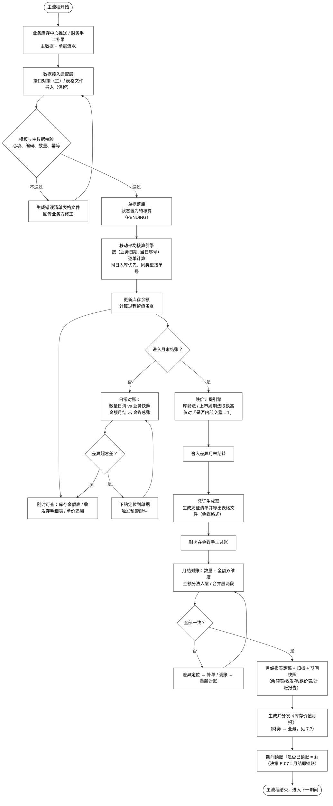
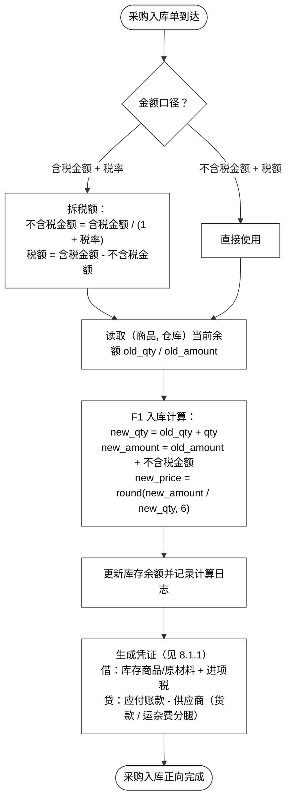
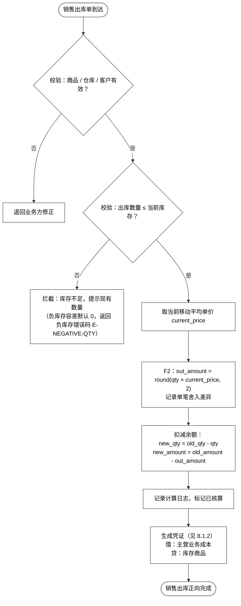
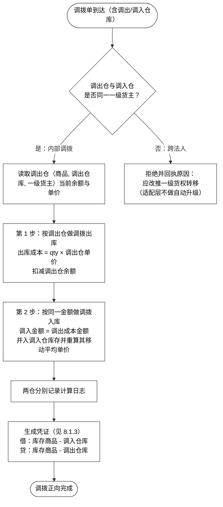

# 财务库存中心（一期）需求文档 1.0（通俗版）

## 一、文档信息

### 1. 项目背景

#### 1.1 建设背景

过去的供应链和企业资源计划系统（ERP）里，仓库里的实物操作（找货位、拣货打包、挪批次）和账面上的资产核算（哪家法人交税、内部产权人赚了多少、单台机器平均多少钱）是死死绑在一个仓储管理系统（WMS）里的，于是就出了下面这些堵心的问题：

| 矛盾 | 具体表现 |
|---|---|
| 权责与货位绑定 | 好几家公司、好几个内部产权人团队共用同一个仓库时，货在仓库里搬来搬去，账面就搞不清这批货到底算谁的 |
| 成本与毛利失真 | 数码 3C 价格上蹿下跳，二手货「一机一况一价」，车架号还要强监管，传统的加权平均根本算不出单台机器真实的利润 |
| 跨法人财税合规风险 | 跨公司调货、代别人卖货，货实际出库的时候没有及时生成合规的交易流水和开票依据，埋下税务风险 |
| 系统架构已达承载上限 | 实物作业要扛高并发，财务核算又要强一致性，两边互相拖后腿，月末关账的时候没法拦住那些还在动的作业，历史报表也定不住格 |

#### 1.2 系统定位

财务库存中心干的事，核心就一件：**存货核算**。管实物的「业务库存中心」由另一个团队负责，和本系统同步建设。

1. 现有的金蝶企业资源计划系统（ERP）存货核算功能，满足不了精细化管成本的要求；
2. 业务库存中心管「实物」，财务库存中心管「价值」，两边职责分开；
3. 财务部需要一套自己能掌控、够灵活、还能追溯的成本计算和凭证生成能力。

#### 1.3 四层解耦架构

系统把「作业、可用量、资产、凭证」这四样彻底拆开：

| 系统层级 | 关注核心 | 系统职责与核心能力 | 关键数据指标 |
|---|---|---|---|
| 物理仓储中心（WMS） | 实物在哪、干活快不快 | 分配库位、波次拣货、实物盘点、序列号（SN）/ 国际移动设备识别码（IMEI）扫描采集、交接装车 | 实物在架数量、货位占用率 |
| 业务库存中心（IMS） | 卖货怎么调度、可用量怎么控 | 算可用量、切分渠道配额、销售预占锁定、履约时找哪个仓发货 | 业务可用量、预占量、在途量 |
| **财务库存中心（本系统）** | **存货资产、货权归属与核算** | **法人与内部管理账户、移动加权核算、负库存补差、内部转价、月结关账** | **账面结存量、结存均价、结存总金额、内部毛利** |
| 财务总账系统（金蝶） | 法定总账与报表凭证 | 接收本系统导出的标准凭证底稿、总账科目汇总、出具法定资产负债表和利润表 | 会计科目借贷余额、总账资产 |

#### 1.4 关键约束

- **独立模块**：不依赖金蝶的存货核算功能，数据自己接、自己算、自己存；
- **并行搭建**：业务库存中心同期在建设，财务这边要准备好应对「接口还没就绪」的那段过渡期；
- **工期约束**：必须按最小可用版本（MVP）的思路砍范围，一期和二期严格分开。

---

### 2. 项目价值

| 价值维度 | 一期要解决的问题 | 交付物 |
|---|---|---|
| **资产真实** | 存货的账面数量、金额、均价，在四个维度上都能查、能对、能追溯 | 存货实时余额、结存流水数据、库存表 |
| **成本可算** | 按核算单元「商品 + 仓库 + 一级货主」维护均价池 / 成本层，三种计价方法（移动加权平均法 / 个别计价法 / 先入先出法）的入库怎么定价、出库怎么结转，规则固定、每次都能复现出一样的结果 | 计价模型配置、核算引擎、存货计价批次追踪 |
| **货权清晰** | 一级货主（法人）和二级货主（内部管理维度）分层记账，两级的作价口径各自独立 | 货权转移出入库、存货记账明细台账 |
| **风险可控** | 成本波动有预警、三套账之间有一致性核对、负库存有关卡，出了异常不会悄无声息 | 成本波动表、核对表、负库存管理配置 |
| **月结可锁** | 引入会计期间和锁账机制，日结只做校验，月结把账锁死，历史报表能定格 | 进销存周期表、期初数据维护 |
| **价值可回传** | 成本单价、库存金额、库龄、跌价准备这些核算结果，标注好口径之后回传给业务侧 | 库存价值月报 |

---

### 3. 一期范围

> 这张表是研发照着干活用的施工图。**表里每一行，都必须能在正文里找到对应的设计。**

| 维度 | 一期范围 |
|---|---|
| **库存维度** | **四轴**：「商品 + 仓库 + 批次 + 一级货主」；**存货核算单元** =「商品 + 仓库 + 一级货主」。在移动加权平均法下，批次不进均价池，只影响库龄和跌价；在个别计价法 / 先入先出法下，批次 / 成本层就是成本单元，见成本层表（`t_inventory_layer`） |
| **货主分层** | 一级货主 = **法人主体**（一级货主（`owner_l1`），和账套是同一概念）；二级货主 = **二级产权人** = 内部管理维度（**产权人可以是个人，也可以是部门 / 事业部 / 代采项目**），**不进存货总额**；二级层另外维护一本**管理口径**的**二级自有均价池**（见 `《财务库存中心（一期）计算逻辑（通俗版）》`§二``），**不影响会计** |
| **核算主体** | **多法人**（已经确认存在集团内跨法人转移的情况） |
| **计价方法** | **三种同时用**：**移动加权平均法（`MA`，全局默认）** / **个别计价法（`SI`）** / **先入先出法（`FIFO`）**，按核算单元「商品 + 仓库 + 一级货主」这个粒度，在计价模型配置表（`t_price_method_config`）里配置（没配就回落到全局默认的移动加权平均法，同时告警）；个别计价法 / 先入先出法另外启用**成本层**（`t_inventory_layer`）来承载批次 / 序列号级别的成本，**余额和所有报表的口径都不变** |
| **作价来源** | 一级用「一级货权转移价（`transfer_price`）」：这是**交易数据**，不用配置，系统只负责取价加校验；二级用「内部结算价（`internal_price`）」：这是**政策数据**，来自带生效期的价目表（有固定价、成本加成率两种） |
| **跌价准备** | **库龄法 + 3C 上市周期法两条轨道并行，取两者里高的那个**（按商品类别配置）；**计提范围只限「是否内部交易 = 1」的货** |
| **会计期间** | 引入会计期间表（`t_period`）加一个「是否已锁账（`is_closed`）」的开关；**日结只校验、月结锁账**；反结账必须走审批并留痕；跨期补记走当期补录单 |
| **凭证处理** | 生成凭证清单并导出表格文件（Excel）（一期不直接推给金蝶）；包含货权转移和集团内抵消，**不含二级内部结算价差** |
| **主数据** | 以业务库存中心推送为主，财务这边可以补充维护；**一级货主编码属于 A 级、二级货主必须由业务侧提供** |
| **数据接入** | **以直接接口（API）对接为主**（协议和鉴权还没定），**表格文件（Excel）/ 逗号分隔值文件（CSV）导入保留**（用于过渡期和手工补录）；两条通道**共用同一套字段 / 校验 / 幂等 / 错误回执** |
| **单据类型** | **11 类**：采购入库（`PO_IN`）、采购退货出库（`PO_RET`）、销售出库（`SO_OUT`）、销售退货入库（`SO_RET`）、调拨（`TRANSFER`）、盘点（`STOCKTAKE`）、其他入库（`OTHER_IN`）、其他出库（`OTHER_OUT`）、一级货权转移（`OWNER_TRANSFER`）、二级货权重分配（`OWNER_REASSIGN`）、跨期补录单（`PERIOD_ADJUST`） |
| **输出报表** | 库存余额表、收发存明细表、跌价表（双轨分列）、凭证清单、**库存价值月报（对外分发）** |
| **审批流** | **不建审批流引擎**，只保留单据上的「待审 / 已审核」状态位，外加一个**审核动作**（记下审核人（`approved_by`）和审核时间（`approved_at`））；预留审批网关接口（`ApprovalGateway`），一期就用单点直通的方式实现 |

**明确不做（一期）**：

| 不做项 | 一期承载方式 / 后置说明 |
|---|---|
| 产权交易中心落地 | 由库存中心出一张临时货权变更单先扛着，二期再搬过去 |
| 多层级货主 | 一期只做两级（一级货主 + 二级内部管理维度） |
| 二级层会计凭证 | 二级只做管理口径，不出凭证 |
| 货押融资相关库存状态 | 一期范围之外 |
| 标准成本 | 纯贸易 / 零售模式没有生产环节，不引入 |
| 直推金蝶总账 | 二期（凭证自动过账） |

---

### 4. 术语表

| 术语 | 含义 |
|---|---|
| **一级货主** | 就是常说的**法人主体**（一家独立注册的公司），系统里给它起的字段名是一级货主（`owner_l1`），跟财务说的「账套」是同一件事。存货的均价池、凭证、损益、跌价基数，全都以它为单位来算 |
| **二级货主（二级产权人）** | 这是公司内部的管理维度，也就是页面上的**二级产权人**——**产权人可以是某个个人，也可以是某个部门 / 事业部 / 代采项目**。它**不是法人、不是会计主体**，所以不进存货总额。它在两处体现：**二级分摊账**（会计口径）和**二级自有均价池**（管理口径，「自有结存金额」/「自有均价」） |
| **二级自有均价池** | **管理口径**：每个二级产权人**自己的一本**移动加权平均账（「自有结存金额」）。入池按**实际成本**、出池按**该二级当期自有均价**，二级重分配**同额平移**。它和一级层金额的差就是**池化差异 `D`**（见 `《财务库存中心（一期）计算逻辑（通俗版）》`§二``）。**不进存货总额、不进跌价基数、不出凭证**，和会计口径**分成两列并排展示** |
| **存货核算单元** | 「商品 + 仓库 + 一级货主」这三样的组合。它是**计价方法真正起作用的最小单位**——均价池、成本层、凭证、跌价基数都是挂在核算单元上的，不是挂在某一批货（批次行）上的 |
| **库存维度（四轴）** | 「商品 + 仓库 + 批次 + 一级货主」这四样的组合，是余额表的主键。在移动加权平均法下，批次只影响库龄和跌价，不进均价池；在个别计价法 / 先入先出法下，批次就是成本层 |
| **作价** | 货权转移的时候，给转出去的这批货定一个价，并据此生成凭证，这个动作叫作价。一级用「一级货权转移价（`transfer_price`）」，二级用「内部结算价（`internal_price`）」 |
| **内部结算价** | 二级重分配时用的考核价（内部结算价），属于**政策数据**，来自带生效期的价目表；**不影响会计账** |
| **二级分摊金额（`alloc_amount`）** | 二级分摊金额 = 数量 × 一级均价。这个数**能**加总回到一级层 |
| **二级内部结算金额（`internal_amount`）** | 二级内部结算金额 = 按内部结算价逐笔累计出来的。这个数**不能**加总，它和能加总的那部分之间的差额，就是内部未实现毛利 |
| **货权变更单** | 一期先由库存中心出具的临时单据，分两种：一级货权转移（`OWNER_TRANSFER`）/ 二级货权重分配（`OWNER_REASSIGN`）。按**以后能整块搬走**的形态来设计，二期搬到产权交易中心 |
| **是否内部交易（`is_internal`）** | 一个用来标出「这笔算不算内部交易」的标记。存货总额只累加标记为 1 的；跌价也只对标记为 1 的计提 |
| **会计期间** | 财务结账的最小时间单位，格式是「年-月」（YYYY-MM）。系统里配了一张会计期间表加一个「是否已锁账（`is_closed`）」开关：日结只做校验，月结才真正锁账 |
| **反结账** | 就是把已经锁掉的期间重新打开。**允许做，但必须走审批并留下痕迹**（谁做的、什么时候、为什么、重开了哪个月）。它和补录单是两码事，**不能互相替代** |
| **跨期补录单** | 单据类型是跨期补录单（`PERIOD_ADJUST`）。已经结完账的期间里发现漏记了一笔，这是唯一的补录通道。补录时**一律按当期口径算量和价**，原来那笔业务发生的日期只用来追溯 |
| **过账顺序** | 按「业务日期 + 当日序号」排。同一天里**入库排在前面**，同类型的按单号排。业务单号（`doc_no`）**不能**拿来当排序依据 |
| **增量（`delta`）** | 核算引擎返回的是**增量**（数量和金额各自变了多少），不是新的余额；余额 = 一笔笔增量累计起来 |
| **幂等（三层）** | 「幂等」的意思是同一份东西重复送进来多少次，结果都跟只送一次一样。这里分三层把关：传输幂等按「导入批次号 + 业务单号 + 单据行号」；事件幂等按「单据类型 + 业务单号 + 版本号」；结果幂等是因为引擎本身是个纯函数，同样输入永远得到同样输出 |
| **移动加权平均法（`MA`）** | 每进一次货，就用「累计金额 ÷ 累计数量」把这个单位成本更新一遍（在核算单元这一层算）。**一期全局默认用这个方法** |
| **个别计价法（`SI`）** | 每一件 / 每一批存货，按它自己实际花的那笔钱单独结转成本（**一期启用**，适合管理序列号的高值整机） |
| **先入先出法（`FIFO`）** | 出库时，从**最早进的那批货**开始，一层一层往下扣成本（**一期启用**） |
| **库龄** | 商品在仓库里待了多少天，从入库那天开始算 |
| **上市周期** | 3C 新品从上市那天算起过了多少天，用来给新品算跌价 |
| **单据流水** | 业务系统推过来的每一笔出入库记录 |
| **估值** | 用单位成本 × 数量算出来的库存金额 |
| **跌价准备** | 对那些压在仓里不动、或者已经掉价的库存，按库龄法 / 上市周期法计提的减值 |
| **舍入差异** | 金额小数点后只保留两位，算的过程中会攒下一点点误差，这些累计的差额要专门用科目归集起来 |

---

### 5. 全局说明

这一节是全文的公共约定，后面各章节不再重复讲。**任何跟这一节冲突的说法，都以这一节为准。**

#### 5.1 精度与舍入

> **本节正文已移到《财务库存中心（一期）计算逻辑（通俗版）》`§一`。** 数量 4 位 / 金额 2 位 / 单价 6 位三条精度规则，以及「**舍入差异只在出库的时候产生**」，原样搬走。

#### 5.2 维度与核算单元

| 概念 | 定义 | 用途 |
|---|---|---|
| 库存维度（四轴） | 「商品 + 仓库 + 批次 + 一级货主」 | 余额表的主键 |
| 存货核算单元 | 「商品 + 仓库 + 一级货主」 | **计价方法真正起作用的粒度**（均价池 / 成本层 / 凭证 / 跌价基数，都归它所有） |

> 批次只影响库龄和跌价，**一期不进均价池**。

**结存流水页（P05）上的三个维度不是三套算法**，而是**同一批数据的三种分组方式**——数据来源是同一份，只是聚合用的键不一样。三者共用同一套查询条件，切换维度只是换了个分组键，**不换数据集，也不换取数口径**。

| 维度页签 | 聚合键（分组键） | 取数表 | 跨货主行为 |
|---|---|---|---|
| 仓库维度 | 「仓库编码 + 商品编码 + 资产类型」 | 核算单元层库存余额表·均价表（`t_inventory_balance_unit`） | **跨货主合并**——同一个仓、同一个商品下，**所有**核算单元（各个一级货主 × 各个二级产权人）合并成一行 |
| 一级货主维度 | 「一级货主 + 仓库编码 + 商品编码 + 资产类型」 | 核算单元层库存余额表·均价表（`t_inventory_balance_unit`） | 不合并——**一个核算单元就是一行**（核算单元的前三个键，正好就是这个维度的分组键） |
| 二级产权人维度 | 「二级产权人 + 一级货主 + 仓库编码 + 商品编码 + 资产类型」 | 二级货主结存表（`t_owner_balance_l2`） | 不合并——二级不建核算单元，一行就是一个二级货主 × 一种资产类型 |

**仓库维度的跨货主合并规则**（合并出来的行必须还能拆回去，否则就没法审计）：

| 列 | 合并算法 |
|---|---|
| 当前结存数量（`current_qty`） | $\sum$ 各核算单元数量，**直接求和** |
| 当前结存总额（`current_total_cost`） | $\sum$ 各核算单元金额，**直接求和** |
| 当前结存均价（`current_unit_cost`） | $\frac{\sum 金额}{\sum 数量}$——**是加权平均，不是把各单元的均价再取算术平均**；分母为 0 的时候显示 `—` |
| 计价模式（`pricing_method`） | 合并行里各核算单元的方法**全都一样** → 就显示那个方法；**不一样** → 显示 `混合`（灰底标签） |
| 负库存标记（`has_negative`） | **只要有一个**子单元是负的，就置位 |
| 最后更新时间（`updated_at`） | 取各个子单元里的**最大值** |

**合并行的均价怎么展示，按方法分流**（跟核算单元是同一套规则，混合行取更保守的那一档）：

| 合并行内的方法 | 当前结存均价（`current_unit_cost`）展示 |
|---|---|
| 全是移动加权平均法 | 派生均价 |
| 全是先入先出法 | 派生均价 + 标注「派生 · 非计价依据」 |
| 全是个别计价法 | `--` |
| 混合、**不含**个别计价法（移动加权平均法 + 先入先出法） | 派生均价 + 标注「派生 · 混合口径」 |
| 混合、**含**个别计价法 | **`--`** + 标签「混合口径 · 拆回货主看明细」 |

> **为什么只要含个别计价法就压成 `--`**：合并行里个别计价法那些单元的量，会被一个加权均价给盖住，而这恰恰是「个别计价法不显示均价」想避免的误导。宁可少给一个数，也不给一个会被读成「这批货就值这个单价」的数。

> **合并行必须能拆回去**：仓库维度的 `[查看]` 行详情弹窗，除了当前行的字段，还必须列出**构成这一行的核算单元明细**（一级货主 / 二级产权人 × 数量 / 金额 / 均价 / 计价模式）。没有这个出口，「跨货主合并」在审计上就是一笔糊涂账——金额对不上的时候，根本没法定位是哪一层货主出的问题。

**一级货主维度的聚合算法**（**不做任何合并**——聚合键就是核算单元前三个键，所以是**原样映射**）：

| 列 | 算法 |
|---|---|
| 当前结存数量（`current_qty`） | 取核算单元「商品编码 + 仓库编码 + 一级货主 + 资产类型」的数量，**一个核算单元一行** |
| 当前结存总额（`current_total_cost`） | 取核算单元的金额（**权威值**，不重估、不算） |
| 当前结存均价（`current_unit_cost`） | 核算单元的**权威均价** = 结存金额 ÷ 结存数量（移动加权平均法的移动平均单价就是这个值）；个别计价法单元显示 `--` |
| 计价模式（`pricing_method`） | 取这个核算单元的计价方法——**不存在「混合」**（一个核算单元只有一种方法） |
| 负库存标记（`has_negative`） | 取这个核算单元的负库存位 |

**二级产权人维度的聚合算法**（**不做任何合并**——一行就是一个二级货主 × 一种资产类型）：

| 列 | 算法 |
|---|---|
| 当前结存数量（`current_qty`） | 取**二级货主结存表**（`t_owner_balance_l2`）的数量，分组键是「二级产权人 + 一级货主 + 仓库编码 + 商品编码 + 资产类型」——**直接读现值，不做任何加总**（分摊账里的数量已经带正负号，重分配时转出行取负，就等于把这个量扣走了） |
| 当前结存总额·**会计口径**（`current_total_cost`） | **算出来的**：数量 × 所属核算单元**当期**的一级层均价（**不落库**）。之所以是算出来而不是「把逐笔分摊金额加起来」，是为了让 R3 那条「同一个核算单元里，多个二级货主**在会计口径上共用同一个均价**」**天生成立**——要是改成求和，不同时间进入这个核算单元的二级货主，各自会带出隐含的不同单价，等于在二级层偷偷又建了一个**会计**均价池。**这一列就是 V3 对平的左边**（见下表 `M3`） |
| 当前结存均价·**会计口径**（`current_unit_cost`） | **继承**所属一级层核算单元的均价（**不建会计均价池**，R3）；展示规则按**那个核算单元**的方法分流，不会因为「是引用来的」就一律给均价——移动加权平均法给派生均价，先入先出法同样给派生均价并标注「派生 · 非计价依据」，**个别计价法显示 `--`** |
| **自有结存金额（`own_amount`）** | **新增·管理口径、落库**：二级自有均价池的结存金额（二级货主结存表（`t_owner_balance_l2`）的自有金额列，见《详细设计文档》`4.3.7`）。**和上面的「当前结存总额」不是同一个数**——两者之差 = 该二级分摊到的**池化差异**（见下方「二级自有均价池」）。**不进存货总额（R4）、不进跌价基数、不出凭证（R5）** |
| **自有均价（`own_unit_price`）** | **新增·管理口径、算出来的不落库**：自有结存金额 ÷ 数量（**算出来的 · 非计价依据**），也就是该二级产权人**自己**的移动加权平均。**和所属核算单元的一级层均价可以不一样**——同一个核算单元里两个二级产权人各有各的价，这正是这一列存在的理由（见《财务库存中心（一期）计算示例_v1.0.md》`§3.6`「二级自有均价池：同一核算单元内两个二级各有其价」里的价差算例） |
| 计价模式（`pricing_method`） | **继承**所属核算单元的方法（二级层不单独配方法） |
| 负库存标记（`has_negative`） | 数量小于 0 就置位。二级层的负值是**超分摊**（分摊出去的量超过了它持有的量），**和仓库 / 一级层的负库存不是一回事**，标签文案要区分开 |

> **为什么只有仓库维度需要「合并算法」**：另外两个维度都是**一个核算单元（或者一个二级货主）一行**，聚合本身就是原样映射——没有合并，也就没有加权均价和「混合」降级这些问题。这正是本节开头那句「**不是三套算法，而是同一批数据的三种分组方式**」的落点：**唯一有算法分歧的地方，就是仓库维度的跨货主合并**。

**维度之间怎么对平**（三个维度必须能互相验算，对不平就说明数据有问题）：

| # | 等式 | 性质 |
|---|---|---|
| **V1** | $\sum$ 仓库维度数量 = $\sum$ 一级货主维度数量 = $\sum$ 二级产权人维度数量 | **数量守恒**，在同一个查询范围下，三者恒等 |
| **V2** | $\sum$ 仓库维度金额 = $\sum$ 一级货主维度金额 | **一级层金额守恒** |
| **V3** | $\sum$ 二级维度金额（即 $\sum alloc\_amount$）= 一级层金额 | **二级分摊可加总·会计口径**——这是引擎出口的第①项硬校验，不平就整单回滚（见 `§二.2.6「出口硬校验」`）。**对平的是二级分摊金额（会计分摊），不是自有结存金额（自有成本）** |
| **M1** | $\sum$ 二级自有结存金额 + $D$ = 一级层金额 | **管理口径**：池化差异 $D$ 的定义式，**逐核算单元**（$D$ 见下方「二级自有均价池」）。**日结校验**；和 V3 **并列成立**，不是它的替代 |
| **M3** | 对每个（核算单元, 二级产权人）：自有结存金额 − 二级分摊金额 = 该二级分摊到的池化差异 | **管理口径·并排对账**（余额层）。两列**不相等是正常的**，差必须能解释；$\sum$ 这个差 = $-D$ |

> **V1 能成立的前提是「同一个查询范围」**：仓库维度是跨货主合并的，一级 / 二级维度不合并，只有当三者命中的是**同一批核算单元**时，等式才成立。如果仓库维度按某个货主过滤、二级维度又按另一个货主过滤，这两个本来就不该相等——**不要跨查询范围去对平**。

> **V3 对平的是二级分摊金额这个口径，不是存货总额那个口径**，两者范围不一样，别混着用：V3 等号右边是一级层的**全部**金额（包含外部法人那些「是否内部交易 = 0」的）；而**存货总额**只累加一级层里「是否内部交易 = 1」的金额（R4），**二级层的数字绝对不能往里加**。二级内部结算金额**在 P05 的任何维度都不展示**，也不参与上面任何一个等式——它是按内部结算价累计出来的，天生就加总不回去，差额就是二级内部未实现毛利（管理口径）。

**维度之间的口径差异**（同一个列名在不同维度下含义不一样，必须按维度去读）：

| 列 | 仓库维度 | 一级货主维度 | 二级产权人维度 |
|---|---|---|---|
| 当前结存均价·**会计口径**（`current_unit_cost`） | 合并行的加权均价；**含个别计价法就是 `--`** | 核算单元的**权威均价**（移动加权平均法的移动平均单价就是这个） | **不建会计均价池，继承所属一级层那个核算单元**（R3）；所属单元是个别计价法时**同样继承 `--`**，不会因为「是引用来的」就显示均价 |
| 当前结存总额·**会计口径**（`current_total_cost`） | 各核算单元金额**直接求和** | 核算单元的金额（**权威值**） | **算出来的值**：数量 × 所属核算单元当期的一级层均价（R3；不落库、不建会计均价池） |
| **自有均价（`own_unit_price`）** | **没有这一列** | **没有这一列** | **管理口径**：**该二级自己的**移动加权平均 = 自有结存金额 ÷ 数量（算出来的 · 非计价依据）。**和左边一级层均价可以不一样** |
| **自有结存金额（`own_amount`）** | **没有这一列** | **没有这一列** | **管理口径·落库**：二级自有均价池的结存金额。**和上面的「当前结存总额」之差 = 该二级分摊到的池化差异** |
| 一级货主（`legal_owner_id`） | **没有这一列**（已经合并掉了） | 分组键 | 归属到哪个一级货主 |
| 二级产权人（`amiba_owner_id`） | **没有这一列**（已经合并掉了） | 没有这一列 | 分组键 |
| 批次号（`batch_no`） | 恒为 `—` | 恒为 `—` | 恒为 `—` |

> **在结存余额这个口径下，批次号在三个维度里都恒为 `—`**：核算单元本身就是三轴聚合出来的，批次不属于聚合键，硬要展示就会把聚合打散。**只有记账流水口径**下这一列才有值。

> **二级维度怎么取数（`G-06` 已经闭合）**：二级维度的结存数量，直接读**二级货主结存表**（`t_owner_balance_l2`）——它是二级货权重分配表的**物化投影**，键和本节这个维度的聚合键一模一样。分摊账里的业务数量是**带正负号的**（二级层增加为正、减少为负），二级重分配会**展开成两行**（转出行取负、转入行取正），所以 `SUM(qty) GROUP BY` 聚合键**直接就是结存数量**，方向不再有两种解释。规则细节见《详细设计文档》`4.2.4` / `4.3.7`，校验见 `9.4` 的 `E-12`（二级结存投影不一致）。
>
> **二级维度的会计口径金额只有一列，而且是算出来的**：当前结存总额（`current_total_cost`）= 数量 × 所属核算单元**当期的一级层均价**——**不落库、也不单独建会计均价池**（R3）。因为「同一个核算单元里，多个二级货主**共用同一个会计口径均价**」，把它定死成算出来的值，这条规则才**天生成立**，V3 也顺带退化成 V1（一条硬校验同时守住两个等式）。二级维度的当前结存均价（`current_unit_cost`）**是继承来的**——读所属一级层核算单元的均价，**按那个核算单元的方法分流展示**（移动加权平均法显示派生均价 / 先入先出法显示派生均价并标注「派生 · 非计价依据」/ 个别计价法显示 `--`）。**二级维度不出内部结算口径金额**：二级内部结算金额（`internal_amount`）/ 二级内部损益（`internal_pl`）既不展示、也不参与任何一个等式。
>
> **但二级层另有一本管理口径的账**：「自有结存金额」（`own_amount`）和「自有均价」（`own_unit_price`）——见下方「二级自有均价池」。它和这里的会计口径**并排展示、互不加总**。

> ⚠️ **「数量 × 一级层均价」不是二级分摊金额的通用算式——它只是**「结存」那一侧**的派生写法，**「发生额」那一侧**必须取实际结转额。两侧要分开读**：
> - **结存（也就是报表展示这一侧）**：当前结存总额 = 数量 × 所属核算单元**当期的一级层均价**。这里的「一级层均价」定义就是**结存金额 ÷ 结存数量**，所以这条等式**三种方法都天生成立**（移动加权平均 / 个别计价 / 先入先出法一样），上面「V3 退化成 V1」那段论证不受影响。
> - **发生额（也就是引擎逐单过账这一侧，出口硬校验① 真正验的就是它）**：二级分摊金额的**增量**必须取**这一行实际结转的一级层成本**。移动加权平均下两种写法等价（一级层的金额本来就是「数量 × 均价」）；**个别计价 / 先入先出法下不等价**——一级层的金额是各个成本层加出来的**和**，派生均价只是它的**商**，拿「数量增量 × 均价」去算就会算错，出口硬校验①（二级分摊金额增量合计 = 一级层金额增量）当场不平、**整单回滚**。反例见《财务库存中心（一期）计算示例_v1.0.md》`§3.10`（个别计价下的差异）。
> - 一句话：**结存看派生，发生额看实际**。把结存那一侧的派生写法搬去算发生额，是「个别计价 / 先入先出法」下最容易踩的坑。

**二级自有均价池（管理口径）**

> **本段正文已移到《财务库存中心（一期）计算逻辑（通俗版）》`§二`。** 入池 / 出池规则表、三条概括、池化差异 $D$、对平式 `M1` / `M2` / `M3`，以及「个别计价 / 先入先出法单元下 $D$ 更大」那条 ⚠️，全部原样搬走；`E-13`（二级自有池结转不一致）的判据在该册 `§二` 2.3，抓得到 / 抓不到的反例见《财务库存中心（一期）计算示例_v1.0.md》`§4.9`。
>
> **逐笔演算见《财务库存中心（一期）计算示例_v1.0.md》`§四`；余额层算例见同文 `§三`。**

#### 5.3 货主分层硬约束（R1–R5）

| # | 规则 |
|---|---|
| **R1** | 一级货权转移**必须作价、必须出凭证、必须产生会计损益** |
| **R2** | 二级重分配**必须按内部结算价作价**，差额进二级内部损益（**管理口径**）；**不出会计凭证** |
| **R3** | **存货均价池只在一级货主这一层建立**（**会计口径**）；二级另外维护内部结算价，并且可以另建一本**管理口径**的**二级自有均价池**（「自有结存金额」/「自有均价」，见 `《财务库存中心（一期）计算逻辑（通俗版）》`§二``） |
| **R4** | 存货总额 = $\sum$ 一级层里「是否内部交易 = 1」的金额（**二级层绝对不能相加**——**也包括二级自有均价池的自有结存金额**） |
| **R5** | **二级内部结算价和二级自有均价池都不影响会计**——一级层的成本、存货总额、凭证、跌价基数，都跟它们没关系 |

> **二级产权人（`owner_l2`）是必填的，但它不是一个维度轴**：二级货主**每一行都必须填**（没填就报二级货主缺失（`E-OWNER-L2-MISSING`），整行被拒），**但 R3 / R4 / R5 不变**——它**不进四轴**「商品 + 仓库 + 批次 + 一级货主」、**不进核算单元键**「商品 + 仓库 + 一级货主」、**不进会计均价池、不进存货总额**。它回答的是「这笔货归谁经营」，不回答「这笔货值多少钱」——同一个核算单元里就算有好几个二级货主，**在会计口径上也共用同一个均价**；而**管理口径上各有各的价**（二级自有均价池，`《财务库存中心（一期）计算逻辑（通俗版）》`§二``），两者分开读、互不干扰。
>
> **注意区分两种「必填」**：这一节说的是**数据行上的必填**（业务系统必须在每一行都推二级产权人）；而各个原型页面「搜索条件」表里「二级产权人」那栏写的「**非必填**」，那是**查询语义**（不填 = 不按二级过滤）。**两者不冲突，不要改**。

**二级层的「一个数量、三个金额」**：

| 金额 | 字段 | 算法 | 能否加总 | 用途 |
|---|---|---|---|---|
| 二级分摊金额 | 二级分摊金额（`alloc_amount`） | **结存**：数量 × **一级均价**（派生）；**发生额**：这一行**实际结转的一级层成本**（⚠️ 见 §一.5.2，「个别计价 / 先入先出法」不能走派生那条短路） | **能**——$\sum alloc\_amount = 一级层金额$（引擎出口硬校验，不平就整单回滚） | 把二级的数量和金额还原成成本 |
| 二级内部结算金额 | 二级内部结算金额（`internal_amount`） | 按内部结算价逐笔累计 | **不能**——差额 = 内部未实现毛利，**不做等式校验** | 二级内部考核、内部结算损益 |
| **自有结存金额** | **自有结存金额（`own_amount`）** | 二级自有均价池逐笔结转——入池按**实际成本**、出池按**该二级当期自有均价**、二级重分配**同额平移**（见 `《财务库存中心（一期）计算逻辑（通俗版）》`§二``） | **不能**——和一级层金额之差 = **池化差异 $D$**（$\sum own\_amount + D = 一级层金额$，也就是 **`M1`**） | **该二级自己的**成本还原与考核（**管理口径**，**不进存货总额、不出凭证**） |

**口径标注**：库存金额要标注「存货口径·一级货主层·是否内部交易（`is_internal`）=1」；库存数量要标注「权属口径·一级货主层」或者「物理口径·仓库」；内部结算损益要标注「管理口径·非会计损益」；**二级自有均价**要标注「管理口径·二级自有成本·非计价依据」。任何对外分发的报表和指标，**都必须带口径标注**。

#### 5.4 取价三条铁律

> **本节正文已移到《财务库存中心（一期）计算逻辑（通俗版）》`§三`。** 取价三条铁律——**按业务日期取价 → 取到就立刻做快照 → 事后调价不追溯**——原样搬走。

#### 5.5 过账顺序与幂等

| 机制 | 约定 |
|---|---|
| 排序键 | 「业务日期 + 当日序号」，这里是**全流程唯一决定「谁先谁后」的地方**；同一天里**入库排在前面**，同类型的按单号排；业务单号（`doc_no`）**不能**拿来当排序键 |
| 传输幂等 | 导入批次号 + 业务单号 + 单据行号 |
| 事件幂等 | 「单据类型 + 业务单号 + 版本号」 |
| 结果幂等 | 引擎是纯函数，同样的输入永远得到同样的输出 |

#### 5.6 单据状态位

| 状态位 | 取值 | 说明 |
|---|---|---|
| 业务状态（`biz_status`） | 草稿（`DRAFT`）/ 已提交（`SUBMITTED`）/ 已审核（`APPROVED`）/ 已生效（`EFFECTIVE`）/ 已作废（`VOID`） | 业务状态怎么流转 |
| 核算状态（`cost_status`） | 待处理·挂起（`PENDING`）/ 已核算（`CALCULATED`）/ 已回滚（`ROLLED_BACK`） | 核算状态，**也是作废的闸门** |
| 红字冲销标识（`red_flag`） | `0` / `1` | 为 1 时指向红字引用的原单据（`red_ref_doc`） |

#### 5.7 期间与锁账

- **日结只做校验，月结才锁账**；
- 账锁上之后有三条路，**三条路不能互换**：**改单**（还没锁账时用）、**反结账**（已锁账、但当时结错了）、**当期补录单**（跨期补录单（`PERIOD_ADJUST`），已锁账、但漏了一笔，一律按当期口径算量和价）；
- 反结账的权限是独立的，这类危险动作必须**二次确认 + 填原因 + 记审计日志**。

#### 5.8 数据接入双通道

| 通道 | 定位 | 约定 |
|---|---|---|
| **接口（API）对接** | **一期主通道** | 协议和鉴权还没定；走推模式，不回源去拉 |
| **表格文件（Excel）/ 逗号分隔值文件（CSV）导入** | 过渡和手工补录 | 10 个模板 + 2 个动作文件（单据变更文件 `doc_change_{date}.xlsx` / 单据作废文件 `doc_void_{date}.xlsx`） |

两条通道**共用同一套字段 / 校验 / 幂等 / 错误回执**，字段层以《财务库存中心（一期）通用数据接口字段定义》v1.0 为准。

#### 5.9 契约与回滚口径

- 核算引擎对外的契约是：`measure(event, ctx) -> Posting`，返回的是增量（数量增量（`delta_qty`）/ 金额增量（`delta_amount`）/ 舍入差异（`rounding_diff`）/ 本笔过账后单价（`unit_price_after`））和成本层增量数组（`layer_deltas[]`，建层 / 加层 / 耗层 / 关层，只有个别计价法 / 先入先出法的单元才非空），**不返回余额**；
- 引擎分四层：事件 / 计量 / 记账 / 投影；
- 计量层是**策略化**的：一种计价方法就是一个策略实现（移动加权平均法 / 个别计价法 / 先入先出法）；而且**按腿解析**——调拨、一级货权转移会同时动两个核算单元，两条腿可以配不同的方法，不接受一个全局统一的策略；以后新增方法，只需要加一个策略实现，**记账层和投影层对外的口径、报表结构都不变**；
- **事务回滚 ≠ 事件回滚**：前者是技术手段，而且必须得有；后者已经删掉了；
- 出口硬校验不平就整单回滚，不允许只过账一半。

#### 5.10 一期 / 二期标注

- **一期启用（三种同时用）**：**移动加权平均法（全局默认）**、**个别计价法**、**先入先出法**；按核算单元「商品 + 仓库 + 一级货主」这个粒度，在计价模型配置页上选，没配就回落到全局默认的移动加权平均法，同时告警；
- **一期硬要求**：序列号管理品类的出库单据行**必须**带序列号（这是个别计价法能按序列号单台结转的前提）；
- **合规**：同类存货的计价方法必须保持一致，要变更必须披露；方法切换**只对新商品类别从开账日启用，不对存量品类中途切换**；
- **二期**：产权交易中心搬迁、二级作价迁移、直推金蝶、移动加权平均按月结转的版本。

全文凡是涉及二期能力的，都明确标了「二期」，**不许当作一期来做**。

#### 5.11 危险动作与统一要求

**危险动作 = 做完之后没法靠「再执行一次」抵消掉的动作**：删除、撤销、启用期初、批量重算。这类动作**一律**走同一套流程，各个页面的按钮表里不再逐条重复写「二次确认 + 原因 + 审计日志」：

| 要求 | 内容 |
|---|---|
| **二次确认** | 弹窗里必须列出**操作摘要**和**影响范围**（涉及多少行、影响哪些期间 / 核算单元），不允许只有一句「确定要删除吗」 |
| **填写原因** | **原因必填**，跟着操作一起写进审计日志（NFR-07） |
| **勾选确认项** | 弹窗里必须有一个**必勾的确认项**（比如「我已确认删除该规则，操作不可撤销」）；没勾就不能提交 |
| **审计日志** | 记录操作人 / 操作时间 / 原因 / 影响范围。**反结账另外还需要独立权限**（见 `§一.5.7「期间与锁账」`） |

**一期危险动作清单**（以后新增危险动作，必须同步登记到这张表里）：

| 页 | 动作 | 不可逆在哪 |
|---|---|---|
| P01 计价模型配置 | `[删除 (仅未生效)]` | 删掉之后只能重建；而且删除会改变优先级（`priority`）的序号 |
| P03 业务源单据管理 | `[批量重试记账]` | 批量重放记账，失败的那些行，原来的记账结果会被覆盖 |
| P04 原始数据处理 | `[批量执行计算]` / `[重新计算]` | 重算是**先回滚已经落下的过账再重算**，会产生新的记账流水号（`journal_no`） |
| P12 库存表 | `[重新执行库龄推导 (异步任务)]` / `[生成跌价计提凭证建议]` | 异步重算会覆盖当期的推导结果 |
| P14 期初数据维护 | `[启用期初]` / `[删除]` | 启用之后那个期间就**锁死**了，只能靠反向单来修正；删除是按导入批次号（`import_batch_id`）**整批撤销**，不做逐行恢复 |

> **`[反结账]` 也算危险动作**，但它在 §一.5.7 里已经有完整定义（必须审批留痕，记录谁 / 何时 / 因何 / 重开哪个月），**一期不设页面按钮**，这里不重复。

> **删除类动作必须重排序号**：删掉挂在**有序键**上的记录之后，要按列表顺序把剩下的记录重新排一遍，**不允许留下断号**（比如出现 `1, 2, 4, 5` 这种）。优先级（`priority`）是路由用的排序键（数值越小越优先，见 P01 里 `priority` 字段的说明），留断号会让排序比较失去确定的含义。P01 的 `[删除 (仅未生效)]` 就适用这一条。

---

## 二、流程图

本章分两块：**业务流程**给出端到端的主线，以及三类正向单据的流程图；**数据流程**把「所有单据共用的那条管线」拉直成七段，逐段标出这一步做什么、输入是什么、输出是什么、对应管线上的哪一段（`FL-xx`，单据处理管线段号·泛指）。

---

### 1. 业务流程

四张图分别回答四件事：整条主线怎么走、采购入库怎么走、销售出库怎么走、调拨怎么走。图直接取自对应源文件里的流程图工具（Mermaid）原图，图下面只说明这张图的关键分支。

#### （1）主流程图



这张图是端到端的主线：数据经适配层一次性落地到单据表之后，按「业务日期 + 当日序号」逐单核算、更新余额，日常随时可查。关键的分叉有两个：一是**日常对账差异超出容差** → 下钻定位到具体单据、触发预警邮件，然后再对一遍；二是**月结对账任何一段不一致** → 补单 / 调账之后重新对账。月结报表定稿之后**期间锁账**（是否已锁账 = 1），这个期间禁止任何重算，之后只剩下「结错了 → 反结账」和「漏一笔 → 当期补录单」这两条路（E-09 / E-10）。

#### （2）采购入库正向流程图



关键分支在「金额口径」这里：上游给的是**含税金额 + 税率**，就拆税（`不含税金额 = 含税金额 / (1 + 税率)`）；给的是**不含税金额 + 税额**，就直接用。两种口径最后都进 F1 重算均价。采购入库是**唯一会改变移动加权平均法单元移动平均单价的单据方向**（个别计价法 / 先入先出法的单元，表现出来则是**新建一个成本层**），而且税额是单独拆出来的，只进进项税，不进存货成本。此外还有一条「暂估 / 到票」的分支：货到了票还没到，先按暂估价入库（结算状态（`settle_status`）= 已暂估（`ESTIMATED`））；发票到了之后，**追加一条反向事件把暂估冲掉，再加一条据实事件**（结算状态 = 已调整（`ADJUSTED`），同时记下暂估关联单据（`estimate_ref_doc`）），而不是走「直接把暂估金额改掉」这条路。

#### （3）销售出库正向流程图



出库是按**出库那个时点**的移动平均单价来结转成本的，**出库本身不改变单价**，而且出库是**舍入差异的唯一来源**。关键分支在货主维度：销售签约方就是实际持仓方，走常规的直接出库（就是上面这张图）；如果带二级产权人，就会触发**二级货权重分配**（只算二级分摊金额和二级内部结算金额，不动一级余额、不出凭证）；销售签约方不等于实际持仓方，就是**跨货主穿透**，跨一级货主的要走**一级货权转移**（按一级货权转移价作价、必须出凭证、必须确认损益）。上游**不给金额**——金额由本系统按当前均价自己算。

#### （4）调拨正向出库流程图



关键分支有两个。第一个，**按一级货主来判定走哪条路**：调出仓和调入仓是**同一个一级货主** → 走内部调拨（调拨（`TRANSFER`）），先调出（按调出仓均价），再调入（按同样金额入库，并重算调入仓的均价），公司层面的总库存金额不变；是**不同的一级货主** → 适配层直接拒绝，并回执跨法人单据非法（`E-CROSS-LEGAL-ENTITY`），要求改推一级货权转移，**不做自动升级**。第二个，**落库的形态**：业务侧推过来 **1 张**调拨单，适配层会把它展开成 **2 行**（调出腿 `is_in = 0` / 调入腿 `is_in = 1`，两行的单据类型（`doc_type`）都是调拨，**共用同一个业务单号**，单据行号（`line_no`）递增），而不是拆成两张单据。

---

### 2. 数据流程

下面这七步，是**所有单据共用的同一条管线**在需求文档上的七个环节，逐段编号 `FL-xx`（单据处理管线段号·泛指），和《单据处理全流程图》保持一致。

#### 1. 数据接收：推模式

上游业务侧（业务库存中心）主动把报文**推**过来，经过一个与协议无关的边界 `InventoryDataAdapter.receive(envelope) -> Receipt` 进来；适配层一期的主实现是业务接口适配器（`BusinessApiAdapter`），**表述性状态转移风格接口（REST）/ 消息队列（MQ）/ 文件这三种绑定，实现的都是同一个接口**，一期**以推模式为主、不回源去拉**，接口签名里同时有接收报文的 `receive` 和几个拉取方法（`pull_materials`：拉取商品主数据 / `pull_documents`：拉取单据 / `pull_inventory_snapshot`：拉取库存快照），推、拉两个方向都实现了，定下来之后只是少调一个而已。

接入这一段会把校验和换算一次性做完：**表头**（列名 / 顺序 / 必填列）→ **行级**（编码存不存在、类型、必填、枚举）→ **主数据**（一级货主在不在货主主数据表（`t_cargo_owner`）里、仓库能不能推导出法人）→ **单位换算**（`qty × convert_rate = base_qty`，也就是数量 × 单位换算率 = 基本单位数量，换算率缺失就直接拒绝）→ **金额口径判定**（含税就拆税 / 不含税就直接用，出库单上游不给金额）。信封里的记录条数（`record_count`）和实际的记录集（`records`）条数对不上，就**整批拒绝**。落库的时候执行**传输幂等**（导入批次号 + 业务单号 + 单据行号），重复传过来就直接丢弃，返回上一次的回执。

| 项 | 内容 |
|---|---|
| 输入 | 上游的报文信封（导入批次号（`batch_id`）/ 来源系统（`source_system`）/ 报文版本号（`schema_version`）/ 对象（`object`）/ 推送时间（`push_time`）/ 记录条数（`record_count`）/ 记录集（`records`）） |
| 输出 | 已经落库、核算状态是待处理的单据表头和行；校验失败就写进导入错误日志表（`t_import_error_log`）（原始报文（`raw_payload`）保留原文，可以导出成表格文件给业务修正） |
| 对应段 | `FL-01`（数据到达）· `FL-02`（校验与换算）· `FL-03`（落库与传输去重） |

#### 2. 过期间闸门：然后排队

落库之后的单据，先读单据行表（`t_document_line`）里的记账期间（`period`，格式 `YYYYMM`，年月），再看会计期间表里那个「是否已锁账」的标志（`t_period.is_closed`）。这是第二道闸，**只读不改**——结账锁账是运维动作，引擎只读这个标志并拒绝越界过账，**引擎自己不做结账**。

撞上已锁账期间的单据**不会被静默丢掉**，而是按两条**不能互相替代**的出口分流（E-09 / E-10）：这张单本来就属于那个期间、当时漏了 → 走**跨期补录单**（必须审核，按当期口径算量和价，原来的业务日期只用来追溯）；是上次结账本身结错了 → 走**反结账**（必须审批留痕，记录谁 / 何时 / 因何 / 重开哪个月，反结账次数 + 1（`reopen_count + 1`））；两个都不是 → **拒收**，退回业务方。

| 项 | 内容 |
|---|---|
| 输入 | 已经落库、核算状态是待处理的单据行 + `t_period.is_closed`（会计期间表·是否已锁账） |
| 输出 | 放行的待算单据（进 `FL-05` 排队），或者走补录 / 反结账 / 退回 |
| 对应段 | `FL-04`（期间闸门） |

#### 3. 排序键：全流程唯一决定「谁先谁后」的地方

移动加权平均的**结果依赖处理的先后顺序**，所以过账顺序必须在全流程唯一的一处定义清楚：**第一段**按业务日期（`biz_date`）升序（是业务日期，不是推送日期）；**第二段**在同一个业务日期内分配当日序号（`seq_in_day`）——先把所有入库过完，再过出库，同类型内部按业务单号（`doc_no`）排。据此落成一个全局单调递增的过账序号（`posting_seq`），它记录的是实际生效的顺序，不复用。

业务单号（`doc_no`）**不能当排序键**：单号本身不单调（有补单、有外部系统的单号、有前缀差异），业务系统一旦改了单号规则，历史数据就乱套了。同一天采用**入库优先**（这是决策 E-01 的方案 B），避免当天补进来的货被按旧均价出掉——这个偏差方向**业务能理解**，而「按单号排」这种规则是没法向业务解释清楚的。

| 项 | 内容 |
|---|---|
| 输入 | `FL-04` 放行的待算单据 |
| 输出 | `t_document_header.seq_in_day`（单据头表·当日序号）与 `t_calc_log.posting_seq`（计算过程表·过账序号） |
| 对应段 | `FL-05`（排序键分配，决策 E-01） |

#### 4. 分组、加锁、并行

按**核算单元**「商品 + 仓库 + 一级货主」分组——**锁的最小单位就是核算单元**：均价池只在这一层建立，锁的范围比它大会让无关的仓库互相阻塞，锁的范围比它小（锁到批次）又保护不了均价。**批次不进锁的键**，批次只影响库龄和跌价基数、**不影响均价**。

组内**严格串行**（同一个核算单元里，均价必须一笔一笔累进），组间**并行**（不同的核算单元互不影响）。一张单只动一个单元的（采购入库 / 销售出库 / 盘点），就单键加锁；动两个单元的（调拨 / 一级货权转移），按维度键**排好序再依次加锁**，**用固定的加锁顺序来防死锁**。整张单据的全部行在**同一个事务**里过账，不能出现半张单的情况。

| 项 | 内容 |
|---|---|
| 输入 | 已经定好序的待算单据 |
| 输出 | 锁的键列表（在内存里）；然后进 `FL-07` 计量 |
| 对应段 | `FL-06`（分核算单元，决策 E-05） |

#### 5. 计量

`measure(event, ctx) -> Posting` 是一个**纯函数**，计量上下文（`ctx`）是一个**只读快照、不包含余额引用**；它返回的是**增量，不返回余额**。入库走 **F1**（`new_price = round(new_amount / new_qty, 6)`，重算均价），出库走 **F2**（`out_amount = round(out_qty × current_price, 2)`，取当前均价、出库不重算）。

输出是**一个数量、三个金额**：一级层除了数量增量（`delta_qty`）和金额增量（`delta_amount`，会计口径）之外，带二级货主时还会另外派生三个数——二级分摊金额（`alloc_amount`，二级数量 × **一级层均价**，**能**加总回一级层）、二级内部结算金额（`internal_amount`，二级数量 × 内部结算价（`internal_price`）的快照，**不能**加总，差额就是内部未实现毛利（`internal_pl`））和自有结存金额（`own_amount`，按**该二级当期自有移动加权均价**结转，**不能**加总，差额就是池化差异 `D`，管理口径、**不影响会计**）。**三个数里只有二级分摊金额参与会计对平**。舍入差异（`rounding_diff`）**只在出库时产生**（入库只舍入单价、不回改金额），单笔的尾差量级是 ±0.01 或者 0，累计进库存余额表里的舍入差异累计字段（`t_inventory_balance.rounding_diff_acc`），**月末统一结转**（F3）。

| 项 | 内容 |
|---|---|
| 输入 | `event`（单据行 + 已快照的取价）+ `ctx`（只读的核算单元快照） |
| 输出 | 过账结果对象（全部都是增量：数量增量 / 金额增量 / 舍入差异 / 本笔过账后单价，含追溯信息） |
| 对应段 | `FL-07`（计量，决策 E-06） |

#### 6. 出口硬校验

这是**唯一一处「挡在门外」的地方**——硬校验放在**引擎出口**，不放月末对账：错误数据**压根不落库**，月末对账是第二道网，不是第一道。校验项有五个：① $\sum alloc\_amount\_delta == 一级层 amount\_delta$（二级会计分摊额必须能加总回一级层）；② **数量守恒 F12**（`期末数量 = 期初 + Σ入库 − Σ出库`）；③ **金额守恒 F13**（`期末金额 = 期初金额 + Σ入库金额 − Σ出库金额 + Σ舍入差异`）；④ **批次行均价一致性**（同一个核算单元下所有批次行的单价（`unit_price`）必须相等，这是引擎决策 E-02）；⑤ 单据完整性以及重复键（调拨单的两行共用同一个业务单号，幂等键必须唯一）。

任何一项不平 → **整单回滚**，错误数据不落库，并且**告警并列出不平的（商品, 仓库, 一级货主）**。注意这个顺序：**不是记完账再报警**——账都已经脏了，那时候报警没有任何补救作用。

| 项 | 内容 |
|---|---|
| 输入 | 还没落库的过账结果对象 |
| 输出 | 通过就进 `FL-09` 记账；不通过就整单回滚 + 告警 |
| 对应段 | `FL-08`（出口硬校验） |

#### 7. 记账

记账层是**账的唯一写入者**，对每一个增量执行 `balance += delta WHERE 维度键 = key AND version = expected`（这里用的是**乐观锁「版本（`version`）」**）。影响的行数是 0，就说明中途被并发改过，**重试：重查 → 重算 → 重写**。接着追加二级分摊（写二级货权重分配表）、写凭证草稿，并写计算过程留痕表（里面含过账序号（`posting_seq`）/ 作价来源（`price_source`）/ 基准价（`price_base`）/ 成本加成率（`markup_rate`）/ 数量增量（`delta_qty`）/ 金额增量（`delta_amount`）/ 变动前的值（`before_*`）/ 变动后的值（`after_*`）），最后执行事件幂等标记（`mark_posted(idempotency_key)`，事件幂等的键是「单据类型 + 业务单号 + 版本（`doc_type + doc_no + version_no`）」，重复提交返回零增量、**不报错**）。

**事务回滚 ≠ 事件回滚**：计算过程留痕表（`t_calc_log`）是**只增不删的事件流、是真相源**，余额和报表都只是它的投影；引擎里没有「回滚」这个动作，反向调整一律通过**追加反向事件**来实现（改单 = 版本号 + 1（`version_no + 1`），产生一条新事件；作废 = 追加反向事件 + 红字冲销标识（`red_flag`）= 1）。事务提交之后就进 `FL-10` 投影刷新，打上「已核算」的核算状态（`cost_status = CALCULATED`）。

| 项 | 内容 |
|---|---|
| 输入 | `FL-08` 校验通过的过账结果对象 |
| 输出 | 库存余额表（`t_inventory_balance`，累加增量 + 更新版本）、计算过程留痕表（`t_calc_log`）、二级货权重分配表（`t_owner_allocation`，增量）、二级货主结存表（`t_owner_balance_l2`，同一笔增量按二级货主投影）、凭证草稿；提交之后进 `FL-10` 投影刷新 |
| 对应段 | `FL-09`（记账；传输幂等见 `FL-03`：单据处理管线段号，事件 / 结果幂等见 `FL-09`：单据处理管线段号 / `FL-07`：单据处理管线段号，投影刷新见 `FL-10`：单据处理管线段号） |
## 三、原型页面

> **本章怎么读（两条约定，避免核对的时候误报）**
>
> **① 名字已经统一了。** 每个页面「搜索条件」表里的条件名，和「字段说明」表里的规范字段名，是**逐字对得上的**（比如「对账状态」「所属记账期间」「异常标记」），不再出现同一个东西两个名字的情况。只有三处故意保留差异，因为硬要统一反而会把意思弄丢，**开发时请按列名去映射，不要新建字段**：
>
> | 页面 | 搜索条件里的名字 | 对应的列 / 字段 | 为什么不统一 |
> |---|---|---|---|
> | P07 | 「一级货主」「二级产权人」 | 同一个列「货权主体（`owner_info`）」 | 这一列存的是「一级货主 / 二级产权人」拼起来的文本，两个条件各筛其中一段，**不允许并成一个条件** |
> | P08 | 「序列号（SN）/ 国际移动设备识别码（IMEI）/ 车架号」 | 序列号（`sn_code`） | 检索的时候要同时支持国际移动设备识别码和车架号，所以列名比检索的含义窄 |
> | P09 | 「入库日期范围」 | 入库时间（`in_time`） | 前者说的是控件（一个区间），后者说的是字段 |
>
> **② `[字段与按钮说明]` 是原型自带的一本说明书，不是一个独立功能。** 15 个页面的工具栏里都有这个按钮，点开会从旁边拉出一个抽屉，里面展示的**就是本章这一页的字段说明表和按钮交互表**，方便评审时当场查阅。它没有别的业务规则，**不算「原型有、文档没写」的缺口**。
>
> 另外说明一点：搜索条件里有两类条件，**筛的不是某一列的原文，而是由某一列算出来的结果**，开发的时候要逐行算出来——P05 / P06 的「库存状态」（按「当前结存数量」的正负算出来：只看有库存 / 只看负库存）、P15 的「是否超期」（按「已挂账天数」有没有超过这条策略的「最长挂账天数」算出来）。它们和「报表聚合维度」「快照基准日期」「会计期间」这类**参数型条件**不是一回事：后者改的是「取哪一期 / 哪一天 / 按什么分组」，不过滤行。

### 1. 计价模型配置

#### 搜索条件

| 条件 | 控件 | 匹配方式 | 必填 / 默认值 | 说明、取值与联动 |
|---|---|---|---|---|
| 规则编码 / 名称 | 文本输入 | 模糊搜索 | 非必填 | — |
| 适用一级货主 | 下拉单选 | 精确匹配 | 非必填 | — |
| 适用仓库 | 下拉单选 | 精确匹配 | 非必填 | — |
| 计价模式 | 下拉单选 | 精确匹配 | 非必填（默认全部） | 一期三种都能选；取值：全部 / 移动加权平均 / 个别计价 / 先入先出法 |
| 规则状态 | 下拉单选 | 精确匹配 | 非必填（默认全部） | 取值：全部 / 生效中 / 已停用 |
| 业务类型 | 下拉单选 | 精确匹配 | 非必填（默认全部） | 取值：全部 / 自营 / 代销 / 代采 / 寄售 |

#### 按钮交互

| 按钮 | 功能 | 点了会发生什么 | 权限、前置条件与结果 |
|---|---|---|---|
| `[查询]` | 按当前搜索条件重新加载计价规则列表 | 重新查一遍并刷新列表 | 没有权限限制 |
| `[重置]` | 清空全部搜索条件 | 清空条件，恢复成默认查询 | 没有权限限制 |
| `[+ 新建计价规则]` | 新增一条计价规则 | 弹出新建表单，录入规则编码、名称、适用范围、业务类型、计价模式、生效周期 | 保存之后多出一行新规则，状态默认是生效（`ACTIVE`） |
| `[保存优先级重排]` | 保存拖动排序之后的优先级顺序 | 提交当前的优先级顺序并刷新列表 | 保存之后把优先级（`priority`）写回去 |
| `[编辑]` | 改规则内容 | 打开编辑表单 | 已生效的规则和还没生效的规则都能改 |
| `[启用]` | 启用规则 | 把这条规则的状态置为生效（`ACTIVE`） | 前置条件：这条规则当前是停用 |
| `[停用]` | 停用规则 | 把这条规则的状态置为停用（`INACTIVE`） | 前置条件：这条规则当前是生效 |
| `[删除（仅未生效）]` | 删除规则 | 危险动作（见 `§一.5.11「危险动作与统一要求」`）：要二次确认 + 填写原因（`NFR-07`）+ 勾选确认项，并写进审计日志；**删完之后按列表顺序把优先级（`priority`）重排一遍，不留断号** | 前置条件：只有还没生效的规则才能删 |
| `[上移/下移]` | 调整规则的优先级顺序 | 把当前这一行往上或往下挪一位 | 保存之后调整优先级（`priority`） |
| `[查看]` | 看这一行的完整明细 | 打开行详情弹窗，按当前行只读地展示这一行的所有字段 | 没有权限限制 |

#### 字段说明

| 字段 | 数据来源 | 含义、取值和展示规则 |
|---|---|---|
| 优先级（`priority`） | 计价模型配置表（`cfg_inventory_pricing_rule`） | 数字越小越优先，可以用鼠标拖着排序，用数字徽章展示；路由匹配按优先级的顺序是：特定商品编码（SKU）→ 仓库 + 品类 → 商品品类 → 仓库 → 全局默认（移动加权平均`MA`） |
| 规则编码（`rule_code`） | 计价模型配置表（`cfg_inventory_pricing_rule`） | 系统里唯一的编码，纯文本 |
| 规则名称（`rule_name`） | 计价模型配置表（`cfg_inventory_pricing_rule`） | 财务自定义的名字 |
| 适用一级货主（`legal_owner_id`） | 计价模型配置表（`cfg_inventory_pricing_rule`） | 指定法人（留空表示全部） |
| 适用仓库（`warehouse_code`） | 计价模型配置表（`cfg_inventory_pricing_rule`） | 指定仓库（留空表示全部） |
| 适用品类（`category_name`） | 计价模型配置表（`cfg_inventory_pricing_rule`） | 绑定的类目名称（留空表示全部） |
| 适用特定商品（`sku_code`） | 计价模型配置表（`cfg_inventory_pricing_rule`） | 绑定的商品编码（SKU）（留空表示全部） |
| 业务类型（`biz_type`） | 计价模型配置表（`cfg_inventory_pricing_rule`） | 这条规则适用的业务类型，**非必填**；取值：自营 / 代销 / 代采 / 寄售（留空表示全部） |
| 计价模式（`pricing_method`） | 计价模型配置表（`cfg_inventory_pricing_rule`） | 移动加权平均（`MOVING_AVG`）/ 个别计价（`INDIVIDUAL`）/ 先入先出法（`FIFO`），**这三种取值一期都能选**，用三种颜色的小标签区分（移动加权平均绿底 / 个别计价蓝紫底 / 先入先出法棕金底）；**这一列只表达「配置的意图」**，个别计价 / 先入先出法单元的权威成本在成本层表（`t_inventory_layer`） |
| 强制序列号（SN）开关（`sn_mandatory`） | 计价模型配置表（`cfg_inventory_pricing_rule`） | `1` 强制采集 / `0` 不强制（**个别计价锁死为 1**；先入先出法不锁——拣货顺序由系统按入库先后自动决定，不需要人工指定序列号） |
| 生效周期（`valid_period`） | 计价模型配置表（`cfg_inventory_pricing_rule`） | `YYYY-MM-DD ~ YYYY-MM-DD` |
| 状态（`status`） | 计价模型配置表（`cfg_inventory_pricing_rule`） | 生效（`ACTIVE`）显示为绿色 / 停用（`INACTIVE`）显示为灰色 |

### 2. 负库存管理配置

#### 搜索条件

| 条件 | 控件 | 匹配方式 | 必填 / 默认值 | 说明、取值与联动 |
|---|---|---|---|---|
| 适用一级货主 | 下拉单选 | 精确匹配 | 非必填 | — |
| 适用仓库 | 下拉单选 | 精确匹配 | 非必填 | — |
| 是否允许负库存 | 下拉单选 | 精确匹配 | 非必填（默认全部） | 取值：全部 / 严格禁止 / 允许负库存 |
| 状态 | 下拉单选 | 精确匹配 | 非必填（默认全部） | 取值：全部 / 生效中 / 已停用 |

#### 按钮交互

| 按钮 | 功能 | 点了会发生什么 | 权限、前置条件与结果 |
|---|---|---|---|
| `[查询]` | 按当前搜索条件重新加载负库存策略列表 | 重新查一遍并刷新列表 | 没有权限限制 |
| `[重置]` | 清空全部搜索条件 | 清空条件，恢复成默认查询 | 没有权限限制 |
| `[+ 新建负库存策略]` | 新增一条负库存风控策略 | 弹出新建表单，录入适用一级货主、仓库、品类 / 商品编码（SKU）、是否允许负库存、缺口上限、最长挂账天数、暂估取价来源。**条件行会联动**：「缺口上限件数 / 最长挂账天数 / 暂估单价来源」这三项**只有在「是否允许负库存」选了「允许负库存」的时候才出现，而且必填**；选了「严格禁止」这三项就**藏起来**（不允许负库存就不存在缺口，这三项没有意义） | 保存之后多出一行新策略，状态默认是生效（`ACTIVE`） |
| `[编辑]` | 改策略内容 | 打开编辑表单 | — |
| `[启用]` | 启用策略 | 把这条策略的状态置为生效（`ACTIVE`） | 前置条件：这条策略当前是停用 |
| `[停用]` | 停用策略 | 把这条策略的状态置为停用（`INACTIVE`） | 前置条件：这条策略当前是生效 |
| `[查看]` | 看这一行的完整明细 | 打开行详情弹窗，按当前行只读地展示这一行的所有字段 | 没有权限限制 |

#### 字段说明

| 字段 | 数据来源 | 含义、取值和展示规则 |
|---|---|---|
| 策略编码（`rule_code`） | 负库存风控策略配置表（`cfg_negative_stock_rule`） | 唯一的策略编码 |
| 适用一级货主（`legal_owner_id`） | 负库存风控策略配置表（`cfg_negative_stock_rule`） | 法人名称 |
| 适用仓库（`warehouse_code`） | 负库存风控策略配置表（`cfg_negative_stock_rule`） | 仓库编码与名称 |
| 适用品类 / 商品编码（SKU）（`scope_target`） | 负库存风控策略配置表（`cfg_negative_stock_rule`） | 类目名或商品编码（SKU）（留空表示全仓全类目） |
| 允许负库存（`allow_negative`） | 负库存风控策略配置表（`cfg_negative_stock_rule`） | `0` 严格禁止（硬阻断）显示红色 / `1` 允许负库存显示绿色；允许的时候，负库存出库会登记到负库存挂账表（`inv_negative_stock_log`），状态是挂账中·未冲平（`OPEN`），采购到货把它冲平之后置为已冲平（`RESOLVED`） |
| 缺口上限件数（`max_negative_qty`） | 负库存风控策略配置表（`cfg_negative_stock_rule`） | 允许超卖的件数上限，是个数值（比如 `50 件`） |
| 最长挂账天数（`max_pending_days`） | 负库存风控策略配置表（`cfg_negative_stock_rule`） | 逾期还没冲平就阻断出库的天数，是个数值（比如 `7 天`） |
| 暂估单价来源（`est_price_source`） | 负库存风控策略配置表（`cfg_negative_stock_rule`） | 最近采购订单价（`LATEST_PO_PRICE`）/ 基准供货价（`BENCHMARK_PRICE`）/ 当前移动平均价（`MOVING_AVG_PRICE`）；负库存出库的时候，结存均价强制锁定成暂估单价（P_est），禁止出现「金额 ÷ 数量」导致的数学异常 |
| 告警接收人（`alert_email`） | 负库存风控策略配置表（`cfg_negative_stock_rule`） | 告警通知推送的邮箱 |
| 状态（`status`） | 负库存风控策略配置表（`cfg_negative_stock_rule`） | 生效（`ACTIVE`）生效中 / 停用（`INACTIVE`）已停用 |

### 3. 业务源单据管理

#### 搜索条件

| 条件 | 控件 | 匹配方式 | 必填 / 默认值 | 说明、取值与联动 |
|---|---|---|---|---|
| 业务单据号 | 文本输入 | 模糊搜索 | 非必填 | — |
| 单据类型 | 下拉单选 | 精确匹配 | 非必填（默认全部） | 取值：采购入库 / 采退出库 / 销售出库 / 销退入库 / 业务调拨 / 其他入库 / 其他出库 / 一件代发。**盘盈 / 盘亏已经移出这个列表了**——它们属于盘点（`STOCKTAKE`）的**派生单据，不是独立的单据类型（`doc_type`）**，筛选的时候要选盘点单；补进来的「其他入库 / 其他出库」才是报文 11 类里独立的类型 |
| 一级货主 | 下拉单选 | 精确匹配 | 非必填 | 来自法人主数据 |
| 物理仓库 | 下拉单选 | 精确匹配 | 非必填 | 来自仓库主数据 |
| 商品编码（SKU） | 文本输入 | 精确查询 | 非必填 | — |
| 处理状态 | 下拉单选 | 精确匹配 | 非必填（默认全部） | 取值：全部 / 待处理 / 处理成功 / 处理失败 |
| 接收时间范围 | 日期时间双选框 | 区间 | 非必填 | 快捷项：今日 / 近7天 / 近30天 |

#### 按钮交互

| 按钮 | 功能 | 点了会发生什么 | 权限、前置条件与结果 |
|---|---|---|---|
| `[查询]` | 按当前搜索条件重新加载源单台账列表 | 重新查一遍并刷新列表 | 没有权限限制 |
| `[重置]` | 清空全部搜索条件 | 清空条件，恢复成默认查询 | 没有权限限制 |
| `[导出源单日志]` | 导出当前查询结果 | 点击后下载导出文件 | — |
| `[批量重试记账]` | 对勾选的失败单据批量重试 | 二次确认之后批量触发重试 | 前置条件：至少勾选一条失败单据 |
| 查看原始报文（`[查看原始 JSON 报文]`） | 看这条接入的原始报文体 | 用抽屉展示原始报文（JSON） | — |
| `[重试过账]` | 对单条失败单据重试 | 点击后触发重试 | 前置条件：只有失败单据能点 |
| `[查看生成流水]` | 看这张单据生成出来的记账明细 | 跳到 P07 存货记账明细台账 | 前置条件：只有成功单据能点 |
| `[查看]` | 看这一行的完整明细 | 打开行详情弹窗，按当前行只读地展示这一行的所有字段 | 没有权限限制 |

#### 字段说明

| 字段 | 数据来源 | 含义、取值和展示规则 |
|---|---|---|
| 接入流水号（`raw_id`） | 接入层原始报文 | 数据库自增主键，全局唯一，纯文本展示 |
| 业务单据号（`biz_bill_no`） | 接入层原始报文 | 上游推来的单号，能点进去看详情 |
| 单据类型（`bill_type`） | 接入层原始报文 | 上游的操作类型，蓝底标签 |
| 来源系统（`source_system`） | 接入层原始报文 | 仓储管理系统（`WMS`）/ 订单管理系统（`OMS`）/ 采购订单系统（`ERP_PO`），灰底标签 |
| 一级货主（`legal_owner_id`） | 接入层原始报文 | 法人编码与简称，比如 `LEGAL_SH01(上海公司)` |
| 二级产权人（`owner_l2`） | 接入层原始报文 | 二级产权人的编码与名称，比如 `OWN-A-1(3C 事业部)`；**产权人可以是个人，也可以是部门 / 事业部 / 代采项目**。**每一行都必须填**，缺了就整行拒绝（二级货主缺失（`E-OWNER-L2-MISSING`）） |
| 物理仓库（`warehouse_code`） | 接入层原始报文 | 仓库编码与名称，比如 `WH_KS01(昆山一号仓)` |
| 商品编码（`sku_code`） | 接入层原始报文 | 报文里的商品编码（SKU） |
| 原始数量（`raw_qty`） | 接入层原始报文 | 报文里原始申报的数量，保留 4 位小数 |
| 原始单价（`raw_price`） | 接入层原始报文 | 报文单价（采购订单暂估价），货币格式 `¥#,##0.0000` |
| 接收时间（`received_time`） | 接入层原始报文 | 网关接收的时间戳，`YYYY-MM-DD HH:mm:ss` |
| 处理状态（`process_status`） | 接入层原始报文 | 成功（`SUCCESS`）成功（绿）/ 失败（`FAILED`）失败（红）/ 待处理·挂起（`PENDING`）处理中（黄） |
| 失败原因（`error_msg`） | 接入层原始报文 | 接口校验的报错文本，红色文字，太长了用悬停提示（Tooltip） |

### 4. 原始数据处理

本页是**接入段（FL-01 – FL-05）和计量段（FL-06 – FL-08）之间的待计算队列**：报文已经过了表头校验、行级校验、主数据校验、单位换算校验，也做过了传输幂等去重，越过期间闸门、拿到排序键之后，落成**标准化事件**，排队等着核算引擎做计量（`measure(event, ctx) -> Posting`）。

和 P03 的分工是：**P03 看的是报文进没进来、能不能进来**（处理状态（`process_status`）），**P04 看的是这些待计算的数据算没算、算出来是什么**（核算状态（`cost_status`））。队列以**单据行**为单位，同一个业务单号的不同行可以分开重算。

#### 搜索条件

| 条件 | 控件 | 匹配方式 | 必填 / 默认值 | 说明、取值与联动 |
|---|---|---|---|---|
| 接入流水号 | 文本输入 | 模糊搜索 | 非必填 | 接入流水号（`raw_id`），接入层自增主键，全局唯一 |
| 业务单号 | 文本输入 | 模糊搜索 | 非必填 | — |
| 单据类型 | 下拉单选 | 精确匹配 | 非必填（默认全部） | 取值：采购入库 / 采退出库 / 销售出库 / 销退入库 / 业务调拨 / 其他入库 / 其他出库 / 一件代发。**盘盈 / 盘亏已经移出这个列表了**——它们属于盘点（`STOCKTAKE`）的**派生单据，不是独立的单据类型（`doc_type`）**，筛选的时候要选盘点单；补进来的「其他入库 / 其他出库」才是报文 11 类里独立的类型 |
| 子场景原因 | 下拉单选 | 精确匹配 | 非必填（默认全部） | 取值：全部 / 借用归还 / 报废毁损 / 赠出送样 / 借出可归还 / 委托代销发出 / 货权已转实物才出。对应子场景原因（`reason`）；**只有其他出入库才有值**，跟着所选单据类型联动——选其他入库（`OTHER_IN`）时列出 7 个入库原因，选其他出库（`OTHER_OUT`）时列出 8 个出库原因，其余类型置灰。完整枚举见《通用数据接口字段定义》`§4.3.2` |
| 金额来源 | 下拉单选 | 精确匹配 | 非必填（默认全部） | 取值：全部 / 原单回冲 / 外部给价 / 财务估价。对应金额来源（`valuation_source`）；**用途：把「待财务估价」的行单独筛出来**——这三类决定财务到底是「取数」还是「估价」，也决定这张单要不要审 |
| 有无实物移动 | 下拉单选 | 精确匹配 | 非必填（默认全部） | 取值：全部 / 有 / 无。对应有无实物移动（`has_physical_movement`）；**用途：虚进虚出的排查入口** |
| 一级货主 | 下拉单选 | 精确匹配 | 非必填 | 来自法人主数据 |
| 二级产权人 | 下拉单选 | 精确匹配 | 非必填 | 来自二级货主主数据，跟着所选一级货主联动 |
| 物理仓库 | 下拉单选 | 精确匹配 | 非必填 | 来自仓库主数据 |
| 商品编码（SKU） | 文本输入 | 精确查询 | 非必填 | — |
| 核算状态 | 下拉单选 | 精确匹配 | 非必填（默认全部） | 对应核算状态（`cost_status`），取值：全部 / 待计算 / 已计算 / 已回滚；常用筛选是「待计算」 |
| 所属记账期间 | 下拉单选 | 精确匹配 | 非必填（默认当前期间） | 对应所属记账期间（`period`），`YYYYMM`（年月格式） |
| 业务日期范围 | 日期范围选择框 | 区间 | 非必填 | 排序键的第一段，业务日期（`biz_date`）；快捷项：今日 / 近7天 / 近30天 |
| 接收时间范围 | 日期时间双选框 | 区间 | 非必填 | 接收时间（`received_time`），网关接收的时间戳 |

#### 按钮交互

| 按钮 | 功能 | 点了会发生什么 | 权限、前置条件与结果 |
|---|---|---|---|
| `[查询]` | 按当前搜索条件重新加载待计算队列 | 重新查一遍并刷新列表 | 没有权限限制 |
| `[重置]` | 清空全部搜索条件 | 清空条件，恢复成默认查询 | 没有权限限制 |
| `[导出待计算清单]` | 导出当前查询结果 | 点击后下载导出文件 | — |
| `[批量执行计算]` | 对勾选的数据批量触发引擎计量 | 二次确认之后，按排序键「业务日期 + 当日序号」（`biz_date, seq_in_day`）的顺序逐单调度 | 前置条件：至少勾选一条「待计算」的数据；出口硬校验不平的单会回滚，核算状态（`cost_status`）置为已回滚（`ROLLED_BACK`） |
| `[执行计算]` | 对单条数据触发计量 | 点击后立即调用计量（`measure(event, ctx) -> Posting`） | 前置条件：只有「待计算」能点 |
| `[重新计算]` | 对已回滚的数据重算 | 二次确认之后重新触发计量 | 前置条件：只有「已回滚」能点；同一个事件的幂等键（单据类型 + 业务单号 + 版本号，即 `doc_type, doc_no, version_no`）重复执行，结果一致 |
| `[查看计量结果]` | 看计量（`measure()`）返回的记账结果（`Posting`） | 抽屉里展示数量增量（`delta_qty`）/ 金额增量（`delta_amount`）/ 舍入差异（`rounding_diff`）/ 本笔过账后单价（`unit_price_after`） | 前置条件：只有「已计算」能点 |
| `[查看标准化事件]` | 看映射之后的标准事件结构 | 从右侧滑出抽屉展示 | — |
| `[报文对照]` | 把原始报文和标准化事件逐字段对照 | 抽屉左右分栏对照 | 用来排查字段映射和单位换算 |
| `[查看原始报文]` | 看这条接入的原始报文（JSON） | 用抽屉展示原始报文（JSON） | — |

#### 字段说明

| 字段 | 数据来源 | 含义、取值和展示规则 |
|---|---|---|
| 接入流水号（`raw_id`） | 接入层原始报文 | 数据库自增主键，全局唯一，纯文本展示 |
| 业务单号（`doc_no`） | 标准化事件 | 上游推来的单号，是链接文本，点了跳回 P03 看原始报文 |
| 单据类型（`doc_type`） | 标准化事件 | 标准化之后的单据类型，蓝底标签 |
| 单据行号（`line_no`） | 标准化事件 | 同一个业务单号里从 1 开始递增；重算的最小单位 |
| 版本号（`version_no`） | 标准化事件 | 改单之后递增，和单据类型（`doc_type`）、业务单号（`doc_no`）一起组成事件的幂等键 |
| 业务日期（`biz_date`） | 标准化事件 | 排序键第一段，`YYYY-MM-DD`（日期格式）；跨期补录单填写它归属的那一天 |
| 当日序号（`seq_in_day`） | 标准化事件 | 排序键第二段，由引擎按「同一天里入库优先、同类型按单号」来分配 |
| 所属记账期间（`period`） | 标准化事件 | `YYYYMM`（年月格式），由业务日期（`biz_date`）推导出来 |
| 一级货主（`legal_owner_id`） | 标准化事件 | 法人编码与名称，比如 `OWN-A(上海醒市供应链有限公司)` |
| 二级产权人（`amiba_owner_id`） | 标准化事件 | 产权人编码与名称（**个人或部门**）；不进余额表主键、不进存货总额 |
| 仓库（`warehouse_code`） | 标准化事件 | 核算单元（均价池）的键之一，仓库编码与名称 |
| 商品编码（`sku_code`） | 标准化事件 | 商品编码，四轴之一 |
| 批次号（`batch_no`） | 标准化事件 | 空 = 这个商品不按批次管理；批次一期不进均价池 |
| 出入方向（`is_in`，1 入 0 出） | 标准化事件 | `1`（入）入库（绿）/ `0`（出）出库（橙） |
| 数量（`qty`） | 标准化事件 | 业务单位的数量（展示用），保留 4 位小数 |
| 单位（`unit`） | 标准化事件 | 业务单位 |
| 基本单位数量（`base_qty`） | 标准化事件 | 核算唯一口径，`qty × convert_rate = base_qty`（数量 × 单位换算率 = 基本单位数量），对不上就在接入段被拒 |
| 不含税金额（`amount_ex_tax`） | 标准化事件 | 入账基数，货币格式 `¥#,##0.00` |
| 取价来源（`price_source`） | 标准化事件 | 取价在事件层就做完了，跟着单据快照一起进来，引擎不查价目表 |
| 子场景原因（`reason`） | 标准化事件 | **第四层（`L4`）子场景的钥匙**，只有其他入库（`OTHER_IN`）/ 其他出库（`OTHER_OUT`）才有值，其余类型显示 `—`。彩色标签（蓝底）；**没列进枚举的取值在接入段就被拒**（枚举取值非法（`E-ENUM-INVALID`））。取值见《通用数据接口字段定义》`§4.3.2` |
| 金额来源（`valuation_source`） | 标准化事件 | **决定财务是「取数」还是「估价」**，也决定这张单要不要审：原单回冲（`ORIG_DOC`）/ 外部给价（`EXTERNAL`）/ 财务估价（`FINANCE_ESTIMATE`，必须带上估价人）。只有其他出入库有值 |
| 原单号（`orig_doc_no`） | 标准化事件 | 这一行回冲 / 归还所依据的原单号（比如 `OT-202601-0005`）。只有原物归还、退货类才有值；是链接文本，点了跳 P03 看原单报文 |
| 有无实物移动（`has_physical_movement`） | 标准化事件 | `1`（有）/ `0`（无）。**这是一个事实声明**，由业务推单的时候自己声明，财务侧不判断真假、只留痕；为 `0` 时，这一行在「虚实」排查里需要人工确认 |
| 直发配对键（`link_doc_no`） | 标准化事件 | 直发业务里「入库 + 出库」两笔的配对键；**没有它，「入库数量 = 出库数量」这条校验就做不了**。不是直发就为空 |
| 核算状态（`cost_status`） | 标准化事件 | 待计算（`PENDING`）待计算（黄）/ 已计算（`CALCULATED`）已计算（绿）/ 已回滚（`ROLLED_BACK`）已回滚（红） |
| 数量增量（`delta_qty`） | 计量结果（`Posting`） | 由计量（`measure()`）返回，保留 4 位小数；余额由投影层累加出来，引擎**不返回余额** |
| 金额增量（`delta_amount`） | 计量结果（`Posting`） | 由计量（`measure()`）返回，货币格式 `¥#,##0.00` |
| 本笔过账后单价（`unit_price_after`） | 计量结果（`Posting`） | 这一笔过账之后核算单元的派生单价（= 结存金额 ÷ 结存数量）；移动加权平均下它就是移动平均单价、作为计价输入，个别计价 / 先入先出法下只用来展示，货币格式 `¥#,##0.000000` |
| 舍入差异（`rounding_diff`） | 计量结果（`Posting`） | 单价除不尽的残差归到这一笔，货币格式 `¥#,##0.00` |
| 接收时间（`received_time`） | 接入层原始报文 | 网关接收的时间戳，`YYYY-MM-DD HH:mm:ss` |
| 失败原因（`error_msg`） | 计量结果（`Posting`） | 出口硬校验不平的报错文本（比如负库存（`E-NEGATIVE-QTY`）），红色文字，太长了用悬停提示（Tooltip） |

### 5. 结存流水数据

> 这一页有**仓库 / 一级货主 / 二级货主三个维度的页签**，三者是同一批数据的三种分组方式。**聚合键、跨货主合并规则、维度之间的对平等式，以及各维度的口径差异，统一见 `§一.5.2「维度与核算单元」`**，本节不重复。

#### 搜索条件

| 条件 | 控件 | 匹配方式 | 必填 / 默认值 | 说明、取值与联动 |
|---|---|---|---|---|
| 一级货主 | 下拉单选 | 精确匹配 | 非必填（默认全部） | 这个维度**是按一级货主分组的**，所以不必非得选某一个。**不填 = 全部一级货主**：仓库维度就是**跨货主合并**（见 `§一.5.2`），一级货主维度就是每个一级货主各自成一组；填了就是在该一级货主的范围里再缩小 |
| 二级产权人 | 下拉联动（支持多选） | 精确匹配 | 非必填 | 这个维度按二级产权人分组显示；结存余额口径支持多选，记账流水口径是单选 |
| 物理仓库 | 下拉选择（支持多选） | 精确匹配 | 非必填 | 仓库维度按仓库编码分组显示；结存余额口径支持多选，记账流水口径是单选 |
| 商品编码（SKU）/ 名称 | 文本输入 | 模糊搜索 | 非必填 | 结存余额口径按商品编码 / 名称模糊；记账流水口径就是商品编码（SKU）文本输入 |
| 资产类型 | 下拉单选 | 精确匹配 | 非必填（默认全部） | 取值：全部 / 自有资产（OWN）/ 受托代管（CONSIGNMENT）（结存余额口径） |
| 计价模式 | 下拉单选 | 精确匹配 | 非必填（默认全部） | 结存余额口径，一期三种都能选；取值：全部 / 移动加权平均 / 个别计价 / 先入先出法 |
| 库存状态 | 下拉单选 | 精确匹配 | 非必填（默认全部） | 取值：全部 / 只看有库存 / 只看负库存（结存余额口径） |
| 会计期间 | 下拉单选 | 精确匹配 | 非必填 | 取值 `YYYY-MM`（记账流水口径） |
| 记账日期范围 | 日期范围选择框 | 区间 | 非必填 | 记账流水口径 |
| 单据类型 | 下拉多选 | 精确匹配 | 非必填 | 取值：采购入库 / 采退出库 / 销售出库 / 销退入库 / 业务调拨 / 其他入库 / 其他出库 / 一件代发（记账流水口径）；**盘盈 / 盘亏是盘点（`STOCKTAKE`）的派生单据，不在这个列表里** |
| 子场景原因 | 下拉多选 | 精确匹配 | 非必填 | 取值：全部 / 借用归还 / 报废毁损 / 赠出送样 / 借出可归还 / 委托代销发出 / 货权已转实物才出。对应子场景原因（`reason`），**记账流水口径**；只有其他出入库有值，完整枚举见《通用数据接口字段定义》`§4.3.2` |
| 金额来源 | 下拉单选 | 精确匹配 | 非必填（默认全部） | 取值：全部 / 原单回冲 / 外部给价 / 财务估价。对应金额来源（`valuation_source`），**记账流水口径**；只有其他出入库有值 |
| 有无实物移动 | 下拉单选 | 精确匹配 | 非必填（默认全部） | 取值：全部 / 有 / 无。对应有无实物移动（`has_physical_movement`），**记账流水口径** |
| 业务单据号 | 文本输入 | 模糊搜索 | 非必填 | 记账流水口径 |
| 批次号 | 文本输入 | 精确匹配 | 非必填 | 记账流水口径；**结存余额口径没有批次这个维度，所以不展示这个条件**（核算单元是按三个轴聚合的） |
| 异常标记 | 下拉单选 | 精确匹配 | 非必填（默认全部） | 取值：全部 / 正常 / 负库存过账 / 尾差平账（记账流水口径） |

#### 按钮交互

| 按钮 | 功能 | 点了会发生什么 | 权限、前置条件与结果 |
|---|---|---|---|
| `[查询]` | 按当前搜索条件在当前维度页签里重新加载数据 | 重新查一遍并刷新当前页签的列表 | 没有权限限制 |
| `[重置]` | 清空全部搜索条件 | 清空条件，恢复成默认查询 | 没有权限限制 |
| 导出表格文件（`[导出 Excel]`） | 导出结存余额的结果 | 点击后下载导出文件 | 结存余额口径 |
| `[导出流水报表]` | 导出记账流水的结果 | 点击后下载导出文件 | 记账流水口径 |
| `[查看收发流水]` | 看这一行对应的收发流水明细 | 跳到 P07 存货记账明细台账 | 结存余额口径 |
| `[计价批次]` | 看这一行对应的计价批次 | 跳到 P09 存货计价批次追踪 | 结存余额口径 |
| `[穿透详情]` | 钻进去看核算结果、凭证分录和原始报文 | 从右侧滑出抽屉，展示核算结果、凭证分录、原始报文（JSON） | 记账流水口径 |
| `[查看]` | 看这一行的完整明细 | 打开行详情弹窗，按当前行只读地展示这一行的所有字段。**仓库维度下还要额外列出构成这一合并行的各个核算单元明细**（一级货主 / 二级产权人 × 数量 / 金额 / 均价 / 计价模式），让跨货主合并可以拆回去、可审计（见 `§一.5.2`） | 没有权限限制 |

#### 字段说明（仓库维度）

| 字段 | 数据来源 | 含义、取值和展示规则 |
|---|---|---|
| 仓库（`warehouse_code`） | 核算单元层库存余额表·均价表（`t_inventory_balance_unit`） | 物理仓编码和名称，这个维度按仓库编码分组。**这个维度是跨货主合并的**：同仓同商品编码（SKU）下，各个一级货主 × 各个二级产权人的核算单元合并成一行，**合并规则（数量 / 金额求和、均价加权、方法混合就降级）统一见 `§一.5.2`** |
| 商品编码（`sku_code`） | 核算单元层库存余额表·均价表（`t_inventory_balance_unit`） | 商品编码 |
| 商品品名（`sku_name`） | 核算单元层库存余额表·均价表（`t_inventory_balance_unit`） | 商品主数据的全称 |
| 资产类型（`asset_type`） | 核算单元层库存余额表·均价表（`t_inventory_balance_unit`） | 自有（`OWN`，货权变更单号前缀）蓝色 / 受托代管（`CONSIGNMENT`，寄售）橙色 |
| 计价模式（`pricing_method`） | 核算单元层库存余额表·均价表（`t_inventory_balance_unit`） | 移动加权平均（`MOVING_AVG`）/ 个别计价（`INDIVIDUAL`）/ 先入先出法（`FIFO`），灰底标签（**一期三种都能选**，取自计价模型配置） |
| 当前结存数量（`current_qty`） | 核算单元层库存余额表·均价表（`t_inventory_balance_unit`） | 账面上剩下的量，数值展示，小于 0 就标红加粗 |
| 当前结存均价（`current_unit_cost`） | 核算单元层库存余额表·均价表（`t_inventory_balance_unit`） | **按计价方法分流**：移动加权平均（`MA`）显示派生均价（= 结存金额 ÷ 结存数量，也就是移动平均单价）；先入先出法（`FIFO`）同样显示派生均价，并标注「派生 · 非计价依据」；个别计价（`SI`）显示 `--`（逐件成本差异最大，均价最容易误导，请下钻到序列号资产台账去看）。货币格式 `¥#,##0.000000`；均价池（核算单元）是按「商品 + 仓库 + 一级货主」建立的。**这一列已经合并了多个货主，取值是加权均价，不是任何单个单元的均价；合并行里如果含有个别计价单元，就降级成 `--`**——见 `§一.5.2` 的合并规则和降级表 |
| 当前结存总额（`current_total_cost`） | 核算单元层库存余额表·均价表（`t_inventory_balance_unit`） | 在库总成本 数量 × 单价，货币格式 `¥#,##0.00` |
| 负库存标记（`has_negative`） | 核算单元层库存余额表·均价表（`t_inventory_balance_unit`） | 为 `1` 的时候，显示一个红色闪烁的标签「负库存异常」；**负库存期间这一行的均价同时显示 `—`**（负库存期间均价不可对外） |
| 最后更新时间（`updated_at`） | 核算单元层库存余额表·均价表（`t_inventory_balance_unit`） | 最后一次流水变动的时间戳，`YYYY-MM-DD HH:mm:ss` |
| 流水号（`journal_no`） | 计算过程留痕表（`t_calc_log`） | 唯一的记账流水号 |
| 全局过账序号（`posting_seq`） | 计算过程留痕表（`t_calc_log`） | **全局单调递增**的过账序号，记录实际生效的顺序（同一天内也按它排序，而不是按业务日期 + 当日序号）。**它是审计追溯和事件重放对齐的依据**：排障的时候按它复现过账次序、核对 `before_* / after_*` 快照链是不是连续的。纯数字，等宽字体右对齐 |
| 批次号（`batch_no`） | 标准化事件（**展示层派生**） | 这一笔流水所属的批次号；**空 = 这个商品不按批次管理**。**派生方式**：用幂等键（单据类型 + 业务单号 + 版本号 + 单据行号，即 `doc_type, doc_no, version_no, line_no`）反查标准化事件，把它的批次号取出来，**不写进计算过程留痕表**（字段层已经冻结了，所以做成展示层派生，而不是新加字段）。**只有记账流水口径才有值**：结存余额口径的核算单元是按「商品 + 仓库 + 一级货主」这三个轴聚合的，批次不属于聚合键，硬要展示会把聚合打散，所以这个口径下它恒为 `—`。口径说明：个别计价单元的批次 = 序列号；先入先出法单元的批次 = 每一次入库形成的层 |
| 业务单据号（`biz_bill_no`） | 计算过程留痕表（`t_calc_log`） | 上游单据编号 |
| 单据类型（`bill_type`） | 计算过程留痕表（`t_calc_log`） | 业务操作类型，彩色标签 |
| 会计期间（`fiscal_period`） | 计算过程留痕表（`t_calc_log`） | 归属账期，比如 `2026-09` |
| 记账日期（`posting_date`） | 计算过程留痕表（`t_calc_log`） | 财务记账日，`YYYY-MM-DD`（日期格式） |
| 变动方向（`direction`） | 计算过程留痕表（`t_calc_log`） | `1` 入库（绿 +）/ `-1` 出库（橙 -）/ `0` 纯金额调整（蓝调） |
| 发生数量（`change_qty`） | 计算过程留痕表（`t_calc_log`） | 本次出入库的量，保留 4 位小数 |
| 核算单价（`unit_cost`） | 计算过程留痕表（`t_calc_log`） | 本次的不含税成本，货币格式 `¥#,##0.000000` |
| 发生总成本（`total_cost`） | 计算过程留痕表（`t_calc_log`） | 发生数量 × 核算单价，货币格式 `¥#,##0.00` |
| 结存数量快照（`bal_qty_snapshot`） | 计算过程留痕表（`t_calc_log`） | 过账之后在库量的快照 |
| 结存均价快照（`bal_price_snapshot`） | 计算过程留痕表（`t_calc_log`） | 过账之后均价的快照，货币格式 `¥#,##0.000000` |
| 结存金额快照（`bal_cost_snapshot`） | 计算过程留痕表（`t_calc_log`） | 过账之后总额的快照，货币格式 `¥#,##0.00` |
| 异常标记（`is_abnormal`） | 计算过程留痕表（`t_calc_log`） | `0` 正常 / `1` 负库存 / `2` 尾差清零 |
| 子场景原因（`reason`） | 标准化事件（**展示层派生**） | **第四层（`L4`）子场景的钥匙**，只有其他入库 / 其他出库才有值，其余类型恒为 `—`。彩色标签（蓝底），和单据类型并排展示，让「其他出入库」不再是一团糊。**派生方式**：用幂等键（单据类型 + 业务单号 + 版本号 + 单据行号）反查标准化事件，取出子场景原因，**不写进计算过程留痕表**（和批次号一样）。取值见《通用数据接口字段定义》`§4.3.2` |
| 金额来源（`valuation_source`） | 标准化事件（**展示层派生**） | **决定这笔流水的金额是「取数」还是「估价」**：原单回冲（`ORIG_DOC`）/ 外部给价（`EXTERNAL`）/ 财务估价（`FINANCE_ESTIMATE`，必须带上估价人）。只有其他出入库有值；**财务估价的行会加黄底提示「财务估价」**，方便复核的时候一眼定位 |
| 原单号（`orig_doc_no`） | 标准化事件（**展示层派生**） | 这一笔流水回冲 / 归还所依据的原单号（比如 `OT-202601-0005`）。只有原物归还、退货类才有值；是链接文本，点了跳 P03 看原单报文 |
| 有无实物移动（`has_physical_movement`） | 标准化事件（**展示层派生**） | `1`（有）/ `0`（无）。**这是一个事实声明**，由业务推单的时候自己声明，财务侧不判断真假、只留痕。**为 `0` 时，整行加浅灰底 + 一个「无实物移动」标签**——这是把虚进虚出（`XY-1`–`XY-3`）从流水里挑出来的唯一手段 |
| 直发配对键（`link_doc_no`） | 标准化事件（**展示层派生**） | 直发业务里「入库 + 出库」两笔的配对键，不是直发就为空。链接文本，点了跳到对面那一笔；**没有它，「入库数量 = 出库数量」这条校验就做不了** |

#### 字段说明（一级货主维度）

| 字段 | 数据来源 | 含义、取值和展示规则 |
|---|---|---|
| 一级货主（`legal_owner_id`） | 核算单元层库存余额表·均价表（`t_inventory_balance_unit`） | 纳税主体的法人编码和名称，这个维度按一级货主分组（一级货主 = 法人主体），均价池（核算单元）落在一级层的「商品 + 仓库 + 一级货主」 |
| 仓库（`warehouse_code`） | 核算单元层库存余额表·均价表（`t_inventory_balance_unit`） | 物理仓编码和名称 |
| 商品编码（`sku_code`） | 核算单元层库存余额表·均价表（`t_inventory_balance_unit`） | 商品编码 |
| 商品品名（`sku_name`） | 核算单元层库存余额表·均价表（`t_inventory_balance_unit`） | 商品主数据的全称 |
| 资产类型（`asset_type`） | 核算单元层库存余额表·均价表（`t_inventory_balance_unit`） | 自有（`OWN`，货权变更单号前缀）蓝色 / 受托代管（`CONSIGNMENT`，寄售）橙色 |
| 计价模式（`pricing_method`） | 核算单元层库存余额表·均价表（`t_inventory_balance_unit`） | 移动加权平均（`MOVING_AVG`）/ 个别计价（`INDIVIDUAL`）/ 先入先出法（`FIFO`），灰底标签（**一期三种都能选**，取自计价模型配置） |
| 当前结存数量（`current_qty`） | 核算单元层库存余额表·均价表（`t_inventory_balance_unit`） | 账面上剩下的量，数值展示，小于 0 就标红加粗 |
| 当前结存均价（`current_unit_cost`） | 核算单元层库存余额表·均价表（`t_inventory_balance_unit`） | **按计价方法分流**：移动加权平均（`MA`）显示派生均价（也就是移动平均单价）；先入先出法（`FIFO`）同样显示派生均价，并标注「派生 · 非计价依据」；个别计价（`SI`）显示 `--`。货币格式 `¥#,##0.000000`；均价池（核算单元）只在一级层的「商品 + 仓库 + 一级货主」 |
| 当前结存总额（`current_total_cost`） | 核算单元层库存余额表·均价表（`t_inventory_balance_unit`） | 在库总成本 数量 × 单价，货币格式 `¥#,##0.00` |
| 负库存标记（`has_negative`） | 核算单元层库存余额表·均价表（`t_inventory_balance_unit`） | 为 `1` 的时候，显示一个红色闪烁的标签「负库存异常」；**负库存期间这一行的均价同时显示 `—`**（负库存期间均价不可对外） |
| 最后更新时间（`updated_at`） | 核算单元层库存余额表·均价表（`t_inventory_balance_unit`） | 最后一次流水变动的时间戳，`YYYY-MM-DD HH:mm:ss` |
| 流水号（`journal_no`） | 计算过程留痕表（`t_calc_log`） | 唯一的记账流水号 |
| 全局过账序号（`posting_seq`） | 计算过程留痕表（`t_calc_log`） | **全局单调递增**的过账序号，记录实际生效的顺序（同一天内也按它排序，而不是按业务日期 + 当日序号）。**它是审计追溯和事件重放对齐的依据**：排障的时候按它复现过账次序、核对 `before_* / after_*` 快照链是不是连续的。纯数字，等宽字体右对齐 |
| 批次号（`batch_no`） | 标准化事件（**展示层派生**） | 这一笔流水所属的批次号；**空 = 这个商品不按批次管理**。**派生方式**：用幂等键（单据类型 + 业务单号 + 版本号 + 单据行号，即 `doc_type, doc_no, version_no, line_no`）反查标准化事件，把它的批次号取出来，**不写进计算过程留痕表**（字段层已经冻结了，所以做成展示层派生，而不是新加字段）。**只有记账流水口径才有值**：结存余额口径的核算单元是按「商品 + 仓库 + 一级货主」这三个轴聚合的，批次不属于聚合键，硬要展示会把聚合打散，所以这个口径下它恒为 `—`。口径说明：个别计价单元的批次 = 序列号；先入先出法单元的批次 = 每一次入库形成的层 |
| 业务单据号（`biz_bill_no`） | 计算过程留痕表（`t_calc_log`） | 上游单据编号 |
| 单据类型（`bill_type`） | 计算过程留痕表（`t_calc_log`） | 业务操作类型，彩色标签 |
| 会计期间（`fiscal_period`） | 计算过程留痕表（`t_calc_log`） | 归属账期，比如 `2026-09` |
| 记账日期（`posting_date`） | 计算过程留痕表（`t_calc_log`） | 财务记账日，`YYYY-MM-DD`（日期格式） |
| 变动方向（`direction`） | 计算过程留痕表（`t_calc_log`） | `1` 入库（绿 +）/ `-1` 出库（橙 -）/ `0` 纯金额调整（蓝调） |
| 发生数量（`change_qty`） | 计算过程留痕表（`t_calc_log`） | 本次出入库的量，保留 4 位小数 |
| 核算单价（`unit_cost`） | 计算过程留痕表（`t_calc_log`） | 本次的不含税成本，货币格式 `¥#,##0.000000` |
| 发生总成本（`total_cost`） | 计算过程留痕表（`t_calc_log`） | 发生数量 × 核算单价，货币格式 `¥#,##0.00` |
| 结存数量快照（`bal_qty_snapshot`） | 计算过程留痕表（`t_calc_log`） | 过账之后在库量的快照 |
| 结存均价快照（`bal_price_snapshot`） | 计算过程留痕表（`t_calc_log`） | 过账之后均价的快照，货币格式 `¥#,##0.000000` |
| 结存金额快照（`bal_cost_snapshot`） | 计算过程留痕表（`t_calc_log`） | 过账之后总额的快照，货币格式 `¥#,##0.00` |
| 异常标记（`is_abnormal`） | 计算过程留痕表（`t_calc_log`） | `0` 正常 / `1` 负库存 / `2` 尾差清零 |
| 子场景原因（`reason`） | 标准化事件（**展示层派生**） | **第四层（`L4`）子场景的钥匙**，只有其他入库 / 其他出库才有值，其余类型恒为 `—`。彩色标签（蓝底），和单据类型并排展示，让「其他出入库」不再是一团糊。**派生方式**：用幂等键（单据类型 + 业务单号 + 版本号 + 单据行号）反查标准化事件，取出子场景原因，**不写进计算过程留痕表**（和批次号一样）。取值见《通用数据接口字段定义》`§4.3.2` |
| 金额来源（`valuation_source`） | 标准化事件（**展示层派生**） | **决定这笔流水的金额是「取数」还是「估价」**：原单回冲（`ORIG_DOC`）/ 外部给价（`EXTERNAL`）/ 财务估价（`FINANCE_ESTIMATE`，必须带上估价人）。只有其他出入库有值；**财务估价的行会加黄底提示「财务估价」**，方便复核的时候一眼定位 |
| 原单号（`orig_doc_no`） | 标准化事件（**展示层派生**） | 这一笔流水回冲 / 归还所依据的原单号（比如 `OT-202601-0005`）。只有原物归还、退货类才有值；是链接文本，点了跳 P03 看原单报文 |
| 有无实物移动（`has_physical_movement`） | 标准化事件（**展示层派生**） | `1`（有）/ `0`（无）。**这是一个事实声明**，由业务推单的时候自己声明，财务侧不判断真假、只留痕。**为 `0` 时，整行加浅灰底 + 一个「无实物移动」标签**——这是把虚进虚出（`XY-1`–`XY-3`）从流水里挑出来的唯一手段 |
| 直发配对键（`link_doc_no`） | 标准化事件（**展示层派生**） | 直发业务里「入库 + 出库」两笔的配对键，不是直发就为空。链接文本，点了跳到对面那一笔；**没有它，「入库数量 = 出库数量」这条校验就做不了** |

#### 字段说明（二级产权人维度）

| 字段 | 数据来源 | 含义、取值和展示规则 |
|---|---|---|
| 二级产权人（`amiba_owner_id`） | 二级货主结存表（`t_owner_balance_l2`） | 内部利润中心的编码和名称（**产权人可以是个人，也可以是部门**），这个维度按二级产权人分组（二级货主 = 内部管理维度）。**二级维度不读四轴余额表**（二级不进余额表主键），读**二级货主结存表**——它是分摊账的**物化投影**，一行就是一个二级货主 × 一种资产类型 |
| 一级货主（`legal_owner_id`） | 二级货主结存表（`t_owner_balance_l2`） | 纳税主体的法人编码和名称（二级货主所属的那个一级货主） |
| 仓库（`warehouse_code`） | 二级货主结存表（`t_owner_balance_l2`） | 物理仓编码和名称 |
| 商品编码（`sku_code`） | 二级货主结存表（`t_owner_balance_l2`） | 商品编码 |
| 商品品名（`sku_name`） | 核算单元层库存余额表·均价表（`t_inventory_balance_unit`） | 商品主数据的全称（商品主数据取自余额表同键的那一行） |
| 资产类型（`asset_type`） | 二级货主结存表（`t_owner_balance_l2`） | 自有（`OWN`，货权变更单号前缀）蓝色 / 受托代管（`CONSIGNMENT`，寄售）橙色。**它也是二级维度分组键之一**（见 `§一.5.2`） |
| 计价模式（`pricing_method`） | 核算单元层库存余额表·均价表（`t_inventory_balance_unit`） | 移动加权平均（`MOVING_AVG`）/ 个别计价（`INDIVIDUAL`）/ 先入先出法（`FIFO`），灰底标签（**一期三种都能选**，取自计价模型配置） |
| 当前结存数量（`current_qty`） | 二级货主结存表（`t_owner_balance_l2`） | 二级货主结存表里的结存数量，数值展示，小于 0 就标红加粗。**带正负号**（二级层增加为正、减少为负）；**直接读现值、不做加总**——重分配时转出行取负，就等于把这个量从该货主扣走（`G-06` **已经闭合**，规则见 `§一.5.2`）。负值的含义是**超分摊**（分摊出去的量超过了它持有的量），和仓库 / 一级层的负库存**不是一回事** |
| 移动平均单价·**一级层**（`current_unit_cost`） | 核算单元层库存余额表·均价表（`t_inventory_balance_unit`） | 二级货主是内部管理维度，**不单独建会计均价池**；均价引用它所属一级层的「商品 + 仓库 + 一级货主」核算单元，货币格式 `¥#,##0.000000`。**展示规则按那个核算单元的方法分流**（和一级层规则一样，不会因为是「引用来的」就一律显示均价）：移动加权平均显示派生均价 / 先入先出法同样显示并标注「派生 · 非计价依据」/ **个别计价显示 `--`**（逐件成本差异最大、均价最容易误导，下钻到序列号资产台账 P08）。**列名建议从「当前结存均价」改成「移动平均单价（一级层）」**——它要和下面的二级自有均价**并排**，不改名就会有人拿一级层的价去对二级的数量 |
| 当前结存总额·**会计口径**（`current_total_cost`） | 二级货主结存表（`t_owner_balance_l2`）·**算出来的** | **算出来的值、不落库**：数量 × 所属核算单元**当期**的一级层均价（也就是二级分摊金额 `alloc_amount`），货币格式 `¥#,##0.00`。**这一列就是 V3 对平的左边**，求和之后应该等于一级层的金额（见 `§一.5.2`）。做成算出来的值而不是「把逐笔分摊金额加起来」，是为了让 R3 那条「同一个核算单元里，多个二级货主**在会计口径上共用同一个均价**」**天生成立**。**不含内部结算金额（`internal_amount`）**（内部结算金额不展示、也不参与对平） |
| **自有均价·二级（`own_unit_price`）** | 二级货主结存表（`t_owner_balance_l2`）·**算出来的** | **管理口径、算出来的不落库**：自有结存金额 ÷ 数量，货币格式 `¥#,##0.000000`——该二级产权人**自己的**移动加权平均。**和上一列（一级层均价）并排展示，两列不相等是正常的**，差 = 该二级分摊到的**池化差异**（见 `《财务库存中心（一期）计算逻辑（通俗版）》`§二``）。标注「算出来的 · 非计价依据」；数量 = 0 时显示 `—` |
| **自有结存金额·二级（`own_amount`）** | 二级货主结存表（`t_owner_balance_l2`）·**落库** | **管理口径、落库字段**（自有结存金额）：二级自有均价池的结存金额，货币格式 `¥#,##0.00`。**和上面的「当前结存总额」不是同一个数**——两者之差 = 该二级分摊到的池化差异。**不进存货总额（R4）、不进跌价基数、不出凭证（R5）** |
| 负库存标记（`has_negative`） | 二级货主结存表（`t_owner_balance_l2`） | 这个二级货主结存的数量小于 0 的时候显示红色闪烁标签「负库存异常」（二级层的含义是**超分摊**）；**负库存期间这一行的均价同时显示 `—`**（负库存期间均价不可对外） |
| 最后更新时间（`updated_at`） | 二级货主结存表（`t_owner_balance_l2`） | 这个二级货主结存最后一次变更的时间戳，`YYYY-MM-DD HH:mm:ss` |
| 流水号（`journal_no`） | 计算过程留痕表（`t_calc_log`） | 唯一的记账流水号 |
| 全局过账序号（`posting_seq`） | 计算过程留痕表（`t_calc_log`） | **全局单调递增**的过账序号，记录实际生效的顺序（同一天内也按它排序，而不是按业务日期 + 当日序号）。**它是审计追溯和事件重放对齐的依据**：排障的时候按它复现过账次序、核对 `before_* / after_*` 快照链是不是连续的。纯数字，等宽字体右对齐 |
| 批次号（`batch_no`） | 标准化事件（**展示层派生**） | 这一笔流水所属的批次号；**空 = 这个商品不按批次管理**。**派生方式**：用幂等键（单据类型 + 业务单号 + 版本号 + 单据行号，即 `doc_type, doc_no, version_no, line_no`）反查标准化事件，把它的批次号取出来，**不写进计算过程留痕表**（字段层已经冻结了，所以做成展示层派生，而不是新加字段）。**只有记账流水口径才有值**：结存余额口径的核算单元是按「商品 + 仓库 + 一级货主」这三个轴聚合的，批次不属于聚合键，硬要展示会把聚合打散，所以这个口径下它恒为 `—`。口径说明：个别计价单元的批次 = 序列号；先入先出法单元的批次 = 每一次入库形成的层 |
| 业务单据号（`biz_bill_no`） | 计算过程留痕表（`t_calc_log`） | 上游单据编号 |
| 单据类型（`bill_type`） | 计算过程留痕表（`t_calc_log`） | 业务操作类型，彩色标签 |
| 货权主体（`owner_info`） | 计算过程留痕表（`t_calc_log`） | 「一级货主 / 二级产权人」拼起来的文本 |
| 会计期间（`fiscal_period`） | 计算过程留痕表（`t_calc_log`） | 归属账期，比如 `2026-09` |
| 记账日期（`posting_date`） | 计算过程留痕表（`t_calc_log`） | 财务记账日，`YYYY-MM-DD`（日期格式） |
| 变动方向（`direction`） | 计算过程留痕表（`t_calc_log`） | `1` 入库（绿 +）/ `-1` 出库（橙 -）/ `0` 纯金额调整（蓝调） |
| 发生数量（`change_qty`） | 计算过程留痕表（`t_calc_log`） | 本次出入库的量，保留 4 位小数 |
| 核算单价（`unit_cost`） | 计算过程留痕表（`t_calc_log`） | 本次的不含税成本，货币格式 `¥#,##0.000000` |
| 发生总成本（`total_cost`） | 计算过程留痕表（`t_calc_log`） | 发生数量 × 核算单价，货币格式 `¥#,##0.00` |
| 结存数量快照（`bal_qty_snapshot`） | 计算过程留痕表（`t_calc_log`） | 过账之后在库量的快照 |
| 结存均价快照（`bal_price_snapshot`） | 计算过程留痕表（`t_calc_log`） | 过账之后均价的快照，货币格式 `¥#,##0.000000` |
| 结存金额快照（`bal_cost_snapshot`） | 计算过程留痕表（`t_calc_log`） | 过账之后总额的快照，货币格式 `¥#,##0.00` |
| 异常标记（`is_abnormal`） | 计算过程留痕表（`t_calc_log`） | `0` 正常 / `1` 负库存 / `2` 尾差清零 |
| 子场景原因（`reason`） | 标准化事件（**展示层派生**） | **第四层（`L4`）子场景的钥匙**，只有其他入库 / 其他出库才有值，其余类型恒为 `—`。彩色标签（蓝底），和单据类型并排展示，让「其他出入库」不再是一团糊。**派生方式**：用幂等键（单据类型 + 业务单号 + 版本号 + 单据行号）反查标准化事件，取出子场景原因，**不写进计算过程留痕表**（和批次号一样）。取值见《通用数据接口字段定义》`§4.3.2` |
| 金额来源（`valuation_source`） | 标准化事件（**展示层派生**） | **决定这笔流水的金额是「取数」还是「估价」**：原单回冲（`ORIG_DOC`）/ 外部给价（`EXTERNAL`）/ 财务估价（`FINANCE_ESTIMATE`，必须带上估价人）。只有其他出入库有值；**财务估价的行会加黄底提示「财务估价」**，方便复核的时候一眼定位 |
| 原单号（`orig_doc_no`） | 标准化事件（**展示层派生**） | 这一笔流水回冲 / 归还所依据的原单号（比如 `OT-202601-0005`）。只有原物归还、退货类才有值；是链接文本，点了跳 P03 看原单报文 |
| 有无实物移动（`has_physical_movement`） | 标准化事件（**展示层派生**） | `1`（有）/ `0`（无）。**这是一个事实声明**，由业务推单的时候自己声明，财务侧不判断真假、只留痕。**为 `0` 时，整行加浅灰底 + 一个「无实物移动」标签**——这是把虚进虚出（`XY-1`–`XY-3`）从流水里挑出来的唯一手段 |
| 直发配对键（`link_doc_no`） | 标准化事件（**展示层派生**） | 直发业务里「入库 + 出库」两笔的配对键，不是直发就为空。链接文本，点了跳到对面那一笔；**没有它，「入库数量 = 出库数量」这条校验就做不了** |

> **其余的子场景字段不进列表，放到 `[穿透详情]` 抽屉里。** 可否归还（`is_recoverable`）/ 应归还日（`due_date`）/ 残值（`residual_amount`）/ 残值来源（`residual_source`）/ 结转科目（`account_subject`）/ 领用部门（`dept_code`）/ 对应货权转移单（`orig_owner_transfer_doc`）这七个字段**只在其他出入库的特定子场景才有值**，列表里绝大多数行都是空的。
> 把它们做成列会把列表撑到 40+ 列，而且一大半是 `—`，**列表能扫读比字段齐全更重要**；需要的时候按行点开 `[穿透详情]` 看全部字段。**它们的落库位置是单据行表（`t_document_line`）**（见《详细设计文档》`§4.2.2`），不是「不落库」。

### 6. 存货实时余额

> **这一页的行粒度是二级产权人**：一行 = （二级产权人、一级货主、仓库、商品、资产类型），取数走**二级货主结存表**（`t_owner_balance_l2`，二级分摊账的物化投影）；一级层的均价和计价方法从所属**核算单元**继承（二级不独立建会计均价池，R3）。**一级货主必填**——先定法人，再看这个法人下面各二级产权人的结存。
>
> **这一页和 `§三.16 余额管理报表` 的分工**：这一页是**单法人、二级粒度的快查和异常定位入口**（一级货主必填、`二级产权人` 能多选、独有 `只看负库存` 筛选和 `[计价批次]` 跳 P09）；`§三.16` 是**跨法人全景**（四个分组页签、批次轴和库龄、以及管理口径的自有均价 / 自有结存金额两列）。**这一页不展示管理口径的 `own_unit_price` / `own_amount`**，要看这两列请去 `§三.16` 的二级产权人余额页签；两页在**二级产权人粒度上的行要逐行对得上**。
>
> **维度定义、聚合键、对平等式统一见 `§一.5.2「维度与核算单元」`**，这一节不重复。

#### 搜索条件

| 条件 | 控件 | 匹配方式 | 必填 / 默认值 | 说明、取值与联动 |
|---|---|---|---|---|
| 一级货主 | 下拉单选 | 精确匹配 | 必填 | — |
| 二级产权人 | 下拉联动（支持多选） | 精确匹配 | 非必填 | 和一级货主联动 |
| 物理仓库 | 下拉选择（支持多选） | 精确匹配 | 非必填 | — |
| 商品编码（SKU）/ 名称 | 文本输入 | 模糊搜索 | 非必填 | — |
| 资产类型 | 下拉单选 | 精确匹配 | 非必填（默认全部） | 取值：全部 / 自有资产（OWN）/ 受托代管（CONSIGNMENT） |
| 计价模式 | 下拉单选 | 精确匹配 | 非必填（默认全部） | 一期三种都能选；取值：全部 / 移动加权平均 / 个别计价 / 先入先出法 |
| 库存状态 | 下拉单选 | 精确匹配 | 非必填（默认全部） | 取值：全部 / 只看有库存 / 只看负库存 |

#### 按钮交互

| 按钮 | 功能 | 点了会发生什么 | 权限、前置条件与结果 |
|---|---|---|---|
| `[查询]` | 按当前搜索条件重新加载实时余额列表 | 重新查一遍并刷新列表 | 没有权限限制 |
| `[重置]` | 清空全部搜索条件 | 清空条件，恢复成默认查询 | 没有权限限制 |
| 导出表格文件（`[导出 Excel]`） | 导出当前查询结果 | 点击后下载导出文件 | — |
| `[查看收发流水]` | 看这一行对应的收发流水明细 | 跳到 P07 存货记账明细台账 | — |
| `[计价批次]` | 看这一行对应的计价批次 | 跳到 P09 存货计价批次追踪 | — |
| `[查看]` | 看这一行的完整明细 | 打开行详情弹窗，按当前行只读地展示这一行的所有字段 | 没有权限限制 |

#### 字段说明

| 字段 | 数据来源 | 含义、取值和展示规则 |
|---|---|---|
| 一级货主（`legal_owner_id`） | 二级货主结存表（`t_owner_balance_l2`） | 纳税主体的法人编码和名称（这个二级产权人所属的一级货主）。**这一页一级货主必填**——先定法人，再看这个法人下面各二级产权人的结存 |
| 二级产权人（`amiba_owner_id`） | 二级货主结存表（`t_owner_balance_l2`） | 内部利润中心的编码和名称（**产权人可以是个人，也可以是部门 / 事业部 / 代采项目**）。**这一页按二级产权人分组**，一行 = 一个二级货主 × 一种资产类型。二级产权人**不进核算单元、不进会计均价池**（R3）——同一个核算单元里多个二级产权人**在会计口径上共用同一个一级层均价** |
| 仓库（`warehouse_code`） | 二级货主结存表（`t_owner_balance_l2`） | 物理仓编码和名称 |
| 商品编码（`sku_code`） | 二级货主结存表（`t_owner_balance_l2`） | 商品编码 |
| 商品品名（`sku_name`） | 商品主数据（经核算单元层库存余额表·均价表（`t_inventory_balance_unit`）同键行取） | 商品主数据的全称 |
| 资产类型（`asset_type`） | 二级货主结存表（`t_owner_balance_l2`） | 自有（`OWN`，货权变更单号前缀）蓝色 / 受托代管（`CONSIGNMENT`，寄售）橙色。**属于二级维度分组键之一**（见 `§一.5.2`） |
| 计价模式（`pricing_method`） | 核算单元层库存余额表·均价表（`t_inventory_balance_unit`） | 移动加权平均（`MOVING_AVG`）/ 个别计价（`INDIVIDUAL`）/ 先入先出法（`FIFO`），灰底标签（**一期三种都能选**，取自计价模型配置）。**继承**所属一级层核算单元的方法，二级层不单独配方法 |
| 当前结存数量（`current_qty`） | 二级货主结存表（`t_owner_balance_l2`） | 二级货主结存表的结存数量，数值展示，小于 0 就标红加粗。**带符号**（二级层增加为正、减少为负）；**直接读现值、不做加总**——重分配的转出行取负，也就是把量从这个货主扣走（`G-06` **已闭合**，规则见 `§一.5.2`）。负值的含义是**超分摊**（分摊出去的量超过这个货主持有的量），**和仓库 / 一级层的负库存不是一回事** |
| 当前结存均价（`current_unit_cost`） | 核算单元层库存余额表·均价表（`t_inventory_balance_unit`） | 二级货主是内部管理维度，**不独立建会计均价池**（R3）；均价**继承**所属一级层（商品、仓库、一级货主）核算单元。**按计价方法分流**：移动加权平均显示派生均价（也就是移动平均单价）；先入先出法同样显示派生均价，并标注「派生 · 非计价依据」；个别计价显示 `--`（逐件成本差异最大，均价最误导，下钻到序列号资产台账 P08）。货币格式 `¥#,##0.000000` |
| 当前结存总额·**会计口径**（`current_total_cost`） | 二级货主结存表（`t_owner_balance_l2`）·**算出来的** | **算出来的、不落库**：结存数量 × 所属一级层核算单元**当期**均价（也就是二级分摊金额 `alloc_amount`），货币格式 `¥#,##0.00`。之所以算出来而不是「把逐笔分摊金额加起来」，是为了让 R3 的「同一个核算单元里多个二级货主**在会计口径上共用同一个均价**」**由构造本身保证**。本列求和 = 一级层金额（V3 对平）。**不含内部结算金额**（内部结算金额不展示、不参与对平） |
| 负库存标记（`has_negative`） | 二级货主结存表（`t_owner_balance_l2`） | 二级货主结存表里的结存数量小于 0 的时候，显示一个红色闪烁的标签「负库存异常」（二级层的含义是**超分摊**，标签文案要和仓库 / 一级层区分开）。**负库存期间这一行的均价同时显示 `—`** |
| 最后更新时间（`updated_at`） | 二级货主结存表（`t_owner_balance_l2`） | 这个二级货主结存最后一次变动的时间戳，`YYYY-MM-DD HH:mm:ss` |

### 7. 存货记账明细台账

#### 搜索条件

| 条件 | 控件 | 匹配方式 | 必填 / 默认值 | 说明、取值与联动 |
|---|---|---|---|---|
| 会计期间 | 下拉单选 | 精确匹配 | 非必填 | 取值 `YYYY-MM`（年月格式） |
| 记账日期范围 | 日期范围选择框 | 区间 | 非必填 | — |
| 单据类型 | 下拉多选 | 精确匹配 | 非必填 | 取值：采购入库 / 采退出库 / 销售出库 / 销退入库 / 业务调拨 / 其他入库 / 其他出库 / 一件代发；**盘盈 / 盘亏是盘点（`STOCKTAKE`）的派生单据，不在这个列表里** |
| 业务单据号 | 文本输入 | 模糊搜索 | 非必填 | — |
| 一级货主 | 下拉单选 | 精确匹配 | 非必填 | — |
| 二级产权人 | 下拉单选 | 精确匹配 | 非必填 | — |
| 物理仓库 | 下拉单选 | 精确匹配 | 非必填 | — |
| 商品编码（SKU） | 文本输入 | 精确查询 | 非必填 | — |
| 批次号 | 文本输入 | 精确匹配 | 非必填 | 取值是标准化事件**派生**出来的批次号（详见字段说明），**不是落库字段**，所以不做模糊匹配；空 = 这个商品不按批次管理 |
| 异常标记 | 下拉单选 | 精确匹配 | 非必填（默认全部） | 取值：全部 / 正常 / 负库存过账 / 尾差平账 |

> **「一级货主」和「二级产权人」这两个条件，筛的是同一列货权主体（`owner_info`）。** 这一列的取值是「一级货主 / 二级产权人」拼起来的文本（见字段说明）：**只填「一级货主」时按组合文本的前一段匹配；只填「二级产权人」时按后一段匹配；两个都填的时候必须同时命中。** 它们**不是**两个独立的列，不能拆成两个字段来建表。

#### 按钮交互

| 按钮 | 功能 | 点了会发生什么 | 权限、前置条件与结果 |
|---|---|---|---|
| `[查询]` | 按当前搜索条件重新加载记账流水列表 | 重新查一遍并刷新列表 | 没有权限限制 |
| `[重置]` | 清空全部搜索条件 | 清空条件，恢复成默认查询 | 没有权限限制 |
| `[导出流水报表]` | 导出当前查询结果 | 点击后下载导出文件 | — |
| `[穿透详情]` | 钻进去看这一笔流水的核算全过程 | 从右侧滑出抽屉：展示核算结果、凭证分录、原始报文（JSON） | 本页是只读流水，没有写操作 |
| `[查看]` | 看这一行的完整明细 | 打开行详情弹窗，按当前行只读地展示这一行的所有字段 | 没有权限限制 |

#### 字段说明

| 字段 | 数据来源 | 含义、取值和展示规则 |
|---|---|---|
| 流水号（`journal_no`） | 计算过程留痕表（`t_calc_log`） | 唯一的记账流水号 |
| 全局过账序号（`posting_seq`） | 计算过程留痕表（`t_calc_log`） | **全局单调递增**的过账序号，记录实际生效的顺序（同一天内也按它排序，而不是按业务日期 + 当日序号）。**它是审计追溯和事件重放对齐的依据**：排障的时候按它复现过账次序、核对 `before_* / after_*` 快照链是不是连续的。纯数字，等宽字体右对齐 |
| 批次号（`batch_no`） | 标准化事件（**展示层派生**） | 这一笔流水所属的批次号；**空 = 这个商品不按批次管理**。**派生方式**：用幂等键（单据类型 + 业务单号 + 版本号 + 单据行号，即 `doc_type, doc_no, version_no, line_no`）反查标准化事件，把它的批次号取出来，**不写进计算过程留痕表**（字段层已经冻结了，所以做成展示层派生，而不是新加字段）。**只有记账流水口径才有值**：结存余额口径的核算单元是按「商品 + 仓库 + 一级货主」这三个轴聚合的，批次不属于聚合键，硬要展示会把聚合打散，所以这个口径下它恒为 `—`。口径说明：个别计价单元的批次 = 序列号；先入先出法单元的批次 = 每一次入库形成的层 |
| 业务单据号（`biz_bill_no`） | 计算过程留痕表（`t_calc_log`） | 上游单据编号 |
| 单据类型（`bill_type`） | 计算过程留痕表（`t_calc_log`） | 业务操作类型，彩色标签 |
| 溯源原单号（`source_bill_no`） | 计算过程留痕表（`t_calc_log`） | 退货 / 调拨的原单号 |
| 会计期间（`fiscal_period`） | 计算过程留痕表（`t_calc_log`） | 归属账期，比如 `2026-09` |
| 记账日期（`posting_date`） | 计算过程留痕表（`t_calc_log`） | 财务记账日，`YYYY-MM-DD`（日期格式） |
| 货权主体（`owner_info`） | 计算过程留痕表（`t_calc_log`） | 「一级货主 / 二级产权人」拼起来的文本 |
| 仓库（`warehouse_code`） | 计算过程留痕表（`t_calc_log`） | 仓库编码 |
| 商品编码（`sku_code`） | 计算过程留痕表（`t_calc_log`） | 商品编码 |
| 变动方向（`direction`） | 计算过程留痕表（`t_calc_log`） | `1` 入库（绿 +）/ `-1` 出库（橙 -）/ `0` 纯金额调整（蓝调） |
| 发生数量（`change_qty`） | 计算过程留痕表（`t_calc_log`） | 本次出入库的量，保留 4 位小数 |
| 核算单价（`unit_cost`） | 计算过程留痕表（`t_calc_log`） | 本次的不含税成本，货币格式 `¥#,##0.000000` |
| 发生总成本（`total_cost`） | 计算过程留痕表（`t_calc_log`） | 发生数量 × 核算单价，货币格式 `¥#,##0.00` |
| 结存数量快照（`bal_qty_snapshot`） | 计算过程留痕表（`t_calc_log`） | 过账之后在库量的快照 |
| 结存均价快照（`bal_price_snapshot`） | 计算过程留痕表（`t_calc_log`） | 过账之后均价的快照，货币格式 `¥#,##0.000000` |
| 结存金额快照（`bal_cost_snapshot`） | 计算过程留痕表（`t_calc_log`） | 过账之后总额的快照，货币格式 `¥#,##0.00` |
| 异常标记（`is_abnormal`） | 计算过程留痕表（`t_calc_log`） | `0` 正常 / `1` 负库存 / `2` 尾差清零 |

### 8. 序列号资产台账

#### 搜索条件

| 条件 | 控件 | 匹配方式 | 必填 / 默认值 | 说明、取值与联动 |
|---|---|---|---|---|
| 序列号（SN）/ 国际移动设备识别码（IMEI）/ 车架号 | 文本输入 | 模糊搜索 | 非必填 | 设备唯一码，支持批量粘贴。 |
| 商品编码（SKU） | 文本输入 | 模糊搜索 | 非必填 | 所属商品编码。 |
| 当前状态 | 下拉单选 | 精确查询 | 非必填 | 全部 / 在库（`IN_STOCK`）/ 已售（`SOLD`）/ 已退供（`RETURNED`）/ 已报损（`SCRAPPED`）。 |
| 一级货主 | 下拉单选 | 精确查询 | 非必填 | 产权所属的一级货主。 |
| 所在仓库 | 下拉单选 | 精确查询 | 非必填 | 设备当前所在的物理仓。 |
| 入库单号 | 文本输入 | 模糊搜索 | 非必填 | 采购入库单号。 |
| 销售单号 | 文本输入 | 模糊搜索 | 非必填 | 销售订单号。 |
| 入库时间范围 | 日期范围选择框 | 区间 | 非必填 | 按验收入库时间过滤。 |

#### 按钮交互

| 按钮 | 功能 | 点了会发生什么 | 权限、前置条件与结果 |
|---|---|---|---|
| `[查询]` | 按当前搜索条件加载序列号资产列表 | 重新查一遍并刷新列表 | 没有权限限制 |
| `[重置]` | 清空全部搜索条件 | 清空条件，恢复成默认查询 | 没有权限限制 |
| 导出序列号资产表（`[导出 SN 资产表]`） | 导出序列号资产台账 | 按当前筛选条件导出序列号资产表 | 没有权限限制 |
| `[全生命周期轨迹]` | 看单台设备的全生命周期足迹 | 抽屉里展示时间轴：入库、调拨、销售、退货的足迹 | 行级操作，没有权限限制 |
| `[查看]` | 看这一行的完整明细 | 打开行详情弹窗，按当前行只读地展示这一行的所有字段 | 没有权限限制 |

#### 字段说明

| 字段 | 数据来源 | 含义、取值和展示规则 |
|---|---|---|
| 序列号（`sn_code`） | 序列号资产档案 | 设备唯一码，加粗、可以复制的文本。 |
| 商品编码（`sku_code`） | 商品主数据 | 所属商品编码。 |
| 商品名称（`sku_name`） | 商品主数据 | 商品名称规格。 |
| 成色等级（`quality_grade`） | 序列号资产档案 | 二手等级，比如 `A级 99新`，浅蓝标签。 |
| 当前状态（`sn_status`） | 序列号资产档案 | 在库（`IN_STOCK`，绿）/ 已售（`SOLD`，灰）/ 已退供（`RETURNED`，橙）/ 已报损（`SCRAPPED`，红）。 |
| 一级货主（`legal_owner_id`） | 货主主数据（一级） | 产权所属的一级货主。 |
| 二级产权人（`amiba_owner_id`） | 货主主数据（二级） | 资产所属的二级产权人（**可以是个人，也可以是部门**）。 |
| 所在仓库（`warehouse_code`） | 仓库主数据 | 当前所在的物理仓。 |
| 采购入账成本（`initial_cost`） | 采购入库单（`PO_IN`）核算结果 | 采购原值，货币格式 `¥#,##0.00`。 |
| 入库单号（`in_bill_no`） | 采购入库单（`PO_IN`） | 采购 / 调入单号。 |
| 入库时间（`in_time`） | 采购入库单（`PO_IN`） | 验收入库时间，`YYYY-MM-DD HH:mm:ss`。 |
| 销售出库成本（`out_cost`） | 销售出库单（`SO_OUT`）核算结果 | 出库成本（还在库的时候为空），货币格式 `¥#,##0.00`。 |
| 销售单号（`out_bill_no`） | 销售出库单（`SO_OUT`） | 销售订单号。 |
| 单机毛利额（`gross_profit`） | 派生 | $售价 - out\_cost$，绿色/红色货币格式。 |
### 9. 存货计价批次追踪

#### 搜索条件

| **查询条件** | **查询控件类型** | **匹配方式** | **必填 / 默认值** | **说明、取值与联动** |
|---|---|---|---|---|
| 计价批次号 | 文本框 | 模糊搜索，打几个字就能匹配上 | 非必填 | 就是采购批次号。 |
| 采购入库单号 | 文本框 | 模糊搜索 | 非必填 | 这批货是从哪张入库单进来的，填那张单的单号。 |
| 商品单品编码（SKU） | 文本框 | 模糊搜索 | 非必填 | 商品编码。 |
| 一级货主 | 下拉单选 | 精确查询，两边必须完全一样才算匹配 | 非必填 | 采购法人。 |
| 到票状态 | 下拉单选 | 精确查询 | 非必填 | 可选：全部、暂估中（`ESTIMATED`）、已到票（`INVOICED`）。 |
| 入库日期范围 | 日期区间选择框 | 按区间过滤 | 非必填 | 按批次的入库日期来筛。 |

#### 按钮交互

| **按钮** | **功能** | **点击后的交互** | **权限、前置条件与结果** |
|---|---|---|---|
| `[查询]` | 按当前的搜索条件把批次列表拉出来 | 重新查一遍，列表刷新 | 没有权限限制。 |
| `[重置]` | 把搜索条件全部清空 | 条件清空，回到默认的那次查询 | 没有权限限制。 |
| `[导出批次报表]` | 把批次追踪报表导出来 | 按当前筛选条件导出一份批次报表 | 没有权限限制。 |
| `[查看分摊与出库明细]` | 看这个批次的费用分摊和出库情况 | 从右侧滑出一个抽屉，里面是费用分摊和出库明细 | 针对单行的操作，没有权限限制。 |
| `[查看]` | 看这一行的全部明细 | 弹出该行的详情窗，把这一行所有字段只读展示出来 | 没有权限限制。 |

#### 字段说明

| **页面字段** | **数据来源** | **字段含义、取值和展示规则** |
|---|---|---|
| 计价批次号（`batch_no`） | 计价批次，存在批次层库存余额表（`t_inventory_balance_batch`）里 | 采购批次号。 |
| 采购入库单号（`in_biz_bill_no`） | 采购入库单（`PO_IN`） | 这批货的来源入库单号。 |
| 商品单品编码（`sku_code`） | 商品主数据 | 商品编码。 |
| 商品名称（`sku_name`） | 商品主数据 | 商品的品名和规格。 |
| 一级货主（`legal_owner_id`） | 一级货主主数据 | 采购法人。 |
| 仓库（`warehouse_code`） | 仓库主数据 | 货入到哪个仓库。 |
| 批次初始量（`init_qty`） | 计价批次，也就是批次层库存余额表 | 这批货入库时的初始总件数，按数字展示。 |
| 在库剩余量（`remain_qty`） | 计价批次，也就是批次层库存余额表 | 这批货还没卖掉的结存件数，按数字展示。 |
| 已售出数量（`sold_qty`） | 系统算出来的 | 用批次初始量减去在库剩余量，也就是 $init\_qty - remain\_qty$，按数字展示。 |
| 采购暂估单价（`po_est_cost`） | 采购入库单（`PO_IN`）的核算结果 | 暂估的不含税单价，金额格式 `¥#,##0.000000`。 |
| 发票最终单价（`actual_cost`） | 供应商到票价差回传 | 到票之后的最终单价，金额格式 `¥#,##0.000000`；还没到票就显示 `--`。 |
| 单位价差（`diff_unit_cost`） | 系统算出来的 | 用发票最终单价减去采购暂估单价，也就是 $actual - po\_est$；正差用红字，负差用绿字。 |
| 到票状态（`invoice_status`） | 供应商到票价差回传 | 暂估中（`ESTIMATED`）显示橙色，已到票（`INVOICED`）显示绿色。 |
| 入库时间（`in_time`） | 采购入库单（`PO_IN`） | 这批货入库的时间戳，格式 `YYYY-MM-DD HH:mm:ss`。 |

### 10. 核对表

#### 搜索条件

| **查询条件** | **查询控件类型** | **匹配方式** | **必填 / 默认值** | **说明、取值与联动** |
|---|---|---|---|---|
| 核对日期 | 单选日期选择器 | 精确查询 | 默认是今天 | 对账用的日期。 |
| 物理仓库 | 下拉单选 | 精确查询 | 非必填 | 仓库编码。 |
| 商品单品编码（SKU） | 文本框 | 模糊搜索 | 非必填 | 商品编码。 |
| 对账状态 | 下拉单选 | 精确查询 | 非必填 | 可选：全部、存在差异（`UNBALANCED`）、完全一致（`BALANCED`）。 |

#### 按钮交互

| **按钮** | **功能** | **点击后的交互** | **权限、前置条件与结果** |
|---|---|---|---|
| `[查询]` | 按当前的搜索条件把对账结果拉出来 | 重新查一遍，列表刷新 | 没有权限限制。 |
| `[重置]` | 把搜索条件全部清空 | 条件清空，回到默认的那次查询 | 没有权限限制。 |
| `[执行全仓手动对账任务]` | 手工触发一次全仓的三账对账 | **重算三方差，但不改变差异的客观事实**：重新比对全仓的仓储管理系统物理在架数（`wms_qty`）、业务库存可用总数（`biz_inv_qty`）、财务账面结存数（`fin_inv_qty`）这三方差，并刷新差异根因初步研判（`diff_type`）和对账状态（`status`）。**只有时点性的差异会自然收敛**——差异根因为「仓储管理系统已发货但财务没有过账」或者「在途调拨」的行，等过账补齐之后会由「不平」转成「平账」；**而根因是真实差异的行（比如「负库存挂账」），重跑之后还是「不平」**，并且照样留在导出清单里。**这个按钮不能做成「点一下全部就平账」。** | ——（源文档没有规定权限） |
| `[导出对账异常清单]` | 把差异明细导出来 | 按当前筛选条件导出对账异常清单 | 没有权限限制。 |
| `[差异链路排查]` | 定位差异是在哪一段报文链路上发生的 | 抽屉里按毫秒展示 24 小时的报文流水时间线 | 针对单行的操作，没有权限限制。 |
| `[查看]` | 看这一行的全部明细 | 弹出该行的详情窗，把这一行所有字段只读展示出来 | 没有权限限制。 |

#### 字段说明

| **页面字段** | **数据来源** | **字段含义、取值和展示规则** |
|---|---|---|
| 核对日期（`recon_date`） | 对账结果表（`t_reconcile_result`） | 对账日期，格式 `YYYY-MM-DD`（日期格式）。 |
| 仓库（`warehouse_code`） | 对账结果表 | 仓库编码。 |
| 商品单品编码（`sku_code`） | 对账结果表 | 商品编码。 |
| 商品名称（`sku_name`） | 商品主数据 | 商品的品名。 |
| 仓储管理系统物理在架数（`wms_qty`） | 仓储管理系统报上来的物理在架数 | 仓储管理系统里物理在架库存的总量。 |
| 业务库存可用总数（`biz_inv_qty`） | 业务库存中心 | 业务库存，也就是可用量加上预占锁定的量。 |
| 财务账面结存数（`fin_inv_qty`） | 财务库存余额表里的当前结存数量（`current_qty`） | 就是财务库存余额表里的当前结存数量（`current_qty`）。 |
| 实物对财务差异（`wms_diff`） | 系统算出来的（`F14` 口径） | 账实差异公式 $diff = 本系统账面值 − 业务系统值$ 的实物侧：用仓储管理系统物理在架数减去财务账面结存数，也就是 $wms - fin$；不等于 0 就用红色高亮（比如 `+2.0000`）。 |
| 业务对财务差异（`biz_diff`） | 系统算出来的（`F14` 口径） | 同一个账实差异公式 $diff = 本系统账面值 − 业务系统值$ 的业务侧：用业务库存可用总数减去财务账面结存数，也就是 $biz - fin$；不等于 0 就用红色高亮。 |
| 差异根因初步研判（`diff_type`） | 对账结果表 | 取值有三种：仓储管理系统已发货财务未过账、在途调拨、负库存挂账（对应的码分别是 `WMS已发货财务未过账`、`在途调拨`、`负库存挂账`）。 |
| 对账状态（`status`） | 对账结果表 | 平账（`BALANCED`）显示绿色，不平（`UNBALANCED`）显示红色。是否算平账，要看两条守恒校验：数量守恒（`F12`），即期末数量 = 期初数量 + Σ入库数量 − Σ出库数量；金额守恒（`F13`），即期末金额 = 期初金额 + Σ入库金额 − Σ出库金额 + Σ舍入差异。行级差异按 `F14` 口径 $diff = 本系统账面值 − 业务系统值$（账实差异）来算，差异的绝对值 $\lvert diff \rvert$ 落在容差以内就算「正常」（`OK`），超出容差就按方向分成差异（`DIFF`）/ 缺失（`MISS`）/ 多出（`EXTRA`）三类。 |

### 11. 成本波动表

#### 搜索条件

| **查询条件** | **查询控件类型** | **匹配方式** | **必填 / 默认值** | **说明、取值与联动** |
|---|---|---|---|---|
| 商品单品编码（SKU） | 文本框 | 模糊搜索 | 非必填 | 商品编码。 |
| 单据类型 | 下拉单选 | 精确查询 | 非必填 | 比如采购入库、成本调整、调拨入库等。 |
| 预警级别 | 下拉单选 | 精确查询 | 非必填 | 可选：全部、无预警（`NONE`）、黄色预警（`WARN`）、红色阻断（`CRITICAL`）。 |
| 复核状态 | 下拉单选 | 精确查询 | 非必填 | 可选：全部、免审（`PASSED`）、待复核（`PENDING`）、已驳回（`REJECTED`）。 |
| 发生时间范围 | 日期区间选择框 | 按区间过滤 | 非必填 | 按记录的发生时间来筛。 |

#### 按钮交互

| **按钮** | **功能** | **点击后的交互** | **权限、前置条件与结果** |
|---|---|---|---|
| `[查询]` | 按当前的搜索条件把波动记录拉出来 | 重新查一遍，列表刷新 | 没有权限限制。 |
| `[重置]` | 把搜索条件全部清空 | 条件清空，回到默认的那次查询 | 没有权限限制。 |
| `[导出波动底稿]` | 把成本波动底稿导出来 | 按当前筛选条件导出波动底稿 | 没有权限限制。 |
| `[复核审批 (限主管)]` | 对红色阻断的记录做放行或驳回 | 抽屉里展示 30 天的走势图，然后提交放行或驳回的意见 | 只限财务主管；红色阻断的记录会进入「财务待复核单据池」，需要主管审核审批之后才能放行。 |
| `[查看]` | 看这一行的全部明细 | 弹出该行的详情窗，把这一行所有字段只读展示出来 | 没有权限限制。 |

#### 字段说明

| **页面字段** | **数据来源** | **字段含义、取值和展示规则** |
|---|---|---|
| 变动流水号（`journal_no`） | 成本波动日志（`inv_cost_fluctuation_log`） | 触发单价变动的那个流水号。 |
| 业务单号（`biz_bill_no`） | 成本波动日志 | 引起这次变动的单据号。 |
| 单据类型（`bill_type`） | 成本波动日志 | 比如采购入库、成本调整、调拨入库等。 |
| 一级货主（`legal_owner_id`） | 成本波动日志 | 法人编码。 |
| 仓库（`warehouse_code`） | 成本波动日志 | 仓库编码。 |
| 商品单品编码（`sku_code`） | 成本波动日志 | 商品编码。 |
| 商品名称（`sku_name`） | 商品主数据 | 商品的名称和规格。 |
| 变动前均价（`prev_unit_cost`） | 成本波动日志 | 记账之前的均价，金额格式 `¥#,##0.0000`。 |
| 变动后均价（`curr_unit_cost`） | 成本波动日志 | 记账之后的新均价，金额格式 `¥#,##0.0000`。 |
| 单价变动绝对值（`cost_diff_abs`） | 成本波动日志 | 用变动后均价减去变动前均价，也就是 $curr - prev$，金额格式 `¥#,##0.0000`。 |
| 波动幅度（`fluctuation_rate`） | 成本波动日志 | $\frac{curr - prev}{prev} \times 100\%$；上涨用红字显示 `+X%`，下跌用绿字显示 `-X%`。 |
| 预警级别（`alert_level`） | 成本波动日志 | $\ge 10\%$ 是黄色预警，$\ge 30\%$ 是红色阻断。金额上还要同时达标：黄色预警（`WARN`）要求 $\lvert Ratio \rvert \ge 10\%$ 并且 $\lvert \Delta P \rvert \ge 20$ 元；红色阻断（`CRITICAL`）要求 $\lvert Ratio \rvert \ge 30\%$ 并且 $\lvert \Delta P \rvert \ge 100$ 元。红色阻断的记录会照常过账，同时进入「财务待复核单据池」。 |
| 复核状态（`review_status`） | 成本波动日志 | 免审（`PASSED`）显示「通过」，待处理·挂起（`PENDING`）显示「待审」，拒收（`REJECTED`）显示「驳回」。 |
| 发生时间（`created_at`） | 成本波动日志 | 记录的时间戳，格式 `YYYY-MM-DD HH:mm:ss`。 |

### 12. 库存表

#### 搜索条件

| **查询条件** | **查询控件类型** | **匹配方式** | **必填 / 默认值** | **说明、取值与联动** |
|---|---|---|---|---|
| 快照基准日期 | 单选日期选择器 | 精确查询 | 必填 | 库龄推演的统计基准日。 |
| 一级货主 | 下拉单选 | 精确查询 | 非必填 | 法人主体。 |
| 二级产权人 | 下拉单选 | 精确查询 | 非必填 | 产权人（**个人或部门**）。 |
| 物理仓库 | 下拉单选 | 精确查询 | 非必填 | 物理仓库。 |
| 商品品类 | 商品类目树选择器 | 精确查询 | 非必填 | 三级品类。 |
| 商品单品编码（SKU） | 文本框 | 模糊搜索 | 非必填 | 商品编码。 |

#### 按钮交互

| **按钮** | **功能** | **点击后的交互** | **权限、前置条件与结果** |
|---|---|---|---|
| `[查询]` | 按当前的搜索条件把库龄和跌价看板拉出来 | 重新查一遍，列表刷新 | 没有权限限制。 |
| `[重置]` | 把搜索条件全部清空 | 条件清空，回到默认的那次查询 | 没有权限限制。 |
| `[重新执行库龄推导 (异步任务)]` | 按快照基准日期重新跑一遍库龄推导 | 触发一个异步任务，任务跑完之后刷新看板 | ——（源文档没有规定权限） |
| 导出资产减值测试底稿（`[导出资产减值测试底稿 (Excel)]`） | 把资产减值测试底稿导出来 | 按当前筛选条件导出一份表格文件（Excel） | 没有权限限制。 |
| `[生成跌价计提凭证建议]` | 生成跌价计提凭证建议 | 根据跌价测算结果，生成计提凭证建议 | ——（源文档没有规定权限） |
| `[查看]` | 看这一行的全部明细 | 弹出该行的详情窗，把这一行所有字段只读展示出来 | 没有权限限制。 |

#### 字段说明

| **页面字段** | **数据来源** | **字段含义、取值和展示规则** |
|---|---|---|
| 一级货主（`legal_owner_id`） | 一级货主主数据 | 法人名称。 |
| 二级产权人（`amiba_owner_id`） | 二级货主主数据 | 产权人的全称（**个人姓名或部门名称**）。 |
| 仓库（`warehouse_code`） | 仓库主数据 | 仓库名称。 |
| 商品品类（`category_name`） | 商品主数据 | 三级品类。 |
| 商品单品编码（`sku_code`） | 商品主数据 | 商品编码。 |
| 商品名称（`sku_name`） | 商品主数据 | 商品的名称和规格。 |
| 在库总数量（`total_stock_qty`） | 存货库龄分析表（`inv_stock_aging`） | 结存的总件数。 |
| 在库总成本（`total_stock_cost`） | 存货库龄分析表 | 结存的总金额，金额格式 `¥#,##0.00`。 |
| 0-30 天量/额（`aging_0_30`） | 存货库龄分析表 | 30 天以内的数量和金额。库龄是这么推导出来的：用序列号（SN）管理的商品（`SI` 单元）按单台序列号算绝对天数，$AgeDay = DATEDIFF(Now(), InTime)$；标品（`MA` 单元）用**入库批次逆向倒扣法**，从统计日往回倒着遍历历史采购批次，从未售结存量里依次扣减，把结存量还原到各个历史入库日，从而推出各个区间的账龄分布。（这里的「倒扣」是**库龄推导的手法**，跟计价方法里的先入先出法（`FIFO`）不是一回事。） |
| 31-60 天量/额（`aging_31_60`） | 存货库龄分析表 | 31~60 天的数量和金额。 |
| 61-90 天量/额（`aging_61_90`） | 存货库龄分析表 | 61~90 天的数量和金额。 |
| 91-180 天量/额（`aging_91_180`） | 存货库龄分析表 | 91~180 天的数量和金额。 |
| 181-360 天量/额（`aging_181_360`） | 存货库龄分析表 | 181~360 天的数量和金额。 |
| 360 天以上量/额（`aging_360_plus`） | 存货库龄分析表 | 超过 1 年的呆滞品数量和金额，标红加粗。 |
| 建议跌价准备额（`provision_amount`） | 跌价计提结果表（`t_depreciation_result`） | 把每笔在库金额乘上对应的跌价比例再求和，也就是 $\sum (在库金额 \times 跌价比例)$，用橙色的金额格式 `¥#,##0.00` 展示。跌价准备建议只对内部单位（`is_internal = 1`）计提，系统会自动出一张资产减值测试建议表，帮财务做资产减值准备的计提。 |

### 13. 进销存周期表

#### 搜索条件

| **查询条件** | **查询控件类型** | **匹配方式** | **必填 / 默认值** | **说明、取值与联动** |
|---|---|---|---|---|
| 会计期间 | 下拉单选 | 精确查询 | 必选（比如 `2026-09`） | 月报属于哪个会计期间。 |
| 一级货主 | 下拉单选 | 精确查询 | 必选 | 法人主体。 |
| 二级产权人 | 下拉多选 | 精确查询 | 非必填 | 产权人（**个人或部门**）。 |
| 物理仓库 | 下拉多选 | 精确查询 | 非必填 | 物理仓库。 |
| 商品品类 | 商品类目选择器 | 精确查询 | 非必填 | 商品品类。 |
| 商品单品编码/名称（SKU） | 文本框 | 模糊搜索 | 非必填 | 商品编码或者品名。 |
| 报表聚合维度 | 单选按钮组 | 精确查询 | 非必填 | 可选：按单品（SKU）汇总 / 按类目汇总 / 按仓库汇总 / 按产权人汇总。 |

#### 按钮交互

| **按钮** | **功能** | **点击后的交互** | **权限、前置条件与结果** |
|---|---|---|---|
| `[查询]` | 按当前的搜索条件把收发存月报拉出来 | 重新查一遍，报表刷新 | 没有权限限制。 |
| `[重置]` | 把搜索条件全部清空 | 条件清空，回到默认的那次查询 | 没有权限限制。 |
| 导出标准收发存报表（`[导出标准收发存报表 (Excel/PDF)]`） | 把标准收发存报表导出来 | 按当前筛选条件导出一份表格文件（Excel）或者 PDF 文件 | 没有权限限制。 |
| 导出金蝶标准凭证引入表（`[★ 导出金蝶标准凭证引入表 (Excel)]`） | 一键导出金蝶标准凭证引入模板 | 按当前筛选条件导出金蝶标准凭证引入表的表格文件（Excel） | 没有权限限制。 |
| `[查看]` | 看这一行的全部明细 | 弹出该行的详情窗，把这一行所有字段只读展示出来 | 没有权限限制。 |

#### 字段说明

| **页面字段** | **数据来源** | **字段含义、取值和展示规则** |
|---|---|---|
| 一级货主（`legal_owner_id`） | 期间收发存汇总（`inv_period_balance`） | 法人名称。 |
| 二级产权人（`amiba_owner_id`） | 期间收发存汇总 | 产权人名称（**个人姓名或部门名称**）。 |
| 仓库（`warehouse_code`） | 期间收发存汇总 | 仓库名称。 |
| 商品单品编码/名称（`sku_info`） | 商品主数据 | 商品编码加上品名规格。 |
| 计量单位（`unit_code`） | 商品主数据 | 基础单位，比如「件」（`PCS`）这种计量单位。 |
| 期初数量（`begin_qty`） | 期间收发存汇总 | 上一期期末的结存数量。 |
| 期初单价（`begin_unit_cost`） | 期间收发存汇总 | 用期初金额除以期初数量，也就是 $\frac{begin\_cost}{begin\_qty}$，金额格式 `¥#,##0.000000`。 |
| 期初金额（`begin_total_cost`） | 期间收发存汇总 | 上一期期末的结存总金额。 |
| 采购入库量/额（`in_purchase`） | 期间收发存汇总 | 本期采购入库的暂估数量和金额。 |
| 销退入库量/额（`in_sale_return`） | 期间收发存汇总 | 本期退货按原单溯源的数量和金额。 |
| 调拨调入量/额（`in_transfer`） | 期间收发存汇总 | 本期调拨验收入库的数量和金额。 |
| 盘盈入库量/额（`in_profit`） | 期间收发存汇总 | 本期盘盈入账的数量和金额。 |
| 入库小计量/额（`in_total`） | 期间收发存汇总 | 入库数量合计 $\sum InQty$ / 入库金额合计 $\sum InCost$。 |
| 销售出库量/额（`out_sale`） | 期间收发存汇总 | 本期销售发货结转的数量和成本。 |
| 采退出库量/额（`out_purchase_return`） | 期间收发存汇总 | 本期退供的不良品数量和金额。 |
| 调拨调出量/额（`out_transfer`） | 期间收发存汇总 | 本期调拨发出的数量和原成本。 |
| 盘亏出库量/额（`out_loss`） | 期间收发存汇总 | 本期盘亏结转的数量和成本。 |
| 出库小计量/额（`out_total`） | 期间收发存汇总 | 出库数量合计 $\sum OutQty$ / 出库金额合计 $\sum OutCost$。 |
| 纯成本调整额（`cost_adjust_amount`） | 期间收发存汇总 | 发票差、运费摊、负库存补差这几类纯金额的合计，数量为 0。 |
| 期末数量（`end_qty`） | 期间收发存汇总 | 用期初加入库减出库，也就是 $begin + in - out$，按数字展示。要满足数量守恒 `F12`：期末数量 $EndQty = BeginQty + InTotalQty - OutTotalQty$；关账的时候引擎会自动跑这个恒等式检验，差额不等于 0 就把月结拦住。 |
| 期末单价（`end_unit_cost`） | 期间收发存汇总 | 用期末金额除以期末数量，也就是 $\frac{end\_cost}{end\_qty}$，金额格式 `¥#,##0.000000`。 |
| 期末金额（`end_total_cost`） | 期间收发存汇总 | $begin + in - out + adjust$，金额格式 `¥#,##0.00`。要满足金额守恒 `F13`：期末金额 $EndCost = BeginCost + InTotalCost - OutTotalCost + CostAdjustAmount$；关账的时候引擎会自动跑这个恒等式检验，差额不等于 0 就把月结拦住。 |

### 14. 期初数据维护

#### 搜索条件

| **查询条件** | **查询控件类型** | **匹配方式** | **必填 / 默认值** | **说明、取值与联动** |
|---|---|---|---|---|
| 所属记账期间 | 下拉单选 | 精确查询 | 非必填 | 就是启用期间，格式 `YYYYMM`（年月格式），比如 `202601`。 |
| 仓库编码 | 下拉单选 | 精确查询 | 非必填 | 仓库编码，四轴之一。 |
| 一级货主 | 下拉单选 | 精确查询 | 非必填 | 一级货主（法人 / 账套），四轴之一，主数据必须是 A 级编码。 |
| 商品编码 | 文本框 | 模糊搜索 | 非必填 | 商品编码。 |
| 导入状态 | 下拉单选 | 精确查询 | 非必填 | 可选：全部、待校验、校验通过、校验失败、已启用。 |

#### 按钮交互

| **按钮** | **功能** | **点击后的交互** | **权限、前置条件与结果** |
|---|---|---|---|
| `[查询]` | 按当前的搜索条件重新加载期初数据列表 | 重新查一遍，列表刷新 | 没有权限限制。 |
| `[重置]` | 把搜索条件全部清空 | 条件清空，回到默认的那次查询 | 没有权限限制。 |
| `[下载期初导入模板]` | 下载期初数据的导入模板 | 下载期初数据导入模板文件（`initial_balance_import_template.xlsx`）；这份模板的列名和顺序，就是校验表头的判据 | 没有权限限制。 |
| `[导入]` | 上传文件并生成一个导入批次 | 打开上传弹窗（`modal-file`，里面有模板下拉和拖拽上传），上传之后会生成一个导入批次号（`import_batch_id`），逐行写进期初余额表（`t_initial_balance`），失败的行写进导入错误日志表（`t_import_error_log`） | ——（源文档没有规定权限） |
| `[校验]` | 对已经导入的期初数据跑一遍校验 | 逐行跑 **5 项**校验，然后返回通过和失败的行清单：① **四轴完整性**，也就是商品、仓库、批次、一级货主都得有；② **货主维度**，二级产权人（`owner_l2`）必填；③ **精度**，数量 4 位、金额 2 位、单价 6 位；④ **行内恒等式**，期初数量 × 期初单价 = 期初金额（`init_qty × init_unit_price = init_amount`）；⑤ **期间未锁账**，也就是不能落在已锁账的期间（`E-PERIOD-CLOSED`）。失败的行写进导入错误日志表 | 前置条件：**只有「待校验」的行才参与定级**；「已启用」的行**跳过**，因为那个期间已经锁定，不能被复检拉回来 |
| `[启用期初]` | 把校验通过的期初，当作存量成本的第一笔事件启用 | **只启用「校验通过」的行**；「校验失败」和「待校验」的行**不启用**，保持原样并留在导入错误日志表里。启用之后，这个期间的期初就**锁定**了，作为采购入库单（`PO_IN`）的第一笔事件 | 危险动作（见 `§一.5.11「危险动作与统一要求」`）。前置条件：**至少要有一行「校验通过」，否则不能启用**。启用时要二次确认、填写原因、勾选确认项、写审计日志要求（`NFR-07`） |
| `[查看导入日志]` | 查看导入批次和错误明细 | 打开失败明细抽屉（`drawer-err`），里面有失败明细、导出清单、标记重推，可以整批撤销重导 | 没有权限限制。 |
| `[删除]` | 按导入批次整批撤销期初数据 | 要二次确认、填写原因（`NFR-07`）、勾选确认项，并写审计日志；按导入批次号（`import_batch_id`）整批撤销，不做人工逐行改 | 危险动作（见 `§一.5.11「危险动作与统一要求」`）。必须二次确认、填原因、勾选确认项、写审计日志要求（`NFR-07`） |
| `[查看]` | 看这一行的全部明细 | 弹出该行的详情窗，把这一行所有字段只读展示出来 | 没有权限限制。 |

#### 字段说明

| **页面字段** | **数据来源** | **字段含义、取值和展示规则** |
|---|---|---|
| 所属记账期间（`period`） | 期初余额表（`t_initial_balance`） | 联合主键之一；启用期间，格式 `YYYYMM`（年月格式）。 |
| 商品编码（`material_code`） | 期初余额表 | 联合主键之一；核算单元第 1 轴 / 库存维度第 1 轴。 |
| 仓库编码（`warehouse_code`） | 期初余额表 | 联合主键之一；核算单元第 2 轴 / 库存维度第 2 轴。 |
| 批次号（`batch_no`） | 期初余额表 | 联合主键之一；库存维度第 3 轴。算均价的那一行它是空的（`batch_no IS NULL`）；批次只影响库龄和跌价，一期不进均价池。 |
| 一级货主（`owner_l1`） | 期初余额表 | 联合主键之一；核算单元第 3 轴 / 库存维度第 4 轴。货主维度必须导，缺了这一轴，四轴从第一天就是坏的。 |
| 期初数量（`init_qty`） | 期初余额表 | `DECIMAL(18,4)`，数量的精度是 4 位。 |
| 期初金额（`init_amount`） | 期初余额表 | `DECIMAL(18,2)`，金额的精度是 2 位。 |
| 期初单价（`init_unit_price`） | 期初余额表 | `DECIMAL(18,6)`，单价的精度是 6 位。 |
| 原始批次号（`batch_no_origin`） | 期初余额表 | 原始批次号（按上游的口径）。 |
| 导入批次（`import_batch_id`） | 期初余额表 | 导入批次，可追溯、可整批撤销，和幂等键（`idempotency_key`）的前缀保持一致。 |
| 创建时间（`created_at`） | 期初余额表 | 创建时间。 |
| 出错行号（`row_no`） | 导入错误日志表（`t_import_error_log`） | 出错误的行号。 |
| 错误码（`error_code`） | 导入错误日志表 | 错误码，比如：主数据缺失（`E-MASTER-MISSING`）、一级货主缺失（`E-OWNER-L1-MISSING`）、二级货主缺失（`E-OWNER-L2-MISSING`）、枚举取值非法（`E-ENUM-INVALID`）、期间已锁账（`E-PERIOD-CLOSED`）。 |
| 错误说明（`error_msg`） | 导入错误日志表 | 错误的文字说明。 |
| 原始报文（`raw_payload`） | 导入错误日志表 | 原始报文，方便业务改好之后再推一次。 |
| 是否已处理（`resolved`） | 导入错误日志表 | 这条错误有没有处理过。 |
| 导入状态 | 系统算出来的 | 待校验 / 校验通过 / 校验失败 / 已启用。 |

> **期初导入的每一行也都要带二级货主**：期初余额表（`t_initial_balance`）是一张**四轴**表，二级产权人（`owner_l2`）**不在它的主键里**，也不在这张表的字段里——但**导入文件的每一行都必须带上 `owner_l2`**，一旦缺了就是二级货主缺失（`E-OWNER-L2-MISSING`），这一行会被拒收。二级货主的期初归属落在**二级分摊账**上，这样「一级货主数量 = Σ 二级货主数量」这条层间守恒关系，**从启用期的第一天起就是成立的**（见《货主分层口径分析与表述框架》R1–R5）。

### 15. 负库存挂账表

#### 搜索条件

| **查询条件** | **查询控件类型** | **匹配方式** | **必填 / 默认值** | **说明、取值与联动** |
|---|---|---|---|---|
| 出库流水号 | 文本框 | 模糊搜索 | 非必填 | 缺货暂估出库的流水号，比如 `OUT-202603-0007`。 |
| 商品单品编码（SKU） | 文本框 | 模糊搜索 | 非必填 | 商品编码。 |
| 一级货主 | 下拉单选 | 精确查询 | 非必填 | 法人主体。 |
| 物理仓库 | 下拉单选 | 精确查询 | 非必填 | 缺货出库的那个仓。 |
| 冲平状态 | 下拉单选 | 精确查询 | 非必填（默认「全部」） | 对应的冲平状态（`resolve_status`）取值：全部 / 待冲平挂账中（`OPEN`）/ 已冲平补差（`RESOLVED`） |
| 是否超期 | 下拉单选 | 精确查询 | 非必填（默认「全部」） | 取值：全部 / 正常挂账 / 超期预警。所谓超期预警，就是挂账天数（`pending_days`）大于该策略的最长挂账天数（`max_pending_days`）；逾期没冲平就会阻断后续出库。 |

#### 按钮交互

| **按钮** | **功能** | **点击后的交互** | **权限、前置条件与结果** |
|---|---|---|---|
| `[查询]` | 按当前的搜索条件重新加载挂账台账 | 重新查一遍，列表刷新 | 没有权限限制。 |
| `[重置]` | 把搜索条件全部清空 | 条件清空，回到默认的那次查询 | 没有权限限制。 |
| `[导出负库存监控台账]` | 把当前筛选条件下的挂账明细导出来 | 按当前条件导出一份表格文件（Excel） | 没有权限限制。 |
| `[强制手动匹配采购单]` | 对还挂着账的记录，手工指定一张采购入库单把它冲平 | 弹出采购入库单选择框，**候选单要按下述 5 条来筛**；选定之后就按这张单的实际单价把缺口冲平，并回写冲平采购流水号（`in_journal_no`）、采购实际单价（`actual_in_cost`）、成本补差金额（`cost_diff_amount`）、冲平解决时间（`resolved_time`），状态置成已冲平（`RESOLVED`）。**候选单的 5 条筛选条件是**：① **同商品**，商品单品编码（`sku_code`）一致；② **同一级货主**，一级货主（`legal_owner_id`）一致，不能拿别人的货权来冲自己的缺口；③ **同仓库**，仓库（`warehouse_code`）一致；如果要跨仓，必须在弹窗里显式勾选「允许跨仓冲平」并写审计日志（跨仓会让 `P05` 这个页面里仓库维度与一级货主维度的对平关系（`V1` / `V2`）在这个查询范围内不平，必须留痕可查）；④ **入库日期 ≥ 挂账出库日期**，后到货的才能填补先前的缺货；⑤ **没有被别的行占用、而且数量 ≥ 缺口量**，因为冲平采购流水号（`in_journal_no`）是单值列，**一条挂账行只能对一张采购入库单，一期不做部分冲平** | 前置条件：这条记录的冲平状态（`resolve_status`）是待冲平挂账中（`OPEN`）。它是自动冲平失败、或者到货单据还没接进报表时的人工兜底入口。成本补差金额（`cost_diff_amount`）不为零时，会同步出一张成本调整单（`COST_ADJUST`）来计损益 |
| `[查看补差明细]` | 看这笔挂账冲平的全过程 | 打开明细抽屉，里面是：暂估出库流水 → 冲平采购入库流水 → 单价与金额差异 | 权限：冲平状态（`resolve_status`）是已冲平（`RESOLVED`）时展示完整链路，是待冲平挂账中（`OPEN`）时只展示暂估侧 |
| `[查看]` | 看这一行的全部明细 | 弹出该行的详情窗，把这一行所有字段只读展示出来 | 没有权限限制。 |

#### 字段说明

| **页面字段** | **数据来源** | **字段含义、取值和展示规则** |
|---|---|---|
| 出库流水号（`out_journal_no`） | 负库存挂账表（`inv_negative_stock_log`） | 缺货暂估出库的流水号，和结存流水里的流水号（`journal_no`）一致。 |
| 关联销售单号（`biz_bill_no`） | 负库存挂账表 | 触发这次缺货出库的销售订单号，方便反过来催货、催票。 |
| 一级货主（`legal_owner_id`） | 负库存挂账表 | 缺货出库方的法人编码和名称。 |
| 二级产权人（`amiba_owner_id`） | 负库存挂账表 | 这笔挂账挂在哪个产权人账下（**个人或部门**）；它不进存货总额，只影响二级的考核口径。 |
| 仓库（`warehouse_code`） | 负库存挂账表 | 缺货出库的仓。 |
| 商品单品编码（`sku_code`） | 负库存挂账表 | 商品编码。 |
| 商品名称（`sku_name`） | 商品主数据 | 商品的名称和规格。 |
| 负库存缺口量（`negative_qty`） | 负库存挂账表 | 缺口的件数，永远是负值（比如 `-5.0000`），**用红色显示**。 |
| 暂估出库单价（`est_out_cost`） | 负库存挂账表 | 出库时锁定的暂估单价（`P_est`），取的是策略里配置的暂估取价来源；金额格式 `¥#,##0.0000`。 |
| 暂估取价来源（`est_price_source`） | 负库存挂账表 | 这笔暂估单价是从哪儿取的：最近采购订单价 / 基准供货价 / 当前均价。来源决定了暂估和实际会差多少，它是成本波动表的输入之一。 |
| 挂账天数（`pending_days`） | 系统算出来的（当前日期 − 出库日期） | 从暂估出库那天算起挂了多少天；一旦超过策略里的最长挂账天数（`max_pending_days`），就**红色预警**。 |
| 冲平状态（`resolve_status`） | 负库存挂账表 | 待冲平挂账中（`OPEN`）显示红色，已冲平补差（`RESOLVED`）显示绿色。**一条记录只能从「待冲平」单向走到「已冲平」，不允许手工改回去。** |
| 冲平采购流水号（`in_journal_no`） | 负库存挂账表 | 用来冲平这个缺口的那张采购入库流水号；状态是待冲平（`OPEN`）时它是空的。 |
| 采购实际单价（`actual_in_cost`） | 负库存挂账表 | 后续到货的真实单价（`P_actual`），金额格式 `¥#,##0.0000`；状态是待冲平（`OPEN`）时它是空的。 |
| 成本补差金额（`cost_diff_amount`） | 负库存挂账表 | 补差金额 = (`P_actual` − `P_est`) × \|缺口量\|，金额格式 `¥#,##0.00`；正数表示要补提成本，负数表示冲减，只要不为零就触发一张成本调整单（`COST_ADJUST`）。 |
| 冲平解决时间（`resolved_time`） | 负库存挂账表 | 冲平的时间戳，格式 `YYYY-MM-DD HH:mm:ss`。 |

> **这一页和负库存管理配置是什么关系**：本页只负责**记录和监控**。「允不允许负库存 / 缺口上限 / 最长挂账天数 / 暂估取价来源」这些，是 `P02` 负库存管理配置里的负库存风控策略配置表（`cfg_negative_stock_rule`）决定的。**一期负库存容差参数（`NEGATIVE_STOCK_TOLERANCE`）默认是 `0`**，也就是说默认禁止负库存，本页默认是空的；把容差调高之后，本页才会有数据。
>
> **不允许出了负数量却没有任何记录**——负库存必须**看得见、查得到、能催票**。本页就是那个「看得见」的载体：一条负库存记录从待冲平挂账中（`OPEN`）走到已冲平补差（`RESOLVED`），中间每一步都在台账上留下痕迹。

### 16. 余额管理报表

> 这一页有**四个页签**：**批次余额 / 仓库余额 / 一级货主余额 / 二级产权人余额**。四者是**同一份现时余额的四种分组**——**前三个页签就是 `P05` 结存余额口径的三种分组视图**（仓库 / 一级货主 / 二级产权人），**批次余额页签是 `P05` 之外的增量**：`P05` 的核算单元是按「商品 + 仓库 + 一级货主」三轴聚合的，批次不属于聚合键（`P05` 上批次号恒为 `—`），**批次层的现时存量在 `P05` 里没有落点**，这个页签补的正是这个缺口。
>
> **页签之间的口径差异、聚合键、跨货主合并规则、维度之间的对平等式和降级规则统一见 `§一.5.2「维度与核算单元」`**，这一节不重复；各个页签的取数表和粒度看下面各自对应的字段说明。

#### 搜索条件

| **查询条件** | **查询控件类型** | **匹配方式** | **必填 / 默认值** | **说明、取值与联动** |
|---|---|---|---|---|
| 商品单品编码（SKU） | 文本框 | 模糊搜索 | 非必填 | 商品编码。**四个页签都生效**。 |
| 批次号 | 文本框 | 模糊搜索 | 非必填 | 计价批次号。**不做批次管理的品类不会出现在「批次余额」页签**。**只有「批次余额」页签生效**——批次不是另外三个页签的分组键。 |
| 物理仓库 | 下拉单选 | 精确查询 | 非必填 | 这个批次存在哪个仓。**四个页签都生效**。 |
| 一级货主 | 下拉单选 | 精确查询 | 非必填 | 法人主体，也就是核算单元里的货主那一轴。**四个页签都生效**。 |
| 二级产权人 | 下拉单选 | 精确查询 | 非必填 | 内部管理维度，也就是二级货主。**产权人可以是个人，也可以是部门 / 事业部 / 代采项目**。选项来自二级货主主数据，跟着上面选的一级货主动。**它不进核算单元、也不进会计均价池**（另有管理口径的二级自有均价池，见 `《财务库存中心（一期）计算逻辑（通俗版）》`§二``），用来把一级层的结存拆到二级、并给出该二级自己的价。**只有在「批次余额」和「二级产权人余额」两个页签生效**。 |
| 资产类型 | 下拉单选 | 精确查询 | 非必填（默认「全部」） | 取值：全部 / 自有（`OWN`，货权变更单号前缀）/ 受托代管（`CONSIGNMENT`，寄售）。**四个页签都生效**。 |
| 计价模式 | 下拉单选 | 精确查询 | 非必填（默认「全部」） | 计价模式（`pricing_method`）取值：全部 / 移动加权平均 / 个别计价 / 先入先出法。**取的是这一行所属核算单元的配置**，不是批次自己的属性。**四个页签都生效**。 |
| 库龄区间 | 下拉单选 | 精确查询 | 非必填（默认「全部」） | 取值：全部 / 0-30 天 / 31-60 天 / 61-90 天 / 91-180 天 / 181-360 天 / 360 天以上。区间口径和 `P12` 库存表的六个桶完全一致，不另外定边界。**只有「批次余额」页签生效**——库龄从批次入库那天算起，另外三个页签没有批次维度。 |
| 仅看有余额 | 下拉单选 | 精确查询 | 非必填（默认「全部」） | 取值：全部 / 仅有余额 / 仅零余额。**零余额的行也留着**（数量为 0，在「仅有余额」筛选下不出现），用来追溯已经出清的对象。**四个页签都生效**。 |

> **四个页签共用同一套搜索条件**，切换页签不会改动已经填好的条件，只是按当前条件把那个页签的数据重新查一遍。上表逐条标了**这个条件在哪些页签生效**；不适用于当前页签的条件不参与查询。

#### 按钮交互

| **按钮** | **功能** | **点击后的交互** | **权限、前置条件与结果** |
|---|---|---|---|
| `[查询]` | 按当前的搜索条件重新加载**当前页签**的余额 | 重新查一遍，当前页签的列表刷新 | 没有权限限制。 |
| `[重置]` | 把搜索条件全部清空 | 条件清空，回到默认的那次查询 | 没有权限限制。 |
| `[导出余额报表]` | 把**当前页签**当前筛选条件下的余额明细导出来 | 按当前条件和页签导出一份表格文件（Excel） | 没有权限限制。 |
| `[查看收发流水]` | 查看这一行对象对应的收发流水明细 | 跳转 P07 存货记账明细台账 | 仓库余额 / 一级货主余额 / 二级产权人余额三个页签 |
| `[查看批次层成本]` | 看这个批次的成本层是怎么构成的 | 打开明细抽屉，按成本层标识（`layer_id`）一层一层列出：层剩余数量（`layer_qty`）、层单价（`layer_unit_cost`）、层金额（`layer_amount`）、是否还没耗尽（`is_open`）。**个别计价**是一台一层（按序列号定位）、**先入先出法**是按入库先后一层一层排；**移动加权平均**的单元根本不写成本层，抽屉里直接提示「本单元按移动加权平均计价，无成本层」 | 批次余额页签 |
| `[查看]` | 看这一行的完整明细 | 打开行详情弹窗，按当前行只读展示这一行的全部字段。**仓库余额页签下还要列出构成这一合并行的核算单元明细**（一级货主 / 二级产权人 × 数量 / 金额 / 均价 / 计价模式），让跨货主合并能拆回来、可审计（见 `§一.5.2`） | 没有权限限制。 |

#### 字段说明（批次余额）

| **页面字段** | **数据来源** | **字段含义、取值和展示规则** |
|---|---|---|
| 计价批次号（`batch_no`） | 批次层库存余额表 | 计价批次号，四轴里的**批次那一轴**。 |
| 商品单品编码（`sku_code`） | 批次层库存余额表 | 商品编码。 |
| 商品名称（`sku_name`） | 商品主数据 | 商品的名称和规格。 |
| 仓库（`warehouse_code`） | 批次层库存余额表 | 这个批次在哪个仓。 |
| 一级货主（`legal_owner_id`） | 批次层库存余额表 | 法人的编码和名称，也就是核算单元里的货主那一轴。 |
| 二级产权人（`amiba_owner_id`） | 二级货主分摊账（`t_owner_allocation`）按「核算单元 + 批次号 + 二级产权人」归集 | 二级货主（内部管理维度，**可以是个人，也可以是部门 / 事业部 / 代采项目**）的编码和名称。**二级不进核算单元、也不进会计均价池**（R3）——同一个核算单元里多个二级产权人**在会计口径上共用一个一级层均价**，所以这个页签的「批次结存金额」和「移动平均单价」跟这个二级产权人没关系，一律取所属核算单元的一级层现行值。**但二级产权人有自己的价**：这个页签另有**管理口径**的「自有结存金额」/「自有均价」两列（二级自有均价池，见 `《财务库存中心（一期）计算逻辑（通俗版）》`§二``），和会计口径**并排展示、互不加总**。所以这个页签**不是**「按二级产权人分组的一级结存」：数量是二级层的实有数量。 |
| 计价模式（`pricing_method`） | 计价规则配置 | 这个批次所属**核算单元**的计价方法，取值：移动加权平均 / 个别计价 / 先入先出法；没匹配到规则就回落到全局默认，同时告警。这一列是**展示层派生**的（顺着核算单元去关联查），不是这张表自己的字段。 |
| 批次结存数量（`qty`） | 二级货主分摊账（`t_owner_allocation`）按「核算单元 + 批次号 + 二级产权人」归集 | 这个批次挂在这个二级产权人名下还剩多少，**带符号**（二级层增加为正、减少为负；负数就是**超分摊**），数量格式 `#,##0.0000`。**把这一列按二级产权人加起来 = 这个批次的批次层结存数量**，日结要校验。 |
| 批次结存金额·**会计口径**（`amount`） | **算出来的**：数量 × 所属核算单元当期一级层均价（口径就是二级分摊金额 `alloc_amount`，**不落库**） | 这个批次挂在这个二级产权人名下值多少钱，金额格式 `¥#,##0.00`。**用算的、不用「逐笔分摊金额求和」，是为了让 R3「同一个核算单元里多个二级货主在会计口径上共用同一个均价」由构造成立**。**把这一列按仓库、按一级货主、或按二级产权人汇总起来，都必须等于 `P05` 对应维度的结存金额**（按二级产权人汇总的那一路就是 V3 的左边），两页对不上就是投影不一致。 |
| 移动平均单价·**一级层**（`unit_price`） | 批次层库存余额表 | 结存金额 ÷ 结存数量，金额格式 `¥#,##0.000000`。**它必须恒等于同一个核算单元均价行上的移动平均单价**（均价行在均价表 `t_inventory_balance_unit` 里），日结的时候逐行校验（`E-02`）——**三种计价方法一律生效**。**`E-02` 管的是「批次行」**：同一个核算单元里所有**批次行**都是同一个值（共用一个一级层均价）；**不含二级产权人行**——二级产权人有自己的价（下面两列），`E-02` 管不到它。 |
| **自有均价·二级（`own_unit_price`）** | **算出来的**：自有结存金额 ÷ 数量（**不落库**，和 `P05` 二级产权人维度同一算法） | **管理口径**：该二级产权人**自己的**移动加权平均，金额格式 `¥#,##0.000000`。**和上一列（一级层均价）并排展示，两列不相等是正常的**——差 = 该行分摊到的**池化差异**（`《财务库存中心（一期）计算逻辑（通俗版）》`§二``）。标注「算出来的 · 非计价依据」；数量 = 0 时显示 `—`。**不进存货总额、不进跌价基数、不出凭证**。 |
| **自有结存金额·二级（`own_amount`）** | 二级货主分摊账（`t_owner_allocation`）按「核算单元 + 批次号 + 二级产权人」归集（**落库字段**） | **管理口径**：该批次挂在该二级产权人名下、**按该二级自有均价池**算出的金额，金额格式 `¥#,##0.00`。**和上面的「批次结存金额」（会计口径）不是同一个数**——两者之差 = 该行分摊到的池化差异。同一批次按二级产权人求和 = 该批次在二级自有口径下的金额；**不进存货总额（R4）、不出凭证（R5）**。 |
| 成本层单价（`layer_unit_cost`） | 库存成本层 | 成本层真正入账的那个单价，金额格式 `¥#,##0.000000`。**只有个别计价、先入先出法的单元才有值**；移动加权平均的单元不写成本层，这一列恒为 `—`。 |
| 入库日期（`in_date`） | 批次层库存余额表 | 这个批次的入库日期，格式 `YYYY-MM-DD`；库龄就是从这天开始算的。 |
| 库龄天数（`aging_days`） | 系统算出来的（当前日期 − 入库日期） | 从入库那天起到现在的天数。 |
| 库龄区间（`aging_bucket`） | 系统算出来的（按库龄天数落六个桶） | 0-30 天 / 31-60 天 / 61-90 天 / 91-180 天 / 181-360 天 / 360 天以上；口径和 `P12` 库存表一致。 |
| 更新时间（`updated_at`） | 批次层库存余额表与二级货主分摊账**取较晚的那个** | 这一行（批次 × 二级产权人）的最后更新时间。 |

#### 字段说明（仓库余额）

| 字段 | 数据来源 | 含义、取值和展示规则 |
|---|---|---|
| 仓库（`warehouse_code`） | 核算单元层库存余额表·均价表（`t_inventory_balance_unit`） | 物理仓编码和名称，这个页签按仓库编码分组。**这个页签是跨货主合并的**：同仓同商品编码（SKU）下，各个一级货主 × 各个二级产权人的核算单元合并成一行，**合并规则（数量 / 金额求和、均价加权、方法混合降级）统一见 `§一.5.2`** |
| 商品编码（`sku_code`） | 核算单元层库存余额表·均价表（`t_inventory_balance_unit`） | 商品编码 |
| 商品品名（`sku_name`） | 核算单元层库存余额表·均价表（`t_inventory_balance_unit`） | 商品主数据的全称 |
| 资产类型（`asset_type`） | 核算单元层库存余额表·均价表（`t_inventory_balance_unit`） | 自有（`OWN`，货权变更单号前缀）蓝色 / 受托代管（`CONSIGNMENT`，寄售）橙色 |
| 计价模式（`pricing_method`） | 核算单元层库存余额表·均价表（`t_inventory_balance_unit`） | 移动加权平均（`MOVING_AVG`）/ 个别计价（`INDIVIDUAL`）/ 先入先出法（`FIFO`），灰底标签（**一期三种都能选**，取自计价模型配置）。**合并行里只要有个别计价的单元，均价就降级成 `—`**（见 `§一.5.2`） |
| 当前结存数量（`current_qty`） | 核算单元层库存余额表·均价表（`t_inventory_balance_unit`） | 账面上剩下的量，数值展示，小于 0 就标红加粗 |
| 当前结存均价（`current_unit_cost`） | 核算单元层库存余额表·均价表（`t_inventory_balance_unit`） | **按计价方法分流**：移动加权平均显示派生均价（也就是移动平均单价）；先入先出法同样显示并标注「派生 · 非计价依据」；个别计价显示 `—`（逐件的成本差异最大，均价最容易误导，下钻到序列号资产台账 P08）。货币格式 `¥#,##0.000000`。**这一列已经合并了多个货主，取到的是加权均价，不是哪一个单元的均价**——见 `§一.5.2` 的合并规则和降级表 |
| 当前结存总额（`current_total_cost`） | 核算单元层库存余额表·均价表（`t_inventory_balance_unit`） | 在库总成本 = 数量 × 均价，货币格式 `¥#,##0.00` |
| 负库存标记（`has_negative`） | 核算单元层库存余额表·均价表（`t_inventory_balance_unit`） | 为 `1` 的时候，显示一个红色闪烁的标签「负库存异常」；**负库存期间这一行的均价同时显示 `—`**（负库存期间均价不可对外） |
| 最后更新时间（`updated_at`） | 核算单元层库存余额表·均价表（`t_inventory_balance_unit`） | 最后一次流水变动的时间戳，`YYYY-MM-DD HH:mm:ss` |
#### 字段说明（一级货主余额）

| 字段 | 数据来源 | 含义、取值和展示规则 |
|---|---|---|
| 一级货主（`legal_owner_id`） | 核算单元层库存余额表·均价表（`t_inventory_balance_unit`） | 纳税主体的法人编码和名称，这个页签按一级货主分组（一级货主 = 法人主体）。**这个页签一行就是一个核算单元 =「商品 + 仓库 + 一级货主」**，不做跨货主合并，所以不存在均价降级的问题 |
| 仓库（`warehouse_code`） | 核算单元层库存余额表·均价表（`t_inventory_balance_unit`） | 物理仓编码和名称 |
| 商品编码（`sku_code`） | 核算单元层库存余额表·均价表（`t_inventory_balance_unit`） | 商品编码 |
| 商品品名（`sku_name`） | 核算单元层库存余额表·均价表（`t_inventory_balance_unit`） | 商品主数据的全称 |
| 资产类型（`asset_type`） | 核算单元层库存余额表·均价表（`t_inventory_balance_unit`） | 自有（`OWN`，货权变更单号前缀）蓝色 / 受托代管（`CONSIGNMENT`，寄售）橙色 |
| 计价模式（`pricing_method`） | 核算单元层库存余额表·均价表（`t_inventory_balance_unit`） | 移动加权平均（`MOVING_AVG`）/ 个别计价（`INDIVIDUAL`）/ 先入先出法（`FIFO`），灰底标签（**一期三种都能选**，取自计价模型配置） |
| 当前结存数量（`current_qty`） | 核算单元层库存余额表·均价表（`t_inventory_balance_unit`） | 账面上剩下的量，数值展示，小于 0 就标红加粗 |
| 当前结存均价（`current_unit_cost`） | 核算单元层库存余额表·均价表（`t_inventory_balance_unit`） | **按计价方法分流**：移动加权平均显示派生均价（也就是移动平均单价）；先入先出法同样显示并标注「派生 · 非计价依据」；个别计价显示 `—`。货币格式 `¥#,##0.000000`。**均价池（核算单元）就落在一级层「商品 + 仓库 + 一级货主」，所以这一列就是这个核算单元的现行均价**，不跨货主合并 |
| 当前结存总额（`current_total_cost`） | 核算单元层库存余额表·均价表（`t_inventory_balance_unit`） | 在库总成本 = 数量 × 均价，货币格式 `¥#,##0.00`。**这一列求和 = `P05` 一级货主维度的结存总额**（同一份数据、同一种分组） |
| 负库存标记（`has_negative`） | 核算单元层库存余额表·均价表（`t_inventory_balance_unit`） | 为 `1` 的时候，显示一个红色闪烁的标签「负库存异常」；**负库存期间这一行的均价同时显示 `—`**（负库存期间均价不可对外） |
| 最后更新时间（`updated_at`） | 核算单元层库存余额表·均价表（`t_inventory_balance_unit`） | 最后一次流水变动的时间戳，`YYYY-MM-DD HH:mm:ss` |
#### 字段说明（二级产权人余额）

| 字段 | 数据来源 | 含义、取值和展示规则 |
|---|---|---|
| 二级产权人（`amiba_owner_id`） | 二级货主结存表（`t_owner_balance_l2`） | 内部利润中心的编码和名称（**产权人可以是个人，也可以是部门 / 事业部 / 代采项目**），这个页签按二级产权人分组。**二级维度不读四轴余额表**（二级不进余额表主键），读**二级货主结存表**——它是分摊账的**物化投影**，一行就是一个二级货主 × 一种资产类型 |
| 一级货主（`legal_owner_id`） | 二级货主结存表（`t_owner_balance_l2`） | 纳税主体的法人编码和名称（这个二级货主所属的那个一级货主） |
| 仓库（`warehouse_code`） | 二级货主结存表（`t_owner_balance_l2`） | 物理仓编码和名称 |
| 商品编码（`sku_code`） | 二级货主结存表（`t_owner_balance_l2`） | 商品编码 |
| 商品品名（`sku_name`） | 核算单元层库存余额表·均价表（`t_inventory_balance_unit`） | 商品主数据的全称（商品主数据取自余额表同键的那一行） |
| 资产类型（`asset_type`） | 二级货主结存表（`t_owner_balance_l2`） | 自有（`OWN`，货权变更单号前缀）蓝色 / 受托代管（`CONSIGNMENT`，寄售）橙色。**它也是二级维度分组键之一**（见 `§一.5.2`） |
| 计价模式（`pricing_method`） | 核算单元层库存余额表·均价表（`t_inventory_balance_unit`） | 移动加权平均（`MOVING_AVG`）/ 个别计价（`INDIVIDUAL`）/ 先入先出法（`FIFO`），灰底标签（**一期三种都能选**，取自计价模型配置） |
| 当前结存数量（`current_qty`） | 二级货主结存表（`t_owner_balance_l2`） | 二级货主结存表里的结存数量，数值展示，小于 0 就标红加粗。**带正负号**（二级层增加为正、减少为负）；**直接读现值、不做加总**——重分配时转出行取负，就等于把这个量从该货主扣走（`G-06` **已经闭合**，规则见 `§一.5.2`）。负值的含义是**超分摊**（分摊出去的量超过了它持有的量），和仓库 / 一级层的负库存**不是一回事** |
| 移动平均单价·**一级层**（`current_unit_cost`） | 核算单元层库存余额表·均价表（`t_inventory_balance_unit`） | 二级货主是内部管理维度，**不单独建会计均价池**；均价引用它所属一级层的「商品 + 仓库 + 一级货主」核算单元，货币格式 `¥#,##0.000000`。**展示规则按那个核算单元的方法分流**（和一级层规则一样，不会因为是「引用来的」就一律显示均价）：移动加权平均显示派生均价 / 先入先出法同样显示并标注「派生 · 非计价依据」/ **个别计价显示 `—`**（逐件的成本差异最大，均价最容易误导，下钻到序列号资产台账 P08）。**列名带上「一级层」，是为了和右边的自有均价并排的时候不至于混淆**——它要和自有均价并排，不改名就会被拿一级层的价去对二级的数量 |
| 当前结存总额·**会计口径**（`current_total_cost`） | 二级货主结存表（`t_owner_balance_l2`）·**算出来的** | **算出来的值、不落库**：数量 × 所属核算单元**当期**的一级层均价（也就是二级分摊金额 `alloc_amount`），货币格式 `¥#,##0.00`。**这一列就是 V3 对平的左边**，求和之后应该等于一级层的金额（见 `§一.5.2`）。做成算出来的值而不是「把逐笔分摊金额加起来」，是为了让 R3 那条「同一个核算单元里，多个二级货主**在会计口径上共用一个均价**」**由构造成立**。**不含内部结算金额**（内部结算金额既不展示、也不参与对平） |
| **自有均价·二级（`own_unit_price`）** | 二级货主结存表（`t_owner_balance_l2`）·**算出来的** | **管理口径、算出来的不落库**：自有结存金额 ÷ 数量，货币格式 `¥#,##0.000000`——该二级产权人**自己的**移动加权平均。**和左边的一级层均价并排展示，两列不相等是正常的**，差 = 该二级分摊到的**池化差异**（见 `《财务库存中心（一期）计算逻辑（通俗版）》`§二``）。标注「算出来的 · 非计价依据」；数量 = 0 时显示 `—`。**不进存货总额、不进跌价基数、不出凭证** |
| **自有结存金额·二级（`own_amount`）** | 二级货主结存表（`t_owner_balance_l2`）·**落库** | **管理口径、落库字段**（自有结存金额）：二级自有均价池的结存金额，货币格式 `¥#,##0.00`。**和上面的「当前结存总额」（会计口径）不是同一个数**——两者之差 = 该二级分摊到的池化差异。**不进存货总额（R4）、不进跌价基数、不出凭证（R5）** |
| 负库存标记（`has_negative`） | 二级货主结存表（`t_owner_balance_l2`） | 这个二级货主结存的数量小于 0 的时候显示红色闪烁标签「负库存异常」（二级层的含义是**超分摊**）；**负库存期间这一行的均价同时显示 `—`**（负库存期间均价不可对外） |
| 最后更新时间（`updated_at`） | 二级货主结存表（`t_owner_balance_l2`） | 这个二级货主结存最后一次变更的时间戳，`YYYY-MM-DD HH:mm:ss` |
> **这个页签是 `P05` 的「批次 + 二级产权人」双轴视角**：`P05` 看的是核算单元（商品 / 仓库 / 一级货主 三轴）的结存，这个页签在**同一份数据上多切了两刀——批次轴**（核算单元内部的成本明细）**和二级产权人轴**（内部管理维度）。**这个页签一行 = 一个批次 × 一个二级产权人**；同一个批次由多个二级产权人持有，就**拆成多行**，只由一个持有就还是一行。两页看的是同一笔钱，只是切法不一样：把这个页签的「批次结存金额」按仓库、按一级货主、或者按二级产权人汇总起来，都必须等于 `P05` 对应维度的结存金额，对不上就是投影不一致。
>
> **这个页签和 `P09` 是什么分工**：`P09` 追的是「采购批次的暂估 → 到票」（一进一出对账），这个页签看的是「批次现在还剩多少、值多少钱、放了多久」。用的是同一张批次层库存余额表，两个视角。
>
> **批次和二级产权人都不是新的一条核算轴**：核算单元仍然是（商品，仓库，一级货主）——批次只是**核算单元内部的成本明细**，二级产权人只是**内部管理维度**，两者**都不进核算单元、不进会计均价池**，加锁、凭证、跌价计提一概不受影响。**这个页签不出内部结算口径的金额**：二级内部结算金额（`internal_amount`）和二级内部损益（`internal_pl`）既不展示、也不参与任何对平。**但这个页签新增了两列管理口径金额**（「自有结存金额」/「自有均价」，二级自有均价池，见 `《财务库存中心（一期）计算逻辑（通俗版）》`§二``）——它们是**另一套口径**，和会计口径同页并排、互不加总，**不进存货总额、不进跌价基数、不出凭证**。
>
> **为什么这个页签的数量要去二级货主分摊账里取**：同时带「批次号」和「二级产权人」两条轴的，只有二级货主分摊账（`t_owner_allocation`）——批次层库存余额表没有二级那一轴，二级货主结存表没有批次那一轴，**两张余额表各缺一条轴，单独谁都撑不起这个页签**。按「核算单元 + 批次号 + 二级产权人」把分摊账归集一下，就得到这个页签每一行的数量，等于**给二级货主结存表补上了一条批次轴**（批次明细本来就落在发生额账里）。**两条等式要在日结时校验**：① 把这个页签的数量按二级产权人加起来 = 这个批次的批次层结存数量（**在批次这一轴上对平**）；② 把这个页签的数量按批次加起来（同一个核算单元、同一个二级产权人）= `P05` 二级产权人维度对应那几行的当前结存数量**加起来**（**在二级这一轴上对平**）。**② 要按「加起来」读**：二级货主结存表的键里带「资产类型」，而这个页签没有这一轴（自有的货和受托代销的货本来就是不同批次，同一批次不会跨资产类型），所以只能把它的各资产类型行合计起来对平。**两条等式都只对批次管理品类成立**——「是否按批次管理」是**商品主数据的属性**，不按批次管理的品类不进批次层、也不出现在这个页签。
>
> **会计口径的金额仍然只有一列、而且是算出来的**：金额 = 数量 × 所属核算单元当期的**一级层均价**（R3），和 `P05` 二级产权人维度用的是同一套算法——**不落库、不另建会计均价池**，所以同一个核算单元里**所有批次行共用同一个单价**（`E-02` 要求逐行相等，**管的是「批次行」、不含二级产权人行**）。
>
> **管理口径的金额是一列落库值**：「自有结存金额」来自二级货主分摊账的自有金额列（按「核算单元 + 批次号 + 二级产权人」归集），「自有均价」= 自有结存金额 ÷ 数量（算出来的）。两列和会计口径**并排展示，不相等是正常的**——差就是该行分摊到的**池化差异**（`《财务库存中心（一期）计算逻辑（通俗版）》`§二`` 的 `M3`）。**这两列不参与上面那两条等式**（那两条是会计口径的）。
>
> **「移动平均单价」和「成本层单价」两列并存，不是冗余**：前者是派生出来的加权平均，用来对账和展示（`E-02` 要求同一个核算单元里所有批次行都相等）；后者只有个别计价、先入先出法的单元才有值，**那才是这些单元的计价依据**。**二级自有均价和前两者都不是一回事**：它只用于二级考核和解释池化差异，标注「算出来的 · 非计价依据」，**不参与任何计价**。
>
> **零余额的批次行照样留着**（数量为 0，在「仅有余额」筛选下不出现）：批次出清之后行不删，用来追溯「这批货当初入了多少、什么时候出完的」。


> **另外三个页签（仓库余额 / 一级货主余额 / 二级产权人余额）和 `§5 结存流水数据` 是什么关系**：这三个**就是 `P05` 结存余额口径的三种分组视图**，只是把 `P05` 的三个页签挪到了这一页——**列和取数表完全一样**（仓库 / 一级货主两个页签取核算单元层库存余额表·均价表，二级产权人页签取二级货主结存表），**这一页没有新增任何口径**。**仓库余额页签是跨货主合并的**（同仓同商品编码下，各个一级货主 × 各个二级产权人的核算单元合并成一行，数量 / 金额求和、均价加权、方法混合就降级），合并和降级规则见 `§一.5.2`；**一级货主余额页签就是核算单元本身**（一行 =「商品 + 仓库 + 一级货主」），不合并，均价也没有降级问题。
>
> **二级产权人余额页签保留「两个金额」并排**：「当前结存总额」（**会计口径**）是**算出来的值、不落库**（数量 × 所属一级层核算单元当期均价，也就是二级分摊金额 `alloc_amount`），「自有结存金额·二级」是**落库值**（二级自有均价池，见 `§一.5.2`）。**两者之差 = 该二级分摊到的池化差异**，日结要逐行校验；**管理口径的两列不进存货总额、不进跌价基数、不出凭证**（R4 / R5）。
>
> **四个页签的数量和金额必须互相对得上**：同一个筛选条件下，按仓库分组的合计 = 按一级货主分组的合计 = 按二级产权人分组的合计；**批次余额页签按仓库 / 一级货主 / 二级产权人聚合之后的合计**也应该和它们相等（也就是上文那两条等式）。对不上就是投影不一致，日结要校验。
>
> **页签不是新增的核算轴**：四个页签共用「商品 + 仓库 + 一级货主」这一套核算单元，批次只是**核算单元内部的成本明细**、二级产权人只是**内部管理维度**，加锁、凭证、跌价计提一概不受影响（见 R1–R5）。
> **和 `§三.6 存货实时余额` 的分工**：`§三.6` 是**单法人、二级粒度的快查和异常定位入口**（一级货主必填、`二级产权人` 能多选、独有 `只看负库存` 筛选和 `[计价批次]` 跳 P09），**不展示**管理口径的自有均价 / 自有结存金额两列；这一页是**跨法人全景**（四个分组页签 + 批次轴和库龄 + 自有均价 / 自有结存金额两列）。**这一页的二级产权人余额页签去掉自有均价、自有结存金额两列之后，字段集和 `§三.6` 完全一样**——两页在二级产权人粒度上要逐行对得上。
## 四、核算引擎

### 1. 接口数据

这一节按单据类型，一类一类地把要接入哪些字段列出来。字段名沿用《通用数据接口字段定义》v1.0 里的**规范字段名**（接口（API）这边就按这套名字来绑定）；走文件导入的时候，文件里的中文列名由文件导入适配器（FileAdapter）负责对应过来，但它和接口（API）这条通道**用的是同一套校验、同一套防重、同一套出错回执**。

**这一节怎么读**：字段要分两层看——一层是**公共接口字段**（10 类单据全都用得上，见下），另一层是**单据独有字段**（只有某一类单据才有的，见下）。两层加起来，才是这类单据**完整的报文字段**。后面每类单据的字段表，是把「公共 + 独有」**逐行摊开的完整清单**——这么做只是方便你在一张表里对着看，它并不是另一套定义。

> **后面各节的「核算动作」，都按移动加权平均（`MA`）这个口径来写**（一期全局默认就是它，同时也是为了迁就存量口径的通用说法）。如果某个核算单元用的是个别计价（`SI`），那出库行还要额外带上序列号（SN），靠序列号（SN）去定位到对应的成本层再结转；如果用的是先入先出法（`FIFO`），就按入库日期（`in_date`）的先后顺序，一层一层往下消耗。这三者的差别**只在计量这一层**；至于要接入哪些字段、怎么校验、怎么防重、出错怎么回执，三者**完全一样**——详见《财务库存中心（一期）计算逻辑（通俗版）》`§四` 「计价方式具体逻辑」。

#### 公共接口字段

**适用范围**：10 类单据类型**全部适用**，不用一类一类重复说。它分成两段——**单据头**（一张单一份）10 个字段、**单据行**（一行一份，可以有很多行）10 个字段。

| 层级 | 字段 | 类型 | 必填 | 说明 |
|---|---|---|---|---|
| 头 | 业务单号（`doc_no`） | 字符串(64) | 是 | 业务单号。同一个单据类型（`doc_type`）里不能重号，它也是整个流程防重复排重的钥匙之一。**双边的单据（调拨、货权转移）两条腿共用同一个业务单号（`doc_no`）**，不许拆成两张单 |
| 头 | 单据类型（`doc_type`） | 枚举 | 是 | 单据类型。能取哪些值，见下面的「各单据类型的取值差异」 |
| 头 | 业务日期（`biz_date`） | 日期 | 是 | 业务日期（属 A 级）。它是排序键的第一段，**填成推送当天就错了**；如果这个日期落在已经锁账的期间里，这张单会被直接退回去，不会记账 |
| 头 | 当日序号（`seq_in_day`） | 整数 | 是 | 当日序号。排序键的第二段，由引擎按「同一天入库的排前面、同类型的按单号排」来分配 |
| 头 | 业务状态（`biz_status`） | 枚举 | 是 | 业务状态，取值有草稿（`DRAFT`）／已提交（`SUBMITTED`）／已审核（`APPROVED`）／已生效（`EFFECTIVE`）／已作废（`VOID`），默认是已生效（`EFFECTIVE`） |
| 头 | 法人（`legal_entity`） | 字符串 | 是 | 法人。同一张单的行可以是不同法人，所以也允许某一行的值覆盖单头 |
| 头 | 往来单位编码（`counterparty_code`） | 字符串 | 条件 | 往来单位编码。**到底填谁，要看单据类型**（见下面那张差异表）。这里写「条件」的意思是：它按场景决定要不要填，不是这类单据恒定必填 |
| 头 | 审核人（`approved_by`） | 字符串 | 条件 | 审核人。「必审」的意思是要有一个单点审核的动作，并且留下痕迹 |
| 头 | 审核时间（`approved_at`） | 日期时间 | 条件 | 审核时间 |
| 头 | 所属记账期间（`period`） | 定长字符(6) | 是 | 所属记账期间，格式是 `YYYYMM`（年月的写法），由业务日期（`biz_date`）推出来 |
| 行 | 单据行号（`line_no`） | 整数 | 是 | 行号。单腿的单，就在同一个业务单号（`doc_no`）里从 1 开始一个个往上加；**双边单据展开以后，两行是连着的**（第一条腿是 1，第二条腿是 2） |
| 行 | 商品编码（`material_code`） | 字符串 | 是 | 商品编码。四根轴之一 |
| 行 | 仓库编码（`warehouse_code`） | 字符串 | 是 | 仓库编码。它是核算单元（也就是均价池）的键之一。**双边单据按腿写进各自对应的仓**（见下面那张差异表） |
| 行 | 出入方向（`is_in`） | 布尔 | 是 | 出入方向：`0` 是出、`1` 是入。**具体取哪个，看单据类型和是哪条腿**（见下面那张差异表） |
| 行 | 一级货主（`owner_l1`） | 字符串 | 是 | 一级货主（就等于法人）。四根轴之一，缺了就直接拒绝入账 |
| 行 | 二级产权人（`owner_l2`） | 字符串 | **是** | 二级货主（**必须按行填**，缺了就报二级货主缺失（`E-OWNER-L2-MISSING`））（属于内部管理维度）。它不进余额表主键，也不进存货总额 |
| 行 | 批次号（`batch_no`） | 字符串 | 否 | 批次号。空着 = 不按批次管理；一期批次不进均价池 |
| 行 | 数量（`qty`） | 小数(18,4) | 是 | 业务单位的数量（只是拿来展示的） |
| 行 | 单位（`unit`） | 字符串 | 是 | 业务单位 |
| 行 | 基本单位数量（`base_qty`） | 小数(18,4) | 是 | 基本单位数量。核算是只认这一个口径的，`qty × convert_rate`（数量乘单位换算率）对不上就拒绝 |

**各单据类型的取值差异**（只列出公共字段里随类型会变的那几个，剩下的字段在各类型里含义都一样）：

| 单据类型 | 单据类型（`doc_type`） | 出入方向（`is_in`） | 其他取值差异 |
|---|---|---|---|
| 采购入库 | 采购入库（`PO_IN`） | 恒取 `1` | 无 |
| 采退出库 | 采购退货出库（`PO_RET`） | 恒取 `0` | 无 |
| 销售出库 | 销售出库（`SO_OUT`） | 恒取 `0` | 二级产权人（`owner_l2`）还会另外同步派生出二级分摊（二级分摊金额（`alloc_amount`）和二级内部结算金额（`internal_amount`）两个数） |
| 销退入库 | 销售退货入库（`SO_RET`） | 恒取 `1` | 无 |
| 调拨出库 | 调拨（`TRANSFER`） | 取 `0` | 单据行号（`line_no`）两行连着；仓库编码（`warehouse_code`）写的是调出仓；一级货主（`owner_l1`）**必须和调入腿是同一个** |
| 调拨入库 | 调拨（`TRANSFER`） | 取 `1` | 单据行号（`line_no`）两行连着；仓库编码（`warehouse_code`）写的是调入仓；一级货主（`owner_l1`）**必须和调出腿是同一个** |
| 其他出库 | 其他出库（`OTHER_OUT`） | 恒取 `0` | 一级货主（`owner_l1`）在借出、委托代销这类场景里可以是外部法人（这种法人的是否内部（`is_internal`）是 0） |
| 其他入库 | 其他入库（`OTHER_IN`） | 恒取 `1` | 一级货主（`owner_l1`）在受托代销、借入别人的货时**必须填外部法人**（这种法人的是否内部（`is_internal`）是 0） |
| 货权转移出库 | 一级货权转移（`OWNER_TRANSFER`） | 取 `0` | 单据行号（`line_no`）两行连着；一级货主（`owner_l1`）和仓库编码（`warehouse_code`）都写**转出那一侧** |
| 货权转移入库 | 一级货权转移（`OWNER_TRANSFER`） | 取 `1` | 单据行号（`line_no`）两行连着；一级货主（`owner_l1`）和仓库编码（`warehouse_code`）都写**转入那一侧** |

往来单位编码（`counterparty_code`）该填谁：采购入库、采退出库填**供应商**；销售出库、销退入库填**客户或平台**；其他入库填**赠送方（受赠时）或委托方（受托代销时）**；调拨和货权转移填**往来单位**；其他出库也填**往来单位**。

#### 单据独有字段

**适用范围**：只有这一类单据才需要的字段，在公共字段之外补上。**「独有」不等于「公共字段就不存在了」**——每张单都是「公共 + 独有」合起来的一整套。

| 单据类型 | 字段 | 类型 | 必填 | 说明 |
|---|---|---|---|---|
| **采购入库**（`PO_IN`） | 供应商编码（`supplier_code`） | 字符串(32) | 是 | 供应商编码（这类单据差异化的必填项） |
| | 不含税金额（`amount_ex_tax`） | 小数(18,2) | 是 | 不含税金额。这张单的入账基数 |
| | 税率（`tax_rate`） | 小数(10,6) | 否 | 税率，默认 `0.13`——这是全篇唯一的默认值 |
| | 税额（`tax_amount`） | 小数(18,2) | 否 | 税额。单独拆出来进进项税额，**绝不能混进不含税金额（`amount_ex_tax`）** |
| | 已分摊成本（`allocated_cost`） | 小数(18,2) | 否 | 这一行分摊到的运费、关税、其他费用（按费用分摊规则表（`t_cost_allocation_rule`）分摊） |
| | 结算状态（`settle_status`） | 枚举 | 条件 | 结算状态，取值有暂估（`ESTIMATED`）／已结算（`SETTLED`）／已调整（`ADJUSTED`）——暂估冲回就从这里进 |
| | 暂估关联单据（`estimate_ref_doc`） | 字符串(64) | 条件 | 暂估引用的单号，用来把暂估和据实配成对 |
| **采退出库**（`PO_RET`） | 供应商编码（`supplier_code`） | 字符串(32) | 是 | 供应商编码 |
| | 原始采购订单号（`orig_po_doc`） | 字符串(64) | 是 | 原采购入库单号。**必须能追回到原单**，定位不到就报源单缺失（`E-SRC-DOC-MISSING`） |
| | 不含税金额（`amount_ex_tax`） | 小数(18,2) | 是 | 不含税金额，入账时取负数 |
| **销售出库**（`SO_OUT`） | 客户编码（`customer_code`） | 字符串(32) | 是 | 客户编码（这类单据差异化的必填项） |
| | 是否关联方（`is_related_party`） | 布尔 | 否 | 是不是关联方，决定要不要做合并抵消 |
| **销退入库**（`SO_RET`） | 客户编码（`customer_code`） | 字符串(32) | 是 | 客户编码 |
| | 原始销售出库单号（`orig_so_doc`） | 字符串(64) | 是 | 原销售出库单号。**必须能追回到原单**，定位不到就报源单缺失（`E-SRC-DOC-MISSING`） |
| **调拨出库 / 调拨入库**（`TRANSFER`） | 出库仓库编码（`out_warehouse_code`） | 字符串(32) | 是 | 调出仓库编码（报文这一侧用的字段） |
| | 入库仓库编码（`in_warehouse_code`） | 字符串(32) | 是 | 调入仓库编码（报文这一侧用的字段）。调出仓和调入仓如果不属于同一个一级货主，直接拒绝，回执跨法人单据非法（`E-CROSS-LEGAL-ENTITY`），并要求改推一级货权转移（`OWNER_TRANSFER`）；适配层**不会自动帮你升级** |
| **其他出库**（`OTHER_OUT`） | 原因（`reason`） | 字符串 | 是 | 原因标记（这类单据差异化的必填项）。六类怎么分，看「是否回来」这根轴 |
| | 不含税金额（`amount_ex_tax`） | 小数(18,2) | 条件 | 出库金额标记；填 `0` 是「只减数量、不减金额」的标记（对应第 6 类「货权已转、实物才出库」） |
| **其他入库**（`OTHER_IN`） | 原因（`reason`） | 字符串 | 是 | 原因标记（这类单据差异化的必填项）。五类按「金额从哪来」来分 |
| | 不含税金额（`amount_ex_tax`） | 小数(18,2) | 条件 | 入账金额，来源看原因（`reason`）是什么：原物归还就取原结转金额回冲，受赠就取不含税的公允价值，受托代销或借入就取对方给的价，无对价杂项就由财务手工估一个 |
| **货权转移出库 / 货权转移入库**（`OWNER_TRANSFER`） | 转出一级货主（`from_owner_l1`） | 字符串(32) | 是 | 转出一级货主（法人），这类单据差异化的必填项 |
| | 转入一级货主（`to_owner_l1`） | 字符串(32) | 是 | 转入一级货主（法人），这类单据差异化的必填项 |
| | 一级货权转移价（`transfer_price`） | 小数(18,6) | 是 | 一级转移的作价。**这是交易数据、不是配置出来的**，来自销售单或合同；缺了就回取价缺失（`E-PRICE-MISSING`） |
| | 作价来源（`price_source`） | 定长字符(2) | 是 | 价格来源（一级是调拨（`TRANSFER`）） |
| | 取价结果（`price_value`） | 小数(18,6) | 是 | 实际取到的价（快照）。一旦取到就快照下来，后面调价不再追溯 |
| | 是否关联方（`is_related_party`） | 布尔 | 是 | 是不是关联方，决定要不要做合并抵消 |
| | 是否会计事件（`is_accounting_event`） | 小整数（`tinyint`） | 是 | `1` = 会产生会计影响（要出凭证）；一级转移恒为 `1` |

**独有字段的语义要点**（每条详细说明见各自的类型小节）：

- 不含税金额（`amount_ex_tax`）**不是公共字段**——出库方向里只有采购退货和其他出库带金额（销售出库的成本由本系统自己算，不采信传进来的成本），所以它按类型单独列。
- 原因（`reason`）在出库、入库这两类里都是**分场景的判别键**：其他出库的六类按「是否回来」这根轴分，其他入库的五类按「金额从哪来」分。
- 调拨和货权转移的独有字段**由两条腿共享**（一次就把两个都报全），不按腿拆表——哪条腿是哪条腿，靠公共字段里的出入方向（`is_in`）和仓库编码（`warehouse_code`）来区分。
- 作价来源（`price_source`）和取价结果（`price_value`）**只在一级货权转移里出现**；二级重分配（二级货权重分配（`OWNER_REASSIGN`））复用同一张单、同一套字段，差别在于它作价取的是内部结算价（`internal_price`）、且是否会计事件（`is_accounting_event`）为 0。

#### 采购入库

方向：业务库存中心 → 财务库存中心（既支持推模式，也就是接收报文（`receive`），也支持拉模式，也就是拉取单据（`pull_documents`）；主要走接口（API）这条通道，走表格文件（Excel）的则交给文件导入适配器（FileAdapter））。触发场景：从外面采购到货、仓储管理系统（WMS）的采购入库作业完成，业务侧推过来一条采购入库流水。

| 字段 | 类型 | 必填 | 说明 |
|---|---|---|---|
| 业务单号（`doc_no`） | 字符串(64) | 是 | 业务单号。同一个单据类型（`doc_type`）里不能重号，它也是整个流程防重复排重的钥匙之一 |
| 单据类型（`doc_type`） | 枚举 | 是 | 单据类型，这张表里固定是采购入库（`PO_IN`） |
| 业务日期（`biz_date`） | 日期 | 是 | 业务日期（A 级）。排序键第一段，填成推送当天就错了；落在已经锁账的期间里会被直接退回去 |
| 当日序号（`seq_in_day`） | 整数 | 是 | 当日序号。排序键第二段，由引擎按「同一天入库的排前面、同类型的按单号排」分配 |
| 业务状态（`biz_status`） | 枚举 | 是 | 业务状态，取值有草稿（`DRAFT`）／已提交（`SUBMITTED`）／已审核（`APPROVED`）／已生效（`EFFECTIVE`）／已作废（`VOID`），默认已生效（`EFFECTIVE`） |
| 法人（`legal_entity`） | 字符串 | 是 | 法人。同一张单的行可以是不同法人，所以也允许某一行覆盖单头 |
| 往来单位编码（`counterparty_code`） | 字符串 | 条件 | 供应商、客户或往来单位的编码 |
| 审核人（`approved_by`） | 字符串 | 条件 | 审核人。「必审」的意思是要有一个单点审核的动作，并且留痕 |
| 审核时间（`approved_at`） | 日期时间 | 条件 | 审核时间 |
| 所属记账期间（`period`） | 定长字符(6) | 是 | 所属记账期间，格式 `YYYYMM`（年月），由业务日期（`biz_date`）推出来 |
| 单据行号（`line_no`） | 整数 | 是 | 行号。在同一个业务单号（`doc_no`）里从 1 开始往上加 |
| 商品编码（`material_code`） | 字符串 | 是 | 商品编码。四根轴之一 |
| 仓库编码（`warehouse_code`） | 字符串 | 是 | 仓库编码。核算单元（均价池）的键之一 |
| 出入方向（`is_in`） | 布尔 | 是 | 出入方向：`0` 出、`1` 入。这张表里恒为 `1` |
| 一级货主（`owner_l1`） | 字符串 | 是 | 一级货主（等于法人）。四根轴之一，缺了直接拒绝入账 |
| 二级产权人（`owner_l2`） | 字符串 | **是** | 二级货主（**必须按行填**，缺了就报二级货主缺失（`E-OWNER-L2-MISSING`））（内部管理维度）。不进余额表主键、不进存货总额 |
| 批次号（`batch_no`） | 字符串 | 否 | 批次号。空着 = 不按批次管理；一期批次不进均价池 |
| 数量（`qty`） | 小数(18,4) | 是 | 业务单位的数量（展示用） |
| 单位（`unit`） | 字符串 | 是 | 业务单位 |
| 基本单位数量（`base_qty`） | 小数(18,4) | 是 | 基本单位数量。核算只认这一个口径，`qty × convert_rate`（数量乘单位换算率）对不上就拒绝 |
| 供应商编码（`supplier_code`） | 字符串(32) | 是 | 供应商编码（这类单据差异化的必填项） |
| 不含税金额（`amount_ex_tax`） | 小数(18,2) | 是 | 不含税金额。这张单的入账基数 |
| 税率（`tax_rate`） | 小数(10,6) | 否 | 税率，默认 `0.13`——这是全篇唯一的默认值 |
| 税额（`tax_amount`） | 小数(18,2) | 否 | 税额。单独拆出来进进项税额，绝不能混进不含税金额 |
| 已分摊成本（`allocated_cost`） | 小数(18,2) | 否 | 这一行分摊到的运费、关税、其他费用（按费用分摊规则表（`t_cost_allocation_rule`）分摊） |
| 结算状态（`settle_status`） | 枚举 | 条件 | 取值有暂估（`ESTIMATED`）／已结算（`SETTLED`）／已调整（`ADJUSTED`）——暂估冲回从这里进 |
| 暂估关联单据（`estimate_ref_doc`） | 字符串(64) | 条件 | 暂估引用的单号，用来把暂估和据实配成对 |

核算动作：**这是唯一会改变移动加权平均（`MA`）单元移动平均单价的日常单据方向之一**（个别计价（`SI`）和先入先出法（`FIFO`）单元是**新建一个成本层**，不动均价）——按入库均重公式（`F1`）并进核算单元 `(商品, 仓库, 一级货主)` 的均价池、重算移动平均单价；入账金额 = 不含税金额 + 这一行分摊的附加费用；含税金额只拿来核对。生成采购入库凭证（模板 `8.1.1`），暂估的（也就是结算状态（`settle_status`）为暂估（`ESTIMATED`））走同一个模板，等发票到了再按暂估冲回处理。

#### 采退出库

方向：业务库存中心 → 财务库存中心。触发场景：退货给供应商、退掉不良品出库，业务侧推过来一条采购退货出库流水。

| 字段 | 类型 | 必填 | 说明 |
|---|---|---|---|
| 业务单号（`doc_no`） | 字符串(64) | 是 | 业务单号。同一个单据类型（`doc_type`）里不能重号 |
| 单据类型（`doc_type`） | 枚举 | 是 | 单据类型，这张表里固定是采购退货出库（`PO_RET`） |
| 业务日期（`biz_date`） | 日期 | 是 | 业务日期（A 级）。排序键第一段 |
| 当日序号（`seq_in_day`） | 整数 | 是 | 当日序号。排序键第二段 |
| 业务状态（`biz_status`） | 枚举 | 是 | 业务状态，默认已生效（`EFFECTIVE`） |
| 法人（`legal_entity`） | 字符串 | 是 | 法人 |
| 往来单位编码（`counterparty_code`） | 字符串 | 条件 | 往来单位编码 |
| 审核人（`approved_by`） | 字符串 | 条件 | 审核人 |
| 审核时间（`approved_at`） | 日期时间 | 条件 | 审核时间 |
| 所属记账期间（`period`） | 定长字符(6) | 是 | 所属记账期间，格式 `YYYYMM`（年月） |
| 单据行号（`line_no`） | 整数 | 是 | 行号，在业务单号（`doc_no`）里从 1 开始往上加 |
| 商品编码（`material_code`） | 字符串 | 是 | 商品编码。四根轴之一 |
| 仓库编码（`warehouse_code`） | 字符串 | 是 | 仓库编码。核算单元的键之一 |
| 出入方向（`is_in`） | 布尔 | 是 | 出入方向，这张表里恒为 `0`（出） |
| 一级货主（`owner_l1`） | 字符串 | 是 | 一级货主（等于法人） |
| 二级产权人（`owner_l2`） | 字符串 | **是** | 二级货主（**必须按行填**，缺了就报二级货主缺失（`E-OWNER-L2-MISSING`）） |
| 批次号（`batch_no`） | 字符串 | 否 | 批次号 |
| 数量（`qty`） | 小数(18,4) | 是 | 业务单位的数量（展示用） |
| 单位（`unit`） | 字符串 | 是 | 业务单位 |
| 基本单位数量（`base_qty`） | 小数(18,4) | 是 | 基本单位数量。核算只认这一个口径 |
| 供应商编码（`supplier_code`） | 字符串(32) | 是 | 供应商编码 |
| 原始采购订单号（`orig_po_doc`） | 字符串(64) | 是 | 原采购入库单号。**必须能追回到原单**，定位不到就报源单缺失（`E-SRC-DOC-MISSING`） |
| 不含税金额（`amount_ex_tax`） | 小数(18,2) | 是 | 不含税金额，入账时取负数 |

核算动作：按出库结转公式（`F2`）从核算单元 `(商品, 仓库, 一级货主)` 的均价池里**按当前均价**结转（不是按原来那笔采购的价），余额往下扣；如果原来那笔采购所在的期间已经锁账了，就走跨期补录单（`PERIOD_ADJUST`）。生成采购退货出库凭证（模板 `8.1.8`）。

#### 销售出库

方向：业务库存中心 → 财务库存中心。触发场景：对客户销售发货、平台自营渠道出库，业务侧推过来一条销售出库流水（**不带出库金额**——因为业务侧手里没有金额的权威数据）。

| 字段 | 类型 | 必填 | 说明 |
|---|---|---|---|
| 业务单号（`doc_no`） | 字符串(64) | 是 | 业务单号。同一个单据类型（`doc_type`）里不能重号 |
| 单据类型（`doc_type`） | 枚举 | 是 | 单据类型，这张表里固定是销售出库（`SO_OUT`） |
| 业务日期（`biz_date`） | 日期 | 是 | 业务日期（A 级）。排序键第一段 |
| 当日序号（`seq_in_day`） | 整数 | 是 | 当日序号。排序键第二段 |
| 业务状态（`biz_status`） | 枚举 | 是 | 业务状态，默认已生效（`EFFECTIVE`） |
| 法人（`legal_entity`） | 字符串 | 是 | 法人 |
| 往来单位编码（`counterparty_code`） | 字符串 | 条件 | 客户或平台的编码 |
| 审核人（`approved_by`） | 字符串 | 条件 | 审核人 |
| 审核时间（`approved_at`） | 日期时间 | 条件 | 审核时间 |
| 所属记账期间（`period`） | 定长字符(6) | 是 | 所属记账期间，格式 `YYYYMM`（年月） |
| 单据行号（`line_no`） | 整数 | 是 | 行号，在业务单号（`doc_no`）里从 1 开始往上加 |
| 商品编码（`material_code`） | 字符串 | 是 | 商品编码。四根轴之一 |
| 仓库编码（`warehouse_code`） | 字符串 | 是 | 仓库编码。核算单元的键之一 |
| 出入方向（`is_in`） | 布尔 | 是 | 出入方向，这张表里恒为 `0`（出） |
| 一级货主（`owner_l1`） | 字符串 | 是 | 一级货主（等于法人） |
| 二级产权人（`owner_l2`） | 字符串 | **是** | 二级货主，**必须按行填**。还会同步派生出二级分摊（二级分摊金额（`alloc_amount`）和二级内部结算金额（`internal_amount`）两个数） |
| 批次号（`batch_no`） | 字符串 | 否 | 批次号 |
| 数量（`qty`） | 小数(18,4) | 是 | 业务单位的数量（展示用） |
| 单位（`unit`） | 字符串 | 是 | 业务单位 |
| 基本单位数量（`base_qty`） | 小数(18,4) | 是 | 基本单位数量。核算只认这一个口径 |
| 客户编码（`customer_code`） | 字符串(32) | 是 | 客户编码（这类单据差异化的必填项） |
| 是否关联方（`is_related_party`） | 布尔 | 否 | 是不是关联方，决定要不要做合并抵消 |

核算动作：按出库结转公式（`F2`）取当前核算单元 `(商品, 仓库, 一级货主)` 的移动平均单价来结转成本，**出库成本由本系统自己算、不采信传进来的成本**；带了二级产权人（`owner_l2`）的还要同时派生出二级分摊，而且二级分摊金额增量（`Σ alloc_amount_delta`）必须加总回一级层。生成销售出库凭证（模板 `8.1.2`）。

#### 销退入库

方向：业务库存中心 → 财务库存中心。触发场景：客户退货、售后退回入库，业务侧推过来一条销售退货入库流水。

| 字段 | 类型 | 必填 | 说明 |
|---|---|---|---|
| 业务单号（`doc_no`） | 字符串(64) | 是 | 业务单号。同一个单据类型（`doc_type`）里不能重号 |
| 单据类型（`doc_type`） | 枚举 | 是 | 单据类型，这张表里固定是销售退货入库（`SO_RET`） |
| 业务日期（`biz_date`） | 日期 | 是 | 业务日期（A 级）。排序键第一段 |
| 当日序号（`seq_in_day`） | 整数 | 是 | 当日序号。排序键第二段 |
| 业务状态（`biz_status`） | 枚举 | 是 | 业务状态，默认已生效（`EFFECTIVE`） |
| 法人（`legal_entity`） | 字符串 | 是 | 法人 |
| 往来单位编码（`counterparty_code`） | 字符串 | 条件 | 客户或平台的编码 |
| 审核人（`approved_by`） | 字符串 | 条件 | 审核人 |
| 审核时间（`approved_at`） | 日期时间 | 条件 | 审核时间 |
| 所属记账期间（`period`） | 定长字符(6) | 是 | 所属记账期间，格式 `YYYYMM`（年月） |
| 单据行号（`line_no`） | 整数 | 是 | 行号，在业务单号（`doc_no`）里从 1 开始往上加 |
| 商品编码（`material_code`） | 字符串 | 是 | 商品编码。四根轴之一 |
| 仓库编码（`warehouse_code`） | 字符串 | 是 | 仓库编码。核算单元的键之一 |
| 出入方向（`is_in`） | 布尔 | 是 | 出入方向，这张表里恒为 `1`（入） |
| 一级货主（`owner_l1`） | 字符串 | 是 | 一级货主（等于法人） |
| 二级产权人（`owner_l2`） | 字符串 | **是** | 二级货主（**必须按行填**，缺了就报二级货主缺失（`E-OWNER-L2-MISSING`）） |
| 批次号（`batch_no`） | 字符串 | 否 | 批次号 |
| 数量（`qty`） | 小数(18,4) | 是 | 业务单位的数量（展示用） |
| 单位（`unit`） | 字符串 | 是 | 业务单位 |
| 基本单位数量（`base_qty`） | 小数(18,4) | 是 | 基本单位数量。核算只认这一个口径 |
| 客户编码（`customer_code`） | 字符串(32) | 是 | 客户编码 |
| 原始销售出库单号（`orig_so_doc`） | 字符串(64) | 是 | 原销售出库单号。**必须能追回到原单**，定位不到就报源单缺失（`E-SRC-DOC-MISSING`） |

核算动作：走入库均重公式（`F1`）的**入库路径，但金额按原来那笔销售出库的成本回冲、不重算**——退货入库时必须取原销售出库当时的成本单价（靠原始销售出库单号（`orig_so_doc`）追回去）；要是按当前均价重算，一次退货就会把已经结转的历史成本改掉，当期的损益等于被这次退货「重写」了。并入核算单元的均价池。生成销售退货入库凭证（模板 `8.1.9`）。

#### 调拨出库

方向：业务库存中心 → 财务库存中心。触发场景：同一个法人主体下、仓库和仓库之间的实物调拨。业务侧推过来的其实是**一张单、两个仓**，适配层会把它展开成 **2 行**（一行调出腿、一行调入腿；两行的单据类型（`doc_type`）都是调拨（`TRANSFER`），业务单号（`doc_no`）也共用同一个，靠仓库编码（`warehouse_code`）和出入方向（`is_in`）来区分谁是谁）。

| 字段 | 类型 | 必填 | 说明 |
|---|---|---|---|
| 业务单号（`doc_no`） | 字符串(64) | 是 | 业务单号。调出腿和调入腿**共用同一个业务单号（`doc_no`）** |
| 单据类型（`doc_type`） | 枚举 | 是 | 单据类型，这张表里固定是调拨（`TRANSFER`）（调拨不设「调拨出库腿（`TRANSFER_OUT`）」和「调拨入库腿（`TRANSFER_IN`）」这两种） |
| 业务日期（`biz_date`） | 日期 | 是 | 业务日期（A 级）。排序键第一段 |
| 当日序号（`seq_in_day`） | 整数 | 是 | 当日序号。排序键第二段 |
| 业务状态（`biz_status`） | 枚举 | 是 | 业务状态，默认已生效（`EFFECTIVE`） |
| 法人（`legal_entity`） | 字符串 | 是 | 法人 |
| 往来单位编码（`counterparty_code`） | 字符串 | 条件 | 往来单位编码 |
| 审核人（`approved_by`） | 字符串 | 条件 | 审核人 |
| 审核时间（`approved_at`） | 日期时间 | 条件 | 审核时间 |
| 所属记账期间（`period`） | 定长字符(6) | 是 | 所属记账期间，格式 `YYYYMM`（年月） |
| 单据行号（`line_no`） | 整数 | 是 | 行号。展开后两行的单据行号（`line_no`）是连着的（调出腿是 1、调入腿是 2） |
| 商品编码（`material_code`） | 字符串 | 是 | 商品编码。四根轴之一 |
| 仓库编码（`warehouse_code`） | 字符串 | 是 | 仓库编码（展开后写进来：调出腿 = 调出仓，调入腿 = 调入仓） |
| 出入方向（`is_in`） | 布尔 | 是 | 出入方向。**这张表（调拨出库）取 `0`**——是出方向 |
| 一级货主（`owner_l1`） | 字符串 | 是 | 一级货主。**调出和调入必须是同一个一级货主（`owner_l1`）** |
| 二级产权人（`owner_l2`） | 字符串 | **是** | 二级货主（**必须按行填**，缺了就报二级货主缺失（`E-OWNER-L2-MISSING`）） |
| 批次号（`batch_no`） | 字符串 | 否 | 批次号 |
| 数量（`qty`） | 小数(18,4) | 是 | 业务单位的数量（展示用） |
| 单位（`unit`） | 字符串 | 是 | 业务单位 |
| 基本单位数量（`base_qty`） | 小数(18,4) | 是 | 基本单位数量。核算只认这一个口径 |
| 出库仓库编码（`out_warehouse_code`） | 字符串(32) | 是 | 调出仓库编码（报文这一侧用的字段） |
| 入库仓库编码（`in_warehouse_code`） | 字符串(32) | 是 | 调入仓库编码（报文这一侧用的字段）。调出仓和调入仓如果不属于同一个一级货主，直接拒绝，回执跨法人单据非法（`E-CROSS-LEGAL-ENTITY`），并要求改推一级货权转移（`OWNER_TRANSFER`）；适配层**不会自动帮你升级** |

核算动作：调拨算的是**两条腿的计量**——第 1 步按出库结转公式（`F2`）取调出仓核算单元的均价做调拨出库、把调出仓的余额扣掉；第 2 步按**同一笔金额**做调拨入库、并进调入仓的均价池，再用入库均重公式（`F1`）重算调入仓的均价。跨法人就不算调拨，直接拒绝。调拨不影响公司的整体库存总额（同样金额一出一入）。

#### 调拨入库

方向、触发场景、报文字段，都和「调拨出库」**完全共用同一套报文、同一张表**（调拨不拆成两张单，出库仓库编码（`out_warehouse_code`）和入库仓库编码（`in_warehouse_code`）一次报全）。

**差别只在出入方向（`is_in`）取什么值**：这张表（调拨入库）取出入方向为 `1`（入方向），仓库编码（`warehouse_code`）写的是调入仓；「调拨出库」取 `0`（出方向），仓库编码写的是调出仓。两行共用同一个业务单号（`doc_no`），**不能拆成两张单**——拆了就会破坏业务单号的唯一性，而且传输防重复键「传输批次号（`batch_id`）+ 业务单号（`doc_no`）+ 单据行号（`line_no`）」也对不上，重推一次就重复入账。

| 字段 | 类型 | 必填 | 说明 |
|---|---|---|---|
| 业务单号（`doc_no`） | 字符串(64) | 是 | 业务单号。调出腿和调入腿**共用同一个业务单号（`doc_no`）** |
| 单据类型（`doc_type`） | 枚举 | 是 | 单据类型，固定是调拨（`TRANSFER`） |
| 业务日期（`biz_date`） | 日期 | 是 | 业务日期（A 级）。排序键第一段 |
| 当日序号（`seq_in_day`） | 整数 | 是 | 当日序号。排序键第二段 |
| 业务状态（`biz_status`） | 枚举 | 是 | 业务状态，默认已生效（`EFFECTIVE`） |
| 法人（`legal_entity`） | 字符串 | 是 | 法人 |
| 往来单位编码（`counterparty_code`） | 字符串 | 条件 | 往来单位编码 |
| 审核人（`approved_by`） | 字符串 | 条件 | 审核人 |
| 审核时间（`approved_at`） | 日期时间 | 条件 | 审核时间 |
| 所属记账期间（`period`） | 定长字符(6) | 是 | 所属记账期间，格式 `YYYYMM`（年月） |
| 单据行号（`line_no`） | 整数 | 是 | 行号。两行连着，调入腿是 2 |
| 商品编码（`material_code`） | 字符串 | 是 | 商品编码。四根轴之一 |
| 仓库编码（`warehouse_code`） | 字符串 | 是 | 仓库编码（调入腿 = 调入仓） |
| 出入方向（`is_in`） | 布尔 | 是 | 出入方向。**这张表取 `1`**——是入方向 |
| 一级货主（`owner_l1`） | 字符串 | 是 | 一级货主。必须和调出腿是同一个 |
| 二级产权人（`owner_l2`） | 字符串 | **是** | 二级货主（**必须按行填**，缺了就报二级货主缺失（`E-OWNER-L2-MISSING`）） |
| 批次号（`batch_no`） | 字符串 | 否 | 批次号 |
| 数量（`qty`） | 小数(18,4) | 是 | 业务单位的数量（展示用） |
| 单位（`unit`） | 字符串 | 是 | 业务单位 |
| 基本单位数量（`base_qty`） | 小数(18,4) | 是 | 基本单位数量。核算只认这一个口径 |
| 出库仓库编码（`out_warehouse_code`） | 字符串(32) | 是 | 调出仓库编码（报文这一侧用的字段） |
| 入库仓库编码（`in_warehouse_code`） | 字符串(32) | 是 | 调入仓库编码（报文这一侧用的字段） |

核算动作：把**调出仓出库算出来的成本金额，按同样金额**并进调入仓的核算单元 `(商品, 仓库, 一级货主)` 均价池，用入库均重公式（`F1`）重算调入仓的移动平均单价；必须等来源仓那边算完了才能入库，同额、不产生损益。生成调拨凭证（模板 `8.1.3`，一张单两行、同法人同额结转、不产生损益但**照样要出凭证**）。

#### 其他出库

方向：业务库存中心 → 财务库存中心。触发场景：既不是销售、也不是采购退货的实物出库——内部领用、报废毁损、赠出送样、借出、委托代销发出，还有「货权已经转了、实物才出库」这六类。

| 字段 | 类型 | 必填 | 说明 |
|---|---|---|---|
| 业务单号（`doc_no`） | 字符串(64) | 是 | 业务单号。同一个单据类型（`doc_type`）里不能重号 |
| 单据类型（`doc_type`） | 枚举 | 是 | 单据类型，这张表里固定是其他出库（`OTHER_OUT`） |
| 业务日期（`biz_date`） | 日期 | 是 | 业务日期（A 级）。排序键第一段 |
| 当日序号（`seq_in_day`） | 整数 | 是 | 当日序号。排序键第二段 |
| 业务状态（`biz_status`） | 枚举 | 是 | 业务状态，默认已生效（`EFFECTIVE`） |
| 法人（`legal_entity`） | 字符串 | 是 | 法人 |
| 往来单位编码（`counterparty_code`） | 字符串 | 条件 | 往来单位编码 |
| 审核人（`approved_by`） | 字符串 | 条件 | 审核人 |
| 审核时间（`approved_at`） | 日期时间 | 条件 | 审核时间 |
| 所属记账期间（`period`） | 定长字符(6) | 是 | 所属记账期间，格式 `YYYYMM`（年月） |
| 单据行号（`line_no`） | 整数 | 是 | 行号，在业务单号（`doc_no`）里从 1 开始往上加 |
| 商品编码（`material_code`） | 字符串 | 是 | 商品编码。四根轴之一 |
| 仓库编码（`warehouse_code`） | 字符串 | 是 | 仓库编码。核算单元的键之一 |
| 出入方向（`is_in`） | 布尔 | 是 | 出入方向。**这张表取 `0`**——是出方向 |
| 一级货主（`owner_l1`） | 字符串 | 是 | 一级货主（等于法人）。借出、委托代销这类场景可以是外部法人（这种法人的是否内部（`is_internal`）是 0） |
| 二级产权人（`owner_l2`） | 字符串 | **是** | 二级货主（**必须按行填**，缺了就报二级货主缺失（`E-OWNER-L2-MISSING`）） |
| 批次号（`batch_no`） | 字符串 | 否 | 批次号 |
| 数量（`qty`） | 小数(18,4) | 是 | 业务单位的数量（展示用） |
| 单位（`unit`） | 字符串 | 是 | 业务单位 |
| 基本单位数量（`base_qty`） | 小数(18,4) | 是 | 基本单位数量。核算只认这一个口径 |
| 原因（`reason`） | 字符串 | 是 | 原因标记（这类单据差异化的必填项）。六类怎么分，看「是否回来」这根轴 |
| 不含税金额（`amount_ex_tax`） | 小数(18,2) | 条件 | 出库金额标记；填 `0` 是「只减数量、不减金额」的标记（对应第 6 类「货权已转、实物才出库」） |

核算动作：按出库结转公式（`F2`）取核算单元 `(商品, 仓库, 一级货主)` 的当前均价结转；**只有内部领用、报废毁损、赠出送样这三类是真费用**，要生成其他出库凭证（模板 `8.1.13`）；借出算暂挂、委托代销发出走「库存商品→发出商品」、货权已转实物才出库的金额为 0、不出凭证（会计上的影响在货权转移出账那一步就已经发生了）。字段层还欠着一块契约缺口 **G-08**（缺金额来源标记，比如估价来源（`valuation_source`）、估价依据（`valuation_basis`）、原单号等），要等 `W1` 按出库的六类一类一类补齐之后再解冻。

#### 其他入库

方向：业务库存中心 → 财务库存中心（无对价杂项这种场景可以由财务侧补录，走的是同一套字段、同一套校验）。触发场景：不属于采购、但实物确实进了库——原物归还、受赠入库、受托代销寄售、借入别人的货、无对价杂项这五类。

| 字段 | 类型 | 必填 | 说明 |
|---|---|---|---|
| 业务单号（`doc_no`） | 字符串(64) | 是 | 业务单号。同一个单据类型（`doc_type`）里不能重号 |
| 单据类型（`doc_type`） | 枚举 | 是 | 单据类型，这张表里固定是其他入库（`OTHER_IN`） |
| 业务日期（`biz_date`） | 日期 | 是 | 业务日期（A 级）。排序键第一段 |
| 当日序号（`seq_in_day`） | 整数 | 是 | 当日序号。排序键第二段 |
| 业务状态（`biz_status`） | 枚举 | 是 | 业务状态，默认已生效（`EFFECTIVE`） |
| 法人（`legal_entity`） | 字符串 | 是 | 法人 |
| 往来单位编码（`counterparty_code`） | 字符串 | 条件 | 往来单位编码（受赠就传赠送方、受托代销就传委托方） |
| 审核人（`approved_by`） | 字符串 | 条件 | 审核人 |
| 审核时间（`approved_at`） | 日期时间 | 条件 | 审核时间 |
| 所属记账期间（`period`） | 定长字符(6) | 是 | 所属记账期间，格式 `YYYYMM`（年月） |
| 单据行号（`line_no`） | 整数 | 是 | 行号，在业务单号（`doc_no`）里从 1 开始往上加 |
| 商品编码（`material_code`） | 字符串 | 是 | 商品编码。四根轴之一 |
| 仓库编码（`warehouse_code`） | 字符串 | 是 | 仓库编码。核算单元的键之一 |
| 出入方向（`is_in`） | 布尔 | 是 | 出入方向。**这张表取 `1`**——是入方向 |
| 一级货主（`owner_l1`） | 字符串 | 是 | 一级货主（等于法人）。**受托代销、借入别人的货必须填外部法人**（这种法人的是否内部（`is_internal`）是 0） |
| 二级产权人（`owner_l2`） | 字符串 | **是** | 二级货主（**必须按行填**，缺了就报二级货主缺失（`E-OWNER-L2-MISSING`）） |
| 批次号（`batch_no`） | 字符串 | 否 | 批次号 |
| 数量（`qty`） | 小数(18,4) | 是 | 业务单位的数量（展示用） |
| 单位（`unit`） | 字符串 | 是 | 业务单位 |
| 基本单位数量（`base_qty`） | 小数(18,4) | 是 | 基本单位数量。核算只认这一个口径 |
| 原因（`reason`） | 字符串 | 是 | 原因标记（这类单据差异化的必填项）。五类按「金额从哪来」来分 |
| 不含税金额（`amount_ex_tax`） | 小数(18,2) | 条件 | 入账金额，来源看原因（`reason`）是什么：原物归还就取原结转金额回冲，受赠就取不含税的公允价值，受托代销或借入就取对方给的价，无对价杂项就由财务手工估一个 |

核算动作：原物归还、受赠、无对价杂项这三类按金额走入库均重公式（`F1`）并进核算单元 `(商品, 仓库, 一级货主)` 均价池、重算均价（**归还按原来那个金额回冲、不重新估**），受赠要生成其他入库凭证（模板 `8.1.12`，借库存商品（按不含税公允价值）／贷营业外收入）；**受托代销寄售和借入别人的货，虽然也建四轴余额、数量金额都记，但是否内部（`is_internal`）为 0，所以不计入存货总额、不进跌价基数、不出凭证（只做备查登记）**。字段层的契约缺口和上面一样，还是 **G-08**（缺估价来源（`valuation_source`）、估价依据（`valuation_basis`）、原始单据号（`orig_doc_no`）等），要等 `W1` 按入库的五类补齐。

#### 货权转移出库

方向：业务库存中心 → 财务库存中心。触发场景：**一级货权转移**（货权在法人之间变更），跨法人的转移必须改推这个类型（不能推调拨（`TRANSFER`））。同样是展开成 **2 行**（一行转出腿、一行转入腿，共用同一个业务单号（`doc_no`））。

| 字段 | 类型 | 必填 | 说明 |
|---|---|---|---|
| 业务单号（`doc_no`） | 字符串(64) | 是 | 业务单号。转出腿和转入腿共用同一个业务单号（`doc_no`） |
| 单据类型（`doc_type`） | 枚举 | 是 | 单据类型，这张表里固定是一级货权转移（`OWNER_TRANSFER`） |
| 业务日期（`biz_date`） | 日期 | 是 | 业务日期（A 级）。排序键第一段 |
| 当日序号（`seq_in_day`） | 整数 | 是 | 当日序号。排序键第二段 |
| 业务状态（`biz_status`） | 枚举 | 是 | 业务状态，默认已生效（`EFFECTIVE`） |
| 法人（`legal_entity`） | 字符串 | 是 | 法人 |
| 往来单位编码（`counterparty_code`） | 字符串 | 条件 | 往来单位编码 |
| 审核人（`approved_by`） | 字符串 | 条件 | 审核人 |
| 审核时间（`approved_at`） | 日期时间 | 条件 | 审核时间 |
| 所属记账期间（`period`） | 定长字符(6) | 是 | 所属记账期间，格式 `YYYYMM`（年月） |
| 单据行号（`line_no`） | 整数 | 是 | 行号。两行连着 |
| 商品编码（`material_code`） | 字符串 | 是 | 商品编码。四根轴之一 |
| 仓库编码（`warehouse_code`） | 字符串 | 是 | 仓库编码。核算单元的键之一 |
| 出入方向（`is_in`） | 布尔 | 是 | 出入方向。**这张表（转移出库）取 `0`**——是出方向 |
| 一级货主（`owner_l1`） | 字符串 | 是 | 一级货主（等于法人）。是转出那一侧的法人 |
| 二级产权人（`owner_l2`） | 字符串 | **是** | 二级货主（**必须按行填**，缺了就报二级货主缺失（`E-OWNER-L2-MISSING`）） |
| 批次号（`batch_no`） | 字符串 | 否 | 批次号 |
| 数量（`qty`） | 小数(18,4) | 是 | 业务单位的数量（展示用） |
| 单位（`unit`） | 字符串 | 是 | 业务单位 |
| 基本单位数量（`base_qty`） | 小数(18,4) | 是 | 基本单位数量。核算只认这一个口径 |
| 转出一级货主（`from_owner_l1`） | 字符串(32) | 是 | 转出一级货主（法人），这类单据差异化的必填项 |
| 转入一级货主（`to_owner_l1`） | 字符串(32) | 是 | 转入一级货主（法人），这类单据差异化的必填项 |
| 一级货权转移价（`transfer_price`） | 小数(18,6) | 是 | 一级转移的作价。**这是交易数据、不是配置出来的**，来自销售单或合同；缺了就回取价缺失（`E-PRICE-MISSING`） |
| 作价来源（`price_source`） | 定长字符(2) | 是 | 价格来源（一级是调拨（`TRANSFER`）） |
| 取价结果（`price_value`） | 小数(18,6) | 是 | 实际取到的价（快照）。取到就快照，后面调价不再追溯 |
| 是否关联方（`is_related_party`） | 布尔 | 是 | 是不是关联方，决定要不要做合并抵消 |
| 是否会计事件（`is_accounting_event`） | 小整数（`tinyint`） | 是 | `1` = 会产生会计影响（要出凭证）；一级转移恒为 1 |

核算动作：按出库结转公式（`F2`）用**当前核算单元的均价**结转成本，同时按一级货权转移价（`transfer_price`）**作价**——这两者不一样，差额就是毛利；两侧的均价都要重算。**这是唯一一张会同时改动会计损益和均价的单据**：必须出凭证（视同销售 + 成本结转，模板 `8.1.10`），在集团内部还要加合并抵消（模板 `8.1.11`）。

#### 货权转移入库

方向、触发场景、报文字段，都和「货权转移出库」**完全共用同一套报文、同一张表**（一级货权转移（`OWNER_TRANSFER`）是双边单据，一次就把转出一级货主（`from_owner_l1`）和转入一级货主（`to_owner_l1`）报全）。

**差别只在出入方向（`is_in`）取什么值**：这张表（转移入库）取 `1`，一级货主（`owner_l1`）和仓库编码（`warehouse_code`）都写**转入那一侧的**法人仓；「货权转移出库」取 `0`，写的是**转出那一侧**。两行共用同一个业务单号（`doc_no`），不拆成两张单——理由和调拨一样（拆单会破坏业务单号的唯一性，也会让传输防重复键对不上）。

| 字段 | 类型 | 必填 | 说明 |
|---|---|---|---|
| 业务单号（`doc_no`） | 字符串(64) | 是 | 业务单号。转出腿和转入腿共用同一个业务单号（`doc_no`） |
| 单据类型（`doc_type`） | 枚举 | 是 | 单据类型，固定是一级货权转移（`OWNER_TRANSFER`） |
| 业务日期（`biz_date`） | 日期 | 是 | 业务日期（A 级）。排序键第一段 |
| 当日序号（`seq_in_day`） | 整数 | 是 | 当日序号。排序键第二段 |
| 业务状态（`biz_status`） | 枚举 | 是 | 业务状态，默认已生效（`EFFECTIVE`） |
| 法人（`legal_entity`） | 字符串 | 是 | 法人 |
| 往来单位编码（`counterparty_code`） | 字符串 | 条件 | 往来单位编码 |
| 审核人（`approved_by`） | 字符串 | 条件 | 审核人 |
| 审核时间（`approved_at`） | 日期时间 | 条件 | 审核时间 |
| 所属记账期间（`period`） | 定长字符(6) | 是 | 所属记账期间，格式 `YYYYMM`（年月） |
| 单据行号（`line_no`） | 整数 | 是 | 行号。两行连着 |
| 商品编码（`material_code`） | 字符串 | 是 | 商品编码。四根轴之一 |
| 仓库编码（`warehouse_code`） | 字符串 | 是 | 仓库编码（转入这一侧的仓） |
| 出入方向（`is_in`） | 布尔 | 是 | 出入方向。**这张表取 `1`**——是入方向 |
| 一级货主（`owner_l1`） | 字符串 | 是 | 一级货主（等于法人）。**是转入这一侧的法人** |
| 二级产权人（`owner_l2`） | 字符串 | **是** | 二级货主（**必须按行填**，缺了就报二级货主缺失（`E-OWNER-L2-MISSING`）） |
| 批次号（`batch_no`） | 字符串 | 否 | 批次号 |
| 数量（`qty`） | 小数(18,4) | 是 | 业务单位的数量（展示用） |
| 单位（`unit`） | 字符串 | 是 | 业务单位 |
| 基本单位数量（`base_qty`） | 小数(18,4) | 是 | 基本单位数量。核算只认这一个口径 |
| 转出一级货主（`from_owner_l1`） | 字符串(32) | 是 | 转出一级货主（法人） |
| 转入一级货主（`to_owner_l1`） | 字符串(32) | 是 | 转入一级货主（法人） |
| 一级货权转移价（`transfer_price`） | 小数(18,6) | 是 | 一级转移的作价（交易数据，不配置） |
| 作价来源（`price_source`） | 定长字符(2) | 是 | 价格来源（一级是调拨（`TRANSFER`）） |
| 取价结果（`price_value`） | 小数(18,6) | 是 | 实际取到的价（快照） |
| 是否关联方（`is_related_party`） | 布尔 | 是 | 是不是关联方，决定要不要做合并抵消 |
| 是否会计事件（`is_accounting_event`） | 小整数（`tinyint`） | 是 | `1` = 会产生会计影响（要出凭证） |

核算动作：按一级货权转移价（`transfer_price`）走入库均重公式（`F1`）**把转入侧的核算单元 `(商品, 仓库, 一级货主)` 均价重建**；它和转出腿属于同一张凭证（模板 `8.1.10`），集团内跨主体还要加合并抵消（模板 `8.1.11`）。二级重分配（二级货权重分配（`OWNER_REASSIGN`））复用同一张货权变更单、走同一套字段，但**作价取的是内部结算价（`internal_price`）、是否会计事件（`is_accounting_event`）为 0、不出凭证**——一级和二级的差别在于作价来源和要不要出凭证，不在报文结构上。
### 2. 单据处理

#### 检验规则

**定义**：一共八道检查——入参完整性、主数据是否存在、期间闸门、负库存闸门、四轴必填、二级货主必填、幂等校验、出口硬校验，统统在「数据接入校验层」和「引擎出口」这两处完成。核心口径叫「校验前移」：该拦住的错要在数据进库之前就拦住，错的数据压根写不进系统；月末对账只是第二道网，不是第一道。

**怎么执行（按管线段）**：

1. **入参完整性（校验项 FL-02，表头 + 行级）**：表头这一层，要检查列名、列的先后顺序、必填列，以及报文里声明的记录条数（`record_count`）跟实际条数对不对得上；行这一层，要检查各种编码存不存在、数量和金额的类型对不对、必填项有没有填、枚举值合不合法；还要判定金额口径是哪种——是「含税金额 + 税率拆税」，还是「不含税金额 + 税额直接用」。**表头不合法，整批退回去；某一行或某一列校验不过，整张单退回去**——一张单据里面各个行是一个整体，不做「跳过错误行、继续处理剩下的」这种事，否则单据缺了几行，表面看却还是合法的。

2. **主数据是否存在（校验项 FL-02）**：商品、仓库、货主、批次这几个编码必须都存在；一级货主必须在货主主数据表（`t_cargo_owner`）里，而且是 A 级主数据（两级清单对不上时，这张单拒绝入账）；仓库必须能推导出所属法人。

3. **期间闸门（校验项 FL-04，只读、不修改）**：去读会计期间表（`t_period`）里的「是否已锁账」（`is_closed`）这一列，只要等于 1 就直接拒收、不发事件。结账锁账属于运维动作，引擎只读这个标志、拒绝越过账期过账，**引擎自己不去结账**。两条出口含义不同、不能互相代替：账结错了，走**反结账**（必须审批留痕：谁、什么时候、因为什么、重开哪个月，并且反结账次数（`reopen_count`）要加 1）；漏记了一笔，走**跨期补录单（`PERIOD_ADJUST`）**（必须审批，一律按当期口径算量算价，原来的业务日期只用来追溯）。

4. **负库存闸门（卡在计量之前的一道闸，不占管线编号）**：由负库存容差参数（`NEGATIVE_STOCK_TOLERANCE`）控制，**一期默认是 0，也就是默认不许出现负库存**。出库数量大于当前库存、但**差距还在容差之内**时：允许过账，同时发一条负库存（`NEGATIVE_STOCK`）告警（编号 X-09），成本按当前均价结转、余额可以是负数；**超出容差**时：抛拒收异常（`RejectError`）拒绝过账，返回负库存超容差（`E-NEGATIVE-QTY`），并附上现有数量。还有一种情况——入库之后总数量是 0，同样拒绝过账（编号 X-10）。

5. **四轴必填校验**：逻辑余额是按四样东西算的——商品、仓库、批次、一级货主，这四样合起来叫四轴；均价池是按三样算的——商品、仓库、一级货主，这三样合起来叫核算单元。**四轴少一轴就不能入账**（比如一级货主（`owner_l1`）缺失，或者不是 A 级编码，就是一级货主缺失（`E-OWNER-L1-MISSING`））。没有管理的维度要传空值（`null`），像 `"N/A"`、`"-"` 这种占位符一律当成非法值；换算率没维护的**必须报错拒收，不许按 1:1 兜底**。

6. **二级货主必填（这是行的属性，不是维度）**：二级产权人（`owner_l2`）**每一行都必须填**，不填就是二级货主缺失（`E-OWNER-L2-MISSING`）、这一行被拒。**这里要和上一条区分清楚**：二级货主是**每一行的必填属性**，不是**余额的维度**——它**不进**四轴（商品、仓库、批次、一级货主）、**不进**核算单元那三样（商品、仓库、一级货主）、**不进**会计均价池、也**不进**存货总额（R3、R4、O-02 都不变）。二级货主只回答「这笔货归谁经营」，不回答「这笔货值多少钱」——同一个核算单元里有多个二级货主，他们**在会计口径上共用同一个均价**；管理口径上则各有各的价（二级自有均价池，`《财务库存中心（一期）计算逻辑（通俗版）》`§二``）。

7. **幂等校验（校验项 FL-03 / FL-09，这三层不是一回事）**：**传输幂等**用的是「批次号 + 业务单号 + 行号」（`batch_id + doc_no + line_no`），同一批推两次，如果**行的集合完全一样就自动跳过、返回上次的回执**（算去重，不算失败）；**事件幂等**用的是「单据类型 + 业务单号 + 版本号」（`doc_type, doc_no, version_no`），同一个事件重放回来，返回**零增量（delta）并且不报错**；**结果幂等**靠引擎本身是纯函数、而且顺序是确定的，重放出来的结果逐位都一样。键命中之后还必须再看一眼行的集合：**行集合相同就返回零增量**，**行集合不同就是冲突错误**（一期还没有专门的错误码，暂时借用单头字段不完整（`E-HEADER-INVALID`），建议信息里指明疑似是改单没走改单（`CHANGE`）动作；建议二期新增幂等键冲突（`E-IDEMPOTENT-KEY-CONFLICT`））。**幂等不是「拒绝重复请求」，而是「重复请求返回跟第一次一模一样的结果」**——要是返回错误，上游会以为失败了，然后无限重试。

8. **出口硬校验（校验项 FL-08，唯一「挡在门外」的一关）**：① 二级分摊金额增量合计要等于一级层金额增量，也就是所有行的分摊金额增量（`alloc_amount_delta`）加起来要等于一级层金额增量（`amount_delta`）；② 数量守恒（公式编号 F12）；③ 金额守恒（公式编号 F13）；④ 批次行均价一致性（引擎侧校验项 E-02：批次行均价一致性校验，也就是同一个核算单元里所有批次行的单价（`unit_price`）必须相等）；⑤ 单据完整性与重复键（比如一张调拨单的两行共用同一个业务单号（`doc_no`）、幂等键要唯一）。**如果不平，整张单回滚并告警（把不平的核算单元列出来），错误数据压根不会落库**——不是记完账之后再报警。

**违反了会怎样（错误码全集）**：**这 14 个码全部卡在过账之前**——其中 13 个在数据接入校验层判定（校验与换算、期间闸门），负库存超容差（`E-NEGATIVE-QTY`）在计量前那道负库存闸门判定（见上面第 4 条），**反正都进不了账**。

| 错误码 | 触发条件 | 处理 |
|---|---|---|
| 单头字段不完整（`E-HEADER-INVALID`） | ① 报文字段名 / 顺序 / 记录条数（`record_count`）不符；② 幂等键命中但行集合不同 | ① 整批拒绝；② 返回冲突错误 |
| 报文版本不支持（`E-SCHEMA-VERSION`） | 报文版本号（`schema_version`）不匹配 | 整批拒绝 |
| 主数据缺失（`E-MASTER-MISSING`） | 商品 / 仓库 / 货主主数据不存在 | 行级拒绝 |
| 一级货主缺失（`E-OWNER-L1-MISSING`） | 一级货主（`owner_l1`）缺失或不是 A 级编码 | 行级拒绝（四轴缺一轴不可入账） |
| 二级货主无所属（`E-OWNER-L2-ORPHAN`） | 二级货主没有有效的上级 | 行级拒绝 |
| 二级货主缺失（`E-OWNER-L2-MISSING`） | 二级产权人（`owner_l2`）缺失 | 行级拒绝（**行级必填属性，不进四轴**） |
| 枚举取值非法（`E-ENUM-INVALID`） | 枚举值不在字典内 | 行级拒绝 |
| 单位换算缺失（`E-UNIT-CONV-MISSING`） | 换算率未维护 | 行级拒绝，不做 1:1 兜底 |
| 数量不匹配（`E-QTY-MISMATCH`） | 数量 × 单位换算率 与 基本单位数量 不符（`qty × convert_rate ≠ base_qty`） | 行级拒绝 |
| 跨法人单据非法（`E-CROSS-LEGAL-ENTITY`） | 跨法人推送调拨（`TRANSFER`） | 行级拒绝，要求改推一级货权转移（`OWNER_TRANSFER`） |
| 取价缺失（`E-PRICE-MISSING`） | 一级转移缺一级货权转移价（`transfer_price`），或二级缺内部结算价（`internal_price`） | 行级拒绝 |
| 期间已锁账（`E-PERIOD-CLOSED`） | 业务日期（`biz_date`）落在已锁账期间 | 行级拒绝；漏记只能开当期补录单 |
| 负库存超容差（`E-NEGATIVE-QTY`） | 出库导致负库存且超出容差 | 行级拒绝或预警（按容差配置） |
| 源单缺失（`E-SRC-DOC-MISSING`） | 退货单的原始单据号（`orig_doc`）无法定位 | 行级拒绝 |

#### 排序规则

**定义**：过账的先后顺序，只由两样东西决定——业务日期（`biz_date`）和当日序号（`seq_in_day`），合起来写成 `(biz_date, seq_in_day)`。**整个流程里，只有这里决定「谁先谁后」**。引擎在过账的时候分配当日序号（`seq_in_day`），并落一个全局过账序号（`posting_seq`）——它是全局单调递增的，记录的是实际生效的先后顺序，不会重复使用。

**怎么执行（校验项 FL-05，分两段）**：

1. **第一段，按业务日期（`biz_date`）从小到大排**——注意，排的是业务日期，不是推送日期。
2. **第二段，同一天的再分配当日序号（`seq_in_day`）**——先把所有入库过掉，再过出库；**同一类里面按业务单号（`doc_no`）从小到大排**。
3. **业务单号（`doc_no`）不能拿来当排序键**：单号并不单调递增（有补单、有外部系统的单号、有前缀不一致的），业务系统一旦改了单号规则，历史数据就乱了。
4. **同一天「入库优先」的依据（引擎决策项 E-01，采用方案 B）**：一期的数据来自表格文件（Excel）、业务系统推送，**时刻字段不可靠**；而「当天进的货当天出、按含当日入库的新均价结转」这种偏差方向，是业务能理解的，比「按单号排」这种没法向业务解释的规则要强。

**为什么必须定义这个**：移动加权平均是**顺序依赖**的。同一个业务日里的两张单，谁先过账就决定了当天的均价——这不是实现细节，是口径。举个例子：同一天有一张出库单 D-003（示例出库单号）和一张入库单 Z-009（示例入库单号），如果按单号排（这个方案已经否决了），会得到「先出后入」，出库只能按入库之前的旧均价结转；如果按**入库优先**，会得到「先入后出」，出库就按含当日入库的新均价结转。**同一批单据、两种规则、两个结果**——同一天先入后出和先出后入会算出**不一样的均价，导致不一样的存货金额，对账就永远差一点，而且差得没规律**。

**违反了会怎样**：

- **乱序输入的结果，必须和顺序输入一致**：同一天把输入顺序打乱之后，当日序号（`seq_in_day`）按上面的规则重排，结果应该跟有序输入**完全相同**（验收断言 FR-24）；如果不一样，说明排序键没起作用。
- **一期采用入库优先，二期如果要切换成方案 A（按业务时刻），必须连带做历史重算**，不能一期用 B、二期用 A 混着来——两期的数据会没法比，同一批历史单据在两种规则下均价不一样，对账会永远差。
- 已经结账的期间来了迟到的单据，**不许改历史**（引擎决策项 E-04：采用禁止，走当期补录单通道），跨期回填也复原不出当天的当日序号。

#### 分组规则

**定义**：按**核算单元**来分组，核算单元就是「商品 + 仓库 + 一级货主」这三样。**核算单元就是计价的粒度**——均价和成本层归核算单元所有，不属于批次行。**移动加权平均（`MA`）下，批次不进均价池**（批次只影响库龄和跌价基数，不影响均价）；**个别计价（`SI`）/ 先入先出法（`FIFO`）下，批次就是成本层**，但核算单元仍然是外面那一层分组。

**怎么执行（校验项 FL-06）**：

1. **同一个核算单元里面严格串行**——均价必须一笔一笔累进，这是锁的最小单位，也是唯一需要的锁。
2. **不同核算单元之间可以并行**——整批导入的时候按核算单元分组，**组内串行、组间并行**；批量导入和实时过账走的是同一个计量函数（`measure`），不许搞两套实现（引擎决策项 E-05）。
3. **跨单元单据的加锁顺序要固定**：调拨、货权转移会同时动转出方和转入方两个单元，必须**按维度键排好序之后依次加锁**，用固定的加锁顺序来防死锁。
4. **整张单据的所有行，要在同一个事务里过账**——不能出现「入库行过了、出库行没过」这种半张单。

**违反了会怎样**：

- **锁的粒度搞错**：锁得比核算单元大（锁到整个商品），会让不相干的仓库互相卡住；锁得比核算单元小（锁到批次），又保护不了均价。
- **跨单元单据不排序加锁**：并发下如果 A 先锁 WH01 再锁 WH02，B 反过来先锁 WH02 再锁 WH01，就会直接死锁（编号 X-13，走乐观锁版本号（`version`），版本对不上就重查、重算、重写，但死锁必须靠加锁顺序来避免）。
- **批次进了键（key）**：会造出一堆互相独立的均价——那已经不是移动平均了。在方案 (a)（保留批次行，单价（`unit_price`）当派生值）下，必须多加一条一致性校验：**同一个核算单元里所有批次行的单价（`unit_price`）必须相等**（引擎侧校验项 E-02：批次行均价一致性校验），日结的时候校验，不相等就报错。**注意别张冠李戴借用错误码**：这是引擎侧日结的硬校验，不属于那 14 个报文错误码，不要写成数量不匹配（`E-QTY-MISMATCH`）——那个码说的是单位换算不平，跟均价没关系。
  > **为什么三种方法都要校验 E-02**：单价（`unit_price`）的所有者是**核算单元**，三种方法下它**都是派生值**（等于核算单元结存金额 ÷ 核算单元结存数量）。移动加权平均（`MA`）下，这个派生值就是移动平均单价，是计价的输入；个别计价（`SI`）/ 先入先出法（`FIFO`）下，它只是对账和展示用的加权平均，**不参与计价**（权威成本在成本层 `t_inventory_layer.layer_unit_cost`）。所以「同一个核算单元里批次行单价必须相等」跟「批次行金额之和等于均价行金额」其实是同一个等式，**不能只缩小到移动加权平均**——缩小了会让个别计价 / 先入先出法单元的批次表和均价表失去等式约束、各自漂移。
- **个别计价（`SI`）/ 先入先出法（`FIFO`）单元的层和余额必须对平**（引擎侧校验项 E-11：成本层与核算单元一致性校验，日结时跟 E-02 一起跑）：

  ```
  Σ{is_open=1} layer_qty    = t_inventory_balance_unit.qty
  Σ{is_open=1} layer_amount = t_inventory_balance_unit.amount
  ```

  移动加权平均（`MA`）单元不写成本层，这个式子是 0 = 0、平凡成立，所以不校验。**F3（出库舍入差异）必须定义在层成本上**（也就是把各层被消耗的数量 × 各层单价再加总），**不能**用核算单元派生出来的均价去算——否则等于偷偷又回到了移动加权平均。

**分组决定了加锁粒度和并行度**：锁的最小单位就是核算单元，并行度就是核算单元的个数。
### 3. 计算逻辑

> **本节正文已整段移到《财务库存中心（一期）计算逻辑（通俗版）》`§四`。** 三种计价方法的**具体逻辑**留在该册 `§四.3`；**入库示例（10 小节）、出库示例（10 小节）、一级与二级产权人结存示例**三节已由该册**再移出**，收进《财务库存中心（一期）计算示例_v1.0.md》——入库示例在该文 `§2.2`、出库示例在该文 `§2.3`、结存示例在该文 `§三`，且金额口径已升级为**一个数量、三个金额**（`alloc_amount` / `internal_amount` / `own_amount`）；v0.5 新增的「二级自有均价池逐笔过账」演算在该文 `§四`。**本文档不再重复这些正文。**
>
> 整段移出的理由：这一节是**开发、测试、对账**三边都要反复翻的部分，和页面需求放在一起太厚。**口径冲突时仍以《财务库存中心（一期）需求文档 1.0（原型页面与核算引擎）》为准**，本册只是通俗表述。

---
### 4. 异常处理

#### 负库存处理逻辑

**一、为什么会发生**

| 成因 | 说明 |
|---|---|
| 出库早于入库到账 | 「先发货、后到票」在贸易 / 电商场景下真实存在——货已经发出去了，采购单据还没录进系统 |
| 排序键把出库排到了入库之前 | 过账顺序是 `(biz_date, seq_in_day)`，同一天**入库优先**、同类型按单号排；但如果真实业务本来就是**先出后入**（入库的业务日期比出库晚），出库那一刻的余额本来就不够 |
| 上游漏推 | 业务库存中心漏推了一张入库单，财务这边就只剩出库腿了 |

**二、闸门在哪（在计量之前就拦下，不进计量）**

出库计量在**算出金额之前**先判余额——也就是**校验前移**，不进计量：

```
measure_outbound(event, ctx)
  assert event.base_qty > 0                              # 数量 ≤ 0 直接拒收
  tolerance = ctx.param("NEGATIVE_STOCK_TOLERANCE")      # 默认 0（= 禁止负库存）
  if ctx.balance.qty − out_qty < −tolerance:
        raise RejectError("E-NEGATIVE-QTY：库存不足且超出负库存容差")
  # 通过后才计算 amount_delta（= round(out_qty × 当前均价, 2)）并写余额
```

> **变量说明**：负库存超容差（`E-NEGATIVE-QTY`） · 负库存容差参数（`NEGATIVE_STOCK_TOLERANCE`） · 拒收异常（`RejectError`） · 金额增量（`amount_delta`） · 计量上下文（`ctx`） · 出库数量（`out_qty`） · 四舍五入函数（`round`） · 容差（`tolerance`）

> 那 14 个错误码**全部在过账之前产生**，拒收的时候必须能说清楚**是哪一行、哪个字段、错在哪**。

**三、两阶段闭环（只有容差大于 0 时才走得到）**

```
【阶段一：负库存出库】
实物出库缺口 ΔQ ──► 取暂估单价 P_est ──► 记负数量（−ΔQ）与负金额
                ──► 均价强制锁定为 P_est（禁止"金额 ÷ 负数"产生数学异常）
                ──► 写挂账表 inv_negative_stock_log，状态 OPEN
                ──► 单据核算状态 cost_status = PENDING（挂起，未定稿）
                                    │
                                    ▼ 采购补录
【阶段二：采购到货冲平】
采购入库（Q_in, P_actual）──► 冲平缺口 ΔQ ──► 剩余（Q_in − ΔQ）按 P_actual 写入在库均价
                          ──► 价差 ΔCost =（P_actual − P_est）× ΔQ
                          ──► 自动出【成本调整单 COST_ADJUST】计损益
                          ──► 挂账置 RESOLVED，cost_status 转 CALCULATED
```

> **变量说明**：已核算（`CALCULATED`） · 成本调整单（`COST_ADJUST`） · 挂账中·未冲平（`OPEN`） · 待处理·挂起（`PENDING`） · 实际单价（`P_actual`） · 暂估单价（`P_est`） · 数量（`Q`） · 入库数量（`Q_in`） · 已冲平（`RESOLVED`） · 核算状态（`cost_status`） · 负库存挂账表（`inv_negative_stock_log`）

> **不允许出了负数量却没有任何记录**——负库存必须**看得见、查得到、能催票**。挂账表就是「看得见」的载体：一条负库存记录从挂账中·未冲平（`OPEN`）走到已冲平（`RESOLVED`），中间每一步都在台账上留下痕迹。

**四、容差参数与系统行为**

| 参数 / 场景 | 取值 | 系统行为 | 结果 |
|---|---|---|---|
| 负库存容差参数（`NEGATIVE_STOCK_TOLERANCE`） | **默认是 0**（一期） | 事务级参数，落在系统参数表（`t_system_param`）；由财务部按品类确认之后再调高 | **一期默认禁止负库存** |
| 出库后余额 ≥ 0 | — | 正常过账 | 余额 ≥ 0，不告警 |
| 余额为负，且负数的绝对值 ≤ 容差 | 容差 > 0 | **允许过账**，成本按当前均价结转，**发告警**（进对账异常池） | 余额为负，但**看得见、查得到、能催票** |
| 余额为负，且负数的绝对值 > 容差 | 容差 > 0 | **拒绝过账**，返回负库存超容差（`E-NEGATIVE-QTY`）（并附上现有数量） | 行级拒收，需要人工处置 |

> 一期的阈值就是 **0**，意思是「只要余额是负的就算超容差 → 拒收」，也就是**一期默认禁止负库存**；容差不是写死的，而是**预留了可配置、默认关闭**。

**五、人工处置路径**

| 情形 | 处置通道 |
|---|---|
| 上游漏推了一张入库单 | 业务**补单**（把那张入库单补推上来），重推之后按排序键自动重算 |
| 业务日期 / 当日序号有误（出库被排到了入库之前） | 业务侧**复核排序键**——按 `(biz_date, seq_in_day)` 核对业务日期，同一天入库优先；**业务单号（`doc_no`）不能当排序键** |
| 真实就是先出后入，财务确认可以承受 | 财务部按品类**调高负库存容差参数（`NEGATIVE_STOCK_TOLERANCE`）**（默认 0），容差之内允许过账 + 告警 |
| 已锁账的期间里发现漏记 | 走**跨期补录单（`PERIOD_ADJUST`）**（必须审批，**一律按当期口径量价**，原来的业务日期只用来追溯） |

> **三条路不能互相替换**：**改单**（还没锁账的时候）、**反结账**（已经锁账而且结错了，必须审批留痕）、**跨期补录单（`PERIOD_ADJUST`）**（已经锁账而且漏了一笔，必须审批）。补录的含义是「这笔在原期间里从来没存在过」，**不能用反结账代替补录**——混用会让审计分不清「错误」和「遗漏」。
