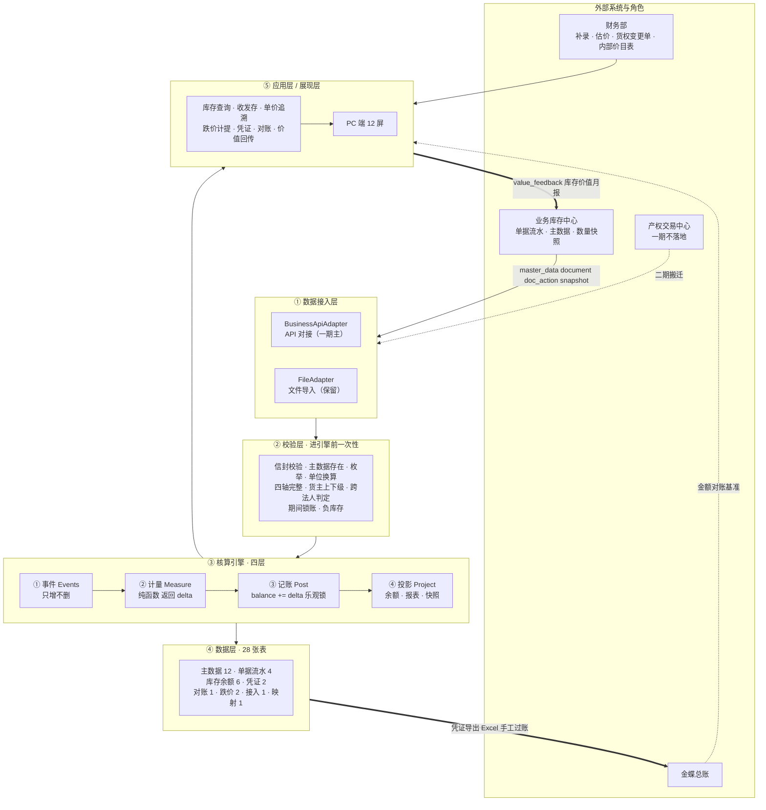
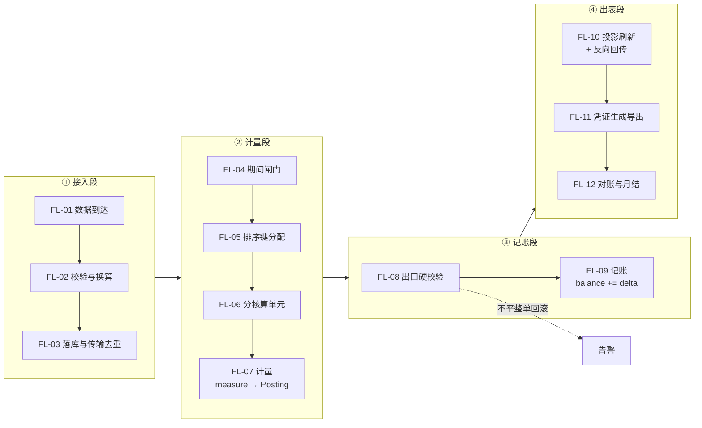
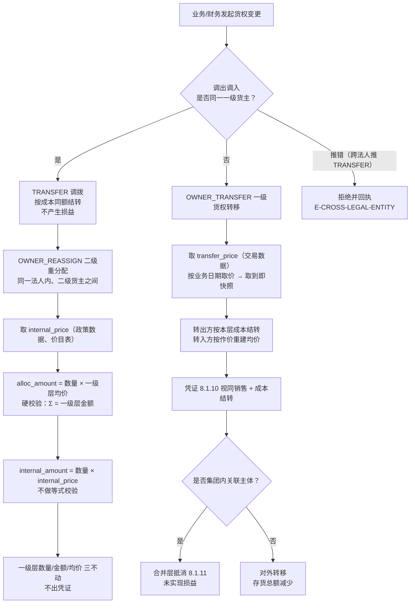

# 财务库存中心（一期）-方案文档 1.0

更改记录

|日期|姓名|版本|更改内容|
|---|---|---|---|
|2026-09-21|项目组|1.0|文档新建|

# 一、方案概览与架构

## 1.1 解决方案概览

财务库存中心解决的是**存货价值怎么算、算完怎么记、记完怎么对得上**这件事。业务库存中心管的是"货在哪儿、有多少"，金蝶管的是总账；两者中间"这批货值多少钱、这批货算谁的"这一段，本期由本系统补上，并且把这个能力做成可追溯、可重算、可对账的独立模块。

系统由十一块构成，覆盖从主数据接入到价值回传的完整链路，概况说明如下：

### 1.1.1 主数据管理

【业务概述】

- 统一管理存货核算所需的四类基础数据：物料（含上市日期、是否批次管理）、仓库（含仓库类型、所属法人）、货主（一级=法人、二级=内部管理维度）、单位换算。
- 配套管理核算规则：计价方法、跌价规则、费用分摊规则、二级内部结算价目表、系统参数。

【用户期望】

- （执行层）**痛点**：单位换算率靠人工按 1:1 或凭经验折算，没维护也不报错，数量口径悄悄就错了；**期望**：核算一律以基本单位数量为准，换算率未维护直接拒绝入账，不做兜底。

- （执行层）**痛点**：物料上市日期没人维护，3C 上市周期法的档位等于空转；**期望**：上市日期作为必填主数据，缺失时能明确提示是哪几个物料。

【解决方案及效果】

- 主数据按"谁权威谁维护"划分：物料、仓库、货主、单位换算由业务库存中心维护并推送，本系统只读；跌价规则、费用分摊规则、内部结算价目表由财务维护。
- 单位换算做成独立配置表，核算入口统一取基本单位数量；换算率缺失时按错误码拒收该行，并在错误回执里指明是哪一行、哪个单位。
- 上市日期作为物料主数据的必填项，缺失的物料在跌价计提前会被规则校验拦住，而不是静默跳过。

### 1.1.2 数据接入

【业务概述】

- 以 API 对接为主、Excel/CSV 文件导入保留的方式，接收业务库存中心的主数据、11 类单据流水、动作报文与库存数量快照。
- 所有报文走同一个信封、同一套校验、同一套幂等、同一套错误回执。

【用户期望】

- （执行层）**痛点**：同一批数据推两次就重复入账，网络重试、消息重投、手工重跑都会造成重复；**期望**：重复请求返回零变化而不是报错，报错会让上游以为失败而无限重试。

- （管理层）**痛点**：报文被拒收时只说"校验失败"，不知道是哪一行哪个字段错了，来回问；**期望**：拒收时能精确指出行号、字段名、原值，并给出修改建议。

【解决方案及效果】

- 接口按三层切开：字段层（本期已冻结）、传输协议层（待定，定型后只补映射不改字段）、部署运维层（待定）。
- **"协议未定"不构成阻塞**——字段先冻结，REST、消息队列、文件都只是把同一套字段换个壳子装。文件导入不是另一条技术路线，而是同一套字段的另一种装载方式，共用一套校验、一套幂等、一套回执。
- 校验全部前移到接入层，13 个错误码在这里产生；不通过则整单拒收，写错误日志（含原始报文）并导出 Excel，不做"跳过错误行继续"。

### 1.1.3 单据处理

【业务概述】

- 接收并管理 11 类单据：采购入库、采购退货、销售出库、销售退货、调拨、盘点、其他入库、其他出库、一级货权转移、二级货主重分配、期间补录。
- 管理单据的三个状态位（业务状态、红冲标记、核算状态），并区分改单、作废、跨期补录、反结账四条处理路径。

【用户期望】

- （执行层）**痛点**：业务改了单、作了废，财务侧毫不知情，账实不符越滚越大；**期望**：改单与作废必须通知，已核算的一律不可撤。

- （执行层）**痛点**：调拨单和跨法人的货权转移单混着推，推错了要人工退回、口头说明、再让对方重推；**期望**：系统按"调出调入是否同一货主"判定并给出明确回执。

【解决方案及效果】

- 单据分三组：伴随物理移动的、只动权属的、账面进出实物不动的。后两组必须有独立单据类型，否则代采"先转货权再发货"这条链路无法表达。
- 调拨实现为**一张单 + 两行**，两行单据类型都是调拨，靠仓库与出入方向区分，共用同一单号——拆成两张单会让幂等键失效。
- 跨法人的调拨**拒绝并回执**，要求改推一级货权转移；**不做自动升级**（自动升级等于财务替业务定价）。
- 改单 = 追加两组事件（反向 + 新的正向），版本号 +1，**不是删了重来**。

### 1.1.4 存货核算

【业务概述】

- 按移动加权平均法，逐笔计算每张单据对库存数量与金额的影响，并沉淀可追溯的计算过程。
- 核算粒度：余额按四轴 `(物料, 仓库, 批次, 一级货主)`；均价池按三轴 `(物料, 仓库, 一级货主)`。

【用户期望】

- （管理层）**痛点**：成本口径依赖金蝶的存货核算，规则不透明、不可追溯到单据，任一对外数字都追溯不回去；**期望**：任一时点的任一笔出库成本都能反推到"用了哪个价、这个价从哪来"。

- （执行层）**痛点**：运费、关税这类采购附加费用靠手工分摊，分摊方式每次不一样，入库成本随之波动；**期望**：分摊规则一次配置持续生效。

【解决方案及效果】

- **入库成本 = 不含税金额 + 本行分摊的采购附加费用**；税额**不进成本**，只进进项税额科目——含税金额进成本会同时虚增存货、少计进项税，两个错一起犯。
- **只有采购入库会改变移动平均单价**，其余场景都在消费这个价。入库只舍入单价、不回改金额；**舍入差异只在出库产生**，月末一张独立凭证结转。
- 核算引擎做成**纯函数**：输入事件与期间快照，输出变化量（delta），**不返回新余额**。这样才能无状态、可重放、可并发、可单测。
- 事件流是真相源、只增不删；余额与报表都是它的投影，可随时重放重建。

### 1.1.5 货权变更（重点）

【业务概述】

- 处理两类不伴随物理移动的货权变化：一级货权转移（法人之间）与二级货主重分配（部门、事业部、代采项目之间）。
- 一级必作价、必出凭证、必产生会计损益；二级按内部结算价作价、差额进管理口径、不出凭证。

【用户期望】

- （决策层）**痛点**：法人之间的货权转移既不开票、也不走销售流程，财务凭经验判断记不记账、记多少，合并报表时内部利润虚增查不出来；**期望**：一级货权转移必作价、必出凭证、必产生损益，集团内的自动抵消。

- （管理层）**痛点**：二级部门之间调货到底值多少钱，会计口径与管理口径混着说，考核数据取不出来；**期望**：同一批货能同时给出会计口径与管理口径两个金额，且互不污染。

【解决方案及效果】

- 一级货权转移的价格来自**交易数据**（财务只取价、只校验，不做定价）；二级重分配的价格来自**政策数据**（财务维护的带生效期价目表）。两者去向不同，绝不互相推导。
- 二级层"**一个数量、两个金额**"：会计分摊额按一级层均价算出、**能加总回一级层**（硬校验，不平整单回滚）；内部结算额按内部结算价累计、**不能加总**（差额即内部未实现毛利，**不做等式校验**）。
- 取价三条铁律：按业务日期取价 → 取到即快照 → 调价不追溯。
- 五条派生规则：R1 一级必作价必出凭证必损益 · R2 二级按内部结算价、差额进管理口径、不出凭证 · R3 均价池只在一级层 · R4 存货总额 = Σ 一级层内部主体金额、二级层绝不相加 · R5 二级结算价不影响会计。
- 一期由本系统出具"货权变更单"临时承载，按可剥离形态设计；二期整体搬迁至产权交易中心时**换生产方、不改数值**。

### 1.1.6 库存查询与报表

【业务概述】

- 提供库存余额、收发存明细、单价追溯、库龄查询等只读视图，全部来源于事件与分录的投影，可重建。

【用户期望】

- （管理层）**痛点**：同一个仓库、同一个批次下两个货主的库存按仓库看会互相抵消，真实差异被隐藏；**期望**：四轴记录，货主维度不可省略。

- （执行层）**痛点**：查询页上的数字不知道是哪个口径、截止哪个时点，拿去汇报经常被问住；**期望**：每个数字都能标出口径与时点。

【解决方案及效果】

- 余额查询支持四轴任意组合下钻，**虚拟仓与在途仓的余额可单独列示**。
- 两个数量口径分开命名：在库数量（物理在库）与权属数量（归属某一法人）；两个金额口径并列展示并强制带口径标注。
- 单价追溯从任一笔出库金额反推取价来源与构成过程，直接兑现"成本可追溯"。

### 1.1.7 跌价计提

【业务概述】

- 按库龄法 + 3C 上市周期法**双轨取孰高**，对内部主体的库存计提跌价准备。

【用户期望】

- （管理层）**痛点**：3C 商品的贬值由新品发布驱动而不是由时间驱动，只按库龄计提严重低估跌价；**期望**：新品发布后能及时反映减值。

【解决方案及效果】

- 库龄法按入库时间分层排队、逐层取比例汇总；上市周期法按物料上市日期计算上市天数、作用在当前在库金额上；**逐项取孰高再汇总**（不是先汇总再取高）。
- 本期计提 = 本期应有 − 上期已计提；凭证**只记变动额**，不是记应有额。
- 计提范围仅限内部主体；外部货主的货不进存货、不计提。

### 1.1.8 凭证生成

【业务概述】

- 按 11 个凭证模板生成会计凭证，按法人分账，导出金蝶格式 Excel 由财务手工过账。

【用户期望】

- （执行层）**痛点**：凭证借贷两边口径不一致，生成出来不平，要人工逐张找；**期望**：不平直接拒绝落库并告警。

- （执行层）**痛点**：跨期补录的单据凭证日期取了系统当前日期，落到错误期间；**期望**：凭证日期一律取记账期间首日。

【解决方案及效果】

- 三条总则：借贷必平（不平拒绝落库）、按法人分账（合并层凭证单独标记来源）、**凭证日期 = 记账期间首日**。
- 二级重分配不产生凭证，但有一张分摊账承载两个金额；**凭证上绝不出现二级货主**。
- 科目映射按多维取最具体一条；价差三分类（价格差/数量差/汇率差）**不可合并**，分别落不同科目。

### 1.1.9 对账

【业务概述】

- 数量对账按日与业务库存中心的日切快照比对；金额对账按月与金蝶总账存货类科目余额比对。

【用户期望】

- （管理层）**痛点**：数量差异与金额差异混在一起报，查半天查不出是哪一类；**期望**：两类分开报，因为两者的对手根本不同。

- （管理层）**痛点**：金额对不上时不知道该找谁；**期望**：明确金额对不上是正常的，但要能解释差额构成。

【解决方案及效果】

- **数量求一致，金额求可解释**——数量是对手是业务快照（差一个都要查清楚），金额的对手是金蝶总账（允许不一致，但必须能解释计价方法、费用分摊、舍入规则的差异构成）。
- 差异定位先分类再下钻；数量差异按物理层下钻到具体单据，金额差异先确认数量一致再核口径。
- **对账程序用与引擎不同的实现**——同一份代码自己校验自己等于没校验。

### 1.1.10 期间与月结

【业务概述】

- 引入会计期间与锁账标志，日结只校验、月结即锁账；月结六关串行通过后归档快照并锁账。

【用户期望】

- （管理层）**痛点**：月末结账前跑大量人工核对，结完账发现错了只能手工改表，改完又不知道影响了哪些数；**期望**：月结六关串行、结完即锁账，结错了走反结账、漏一笔走补录，两条路各自留痕。

【解决方案及效果】

- 月结六关：日常对账 → 守恒校验 → 跌价计提 → 舍入差异结转 → 凭证生成导出 → 月结对账与报表定稿。
- 锁账后三条路语义不同、不可互换：未锁账改单、已锁账"结错了"走反结账、已锁账"漏一笔"走当期补录单。
- 反结账**禁止"回滚/删行重推"**——那会让三种幂等、重放与审计同时失效；正确做法是追加反向事件与修正事件，重放受影响区间，旧快照版本保留。
- 跨期补录**一律按当期口径量价**，原业务日期只用于追溯，不改历史报表。

### 1.1.11 价值回传

【业务概述】

- 月结后向业务库存中心回传库存价值月报：成本单价、库存金额、库龄分布、跌价准备。

【用户期望】

- （决策层）**痛点**：业务侧的"库存金额"与财务算出的数不一致，两个数字打架，每次都要人工解释；**期望**：明确金额权威方是财务，业务展示金额必须标注口径来源。

【解决方案及效果】

- **两个金额口径并列回传、强制带口径标注**：库存金额（存货口径，对外唯一权威值）与内部结算金额（管理口径、非会计，必须与前者成对出现，单独使用即口径错误）。
- 业务侧展示"库存金额"时只能引用存货口径那一行。

## 1.2 解决方案总体架构

### 1.2.1 整体架构图



整体架构说明：

1. **支持决策层**：决策层关心的是存货总额是否真实、集团内交易有没有虚增利润、跌价准备提得够不够、成本口径能不能对外解释。通过库存价值月报中的成本单价、库存金额、库龄分布与跌价准备，以及带口径标注的对外数字，支持其判断。主要涉及报表有：库存余额表、收发存明细表、跌价计提表、库存价值月报。

2. **支撑执行层与财务日常作业**：主要是给财务部与业务库存中心人员使用，完成从单据接入到月结的全部操作。最重要的是**存货核算与货权变更**——涉及四轴库存维度与一级均价池的分层、两级作价（一级交易数据 / 二级政策数据）、一个数量两个金额的二级分摊、双轨跌价取孰高、11 类单据的全流程处理、月结六关与锁账、凭证生成与导出、两条口径对账。

3. **第三方系统集成**：作为本系统的组成部分，通过接入第三方系统使整条链路形成闭环。主要集成有：

    1. 业务库存中心：通过 API 接收主数据、11 类单据流水、动作报文与库存数量快照，是**唯一的外部依赖方**；若业务侧不建货主维度，数量对账只能停在物理层，该限制必须写进对账报告脚注，不能默默降级。
    2. 金蝶总账：本系统是唯一成本源，金蝶侧关闭存货核算；存货与成本凭证由本系统生成清单并导出 Excel，由财务手工过账；金额对账以金蝶总账存货类科目余额为基准。
    3. 产权交易中心：一期不落地，由本系统出具"货权变更单"临时承载，二期整体搬迁时换生产方、不改数值。
    4. 审批/OA 系统：一期不集成，保留待审/已审核状态位与单点审核动作，预留审批网关接口（`ApprovalGateway`），二期换实现不动调用方。

### 1.2.2 整体流程图



主要流程说明：

1. 数据**从左边进、从下边出**。前七段决定这张单值多少钱，是纯计算；第八段是唯一的出口硬闸门；后四段决定这笔钱怎么进账、怎么被查出来。

2. 每张单据的一生要经过七个状态位：落库（生效/待核算）→ 过期间闸门 → 审核 → 过管线 → 打标已核算 → 后续走向改单 / 作废 / 反结账 / 跨期补录四条路径之一。

3. **排序键是（业务日期 + 当日序号），同日入库优先**。单号不能当排序键——单号不单调、有补单、有外部单号、有前缀差异。二期若业务给出可信时刻可切换到按业务时刻排序，但必须伴随历史重算，不能一期一种、二期另一种混用。

4. **加锁的最小单位是核算单元**（= 均价池）。跨核算单元的单据（如调拨同时动两个仓）必须按维度键排序后依次加锁以防死锁；整张单在同一事务内，不能出现半张单。

5. **第八段的五项硬校验**：二级会计分摊额加总 = 一级层金额；数量守恒；金额守恒；同一核算单元内批次行均价一致；单据完整性与重复键。任一项不通过则整单回滚、告警列出不平的核算单元——**错误数据根本不落库**。校验前移的意义在于月末对账是第二道网，不是第一道。

6. **三种幂等是三层，不是一件事**：传输幂等（按行，拦在落库前）、事件幂等（按单据，拦在记账前）、结果幂等（引擎本身是纯函数）。只做第一层，业务从两批推出同一张单就会重复入账；只做前两层而引擎不纯，重放结果与当前余额不一致。

7. **处理异常的两条出口**：数量/金额守恒不平 → 整单回滚；版本冲突（乐观锁影响 0 行）→ 重查、重算、重写。

# 二、详细方案

## 2.1 主数据管理

### 2.1.1 业务概况

主数据是核算的地基。本系统需要四类主数据与五类规则配置：

**四类主数据**

1. 物料：物料编码、名称、规格、计量单位、是否批次管理、**上市日期**（3C 上市周期法的唯一输入）；
2. 仓库：仓库编码、名称、**仓库类型**（自营 / 平台 / 海外 / 在途 / 虚拟）、所属法人、是否参与存货核算；
3. 货主：一级货主（= 法人主体，与金蝶账套一一对应）、二级货主（= 内部管理维度）。维护是否为内部主体、是否关联方、生效区间；
4. 单位换算：物料 + 业务单位 + 基本单位 → 换算率。

**五类规则配置**

1. 计价方法配置：按**核算单元** `(物料, 仓库, 一级货主)` 配置，一期只有移动加权平均；
2. 跌价规则：库龄档与上市周期档的分段天数与计提比例；
3. 费用分摊规则：单据类型 + 费用类型（运费/关税/其他）+ 分摊基准（金额/数量/重量）；
4. 二级内部结算价目表：按物料、转出方、转入方维护，支持固定价与加成价，带生效起止日期与审批状态；
5. 系统参数：一期只用一项——负库存容差，默认 0。

数据来源有三个途径：

1. **系统同步**：业务库存中心初始化及增量推送物料、仓库、货主、供应商、客户、批次、单位换算；
2. **财务维护**：跌价规则、费用分摊规则、二级内部结算价目表、系统参数由财务在系统内配置；
3. **双方共同确认**：一级货主编码规则与层级口径属共同定义项，任一方变更需对方书面确认。

> 关键前提：**一级货主 = 法人主体 = 金蝶账套**，是同一个概念、一个字段、两种叫法。货主层级建议实现为自关联树，不硬编码两级。

### 2.1.2 用户期望

- （执行层）**痛点**：单位换算率靠人工按 1:1 或凭经验折算，没维护也不报错，数量口径悄悄就错了；**期望**：核算一律以基本单位数量为准，换算率未维护直接拒绝入账。

- （执行层）**痛点**：物料上市日期没人维护，3C 上市周期法档位等于空转；**期望**：上市日期必填，缺失时能明确指出是哪几个物料。

- （管理层）**痛点**：主数据编码停用后被重新启用给新货，历史成本串味无法追溯；**期望**：编码一旦发布永不复用，只停用不删除。

### 2.1.3 详细方案说明

- **单位换算**做成独立配置表，核算入口统一取基本单位数量。换算率未维护时报错误码拒收该行，**不做 1:1 兜底**——兜底会让数量口径悄悄错掉且事后无从发现。

- **上市日期**作为物料主数据的必填项，缺失的物料在跌价计提前被规则校验拦住。这是双轨跌价中 LAUNCH 档能生效的前提。

- **编码管理**：一级货主编码属强一致数据，一旦发布永不复用。停用的编码只标记为停用，不删除、不重启用。

- **权属由货主决定，不由仓库决定**。仓库类型只描述物理形态（自营/平台/海外/在途/虚拟），权属由一级货主的"是否内部主体"这一布尔值判断。这纠正了一个常见假设——"平台仓的货一定算我们的"是错的。

- **计价方法按核算单元配置**，不是按物料或按仓库。同一个物料在不同仓库、或同一仓库下不同货主，可以有不同的计价配置。

- 主数据推送五条硬要求：① 编码一旦发布永不复用；② 上市日期必须可维护；③ 序列号必须出现在出库单据行上（否则二期个别计价无法落地）；④ 一级货主编码属 A 级主数据；⑤ 单位换算率由谁权威维护必须谈死。

### 2.1.4 上线效果

- 换算率缺失即拒收，消除了历史上"约等于"折算导致的数量口径偏差；
- 上市日期成为必填项后，3C 商品在新品发布后的减值能被及时反映，不再依赖人工判断；
- 货主维度建立后，同一仓库同一批次下多货主的库存不再净额相抵，差异可见、可追溯。

## 2.2 数据接入

### 2.2.1 业务概况

数据接入解决"单据怎么进来、进来之后怎么保证不重不错"。一期以 API 对接为主，Excel/CSV 文件导入保留作为过渡与补录入口。

报文的信封字段：批号、来源系统、字段版本、对象类型、推送时刻、记录数、记录数组。对象类型有四类（主数据、单据、动作报文、数量快照）加一类反向回传（价值回传）。

**特别约定：不加法人到信封**——法人是行级属性，同一批里可以混法人，放信封会把"一批一法人"这个错误约束写死。

### 2.2.2 用户期望

- （执行层）**痛点**：同一批数据推两次就重复入账；**期望**：重复请求返回零变化而不是报错。

- （执行层）**痛点**：报文被拒收时只说"校验失败"，不知道是哪一行哪个字段；**期望**：精确指出行号、字段、原值，并给出修改建议。

- （管理层）**痛点**：接口协议迟迟定不下来，开发排期被卡住；**期望**：字段先定死，协议后面套。

### 2.2.3 详细方案说明

- **接口按三层切开**，各层的定法与现状：

    | 层 | 内容 | 谁定 | 现状 |
    |---|---|---|---|
    | 业务事实层 | 11 类单据 · 主数据 · 数量快照 | 业务库存中心 | 已列义务 |
    | 通用字段层 | 字段名 · 类型 · 精度 · 必填 · 枚举 · 幂等键 · 错误回执 | 双方共同 | 已定，**已冻结** |
    | 传输协议层 | 协议 · 鉴权 · 调度 · 重试 | 双方 + IT | **待定** |
    | 价值回传层 | 库存金额 · 库龄 · 跌价 · 两个金额口径 | 财务库存中心 | 已定 |

- **"接口未定"不是阻塞项**。架构把边界划在**接口**上而不是划在功能上：字段先冻结，协议定型后只补映射、不改字段。新增绑定方式只加实现类，**调用方一行不改**。

- **文件导入不是另一条技术路线**，而是同一套字段的另一种绑定。API 与文件两条入口**共用一套校验、一套幂等、一套错误回执**。

- **校验全部前移**，13 个错误码在这里产生：报文（2 个）、主数据（3 个）、枚举与换算（2 个）、数量与金额（3 个）、业务合法性（2 个）、期间（1 个）。不通过则**整单拒收**，写错误日志并导出 Excel，**不做"跳过错误行继续"**。

- **三种幂等**，各拦在一条链路上：

    | 层 | 幂等键 | 防什么 | 拦在哪 |
    |---|---|---|---|
    | 传输幂等 | 批号 + 单号 + 行号 | 同一条报文重推（网络重试） | 落库前 |
    | 事件幂等 | 单据类型 + 单号 + 版本号 | 同一版本的同一单据被算两次 | 记账前 |
    | 结果幂等 | 无键（纯函数） | 只要输入相同，输出必相同 | 计量本身 |

    > 幂等不是"拒绝了重复请求"，而是"重复请求返回与第一次相同的结果"（这里是零变化）。

- **调拨的落库展开必须实现**：业务侧推 1 张单 2 个仓，适配层展开为 2 行，两行单据类型都是调拨、共用同一个单号。不拆成两张单，否则幂等键失效、重推即重复入账。

- 数量快照：`(物料, 仓库, 批次)` 维度数量，日切与月末，**不给金额**，专供数量对账比对。三个时点必须同口径：业务快照的时点、财务单据的推送时间、财务余额的时点。

### 2.2.4 上线效果

- 协议层待定而字段层已冻结，接口评审与开发可并行推进，不被协议选型卡住；
- 校验前移后，错误数据根本不落库，月末不再需要"先入账再回头找错行"；
- 三层幂等落地后，重推、重投、重跑都不会造成重复入账，也不会因报错触发上游无限重试。

## 2.3 单据处理

### 2.3.1 业务概况

单据处理管理 11 类单据从接入到核算完成的完整生命周期，并区分改单、作废、跨期补录、反结账四条处理路径。

**11 类单据**：采购入库（`PO_IN`）、采购退货（`PO_RET`）、销售出库（`SO_OUT`）、销售退货（`SO_RET`）、调拨（`TRANSFER`）、盘点（`STOCKTAKE`）、其他入库（`OTHER_IN`）、其他出库（`OTHER_OUT`）、一级货权转移（`OWNER_TRANSFER`）、二级货主重分配（`OWNER_REASSIGN`）、期间补录（`PERIOD_ADJUST`）。

**单据分三组**：

| 组 | 特点 | 包含 |
|---|---|---|
| A 组 | 伴随物理移动 | 采购入库/退货、销售出库/退货、调拨、盘点、其他出入库 |
| B 组 | 不动实物、只动权属 | 一级货权转移、二级货主重分配 |
| C 组 | 账面进出、实物不动 | 直发、库内转手、空转（不是新单据类型，是 A 组两个场景的组合） |

> **后两组才是货主分层模型存在的理由**——它们无法塞进采购/销售单据的形态里。

**三个状态位**：业务状态（草稿/已提交/已审核/生效/作废，业务侧维护）、红冲标记（财务侧维护，业务不推）、核算状态（待核算/已核算/已冲销，财务侧维护）。报表口径统一为"业务状态=生效 且 红冲标记=0"。

### 2.3.2 用户期望

- （执行层）**痛点**：业务改了单、作了废，财务侧毫不知情；**期望**：改单与作废必须通知，已核算的一律不可撤。

- （执行层）**痛点**：调拨单和跨法人的货权转移单混着推，推错了要人工退回再让对方重推；**期望**：系统判定并给出明确回执。

- （执行层）**痛点**：其他出入库的场景五花八门，塞进自由文本的"原因"里，事后想统计一笔费用都统计不出来；**期望**：按金额来源和"会不会回来"分类。

### 2.3.3 详细方案说明

- **调拨与一级货权转移的判定只一条**：调出仓与调入仓是否属同一一级货主——是则走调拨（按成本同额结转、**不产生任何损益**）；不是则必须走一级货权转移（按作价结转、产生会计损益、集团内需抵消）。业务推错的，适配层**拒绝并回执**，**不做自动升级**。

- **调拨的实现方式**：一张单 + 两行，两行单据类型都是调拨，靠仓库编码与出入方向（0 调出 / 1 调入）区分，共用同一单号。判据是"单据类型数的是一张单从哪来、干什么，不是数它动了几行"。

- **其他入库五类**（按金额来源分轴）：原物归还、受赠入库、受托代销/寄售、借入他方货物、无对价杂项。**只有"无对价杂项"用财务估价**。

- **其他出库六类**（按"会不会回来"分轴）：内部领用、报废毁损、赠出送样、借出、委托代销发出、货权已转实物才出库。**只有内部领用、报废毁损、赠出送样是真费用**；借出是暂挂、委托代销发出是"库存商品→发出商品"、货权已转实物才出库金额为 0。

- 三个分类分界点：是否可收回（区分借出与送样）、科目去向（区分委托代销与费用）、金额是否显式为 0（区分"货权已转实物才出库"与其余五类）。

- **改单**：原单未核算时直接替换；已核算时**追加两组事件**（反向事件 + 新的正向事件，版本号 +1），**不是删了重来**。改单不产生新单号，但产生新版本的幂等键。

- **作废**：闸门是**核算状态**，不是"有没有下游引用"。已核算的一律不可撤，只能走反向单 + 红字凭证。作废后红冲标记置 1、记录原单号，报表口径自动排除。

- **暂估与发票到达是两个独立事件**，业务侧必须分别推送并携带原暂估单号。差额按"**不追溯、只调当期**"处理，落地为反向事件 + 据实事件各出一张凭证。

- **撤销规则**：已核算的一律不可撤销。

### 2.3.4 上线效果

- 跨法人推调拨的错误在接入层即被拦住并给出明确改推指引，不再依赖人工沟通；
- 其他出入库分类后，内部领用、报废、赠样这三类真费用可以按类别直接统计，不再需要从自由文本里捞；
- 改单做成"追加事件"而非"删了重来"，历史成本全程可追溯，审计时能还原每一版。

## 2.4 存货核算

### 2.4.1 业务概况

存货核算是本系统的计算内核：按移动加权平均法，逐笔计算每张单据对库存数量与金额的影响，并把计算过程沉淀下来。

核算维度上有一个关键分层：

| 概念 | 维度 | 说明 |
|---|---|---|
| 余额表 | `(物料, 仓库, 批次, 一级货主)` | 四轴 |
| 核算单元（均价池） | `(物料, 仓库, 一级货主)` | 三轴，**批次不进均价池** |

> **为什么批次不进均价池**：若按批次各建一个均价池，同一核算单元内会出现多个互不独立的均价，出库时该取哪个池无法判定。批次只影响库龄与跌价基数，不影响均价。

**核心口径**：

1. **入库成本 = 不含税金额 + 本行分摊的采购附加费用**。税额**不进成本**——税额只进"应交税费—应交增值税（进项税额）"。含税金额进成本会同时虚增存货、少计进项税，两个错一起犯；
2. **只有采购入库会改变移动平均单价**，其余场景都在消费这个价。两个例外改的是另一个核算单元的均价：调拨的入库腿、一级货权转移的转入侧；
3. **入库只舍入单价、不回改金额**；**舍入差异只在出库产生**，月末一张独立凭证结转；
4. 出清时（数量归零但金额不为零）剩余金额全额结转。

**精度约定**：数量 4 位、金额 2 位、单价 6 位、加成率 7 位；数量一律以基本单位计。

### 2.4.2 用户期望

- （管理层）**痛点**：成本口径不透明、不可追溯到单据，任一对外数字追溯不回去；**期望**：任一时点的任一笔出库成本都能反推取价来源。

- （执行层）**痛点**：运费、关税靠手工分摊，分摊方式每次不一样；**期望**：分摊规则一次配置持续生效。

- （管理层）**痛点**：月末才发现账错了，不知道错在哪一笔、错了多久；**期望**：错误在引擎出口就被拦住，不落库。

### 2.4.3 详细方案说明

- **引擎做成纯函数**：`measure(事件, 期间快照) → 记账结果`，返回值里全是**变化量（delta）**，**不返回新余额**。这是全部要害——若返回新余额，`measure` 就必须读余额、就不再是纯函数、就无法重放、无法单测、并发下必错。

- **四层结构**：

    | 层 | 职责 | 依据 |
    |---|---|---|
    | ① 事件层 | 落事件流，只增不删 | 事件是真相源 |
    | ② 计量层 | 回答"这笔值多少钱"，返回 delta | **唯一会因二期换计价方法而重写的层** |
    | ③ 记账层 | `余额 += delta` + 生成凭证分录 | 账的唯一写入者 |
    | ④ 投影层 | 余额、报表、对账都是投影，可重建 | 只读，绝不写账 |

- **三条不变量**：

    1. 返回 delta 不返回余额；
    2. 事件是真相源、余额是投影（删除任何一条事件都会让重放结果与当前余额不一致）；
    3. 锁单位 = 核算单元，跨单元按维度键顺序加锁防死锁。

- **公式**：

    ```
    F1 入库（唯一改变均价的动作）
       new_qty    = old_qty + base_qty
       new_amount = old_amount + (不含税金额 + 本行分摊费用)
       new_price  = round(new_amount / new_qty, 6)

    F2 出库（不改变均价）
       amount_delta = round(base_qty × 当前均价, 2)
       new_qty      = old_qty − base_qty
       new_amount   = old_amount − amount_delta
       new_price    = 旧均价（不重算）

    F3 舍入差异
       rounding_diff += amount_delta − base_qty × 均价  → 累加进 rounding_diff_acc
    ```

- **持久化必须用乐观锁**：按维度键 + 版本号更新，影响 0 行说明该核算单元被并发改过，则重查、重算、重写。**不要"读出来算好再写回去"**。

- **顺序与确定性**：过账顺序 = (业务日期 + 当日序号)，同日**入库优先**，同类型按单号。单号不能当排序键。

- **出口硬校验五项**：二级会计分摊额加总 = 一级层金额；数量守恒；金额守恒；同一核算单元内批次行均价一致；单据完整性与重复键。任一项不通过则整单回滚、告警列出不平的核算单元。

- **销售退货入库按原出库成本回冲、采购退货出库按当前均价结转**。这两个方向相反，是"撤销历史"与"当下成交"的区别，混用会凭空造出假损益。

### 2.4.4 上线效果

- 任一时点的任一出库金额可反推到"用了哪个价、价从哪来、由哪几笔入库构成"，对外答疑从"要查半天"变成"点开就有"；
- 出口硬校验把错误拦在落库前，月末对账从"第一道防线"降为"第二道网"；
- 引擎是纯函数且事件可重放，口径变更时可以重算验证而不动线上数据。

## 2.5 货权变更（重点）

### 2.5.1 业务概况

货权变更是本系统的**重点模块**，也是这套系统区别于普通进销存的存在理由。它处理的是**不伴随物理移动的货权变化**——货还在原地，但"算谁的"变了。

**两级的差别**：

| | 一级货权转移 | 二级货主重分配 |
|---|---|---|
| 主体 | 法人 → 法人 | 二级货主 → 二级货主（同一法人内） |
| 价格来源 | **交易数据**（财务只取价、只校验，不定价） | **政策数据**（带生效期的价目表） |
| 是否出凭证 | **是** | **否**（R2） |
| 是否产生会计损益 | **是** | 否，差额进**管理口径**内部损益 |
| 集团内是否抵消 | **是**（合并层） | 不涉及 |

**五条派生规则**：

| 规则 | 内容 |
|---|---|
| R1 | 一级货权转移必作价、必出凭证、必产生会计损益 |
| R2 | 二级重分配按内部结算价作价，差额进二级内部损益（管理口径），不出会计凭证 |
| R3 | 存货均价池只在一级层建立 |
| R4 | 存货总额 = Σ 一级层中内部主体的金额，**二级层绝不相加** |
| R5 | 二级内部结算价不影响会计——不影响一级层成本、存货总额、凭证、跌价计提 |

**五种价格类型**：

| 价别 | 含义 | 来源性质 | 是否进存货成本 |
|---|---|---|---|
| 业务价 | 对外的采购价/销售价 | 业务数据 | 采购价的不含税部分进 |
| 存货成本价 | 某一级层的存货成本单价 | 计算产物 | **是**（唯一真层） |
| 一级转移作价 | 一级货主之间的结算价 | **交易数据** | 转出方按本层成本结转；转入方按作价建层 |
| 二级内部结算价 | 二级之间的作价 | **政策数据** | **否**，只进二级内部损益 |
| 资金占用/服务费 | 垫资、代采、监管产生的费用加成 | 费率配置 × 占用天数 | 否，按服务收入处理 |

### 2.5.2 用户期望

- （决策层）**痛点**：法人之间的货权转移既不开票、也不走销售流程，财务凭经验判断记不记账、记多少，合并报表时内部利润虚增查不出来；**期望**：一级货权转移必作价、必出凭证、必产生损益，集团内的自动在合并层抵消。

- （管理层）**痛点**：二级部门之间调货到底值多少钱，会计口径与管理口径混着说，考核数据取不出来；**期望**：同一批货能同时给出两个口径的金额，互不污染。

- （管理层）**痛点**：内部结算价改一次，历史的内部损益全跟着变，考核数据前后不一致；**期望**：取到即快照、调价不追溯。

- （执行层）**痛点**：两个金额算出来不相等时不知道哪个对，经常把管理口径的差额当成错误告警；**期望**：明确哪个金额要校验、哪个不要，不要天天误报。

### 2.5.3 详细方案说明

#### 2.5.3.1 货权变更整体流程图



#### 2.5.3.2 货权变更流程详解

**1. 一级货权转移的四个子形态**

| 形态 | 物理是否移动 | 货权归属 | 典型场景 |
|---|---|---|---|
| ① 集团内跨法人、货同仓 | 不动 | 内部 → 内部 | 集团内主体之间的账面划转 |
| ② 集团内跨法人、货也移动 | 移动 | 内部 → 内部 | 集团内主体之间实际调货 |
| ③ 对外转移、货留我方仓 | 不动 | 内部 → 外部 | **代采已转货权、客户未提货** |
| ④ 对外转移、货随货权走 | 移动 | 内部 → 外部 | 正常对外销售式转移 |

四个形态在账务上的处理不同，其中形态③是代采业务的典型形态，也是"货在我仓但不算我的存货"这一口径的来源。

**【用户期望】**

决策层期望：集团内货权转移不开票但必须记账，合并报表时内部利润不能虚增；
管理层期望：外部货主的货不计入存货总额，但要能在同一张余额表里看到；
执行层期望：已核算的转移单不可撤销，要撤销时系统能给出明确的替代路径。

**【设计逻辑】**

1. **取价**：按业务日期从交易数据中取一级转移作价，取到即写入单据行快照，重算不回查。价格来源标记为"交易"。

2. **判权属**：按转入方一级货主的"是否内部主体"判断。内部 → 计入存货总额、需合并抵消；外部 → 不计入存货总额、不抵消。

3. **结转与建层**：
    - 转出方按**本层核算单元均价**结转成本（不是按作价结转——按作价结转会拉高转出方均价，这是最容易犯的错）；
    - 转入方按**作价**重建均价，新增一整条四轴记录；
    - 作价与成本是两个价，差额即已实现毛利。

4. **出凭证**：模板 8.1.10（视同销售 + 成本结转）。集团内的另加 8.1.11（合并层未实现损益抵消），该凭证的来源标记与法人层凭证分列。

5. **撤销**：已核算的一律不可撤，只能开反向货权变更单 + 红字凭证。

6. **集团内未实现毛利的完整生命周期**：转移时点计提抵消（减少被转移方的存货与转出方的收入/成本）→ 售出后回转。**现有方案只覆盖了计提，尚未写明回转的时点、分录形态，以及部分售出时未实现毛利在"已实现/未实现"之间如何拆分**，这一缺口已在架构核对中记录，需在执行前补全。

**2. 二级货主重分配**

**【用户期望】**

管理层期望：部门/代采项目维度的考核数据能取出来，且不污染会计；
执行层期望：两个金额不要都做校验，管理口径天然不相等，做成告警会天天误报。

**【设计逻辑】**

1. **按内部结算价作价**：从带生效期的价目表按业务日期取价，取到即快照；价目表支持固定价与加成价两种形式，作价在凭证与单据上表现为"一个价、三个数"（基准价、加成率、最终取值）。

2. **一个数量、两个金额**：

    | 金额 | 算法 | 能否加总回一级层 | 是否校验 |
    |---|---|---|---|
    | 会计分摊额 | 数量 × **一级层均价** | **能** | **硬校验**，不平整单回滚 |
    | 内部结算额 | 按内部结算价逐笔累计 | **不能** | **不做等式校验** |

    差额即**内部未实现毛利**，是正常现象。

3. **一级层的三件事全不变**（数量、金额、均价），**不出凭证**、不确认会计损益，落二级分摊账。

4. **内部结算损益（管理口径）**：

    ```
    转出方二级：
      内部收入 = 重分配数量 × internal_price
      内部成本 = 重分配数量 × 一级层均价
      内部损益 = 内部收入 − 内部成本     ← 正数为内部毛利，负数为内部亏损
    转入方二级：
      内部结算成本基础 = 重分配数量 × internal_price
    ```

5. **撤销**：反向分摊记录，不动一级余额，不需红字凭证。

#### 2.5.3.3 全链路示例（一条流水跑到底）

起点：甲方（内部法人）在华东仓持有某物料 200 台、金额 2,200.00、均价 11.000000。四笔业务：

| 笔 | 单据 | 内容 | 结果 | 凭证 |
|---|---|---|---|---|
| ① | 一级货权转移 | 甲方 → 乙方（集团内），40 台，作价 14.00 | 转出方按本层成本结转 440.00（均价不变）；转入方按作价建层 40 台/560.00/14.000000；**已实现毛利 120.00** | 8.1.10 + 8.1.11 |
| ② | 采购入库 | 乙方自行采购 60 台，不含税 960.00 | 乙方均价被重算：100 台 / 1,520.00 / **15.200000** | 8.1.1 |
| ③ | 二级重分配 | 乙方一部 → 乙方二部，100 台，内部结算价 17.00 | 会计分摊额 1,520.00（= 100 × 15.2）；内部结算额 1,700.00；**内部损益 180.00**；一级层三不动 | **无** |
| ④ | 销售出库 | 乙方二部对外卖出 100 台 | 出库成本 100 × 15.2 = **1,520.00**；乙方归零 | 8.1.2 |

集团存货总额的走向：2,200.00 →（①）2,200.00 →（②）**3,160.00** →（③）3,160.00 →（④）**1,760.00**。

**③ 那一行"什么都没变"**——这正是二级重分配的特征：不产生凭证、不动一级层、不影响存货总额，只在二级分摊账上记下两个金额。

**④ 之后回看合并层**：会计口径出库成本 1,520.00，集团口径真实成本 440.00 + 960.00 = **1,400.00**，差额 **120.00** 就是①那笔内部毛利——它在①发生时被抵消，在④售出后回转。这 120.00 的一生，就是"集团内未实现损益"从计提、持有到实现的完整过程。

#### 2.5.3.4 运营策略

- 一级货权转移的价格**必须由交易双方确定并推送**，财务只取价、只校验、不定价。系统**不提供"自动升级"**——把跨法人的调拨单自动改判为货权转移，等于财务替业务定价。
- 货权变更单在二期将由产权交易中心生产；一期的表单与字段按"可剥离"形态设计（自带价格与来源、状态机自洽、事件驱动、不直接改余额），二期迁移时**换生产方、不改数值**。
- 集团内货权转移需在 W1 接口评审会上与业务侧确认完成时点与月度频次，以便确定数量对账能否按期覆盖。

### 2.5.4 上线效果

|角色|期望|上线效果|
|---|---|---|
|决策层|一级货权转移必作价、必出凭证、必产生损益，集团内的自动抵消|集团内关联交易不再依赖人工判断，内部未实现毛利在合并层显式抵消，消除了存货与利润的双重虚增。|
|决策层|权属由货主决定而不是由仓库决定，同一套规则覆盖全部情形|代销、寄售、借入、已售未发四类情形归入同一套判定规则，存货总额的口径第一次说清楚；存货总额可精确表达为"Σ 一级层内部主体的金额"。|
|管理层|同一批货能同时给出会计口径与管理口径两个金额，互不污染|二级考核数据可从分摊账直接取出，且**不进入**存货科目、存货总额、凭证与跌价基数——管理口径与会计口径彻底分离，考核与管理不再互相污染。|
|管理层|取到即快照、调价不追溯|内部结算价目表可随时调整，历史内部损益不受影响，考核数据跨期可比。|
|执行层|明确哪个金额要校验、哪个不要|会计分摊额做硬校验（不平整单回滚、错误不落库），内部结算额明确不做等式校验，不再天天误报。|
|执行层|已核算的转移单不可撤销，撤销时能给出替代路径|已核算即不可撤，只能开反向单 + 红字凭证；作废闸门由核算状态判定，不再依赖人工判断"有没有下游引用"。|

## 2.6 库存查询与报表

### 2.6.1 业务概况

提供库存余额、收发存明细、单价追溯、库龄查询等只读视图。所有视图都来源于事件与分录的投影，可随时重建——投影层绝不写账。

**两个数量口径**：在库数量（物理在库，仓库口径，含代销与借入）与权属数量（归属某一法人，货主口径，不含外部法人）。

**两个金额口径**：库存金额（存货口径，对外唯一权威值）与内部结算金额（管理口径、非会计，必须与前者成对出现）。

### 2.6.2 用户期望

- （管理层）**痛点**：同一仓库同一批次下两个货主的库存按仓库看会互相抵消，真实差异被隐藏；**期望**：四轴记录，货主维度不可省略。

- （执行层）**痛点**：查询页上的数字不知道是哪个口径、截止哪个时点，拿去汇报经常被问住；**期望**：每个数字都能标出口径与时点。

- （管理层）**痛点**：跨期直发在期末会真实挂出一笔在途存货，普通报表里摘不出来；**期望**：虚拟仓与在途仓的余额能单独列示。

### 2.6.3 详细方案说明

- **库存余额查询**支持按四轴任意组合下钻（物料、仓库、批次、货主），支持按物料类别、仓库类型过滤；**虚拟仓与在途仓可单独列示**。

- **收发存明细**：期初 + 本期入 − 本期出 = 期末，数量与金额两列并列，按法人分账。数据源自期间快照，反结账后快照版本 +1、旧版本保留。

- **单价追溯**：从任一笔出库金额反推"用了哪个价、价从哪来、由哪几笔入库构成"。这是对"成本可追溯"目标的直接兑现。

- **库龄查询**按批次下钻，是跌价计提的输入。

- **口径标注**：每个对外数字都带口径标注。四种口径标注分别是存货口径、管理口径、数量口径（在库/权属）、时点（截止日）。这不是装饰——它是防止"双方各算一套成本"这条红线复发的主要手段。

- 余额表中的批次行与均价行分开：批次行承载金额明细，均价行承载该核算单元的单价。校验规则是"批次行金额之和 = 均价行金额"。

### 2.6.4 上线效果

- 报告里每一个数字都能回答"这是哪个口径、截止哪一天"，对外答疑不再靠记忆；
- 虚拟仓与在途仓余额可单独摘出，跨期直发产生的在途存货在数量表与金额表里都能定位；
- 单价追溯把成本答疑从"人工翻凭证"变成"点开即见"。

## 2.7 跌价计提

### 2.7.1 业务概况

按**库龄法 + 3C 上市周期法双轨取孰高**，对内部主体的库存计提跌价准备。

计提维度下钻到 `(物料, 仓库, 批次, 一级货主)`，计提范围仅限内部主体（`is_internal = 1`）——外部货主的货不进存货，也不计提。

**公式**：

```
F6  库龄天数 = 计算日 − 该层（批次）最早入库日期
F7  按入库时间先进先出排队分层，剩余库存 = Σ 各入库层剩余数量
F8  库龄法准备 = Σ（各层在库金额 × 该层库龄对应计提比例）
F9  上市天数 = 计算日 − 物料上市日期
    上市周期法准备 = 当前在库金额 × 上市天数对应比例
F10 最终准备 = max(库龄法准备, 上市周期法准备)   ← 逐项取高再汇总
F11 本期计提 = 本期应有准备 − 上期已计提
```

### 2.7.2 用户期望

- （管理层）**痛点**：3C 商品的贬值由新品发布驱动而不是由时间驱动，只按库龄计提严重低估跌价；**期望**：新品发布后能及时反映减值。

- （管理层）**痛点**：每个月都要人工算一遍该提多少，还要回头查上个月提了多少；**期望**：系统自动算本期应有，并自动扣减上期已计提。

- （执行层）**痛点**：凭证记的是应有额而不是变动额，每月都要手工做转回；**期望**：凭证只记变动额，正数补提、负数转回。

### 2.7.3 详细方案说明

- **双轨取孰高**：库龄法按入库时间分层排队、逐层取比例汇总；上市周期法按物料上市日期计算上市天数、作用在当前在库金额上；**逐项取孰高再汇总**（不是先汇总两轨再取高，那样会掩盖单个批次的差异），且两轨结果**并列披露**。

- **只记变动额**：本期计提 = 本期应有 − 上期已计提。正数补提、负数转回（红字）。这里依赖"上期已计提"这一列——**没有它就算不出本期该提多少**。

- **凭证按法人分别出**，不做集团合并出账。

- **分档比例是建议默认值**，需财务部确认后写入配置：

    | 库龄档 | 建议比例 | 上市周期档 | 建议比例 |
    |---|---|---|---|
    | 0–180 天 | 0% | 0–90 天 | 0% |
    | 181–360 天 | 5% | 91–180 天 | 10% |
    | 361–720 天 | 30% | 181–365 天 | 25% |
    | 720 天以上 | 50% | 365 天以上 | 40% |

- **双轨按物料类别配置**：3C 数码类启用双轨，其余类别可只启用库龄法。

### 2.7.4 上线效果

- 3C 商品在新品发布后能及时反映减值，不再等库龄走完才计提；
- 计提从"人工算 + 回头查上月"变成系统自动完成，且变动额直接进凭证；
- 跌价基数仅覆盖内部主体的库存，外部货主的货不被误提。

## 2.8 凭证生成

### 2.8.1 业务概况

按 11 个凭证模板生成会计凭证，按法人分账，导出金蝶格式 Excel 由财务手工过账。

**11 个模板**：采购入库、销售出库、调拨、盘亏、盘盈、跌价准备、舍入差异结转、采购退货出库、销售退货入库、一级货权转移、集团内未实现损益抵消。

**三条总则**：借贷必平（不平拒绝落库）、按法人分账（合并层凭证单独标记来源）、**凭证日期 = 记账期间首日**。

**一个否定**：二级货主重分配**不产生凭证**——它是管理口径，不构成会计事项。凭证上绝不出现二级货主。

### 2.8.2 用户期望

- （执行层）**痛点**：凭证借贷两边口径不一致，生成出来不平，要人工逐张找；**期望**：不平直接拒绝落库并告警。

- （执行层）**痛点**：跨期补录的单据凭证日期取了系统当前日期，落到错误期间；**期望**：凭证日期一律取记账期间首日。

- （执行层）**痛点**：凭证清单格式与金蝶不匹配，导出后还要手工调整；**期望**：导出即为可导入的格式。

### 2.8.3 详细方案说明

- **借贷必平**：生成时校验借方合计 = 贷方合计，不平**拒绝落库并告警**。这是唯一的校验标准。凭证模板中"贷方"必须显式写明与借方同口径，避免出现"借方是含税、贷方是不含税"这类不平。

- **按法人分账**：每个法人主体出自己的一套凭证。集团内未实现损益抵消凭证的来源标记为"合并"，与法人层凭证分列，不混在同一张凭证里。

- **凭证日期 = 记账期间首日**。跨期补录单的凭证日期即当期首日，原业务日期只进摘要与追溯字段——否则跨期补录会把凭证落到错误期间。

- **辅助核算只带一级货主**。二级货主不进凭证。

- **科目映射**按单据类型、借贷方向、物料类别、仓库类型、价差类型、货主层级等维度取**最具体的一条**。价差三分类（价格差 / 数量差 / 汇率差）**不可合并**，分别落不同科目。

- **一期不直推金蝶**：只生成凭证清单并按金蝶格式导出 Excel（16 列），由财务手工过账。二期才考虑直推总账。

- **导出与过账两条触发路径**：单据确认后即时出凭证，或月结时批量统一出。两种路径产出的凭证内容一致。

- **待补的两个模板缺口**（已在架构核对中记录，需在执行前补全）：
    1. 现有 11 个模板**无一覆盖其他入库与其他出库**。这两类中至少有三类是**真费用**（内部领用、报废毁损、赠出送样），一类是**真入账**（受赠入库），账务当前无落点；
    2. 集团内未实现损益抵消模板只覆盖了**转移时点的计提**，**未写明售出后的回转**，也未覆盖部分售出时未实现毛利在"已实现/未实现"之间如何拆分。

### 2.8.4 上线效果

- 借贷不平直接拒绝落库，不再出现"生成出来发现不平、人工逐张找"的情况；
- 凭证日期统一为记账期间首日，跨期补录不再落错期间；
- 导出格式与金蝶一致，财务从"逐张调整"变为"直接过账"。

## 2.9 对账

### 2.9.1 业务概况

对账解决"两边数字对不上时，是谁错了、错在哪"。**两条对账口径、两个不同的对手**：

| 对账项 | 跟谁对 | 维度 | 频率 | 要求 |
|---|---|---|---|---|
| 数量对账 | 业务库存中心的**日切快照** | `(物料, 仓库, 批次)` | 日 | 必须完全一致，差一个都要查清楚 |
| 金额对账 | **金蝶总账**存货类科目余额 | 法人层 + 合并层两段 | 月 | 允许不一致，但必须能解释差额构成 |

### 2.9.2 用户期望

- （管理层）**痛点**：数量差异与金额差异混在一起报，查半天查不出是哪一类；**期望**：两类分开报，因为对手根本不同。

- （管理层）**痛点**：金额对不上时不知道该找谁；**期望**：明确金额对不上是正常的，但要能解释差额构成。

- （执行层）**痛点**：发现差异后不知道从哪儿下钻；**期望**：能按维度下钻到具体单据。

### 2.9.3 详细方案说明

- **第一原则：数量求一致，金额求可解释**。数量是对手是业务快照（同源，差一个都要查清楚）；金额的对手是金蝶总账（两侧算法本就不同，允许不一致，但差额构成必须能说清——计价方法、费用分摊、舍入规则）。

- **一致性分级**：

    | 级别 | 含义 | 覆盖 |
    |---|---|---|
    | 强一致 | 必须同源同值，不一致即为缺陷 | 编码、数量、日期、批次、货主 |
    | 口径一致 | 语义、时点、范围定义一致，值可不同但可对照 | 单据类型语义、业务状态语义、日切时点、对账容差与 SLA |
    | 各自独立 | 各算各的，只要求可解释 | 采购价格、两级作价、库存金额、成本单价、跌价准备、凭证、红冲标记 |

    > 记忆句：**编码、数量、日期、批次、货主这五样强一致，错一个就是事故；金额类全部各自独立，对不上是正常的，解释不清才是事故。**

- **差异定位四步**：先分类（数量差异还是金额差异）→ 数量差异按物理层下钻到单据、由责任方修数据重推、财务侧重算、复对；金额差异先确认数量已一致、再逐项核口径（采购价、运费分摊、舍入规则、计价方法、货主归属）→ 口径问题修订契约（版本化）并双方确认，算法问题财务侧重算。

- **处理时效**：数量差异 T+1 定位、T+3 处理完成；金额差异月结前 5 个工作日定位、前 3 个工作日完成；口径类差异立即识别、当期修订契约下期生效。

- **对账程序必须用与引擎不同的实现**——同一份代码自己校验自己，等于没校验。

- **一个必须写进脚注的限制**：若业务侧不建货主维度，数量对账只能停在物理层 `(物料, 仓库, 批次)`。此时"权属挂错"在数量对账中查不出来，只能靠财务侧四轴余额自检。**该限制必须写进对账报告脚注，不能默默降级。**

- **虚拟仓与在途仓的余额必须能单独列示**——跨期直发会在期末真实挂出一笔在途存货，数量口径与金额口径都要能把它单独摘出来，否则两张表的差会凭空多出一笔且找不到源。

### 2.9.4 上线效果

- 数量与金额两类差异分开报，差异定位从"查半天"变成"按维度下钻即定位"；
- 明确金额对不上是正常现象但要可解释，财务不再把解释不了当成算错；
- 数量差异有明确时效要求（T+1 定位、T+3 完成），差异不积压。

## 2.10 期间与月结

### 2.10.1 业务概况

引入会计期间与锁账标志。**日结只做校验、不锁账；月结即锁账**。

**月结六关**（串行，全通过才锁账）：

1. 日常对账（数量日清、金额月结）
2. 守恒校验（数量守恒、金额守恒、二级会计分摊额加总校验）
3. 跌价计提
4. 舍入差异结转
5. 凭证生成与导出
6. 月结对账与报表定稿

六关通过后归档期间快照、回传库存价值月报、打上锁账标志。

### 2.10.2 用户期望

- （管理层）**痛点**：月末结账前跑大量人工核对，结完账发现错了只能手工改表，改完又不知道影响了哪些数；**期望**：结完即锁账，结错了走反结账、漏一笔走补录，两条路各自留痕。

- （管理层）**痛点**：跨期补一笔账时按原业务日期回填，会把已经出过的报表数字改掉，报出来的数与当时报出去的数不一致；**期望**：跨期补录按当期口径，不改历史。

- （执行层）**痛点**：迟到单据悄悄插进历史位置重算，已经对过的账又被改乱；**期望**：已锁账期间直接拒收，并给出正确的补记路径。

### 2.10.3 详细方案说明

- **锁账后的三条路，语义不同、不可互换**：

    | 情形 | 走哪条路 | 做法 |
    |---|---|---|
    | 账还没锁、单据要改 | **改单** | 追加两组事件（反向 + 新的正向），版本号 +1 |
    | 账已锁、"上次结错了" | **反结账** | 须审批留痕；重开期间、重放受影响区间、重建凭证、重新锁账；旧快照版本保留 |
    | 账已锁、"漏了一笔" | **当期补录单** | 必审；**一律按当期口径量价**，原业务日期只用于追溯 |

    > 三条路不能互相代替：结错了走反结账，漏一笔走补录单，没锁账走改单。

- **反结账禁止"回滚 / 删行重推"**。正确做法是追加反向事件与修正事件，然后重放受影响区间。删行重推会让三种幂等、重放一致性与审计追溯同时失效，且历史成本不可追溯。

- **迟到单据**：已锁账期间**禁止入账**；未锁账期间可接受；跨期确需补记走当期补录单。

- **当期补录单的量价口径**：一律按当期口径（按当期均价结转、建当期成本层）。原业务日期只进摘要与追溯字段。原因是排序键按当日序号分配，跨期回填复原不出那个序号，按原期间口径算出来的只能是"报得出来但是假数"。

- **审批**：一期**不建审批流引擎**——保留"待审 / 已审核"状态位与一个审核动作，记录审核人与审核时间；预留审批网关接口（`ApprovalGateway`），二期换实现不动调用方。

- **快照与重放**：期间快照承载期初、本期入、本期出、期末四组数。反结账后快照版本号 +1，旧版本保留。重放的起点由开账日与期初库存来源决定，快照之前不可重放。

### 2.10.4 上线效果

- 月结六关串行，通过即锁账，账期的"封口"第一次有了明确时点；
- 结错了与漏一笔两条路各自留痕，追溯时能看清当时走了哪条；
- 跨期补录不改历史报表，报出去的数与后来再看的一致。

## 2.11 价值回传

### 2.11.1 业务概况

月结后向业务库存中心回传**库存价值月报**：成本单价、库存金额、库龄分布、跌价准备。

这是财务侧向业务侧的反向输出，也是消除"双方各算一套成本"这条红线的主要手段。

### 2.11.2 用户期望

- （决策层）**痛点**：业务侧的"库存金额"与财务算出的数不一致，两个数字打架，每次都要人工解释；**期望**：明确金额权威方是财务，业务展示金额必须标注口径来源。

- （管理层）**痛点**：业务侧看不到成本单价与库龄，做促销决策时只能拍脑袋；**期望**：月结后能拿到成本单价与库龄分布。

### 2.11.3 详细方案说明

- **两个金额口径并列回传、强制带口径标注**：

    | 口径 | 含义 | 用法 |
    |---|---|---|
    | 库存金额（存货口径） | 仅内部主体的库存，**对外唯一权威值** | 业务展示"库存金额"只能引用这一行 |
    | 内部结算金额（管理口径） | 按内部结算价计算，非会计 | **必须与存货口径成对出现**，单独使用即口径错误 |

    > 这一条看起来是细节，实则是最容易复发的一条红线。历史上出现过"业务从两个回传金额里挑错了那一个当库存金额"的情况——因为契约里写了、实现里没区分，比单纯的算错更难发现。

- **回传内容**：成本单价、库存金额、库龄分布、跌价准备，以及对应的口径标注。

- **回传时机**：随月结产出，双方共用同一份数据。

- **回传渠道**：一期通过既有的数据通道回传；二期可抽象为独立的价值数据导出器。

### 2.11.4 上线效果

- 业务侧与财务侧看到的"库存金额"来自同一个源，两个数字不再打架；
- 两个口径成对出现并带标注，业务侧不会再挑错那一行；
- 业务侧首次拿到成本单价与库龄分布，促销与补货决策有了成本依据。

# 三、与相关系统的集成

## 3.1 业务概括

业务库存中心完成出入库作业后，将主数据、单据流水与库存数量快照推送给财务库存中心；财务库存中心完成核算后，向业务侧回传库存价值月报，并向金蝶输出凭证清单。

**运营部门期望**：单据与主数据由业务侧一次推送到位，不再二次录入；数量对账能按日自动完成，差异能直接定位到具体单据；业务侧看到的库存金额与财务一致，且带口径标注。

**重难点**：

1. **业务侧与财务侧对"库存"的理解不一致**——业务侧的库存在仓库里，财务侧的库存在法人名下。同一批货在两边可能归属不同（代销、寄售、借入、已售未发），必须先把口径统一才能谈对接。

2. **业务侧是否建货主维度尚未定论**——这是**唯一一项我方给不出默认值的外部依赖**。若业务侧不建，数量对账只能停在物理层 `(物料, 仓库, 批次)`，同一仓库同一批次下两个一级货主的库存会净额相抵、真实的权属挂错被隐藏。

3. **业务侧也有一套"库存金额"**，与财务算法不同，两个数字容易打架。

4. **调拨与跨法人货权转移的判定**，业务侧若判错，单据类型就推错。

## 3.2 详细方案

1. **重难点方案**

    1. **数据字段标准化**：双方共同确认字段名称、类型、精度、必填与枚举。**字段层已冻结**；若需新增字段（如"有无实物移动"这类标记），属**解冻动作**，须明确拍板后走版本升级。

    2. **必填字段清单**：明确关键字段必填。其中五个字段错一个就是事故——物料编码、仓库编码、**一级货主编码**、数量（基本单位）、单据号 + 行号。

    3. **口径分工写进契约**：定义权与数据权必须同源。事实归业务，价值归财务，口径双方共定，内部事项各自自理；跨象限只读引用，不改变定义权归属。

    4. **两个金额口径必须区分**：回传时并列出现、必须标注。业务侧展示"库存金额"只能用存货口径那一行。

    5. **信息更新机制**：主数据变更与货主变更（属强一致数据）须提前通知；改单与作废须发通知，已锁账不可改、不可作废。

    6. **对账容差与 SLA 双方书面确认**：容差阈值不能由单方设定。

2. **系统集成方案**

    将单据接入与价值回传两条链路打通，使业务侧无需切换系统即可完成"推单据"与"看价值"两件事。

    - **目标**

        - 主数据、11 类单据流水、数量快照一次推送到位，无需二次录入；
        - 数量对账按日自动完成，差异可下钻到具体单据；
        - 业务侧看到的库存金额与财务一致，且带口径标注；
        - **接口未定不构成阻塞**——字段先冻结，协议定型后只补映射不改字段。

    - **涉及系统**

        - 业务库存中心：主数据、单据流水、动作报文、库存数量快照；
        - 财务库存中心：核算引擎、货权变更、跌价计提、凭证生成、对账、价值回传；
        - 金蝶总账：凭证清单导入与金额对账基准；
        - 产权交易中心：一期缺位，二期承接货权变更。

    - **业务流程**

        - **业务库存中心侧**：完成出入库作业 → 推送主数据与单据流水 → 日切出具库存数量快照 → 收到差异通知后修数据或重推 → 月结后接收库存价值月报；
        - **财务库存中心侧**：接收并校验报文 → 展开调拨为两行 → 过期间闸门 → 排序、分组、加锁 → 计量并返回变化量 → 出口硬校验 → 记账与生成凭证 → 刷新投影并反向回传 → 日清数量、月结金额 → 月结六关 → 锁账 → 回传库存价值月报；
        - **金蝶侧**：接收凭证清单 Excel 并手工过账 → 提供存货类科目余额作为金额对账基准。

# 四、报表管理

## 4.1 重点报表

1. **库存余额表**：按四轴（物料、仓库、批次、一级货主）展示数量、金额、均价；支持按货主、仓库、批次、物料类别下钻；**虚拟仓与在途仓可单独列示**；每个数字带口径与时点标注。

2. **收发存明细表**：期初 + 本期入 − 本期出 = 期末，数量与金额并列；按法人分账；数据源自期间快照，可重建。

3. **单价追溯表**：从任一笔出库金额反推取价来源与构成过程——用了哪个价、价从哪来、由哪几笔入库构成；用于审计与对外答疑。

4. **跌价计提表**：按四轴逐行展示库龄法金额、上市周期法金额、取孰高后的应有准备、上期已计提、本期变动额；两轨结果并列披露。

5. **库存价值月报**（对外分发）：向业务库存中心回传的成本单价、库存金额、库龄分布、跌价准备；**两个金额口径并列并标注**。

6. **对账与差异报告**（配套）：数量对账差异清单（按物理层下钻到单据）、金额对账差异清单（按法人层与合并层两段）、差异定位结论与处理时效追踪。
