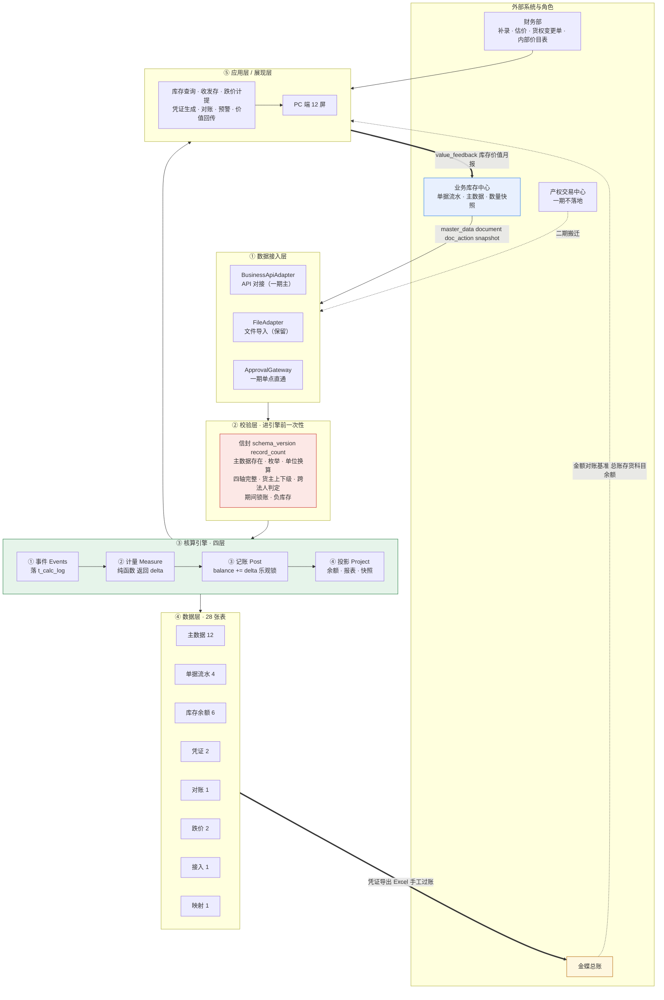
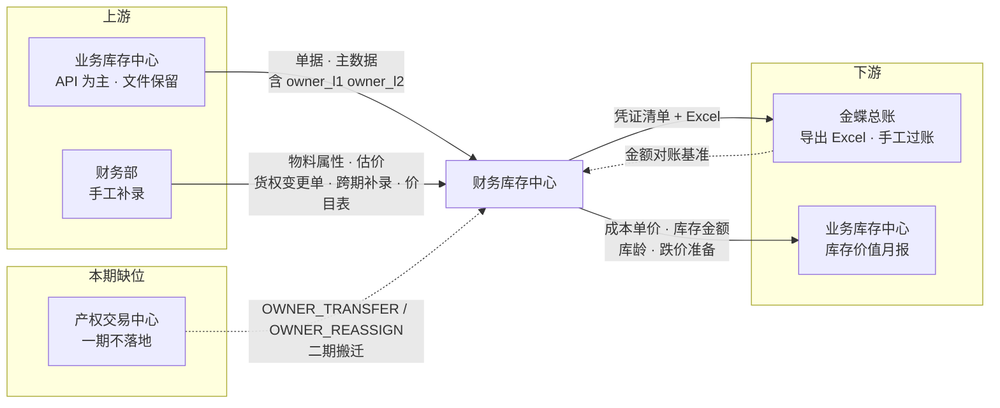
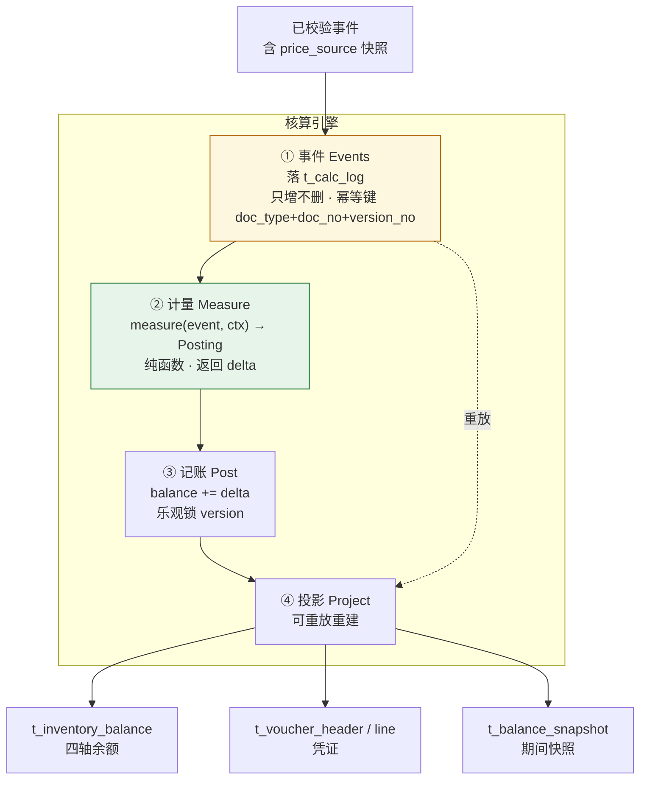
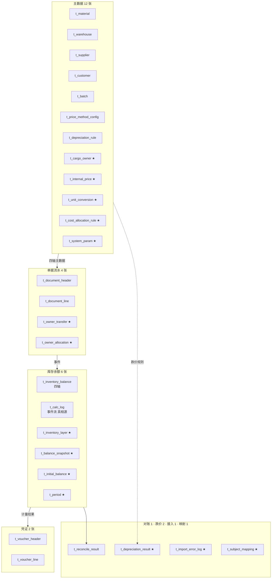
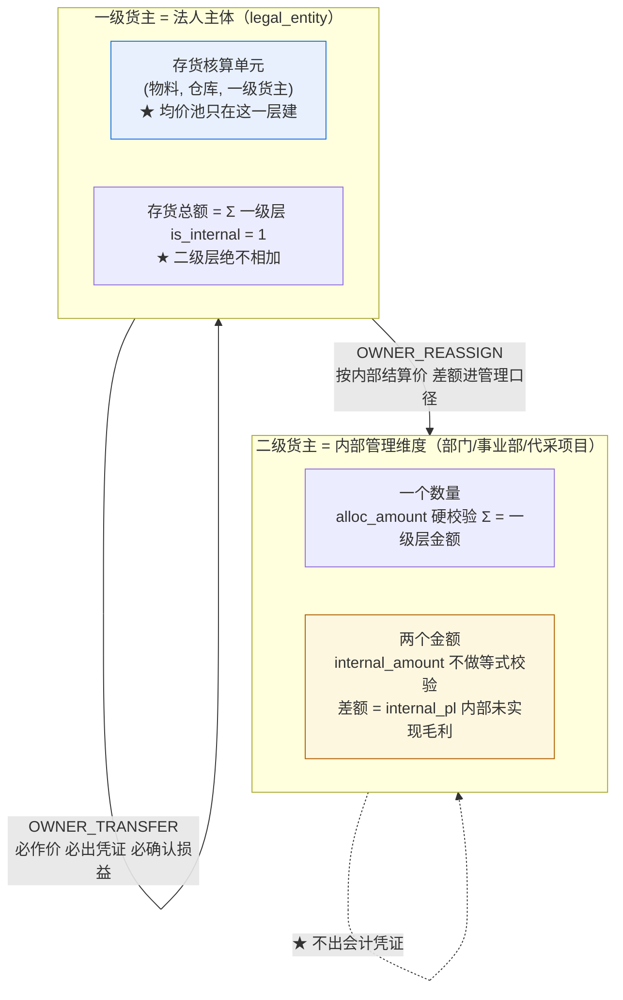
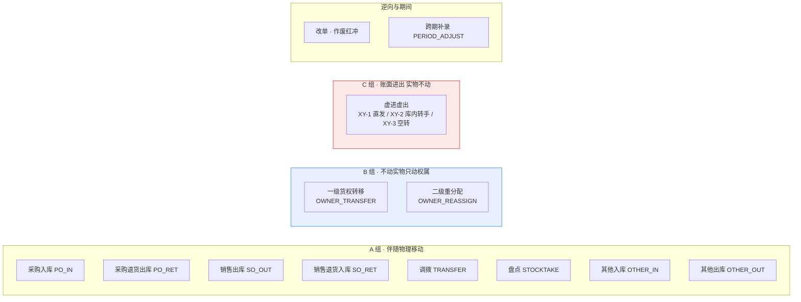
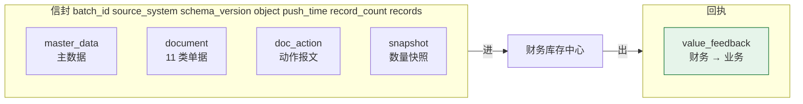
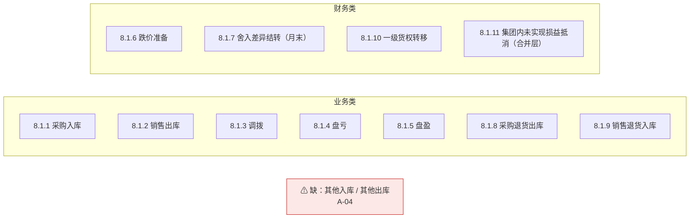

# 财务库存中心（一期）产品架构图

> 版本：v1.0（2026-09-18）
> 用途：**一页看懂这套系统由哪几层、哪几块、彼此的边界在哪**——给项目组、财务部、业务库存中心团队、IT 共用
> 读者：项目组 / 财务部 / 业务库存中心团队 / IT
> 关联文档：《财务库存中心（一期）详细设计文档》v0.4（架构主源）·《核算引擎设计要点》v1.3（引擎四层）·《财务库存中心（一期）通用数据接口字段定义》v1.0（接口层）·《业务与财务库存中心数据交接清单与一致性约定》v1.2（义务清单）·《财务库存中心（一期）产品需求文档》v1.1（功能清单）·《货主分层口径分析与表述框架》v1.4（口径）·《财务库存中心（一期）出入库场景与数据交接对照》v1.0（场景）
> 编号约定：本文是**汇总视图**，不新开编号体系。引用既有编号：**F-xx**（差距）· **C-xx**（核对）· **V-xx**（复核）· **D-xx**（待决策）· **O-xx**（框架）· **E-01–E-10**（引擎）· **G-xx**（出入库对照缺口）· **FR-xx / NFR-xx**（PRD）· **S-xx / IN-x / OUT-x / XY-x**（场景）。本文自身新增的核对发现用 **A-xx**（Architecture），与上述均不重叠。

---

## 0. 核对结论：文档是不是一致的

> 本节回答**「核对全部的文档」**这一半。做法不是"读一遍看着像"，而是**逐项取字面比对**：11 份文档里凡是同一个结论出现两处以上的，逐一比对；凡是同一件事在两处给出数字的，算出总数对不对。

### 0.1 一致的部分（**已核对，不需再议**）

| # | 不变量 | 出现在 | 核对结论 |
|---|---|---|---|
| 1 | **四轴库存维度** `(物料, 仓库, 批次, 一级货主)` | 设计 `0.2`/`0.5`/`3.5.2`/`6.1`·框架 `2`/`4`·引擎 `4.3.1`/`5`·契约 `2.1`·字段定义 `2.2`·PRD `4.1` | ✅ 字面一致 |
| 2 | **核算单元** `(物料, 仓库, 一级货主)`（批次**不进**均价池） | 设计 `3.5.2`/`5.1`·框架 `4.3`·引擎 `5`·字段定义 `2.2`·PRD `4.1` | ✅ 一致，且都写明"批次只影响库龄与跌价" |
| 3 | **R1–R5** 五条派生规则 | 框架 `2.3`·设计 `0.2`/`8.1.10`·引擎 `7`·契约 `2.2` 注·PRD `4.2` | ✅ 一致；**R2「二级不出凭证」五处均有显式表述** |
| 4 | **二级层"一个数量、两个金额"** `alloc_amount` / `internal_amount` | 设计 `4.2.4`·框架 `4.5`·引擎 `7`·契约 `4.2`·字段定义 `4.2`·PRD `4.3` | ✅ 一致；**"能加总 vs 不能加总"六处都写了** |
| 5 | **11 类单据类型** | 设计 `0.2`/`4.2.1`·契约 `2.2`·字段定义 `4.3`·PRD `2`/`4`·出入库对照 `1` | ✅ **逐字一致**（`PO_IN`/`PO_RET`/`SO_OUT`/`SO_RET`/`TRANSFER`/`STOCKTAKE`/`OTHER_IN`/`OTHER_OUT`/`OWNER_TRANSFER`/`OWNER_REASSIGN`/`PERIOD_ADJUST`，全 11 个都在，无多余项） |
| 6 | **凭证模板 11 个** `8.1.1`–`8.1.11` | 设计 `8.1`·出入库对照 `7` | ✅ 设计正文实为 **11 个子节**，与 V-03 修正后的口径一致 |
| 7 | **错误码 13 个** | 字段定义 `2.4`（全集）·出入库对照（引用 `E-CROSS-LEGAL-ENTITY` / `E-SRC-DOC-MISSING`） | ✅ 13 个码只在字段定义定义一次，其余文档引用不重定义——**这是对的** |
| 8 | **精度四档** 数量 `(18,4)`/金额 `(18,2)`/单价 `(18,6)`/加成率 `(10,7)` | 字段定义 `2.2`·设计 `4.2.2`/`4.2.4` | ✅ 一致 |
| 9 | **仓库类型 5 枚举** `SELF`/`PLATFORM`/`OVERSEA`/`IN_TRANSIT`/`VIRTUAL` | 设计 `4.1.2`/`7.x`·契约 `2.1`·字段定义 `4.1`·出入库对照 `5` | ✅ 一致；**三处都写了"无原料库/在制品库"的理由**（纯贸易画像） |
| 10 | **状态位拆分** `biz_status`（业务）与 `cost_status`/`red_flag`（财务） | 设计 `4.2.1`/`4.2.2`·契约 `2.2`·字段定义 `4.1`/`4.2` | ✅ 一致；契约明确"只约定业务状态（B 级），红冲标记财务自维护（C 级）" |
| 11 | **FR / NFR 编号连续性** | PRD `5`/`6` | ✅ `FR-01`–`FR-69` **连续无缺号**（69 条）· `M1`–`M11` **连续**· `NFR-01`–`NFR-10` **连续** |
| 12 | **报表口径** `biz_status = EFFECTIVE AND red_flag = 0` | 设计 `4.2.1`·字段定义 `4.1`·PRD `4.4` | ✅ 一致 |

### 0.2 本次核对新发现（**5 项**，编号 `A-01`–`A-05`）

> 前四轮审查（`F-xx` → `C-xx` → `V-xx`）之后，文档集又新增了**三份**——本轮的独特价值在这里。

**先看一件事：三份最新的文档，从来没被审过。**

| 轮次 | 编号 | 审查对象 | 份数 |
|---|---|---|---|
| 第 1 轮 | `F-xx` 差距 | 设计 v0.3.1 · 契约 v1.1 · 清单 v1.0 | 3 |
| 第 2 轮 | `C-xx` 核对 | 上列 3 份 + 差距 · 框架 v1.4 · 引擎 v1.3 · HTML | 7 |
| 第 3 轮 | `V-xx` 复核 | 设计 **v0.4** · 契约 **v1.2** · 清单 **v1.1** · 框架 · 引擎 · 差距 · 核对 · HTML | 8 |
| **本轮** | `A-xx` | **PRD v1.1 · 字段定义 v1.0 · 出入库对照 v1.0** + 上列 8 份 | **11** |

**`PRD v1.1`、`通用数据接口字段定义 v1.0`、`出入库场景与数据交接对照 v1.0` 三份，不在任何一轮的审查范围内。** 本轮把它们并进来逐项比对。

---

#### A-01 · 「28 张表」与「14 张表」两处口径并存，且 `V-xx` 把这条判成了"一致"

**严重度**：**P1** ｜ **类型**：数字不一致（文档） ｜ **主责方**：项目组 ｜ **状态**：⏳ 待改

| 位置 | 原文 | 实际 |
|---|---|---|
| 设计 `§4` 正文 | `4.1.1`–`4.1.12`（12）· `4.2.1`–`4.2.4`（4）· `4.3.1`–`4.3.6`（6）· `4.4.1`–`4.4.2`（2）· `4.5.1` · `4.6.1` · `4.7.1` · `4.8.1` | **实建 28 张表** |
| 设计 头部第 10 条 + `§14` 第 10 行 | 「**补齐 14 张表**」并列了 14 个表名 | 语义是**新增 14 张**（14 原有 + 14 新增 = 28），但"补齐 14 张"**极易被读成"共 14 张"** |
| `PRD v1.1 §1` | 「数据表 **28 张**（其中 v0.4 新增 14 张）」 | ✅ **正确** |
| `复核清单 V-xx §4` 第 6 项 | 「**14 张表** ｜ 设计头部、`4.1`–`4.8`、`§14` 变更表 ｜ ✅ **表数与实际建表一致**」 | ❌ **这条判错了**——它把"补齐 14 张"读成了"共 14 张"，并据此判定一致 |

**问题**：设计文档的**头部与变更表写 14（新增）**，**正文实建 28**，**PRD 写 28**。三个数不是谁都错——**14 与 28 说的是两件事**（新增数 vs 总数），但**措辞没有区分**，于是最认真的那份复核清单（`V-xx`）在这里判错了，反而给了一个"已验证一致"的假信号。

**建议**：设计头部第 10 条改为「**新增 14 张表（14 → 28）**」，`§14` 同步；`V-xx` 第 6 项加一句更正说明。

> **为什么这条值得写进架构文档**：架构文档要标"这套系统有几张表"，**而现在三个来源给出三个数**。开发按哪个数建，就会差一半。

---

#### A-02 · 设计文档的「关联文档」漏了本轮新增的三份 + 复核清单

**严重度**：**P2** ｜ **类型**：版本引用（文档） ｜ **主责方**：项目组 ｜ **状态**：⏳ 待改

设计 v0.4 头部「关联文档」列了 `框架` / `引擎` / `契约` / `待决策清单` / `差距 F-xx` / `核对 C-xx` —— **未列** `复核清单 V-xx`、`PRD v1.1`、`字段定义 v1.0`、`出入库对照 v1.0`。

这正是 `V-06` 指出的同一类问题（关联文档停在旧版），只是**换了一批文件**：`V-06` 修好的是"停在 v0.3.1/v1.1"，这次漏的是**在它之后新建的四份**。

**建议**：设计头部「关联文档」补齐四份；同时给 `字段定义` 与 `出入库对照` 加一行"本文与设计 v0.4 的对应关系"。

---

#### A-03 · `G-10` / `G-11` / `G-12` 的建议字段只停在"提出方"，**三项**都没进契约与字段定义

**严重度**：**P0** ｜ **类型**：实质缺口（链条断在契约） ｜ **主责方**：双方（W1 接口评审会） ｜ **状态**：⏳ 待定

`出入库对照` 提出 `G-10` / `G-11` / `G-12` 三条缺口，各带具体建议，但**建议的落地字段只在 `出入库对照` 这一份文件里出现过**（全目录 grep 确认）：

| 建议 | 应落到哪 | 现状 |
|---|---|---|
| `link_doc_no`（或"直发进出两腿共用 `batch_no`"）配对键 | `契约 §2.2` 必推字段 / `字段定义 §4` | 仅 `出入库对照` 有 |
| 虚拟仓 / 在途仓建仓与使用规则、`is_inventory_accounted` 配置规则 | `契约 §2.1` 主数据 | 仅 `出入库对照` 有 |
| `has_physical_movement`（有无实物移动） | `契约 §2.2` 必推字段 / `字段定义 §4` | 仅 `出入库对照` 有 |
| 「参不参与数量对账」与「进不进存货金额」**分别命名** | `字段定义 §4.1` | 仅 `出入库对照` 有 |

**这与 `V-01` 是同一个模式**——`V-01` 当时说的是"**D-04 锁了、设计建了字段、唯独契约没写业务侧要推**，于是暂估永远冲不掉"。现在 `G-10`–`G-12` 是**"对照稿提了、契约没写、字段定义没加"**，一字不差的重演。

**为什么是 P0**：三条缺口的共同后果都落在**对账差一笔且无处解释**——
- 缺配对键 → 直发的"入库 = 出库"校验做不了，数量对账漏一笔；
- `is_inventory_accounted` 与 `is_internal` 语义重叠 → 跨期直发的在途存货在**数量表**与**金额表**里各出现一次且对不上；
- 缺 `has_physical_movement` → "货到底动没动"这个事实**没有任何地方留痕**，事后无从追溯。

**建议**：W1 接口评审会上与 `O-07` 一并收口。**注意 `字段层已冻结`**——把 `has_physical_movement` 加进 `字段定义 §4` 属于解冻动作，须明确拍板（见 `§8`）。

---

#### A-04 · 11 个凭证模板**无一覆盖**其他入库 / 其他出库（`G-08` 的根因，已复核确认）

**严重度**：**P1** ｜ **类型**：实质缺口（凭证） ｜ **主责方**：财务部 ｜ **状态**：⏳ 待定

逐条点过 `8.1.1`–`8.1.11`：采购入库 · 销售出库 · 调拨 · 盘亏 · 盘盈 · 跌价准备 · 舍入差异结转 · 采购退货出库 · 销售退货入库 · 一级货权转移 · 集团内未实现损益抵消。

**没有 `OTHER_IN`、也没有 `OTHER_OUT`。** 而 `出入库对照` 已把其他入库拆成 `IN-1`–`IN-5`、其他出库拆成 `OUT-1`–`OUT-6`，其中至少 `OUT-1` 内部领用 / `OUT-2` 报废毁损 / `OUT-3` 赠出送样是**真费用**（走销售费用 / 管理费用），`IN-2` 受赠入库是**真入账**（营业外收入）。**11 类单据里出现频次不低的两类，账务无落点。**

**建议**：补 `8.1.12`（其他入库）/ `8.1.13`（其他出库），借 `G-08` 的细分结果一次做完。

---

#### A-05 · `出入库对照` 的场景数 24 → 25 已自洽，但**其他文档尚未引用新场景编号**

**严重度**：**P2** ｜ **类型**：一致性（文档） ｜ **主责方**：项目组 ｜ **状态**：⏳ 待改

`出入库对照 v1.0（第 4 稿）` 已把场景总数改为 25、缺口改为 12、并把 `S-18` 与 `XY-1`–`XY-3` 写进正文——**文档内部自洽**（`§1` 全景表 25 行、`§8` 写"12 处"、`§9` 速查 8 点，三处对得上）。

但 `设计 0.2` 的"一期范围表"、`PRD §2` 的"一期做"、`契约 §2.2` 的单据清单**都还没有场景视角**——`S-xx` / `IN-x` / `OUT-x` / `XY-x` 这套编号**目前只活在 `出入库对照` 一份文件里**。这不一定是错（对照稿是场景底稿，其他文档按单据类型写），但**W1 会上引用 `S-18` 时，其他文档查不到**。

**建议**：二选一——① 在 `契约 §2.2` 加一列"对应场景（`S-xx`）"；② 在 `设计 0.2` 加一行指向 `出入库对照`。**推荐 ②**，改动最小。

### 0.3 一句话

> **口径层：一致，且比 `V-xx` 那一轮更牢**（11 类单据、13 个错误码、11 个模板、四轴、R1–R5、两个金额、精度四档、状态位——12 项不变量逐字比对通过）。
> **数值层：发现 1 处真不一致**（`A-01`，28 vs 14）。
> **链条层：发现 2 处断链**（`A-03` 三条缺口的建议没进契约与字段定义 · `A-04` 其他出入库无凭证模板）。
> **引用层：2 处漏更新**（`A-02` 关联文档 · `A-05` 场景编号）。

---

## 1. 一页总览

**读图顺序**：数据**从左边进、从下边出**。四条线值得单独记：

| 线 | 方向 | 内容 | 关键约定 |
|---|---|---|---|
| **主数据流** | 业务 → 适配层 | `master_data`（物料/仓库/货主/供应商/客户/批次/单位换算） | **仓库类型与存货权属是两件事**——权属由一级货主 `is_internal` 定，与仓库类型无关（`契约 2.1` 注） |
| **单据流** | 业务 → 适配层 | `document`（11 类）+ `doc_action`（动作报文） | 调拨 **1 张单 + 2 行**，两行 `doc_type` 都是 `TRANSFER`，靠 `warehouse_code` + `is_in` 区分 |
| **价值回传** | 财务 → 业务 | `value_feedback`——《库存价值月报》 | **两个金额口径并列回传**（`C-17`），每个数带口径标注 |
| **凭证出口** | 财务 → 金蝶 | 不直推，导出 Excel 手工过账 | **金额对账以金蝶总账存货科目余额为基准**（`F04`） |

---

## 2. 分层架构详解

### 2.1 五层职责与边界

| 层 | 职责 | **不做**什么 | 关键约定 |
|---|---|---|---|
| **① 数据接入层** | 收报文、鉴权、限流、重试、**两种实现共用同一套校验与回执** | 不做业务判断 | **边界划在接口上，不划在功能上**（设计 `2.2` 原则 5）——一期 `BusinessApiAdapter` / `FileAdapter` 两实现，新增绑定方式只加实现类，**调用方一行不改** |
| **② 校验层** | 信封校验 · 主数据存在性 · 枚举 · 单位换算 · 四轴完整 · 货主上下级 · 跨法人判定 · 期间锁账 · 负库存 | 不改数据 | **校验前移**（引擎 `7`）——13 个错误码全部在这里产生，**拒收的回执要能说清哪一行哪个字段** |
| **③ 核算引擎** | 四层（见 `§3`）——**只做计量与记账** | **取价、业务合法性、报表、通知、对账、结账**（设计 `2.1` 注） | **返回 `delta` 不返回余额**；事件只增不删；锁单位 = 核算单元 |
| **④ 数据层** | 28 张表（见 `§4`） | — | **`t_calc_log` 是真相源**，余额是投影，**可随时重放重建** |
| **⑤ 应用层 / 展现层** | 查询 · 收发存 · 跌价 · 凭证 · 对账 · 价值回传 | 不直接算成本 | 取价在**应用层**完成并把 `price_source` 快照进事件 |

### 2.2 与周边系统的边界（**四进两出**）

> **最容易踩的边界**：「产权交易中心不参与对外审计、开票」**≠「不参与会计」**。集团内跨法人转移是**关联交易**——不开票，**但按 R1 仍必须出凭证、确认损益、并在合并层抵消，一期即需做**（`O-12`）。
> 一句话分工：**交易中心决定"交易是否成立"，库存中心决定"会计怎么记"。**

---

## 3. 核算引擎：四层 + 三条不变量

### 3.1 三条不变量（**引擎的全部要害**）

| # | 不变量 | 含义 | 错在哪 |
|---|---|---|---|
| **1** | **返回 `delta`，不返回新余额** | `measure()` 只回答"这笔让余额变多少"，**不读当前余额** | 若返回新余额，`measure` 就必须读余额 → 不再是纯函数 → **无法重放、无法测试、并发下必错** |
| **2** | **事件是真相源，余额是投影** | `t_calc_log` append-only；删除任何一行都会让重放结果与当前余额不一致（`E-06`） | 若把 `t_calc_log` 当"操作日志"，就会出现"改单 = 删旧行"→ **历史成本不可追溯** |
| **3** | **锁单位 = 核算单元** | 加锁粒度 `(物料, 仓库, 一级货主)`；**跨单元按维度键顺序加锁防死锁** | 锁整张表 → 吞吐崩塌；锁单行 → 同一核算单元并发写会串 |

### 3.2 三种幂等**不是一回事**（最常被混为一谈）

| 层 | 幂等键 | 防什么 | 谁负责 |
|---|---|---|---|
| **传输幂等** | `batch_id + doc_no + line_no` | **同一条报文重推**（网络重试） | 适配层 |
| **事件幂等** | `(doc_type, doc_no, version_no)` | **同一版本的同一单据被算两次** | 引擎 |
| **结果幂等** | 无键（**纯函数**） | 只要输入相同，输出必相同 | `measure()` 本身 |

> **为什么必须三条都有**：只有传输幂等 → 业务侧从**两批**推出同一张单，重复入账；只有事件幂等 → 网络重试把一行推成两行，`line_no` 相同但 `batch_id` 不同时仍会重复；两者都有但 `measure` 不纯 → 重放结果与当前余额不一致。**（`C-21` 已指出：事件幂等键按单据，部分行重推会被静默漏掉——须按行。）**

### 3.3 顺序与确定性

| 项 | 规则 | 依据 |
|---|---|---|
| **排序键** | `(biz_date, seq_in_day)`；**`doc_no` 不可作排序键** | 引擎 `4.1`（`C-04`） |
| **同日内部规则** | **入库优先**；同类型按单号 | `E-01` |
| **迟到单据** | 按业务日期**插入**历史位置重算；**已锁账期间 → `E-PERIOD-CLOSED`** | `E-05` / `E-07` |
| **改单** | **追加两组事件**（reverse + new positive），`version+1`；**不是删了重来** | `E-06` |
| **反结账** | 允许但须走审批并留痕；与 `PERIOD_ADJUST` **是两条路**（"上次结错了" vs "漏了一笔"） | `E-09` / `D-10` / `D-11` |

---

## 4. 数据模型：28 张表（8 组）

> **★ = v0.4 新增（14 张）**。**14 原有 + 14 新增 = 28**（`A-01`）。

| 组 | 张数 | 主键 / 维度 | 关键约定 |
|---|---|---|---|
| **主数据** | 12 | 各自编码 | `t_warehouse` 含 `warehouse_type` 5 枚举 + `is_inventory_accounted`；`t_cargo_owner` 是**第四根轴**，`is_internal` 决定权属 |
| **单据流水** | 4 | `(doc_no, line_no)` | **调拨 1 单 2 行**；`t_owner_allocation` 存二级层**两个金额** |
| **库存余额** | 6 | **四轴** `(物料, 仓库, 批次, 一级货主)` | **`t_calc_log` 是真相源**；`t_period` 承载锁账（`E-03`） |
| **凭证** | 2 | `(voucher_no, line_no)` | **按法人分账**，不平拒绝落库（`F03`） |
| **跌价** | 2 | 核算单元 | `delta_amount` 依赖"上期已计提"列——**没有它就算不出本期该提多少** |
| **对账 / 接入 / 映射** | 3 | — | `t_subject_mapping` 是凭证模板到科目的落点 |

---

## 5. 货主分层：本系统的**存在理由**

> 这套系统的场景分**三组**——**动物理量的**、**只动权属的**、**账面进出而实物不动的**。**后两组才是货主分层模型存在的理由**（出入库对照 `§0`）。

### 5.1 R1–R5 五条派生规则

| 规则 | 内容 |
|---|---|
| **R1** | 一级货权转移**必作价**（`transfer_price` 交易数据，不配置只取价+校验）、**必出凭证**、**必产生会计损益** |
| **R2** | 二级重分配**必按内部结算价作价**（`internal_price` 政策数据，带生效期价目表），差额进二级内部损益（**管理口径**），**不出会计凭证** |
| **R3** | 存货均价池**只在一级层建立** |
| **R4** | 存货总额 = Σ 一级层 `is_internal = 1` 的金额（**二级层绝不相加**） |
| **R5** | 二级内部结算价**不影响会计** |

### 5.2 `R2` 取价：**一个价、三个数**

| 字段 | 含义 | `FIXED` 时 | `MARKUP` 时 |
|---|---|---|---|
| `price_base` | 基准价 | `NULL` | 成本基数 |
| `markup_rate` | 加成率 `(10,7)` | `NULL` | 有值 |
| `price_value` | **最终取值** | 有值 | 有值 |

**三铁律**：**按业务日期取价 → 取到即快照 → 调价不追溯**。`price_type` 是**行属性、不进主键**。

### 5.3 调拨 vs 一级货权转移（**判据只一条**）

| 情形 | 单据 | 适配层行为 |
|---|---|---|
| 调出仓与调入仓属**同一**一级货主 | `TRANSFER` | 收 |
| 属**不同**一级货主 | `OWNER_TRANSFER` | 业务推 `TRANSFER` → **拒绝并回执 `E-CROSS-LEGAL-ENTITY`** |

> **不做自动升级**——自动升级等于**财务替业务定价**。

### 5.4 两个口径分叉（**共三种**）

| # | 分叉 | 数量口径 | 金额口径 |
|---|---|---|---|
| ① | 代销 / 借入（货在我仓、权属不在我） | **在库数量**（含） | **权属数量**（不含） |
| ② | 货权已转、实物未出 | 在（含） | **已不含** |
| ③ | **直发（`XY-1`）** | **瞬时**，正常期末为零；**跨期才挂成在途存货** | 同左，**但 D-06 已定在途计入**，所以那笔是真的 |

> **`A-03` 就出在这里**：第 ③ 种分叉要求**虚拟仓 / 在途仓的余额必须能单独列示**，且**"参不参与数量对账"与"进不进存货金额"必须分别命名**——否则两张表的差会凭空多出一笔且找不到源。

---

## 6. 单据与场景：11 类 · 25 个场景

| 组 | 场景数 | 特点 |
|---|---|---|
| **A 组** | 16 | **动实物**。`S-05` 其他入库拆 `IN-1`–`IN-5`、`S-12` 其他出库拆 `OUT-1`–`OUT-6`（按**金额从哪来**分轴） |
| **B 组** | 4 | **只动权属**。一级转移 4 个子形态 + 二级重分配"一个数量、两个金额" |
| **C 组** | **`S-18`** | **账面进出、实物不动**。**不是新单据类型，是 A 组两个场景的组合**——单看每笔都正常，合起来才是"货没动" |
| **逆向与期间** | 5 | 改单 / 作废 / 反结账 / 跨期补录 |
| **合计** | **25** | 其中 **3 个"一行装不下"**：`S-05` · `S-12` · `S-18` |

### 6.1 `S-18` 虚进虚出：**同一个词底下三种截然相反的账务处理**

| 形态 | 是什么 | 该不该在账上走一遍进销 | 仓库落点 |
|---|---|---|---|
| **`XY-1` 直发 / 直运** | 供应商直接发客户，**从不入我方仓** | **必须**记两笔进销 | `IN_TRANSIT` / `VIRTUAL` |
| **`XY-2` 库内转手** | 货在同一仓不动、货主连续转手 | **严禁**记进销 → 应走 `OWNER_TRANSFER` | 不落新仓 |
| **`XY-3` 纯单据空转** | 走单走票不走货 / 融资性贸易 | **不应确认收入** | 不落新仓 |

**三条判断（为什么系统不能自己下判据）**：

1. **全额法 / 净额法是会计政策，不是系统问题**——与 `D-07`「视同销售是税务判断不是会计判断」同一条原则，**两者不要互相推导**。
2. **权属由一级货主定，与仓库类型无关**（`D-06`）——直发期间照常 `is_internal = 1`，计入存货总额。
3. **判据不能由系统下**——"供应商上午送到、客户下午自提"与真正的空转，**在单据上长得一模一样**。系统给**特征**（提示核对，**不拦截**），**业务给声明**。

> **设计禁令（`出入库对照 §5.4` 第 3 条）**：**绝不能提供"只记账、不动库存"的便捷开关**——那等于给空转业务发工具。虚拟仓 / 在途仓因此**必须是受控的 A 级主数据**。

### 6.2 边界：**纯撮合根本不该产生任何出入库单据**

不持货权的撮合业务，**一张单据都不该推过来**。

---

## 7. 接口与数据交接

### 7.1 报文：一个信封 + 五类 `object`

| 类 | 方向 | 内容 |
|---|---|---|
| `master_data` | 业务 → 财务 | 物料 / 仓库 / 一级货主 / 二级货主 / 供应商 / 客户 / 批次 / 单位换算 |
| `document` | 业务 → 财务 | 11 类单据（前 8 类业务推；`OWNER_TRANSFER`/`OWNER_REASSIGN` 业务+财务；`PERIOD_ADJUST` 财务侧不推） |
| `doc_action` | 业务 → 财务 | 动作报文（提交 / 审核 / 作废…） |
| `snapshot` | 业务 → 财务 | **数量快照**（对账用），一期按物理层 `(物料, 仓库, 批次)` |
| `value_feedback` | **财务 → 业务** | 成本单价 · 库存金额 · 库龄 · 跌价准备，**两个金额口径并列 + 口径标注** |

> **不加 `legal_entity` 到信封**——法人是**行级**属性（同一批里可以混法人），放信封会把"一批一法人"这个错误约束写死。

### 7.2 三层边界：谁定什么（**跨象限只读引用**）

| 层 | 内容 | 谁定 | 现状 |
|---|---|---|---|
| **业务事实层** | 11 类单据 · 主数据 · 数量快照 | **业务库存中心**（① 业务权威） | 契约 v1.2 已列义务 |
| **通用字段层** | 字段名 · 类型 · 精度 · 必填 · 枚举 · 幂等键 · 错误回执 | **双方共同** | 字段定义 v1.0 已定（**已冻结**） |
| **传输协议层** | REST / MQ / 文件 · 鉴权 · 调度 · 重试 | **双方 + IT** | **待定** |
| **价值回传层** | 库存金额 · 库龄 · 跌价 · 两个金额口径 | **财务库存中心**（④ 财务定义并回传） | 已定 |

> **双方都不许"顺手改一下对方的口径"。**

### 7.3 错误码 13 个（**全部在校验层产生**）

| 分类 | 错误码 |
|---|---|
| 报文 | `E-HEADER-INVALID` · `E-SCHEMA-VERSION` |
| 主数据 | `E-MASTER-MISSING` · `E-OWNER-L1-MISSING` · `E-OWNER-L2-ORPHAN` |
| 枚举 / 换算 | `E-ENUM-INVALID` · `E-UNIT-CONV-MISSING` |
| 数量 / 金额 | `E-QTY-MISMATCH` · `E-PRICE-MISSING` · `E-NEGATIVE-QTY` |
| 业务合法性 | `E-CROSS-LEGAL-ENTITY` · `E-SRC-DOC-MISSING` |
| 期间 | `E-PERIOD-CLOSED` |

---

## 8. 凭证与对账

### 8.1 凭证模板 11 个

**三条总则**：**借贷平衡**（`Σ借 = Σ贷`，不平拒绝落库）· **按法人分账** · **凭证日期 = 记账期间首日**（`C-20`）。

> **二级重分配不产生凭证**（`R2`）——但它有 `t_owner_allocation` 承载两个金额。

### 8.2 两条对账口径（**不能混用**）

| 对账项 | 比什么 | 维度 | 频率 |
|---|---|---|---|
| **数量对账** | vs 业务日切**快照** | 一期按物理层 `(物料, 仓库, 批次)`；**能否上到货主层取决于 `O-07`** | 日 |
| **金额对账** | vs **金蝶总账**存货科目余额 | **法人层 + 合并层两段**（`F04`/`C-19`） | 月 |

> **第三条要补的规则（`S-18` 直发）**：**虚拟仓 / 在途仓的余额必须能单独列示**——跨期直发会在期末真实挂出一笔在途存货，**数量口径与金额口径都要能把它单独摘出来**（`A-03`）。

---

## 9. 横切约定速查

| # | 项 | 约定 |
|---|---|---|
| 1 | **排序键** | `(biz_date, seq_in_day)`；**`doc_no` 不可作排序键** |
| 2 | **精度** | 数量 `(18,4)` · 金额 `(18,2)` · 单价 `(18,6)` · 加成率 `(10,7)` |
| 3 | **舍入差异** | **入库不产生，出库才产生**（`F02`） |
| 4 | **状态位** | `biz_status`（DRAFT/SUBMITTED/APPROVED/EFFECTIVE/VOID）+ `cost_status`（PENDING/CALCULATED/ROLLED_BACK）+ `red_flag`/`red_ref_doc` |
| 5 | **报表口径** | `biz_status = EFFECTIVE AND red_flag = 0` |
| 6 | **作废闸门** | `cost_status`——已核算一律不可撤，只能反向单 + 红字凭证 |
| 7 | **暂估链路** | `settle_status` = `ESTIMATED` → `ADJUSTED` → `SETTLED`；`estimate_ref_doc`；**差额不追溯只调当期**（`D-04`），两笔追加事件 |
| 8 | **科目映射** | 价差三分类 `PRICE`/`QTY`/`RATE` **不可合并** → 落 `1404`/`1404.01`/`6603` |
| 9 | **期间** | 日结只校验、**月结锁账**（`E-03`/`E-07`）；反结账须审批留痕（`E-09`） |
| 10 | **审批流** | **不建引擎** + 保留 `ApprovalGateway` + 单点审核动作（`O-19`） |

---

## 10. 待决与缺口

### 10.1 本次核对新增（`A-01`–`A-05`）

| 编号 | 事项 | 严重度 | 主责方 |
|---|---|---|---|
| **A-01** | 表数量 **28 vs 14** 两处口径并存（`V-xx` 判错了） | P1 | 项目组 |
| **A-02** | 设计「关联文档」漏 `V-xx` / PRD / 字段定义 / 出入库对照 | P2 | 项目组 |
| **A-03** | `G-10`/`G-11`/`G-12` 建议字段**只停在对照稿**，未进契约与字段定义 | **P0** | 双方（W1） |
| **A-04** | 11 个凭证模板**无一覆盖**其他入库 / 其他出库 | P1 | 财务部 |
| **A-05** | 场景编号 `S-xx`/`IN-x`/`XY-x` 目前只活在对照稿一份文件里 | P2 | 项目组 |

### 10.2 前序轮次遗留的缺口（未闭环）

| 来源 | 缺口 | 状态 |
|---|---|---|
| `G-01`–`G-09` | 其他出入库金额字段 / "货权已转实物才出库"无单据类型 / 资金占用费口径冲突（`G-05`）/ 二级分摊账展开未定义（`G-06`） | ⏳ W1 |
| `G-10`–`G-12` | 直发缺配对键 · `is_inventory_accounted` 与 `is_internal` 语义重叠 · 缺"实物动没动"标记 | ⏳ → `A-03` |
| `F-xx` / `C-xx` | 24 + 25 条**已全部闭环** | ✅ |
| `V-xx` | 8 项已修正，**唯第 6 项判错**（`A-01`） | ⚠️ 1 项待更正 |

### 10.3 五项待外部输入（**我方给不出**）

| # | 事项 | 向谁要 | 最晚 | 不定的后果 |
|---|---|---|---|---|
| 1 | **`O-07` 业务侧是否也建货主维度** | **业务团队** | **W1** | 决定数量对账能否上到货主层。**全部决策项里唯一一项我方给不出默认值的外部依赖** |
| 2 | `D-09` 业务量级（SKU 数 / 日单据行数 / 峰值 / 保留年限） | IT | W3 压测前 | 架构取向已锁"批量计算"，但**容量参数给不出就没法设压测场景** |
| 3 | `D-12` 部署环境与运维责任人 | IT | W8 前 | 影响适配层接入方式；并行 1 个完整月结周期**两套方式都要有人跑** |
| 4 | `D-13` 出口退税触发条件 | 财务部（税务） | 受 `D-06` 触发 | 若海外仓计入存货，须提前至 **W2** |
| 5 | `D-03` 金蝶账套能否承载多法人 | 金蝶实施方 | W1 | 已锁"多主体 + 视同销售 + 抵消"，**账套承载不了就落不了地** |

### 10.4 另需拍板一项（**不是外部输入**）

> **字段层是否解冻**？`A-03` 要把 `has_physical_movement` 之类的新字段加进 `字段定义 §4`，而**字段层已冻结**。这是**解冻动作**，须明确拍板。
> 连带：`契约` 是否因 `V-01`（新增一条必推项）+ `A-03`（再增）升 **v1.3**。

---

## 11. 一页速查

**这套系统五层、28 张表、11 类单据、11 个凭证模板、13 个错误码。**

| 记什么 | 一句话 |
|---|---|
| **引擎** | **返回 `delta` 不返回余额**；事件是真相源，余额是投影；锁单位 = 核算单元 |
| **货主分层** | 均价池**只在一级层**；存货总额 **Σ 一级层 `is_internal = 1`**；二级层**一个数量两个金额** |
| **两个金额** | `alloc_amount` **硬校验** Σ = 一级层金额；`internal_amount` **不做等式校验**，差额 = 内部未实现毛利 |
| **调拨** | **1 张单 + 2 行**，两行 `doc_type` 都是 `TRANSFER`，靠 `warehouse_code` + `is_in` 区分 |
| **跨法人** | 适配层**拒绝不自动升级**——自动升级等于财务替业务定价 |
| **改单** | **追加两组事件**（reverse + new positive），**不是删了重来** |
| **对账** | 数量 vs **业务快照**；金额 vs **金蝶总账**；**两条口径不能混用** |
| **虚进虚出** | 先问"货有没有、动没动"——直发**必须**记进销、库内转手**严禁**记进销、纯空转**不该确认收入** |

**本轮核对最该记住的一句**：

> **口径全对齐了，问题全在"链条"上——三份最新文档从没被审过（`A-02`），而它们提出的三条缺口建议（`A-03`）还停在提出方，没进契约、没进字段定义。这与 `V-01` 是同一个模式：`D-04` 当时也是"锁了、建了、唯独契约没写"。**

---

## 12. 变更记录

| 版本 | 日期 | 变更 |
|---|---|---|
| **v1.0** | 2026-09-18 | 首次成文。① **核对部分**：对目录内 **11 份 md** 做第四轮核对——前三轮（`F-xx` 3 份 → `C-xx` 7 份 → `V-xx` 8 份）均**未覆盖** `PRD v1.1` / `通用数据接口字段定义 v1.0` / `出入库场景与数据交接对照 v1.0`，本轮并入。**12 项不变量**（四轴 · 核算单元 · R1–R5 · 两个金额 · 11 类单据 · 11 个凭证模板 · 13 个错误码 · 精度四档 · 仓库 5 枚举 · 状态位 · 报表口径 · FR/NFR 编号连续性）**逐字比对通过**。**新发现 5 项**：`A-01` 表数量 28 vs 14 两处口径并存且 `V-xx` 判错 · `A-02` 设计关联文档漏四份 · **`A-03`（P0）`G-10`/`G-11`/`G-12` 的建议字段只停在对照稿，未进契约与字段定义** · `A-04` 11 个凭证模板无一覆盖其他入库/其他出库 · `A-05` 场景编号只活在对照稿一份文件里。② **架构图部分**：五层架构（接入 / 校验 / 引擎 / 数据 / 应用表现）· 引擎四层 + 三条不变量 + 三种幂等 · 28 张表分 8 组 · 货主分层与 R1–R5 · 11 类单据与 25 个场景三组 · 报文五类 `object` · 凭证 11 模板与两条对账口径 · 横切约定 10 项。编号用 **`A-xx`**，与 `F-xx`/`C-xx`/`V-xx`/`D-xx`/`O-xx`/`E-xx`/`G-xx` 均不重叠 |

---

*本文为汇总视图（v1.0）。**核对结论**：口径层一致且比 `V-xx` 那轮更牢；数值层 1 处真不一致（`A-01`）；链条层 2 处断链（`A-03` / `A-04`）；引用层 2 处漏更新（`A-02` / `A-05`）。**架构结论**：这套系统的骨架是**五层 + 引擎四层 + 28 张表**，而它存在的理由全在**货主分层**——均价池只在一级层、二级层一个数量两个金额、二级不出凭证。**下一步**：W1 接口评审会上把 `A-03`（P0）与 5 项外部输入一并收口，其中 `O-07` 是唯一一项我方给不出默认值的。*
