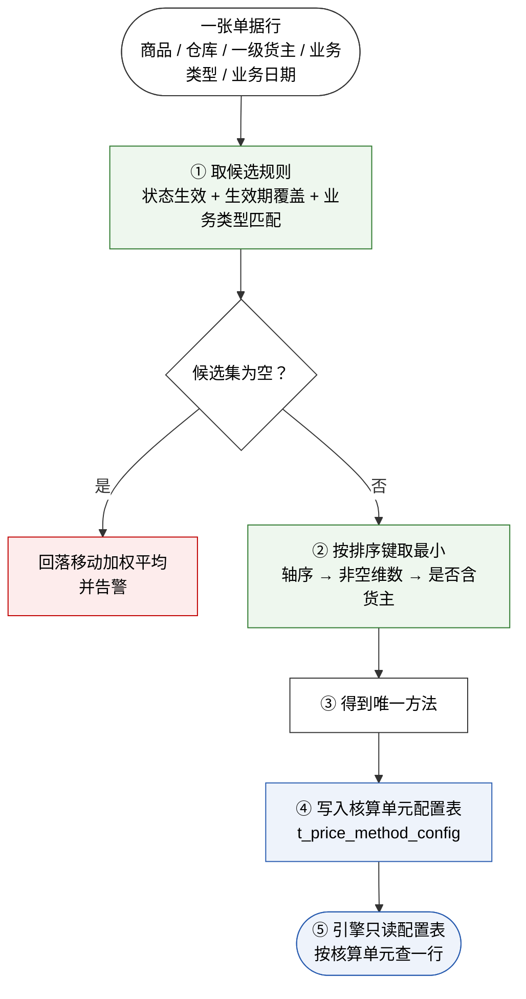

# 计价方式优先级判断规则 · 修订方案 v1.0

> **本文是什么**：把「12 级表」与原文的「5 级链」合成**一套可实现的规则**，并逐条消解《计价方式优先级判断规则口径核对清单 v1.0》里的 7 条真分歧与 6 项未定义。
>
> **权威关系**：原文仍是唯一权威规格。本文是**提案**，未获授权前不改原文、不改原型、不改任何既有文件（`CLAUDE.md` §2.2）。**原型与原型说明已于 2026-10-19 获授权改动，见 §13.7；原文、详细设计仍未动。**
>
> **与两份前身的关系**：
> - 《计价方式优先级判断规则口径核对清单 v1.0》——指出问题；
> - **本文——给出解法**；
> - 用户提供的 12 级表——作为**业务意图**的输入，不是口径。

---

## 一、方案总览

### 1.1 三条设计原则

| # | 原则 | 解决什么 |
|---|---|---|
| **P1** | **一个核算单元只能有一种方法** | 业务类型切不开均价池（原 §3.1） |
| **P2** | **阶梯由「轴 + 非空维数」唯一决定，不由人工排序决定** | priority 语义互斥（原 §3.5） |
| **P3** | **规则表负责「配」，核算单元配置表负责「算」** | 两套配置模型并存（原 §3.6） |

### 1.2 一句话

> **12 级 = 货主{有,无} × 仓库{有,无} × 主轴{SKU, 品类, 无} 的完全划分。**
> 业务类型**不在这三个维度里**——它是规则的**适用前置**，不是阶梯。

### 1.3 解析管线



**关键**：③ 之后方法就**唯一化到核算单元**了。引擎永远看不到规则表——它只查 `t_price_method_config`。

---

## 二、为什么恰好是 12 级

### 2.1 三个维度的取值

| 维度 | 取值 | 属于核算单元吗 |
|---|---|---|
| 货主 | 指定 / 空（= 全部） | ✅ 是（一级货主） |
| 仓库 | 指定 / 空（= 全部） | ✅ 是 |
| **主轴** | **SKU / 品类 / 无** | ✅ 是（商品 或 品类 或 不限定） |
| 业务类型 | 自营 / 代销 / 代采 / 寄售 / 空 | ❌ **不是**（挂在单据上，不挂在核算单元上） |

**SKU 与品类互斥**——它们是同一根轴的两档，不能同时非空。这一条同时解掉了原清单 §六 第 4 项。

### 2.2 完全划分

```
货主 2 种 × 仓库 2 种 × 主轴 3 种 = 12 种
```

**这不是凑出来的 12，是笛卡尔积的必然结果。** 因此：

- **不可能出现孤儿组合**（原 §3.2 的「货主 + 仓库」、§3.3 的「货主 + 仓库 + 业务类型」都自动有位）；
- **不可能出现重叠**（任一规则的维度组合只落在一级）；
- 原清单 §六 第 5 项（第 10/11 级空维不确定）**消失**——级别的空维由定义写死。

> 业务类型若也被塞进阶梯，组合数会变成 2×2×3×2 = 24 种，而其中 12 种在物理上不成立（同一核算单元装不下两种方法）。**这就是原 12 级表必然会撞墙的算术原因。**

---

## 三、12 级阶梯全表

排序方向：**自上而下，越靠上越优先**。

| 优先级 | 颗粒度 | 组合说明 | 适用场景 |
|---|---|---|---|
| **1** | 货主 + 仓库 + SKU | 货主、仓库、SKU 均指定；品类不参与匹配 | 某货主在某仓的某个单品单独计价——极特殊单品、一机一价 |
| **2** | 货主 + SKU | 货主、SKU 指定；仓库空（全部仓库）、品类空 | 某货主的某个单品跨仓统一口径 |
| **3** | 仓库 + SKU | 仓库、SKU 指定；货主空（全部货主）、品类空 | 某个单品在某仓统一口径 |
| **4** | SKU（全局） | 仅 SKU 指定；货主、仓库、品类全空 | 单品级全局口径——原文第 1 级「特定 SKU」；**SKU 族内最粗的一档，但仍压过品类级与无轴级全部规则** |
| **5** | 货主 + 仓库 + 品类 | 货主、仓库、品类均指定；SKU 空 | 某货主在某仓的整个品类统一计价（如 3C 整机走个别计价） |
| **6** | 货主 + 品类 | 货主、品类指定；仓库空、SKU 空 | 某货主的一个品类跨仓统一 |
| **7** | 仓库 + 品类 | 仓库、品类指定；货主空、SKU 空 | 某仓的整个品类统一——原文第 2 级「仓库 + 品类」 |
| **8** | 品类（全局） | 仅品类指定；货主、仓库、SKU 全空 | 品类级全局口径——原文第 3 级「商品品类」 |
| **9** | 货主 + 仓库 | 货主、仓库指定；SKU、品类均空 | 某货主在某仓统一，不分品类 |
| **10** | 货主（兜底） | 仅货主指定；仓库、SKU、品类全空 | 货主级兜底——日常高频配置 |
| **11** | 仓库（兜底） | 仅仓库指定；货主、SKU、品类全空 | 某仓统一口径——原文第 4 级「仓库」，旧表漏掉的一级 |
| **12** | 全局兜底 | 货主、仓库、SKU、品类全空 | 统一移动加权平均；未配置时硬编码回落并告警——原文第 5 级「全局默认」 |

**三条读表约定**：

1. **业务类型不在「颗粒度」列里。** 它可在任意一级附加，作为规则的**适用前置条件**（只对某类业务单据生效），但不改变级别、不改变解析顺序——见 §5、§8 的 R-14。
2. **SKU 与品类互斥。** 同一根轴的两档，规则里只能填一个；同时填值直接拒绝保存（R-12）。
3. **排序键三段**：轴序（SKU → 品类 → 无轴）→ 非空维数降序 → 同维数时含货主者优先。伪代码见 §4.1。

### 3.1 与原文 5 级链的逐一对应

原文 `:619`：`特定 SKU → 仓库 + 品类 → 商品品类 → 仓库 → 全局默认`

| 原文 | 新级 | 说明 |
|---|---|---|
| 特定 SKU | **4** | 新表保留了它「最高优先」的地位（见 §4.3） |
| 仓库 + 品类 | **7** | 原文未限货主，故落到货主为空的一档 |
| 商品品类 | **8** | 同上 |
| **仓库** | **11** | **原文有、旧 12 级表漏掉的一级，新表补回** |
| 全局默认 | **12** | 完全一致 |

### 3.2 旧 12 级压成 8 级、再加 4 级

旧表的 12 级里，有 4 对只是「业务类型填了 / 没填」的差别，**不是真阶梯**：

| 旧级对 | 新级 |
|---|---|
| 旧 1（货主+仓库+业务类型+SKU）、旧 3（货主+仓库+SKU） | **1** |
| 旧 2、旧 4 | **5** |
| 旧 5、旧 7 | **2** |
| 旧 6、旧 8 | **6** |

压掉 4 级后剩 **8 级**；腾出的 4 个位置，正好补上原文有、旧表漏掉的 **4 个组合**（新 3、7、9、11）。**总数仍是 12，但内容是另一组 12。**

---

## 四、排序键的精确定义

### 4.1 伪代码

```text
解析(商品 S, 仓库 W, 一级货主 O, 业务类型 T, 业务日期 D) -> 计价方法

① 候选集 =
    规则.状态 == 生效
    且 规则.生效期 覆盖 D
    且 (规则.业务类型 为空 或 == T)
    且 (规则.适用一级货主 为空 或 == O)
    且 (规则.适用仓库 为空 或 == W)
    且 (规则.适用品类 为空 或 == S.品类)
    且 (规则.适用SKU 为空 或 == S.编码)

② 若候选集为空：
     返回 移动加权平均，并告警「核算单元无配置，已回落全局默认」

③ 排序键(规则) = (
        轴序：SKU = 0，品类 = 1，无 = 2,
        −非空维数,
        含货主 ? 0 : 1
   )

④ 返回 排序键最小者的计价方法
⑤ 结果写入 t_price_method_config（物料, 仓库, 一级货主）
```

### 4.2 两级决胜为什么够用

排序键的三段都是**规则自身的静态属性**，与「命中了哪些其它规则」无关，因此：

- 结果是**确定性的**——同一组配置永远解析出同一个方法；
- 结果是**可解释的**——任何时候都能算出「凭什么是这一条」。

### 4.3 「特定 SKU 优先级最高」被恢复

轴序把 SKU 整族排在最前，所以：

- **第 4 级（全局 SKU）压过第 5–12 级的全部规则**；
- 第 2 级（货主 + SKU）压过第 1 级？——不是，第 1 级是 3 维，优先级更高，但**第 1 级也在 SKU 族内**。

于是原文与原型说明 `:125` 那句「填了就只对该 SKU 生效，**优先级最高**」**重新成立**，不需要改原文。这是相对旧 12 级表最重要的修正。

### 4.4 `priority` 不再是路由键

**定理**：在完全划分下，同一级内的两条规则如果作用域不同，就不可能同时命中同一个核算单元；如果作用域相同，那就是重复配置。

所以 **`priority` 对解析结果没有任何影响**。它的新定位是：

| 用途 | 说明 |
|---|---|
| **列表展示顺序** | 财务按习惯排序，仅影响观感 |
| **同级唯一性校验** | 同一级同一作用域出现两条 → 直接报错（§8 R-11） |

**界面后果**（须同步改）：

- 拖拽只能**同级别内**排序；跨级拖动时自动吸附回本级别，并提示「计价优先级由颗粒度决定，不可跨级调整」；
- `[上移/下移]` 在同一级别内移动；到边界时按钮置灰；
- `[删除 (仅未生效)]` 后**仍需重排序列**（`priority` 依然是展示序列，断号无意义但保持整洁）。

---

## 五、业务类型怎么处理

### 5.1 主方案（推荐）：适用前置 + 单元唯一性校验

**业务类型不是阶梯维度，是规则的「适用前置条件」。**

- 规则可以填 `biz_type`（业务类型），填了就**只对这类单据生效**；
- 但解析结果最终**必须唯一化到核算单元**（P1）；
- 所以保存规则时必须跑 **R-14 单元唯一性校验**（§8）：同一核算单元在所有业务类型下解析出的方法必须相同，否则**保存失败**。

**报错文案**（建议）：

> 该配置会让核算单元「M0001 / WH01 / OWN-A」在「自营」与「代销」下使用不同计价方法，但它们在同一个均价池里，物理上无法并存。
> 请二选一：① 去掉业务类型，统一方法；② 拆成两个核算单元（需变更核算单元键，属字段层变更）。

**为什么保留这个字段**：它能让财务**显式声明**某条规则只覆盖哪类业务，避免规则悄悄扩散到不该覆盖的单据上；冲突由保存时校验兜住，不会漏到运行期。

### 5.2 备选：四轴核算单元（**需 §2.1 字段层解冻**）

若业务上确实要求「自营走移动加权平均、代销走个别计价」，唯一正解是**把业务类型加进核算单元键**：

```
核算单元 = (商品, 仓库, 一级货主, 业务类型)
```

**连带影响**（牵一发动全身，必须整包评估）：

| 受影响对象 | 影响 |
|---|---|
| 均价池 `t_inventory_balance_unit` | 主键加一维，同一 SKU 的均价被拆成多池 |
| 成本层 `t_inventory_layer` | 同上 |
| 凭证生成 | 同一核算单元的出库会生成到不同科目口径 |
| 跌价准备 | 计提基数按四轴拆分 |
| P05 / P06 / P16 全部余额报表 | 聚合键变更，全部列与合计口径要重写 |
| 期初数据 `t_initial_balance` | 四轴导入 |
| 全部历史数据 | 需要迁移，且历史期间无法回溯拆分 |

> **建议**：一期不做四轴。若确有按业务类型分别计价的需求，优先通过**不同一级货主**表达（代销货权通常不属于持有方，本就不该进同一个存货池）。

---

## 六、两套配置模型怎么合并

### 6.1 职责切开

| | 规则表 `cfg_inventory_pricing_rule`（计价模型配置表） | 核算单元配置表 `t_price_method_config`（计价方法配置表） |
|---|---|---|
| **角色** | **配置面**（人写） | **结果面**（系统写） |
| 谁写 | 财务在 P01 维护 | 解析器在规则变更 / 首次使用时写入 |
| 一行是什么 | 一条规则 | 一个核算单元的方法 |
| 引擎读吗 | ❌ 不读 | ✅ **只读它** |
| 缺失时 | —— | 回落移动加权平均 + 告警 |

### 6.2 这样同时满足两种原文表述

| 原文表述 | 为什么成立 |
|---|---|
| `:619` 规则按优先级路由 | 规则表确实是解析的入口 |
| `:343` 按核算单元配置、缺失回落默认 | 物化后的表就是按核算单元，引擎读它 |
| `:1579` 计价模式是展示层派生、按核算单元关联查询 | 展示读物化表，完全一致 |
| 详细设计 `4.1.6` 键 = `(物料, 仓库, 一级货主)` | 物化表保持这个键不变 |

**不需要在两种说法里二选一**——它们描述的是管线上的不同环节。

### 6.3 物化策略

建议**按需物化 + 失效标记**，不预展开全量组合：

| 时机 | 动作 |
|---|---|
| 规则新增 / 编辑 / 启用 / 停用 / 删除 | 标记受影响核算单元为「待重解」；下次过账或查询时重解并覆盖 |
| 物料品类 / SKU 主数据变更 | 同上 |
| 某核算单元首次出现 | 解析 → 写入一行 |
| 日结 | 批量重解所有「待重解」单元，并校验无残留 |

**为什么不预展开**：一条品类级规则可能覆盖上万 SKU × 多仓 × 多货主，预展开会产生海量行，且大部分永不使用。

### 6.4 建议给物化表加 3 列（**字段层新增，需单独授权**）

| 列 | 中文 | 用途 |
|---|---|---|
| `resolved_from_rule` | 来源规则编码 | 审计：这个单元的方法是谁定的 |
| `rule_version` | 规则版本号 | 规则改版后可追溯历史解析 |
| `resolved_at` | 解析时间 | 排查「为什么昨天是另一个方法」 |

> **最小可行版本可以不加这三列**——不加也能跑，只是出问题时只能靠重算复现。建议加。

---

## 七、同类存货一致性怎么落

### 7.1 把「同类」定义死

原文 `:345` / `:2207` 的「同类存货」，**定义为「同一品类」**。

### 7.2 默认一致 + 受控例外

| 情形 | 处理 |
|---|---|
| 同一品类下所有 SKU 解析出同一方法 | ✅ 正常 |
| 某 SKU 的解析方法 ≠ 所属品类的解析方法 | ⚠️ **例外闸门 R-16**：保存时必须勾选「已确认该单品与品类方法不一致，同意披露」并填写原因，写审计日志；未勾选禁止保存 |
| 例外清单 | 新增一张「计价方法例外清单」报表（或并入 P10 核对表），供审计调阅 |

**为什么不是一律禁止**：3C 整机按序列号逐台计价是真实的业务需求；但它必须是**显式登记的例外**，不能靠一条沉默的单品规则悄悄生效。

### 7.3 存量锁定不变

原文 `:345`「不对存量品类中途切换」仍然有效，落到 **R-15**：若某核算单元已有存量，改变其方法**直接拒绝**；只允许对新品类自开账日启用。

---

## 八、保存时的 7 道校验

**这是方案能成立的地方**——所有冲突都在保存时挡住，不留给运行期。

| 编号 | 校验 | 触发时点 | 失败处理 |
|---|---|---|---|
| **R-11** | **签名唯一性**：五个范围列的非空签名 + 具体取值不得重复；同签名不得有生效期重叠 | 新建 / 编辑 / 启用 | 拒绝保存，指出冲突规则编码 |
| **R-12** | **同轴互斥**：`sku_code`（适用特定 SKU）与 `category_name`（适用品类）不得同时非空 | 新建 / 编辑 | 拒绝保存 |
| **R-13** | **阶梯自洽**：维度组合必须落在 12 级之一 | 新建 / 编辑 | 完全划分下**自动成立**，无需实现；保留为回归用例 |
| **R-14** | **单元唯一性**：受影响核算单元在全部业务类型下必须解析出唯一方法 | 新建 / 编辑 / 启用 / 停用 | 拒绝保存，列出冲突单元与方法 |
| **R-15** | **存量锁定**：已启用的核算单元不得改方法 | 编辑 / 启用 | 拒绝，提示「仅可对新品类自开账日启用」 |
| **R-16** | **同类例外闸门**：SKU 级方法 ≠ 品类级方法时须显式披露 | 保存 | 未勾选则拒绝 |
| **R-17** | **全局规则警示**：货主为空（全局）的规则保存时，扫描该 SKU / 品类在各货主下的解析结果 | 保存 | 不一致时**强提示 + 二次确认**（承接用户表 §10 的 ⚠️） |

> R-17 是用户原表那句「只要有一个货主此 SKU 计价不同，则禁止使用」的落地形态。**建议做成「强提示 + 二次确认」而非硬禁止**——硬禁止会让全局 SKU 规则几乎永远配不上，而它可能正是想要的效果（用户确实要在所有货主上统一某单品）。

---

## 九、边界与异常

| 情形 | 处理 |
|---|---|
| **候选集为空** | 回落移动加权平均 + 告警（原文 `:343`）；若第 12 级配了规则但未命中，同样告警 |
| **第 12 级未配置** | 硬编码回落移动加权平均 + 告警——**全局兜底永远有效** |
| **规则停用后留下空洞** | 停用前跑 R-14；若某单元将失去唯一方法，拒绝停用或提示将回落默认 |
| **生效期边界** | 含首尾两日；起止同日 = 仅当日有效 |
| **同一规则在生效期上前后衔接** | 允许；解析按业务日期取值，不看 `priority` |
| **双边单据** | **按腿独立解析**（原文 `:337`）：调拨 / 一级货权转移的转出腿与转入腿各自落在自己的核算单元，各自匹配规则，**互不影响**。一条单据可以出库用个别计价、入库用移动加权平均 |
| **负库存暂估取价** | 与计价方法解析正交——暂估取价来源由负库存策略决定（`fin-negative-stock`），不走本阶梯 |

---

## 十、验收用例

以 `M0001`（示例商品，品类 = 数码配件）、`WH01` / `WH02`、`OWN-A` / `OWN-B` 为起点。

| # | 配置 | 待解析单元 | 期望 | 验证点 |
|---|---|---|---|---|
| 1 | 只配第 12 级 = 移动加权平均 | 任意 | 移动加权平均 | 兜底 |
| 2 | 不配任何规则 | 任意 | 移动加权平均 + 告警 | 缺失回落 |
| 3 | 配 `货主=OWN-A, 仓库=WH01, SKU=M0001 → 个别计价`（第 1 级）+ 第 12 级 | (M0001, WH01, OWN-A) | 个别计价 | 最高级命中 |
| 4 | 同上，但解析 (M0001, WH02, OWN-A) | — | 移动加权平均 | 仓库不匹配 |
| 5 | 配 `SKU=M0001 → 先入先出法`（第 4 级）+ `货主=OWN-A → 个别计价`（第 10 级） | (M0001, WH01, OWN-A) | **先入先出法** | **SKU 族压过货主兜底**（原 §3.4 的修复点） |
| 6 | 配 `货主=OWN-A, 仓库=WH01 → 个别计价`（第 9 级）+ `货主=OWN-A → 移动加权平均`（第 10 级） | (M0001, WH01, OWN-A) | 个别计价 | 维数多者胜 |
| 7 | 配 `仓库=WH01, 品类=数码配件 → 先入先出法`（第 7 级）+ `品类=数码配件 → 移动加权平均`（第 8 级） | (M0001, WH01, OWN-B) | 先入先出法 | **补回的原文第 2 级** |
| 8 | 配 `仓库=WH01 → 个别计价`（第 11 级）+ `货主=OWN-A → 移动加权平均`（第 10 级） | (M0001, WH01, OWN-A) | 移动加权平均 | **货主优先于仓库**（同维数决胜） |
| 9 | 配 `货主=OWN-A, 业务类型=自营, SKU=M0001 → 个别计价`，且同一单元存在代销单据 | (M0001, WH01, OWN-A) | **保存即失败** | R-14 单元唯一性 |
| 10 | 配 `货主=OWN-A, 仓库=WH01, SKU=M0001 → 个别计价`，而同品类其它 SKU 解析为移动加权平均 | — | **保存需勾选披露** | R-16 同类例外 |
| 11 | 一条调拨单，转出腿在 OWN-A、转入腿在 OWN-B，两腿分属不同规则 | 两腿 | 各按各的规则 | 按腿解析 |
| 12 | 同一 SKU 配两条完全相同的第 2 级规则 | — | **保存即失败** | R-11 签名唯一性 |

---

## 十一、对现有文档的影响清单（**均需单独授权**）

| # | 文档 | 位置 | 要改什么 |
|---|---|---|---|
| 1 | **原文** | `:619` | 把 5 级散文链换成 12 级阶梯 + 排序键 |
| 2 | **原文** | `:373` | 「`priority` 是路由排序键」→「`priority` 是展示序列，不参与路由」 |
| 3 | **原文** | `:607`、`:611`、`:612` | 拖拽 / 上移下移 / 删除重排改为「同级别内」语义 |
| 4 | **原文** | `:345`、`:2207` | 「同类存货」定义为「同一品类」，并写明受控例外 |
| 5 | **原文** | `:626` | `biz_type`（业务类型）补一句「不参与阶梯，作为适用前置；受 R-14 约束」 |
| 6 | **原文** | `:619-630` | 补 R-11 ~ R-17 七道校验（可挂在本节末） |
| 7 | **原文** | `:1579` | 明确 `t_price_method_config` 是**物化结果表**、由解析器写入 |
| 8 | **详细设计** | `4.1.6` | 同上；并说明四条表分工 |
| 9 | **详细设计** | `5.1` | 补解析算法（§4.1 伪代码） |
| 10 | **原型** | P01 | 拖拽限定同级别；新建表单实时提示「将落在第 N 级」；增加「解析预览」 |
| 11 | **原型说明** | `:71`、`:103`、`:125` | 同步 12 级与新的 priority 语义 |
| 12 | **菜单取数分析** | `:76-77` | 两种模型的三方读法统一为「配 / 算」两段 |
| 13 | **字段层** | `t_price_method_config` | 加 `resolved_from_rule` / `rule_version` / `resolved_at` 三列（**可选，需 §2.1 解冻**） |

> **实施顺序建议**：先由本文拍板口径 → 再改原文 → 再改详细设计 → 最后改原型。**不要先动原型**——原型一旦先改，后续原文变更会形成二次返工。

---

## 十二、与原清单 7 条真分歧的闭合对照

| 原分歧 | 本文解法 | 章节 |
|---|---|---|
| §3.1 业务类型切不开核算单元 | 业务类型移出阶梯，降为适用前置 + R-14 单元唯一性；四轴方案列为备选 | §5、§8 |
| §3.2 「仓库」级被漏掉 | 新 11 级补回；由 2×2×3 完全划分保证不会漏 | §2、§3 |
| §3.3 `货主+仓库+业务类型` 孤儿组合 | 完全划分下自动有位（落到新 9 级） | §2.2 |
| §3.4 「特定 SKU 优先级最高」被反转 | 轴序把 SKU 整族置于最前，原文结论恢复成立 | §4.3 |
| §3.5 priority 语义互斥 | 阶梯唯一决定顺序；`priority` 降为展示序列，不再影响解析 | §4.4 |
| §3.6 两套配置模型 | 拆成「配置面 / 结果面」，管线串联，两种原文表述同时成立 | §6 |
| §3.7 同类存货一致冲突 | 「同类」= 同一品类；差异须走例外闸门 R-16 披露 | §7 |

**原清单 §六 的 6 项未定义**：

| # | 未定义 | 解法 |
|---|---|---|
| 1 | 同级别命中多条 | R-11 签名唯一性：不可能出现合法重复 |
| 2 | 生效周期是否参与匹配 | 参与——候选集第一道过滤（§4.1 ①） |
| 3 | 停用规则是否参与 | 不参与——候选集要求状态生效 |
| 4 | 品类与 SKU 同时填值 | R-12 直接禁止 |
| 5 | 第 10/11 级的空维 | 完全划分下级别即定义，无需约定 |
| 6 | 双边单据两腿 | 按腿独立解析（§9） |

---

## 十三、原型页面与页面说明的优化清单

### 13.1 结论

**都要改，而且原型的问题比说明多。**

实测对象：`财务库存中心（一期）原型页面.html` 的 P01 段（`data-page="1"`、新建表单浮层 `data-fw="1"`、字段说明抽屉 `data-dw="1"` 页签 `1_2`）与 `财务库存中心（一期）原型说明_v1.0.md` `:67-134`。

> 订正：本节初稿写作「说明浮层 `data-mw="1"`」，实测有误——`data-dw="1"` 才是 P01 的规格抽屉（页签 `1_0` 页面说明 / `1_1` 搜索条件 / `1_2` 字段说明），`data-mw="1"` 是无关的导入模板弹窗。§13.4 第 2 条同此订正。实际改动落在 `data-dw="1"`。

### 13.2 必须改（不改就是口径错误）

| # | 位置 | 现状 | 应改为 | 依据 |
|---|---|---|---|---|
| **1** | 原型 `page-sub` + 说明 `:71` | 「特定 SKU → 仓库 + 品类 → 商品品类 → 仓库 → 全局默认」 | 12 级阶梯（§3），并注明「排序由五维判定，不由人工排序」 | §3、§4.4 |
| **2** | 原型说明抽屉「字段说明」+ 说明 `:103` | 「数值越小越优先，支持鼠标拖拽排序……路由匹配优先级：5 级链」 | 「级别由货主 / 仓库 / 主轴三组非空状态判定；`priority` 仅决定**同级别内**的展示顺序，**不参与解析**」 | §4.4 |
| **3** | 说明 `:110` `biz_type`（业务类型） | 「本规则适用的业务类型」 | 「**适用前置条件**，只决定规则是否命中，**不参与级别判定、不改变计价方法**；受 R-14 单元唯一性校验约束」 | §5、§8 |
| **4** | 原型说明抽屉 + 说明 `:125` SKU 提示 | 「填了就只对该 SKU 生效，优先级最高」 | 保留「优先级最高」（新规则下仍成立），但补一句「**与适用品类互斥，二者只能填一个**」 | §4.3、§8 R-12 |
| **5** | 说明 `:134` | 「新增规则由系统自动排到末位……优先级只在列表上通过拖拽调整」 | 「**级别由五维自动判定**，不是排出来的；`priority` 只在同级别内调整展示顺序」 | §4.4 |
| **6** | 原型按钮表 + 说明 `:91`、`:95`、`:96` | `[保存优先级重排]` 保存拖动顺序；`[上移/下移]` 上移下移一位；删除后重排序列 | 三者都限定为**同级别内**；跨级拖动自动吸附回本级别并提示；删除后重排**只影响展示，不影响解析** | §4.4 |
| **7** | 原型 P01 列表第 2–8 行（`PR-102` ~ `PR-108`） | **同时填了「适用品类」与「适用特定 SKU」** | 违反 R-12，须重造：品类与 SKU 二选一 | §8 R-12 |
| **8** | 原型 `PR-108`「全局默认 · 移动加权平均」 | 作用域 = 货主 + 仓库 + SKU，按新规则是**第 1 级**，不是全局兜底 | 改名 / 改作用域；真正的第 12 级须五项全空 | §3 |

> **第 7 条最要紧**：8 条样例里 7 条在新规则下是非法配置。样例数据是评审者理解规则的**第一入口**，留着会直接把人带偏。

### 13.3 建议改（可用性，不改进也能跑）

| # | 位置 | 建议 | 价值 |
|---|---|---|---|
| 1 | 原型列表 | 新增一列「**优先级级别**」（如「第 1 级 · SKU 轴」），由五维实时计算、只读 | 规则一多，没人能靠肉眼算出它落在第几级 |
| 2 | 新建表单 | 五维选完后实时提示「本规则将落在**第 N 级**」 | 配置时就能发现「以为配的是单品、实际成了全局」 |
| 3 | P01 工具栏 | 新增 `[解析预览]`：指定一个核算单元（商品 / 仓库 / 货主 / 业务类型 / 日期），显示命中的规则与所走级别 | 这是「优先级」这件事唯一直观的验证方式 |
| 4 | 保存失败 | 冲突时弹出**冲突明细面板**：列出冲突单元、各自解析出的方法、冲突规则编码 | R-14 / R-16 / R-17 的报错必须可执行，不能只说「配置冲突」 |
| 5 | 搜索条件 | 加一项「**级别**」下拉（第 1–12 级） | 与新增列配套 |
| 6 | 配置管理组 | 增加「**计价方法例外清单**」入口（或并入 P10 核对表） | R-16 的披露结果需要可查、可供审计调阅 |

### 13.4 实测发现的两个既有问题（与本次规则无关，但会被放大）

| # | 发现 | 影响 |
|---|---|---|
| 1 | **原型根本没有拖拽实现**——`draggable` / `dragstart` / `data-drag` / `sortable` 在整份 HTML 里**计数均为 0**，但字段说明写「支持鼠标拖拽排序」 | 说明描述了未实现的能力。新规则下拖拽只剩「同级内展示排序」，要么补实现，要么把文案改成「仅 `[上移/下移]`」 |
| 2 | 字段说明存在**两份拷贝**——原型说明抽屉（`data-mw="1"`）与 `原型说明_v1.0.md` `:99-114` 是同一份定义的两次复制 | 改一处必须同步另一处，否则又多一个口径源。建议以 md 为源、抽屉由生成器渲染 |

### 13.5 不需要动的

- 列表的 12 个字段 + 操作列构成——字段本身是对的；
- 搜索条件其余 5 项（规则编码 / 名称、一级货主、仓库、计价模式、规则状态）；
- `pricing_method`（计价模式）、`sn_mandatory`（强制 SN 开关）、`valid_period`（生效周期）、`status`（状态）的字段定义；
- 新建表单的控件选型（文本 vs 下拉）。

### 13.6 改动量

| 侧 | 改动 |
|---|---|
| 原型 HTML | `page-sub` 1 处；说明抽屉字段 3 行；按钮表 3 行；样例数据 8 行重造；可选新增 1 列 + 2 个交互 |
| 原型说明 md | 页面说明 1 行；字段表 3 行；表单表 2 行；按钮表 3 行；新增「保存校验（R-11 ~ R-17）」小节 1 节 |
| 原型说明 html | 由生成器重跑，不手工改 |

### 13.7 执行记录（2026-10-19）

按用户逐字 `必须改和不用改，全部改完`，§13.2 的 8 条**已全部执行**；§13.5「不需要动的」保持原样；§13.3 的 6 条建议**未执行**（未被点名）。

| # | 落点 | 结果 |
|---|---|---|
| 1 | 原型 P01 `page-sub`、说明 `:71` | 5 级散文链 → 12 级阶梯；注明「不由人工拖拽排序」 |
| 2 | 原型字段说明抽屉 `1_2`、说明 `:103` | `priority`（优先级）改为**展示序列**，不参与解析 |
| 3 | 原型字段说明抽屉 `1_2`、说明 `:110` | `biz_type`（业务类型）改为**适用前置条件**，受 R-14 约束 |
| 4 | 原型两处表单提示、说明 `:109`/`:125` | SKU 与品类互斥（R-12）；品类侧同步补对称条款 |
| 5 | 说明 `:134` | 级别由「一级货主 / 仓库 / 主轴」三组是否指定自动判定，不是排出来的 |
| 6 | 原型按钮表、说明 `:91`/`:95`/`:96` | 三者限定为同级别内；跨级拖动吸附回本级别；删除后重排只影响展示 |
| 7 | 原型 `PR-101` ~ `PR-108` | 8 条样例重造：品类与 SKU 二选一（R-12 清零），级别依次落在 1 / 4 / 5 / 6 / 7 / 10 / 11 / 12 |
| 8 | 原型 `PR-108` | 更名「全局兜底 · 移动加权平均」，五项范围列全空，真第 12 级 |

**两处连带改动**：

1. **样例数据的「业务类型」一律置为 `全部`**——任一行若带具体业务类型且计价方法非移动加权平均，同一核算单元会在不同业务类型下解析出不同方法，直接违反 R-14。置空后 R-11 / R-12 / R-14 三项校验全部通过。
2. **`fillSelects()` 增加「跳过 `全部`」判断**——样例首次把「全部」写进「适用一级货主 / 适用仓库」两列，而该函数总会补一个 `<option>全部</option>`，不跳过会出现两个「全部」。

**说明 html** 由 `build_proto_doc.py` 重跑生成（未手工改），连跑两次 md5 一致；新增的 `#### 保存校验（R-11 ~ R-17）` 小节已正确渲染。

**未动**：原文（`:619` / `:373` / `:607` / `:611` / `:612` / `:345` / `:2207` / `:626` / `:1579`）、详细设计（`4.1.6` / `5.1`）、菜单取数分析（`:76-77`）、字段层（`t_price_method_config` 三列）——均属 §十一 的影响清单，**仍需单独授权**（`CLAUDE.md` §2.2）。

**仍悬而未决**：§13.4 第 1 条——原型至今**没有任何拖拽实现**（`draggable` / `dragstart` 计数为 0），而文案已按新规则写成「同级别内拖拽」。要么补实现，要么把文案收成「仅 `[上移/下移]`」。本次未改，等拍板。

---

## 附录 A　行号指针

| 内容 | 位置 |
|---|---|
| 核算单元 = `(商品, 仓库, 一级货主)`；均价池 / 凭证 / 跌价基数建在它上面 | 原文 `:50`、`:67`、`:343`；详细设计 `5.1`（`1869`） |
| 按核算单元配置、缺失回落移动加权平均并告警 | 原文 `:343`；详细设计 `4.1.6` |
| 同类存货方法须一致、不对存量中途切换 | 原文 `:345`、`:2207` |
| 两腿可配不同方法 | 原文 `:337` |
| `priority` 是路由排序键、不留断号 | 原文 `:373` |
| 拖拽 / 上移下移 / 保存重排 | 原文 `:607`、`:612` |
| 5 级路由链（现行口径） | 原文 `:619` |
| 五个范围列「空代表全部」 | 原文 `:622-626` |
| `biz_type`（业务类型）非必填、四类取值 | 原文 `:626` |
| 计价模式为展示层派生 | 原文 `:1579` |
| 「特定 SKU 优先级最高」 | 原型说明 `:125` |
| `cfg_inventory_pricing_rule` 无表结构 | `财务库存中心（一期）菜单取数分析_v1.0.md` `:256`、`:321` |

---

## 附录 B　术语

| 中文 | 标识 | 说明 |
|---|---|---|
| 核算单元 | —— | `(商品, 仓库, 一级货主)`；一次解析的结果必须唯一落到这里 |
| 主轴 | —— | SKU / 品类 / 无，三档互斥，决定阶梯的第一排序段 |
| 非空维数 | —— | 货主、仓库、主轴三项中非空的个数 |
| 计价模型配置表 | `cfg_inventory_pricing_rule` | 规则表，配置面 |
| 计价方法配置表 | `t_price_method_config` | 物化结果表，引擎唯一读取来源 |
| 适用一级货主 | `legal_owner_id` | 空代表全部 |
| 适用仓库 | `warehouse_code` | 空代表全部 |
| 适用品类 | `category_name` | 空代表全部；与 `sku_code` 互斥 |
| 适用特定 SKU | `sku_code` | 空代表全部；与 `category_name` 互斥 |
| 业务类型 | `biz_type` | 自营 / 代销 / 代采 / 寄售；**适用前置，不进阶梯** |
| 优先级 | `priority` | 展示序列；**不参与路由** |
| 计价模式 | `pricing_method` | 移动加权平均（`MOVING_AVG`）/ 个别计价（`INDIVIDUAL`）/ 先入先出法（`FIFO`） |
| 移动加权平均 | `MOVING_AVG` | 全局默认 |
| 二级产权人 | —— | 内部管理维度 |

---

> **本文是提案，不改任何既有文件。** §十一 的 13 项影响、备选的四轴方案（§5.2）、物化表新增的 3 列（§6.4），**均需单独授权**。
