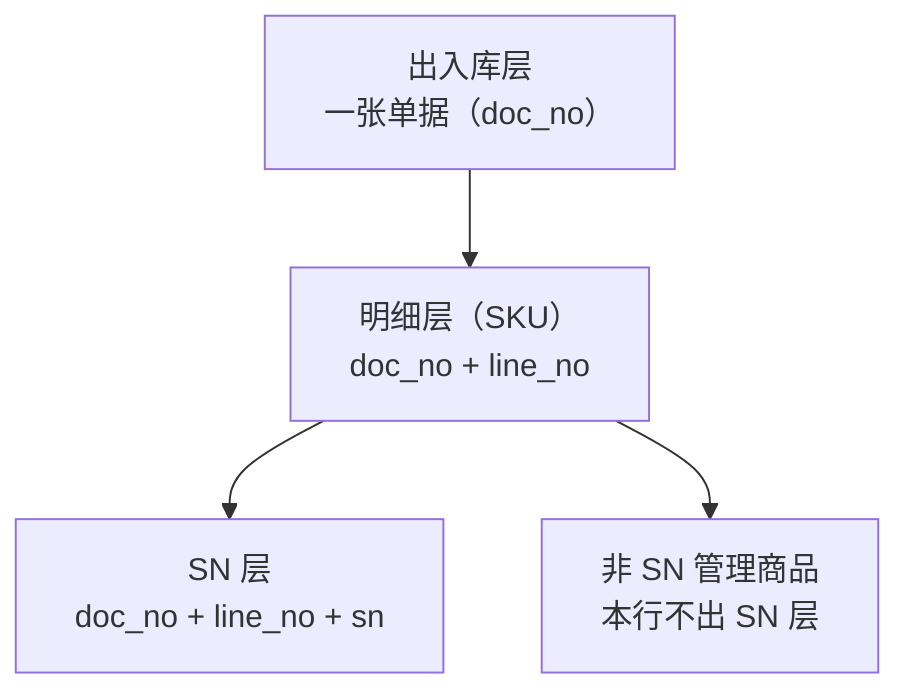

# 财务库存中心（一期）出入库三层字段与示例数据 v1.0

> **本文是什么**：把「单据通用字段 + 单据独有字段」按**出入库层（单据头）/ 出入库明细层（SKU 行）/ 出入库 SN 层**重新归层，逐层给出字段表，并按附件表头（业务单号 · 单据类型 · 业务日期 · 当日序号 · 业务状态）给出**每种单据的示例数据**。
>
> **权威关系**：原文 `财务库存中心（一期）需求文档 1.0（原型页面与核算引擎）.md` §四.1「接口数据」（`:1613` 起）是唯一权威。本文是**归层整理 + 示例**，字段名、类型、必填一律照抄原文；与原文不一致处集中在 §九 报告，**不改原文**。
>
> **本文未改动任何既有文件**：原文、详细设计、通俗版、各 PRD、原型页面、原型说明、字段层均未动。

---

## 一、三个数据层怎么分

| 层 | 一行是什么 | 主键 | 展开规则 |
|---|---|---|---|
| **出入库层**（单据头） | **一张业务单据** | `doc_no`（业务单号） | 单腿单一张一行；**双边单据（调拨 / 一级货权转移）仍是一行**——两条腿是同一张单，靠明细层的 `is_in`（出入方向）与 `warehouse_code`（仓库编码）区分，不拆单 |
| **出入库明细层**（SKU 行） | **一条单据行** | `doc_no` + `line_no`（单据行号） | 单腿单按 SKU 自然分行；**双边单据展开后两行连续**（第一腿 1、第二腿 2）。一行只对应一个 SKU、一个仓库、一个出入方向 |
| **出入库 SN 层** | **一个序列号** | `doc_no` + `line_no` + `sn`（序列号） | 一行报文行若携带 N 个序列号，展开成 N 行；非 SN 管理商品不出本层行。双边单据的同一件货会在两腿各出现一次，靠 `line_no` 区分 |

三层的包含关系：

> **三层不是三段处理流水**，而是同一批报文的三种展开粒度：数据一次报全，三层由同一份报文展开。真正的处理流水见 P17 标准化数据流水与 P04 标准数据计算。

---

## 二、出入库层字段（单据头）

### 2.1 通用字段（10 类单据全适用）

| 字段 | 类型 | 必填 | 说明 |
|---|---|---|---|
| `doc_no`（业务单号） | string(64) | Y | 业务单号。同一 `doc_type`（单据类型）内唯一，是全流程幂等排重键之一。**双边单据（调拨 / 货权转移）的两条腿共用同一个 `doc_no`**，不得拆成两张单 |
| `doc_type`（单据类型） | enum | Y | 取值：采购入库（`PO_IN`）/ 采退出库（`PO_RET`）/ 销售出库（`SO_OUT`）/ 销退入库（`SO_RET`）/ 调拨（`TRANSFER`，两腿）/ 其他出库（`OTHER_OUT`）/ 其他入库（`OTHER_IN`）/ 一级货权转移（`OWNER_TRANSFER`，两腿） |
| `biz_date`（业务日期） | date | Y | 业务日期（A 级）。排序键第一段，**填推送日即错**；落在已锁账期间即被拒收 |
| `seq_in_day`（当日序号） | int | Y | 排序键第二段，按「同日入库优先、同类型按单号」分配。**附件表头列出的就是本字段**，正文段落式的字段清单里容易被漏掉，单列于此 |
| `biz_status`（业务状态） | enum | Y | `DRAFT`（草稿）/ `SUBMITTED`（已提交）/ `APPROVED`（已审核）/ `EFFECTIVE`（已生效）/ `VOID`（已作废），缺省 `EFFECTIVE`（已生效） |
| `counterparty_code`（往来单位编码） | string | 条件 | 传谁随单据类型：采购入库 / 采退出库传**供应商**；销售出库 / 销退入库传**客户 / 平台**；其他入库传**赠送方（受赠）或委托方（受托代销）**；调拨、货权转移、其他出库传**往来单位** |
| `approved_by`（审核人） | string | 条件 | 「必审」= 单点审核动作 + 留痕 |
| `approved_at`（审核时间） | datetime | 条件 | — |
| `period`（所属记账期间） | char(6) | N | `YYYYMM`（年月），由 `biz_date`（业务日期）推导。**原文标 Y，本表按所提供的清单标 N**，差异见 §九 |

### 2.2 头级独有字段（按单据类型）

| 字段 | 类型 | 必填 | 适用单据类型 | 说明 |
|---|---|---|---|---|
| `supplier_code`（供应商编码） | string(32) | Y | 采购入库 / 采退出库 / 其他入库 | 供应商编码（本类型差异化必填） |
| `customer_code`（客户编码） | string(32) | Y | 销售出库 / 销退入库 | 客户编码（本类型差异化必填） |
| `orig_po_doc`（原始采购订单号） | string(64) | Y | 采退出库 | 原采购入库单号。**必须可追溯原单**，定位不到即 `E-SRC-DOC-MISSING`（源单缺失） |
| `orig_so_doc`（原始销售出库单号） | string(64) | Y | 销退入库 | 原销售出库单号。必须可追溯原单，同上错误码 |
| `out_warehouse_code`（出库仓库编码） | string(32) | Y | 调拨 | 调出仓库（报文侧字段） |
| `in_warehouse_code`（入库仓库编码） | string(32) | Y | 调拨 | 调入仓库（报文侧字段）。调出仓与调入仓**不属同一一级货主即拒绝**（`E-CROSS-LEGAL-ENTITY`：跨法人单据非法），要求改推一级货权转移，适配层**不做自动升级** |
| `from_owner_l1`（转出一级货主） | string(32) | Y | 一级货权转移 | 转出方法人 |
| `to_owner_l1`（转入一级货主） | string(32) | Y | 一级货权转移 | 转入方法人 |
| `from_owner_l2`（转出二级产权人） | string | Y | 一级货权转移 | 转出方二级产权人 |
| `to_owner_l2`（转入二级产权人） | string | Y | 一级货权转移 | 转入方二级产权人 |
| `reason`（原因） | string | Y | 其他出库 / 其他入库 | **分场景判别键**：其他出库六类按「是否回来」轴分、其他入库五类按「金额从哪来」分。放头的前提是「一单一个原因」；若同单需混合原因，改到行级（见 §九） |

---

## 三、出入库明细层字段（SKU 行）

### 3.1 通用字段

| 字段 | 类型 | 必填 | 说明 |
|---|---|---|---|
| `line_no`（单据行号） | int | Y | 行号。单腿单在同一 `doc_no`（业务单号）内从 1 递增；**双边单据展开后两行连续**（第一腿 1、第二腿 2） |
| `material_code`（商品编码） | string | Y | 商品编码。四轴之一 |
| `warehouse_code`（仓库编码） | string | Y | 核算单元（均价池）键之一。**双边单据按腿写入对应仓** |
| `is_in`（出入方向·1 入 0 出） | bool | Y | `0` = 出 / `1` = 入。**取值随单据类型与腿**：采购入库恒 `1`、采退出库恒 `0`、销售出库恒 `0`、销退入库恒 `1`、调拨两腿分别 `0` / `1`、其他出库恒 `0`、其他入库恒 `1`、货权转移两腿分别 `0` / `1` |
| `owner_l1`（一级货主） | string | Y | 四轴之一（= 法人），缺失拒绝入账 |
| `owner_l2`（二级产权人） | string | Y | **行级必填**，缺失即 `E-OWNER-L2-MISSING`（二级产权人缺失）。内部管理维度：不进余额表主键、不进存货总额 |
| `batch_no`（批次号） | string | Y | 批次号。**原文标 N（空 = 不按批次管理）**，本表按所提供的清单标 Y——差异见 §九 |
| `SN`（序列号） | string | N | 一行可能有多个序列号（数组）；**按 SN 管理的品类，出库行必须携带**（个别计价靠它定位成本层） |
| `qty`（数量） | decimal(18,4) | Y | 业务单位数量（展示用） |
| `unit`（单位） | string | Y | 业务单位 |
| `base_qty`（基本单位数量） | decimal(18,4) | Y | 核算唯一口径：`qty × convert_rate`（数量 × 单位换算率）对不上即拒 |
| `exchange_rate`（汇率） | decimal(10,6) | Y | 外币单据的本币折算率；本币单据填 `1` |
| `currency`（币种） | char(3) | Y | ISO 4217 三位码，如 `CNY` / `HKD` / `USD`。**所提供的清单把它写成 decimal(10,6)，与币种语义不符**，见 §九 |

### 3.2 行级独有字段（按单据类型）

> 这组字段在所提供的清单里挂在「单据独有字段」下，但按语义是**逐行**的（金额、税率、税额、分摊成本都是行值）。放明细层后，单行单据的行金额 = 单据金额；多行单据的各行加总 = 单据金额。

| 字段 | 类型 | 必填 | 适用单据类型 | 说明 |
|---|---|---|---|---|
| `amount_ex_tax`（不含税金额） | decimal(18,2) | Y / 条件 | 采购入库 Y、采退出库 Y（取负入账）、其他入库 条件、其他出库 条件、货权转移 Y | 本行入账基数。销售出库、销退入库**不采信传入金额**（销售出库成本由本系统算、销退按原出库成本回冲），故这两类不列。其他出库 `0` 是「只减数量、不减金额」的标记（第 6 类「货权已转实物才出库」） |
| `tax_rate`（税率） | decimal(10,6) | Y | 采购入库 / 其他入库 / 货权转移 | 税率。**原文标 N、缺省 `0.13`（全系统唯一缺省值）**，差异见 §九 |
| `tax_amount`（税额） | decimal(18,2) | N | 采购入库 / 其他入库 / 货权转移 | 单独拆出进进项税额，**绝不进 `amount_ex_tax`（不含税金额）** |
| `allocated_cost`（已分摊成本） | decimal(18,2) | N | 采购入库 / 其他入库 | 本行分摊的运费 / 关税 / 其他费用，按 `t_cost_allocation_rule`（费用分摊规则表）分摊；**计入入账金额** |
| `settle_status`（结算状态） | enum | 条件 | 采购入库 / 其他入库 | `ESTIMATED`（暂估）/ `SETTLED`（已结算）/ `ADJUSTED`（已调整）——暂估冲回的入口 |
| `estimate_ref_doc`（暂估关联单据） | string(64) | 条件 | 采购入库 / 其他入库 | 暂估引用单号，暂估与据实配对用 |
| `sale_price`（销售价） | decimal(18,2) | N | 销售出库 | 销售价格（不含税口径）。**仅作参考与核对，不参与结转成本** |
| `is_related_party`（是否关联方） | bool | N | 销售出库 | 决定合并抵消 |

---

## 四、出入库 SN 层字段

| 字段 | 类型 | 必填 | 说明 |
|---|---|---|---|
| `doc_no`（业务单号） | string(64) | Y | 所属单据，关联出入库层 |
| `line_no`（单据行号） | int | Y | 所属单据行，关联明细层 |
| `sn`（序列号） | string | Y | 序列号本体。**同一 `doc_no` + `line_no` 内唯一**；双边单据的同一件货在两腿各出现一次（`line_no` 不同） |
| `material_code`（商品编码） | string | Y | 冗余自所属行，便于本层独立检索 |
| `warehouse_code`（仓库编码） | string | Y | 该行仓库 |
| `is_in`（出入方向·1 入 0 出） | bool | Y | 该行方向 |
| `owner_l1`（一级货主） | string | Y | 该行一级货主 |
| `owner_l2`（二级产权人） | string | Y | 该行二级产权人 |
| `biz_date`（业务日期） | date | Y | 冗余自单据头，便于与出入库层对读 |

> **本层全部可由明细层的 `SN` 字段展开得到**，不引入任何新字段；单独成层的价值是按序列号检索、按件核对（与 P08 序列号资产台账同粒度）。

---

## 五、示例数据 · 出入库层

> 10 个单据类型各一单；调拨与一级货权转移各为**一张单两腿**，在明细层展开。示例数据均为构造样例，非真实业务。

| 业务单号 | 单据类型 | 业务日期 | 当日序号 | 业务状态 | 所属记账期间 | 往来单位 | 审核人 / 审核时间 | 本类型独有字段 |
|---|---|---|---|---|---|---|---|---|
| PO-202603-0001 | 采购入库（`PO_IN`） | 2026-03-02 | 3 | 已生效（`EFFECTIVE`） | 202603 | SUP-0001 | 王会计 / 2026-03-02 09:20 | 供应商 `SUP-0001` |
| PR-202603-0002 | 采退出库（`PO_RET`） | 2026-03-05 | 1 | 已生效（`EFFECTIVE`） | 202603 | SUP-0001 | 王会计 / 2026-03-05 10:05 | 供应商 `SUP-0001`；原单 `PO-202603-0001` |
| SO-202603-0003 | 销售出库（`SO_OUT`） | 2026-03-06 | 2 | 已生效（`EFFECTIVE`） | 202603 | CUS-0001 | 李会计 / 2026-03-06 14:30 | 客户 `CUS-0001` |
| SR-202603-0004 | 销退入库（`SO_RET`） | 2026-03-10 | 1 | 已生效（`EFFECTIVE`） | 202603 | CUS-0001 | 李会计 / 2026-03-10 11:15 | 客户 `CUS-0001`；原单 `SO-202603-0003` |
| TR-202603-0005 | 调拨（`TRANSFER`·两腿） | 2026-03-12 | 4 | 已生效（`EFFECTIVE`） | 202603 | 内部往来 | 王会计 / 2026-03-12 16:40 | 出库仓 `WH01` → 入库仓 `WH02` |
| OO-202603-0006 | 其他出库（`OTHER_OUT`） | 2026-03-15 | 1 | 已生效（`EFFECTIVE`） | 202603 | 华东代采项目 | 王会计 / 2026-03-15 09:50 | 原因：借出 |
| OI-202603-0007 | 其他入库（`OTHER_IN`） | 2026-03-16 | 2 | 已生效（`EFFECTIVE`） | 202603 | 华东代采项目 | 王会计 / 2026-03-16 10:20 | 原因：原物归还；供应商 `SUP-0002` |
| OT-202603-0008 | 一级货权转移（`OWNER_TRANSFER`·两腿） | 2026-03-18 | 5 | 已生效（`EFFECTIVE`） | 202603 | 内部往来 | 张会计 / 2026-03-18 15:00 | 转出 `OWN-A` / `OWN-A-1` → 转入 `OWN-B` / `OWN-B-1` |

---

## 六、示例数据 · 出入库明细层（SKU）

> 金额为不含税；采退出库按原文**取负入账**。销售出库、销退入库、调拨不采信传入金额，故 `amount_ex_tax`（不含税金额）为 `—`。

| 业务单号 | 行号 | 商品编码 | 商品名称 | 仓库 | 出入方向 | 一级货主 | 二级产权人 | 批次号 | 数量 | 单位 | 基本数量 | 不含税金额 | 税率 | 税额 | 分摊成本 | 结算状态 |
|---|---|---|---|---|---|---|---|---|---|---|---|---|---|---|---|---|
| PO-202603-0001 | 1 | M0001 | iPhone 15 Pro 256G 原色钛金属 | WH01 | 入 | OWN-A | OWN-A-1 | B-2603A | 100.0000 | 台 | 100.0000 | 560,000.00 | 0.13 | 72,800.00 | 1,200.00 | 暂估（`ESTIMATED`） |
| PO-202603-0001 | 2 | M0002 | iPhone 15 128G 蓝色 | WH01 | 入 | OWN-A | OWN-A-1 | B-2603B | 200.0000 | 台 | 200.0000 | 640,000.00 | 0.13 | 83,200.00 | 800.00 | 暂估（`ESTIMATED`） |
| PR-202603-0002 | 1 | M0002 | iPhone 15 128G 蓝色 | WH01 | 出 | OWN-A | OWN-A-1 | B-2603B | 20.0000 | 台 | 20.0000 | −64,000.00 | — | −8,320.00 | — | — |
| SO-202603-0003 | 1 | M0003 | 华为 Mate 60 Pro 512G 雅川青 | WH01 | 出 | OWN-B | OWN-B-1 | B-2602C | 50.0000 | 台 | 50.0000 | — | — | — | — | — |
| SR-202603-0004 | 1 | M0003 | 华为 Mate 60 Pro 512G 雅川青 | WH01 | 入 | OWN-B | OWN-B-1 | B-2602C | 5.0000 | 台 | 5.0000 | — | — | — | — | — |
| TR-202603-0005 | 1 | M0005 | iPad Air 5 64G 深空灰 | WH01 | 出 | OWN-A | OWN-A-1 | B-2601D | 30.0000 | 台 | 30.0000 | — | — | — | — | — |
| TR-202603-0005 | 2 | M0005 | iPad Air 5 64G 深空灰 | WH02 | 入 | OWN-A | OWN-A-1 | B-2601D | 30.0000 | 台 | 30.0000 | — | — | — | — | — |
| OO-202603-0006 | 1 | M0007 | AirPods Pro 2 USB-C | WH03 | 出 | OWN-A | OWN-A-1 | B-2601E | 8.0000 | 台 | 8.0000 | — | — | — | — | — |
| OI-202603-0007 | 1 | M0007 | AirPods Pro 2 USB-C | WH03 | 入 | OWN-A | OWN-A-1 | B-2601E | 2.0000 | 箱 | 8.0000 | 21,600.00 | 0.13 | 2,808.00 | — | — |
| OT-202603-0008 | 1 | M0004 | 小米 14 Ultra 16+512G 黑色 | WH01 | 出 | OWN-A | OWN-A-1 | B-2602F | 12.0000 | 台 | 12.0000 | 57,600.00 | 0.13 | 7,488.00 | — | — |
| OT-202603-0008 | 2 | M0004 | 小米 14 Ultra 16+512G 黑色 | WH01 | 入 | OWN-B | OWN-B-1 | B-2602F | 12.0000 | 台 | 12.0000 | 57,600.00 | 0.13 | 7,488.00 | — | — |

> **读法要点**：① `TR-202603-0005` 两腿同一批次、两个仓库，`owner_l1` 必须相同——不同即应改推一级货权转移；② `OT-202603-0008` 两腿同一批次、同一仓库，货权从 `OWN-A / OWN-A-1` 换到 `OWN-B / OWN-B-1`，实物未动；③ `OI-202603-0007` 是**箱 / 台换算**的例子：`qty 2 箱 × convert_rate 4 = base_qty 8 台`，核算只认 `base_qty`。

---

## 七、示例数据 · 出入库 SN 层

> 只列 SN 管理品类的行；每个 SKU 只列前 2 个序列号作样例，实际按件展开。`OT-202603-0008` 的同一件货在**两腿各出现一次**（`line_no` 1 / 2），这是本层的常态，不是重复数据。

| 业务单号 | 行号 | 序列号 SN | 商品编码 | 商品名称 | 仓库 | 出入方向 | 一级货主 | 二级产权人 | 业务日期 |
|---|---|---|---|---|---|---|---|---|---|
| PO-202603-0001 | 1 | SN868120000201 | M0001 | iPhone 15 Pro 256G 原色钛金属 | WH01 | 入 | OWN-A | OWN-A-1 | 2026-03-02 |
| PO-202603-0001 | 1 | SN868120000202 | M0001 | iPhone 15 Pro 256G 原色钛金属 | WH01 | 入 | OWN-A | OWN-A-1 | 2026-03-02 |
| SO-202603-0003 | 1 | SN868120010033 | M0003 | 华为 Mate 60 Pro 512G 雅川青 | WH01 | 出 | OWN-B | OWN-B-1 | 2026-03-06 |
| OT-202603-0008 | 1 | SN868120011307 | M0004 | 小米 14 Ultra 16+512G 黑色 | WH01 | 出 | OWN-A | OWN-A-1 | 2026-03-18 |
| OT-202603-0008 | 2 | SN868120011307 | M0004 | 小米 14 Ultra 16+512G 黑色 | WH01 | 入 | OWN-B | OWN-B-1 | 2026-03-18 |

---

## 八、三层之间的对平关系

| 校验 | 等式 | 不成立说明 |
|---|---|---|
| 单据行数 | 出入库层的一单 = 明细层该 `doc_no` 的行数 | 报文缺行或多行 |
| 方向一致 | 明细层 `is_in` 与该单据类型的固定方向 / 腿方向一致 | 方向填反，会整单回滚 |
| 双边两腿 | 调拨、一级货权转移的明细层**恰为两行**（第一腿 `line_no` 1、第二腿 2），且 `base_qty` 相等、批次号相等 | 腿缺失或数量不等 |
| 金额 | 多行单据：明细层各行 `amount_ex_tax` 之和 = 单据金额；`amount_ex_tax + allocated_cost` = 入账金额 | 分摊未落行 |
| 数量 | 各行 `qty × convert_rate` = `base_qty` | 换算率错或被篡改 |
| SN | 明细层行携带的 SN 个数 = 该行在 SN 层的行数 | SN 漏采或重复 |

---

## 九、归层判断与与原文的差异（**只报告，未改任何文件**）

### 9.1 本轮的归层判断（原文未写层级的地方）

| # | 项 | 判断 | 理由 |
|---|---|---|---|
| 1 | 「单据独有字段」里的金额 / 税率 / 税额 / 分摊成本 / 结算状态 / 暂估单号 / 销售价 / 是否关联方 | 一律放**明细层** | 都是逐行值（原文说明写的是「本行分摊」「行级」） |
| 2 | `supplier_code` / `customer_code` / 原单号 / 调拨两仓 / 货权转移四方 | 放**出入库层** | 一单一份，两腿共享 |
| 3 | `reason`（原因） | 放**出入库层**（一单一个原因） | 原文未写层级；若同单需混合原因，应改放行级并允许按行拆单 |
| 4 | `SN` | 放**明细层**，并展开成 **SN 层** | 原文个别计价要求出库行携带 SN；SN 层不引入新字段，只是展开 |

### 9.2 与原文 §四.1 的差异（**均未改原文**）

| # | 项 | 本次所提供的清单 | 原文 §四.1 | 处理 |
|---|---|---|---|---|
| 1 | `seq_in_day`（当日序号） | 正文清单未列（附件表头有） | 公共头字段，Y | 本文按附件列入出入库层 |
| 2 | `legal_entity`（法人） | 未列 | 公共头字段，Y（行级可覆盖） | 本文未列，**建议确认是否漏项**——`owner_l1`（一级货主）虽等于法人，但原文两个字段并存 |
| 3 | `SN` / `exchange_rate`（汇率）/ `currency`（币种） | 列为行字段 | 公共行字段**没有**这三项（`base_qty` 说明提到 `convert_rate` 换算率，但字段表未单列） | 本文按清单列入明细层；**三项在原文无定义**，属新增字段，需授权后才能落字段层 |
| 4 | `base_qty` 的 `convert_rate`（单位换算率） | 只在说明里出现，未单列 | 同样未单列 | 本文同原文一致，不单列；示例 §六 给出 2 箱 = 8 台的换算例 |
| 5 | `batch_no`（批次号） | **Y**「本期必须有批次号」 | **N**「空 = 不按批次管理」 | **冲突**。本文按清单标 Y，但原文口径会让「不按批次管理」的品类无批次号——需拍板 |
| 6 | `tax_rate`（税率） | **Y** | **N**，缺省 `0.13`（全系统唯一缺省值） | **冲突**。本文按清单标 Y |
| 7 | `period`（所属记账期间） | **N** | **Y**（由 `biz_date` 推导） | 本文按清单标 N |
| 8 | `currency`（币种）类型 | decimal(10,6) | 原文无此字段 | **类型明显不符**（币种应为 `char(3)`），本文按 `char(3)` 写并标注 |
| 9 | `owner_l2` 的说明措辞 | 用的是已废弃的二级称谓 | 原文同段亦沿用该废弃称谓 | 按项目命名禁令统一为「**二级产权人**」，本文全部字段说明已按此写 |
| 10 | 一级货权转移的作价字段 | 清单只给 `amount_ex_tax` / 税率 / 税额 / 四方货主 | 原文另有 `transfer_price`（一级货权转移价）/ `price_source`（作价来源）/ `price_value`（取价结果）/ `is_related_party`（是否关联方）/ `is_accounting_event`（是否会计事件） | 本文示例按清单出数；**这五个字段原文必填，清单缺**，建议补齐 |

---

## 十、改动边界

| 对象 | 状态 |
|---|---|
| 原文（需求文档 1.0） | **未改** |
| 详细设计 / 通俗版 / 计算逻辑分册 / 计算示例 / 各 PRD | **未改** |
| 原型页面 / 原型说明 | **未改**（此前的 P03 三页签改法已按用户要求整体回退） |
| 字段层 | **未动**——§九 的差异与新增字段只报告，未落库、未改表结构 |

> 本文只新增这一份 md。§九 的 10 项若要回灌原文或落实为接入层正式数据模型，属**字段层 + 跨文档变更**，须先出变更清单、再单独授权。
