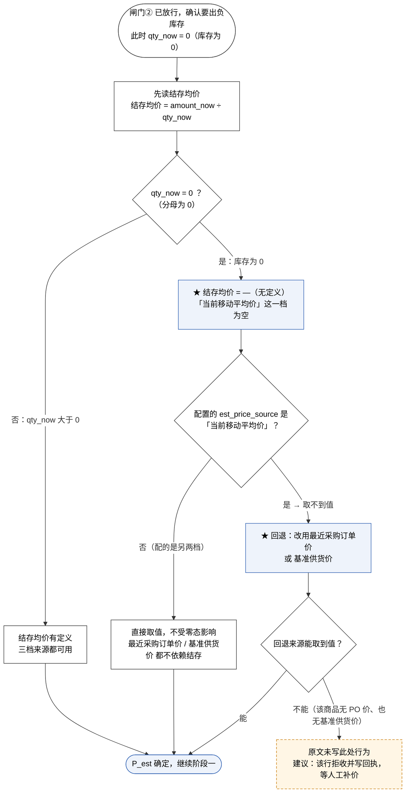
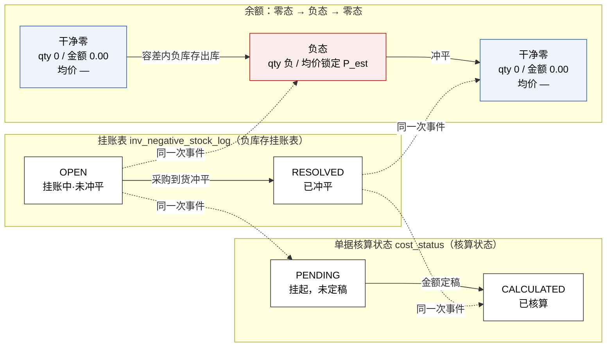
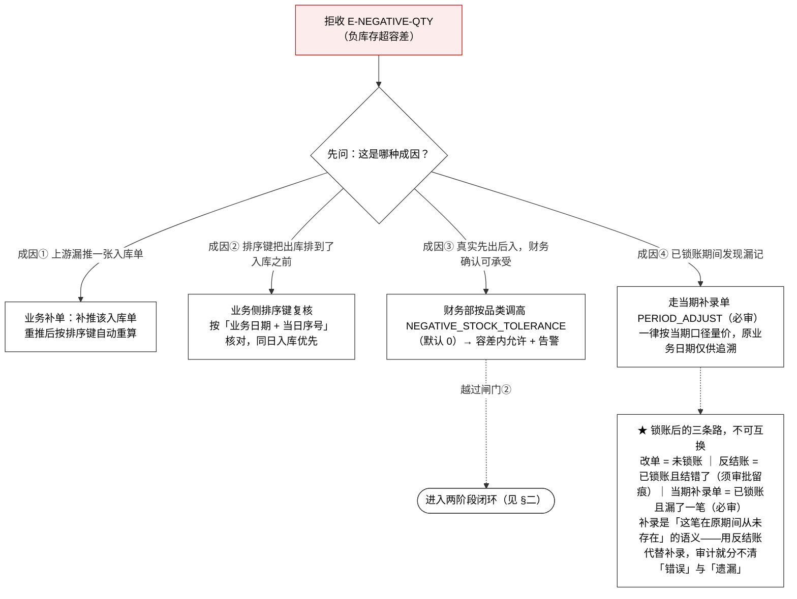

# 财务库存中心（一期）· 负库存全流程 v1.0

> **本文是什么**：把「负库存」从**出库事件到达**到**冲平出凭证**的整条链路画成图，并**专门把「结存数量为 0、没有加权平均价」这个边界**从主干里拎出来画清楚——它决定了**暂估单价从哪来**。
>
> **权威关系**：规则以原文 `财务库存中心（一期）需求文档 1.0（原型页面与核算引擎）.md` 为准（下称「原文」）。本文是**图 + 指针 + 留白清单**，不含任何新口径。原文行号写在每处指针里，可逐条核验。
>
> **★ 关于「没有加权平均价」这一段**：原文把负库存的**闸门**（`:4001`）和**两阶段闭环**（`:4018`）写全了，但**没有处理「结存数量为 0 ⇒ 结存均价失去定义 ⇒ 暂估单价取不到值」这条支线**——「当前移动平均价」这一档在零态下必然为空。本文把这处**原文留白**用虚线框标出来（见 §七）。
>
> **配套读物**：`财务库存中心（一期）单据处理全流程图_v1.0.md` §12 的 `X-08`／`X-09` 是本文在**全流程管线**上的两个接口点；规则摘要见 skill `fin-negative-stock`。

---

## 一、结论速览

### 1.1 三句话

1. **一期默认禁止负库存。** 容差 `NEGATIVE_STOCK_TOLERANCE`（负库存容差参数）默认 `0`，意味着「任意负余额即超容差 → 拒收 `E-NEGATIVE-QTY`（负库存超容差）」（原文 `:4039`）。**负库存这条流程一期根本走不到**，除非财务部按品类把容差调高。
2. **容差 > 0 时才进两阶段闭环。** 阶段一按**暂估单价 `P_est`** 记负数量与负金额、均价**强制锁定**为 `P_est`、挂账 `OPEN`（挂账中·未冲平）、核算状态 `PENDING`（挂起，未定稿）；阶段二是**两步**（冲平缺口 + 剩余入池），不是一步（原文 `:4018`）。
3. **「库存为 0、没有加权平均价」是一个真实存在的状态**，而且**就在负库存流程的入口上**：结存均价 = 结存金额 ÷ 结存数量，**分母为 0 时无定义**（原文 `:163`）。零态下若配置的暂估单价来源恰是「当前移动平均价」，**它取不到值**——必须回退到不依赖结存的来源（见 §三）。

### 1.2 「库存为 0」到底是什么状态

原文 `:163` 只说了**分母**：

> `current_unit_cost`（当前结存均价） = $\frac{\sum 金额}{\sum 数量}$——**加权平均，不是各单元均价的算术平均**；**分母为 0 时显示 `—`**

但「数量为 0」有**两种**，均价都算不出来，后果却不一样：

| 状态 | 数量 | 金额 | 均价 | 语义 | 由谁保证 |
|---|---|---|---|---|---|
| **干净零** | `0` | `0.00` | `—` | 核算单元**真正清零**——先例写法见原文 `:3684`「派生均价 = —（**无残留层，核算单元清零**）」 | `F4`（出清处理，原文 `:2159`） |
| **脏零** | `0` | `≠ 0.00` | `—`（且**金额悬空**） | 数量没了、钱还挂着——**F4 未跑或未跑净** | `F4` 正是为清它而存在 |

> **`F4`（出清处理）**（原文 `:2159`）：
>
> ```
> F4  若出库后 new_qty = 0 且 new_amount ≠ 0，
>     将剩余金额全额结转（或转入舍入差异账户）并把余额清零
> ```

**三种计价法都受 F4 约束**：移动加权平均（原文 `:2159`）、个别计价（`:2179`）、先入先出法（`:2193`）——后两者的写法都是「数量清零时若仍有残留金额，按 F4 全额结转」。

⇒ **「库存为 0」要成为流程的安全前提，靠的是「数量与金额同时为 0」，不是「数量为 0」。** 只判数量不判金额，就会在零态下拿到一个分母为 0 的比值。

### 1.3 零态下均价不可对外

负库存期间（含**数量为负**和**零态残留**）均价**一律不对外**——原文在五个维度的字段说明里各写了一遍：集团 `:840` / 仓库 `:875` / 一级货主 `:911` / 二级产权人 `:950` / 批次 `:990`：

> `has_negative`（负库存标记）……**负库存期间本行均价同时显示 `—`**（负库存期间均价不可对外）

零态（均值为 `—`）与负态（均价强制显示 `—`）在**展示层是同一个符号**，但成因不同：一个是**没有分母**，一个是**分母为负、语义不可信**。§三的取价分支只解决前者的**记账**问题，展示层两种都照 `—` 处理。

### 1.4 配置 / 参数一览（谁在拦）

| 拦截点 | 载体 | 字段 | 默认 | 作用 |
|---|---|---|---|---|
| 闸门① | 事件本身 | 出库数量 `base_qty` | — | 数量 ≤ 0 直接拒收（原文 `:4006`） |
| 闸门② | 系统参数表 `t_system_param` | `NEGATIVE_STOCK_TOLERANCE`（负库存容差参数） | **`0`** | 决定「负多少以内可以过」（原文 `:4039`） |
| 风控策略 | 负库存风控策略配置表 `cfg_negative_stock_rule` | `allow_negative`（允许负库存） | — | `0` 严格禁止（Hard Stop）/ `1` 允许负库存（原文 `:663`） |
| 风控策略 | 同上 | `max_negative_qty`（缺口上限件数） | — | 允许超卖件数上限（原文 `:664`） |
| 风控策略 | 同上 | `max_pending_days`（最长挂账天数） | — | **逾期未平阻断出库**（原文 `:665`） |
| 取价 | 同上 | `est_price_source`（暂估单价来源） | — | 三档：`LATEST_PO_PRICE`（最近采购订单价）/ `BENCHMARK_PRICE`（基准供货价）/ `MOVING_AVG_PRICE`（当前移动平均价）（原文 `:666`） |
| 告警 | 同上 | `alert_email`（告警接收人） | — | 告警推送邮箱（原文 `:667`） |

> **⚠️ 条件行联动**：`max_negative_qty`（缺口上限件数）/ `max_pending_days`（最长挂账天数）/ `est_price_source`（暂估单价来源）三项**仅在 `allow_negative`（允许负库存）选「允许负库存」时出现且必填**；选「严格禁止」时**隐藏**——不允许负库存则不存在缺口，三项无意义（原文 `:655-668`）。

---

## 二、全流程图（主干）

```mermaid
%%{init: {"themeVariables": {"primaryTextColor": "#000000", "edgeLabelBackground": "#ffffff"}}}%%
flowchart TD
    classDef default fill:#ffffff,stroke:#333333,color:#000000;
    classDef k fill:#eef7ee,stroke:#2f7a2f,color:#000000;
    classDef x fill:#fdecec,stroke:#c00000,color:#000000;
    classDef z fill:#eef3fb,stroke:#2a5db0,color:#000000;
    classDef g fill:#fff6e5,stroke:#c77700,color:#000000,stroke-dasharray:5 3;

    S(["出库事件到达<br/>引擎按排序键「业务日期 + 当日序号」逐单调度"]) --> A1{"闸门① 前置断言<br/>出库数量 base_qty 大于 0 ？"}
    A1 -->|否| X1["拒收：数量 ≤ 0<br/>不进计量"]:::x
    A1 -->|是| A2["读该核算单元当前余额<br/>核算单元 = 商品 × 仓库 × 一级货主<br/>qty_now（结存数量）/ amount_now（结存金额）"]

    A2 --> A3{"闸门② 容差判定（校验前移，不进计量）<br/>qty_now − out_qty 小于 −容差 ？<br/>容差 NEGATIVE_STOCK_TOLERANCE，一期默认 0"}
    A3 -->|"是（一期容差 = 0 → 任何负余额都落此支）"| X2["拒收 E-NEGATIVE-QTY（负库存超容差）<br/>行级拒收、附现有数量<br/>不写余额、不出事件"]:::x

    A3 -->|否| A4{"出库后余额 qty_now − out_qty 大于等于 0 ？"}
    A4 -->|是| K1["正常过账<br/>按 F2 结转：out_amount = round(out_qty × 当前均价, 2)<br/>出库不重算均价；舍入差异只在出库产生"]:::k

    A4 -->|"否 → 负库存出库<br/>（容差大于 0 时才走得到）"| B1{"暂估单价来源 est_price_source 是哪一档？<br/>仅在「允许负库存 = 1」时出现且必填"}

    B1 -->|"当前移动平均价 MOVING_AVG_PRICE"| B2{"★ 结存数量 qty_now 大于 0 ？"}
    B2 -->|是| B3["结存均价 = amount_now ÷ qty_now 有定义<br/>P_est 取该值"]
    B2 -->|"否 → qty_now = 0<br/>（没有加权平均价）"| B4["★ 结存均价 = —<br/>分母为 0，比值无定义（原文 :163）<br/>「当前移动平均价」这一档取不到值<br/>原文 :4012 的 amount_delta = round(out_qty × 当前均价, 2) 在此算不出来"]:::z
    B4 --> B5["回退取价：最近采购订单价 LATEST_PO_PRICE<br/>或 基准供货价 BENCHMARK_PRICE<br/>（这两档都不依赖结存，零态下仍可取值）"]:::z
    B5 --> B6{"回退来源能取到值？"}
    B6 -->|否| X3["无价可依 → 该行拒收<br/>写错误回执，等人工补价后再推"]:::g
    B6 -->|是| C0(["P_est（暂估单价）确定"]):::z

    B1 -->|"最近采购订单价 LATEST_PO_PRICE"| C0
    B1 -->|"基准供货价 BENCHMARK_PRICE"| C0
    B3 --> C0

    C0 --> C1["阶段一：负库存出库（挂起，未定稿）<br/>缺口 ΔQ = out_qty − 可动用数量<br/>（qty_now 为 0 时 ΔQ = out_qty）<br/>数量 −ΔQ ；金额 −round(ΔQ × P_est, 2)"]
    C1 --> C2["★ 结存均价【强制锁定】为 P_est<br/>禁止「金额 ÷ 负数」——那才是数学异常"]:::z
    C2 --> C3["写挂账表 inv_negative_stock_log（负库存挂账表）<br/>状态 OPEN（挂账中·未冲平）<br/>发告警（alert_email）进对账异常池"]
    C3 --> C4["单据核算状态 cost_status = PENDING（挂起，未定稿）<br/>金额未定 ⇒ 不出凭证"]

    C4 -->|"采购补录到达<br/>（先发货后到票 → 业务补单，重推后按排序键自动重算）"| D1{"挂账逾期检查<br/>已超 max_pending_days（最长挂账天数）？"}
    D1 -->|是| X4["阻断后续出库 + 催票告警<br/>人工介入"]:::x
    D1 -->|否| D2["采购入库（Q_in, P_actual）到达"]

    D2 --> D3{"缺口 ΔQ 与入库量 Q_in 的关系"}
    D3 -->|"Q_in 大于 ΔQ"| D4["阶段二 · 两步<br/>① 冲平缺口 ΔQ：负数与负金额一起归零，差额 ΔCost 剔出计损益<br/>② 剩余 (Q_in − ΔQ) 按 P_actual 入池<br/>→ 结存均价 = P_actual"]:::k
    D3 -->|"Q_in = ΔQ（正好回零）"| D5["① 冲平缺口，数量与金额一起归零<br/>② 无剩余<br/>→ ★ 均价再度失去定义 = —（回到干净零）"]:::z
    D3 -->|"Q_in 小于 ΔQ（部分冲平）"| D6["缺口只冲掉 Q_in，余量仍为负<br/>挂账仍 OPEN，均价仍锁定 P_est"]:::g

    D4 --> D7["价差 ΔCost =（P_actual − P_est）× ΔQ<br/>自动出【成本调整单 COST_ADJUST】计损益"]
    D5 --> D7
    D7 --> D8["F4（出清处理）兜底<br/>数量为 0 而金额仍有残留 → 全额结转（或转舍入差异账户）并清零"]
    D8 --> E1(["挂账置 RESOLVED（已冲平）<br/>cost_status 转 CALCULATED（已核算）<br/>金额此时才定稿、才出凭证"])
```

> **图例**：白框 = 原文已写明的正常路径；<span>绿框</span> = 正常过账/冲平成功；**红框** = 拒收；**蓝框** = ★ 零结存（无加权平均价）相关；**琥珀虚线框** = 原文未写的留白。



### 2.1 读图要点

| # | 要点 | 依据 |
|---|---|---|
| 1 | **两道闸门都在计量之前**——不通过就**不进计量、不写余额、不出事件**。全部错误码都在过账之前产生 | 原文 `:4001` |
| 2 | **一期容差 = 0 ⇒ 红框 `X2` 是默认终点**。要走到蓝框那一段，必须先由财务部按品类调高容差 | 原文 `:4039` |
| 3 | **零结存不是独立的闸门**，它是**取价环节**的分支——闸门②先放行，才轮到「均价有没有」这个问题 | 原文 `:4012` |
| 4 | **阶段二是两步**：冲平缺口 `ΔQ` 与「剩余入池」是两件事，漏掉第二步，均价就永远停在 `P_est` | 原文 `:4018` |
| 5 | **挂账状态与核算状态是两条独立的线**：`OPEN`（挂账中·未冲平）/`RESOLVED`（已冲平）在挂账表、`PENDING`（挂起，未定稿）/`CALCULATED`（已核算）在单据头，同步推进但载体不同 | 原文 `:663`、`:4018` |
| 6 | **成本调整单 `COST_ADJUST` 是自动出的**，不需要人工点——价差算出来就出 | 原文 `:4018` |

---

## 三、★ 零结存取价放大图（本文重点）

把主干里 `B1 → C0` 那一段单独放大。**核心问题**：结存数量为 `0` 时，「当前移动平均价」这一档是空的，`P_est` 从哪来。



### 3.1 为什么零态下「当前移动平均价」必然为空

结存均价的定义是 **金额 ÷ 数量**（原文 `:163`）。库存为 `0` 时：

- **干净零**（`0 / 0.00`）→ $\frac{0}{0}$，**数学上无定义**；
- **脏零**（`0 / ≠0.00`）→ $\frac{a}{0}$，**同样无定义**，且金额本身悬空。

两种都取不到值。所以「配置了当前移动平均价、库存又恰好为 0」时，**系统必须换一个不依赖结存的来源**。

### 3.2 三档来源的「零态可用性」

| `est_price_source`（暂估单价来源） | 中文名 | 取值依据 | 零结存（qty = 0）下 |
|---|---|---|---|
| `MOVING_AVG_PRICE` | 当前移动平均价 | 结存金额 ÷ 结存数量 | **不可用**——分母为 0，无定义 |
| `LATEST_PO_PRICE` | 最近采购订单价 | 该商品最近一张采购订单的价 | **可用**——不读结存 |
| `BENCHMARK_PRICE` | 基准供货价 | 主数据里维护的基准供货价 | **可用**——不读结存 |

⇒ **零结存场景下，能用的只有后两档。** 这是选型时最该先确认的一件事：**如果某品类会长期从零库存起出库，就不该把它的暂估单价来源配成「当前移动平均价」。**

### 3.3 数字走一遍（同一串数，三种收场）

起点：商品编码 `M0002` / 仓库编码 `WH01` / 一级货主 `OWN-A`，结存 **`qty_now = 0`、`amount_now = 0.00`**（干净零，均价 `—`）。出库 `100` 台，容差已由财务按品类调高。配置的暂估单价来源是「当前移动平均价」→ 零态取不到 → **回退到最近采购订单价 `13.00`**。

**阶段一（三档收场共用）**

| 项 | 值 |
|---|---|
| 缺口 `ΔQ` | `100`（qty_now = 0 ⇒ 全部是缺口） |
| 结存数量 | `0 → −100` |
| 结存金额 | `0.00 → −1,300.00`（= −round(100 × 13.00, 2)） |
| 结存均价 | **强制锁定 `13.000000`**（不是 −1,300.00 ÷ −100；原文禁止走除法） |
| 挂账 | `OPEN`（挂账中·未冲平） |
| 核算状态 | `PENDING`（挂起，未定稿） |

**阶段二 · 收场 A：`Q_in = 100` @ `P_actual = 13.50`（正好回零）**

| 步骤 | 数量 | 金额 | 均价 |
|---|---|---|---|
| 起点 | `−100` | `−1,300.00` | `13.000000`（锁定） |
| ① 冲平缺口 `ΔQ = 100` | `0` | `0.00` | — |
| ② 剩余 `(100 − 100) = 0` | `0` | `0.00` | — |
| **收场** | **`0`** | **`0.00`** | **`—`（★ 均价再度失去定义）** |

价差 `ΔCost =（13.50 − 13.00）× 100 = 50.00` → 自动出【成本调整单 `COST_ADJUST`】。挂账置 `RESOLVED`（已冲平），核算状态 `cost_status`（核算状态）转 `CALCULATED`（已核算）。

> **这就是「冲平后再度归零」的完整答案**：数量回 `0` 时，均价**再次变成 `—`**，但这次是**干净零**——因为冲平这一步把 `ΔCost` 从池里剔出去计损益了，池里没有残留金额。若冲平没剔净（或在 2 位小数上留下 ±0.01 的尾差），`F4` 兜底把残留金额全额结转（或转舍入差异账户）并清零（原文 `:2159`）。

**阶段二 · 收场 B：`Q_in = 300` @ `P_actual = 13.50`（有剩余）**

| 步骤 | 数量 | 金额 | 均价 |
|---|---|---|---|
| 起点 | `−100` | `−1,300.00` | `13.000000`（锁定） |
| ① 冲平缺口 `ΔQ = 100` | `0` | `0.00` | — |
| ② 剩余 `(300 − 100) = 200` 按 `P_actual` 入池 | `200` | `2,700.00` | `13.500000` |
| **收场** | **`200`** | **`2,700.00`** | **`13.500000`（= `P_actual`）** |

> 均价等于 `P_actual` 的**前提是第①步先把池子归零**——这正是「阶段二是两步」的用处。若把入库整笔（`300` 台）直接并入原池，算出来的会是 `(−1,300.00 + 4,050.00) ÷ (−100 + 300) = 2,750.00 ÷ 200 = 13.750000`，**多算了 `0.25`**——差的就是那笔被剔走的 `ΔCost`。

**阶段二 · 收场 C：`Q_in = 60` @ `P_actual = 13.50`（部分冲平）**——原文未写，见 §七 第 5 条。

---

## 四、状态与留痕（三条线）



| 线 | 载体 | 起点 | 终点 | 中途每一步 |
|---|---|---|---|---|
| **挂账** | `inv_negative_stock_log`（负库存挂账表），页面 P15 | `OPEN`（挂账中·未冲平） | `RESOLVED`（已冲平） | 全部留痕 |
| **核算状态** | 单据头 `cost_status`（核算状态） | `PENDING`（挂起，未定稿） | `CALCULATED`（已核算） | —— |
| **余额** | 核算单元余额 | 干净零，均价 `—` | 干净零，均价 `—` | 中间经过「数量为负、均价锁定 `P_est`」 |

> 原文的原则：**不允许「出负数量且无任何记录」**——负库存必须**可见、可查、可催票**（原文 `:4018`）。挂账表就是「可见」的载体。**一期一期走完，余额回到原点，但挂账表上留下了一条从 `OPEN` 到 `RESOLVED` 的完整轨迹**——这是审计要的那条线。

**P15（负库存挂账表）关键字段**（原文 `:1452-1457`）：

| 字段 | 中文名 | 用途 |
|---|---|---|
| `out_journal_no` | 出库流水号 | 与结存流水的流水号一致，双向可查 |
| `biz_bill_no` | 关联销售单号 | 触发该次缺货出库的销售订单号，便于**反向催货与催票** |
| `legal_owner_id` | 一级货主 | 缺货出库方 |
| `amiba_owner_id` | 二级产权人 | 该笔挂账挂在哪位产权人账下；**不进存货总额**，只影响二级考核口径 |
| `warehouse_code` | 仓库 | 缺货出库仓 |
| `sku_code` | 商品 SKU | 商品编码 |

---

## 五、被拒收之后：四条人工处置路



> **三条路不可互换**（原文 `:4059`）：**改单**（未锁账）、**反结账**（已锁账且结错了，须审批留痕）、**当期补录单 `PERIOD_ADJUST`（跨期补录单）**（已锁账且漏了一笔，必审）。补录是「这笔在原期间从未存在」的语义，**不能用反结账代替补录**——混用会让审计无法区分「错误」与「遗漏」。

---

## 六、一处易混：二级层的「负值」不是负库存

| 层 | 负值语义 | 触发条件 | 是否走本文这套两阶段闭环 |
|---|---|---|---|
| 仓库 / 一级货主层 | **负库存**——账面欠货，货已出、账未到 | 出库数量 > 当前结存 + 容差 | **是** |
| 二级产权人层 | **超分摊**——分摊出去的量超过该产权人持有量 | 二级重分配的转出行 | **否**——不是同一回事，**Tag 文案必须区分** |

依据：原文 `:202`（维度定义层）、`:950`（二级产权人维度字段说明）、`:3985`（要点 8）。二级层的 `qty` **带符号**（增加为正、减少为负），直接读现值、不做加总。

> 两者的**展示规则倒是相同的**：负库存期间本行均价**都显示 `—`**（原文 `:950`）。

---

## 七、★ 原文留白清单（本文只是标出来，**没有改原文**）

下列各条是本文在画图时确认的**原文未写**之处。按项目约束（`CLAUDE.md` §一 / §2.2），**发现分歧只报告、不自行改原文**。**每一条都是待授权的跨文档/原文改动，未获单独授权前一律不动。**

| # | 留白 | 位置 | 影响 | 建议 |
|---|---|---|---|---|
| **1** | **「当前移动平均价」在零结存时取不到值，回退规则未写** | 原文 `:666`（三档来源）与 `:4012`（`amount_delta = round(out_qty × 当前均价, 2)`）之间 | **本图的核心分支**——零态下若配了这一档，`P_est` 无从取得 | 明写：零结存（或结存均价为 `—`）时，`MOVING_AVG_PRICE` 不可用，**回退 `LATEST_PO_PRICE` → `BENCHMARK_PRICE`**；建议**配规则时就禁止**把 `MOVING_AVG_PRICE` 用于「允许从零库存出库」的品类 |
| **2** | **三档来源全部取不到值时的行为未写** | 同上 | 无价可依时是拒收、取 0、还是取上次价？ | 建议**拒收 + 写错误回执**，等人工补价后再推——**不要猜价** |
| **3** | **`measure_outbound` 伪代码没有「当前均价 = `—`」的分支** | 原文 `:4012`（注释里的 `amount_delta` 公式） | 该式被写成「闸门通过后才计算」，但前提是当前均价存在 | 在伪代码里补一句前置：**当前均价不存在时，先走取价回退（第 1 条），再进计量** |
| **4** | **两阶段的「取暂估单价 `P_est`」与 `est_price_source` 三档没有互引** | 原文 `:4020` 与 `:666` 两处各自独立 | 读任一处都推不出两处是同一件事 | 在 `:4020` 的「取暂估单价 `P_est`」后加指针 → `§三.2` 的 `est_price_source` |
| **5** | **`Q_in` 小于 `ΔQ`（部分冲平）未写** | 原文 `:4029`「冲平缺口 ΔQ ──► 剩余（`Q_in − ΔQ`）按 `P_actual` 写入在库均价」 | 该式隐含 `Q_in ≥ ΔQ`；部分到货时挂账怎么处置、能不能分批冲平，未写 | 建议明写：**支持分批冲平**——本次冲 `Q_in`，缺口余量继续 `OPEN`，均价继续锁定 `P_est`，直至冲满 |
| **6** | **`F4`（出清处理）与【成本调整单 `COST_ADJUST`】是不是同一个动作，未写** | 原文 `:2159`（F4）与 `:4031`（成本调整单） | 两处处理的**是同一笔钱**（数量回零时残留的价差 `ΔCost`），但没有互引、没说谁先谁后 | 建议明写二者关系：**成本调整单是凭证侧、F4 是余额侧**；`ΔCost` 到不了 0（舍入尾差）时由 `F4` 全额结转（或转舍入差异账户）兜底 |
| **7** | **「结存均价失去定义」只提了分母为 0，没提金额** | 原文 `:163` | 只判数量不判金额，脏零（`qty = 0`、`amount ≠ 0`）会被当成「没有均价」，而它其实是**钱悬空** | 建议明写：**零态的安全前提是「数量与金额同时为 0」**，由 `F4` 保证；`qty = 0 且 amount ≠ 0` 应触发告警，而不是静默显示 `—` |
| **8** | **`max_negative_qty`（缺口上限件数）怎么参与拦截，未写** | 原文 `:664` 定义了字段，`:4005-4012` 的伪代码只用了 `NEGATIVE_STOCK_TOLERANCE` | 两个「上限」谁是权威闸门、判在闸门②之前还是之后，未写 | 建议明写判定顺序：**先 `allow_negative` → 再 `max_negative_qty`（单笔缺口上限）→ 再 `NEGATIVE_STOCK_TOLERANCE`（累计负余额容差）** |
| **9** | **`allow_negative` 与 `NEGATIVE_STOCK_TOLERANCE` 的权威关系未写** | 原文 `:663`（风控策略表）与 `:4039`（系统参数表） | 两个载体都可能拦同一笔出库，优先级与「一处开、一处关」时谁赢，未写 | 建议明写：`allow_negative = 0` 是**硬开关**（Hard Stop，任何情况下不放行负库存）；`NEGATIVE_STOCK_TOLERANCE` 只在 `allow_negative = 1` 时才有意义 |

### 7.1 另：原文自身的两处重复（一并报告，未改）

原文 §三.5 的字段说明里，同一句话**连续出现了两遍**：

- `:840`（集团维度）—— `**负库存期间本行均价同时显示 `—`**（负库存期间均价不可对外）；**负库存期间本行均价同时显示 `—`**（负库存期间均价不可对外）`
- `:990`（批次维度）—— 同上，重复两遍

同节的仓库维度（`:875`）、一级货主维度（`:911`）、二级产权人维度（`:950`）都只有一遍，**这两处是多出来的**。

> **原文是唯一权威规格，本次只报告、未改。** 是否订正，请单独授权。

---

## 八、易错点

| 易错 | 正确 | 依据 |
|---|---|---|
| 「先算金额，再判余额」 | **校验前移**——余额不足在**计量之前**就拦下，不写余额、不出事件 | 原文 `:4001` |
| 「负库存时均价 = 金额 ÷ 数量」 | **强制锁定为 `P_est`**——`金额 ÷ 负数` 是数学异常 | 原文 `:4020` |
| 「库存为 0 就是均价 = 0」 | 均价是 **`—`（无定义）**，不是 `0`——**分母为 0，不是分子为 0** | 原文 `:163` |
| 「库存为 0，暂估价就取 0」 | 回退到**不依赖结存的来源**（最近采购订单价 / 基准供货价）——**不猜价** | 原文 `:666`（本文 §三补充） |
| 「阶段二就是把入库并进去」 | 阶段二是**两步**：①冲平缺口 `ΔQ` ②剩余按 `P_actual` 入池。并成一步会多算均价 | 原文 `:4018` |
| 「冲平后数量回 0，就完事了」 | 数量回 0 时**均价再次变成 `—`**；且要确认池里没有残留金额（`F4`） | 原文 `:2159` |
| 「忘了出成本调整单」 | 价差 `ΔCost =（P_actual − P_est）× ΔQ`，**自动出**【成本调整单 `COST_ADJUST`】计损益 | 原文 `:4018` |
| 「一期就能用负库存」 | **一期默认禁止**（容差 = 0）；容差、缺口上限、挂账天数**预留可配、默认关闭** | 原文 `:4039` |
| 「严格禁止时也要填缺口上限」 | 三项（缺口上限 / 挂账天数 / 暂估单价来源）**隐藏，根本不填** | 原文 `:655-668` |
| 「用反结账代替补录」 | **不可互换**——错误 vs 遗漏，语义不同 | 原文 `:4059` |
| 「二级层的负值也是负库存」 | 二级层是**超分摊**，与仓库 / 一级层的负库存**不是一回事**，Tag 文案要区分 | 原文 `:202`、`:3985` |
| 「负库存期间只把均价藏起来就行」 | 展示层显示 `—` 只是**不对外**；**记账层必须锁定 `P_est`**，否则金额无源 | 原文 `:4018`、`:875` |

---

## 附录 A　原文行号指针

| 内容 | 原文位置 |
|---|---|
| `current_unit_cost`（当前结存均价）定义与「分母为 0 显示 `—`」 | `:163` |
| 五个维度的 `has_negative`（负库存标记）与「负库存期间本行均价同时显示 `—`」 | `:840` / `:875` / `:911` / `:950` / `:990` |
| 二级层负值 = 超分摊 | `:202` / `:945` / `:950` / `:3985` |
| 负库存风控策略配置表 `cfg_negative_stock_rule`（七字段） | `:655-668` |
| `est_price_source`（暂估单价来源）三档 | `:666` |
| `F4`（出清处理）· 移动加权平均 | `:2156-2160` |
| `F4`（出清处理）· 个别计价 | `:2179` |
| `F4`（出清处理）· 先入先出法 | `:2193` |
| 销售出库正向流程图（`E-NEGATIVE-QTY` 在正常路径上的体现） | `:443-465` |
| 「派生均价 = —（无残留层，核算单元清零）」先例 | `:3684` |
| 负库存处理逻辑 · 总节 | `:3991` |
| 一、为什么会发生（三种成因） | `:3993` |
| 二、闸门在哪（`measure_outbound` 伪代码） | `:4001-4012` |
| 三、两阶段闭环 | `:4018` |
| 四、容差参数与系统行为 | `:4039` |
| 五、人工处置路径 | `:4050` |
| 「三条路不可互换」 | `:4059` |
| P15 负库存挂账表 · 页定义 | `:1424` |
| P15 字段说明（`out_journal_no` 起） | `:1452-1457` |

## 附录 B　相关文件

| 文件 | 与本文的关系 |
|---|---|
| `财务库存中心（一期）需求文档 1.0（原型页面与核算引擎）.md` | **唯一权威规格**——本文全部规则以它为准 |
| `财务库存中心（一期）单据处理全流程图_v1.0.md` | 全流程管线（FL-01 – FL-12）；本文是其中 FL-07 计量段一个分支的深挖。§12 的 `X-08`（拒收）与 `X-09`（容差内允许 + 告警）是接口点 |
| `财务库存中心（一期）计算示例_v1.0.md` | 逐笔算例；其中演练三是负库存两阶段闭环的算例 |
| `.claude/skills/fin-negative-stock/SKILL.md` | 规则摘要 + 原文行号指针 + 易错点 |
| `.claude/skills/fin-valuation/SKILL.md` | 计价方法（`F1` / `F2` / `F3` / `F4` 的完整口径） |

---

> **本文不改任何口径、不动任何既有文件。** §七 的 9 条留白与 §7.1 的两处重复，**均为待单独授权的改动**。
