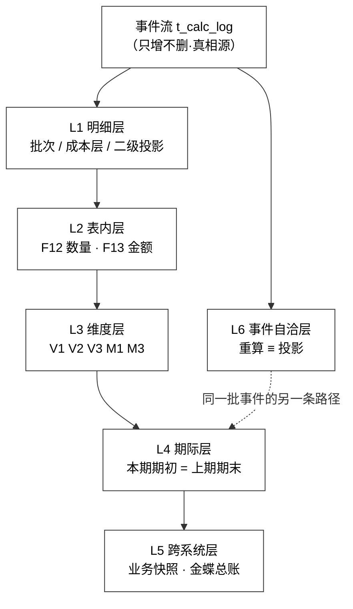

# 财务库存中心（一期）进销存核对逻辑 v1.0

> **本文是什么**：把「进销存」（期初 / 本期入 / 本期出 / 期末）这张表的**核对逻辑**写成一套可执行的判定式——期初从哪来、变化量怎么归类、期末怎么算、表内怎么守恒、期际怎么衔接、维度之间怎么对平、对外怎么对账、内部怎么自证、什么时候拦、拦住之后怎么办。
>
> **权威关系**：原文 `财务库存中心（一期）需求文档 1.0（原型页面与核算引擎）.md`（下称「原文」）与 `财务库存中心（一期）详细设计文档.md`（下称「详细设计」）是唯一权威。本文是**整理 + 推导 + 补判据**，**未改动原文、详细设计、原型、原型说明、各 PRD**。凡原文未逐字写明的，一律标「建议 / 待确认」，并在 §十二 集中列出。
>
> **本文不给新口径**。所有等式都来自原文与详细设计；本文只做三件事：① 把散在各处的等式收进一张表；② 把「不平之后怎么办」写成处置路径；③ 把发现的缺口**只报告、不修改**。

---

## 〇、一页速查

| 项 | 判定式 | 出处 |
|---|---|---|
| 期初 | 本期期初 = 上期期末（逐键承接）；**首期**期初 = 期初导入（P14） | 原文 `:1356`、`:1358`；详细设计 `:1654` |
| 期末数量 | `期末数量 = 期初数量 + 本期入库数量 − 本期出库数量`（**F12**） | 原文 `:1370` |
| 期末金额 | `期末金额 = 期初金额 + 本期入库金额 − 本期出库金额 + 纯成本调整额`（**F13**，报表口径） | 原文 `:1372` |
| 变化量 | 数量 `Δ = Σ入库 − Σ出库`；金额 `Δ = Σ入库 − Σ出库 + 纯成本调整` | 同上 |
| 归类 | **按事件方向归列，不按单据名**；双边单据按两条腿拆开 | 原文 `:1651`–`:1658` |
| 期际 | 本期期初 ≡ 上期期末 ≡ 上期期末快照，三者逐键相等 | 原文 `:1356`；详细设计 `:1631` |
| 维度 | V1 数量五维恒等 / V2 仓库金额 = 一级货主金额 / V3 Σ`alloc_amount` = 一级层金额 / M1 Σ`own_amount` + `D` = 一级层金额 / M3 `own_amount − alloc_amount` = 该二级分摊到的 `D` | 原文 `:210`–`:214` |
| 明细 | 批次行 Σ = 核算单元；成本层 Σ{`is_open = 1`} = 核算单元；二级 Σ`qty` 与 Σ`own_amount` 可从分摊账重放 | 原文 `:549`；详细设计 `:2799` |
| 跨系统（数量） | 日清，维度 `(物料, 仓库, 批次)`，基准 = 业务数量快照 | 详细设计 `:2759` |
| 跨系统（金额） | 月结，维度 `(法人, 物料, 仓库)`，基准 = 金蝶总账，法人层 + 合并层各出一组 | 详细设计 `:2774` |
| 自证 | 重算（只读计算日志）≡ 投影（读余额表） | 详细设计 `:2819` |
| 拦住 | 任一恒等式不平 → **阻断月结**（月结前）/ **整单回滚**（引擎出口）/ **告警**（日结） | 原文 `:549`、`:1372`；详细设计 `:680` |

---

## 一、核对对象与六个层次

### 1.1 进销存是什么

| 项 | 口径 | 出处 |
|---|---|---|
| 页面 | P13「进销存周期表」 | 原文 `:1326` |
| 一行 | **一个会计期间 × 一个一级货主 × 一个商品 × 一个仓库**（查询条件里「会计期间」与「一级货主」**均为必选**） | 原文 `:1330`–`:1332` |
| 取数表 | 期间收发存汇总 `inv_period_balance`（期间收发存汇总表） | 原文 `:1354` |
| 金额口径 | 存货口径 · 一级货主层 · **`is_internal = 1`**（`is_internal`：是否内部交易） | 原文 `:280`、`:295` |
| 数量口径 | **权属口径 · 一级货主层**（一律基本单位 `base_qty`：基本单位数量） | 原文 `:295`、`:1644` |
| 不进本表 | 二级自有均价池 `own_amount`（二级自有结存金额）、内部结算金额 `internal_amount`（二级内部结算金额） | 原文 `:218`、`:280` |

> **为什么一行不是「一个二级产权人」**：二级层是管理口径，不进存货总额（R4）。P13 的「二级产权人」是**筛选与聚合维度**，不是账的粒度；即使按产权人汇总，金额仍是会计口径（`alloc_amount`：二级分摊金额），不会变成自有口径。

### 1.2 六个层次（由内到外）

核对不是一件事，是同一批事件的六次互相验算。**层次越靠内，越早发现、越便宜修**。

| 层 | 核对什么 | 对方是谁 | 频率 | 不平的后果 | 出处 |
|---|---|---|---|---|---|
| **L1 明细层** | 批次行 Σ = 核算单元；成本层 Σ = 核算单元；二级投影 = 分摊账重放 | 自己（同一批事件的两种存法） | **日结** | 校验报错 + 告警 | 原文 `:549`；详细设计 `:2799` |
| **L2 表内层** | F12 数量守恒、F13 金额守恒 | 同一行的期初 / 入 / 出 / 期末 | 引擎出口 + 月结 | **整单回滚**（出口）/ **阻断月结** | 原文 `:549`、`:1370`、`:1372` |
| **L3 维度层** | V1 / V2 / V3 / M1 / M3 | 同一批数据的五种分组 | 日结（M1）/ 月结 | 告警 / 阻断 | 原文 `:210`–`:214` |
| **L4 期际层** | 本期期初 = 上期期末 = 上期快照 | 相邻两个期间 | 月结 | 阻断月结 | 原文 `:1356`；详细设计 `:1631` |
| **L5 跨系统层** | 数量 vs 业务快照；金额 vs 金蝶总账 | **外部** | 日清 / 月结 | 标红 + 预警；不自动平 | 详细设计 `:2759`、`:2774` |
| **L6 事件自洽层** | 重算 ≡ 投影 | 自己（事件流 vs 余额表） | 日结 / 月结全量 / 反结账与补录后 | 报错 + 告警 | 详细设计 `:2819` |



> **L6 与 L5 的区别**：L5 是「我方 vs 外部」，外部数据本身可能有口径差（时点差）；L6 是「我方 vs 我方」，**没有任何口径可以解释不平**——一旦不等，必是 bug。详见 §八。

### 1.3 一条总原则

> **余额只是投影，事件流才是真相源**。
> 任何一次核对不平，先问「是事件错了，还是投影错了」，**不要直接改余额**。改余额会把「可复现的差错」变成「不可复现的差错」。（原文 `:563`：引擎没有「回滚」这个动作，反向调整一律追加反向事件。）

---

## 二、期初从哪来

### 2.1 三条来路

| 场景 | 期初来源 | 落地表 | 出处 |
|---|---|---|---|
| **首期（启用期）** | 期初数据导入，5 项校验通过后 `[启用期初]` | `t_initial_balance`（期初余额表） | 原文 `:1394`–`:1410` |
| **后续期间** | **上期期末结存**（数量 / 金额 / 均价三项承接） | `t_balance_snapshot`（余额期间快照表）或上期收发存 | 原文 `:1356`、`:1358`；详细设计 `:1631` |
| **反结账后** | 重出该期间快照，`snapshot_version`（快照版本号）**+1**，旧版本保留 | `t_balance_snapshot` | 详细设计 `:1631`、`:1672` |

**期初导入的 5 项校验**（原文 `:1394`）：① 四轴完整性（商品 · 仓库 · 批次 · 一级货主）；② 货主维度（`owner_l2`：二级产权人 必填）；③ 精度（数量 4 位 / 金额 2 位 / 单价 6 位）；④ 行内恒等式 `init_qty × init_unit_price = init_amount`（期初数量 × 期初单价 = 期初金额）；⑤ 期间未锁账。

### 2.2 期初的四条纪律

| # | 纪律 | 原因 | 出处 |
|---|---|---|---|
| 1 | **只启用「校验通过」行**，失败行留在错误日志 | 半截期初比没有期初更难查 | 原文 `:1398` |
| 2 | **启用后该期间锁定**，不再接受复检，「已启用」行跳过校验 | 期初一旦成为事件流起点，改动会污染全部下游 | 原文 `:1394`、`:1398` |
| 3 | 导错只能**按导入批次 `import_batch_id`（导入批次号）整批撤销重导**，不做人工逐行改 | 人工逐行改会留下无法解释的中间态 | 详细设计 `:1670` |
| 4 | 期初导错且已跨期 → **只能走反结账或反向单**，不能 "改一个数" | 已核算不可撤 | 原文 `:321`、`:563` |

### 2.3 期初要核的三件事

| # | 核对 | 判据 |
|---|---|---|
| 1 | 期初 vs 上期期末 | 逐 `(商品, 仓库, 批次, 一级货主)` 数量、金额、均价三项相等；**不允许按合计对**——合计相等而明细错位是最常见的假平 |
| 2 | 期初 vs 期间首日余额表 | Σ`t_initial_balance` 或上期期末 ≡ 期间首日 `t_inventory_balance_unit`（库存余额表·核算单元）+ 批次层合计 |
| 3 | 期初 vs 快照 | 上期 `t_balance_snapshot` 的 `end_qty`（期末数量）/ `end_amount`（期末金额）/ `end_unit_price`（期末均价）≡ 本期 `begin_*` |

### 2.4 ⚠️ 首期的「双计」风险（原文未闭合）

原文与详细设计对「期初是余额还是事件」有两种写法：

- P14 `[启用期初]`：**「启用后……作为 `PO_IN`（采购入库）的第一笔事件」**（原文 `:1398`）；
- 详细设计：**「期初是所有存量成本（`PO_IN`）的第一笔事件」**（`:1670`）；
- 但 L6 自检说：重算路径**「从期初开始逐事件 `measure()` 累加」**（详细设计 `:2825`）。

**两者不能同时字面成立**：若期初本身已是一条 `PO_IN` 事件，重算又「从期初开始」，则期初被计两次，第一期的重算结果会比投影多出一整份期初。

**建议口径**（待确认）：**期初是事件流的第 0 条事件，重算从「零」开始，不从「期初」开始**；P13 的首期 `begin_*` 取 0，期初量额落在 `in_purchase` 列。若反过来把期初当 `begin_*`，则期初**不能**再作为事件存在，否则 F12 首期必不平。

> 这条不影响常规月份，只影响**上线首月**与**任何重算首期**；但它会让「首月进销存」与「重算结果」同时看上去都对、却差一整个期初。属于必须在验收前拍板的项，见 §十二 第 3 项。

---

## 三、变化量怎么归类

### 3.1 定义

```
数量变化量 Δqty    = Σ入库数量 − Σ出库数量
金额变化量 Δamount = Σ入库金额 − Σ出库金额 + 纯成本调整额
```

三条读法：

1. **入库金额取实际入账额**（不含税金额 + 分摊附加费用，原文 `:80` 附近 F5a 定义），**出库金额取实际结转成本**，不是「数量 × 派生均价」——个别计价与先入先出法下两者不等，用派生写法会在出口硬校验当场不平（原文 `§一.5.2` 警示，`:238`–`:241`）。
2. **纯成本调整额只动金额、数量为 0**（发票差、运费摊、负库存补差）。
3. **变化量是有符号的**：红字冲销、退回、负库存都会产生负向增量；不要把「负数入库」硬塞进出库列。

### 3.2 单据 → 收发存列：映射与缺口

原文 `:74` 定义 11 类单据。逐类落到 P13 的 8 个明细列上，结果是**14 个方向里只有 9 个有列**：

| # | 单据类型 | 方向 | 应收进哪一列 | 现状 | 备注 |
|---|---|---|---|---|---|
| 1 | 采购入库 `PO_IN` | 入 | `in_purchase`（采购入库量/额） | ✅ 有列 | —— |
| 2 | 销售退货入库 `SO_RET` | 入 | `in_sale_return`（销退入库量/额） | ✅ 有列 | —— |
| 3 | 调拨（`is_in = 1` 入腿） | 入 | `in_transfer`（调拨调入量/额） | ✅ 有列 | 与出腿共用同一 `doc_no`（业务单号） |
| 4 | 盘点 · 盘盈（派生入账行） | 入 | `in_profit`（盘盈入库量/额） | ✅ 有列 | 盘点派生的入库行，不是独立单据类型（原文 `:677`） |
| 5 | **其他入库 `OTHER_IN`** | 入 | **无列** | ⚠️ **缺口** | 五类场景（原物归还 / 受赠 / 受托代销 / 借入 / 无对价杂项） |
| 6 | **一级货权转移（`is_in = 1` 入腿）** | 入 | **无列** | ⚠️ **缺口** | 转入方按 `transfer_price`（一级货权转移价）作价入账 |
| 7 | **跨期补录（入方向）`PERIOD_ADJUST`** | 入 | **无独立列** | ⚠️ **缺口** | 只能按业务性质借列，原文未规定借哪一列 |
| 8 | 销售出库 `SO_OUT` | 出 | `out_sale`（销售出库量/额） | ✅ 有列 | —— |
| 9 | 采购退货出库 `PO_RET` | 出 | `out_purchase_return`（采退出库量/额） | ✅ 有列 | —— |
| 10 | 调拨（`is_in = 0` 出腿） | 出 | `out_transfer`（调拨调出量/额） | ✅ 有列 | —— |
| 11 | 盘点 · 盘亏（派生行） | 出 | `out_loss`（盘亏出库量/额） | ✅ 有列 | 报废 ≠ 盘亏：报废走其他出库（原文 `:3509`） |
| 12 | **其他出库 `OTHER_OUT`** | 出 | **无列** | ⚠️ **缺口** | 六类场景（内部领用 / 报废 / 赠送 / 借出 / 委托代销发出 / 货权已转） |
| 13 | **一级货权转移（`is_in = 0` 出腿）** | 出 | **无列** | ⚠️ **缺口** | 转出方视同销售出凭证（详细设计 `:2630`） |
| 14 | **跨期补录（出方向）`PERIOD_ADJUST`** | 出 | **无独立列** | ⚠️ **缺口** | 同上 |
| 15 | 二级货权重分配 `OWNER_REASSIGN` | 无 | **不进表** | ✅ 正确 | 不动一级余额、不出凭证（原文 `:461`） |
| 16 | 成本调整单 `COST_ADJUST` | 仅金额 | `cost_adjust_amount`（纯成本调整额） | ✅ 有列 | 数量为 0（原文 `:1444`） |
| 17 | 期初导入（非单据类型） | 期初 | `begin_*`（期初量/额） | ⚠️ 首期口径待定 | 见 §2.4 |

> **缺口的算术后果**：F12 的左边是「期初 + **全部**入库 − **全部**出库」。只要有一笔其他入库或其他出库落进系统，它就会改变 `end_qty`，却没有列承接，`in_total` / `out_total` 加回去也对不上 ⇒ **差额恒等于该类单据的累计量** ⇒ 有这类业务就无法月结。货权转移更严重：它**逐法人**改变余额，缺列会让**每个法人**的 F12/F13 各自平不了。
>
> **能否借列（不建议）**：把其他入库并进采购入库、把货权转移并进销售出库，F12/F13 在算术上能闭合，金蝶法人层金额也能对上（转出方总账本就是「视同销售」，详细设计 `:2630`）——但报表的**业务含义被污染**：采购量与销售量被虚增，且「其他入库 / 其他出库 / 货权转移」这三个管理指标从此查不到。**建议加列，不借列**。改动属字段层，需单独授权，本文只报告。

### 3.3 六条归类规则

| # | 规则 | 说明 | 出处 |
|---|---|---|---|
| R1 | **按事件方向归列，不按单据名** | 同一 `doc_type` 可能有两个方向（调拨、货权转移），必须按 `is_in`（出入方向）拆腿 | 原文 `:1651`–`:1658` |
| R2 | **双边单据两条腿都要落**，且两腿必须同 `doc_no` | 少一条腿 = 凭空增减库存 | 原文 `:549`（⑤） |
| R3 | **盘点按派生行归**：盘盈进 `in_profit`，盘亏进 `out_loss` | 盘点单本身不动库存 | 原文 `:677` |
| R4 | **二级重分配不落进销存** | 只改二级分摊，不改一级余额与数量 | 原文 `:461` |
| R5 | **成本调整只进 `cost_adjust_amount`**，不进 `in_total` / `out_total` | 数量为 0；混进出库列会让「数量 × 均价 ≠ 金额」暴露在报表上 | 原文 `:1372`、`:1444` |
| R6 | **作废走反向事件**（`red_flag = 1`），不删除原事件 | 原事件与反向事件**各自进各自记账期间**的对应列 | 原文 `:563`、`:314` |

> **R6 的未决点**：反向事件落在**原单据期间**还是**作废动作所在期间**，原文未写。若原期间已锁账，反向事件**不可能**落回原期间（期间闸门直接拒收，原文 `:2044`），只能落当期——这会让「原期虚增、当期虚减」，进销存逐期看都对不上业务直觉，但合计是对的。建议明确：**反向事件一律落发起作废的当期，报表以「净额」口径解释**，并在「本期入库/出库」旁标注红冲笔数。见 §十二 第 4 项。

### 3.4 期间归属与锁账

| 规则 | 内容 | 出处 |
|---|---|---|
| 期间归属键 | 按 `biz_date`（业务日期）落 `period`（所属记账期间），** `YYYYMM`** | 原文 `:736`（P04 搜索条件） |
| 过账排序 | `(biz_date, seq_in_day)`（业务日期, 当日序号），同日**入库优先**；`doc_no` 不可作排序键 | 原文 `:301` |
| 锁账后 | `is_closed = 1` ⇒ 拒收、不发事件 | 原文 `:2044` |
| 迟到单据（期间未锁） | 允许插入，必须**重放受影响区间** | 原文 `:2044`；重算逻辑见《重算逻辑_v1.0》 |
| 迟到单据（期间已锁） | 唯一通道 = **当期补录单 `PERIOD_ADJUST`**，一律按当期口径量价，原业务日期仅供追溯 | 原文 `:108`、`:321` |

### 3.5 三条数量口径边界

| 边界 | 规则 | 出处 |
|---|---|---|
| 单位 | 一律 `base_qty`（基本单位数量），业务单位只作展示；`qty × convert_rate ≠ base_qty` 即拒 | 原文 `:1644` |
| 权属 vs 物理 | 进销存数量是**权属口径**（一级货主层），不是 WMS 物理在架量；两者差异由 P10 三账核对承载 | 原文 `:295`；详细设计 `:2759` |
| 内部 vs 外部 | `is_internal = 0` 的一级货主（外部法人：受托代销 / 借入 / 借出）**在系统里有余额、在存货总额里没有** | 原文 `:280`、`:1958` |

> ⚠️ 第三条会在进销存上制造一个**同表两口径**的问题：`is_internal = 0` 的货主，数量进表、金额不计入存货总额。若 P13 不区分，`end_qty > 0` 而 `end_total_cost = 0`，期末单价为 0，跌价与金蝶对账都会跟着错。**P13 现有字段里没有 `is_internal` 标识**，建议要么在页面固定只出 `is_internal = 1` 的行（外部货主另表备查），要么加标识列。属字段层，需授权，见 §十二 第 8 项。

---

## 四、表内恒等：F12 / F13

### 4.1 F12 数量守恒

```
EndQty = BeginQty + InTotalQty − OutTotalQty
```

三处表述一致（原文 `:1370`、`:549` ②、`:1236`），**没有分歧**。

判定：`差额 = 0` 通过；`≠ 0` **阻断月结**，并在引擎出口处**整单回滚**（错误数据根本不落库）。

### 4.2 F13 金额守恒：**两个版本**

原文里 F13 有两种写法，**不是同一个式子**：

| 版本 | 公式 | 出处 | 用在哪儿 |
|---|---|---|---|
| **A（报表口径）** | `EndCost = BeginCost + InTotalCost − OutTotalCost + CostAdjustAmount` | 原文 `:1372`（P13 期末金额） | 进销存表内 |
| **B（引擎/对账口径）** | `EndCost = BeginCost + InTotalCost − OutTotalCost + Σ舍入差异` | 原文 `:549` ③、`:1236`（P10 状态判定） | 引擎出口硬校验、P10 平账判定 |

两者**互相缺项**：A 有纯成本调整、没有舍入差异；B 有舍入差异、没有纯成本调整。

- 只按 A 验 ⇒ 每发生一笔成本调整单，账是平的，但 A 平、B 不平；出清产生的残余金额也会让 A 不平。
- 只按 B 验 ⇒ 每发生一笔成本调整单，B 必不平 ⇒ **出口硬校验整单回滚，成本调整单根本进不了账**。

**建议的统一式**（待确认）：

```
EndCost = BeginCost + InTotalCost − OutTotalCost + CostAdjustAmount + 舍入结转额
```

其中「舍入结转额」的口径取决于舍入差异**放在哪里**（见 4.3）。若逐笔舍入已含在出库金额里，该项在表内取 0，只在月末结转那一步非零。见 §十二 第 2 项。

### 4.3 舍入差异的三个去向（最容易漏的地方）

原文的规则是：**舍入差异只在出库产生**（入库只舍入单价、不回改金额，原文 `:136`、`:2154`）；逐笔残差累进 `rounding_diff_acc`（舍入差异累计，详细设计 `:1557`）；月末由**一张独立凭证**结转（模板 8.1.7，详细设计 `:2598`）。这句规则落到金额上，有三个不同的位置：

| 去向 | 机制 | 对余额的影响 | 对 F13 的影响 |
|---|---|---|---|
| ① **逐笔** | 出库金额 `out_amount = round(数量 × 6 位单价, 2)`，余额减 `out_amount` | 已包含在出库金额里 | **不另加减项** |
| ② **出清残余** | 数量清零但仍有金额残留 → 全额结转 / 转入舍入差异账户并清零（F4，详细设计 `:794`） | 转出的残余额**超出** `out_amount` | **要加一个「出清残余」项**，否则 F13 必不平 |
| ③ **月末结转** | 模板 8.1.7：`借/贷 库存商品`，`贷/借 财务费用 - 舍入差异`（详细设计 `:2598`） | ⚠️ **动的是库存商品科目** | 见下 |

> ⚠️ **③ 是本文发现的最实质的缺口**：8.1.7 的分录**直接动「库存商品」科目**，但它**不是一条单据事件**——不进 `t_calc_log`、不改 `t_inventory_balance_unit` 的金额。于是：
>
> - **金蝶总账的库存商品** = 系统余额 − 已结转的舍入累计；
> - **本系统账面** = 系统余额（舍入残差仍在里面）。
>
> 两者每期都会差一个「累计舍入结转额」，而且**会一直累积**。金额月结（§7.2）如果不显式加回这一项，就会得到一个**永远存在、永远解释不清**的差异。
>
> **两种修法**（需拍板）：
> 1. **舍入结转也走事件**——月末生成一条数量为 0、金额为 −舍入累计的事件（可复用成本调整单类型），让余额表与总账同步变化，F13 加「舍入结转额」项；
> 2. **不改余额，改对账口径**——金额月结时，把「累计舍入结转额」作为对账公式的加项（`本系统账面 + 累计舍入结转 = 金蝶`），并在对账报告里单列。
>
> 推荐 ①：它让「余额表 = 总账」这条最朴素的校验继续成立；② 会让每次对账都要解释一个常数。见 §十二 第 2 项。

### 4.4 精度与容差

| 对象 | 精度 | 规则 | 出处 |
|---|---|---|---|
| 数量 | 4 位 | 一律基本单位 | 原文 `:133` |
| 单价 | 6 位 | 入库时舍入到 6 位 | 原文 `:133` |
| 金额 | 2 位 | 出库按 `round(数量 × 单价, 2)` | 原文 `:133` |
| 金额恒等式容差 | **无默认值**，须双方书面确认（DISC-F21） | 设计不给默认值 | 详细设计 `:2795`、`:2816` |
| 数量差异容差 | **0**——绝对值 > 0 即标红 | 与负库存容差是两件事 | 详细设计 `:2800` |

> **两处「容差」不要混**：
> - `NEGATIVE_STOCK_TOLERANCE`（负库存容差）控制**业务能否发生负库存**，一期默认 0（原文 `:2045`）；
> - 对账 `tolerance`（容差）控制**差异是否算异常**，取值未定（详细设计 `:2816`）。
> 把前者当后者，会让「允许的负库存」被当成「可接受的账面差异」——这是两件事。

### 4.5 零与负的边界

| 边界 | 现象 | 核对时要做的 |
|---|---|---|
| `begin_qty = 0` | `begin_unit_cost = begin_cost ÷ begin_qty` 无意义 | 单价列显示 `—`，**不参与**任何金额校验 |
| `end_qty = 0` 但 `end_amount ≠ 0` | 「脏零」——出清没做完 | 这是 **F4 未生效**的信号，必须查，不能当成尾差 |
| `end_qty < 0` | 负库存（容差内允许） | 数量可为负、金额为负；**均价显示 `—`**；F12 仍须严格成立 |
| 批次清零 | 库龄归零、退出跌价基数 | 与进销存金额无关，但影响跨表核对（详细设计 `:2162`） |

---

## 五、期际衔接

### 5.1 链式恒等

```
第 n 期.期初 ≡ 第 n−1 期.期末        （逐键，不是合计）
第 n 期.期初 ≡ 第 n−1 期 期末快照    （t_balance_snapshot，同 snapshot_version）
```

三条链必须同时成立，且**都以 `(商品, 仓库, 批次, 一级货主)` 为键**。合计相等只能证明总量没错，证明不了没有串行。

### 5.2 期际四核对

| # | 核对 | 判据 | 不平说明什么 |
|---|---|---|---|
| 1 | 本期 `begin_*` vs 上期 `end_*` | 数量、金额、均价三项逐键相等 | 期末结转逻辑错，或上期被重算过而本期未重跑 |
| 2 | 本期 `begin_*` vs 上期快照 | 同上 | 快照落库时机错（在锁账后才落、或落的是旧版本） |
| 3 | 本期 `end_*` vs 期末日余额表 | Σ 核算单元 = Σ 批次行；金额同理 | 投影未刷新（FL-10 漏跑）或期间边界取错 |
| 4 | 本期 `end_*` vs 本期快照 | 逐键相等 | 快照生成时点与报表取数时点不一致 |

### 5.3 反结账后的期际

| 动作 | 期际影响 | 出处 |
|---|---|---|
| 反结账 | `is_closed` 置 0；重出快照 `snapshot_version + 1`；旧版本保留供审计 | 详细设计 `:1672`、`:1631` |
| 重开后重算 | 必须**全量重放**受影响期间，并**重跑 L6 自检** | 详细设计 `:2819` 注 |
| **下游期间** | ⚠️ **原文未写**：反结账重算第 n 期后，第 n+1 期的期初是否自动级联刷新、还是必须逐期反结账 | 见 §十二 第 5 项 |

> 这是「月结后再看历史」最容易出问题的地方：第 n 期改了一个数，第 n+1 期的期初就变了，但第 n+1 期可能仍显示旧期初。**建议**：反结账后把所有后续期间标记为「待重算」，并在 P13 上加「上游期间已重算，本表需刷新」的横幅。

### 5.4 跨期补录对期际的影响

补录单**只进当期**（原文 `:108`）：历史期间的期末**不变**，当期期初**不变**，变化全部落在当期的入/出列。因此：

- 期际核对（5.1）**不受影响**——这是设计正确的表现；
- 但「本期出库」里会出现一批**业务日期在上期**的单据，报表必须能区分（建议按 `doc_type = PERIOD_ADJUST` 单独出一个小计）。

---

## 六、维度对平

### 6.1 五个等式

| # | 等式 | 性质 | 频率 | 出处 |
|---|---|---|---|---|
| **V1** | Σ集团数量 = Σ仓库数量 = Σ一级货主数量 = Σ二级产权人数量 = Σ批次数量 | 数量守恒（**同一查询范围**） | 月结 | 原文 `:210` |
| **V2** | Σ仓库金额 = Σ一级货主金额 | 一级层金额守恒 | 月结 | 原文 `:211` |
| **V3** | Σ`alloc_amount`（二级分摊金额）= 一级层金额 | 会计口径可加总 | **引擎出口逐单** + 月结 | 原文 `:212` |
| **M1** | Σ`own_amount`（二级自有结存金额）+ `D`（池化差异）= 一级层金额 | 管理口径定义式，**逐核算单元** | 日结 | 原文 `:213` |
| **M3** | `own_amount − alloc_amount` = 该二级分摊到的 `D`；Σ 该差 = −`D` | 管理口径并排对账 | 日结 / 月结 | 原文 `:214` |

三条边界：

1. **V1 只在「同一查询范围」成立**——五个维度若各自加了不同过滤条件，本就不该相等，不要跨范围对平（原文 `:216`）。
2. **V3 右侧是「一级层全部金额」**，**含 `is_internal = 0` 的外部法人**；这与「存货总额只算 `is_internal = 1`」不是同一个范围，不要混用（原文 `:218`）。
3. **`internal_amount` 不参与任何等式**——它按 `internal_price`（内部结算价）累计，天然加不回去；差额是二级内部未实现毛利（管理口径）。

### 6.2 分层守恒（进销存的明细支撑）

| 层 | 等式 | 作用域 | 出处 |
|---|---|---|---|
| 批次层 | Σ 批次行数量 = 核算单元数量；Σ 批次行金额 = 核算单元金额 | 全部方法 | 原文 `:549`（E-02 同批校验） |
| 批次行均价 | 同一核算单元内所有批次行 `unit_price` 相等（均价行 `batch_no IS NULL` 那一行） | **仅批次行**，不含二级产权人行 | 详细设计 `:2804` |
| 成本层 | Σ{`is_open = 1`} 层数量/层金额 = 核算单元数量/金额 | **仅个别计价与先入先出法单元** | 详细设计 `:2808` |
| 二级投影 | 由分摊账重放出的 Σ`qty` = `t_owner_balance_l2.qty`；同法重放 Σ`own_amount` | 全部 | 详细设计 `:2812`、`:2814` |
| 二级符号 | 同一分摊行内 `qty` 与三个金额符号同向；逐事件 Σ`qty` = Δ 一级层数量 | 全部 | 详细设计 `:2810` |

> **为什么批次层要单独核**：核算单元的金额对、批次层的金额错，合计照样对得上——直到某天按批次出报表或做库龄跌价，才发现金额挂错了批次。**批次层是「合计平、明细错」的唯一发现点**。

### 6.3 进销存自身的维度核对（把 6.1 落到期末余额上）

| # | 核对 | 判据 |
|---|---|---|
| 1 | 期末数量五维恒等 | 对**本期期末时点**重跑 V1（不是对期初，也不是对全历史） |
| 2 | 期末金额：仓库 = 一级货主 | 重跑 V2 |
| 3 | 期末金额：Σ`alloc_amount` = 一级层 | 重跑 V3（进销存版：`end_total_cost` 的二级合计） |
| 4 | 期末金额：Σ`own_amount` + `D` = 一级层 | 重跑 M1 |
| 5 | 本期变化量：五维一致 | `Δqty` 在每个维度上合计必须相等（若加列补全后） |

> 第 5 项在**当前 P13 缺列的情况下无法成立**——缺的那些方向在某个维度上有、在另一个维度上被合并，`Δ` 自然对不上。这是 §3.2 缺口的第二个后果。

### 6.4 时间点必须一致

所有维度核对必须锁定**同一个时点**（期末日 23:59:59 或期间最后一条事件之后）。混用「今天查的余额」与「期间末的报表」会得到假不平——这类差异每天都会自然变化，最容易被误判成真实差错。

---

## 七、跨系统对账

### 7.1 数量对账（日清）

| 项 | 口径 | 出处 |
|---|---|---|
| 频率 | **每日** | 详细设计 `:2759` |
| 维度 | `(物料, 仓库, 批次)`——**物理层，不含货主** | 详细设计 `:2759` |
| 基准 | 业务数量快照（`basis = BIZ_SNAPSHOT`：业务数量快照） | 详细设计 `:2772` |
| 差异 | `diff = 本系统账面值 − 业务系统值`（F14） | 原文 `:1230` |
| 分类 | `OK`（平）/ `DIFF`（两边都有但不等）/ `MISS`（系统无、对方有）/ `EXTRA`（系统有、对方无） | 详细设计 `:2761`–`:2768` |
| 阈值 | 绝对值 > 0 即标红 | 详细设计 `:2800` |

> **数量对账查不出「货主挂错」**：维度停在物理层（O-07 未闭合，详细设计 `:2771`），同一批货挂在 A 法人还是 B 法人，数量对账都是平的。**货主层错配只能靠金额月结发现**——这是两条对账线必须都跑、不能只跑一条的原因。

### 7.2 金额对账（月结）

| 项 | 口径 | 出处 |
|---|---|---|
| 频率 | **月结** | 详细设计 `:2774` |
| 维度 | `(法人, 物料, 仓库)` | 详细设计 `:2776` |
| 基准 | **金蝶总账**（`basis = GL_BALANCE`：金蝶总账） | 详细设计 `:2778` |
| 两个层 | **法人层**逐法人各比一次；**合并层**再比一次（抵消后集团口径） | 详细设计 `:2784`–`:2787` |
| 下钻 | `(物料, 仓库, 一级货主)` | 详细设计 `:2791` |
| 容差 | **未定**，须双方书面确认（DISC-F21） | 详细设计 `:2795` |

**合并层必须做的三件事**（详细设计 `:2639` 起）：

1. 抵消内部购销（收入 / 成本同额对冲）；
2. 抵消存货中的未实现毛利（`transfer_price − 转出方均价` × 数量）；
3. **已售部分的抵消转回**——转入方对外售出时，未实现毛利在那一刻实现，必须转回；部分售出按比例拆，不得整笔转回。

> 合并层最容易漏第 3 条：只做抵消、不做转回，合并层的存货会**永远偏低**，差额等于历年已售部分的未实现毛利。

### 7.3 差异的两种性质

| 性质 | 例子 | 行为 | 处置 |
|---|---|---|---|
| **时点差** | WMS 已发货、财务未过账；在途调拨 | 补齐过账后**自然收敛** | 等，不调账 |
| **真实差异** | 负库存挂账；计算错误；漏单 | **重跑后仍然不平** | 必须查，不能平账 |

P10 的 `diff_type`（差异根因初步研判）就是这三类：`WMS已发货财务未过账`、`在途调拨`、`负库存挂账`（原文 `:1232`）。

### 7.4 手工重跑的红线

原文对 `[执行全仓手动对账任务]` 的规定是：**重算三方差、不改变差异事实**；只有时点差会自然收敛，真实差异重跑后**仍为不平**并留在导出清单；**「不得实现为『点一下全部平账』」**（原文 `:1212`）。

> 这条不是体验建议，是**内控红线**：一键平账等于把差异藏起来。核对的所有动作都必须是「发现问题 → 定位 → 修源头 → 复对」，不能有「把差异抹掉」这个选项。

### 7.5 与进销存的接口

跨系统对账是**时点值**（某一天 / 某一期间末），进销存是**期间值**。两者只在**一端**相交：

```
进销存.期末（本期最后一刻） ≡ 期末日数量对账的 fin_inv_qty（财务账面结存数）
进销存.期末金额            ≡ 月结金额对账的 sys_value（系统账面值）
```

所以核对顺序必须是：**先平表内（F12/F13）→ 再平维度（V/M）→ 最后才对外对账**。表内没平就对外对账，只会得到一堆没有意义的差异。

---

## 八、内部自证：重算 ≡ 投影

### 8.1 两条路径

| 路径 | 输入 | 算法 | 产物 |
|---|---|---|---|
| **重算** | `t_calc_log`（计算过程留痕表）的**全量事件流**，按 `(业务日期, 当日序号)` 重放 | 从零（见 §2.4）逐事件 `measure()` 累加 | 重算余额 |
| **投影** | `t_inventory_balance_unit`（库存余额表·核算单元）/ `t_inventory_balance_batch`（批次层）/ `t_owner_balance_l2`（二级货主结存表）的**现值** | 直接读——引擎每次 `balance += delta` 落下的结果 | 投影余额 |

### 8.2 判定

```
对同一 (物料, 仓库, 一级货主 [, 批次])：
    重算数量 ≡ 投影数量
    重算金额 ≡ 投影金额
    重算均价 ≡ 投影均价
二级层两列同时成立：重放 Σqty ≡ 投影 qty；重放 Σown_amount ≡ 投影 own_amount
自有口径多一项：重放出的 Σown_amount ÷ Σqty ≡ 分摊账逐行 own_unit_price 隐含的当期均价
```

（详细设计 `:2829`–`:2833`）

### 8.3 何时跑

| 时点 | 范围 | 出处 |
|---|---|---|
| **日结** | 与 E-02 / E-11 / E-12 / E-13 同批 | 详细设计 `:2837` |
| **月结** | **全量**再跑一次 | 同上 |
| **反结账后** | **必跑**（事件流被改动） | 同上 |
| **跨期补录后** | **必跑**（同上） | 同上 |

### 8.4 它是唯一能发现「都对、但互相矛盾」的检查

投影是**增量累加**，不做全量重算。一旦某笔 `delta` 落库成功而事件日志写失败（或反之），余额就与事件流分叉。此时：

- 数量仍对得上业务快照；
- 金额仍对得上总账；
- **两条外部对账都通过**，却是两个不同的数。

这是 L5 跨系统对账**结构性无法发现**的一类错误。所以 L6 不是「可选的自检」，是**唯一**能覆盖这类分叉的检查。（详细设计 `:2839`）

### 8.5 与进销存的关系

重算结果必须能**重放出同一张进销存**：

```
对每一 (期间, 一级货主, 商品, 仓库)：
    重算得出的期末余额 ≡ P13 的 end_*
```

若不等，说明 P13 的取数路径与引擎的余额路径不是同一套——这类问题在报表上看不出来，只能这样反推。

---

## 九、日结 / 月结的关卡

### 9.1 日结：只校验，不锁账

| # | 校验 | 不平后果 |
|---|---|---|
| 1 | 批次行均价一致性（E-02） | 校验报错 + 告警 |
| 2 | 成本层 vs 核算单元（E-11，仅个别计价 / 先入先出法） | 校验报错 + 告警 |
| 3 | 二级结存投影（E-12，含符号与逐事件 Σqty） | 校验报错 + 告警 |
| 4 | 二级自有池结转（E-13，含 M2 逐事件出池价） | 校验报错 + 告警 |
| 5 | 池化差异 M1（`D` 双路径互校） | 校验报错 + 告警 |
| 6 | 重算 ≡ 投影（L6） | 报错 + 告警 |
| 7 | 数量日清（vs 业务快照） | 差异 > 0 标红 + 预警邮件 |

**日结不锁账**，所以上述任何一项不平都**不阻断业务**——它只保证「今天的问题今天能被看见」。这是原文的设计意图（`:312`）。

### 9.2 月结：六关

| 关 | 内容 | 失败处置 | 出处 |
|---|---|---|---|
| T-1 | 结账前检查：业务单据全部推送完毕、无 `PENDING`（待处理）单据、无导入失败积压 | 等 / 补推 | 详细设计 `:684` |
| 1 | 日常对账通过（数量日清） | 定位差异 | `:686` |
| 2 | 引擎守恒校验通过，**含二级层 Σ`alloc_amount` = 一级层金额** | 回滚 / 重算 | `:687` |
| 3 | 跌价计提完成（库龄法 / 上市周期法取孰高，仅 `is_internal = 1`） | 重算跌价 | `:688` |
| 4 | 舍入差异月末结转 | 重跑结转 | `:689` |
| 5 | 凭证清单生成并导出；财务金蝶过账回执确认 | 补凭证 / 重导 | `:690` |
| 6 | 月结对账通过：数量 vs 业务快照；金额 vs 金蝶总账（法人层 + 合并层） | 定位 / 复对 | `:691` |
| 收尾 | 报表定稿 → 库存价值月报 → 归档 + 快照落库 → `is_closed = 1` | —— | `:693`–`:699` |

> **第 4 关与 F13 的耦合**：舍入结转若走「事件」路线（§4.3 修法 1），它必须在第 4 关**之前**完成，才能让第 2 关的 F13 在第 6 关仍然成立；若走「对账口径」路线，则第 4 关只记备忘录、不动余额。**当前的写法（动库存商品科目、不动余额）会让第 2 关与第 6 关互相矛盾**——第 2 关按系统余额判平，第 6 关与总账比就差了结转额。

### 9.3 阻断条件汇总

| 条件 | 在哪拦 | 拦成什么样 |
|---|---|---|
| F12 数量不平 | 出口硬校验 / 月结 | 整单回滚 / 阻断月结 |
| F13 金额不平 | 出口硬校验 / 月结 | 整单回滚 / 阻断月结 |
| 出口硬校验①（Σ`alloc_amount` ≠ 一级层） | 出口 | **整单回滚** |
| 批次行均价不一致（E-02） | 出口 / 日结 | 整单回滚 / 报错 |
| 成本层不一致（E-11） | 日结 | 报错 + 告警 |
| 二级投影不一致（E-12 / E-13） | 日结 | 报错 + 告警 |
| M1 不平 | 日结 | 报错 + 告警 |
| 重算 ≠ 投影 | 日结 / 月结 / 反结账后 | 报错 + 告警 |
| 凭证借贷不平 | 落库前 | **拒绝落库** |
| 数量对账存在差异 | 月结第 1 关 | **阻断月结** |
| 金额对账超容差 | 月结第 6 关 | 预警；是否阻断取决于容差口径（未定） |

---

## 十、差异分类与处置

### 10.1 先定位层次，再决定动作

```
差额出现在哪一层？
├─ L1 明细层（批次 / 成本层 / 二级投影）
│     → 引擎 bug 或投影未刷新 → 重算该核算单元，不改数据
├─ L2 表内层（F12 / F13）
│     ├─ 单笔单据导致 → 该单据错 → 改单 / 作废重开（未锁账）
│     └─ 多笔累计 → 归类缺列或期间归属错（见 §3.2 / §3.3）
├─ L3 维度层（V / M）
│     ├─ 数量不平 → 四轴余额有串维度 → 查事件
│     └─ 金额不平 → `alloc_amount` / `own_amount` 口径混用 → 查取数
├─ L4 期际层
│     → 期末结转 / 快照落库 / 下游未重算
├─ L5 跨系统层
│     ├─ 时点差 → 等收敛
│     └─ 真实差 → 查业务 / 补单 / 改单
└─ L6 事件自洽层
      → 事件流与余额表分叉 → 以事件流为准，重建投影
```

### 10.2 五条处置路（**不可互换**）

| 场景 | 唯一正确的路 | 禁止用 | 出处 |
|---|---|---|---|
| 期间未锁账、单据内容错了 | **改单**（`version_no + 1`，版本号 + 1，生成新事件） | 直接改余额 | 原文 `:563` |
| 期间未锁账、单据不该有 | **作废**（追加反向事件 + `red_flag = 1`） | 删除原事件 | 原文 `:563`、`:314` |
| 已核算、需重算 | **重算**（重试计量 / 冲销后重放，见《重算逻辑_v1.0》） | 回滚式措辞 | 原文 `:563`、`:747` |
| **已锁账、结错了** | **反结账**（走审批、留痕、`reopen_count + 1`、重出快照） | 补录单 | 原文 `:321`、`:2044` |
| **已锁账、漏一笔** | **当期补录单 `PERIOD_ADJUST`**（必审、按当期口径量价） | 反结账 | 原文 `:321`、`:108` |

> 最后两条**语义不同、不可互相代替**（原文 `:321`）。判断标准只有一句：**是「已有的数错了」还是「少了一笔」**。

### 10.3 处置后必做

1. **重跑 L6 自检**（重算 ≡ 投影）——任何改动事件流的操作之后都要跑；
2. **重出快照**（反结账场景：`snapshot_version + 1`），旧版保留；
3. **复对**：数量日清 + 金额月结，确认差异收敛；
4. **记录**：谁、何时、因何、改了哪个月（反结账留痕字段已备，详细设计 `:1680`）。

### 10.4 四条禁止动作

| 禁止 | 为什么 |
|---|---|
| **一键全部平账** | 原文明令不得实现（`:1212`）；等于把差异藏起来 |
| **直接改余额表** | 余额是投影，改了就无法从事件重放，L6 永远不平 |
| **对已锁账期间直接补事件** | 期间闸门拒收（`:2044`），能绕过的实现都是漏洞 |
| **用补录单代替反结账** | 结错的数不会因为补一笔而变对，只会多一笔错 |

---

## 十一、可执行核对清单

### 11.1 日结（每个工作日）

| # | 核对项 | 判据 | 不平处置 |
|---|---|---|---|
| D1 | 批次行均价一致（E-02） | 同核算单元所有批次行 `unit_price` 相等 | 查该单元最近事件 |
| D2 | 成本层一致（E-11） | Σ{`is_open = 1`} 层量/额 = 核算单元 | 查分层 / 耗层 |
| D3 | 二级投影一致（E-12） | 重放 Σ`qty` = `t_owner_balance_l2.qty`；符号同向 | 重建二级投影 |
| D4 | 二级自有池一致（E-13） | 出池行 `own_amount` = `qty × 当期自有均价`；重放 Σ`own_amount` = 现值 | 查自有池滚动 |
| D5 | 池化差异（M1） | Σ`own_amount` + `D` = 一级层金额 | 两条路径各算 `D` 互校 |
| D6 | 重算 ≡ 投影（L6） | 数量 / 金额 / 均价逐项相等 | 以事件流为准重建 |
| D7 | 数量日清 | `diff = 0`（物理层 `(物料, 仓库, 批次)`） | 分类 DIFF / MISS / EXTRA |
| D8 | 负库存可见性 | 所有 `qty < 0` 均有挂账记录 | 补挂账 |

### 11.2 月结（关账前按序执行）

| # | 核对项 | 判据 | 不平处置 |
|---|---|---|---|
| M1 | 结账前置 | 无 `PENDING` 单据、无导入失败积压 | 补推 / 重试 |
| M2 | 期初承接 | 本期 `begin_*` = 上期 `end_*` = 上期快照（逐键） | 查期末结转 / 快照 |
| M3 | 归类完整性 | 每笔出入库事件都落到了某一列（**当前需人工确认缺列方向**） | 见 §3.2 |
| M4 | F12 数量守恒 | `end_qty = begin_qty + in_total − out_total` | 阻断，逐笔查 |
| M5 | F13 金额守恒 | 按 §4.2 的统一式 | 阻断，逐笔查 |
| M6 | 期际四核对 | §5.2 的 4 项全过 | 逐项定位 |
| M7 | V1 / V2 | 期末时点五维数量、仓库=一级货主金额 | 查四轴余额 |
| M8 | V3 | Σ`alloc_amount` = 一级层金额 | 查分摊账 |
| M9 | M1 / M3 | `D` 双路径一致；Σ(`own_amount − alloc_amount`) = −`D` | 查自有池 |
| M10 | 重算 ≡ 投影（全量） | 全量重放 ≡ 余额表 | 以事件流为准 |
| M11 | 舍入差异结转 | `rounding_diff_acc` 已清理，且余额与总账同步（**口径待定**，§4.3） | 重跑结转 |
| M12 | 金额月结 | 法人层逐法人 + 合并层；差异 ≤ 容差 | 定位 / 复对 |
| M13 | 数量月结 | 期间末对账通过 | 定位 / 复对 |
| M14 | 凭证一致性 | 凭证清单金额 = 本期余额变动（库存商品科目） | 补凭证 / 重导 |

### 11.3 反结账 / 跨期补录之后

| # | 核对项 | 判据 |
|---|---|---|
| X1 | 受影响期间已全量重算 | 重放区间覆盖所有改动事件的 `biz_date` |
| X2 | 重算 ≡ 投影 | 全量跑一次 |
| X3 | F12 / F13 | 逐期间重验 |
| X4 | 下游期间期初已刷新 | 逐期确认 `begin_*` 已更新（**当前需人工**，§5.3） |
| X5 | 快照版本 | `snapshot_version` 已 +1，旧版可查 |
| X6 | 复对 | 数量日清 + 金额月结重新跑通 |

---

## 十二、原文缺口与待确认（只报告，未改）

| # | 项 | 现状 | 建议 | 影响 |
|---|---|---|---|---|
| **1** | **P13 收发存缺列** | 只有 4 个入库列 + 4 个出库列；**其他入库 / 其他出库 / 一级货权转移两腿 / 跨期补录两个方向**共 6 个方向无列 | **加列**（字段层，需单独授权）；不建议借列 | F12 / F13 在这几类业务一发生就必不平；货权转移逐法人不平 |
| **2** | **F13 两个版本，且舍入结转动总账不动余额** | 报表式带成本调整、引擎式带舍入差异，互相缺项；8.1.7 结转凭证直接动「库存商品」科目但不产生事件 | 统一为 `+ 成本调整 + 舍入结转`；舍入结转**走一条数量为 0 的事件** | 成本调整单一进账出口校验就红；舍入结转会让「系统余额 vs 金蝶」永久差一个累计额 |
| **3** | **首期期初「双计」** | 「期初作为 `PO_IN` 第一笔事件」（原文 `:1398`、详细设计 `:1670`）与「重算从期初开始」（详细设计 `:2825`）不能同时成立 | 期初 = 事件流第 0 条，**重算从零开始**；首期 `begin_* = 0`、期初量额落 `in_purchase` | 上线首月进销存与重算结果差一整个期初 |
| **4** | **反向事件（作废 / 红冲）的期间归属** | 原文未写 | 一律落**发起作废的当期**（锁账后别无选择），报表注明红冲笔数 | 逐期看会「原期虚增、当期虚减」，合计对 |
| **5** | **反结账后下游期间是否级联重算** | 原文未写 | 下游全部标记「待重算」，并给页面提示 | 改一期后下游期初可能是旧的，且外部对账查不出 |
| **6** | **数量对账不上货主层** | 维度止于 `(物料, 仓库, 批次)`（O-07 未闭合） | 一期维持，金额月结是唯一能发现货主错配的手段 | 货主挂错在数量侧完全不可见 |
| **7** | **对账容差未定** | DISC-F21：须双方书面确认，设计不给默认值 | 先定数量 0、金额按物料价值分级 | 金额「是否算差异」目前没有判定依据 |
| **8** | **P13 无 `is_internal` 标识** | 外部法人（受托代销 / 借入）有余额、不进存货总额，但页面无法区分 | 页面固定只出 `is_internal = 1`，或加标识列 | `end_qty > 0` 而 `end_total_cost = 0`，期末单价为 0 |
| **9** | **P13 的「按产权人汇总」口径未写** | 报表聚合维度有「按产权人汇总」，但字段表无二级层金额列 | 明确该汇总展示的是**会计口径** `alloc_amount`，不含 `own_amount` | 容易被读成二级自有账 |
| **10** | **`inv_period_balance` 无详细设计 schema** | 原文把它作为 P13 取数表，详细设计未定义其表结构与派生逻辑 | 补 schema 或明确它是视图 | 表内各列怎么算出来的，当前只能从页面字段反推 |

> 第 1、2 项是**会直接导致月结跑不通**的硬缺口；第 3 项是**首期数据正确性**问题。其余为口径与可解释性问题。

---

## 十三、本文的改动边界

| 对象 | 状态 |
|---|---|
| 原文（需求文档 1.0） | **未改** |
| 详细设计文档 | **未改** |
| 原型页面 / 原型说明 | **未改** |
| 通俗版 / 计算逻辑分册 / 计算示例 / 各 PRD | **未改** |
| 字段层 | **未动**（§3.2 加列建议、§4.3 事件化建议均属字段层 / 引擎契约变更，只提出，未实施） |

> 本文只新增这一份 md。§十二 的 10 项若要回灌原文或其它文档，属**跨文档传播**，须先出变更清单、再单独授权。
