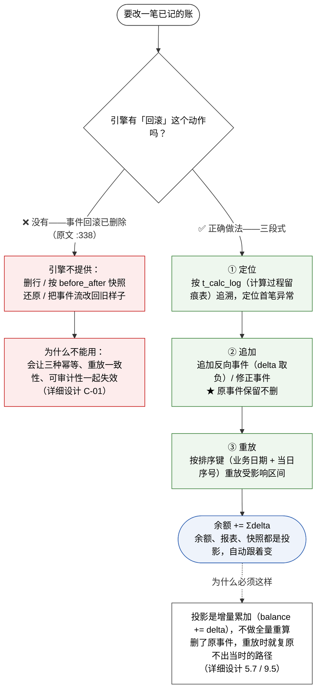
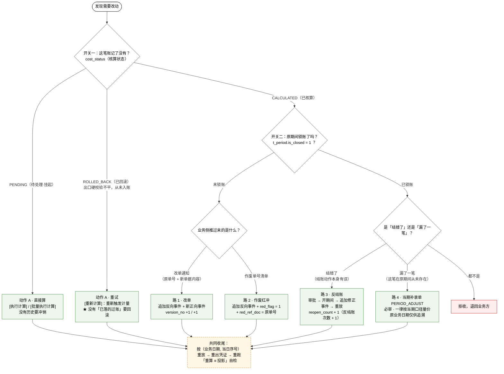
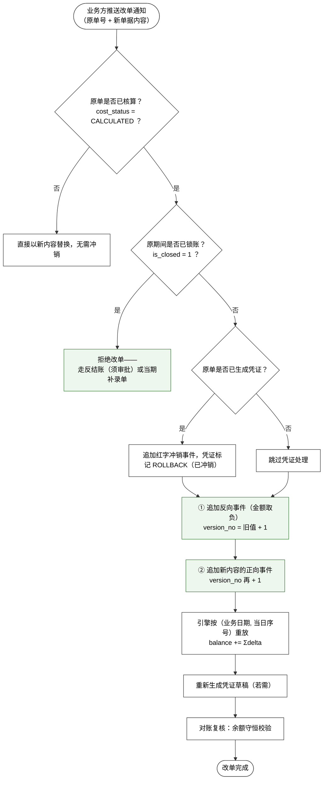
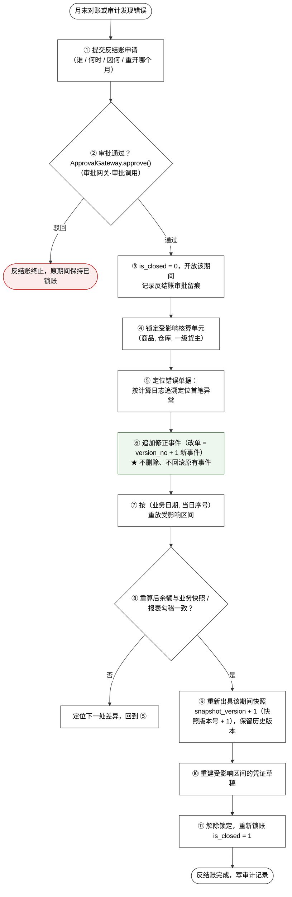
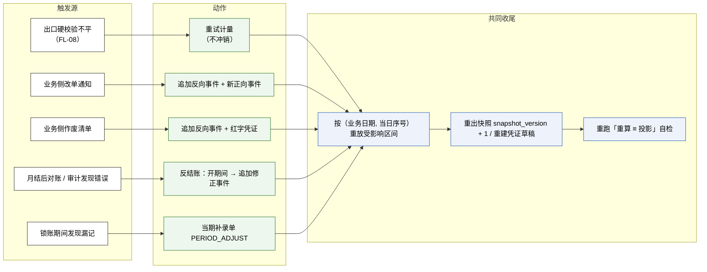

# 财务库存中心（一期）· 重算逻辑 v1.0

> **本文是什么**：把「重算」从**谁触发**到**收尾自检**的整条链路画清楚。核心是回答一个问题——**账记错了要改，系统凭什么能改？** 答案是：**它不改已记的账，只往后追加**。
>
> **权威关系**：规则以原文 `财务库存中心（一期）需求文档 1.0（原型页面与核算引擎）.md` 为准（下称「原文」）。**「逆向流程」的实现口径**（改单 / 作废 / 反结账的执行步骤）以 `财务库存中心（一期）详细设计文档.md` `§3.4` 为准——它是 schema 与实现层的权威来源之一。本文是**图 + 对照 + 留白清单**，不含任何新口径。
>
> **★ 先提醒一件事**：本项目里「重算」**指两个不同的动作**——① **对从未入账的数据重新计量**（`ROLLED_BACK` 已回滚的行）；② **对已入账的数据追加反向事件后重放**。原文把它们写在了同一张危险动作表里，**且两处描述互斥**（见 §八 第 1 条）。读本文请先分清这两件事。
>
> **配套读物**：`财务库存中心（一期）单据处理全流程图_v1.0.md`（FL-01 – FL-12 全链路、`X-11` – `X-15` 异常出口）；`财务库存中心（一期）负库存全流程_v1.0.md`（负库存的两阶段闭环）；规则摘要见 skill `fin-negative-stock`。

---

## 一、结论速览

### 1.1 四句话

1. **引擎没有「回滚」这个动作。** `t_calc_log`（计算过程留痕表）是**只增不删的事件流、是真相源**；余额、报表、快照都只是它的**投影**。要改一笔已记的账，唯一的做法是**追加一笔反向事件**，原事件**保留不删**（原文 `:563`）。
2. **所以「重算」的三段式是：定位 → 追加 → 重放。** 不是「还原 → 改数 → 重存」。「事务回滚是实现手段、**事件回滚已删除**」——这两件事名字像，性质完全相反（原文 `:338`）。
3. **改哪条路，先看两个开关**：这笔账**记了没有**（`cost_status`：核算状态）、那个期间**锁了没有**（`t_period.is_closed`：会计期间表·是否已锁账）。两个开关的四种组合决定四条路，**不可互换**（原文 `:321`、`:4059`）。
4. **重算之后必须重跑「重算 ≡ 投影」自检**——它是唯一能发现「余额与事件流已经分叉、而两边的外部对账各自都过」的校验（详细设计 `9.5`）。

### 1.2 「重算」在本项目里是哪两个动作

| | **动作 A · 重试计量** | **动作 B · 冲销后重放** |
|---|---|---|
| 作用对象 | **从未入账**的行（`cost_status = ROLLED_BACK`） | **已经入账**的行（`cost_status = CALCULATED`） |
| 为什么会有 | 出口硬校验不平 → 整单回滚，**错误数据根本不落库**（原文 `:551`） | 业务方改了单 / 作废了单 / 期间结错了 |
| 有没有「已落的过账」要冲 | **没有**——账从来没记上 | **有**——必须先追加反向事件 |
| 入口 | P04 `[执行计算]` / `[批量执行计算]` / `[重新计算]`（原文 `:747-749`） | 业务侧推**改单通知** / **作废清单**；或走**反结账**审批（详细设计 `3.4`） |
| 前提 | 行还在、数据已修好 | 原期间**未锁账**（或反结账已开期间） |
| 结果 | 计量通过则入账；再不平则**再回滚** | 追加两组事件 + 重放；`version_no`（版本号）递增留痕 |

> **一句话**：**动作 A 是「重新算一遍」**（没有历史要冲），**动作 B 是「冲掉旧结果、再算一遍」**（旧结果也留在事件流里）。原文 `:367` 把两者写成了同一句（见 §八 第 1 条）。

### 1.3 四条铁律

| # | 铁律 | 出处 |
|---|---|---|
| 1 | **不物理删除**——用 `red_flag`（红冲标记）/ `red_ref_doc`（红冲关联单号）/ `version_no`（版本号）留痕 | 详细设计 `3.4` 原则 1 |
| 2 | **已生成凭证必须先红字冲销或作废，再重算** | 详细设计 `3.4` 原则 2 |
| 3 | **任何反向调整都写入 `t_calc_log`**——保证「每一分钱可追溯」 | 详细设计 `3.4` 原则 3 |
| 4 | **已锁账期间禁止任何重算**——错了只有两条路：反结账（结错了）/ 当期补录单（漏一笔） | 原文 `:422`、详细设计 `:316` |

---

## 二、总原则：事件只增不删

> 原文 `:563`：
>
> **事务回滚 ≠ 事件回滚**：`t_calc_log`（计算过程留痕表）是**只增不删的事件流、是真相源**，余额与报表都只是它的投影；引擎没有"回滚"这个动作，反向调整一律通过**追加反向事件**实现（改单 = `version_no + 1`（版本号 + 1）新事件；作废 = 追加反向事件 + `red_flag = 1`（红冲标记置 1））。

**两层要分清**：

| 层 | 是什么 | 能不能重算 |
|---|---|---|
| **事件层** | `t_calc_log`（计算过程留痕表）、`t_owner_allocation`（二级货权重分配表） | **只增不删**——真相源，永远不能改 |
| **投影层** | 余额表、P05 结存流水、P16 余额管理报表、期间快照 | 可随时由事件重放**重建**——它本来就只是事件的投影 |

> **`before_*` / `after_*` 是审计快照，不是回滚依据。** 原文案里「利用 `calc_log` 的 `before/after` 快照回滚」是**回滚式做法**；正确做法是**追加反向事件**。把这两列当作回滚输入，会让三种幂等、重放一致性、可审计性一起失效（详细设计 `1611`、`2042`）。

---

## 三、四条路：先看两个开关

**开关一**：这笔账**记了没有** → `cost_status`（核算状态，在 `t_document_line` 单据行上）取值 `PENDING`（待处理·挂起）/ `CALCULATED`（已核算）/ `ROLLED_BACK`（已回滚）。
**开关二**：那个期间**锁了没有** → `t_period.is_closed`（会计期间表·是否已锁账）`= 1` 即已锁。

### 3.1 路 1 · 改单（已核算、期间未锁）

**改单不是「撤销」，是追加两组事件**（详细设计 `3.4.1`）：
① 对**原内容**追加一笔反向事件（`delta` 取负），② 对**新内容**追加一笔正向事件。原事件**保留不删**，`t_calc_log` 只增不写。

> **关键点**：**原事件留在事件流里**，与新事件并存。所以事后追溯时，看到的是「原来怎么记的 → 什么时候被冲的 → 后来怎么记的」三步，而不是一个被覆盖后的终态。

### 3.2 路 2 · 作废红冲（已核算、期间未锁）

追加**一笔**反向事件（入库单作废 → 数量金额取负；出库单作废 → 数量金额取正）+ 红字凭证冲销 + 原行置 `red_flag = 1`（红冲标记）并记 `red_ref_doc = 原单号`（红冲关联单号）（详细设计 `3.4.2`）。

> **作废闸门 = 核算状态，不是「是否有下游引用」**：**已核算的一律不可撤**，只能反向单 + 红字凭证。下游引用（凭证 / 对账）只作为**提示**，不作为是否允许的门槛（详细设计 `3.4.2`）。
>
> **报表口径**统一为 `biz_status = EFFECTIVE AND red_flag = 0`（业务状态 = 生效 **且** 红冲标记 = 未红冲）——作废后原流水保留，靠过滤条件把它排除出报表（详细设计 `3.4.2`、DISC-F12）。

### 3.3 路 3 · 反结账 · 批量重算（已锁账、结错了）

**反结账不是「回滚」，是「重新打开期间 + 追加修正事件」**（详细设计 `3.4.3`）。十一步：

> **为什么反复强调「不是回滚」**：原文此前的写法是「从错误单据开始逆向撤销（利用 `calc_log` 的 `before/after` 快照）」「补单 / **删行重推**」——那是**回滚式**做法，它把 `t_calc_log` 当成「可被改写的中间态」，会让引擎的三种幂等、重放一致性、可审计性一起失效（详细设计 C-01）。正确做法就是上面这十一步。

### 3.4 路 4 · 当期补录单（已锁账、漏了一笔）

`PERIOD_ADJUST`（跨期补录单），**必审**，**一律按当期口径量价**，原业务日期**仅供追溯**。

> **三条路不可互换**（原文 `:4059`）：**改单**（未锁账）、**反结账**（已锁账且结错了，须审批留痕）、**当期补录单**（已锁账且漏了一笔，必审）。补录是「这笔在原期间**从未存在**」的语义——**用反结账代替补录，审计就分不清「错误」与「遗漏」**。

### 3.5 四条路对照

| # | 路 | 触发 | 前置 | 动作 | 留痕 |
|---|---|---|---|---|---|
| **A** | **重试计量** | 校验失败 / 数据修好 | `ROLLED_BACK`（已回滚） | 重新触发计量，不平则再回滚 | `cost_status` 变化 |
| **1** | **改单** | 业务侧推改单通知 | 已核算 + **期间未锁** | 追加反向事件 + 新正向事件（`version_no` +1/+1） | `version_no`、原事件保留 |
| **2** | **作废红冲** | 业务侧推作废清单 | 已核算 + **期间未锁** | 追加反向事件 + 红字凭证 | `red_flag = 1` / `red_ref_doc` |
| **3** | **反结账** | 月结后发现结错了 | **已锁账** + 审批通过 | 开期间 → 追加修正事件 → 重放 → 重出快照 | 审批单 + `reopen_count` + `snapshot_version` |
| **4** | **当期补录单** | 已锁账期间发现漏记 | **已锁账** | 按**当期**口径量价补记一笔（不是改历史） | 补录单 + `approved_by` / `approved_at`（审批人 / 审批时间） |

---

## 四、重算的边界

### 4.1 闸门一：期间锁账

`is_closed = 1` → **禁止任何重算、改单、作废**（详细设计 `1679`）。日结**只校验不锁账，月结即锁账**（原文 `:70`）。

### 4.2 闸门二：危险动作的统一要求

**危险动作 = 执行后无法用「再执行一次」抵消的动作**——删除、撤销、启用期初、**批量重算**（原文 `:352`）。四件套，各页不再逐一重复（原文 `:355-359`）：

| 要求 | 内容 |
|---|---|
| **二次确认** | 弹窗须列出**操作摘要**与**影响范围**（涉及多少行、影响哪些期间 / 核算单元）——不允许只有一句「确定要删除吗」 |
| **填写原因** | **原因必填**，随操作写入审计日志 |
| **勾选确认项** | 弹窗内须有一个**必勾的确认项**；未勾选不可提交 |
| **审计日志** | 记录操作人 / 操作时间 / 原因 / 影响范围。**反结账另须独立权限** |

### 4.3 重算的最小单位与重放顺序

| 概念 | 是什么 | 用途 |
|---|---|---|
| `line_no`（单据行号） | 同一业务单号内从 1 递增 | **重算的最小单位**（原文 `:762`）——同一业务单号的不同行可分开算（原文 `:719`） |
| `biz_date`（业务日期） + `seq_in_day`（当日序号） | 排序键两段；同日**入库优先、同类型按单号** | **决定重放顺序**——全流程唯一决定谁先谁后的地方 |
| `posting_seq`（全局过账序号） | **全局单调递增**，记录**实际生效顺序**（同一天内也按它，而非排序键） | **审计追溯与事件重放的对齐依据**（原文 `:843`） |
| `journal_no`（记账流水号） | 唯一记账流水号 | 每次过账一个号；**重算后换新号，旧号作废**（PRD `:876`） |

> ★ **别把后两个搞混**：**重放按排序键 `(biz_date, seq_in_day)`**，不是按 `posting_seq`。`posting_seq` 记录的是「**实际**按什么顺序生效过」，供审计复现；重放则是「按**业务**顺序再走一遍」。两者在重算后会不一致——这是正常的。

### 4.4 三种幂等（重算能安全重跑的前提）

| 幂等 | 键 | 行为 |
|---|---|---|
| **传输幂等** | `batch_id + doc_no + line_no`（批次号 + 业务单号 + 单据行号） | 同一批推两次、行集合相同 → 自动跳过、返回上次回执 |
| **事件幂等** | `(doc_type, doc_no, version_no)`（单据类型 + 业务单号 + 版本号） | 同一事件重放 → **零 delta 且不报错** |
| **结果幂等** | —— | 引擎是纯函数 + 顺序确定 → **重放逐位相同** |

> **幂等不是「拒绝重复请求」，而是「重复请求返回与第一次相同的结果」**——返回错误会让上游以为失败而无限重试（原文 `:2048`）。
>
> **键命中后必须再判行集合**：行集合相同 → 零 delta；**行集合不同 → 冲突错误**（疑似改单未走 `CHANGE`（改单）动作）。

---

## 五、重算之后：必须重跑两件事

### 5.1 「重算 ≡ 投影」自检

| | 内容 |
|---|---|
| **重算（recalc）** | 由 `t_calc_log`（计算过程留痕表）**从事件流重放**，算出余额 |
| **投影（projection）** | 余额表现值（引擎每次 `balance += delta` 累加落下的结果） |
| **规则** | 对同一维度键，**重算余额 ≡ 投影余额**（数量、金额、均价逐项相等）；不等即**报错 + 告警** |
| **口径** | **重算只读 `t_calc_log`，不读余额表**——否则就是把投影当真相源，变成自己和自己比 |

**二级层对两列同时成立**：由 `t_owner_allocation`（二级货权重分配表）重放出的 `qty`（数量）**与** `own_amount`（自有结存金额）必须分别等于 `t_owner_balance_l2`（二级货主结存表）现值（即日结校验 `E-12`（二级结存投影不一致）+ `E-13`（二级自有池结转不一致））。

**何时跑**（详细设计 `9.5`）：

| 时点 | 跑什么 |
|---|---|
| **日结** | 与 `E-02`（批次行均价一致性）/ `E-11`（成本层一致性）/ `E-12` / `E-13` 同批跑 |
| **月结** | 再**全量**跑一次 |
| ★ **反结账 / 跨期补录后** | **必须重跑**——这两类操作会改动事件流，是最容易出现「重算 ≠ 投影」的时点 |

> **为什么必须有这一条**：投影是**增量累加**（`balance += delta`，不做全量重算）。一旦某笔 delta 落库成功而事件写日志失败（或反之），余额就与事件流分叉，而**外部对账查不出来**——数量仍对得上业务快照、金额仍对得上总账，两条路各自都对，却是两个不同的数。这是**唯一**能发现「各自都正确、但互相矛盾」的校验（详细设计 `9.5`）。

### 5.2 重出快照与凭证

- **期间快照**：`snapshot_version + 1`（快照版本号 + 1），**保留历史版本**——重算不是把旧快照改掉，是出一版新的（详细设计 `3.4.3` ⑨）。
- **凭证**：受影响区间的凭证草稿**重建**；已出的原凭证先红字冲销（详细设计 `3.4.3` ⑩、原则 2）。

---

## 六、一图看全（谁触发 → 走哪条 → 收什么尾）

---

## 七、易错点

| 易错 | 正确 | 依据 |
|---|---|---|
| 「重算 = 把数据改回去重算」 | 重算 = **追加反向事件 + 重放**；事件流**只增不删** | 原文 `:563` / 详细设计 C-01 |
| 「事务回滚 = 事件回滚」 | **事务回滚是技术手段（必须存在）；事件回滚已删除** | 原文 `:338` |
| 「出口硬校验不平 → 先记账再报警」 | 不平**整单回滚，错误数据根本不落库**——账已经脏了，报警没有任何补救作用 | 原文 `:551` |
| 「已核算的可以撤」 | **已核算的一律不可撤**，只能反向单 + 红字凭证。**作废闸门 = 核算状态，不是「有没有下游引用」** | 详细设计 `3.4.2` |
| 「锁账后还能改单」 | **不能**——锁账期间禁止任何重算、改单、作废 | 详细设计 `1679` |
| 「用反结账代替补录」 | **不可互换**——错误 vs 遗漏，语义不同 | 原文 `:4059` |
| 「重算后不用管自检」 | **必须重跑**「重算 ≡ 投影」；反结账 / 跨期补录后**尤其必须** | 详细设计 `9.5` |
| 「`before_*` / `after_*` 是回滚依据」 | 它们是**审计快照**，不是回滚输入——当回滚依据用会让三种幂等一起失效 | 原文 `:563` / 详细设计 `1611` |
| 「按 `posting_seq` 重放」 | **重放按排序键 `(biz_date, seq_in_day)`**；`posting_seq` 只记录实际生效顺序 | 原文 `:843` |
| 「`[重新计算]` 是对已入账的数据重算」 | 按**前置条件**，它**只对 `ROLLED_BACK`（从未入账）可点**；已入账的走改单 / 作废 / 反结账 | 原文 `:749`（★ 与 `:367` 冲突，见 §八 第 1 条） |
| 「重算会重新排 `posting_seq`」 | 不会——重放产生的是**新**的过账，拿**新**的 `posting_seq`；旧的留在流里 | 原文 `:843` |
| 「改单后原来那条记录就没了」 | **原事件保留**——追溯时能看到「原记 → 被冲 → 新记」三步 | 详细设计 `3.4.1` |

---

## 八、★ 留白与措辞冲突清单（本文只是标出来，**没有改原文**）

按项目约束（`CLAUDE.md` §一 / §2.2），**发现分歧只报告、不自行改原文**。**每一条都是待单独授权的改动，未获单独授权前一律不动。**

| # | 问题 | 位置 | 影响 | 建议 |
|---|---|---|---|---|
| **1** ★ | **同一页的两处描述互斥**：危险动作表的 P04 行（管 `[批量执行计算]` / `[重新计算]` **两个按钮**）写「重算**先回滚已落的过账**再重算，产生新的 `journal_no`」；而同页按钮表分别写着 `[批量执行计算]` 前置「选中至少一条**待计算**」、`[重新计算]` 前置「**仅『已回滚』可点**」且动作是「对已回滚的数据重算 / **重新触发计量**」 | 原文 `:367` vs `:747-749`（`:747` 定义 `ROLLED_BACK` = 出口硬校验不平、整单回滚、**从未落库**） | **一份从未入账的数据，不存在「已落的过账」要回滚**。按 `:747-749`，两个按钮都只作用于**从未入账**的行（`PENDING` / `ROLLED_BACK`）→ 它们是**动作 A（重试）**；按 `:367` 它们作用于已过账的数据 → 是**动作 B（冲销重放）**。两者不可能同时成立 | 择一写死：① 按 `:747-749` 保留两个前置，把 `:367` 改为「对出口硬校验失败的数据**重新触发计量**，不平则再次整单回滚」；② 若确要让财务在 P04 直接改已核算数据，则两个按钮的前置都要放宽，且须与改单 / 反结账划清边界。另：`:367` 的「回滚」措辞本身是 **C-01 的残留**（`:563` 已明写「引擎没有『回滚』这个动作」） |
| **2** ★ | **同属 C-01 残留**：P03 `[批量重试记账]` 的「不可逆之处」写「批量重放记账，**失败行的原记账结果被覆盖**」 | 原文 `:366` | 「**覆盖**」是回滚式措辞，与「事件只增不删」相反；且**失败单据压根没有「原记账结果」**可覆盖（它没记过账） | 改为：**重新触发计量；若该行此前已有过账结果，按追加反向事件处理** |
| **3** | **「重放受影响区间」的区间怎么算出来，没写** | 详细设计 `3.4.3` ④⑦（原文无对应） | 只有「锁定受影响核算单元」「重放受影响区间」两句，**没有界定上界**：是该核算单元在本期间的最后一笔？该期间末？还是全量重放？**跨核算单元的单据**（调拨、一级货权转移各动两个核算单元）要不要两腿一起重放？**二级分摊投影**要不要同步重放？ | 明写区间口径：建议 **受影响区间 = 该核算单元内、从首笔异常事件的排序键位置起，至该期间末**；双边单据**两腿同批重放**；二级层由 `t_owner_allocation` 一并重放 |
| **4** | **未锁账期间的「迟到单据」如何处置，原文未写** | 原文 `:2087` 只写了已结账的（`E-04`（引擎决策项·采用禁止）「不许改历史」+ 当期补录通道） | 一张 `biz_date` 落在过去、但**该期间没锁账**的单据到达时，是插回历史位置重算，还是追加到当天？**没写**。PRD（派生件）`:872` 写了「按业务日期**插入历史位置重算**（不是追加到当天）」——**这是 PRD 的补充，不是原文口径** | 把「未锁账期间的迟到单据 → 按业务日期插入历史位置重算」明写进原文；否则「排序键」在迟到场景下没有定义 |
| **5** | **`journal_no`（记账流水号）在重算后的留痕关系未写** | 原文 `:367` 只说「产生新的 `journal_no`」；PRD `:876` 说「重算后换新号，**旧号作废**」 | 「**旧号作废**」没写**旧行是删还是留**。按只增不删原则应**留**（并标记被替代），但没有一处写明；与此并列的 `t_calc_log` 其他列（`before_*` / `after_*`）的存留也未一并说明 | 明写：**旧 `journal_no` 行保留在事件流中、标记为已作废；新行取新号**——这样追溯时能看到完整替代链 |
| **6** | **重算后必须重跑自检，原文未写** | 详细设计 `9.5` 写了「反结账 / 跨期补录后必须重跑」；PRD `:720` 写了「重算后必须重跑」 | 两处**派生件都写了**，**原文缺** | 回灌一句进原文 `§四` 或 `§三.4`（P04 节）：**重算 / 反结账 / 跨期补录后必须重跑「重算 ≡ 投影」自检** |
| **7** | **重放时 `rounding_diff_acc`（舍入差异累计）怎么处理，未写** | 原文 `:539`（定义）/ `:2154`（要点）—— `rounding_diff`（舍入差异）**只在出库产生**，累计进余额表的 `rounding_diff_acc`，月末统一结转（`F3`） | 重放一条曾经出过库的事件时，旧事件当初计入的 `rounding_diff` 是**先冲回再重计**，还是**只计新增量**？**反向事件的 `rounding_diff` 取不取负**？没写 | 明写：**反向事件一并追加 `rounding_diff` 的负值**（否则重放后 `rounding_diff_acc` 会翻倍），并在重放后校验其等于「由事件流重放出的累计值」 |
| **8** | **重算的并发与顺序锁，只在详细设计提了一句** | 原文 `:2103` 讲了「跨单元单据不排序加锁 → 死锁」（靠乐观锁 `version`（版本号）重查重算重写 + 加锁顺序避免） | 反结账 PF8 ④「锁定受影响核算单元」具体是**排他锁**还是**乐观锁 + 重试**、与日常过账如何互斥，未写 | 明写：反结账期间**受影响核算单元禁止日常过账**（排他），否则会一边重放一边插入新事件 |

### 8.1 另：一处原文与派生件的口径先后

`财务库存中心（一期）单据处理全流程图_v1.0.md` `§6.2` 仍写「一个数量、**两个**金额」——这是**该派生件自己的落后项**（二级层早已是「一个数量、三个金额」：`alloc_amount`（二级分摊金额）/ `internal_amount`（二级内部结算金额）/ `own_amount`（二级自有结存金额））。本文一句带过，未动那份文件。

---

## 附录 A　行号指针

**原文** `财务库存中心（一期）需求文档 1.0（原型页面与核算引擎）.md`

| 内容 | 位置 |
|---|---|
| 引擎四层（事件 / 计量 / 记账 / 投影）与「事务回滚 ≠ 事件回滚」 | `:336` / `:338` |
| **事件只增不删 · 追加反向事件**（核心） | `:563` |
| 出口硬校验不平 → **整单回滚、错误数据不落库** | `:551`、`:556`、`:2049` |
| 危险动作定义与统一要求（二次确认 / 原因 / 勾选 / 审计） | `:352-359` |
| 一期危险动作清单（P03 / P04 / P12 / P14） | `:366-370` |
| P04 `[重新计算]` 前置「仅『已回滚』可点」 | `:749` |
| P04 `[批量执行计算]` → `cost_status` 置 `ROLLED_BACK` | `:747` |
| P03 `[批量重试记账]` | `:691` |
| `cost_status` 三态 | `:315`、`:783` |
| `line_no` = **重算的最小单位** | `:762` |
| 排序键 `(biz_date, seq_in_day)` 与「入库优先」 | `:2086` |
| `posting_seq` = 审计追溯与**事件重放的对齐依据** | `:843` |
| 三种幂等（传输 / 事件 / 结果） | `:2048` |
| `E-04` 已结账期间迟到单据不许改历史 | `:2087` |
| 期初「启用后锁定，只能靠反向单修正」 | `:369`、`:1395` |
| 期间锁账（`E-07` 月结即锁账）与反结账 / 补录两条路（`E-09` / `E-10`） | `:418`、`:422`、`:503`、`:4059` |
| 跨期补录单 `PERIOD_ADJUST` 定义 | `:108` |
| 负库存期间出库后的**成本调整单**（重算的另一种形态） | `:4018`、`:4054` |

**详细设计** `财务库存中心（一期）详细设计文档.md`

| 内容 | 位置 |
|---|---|
| 逆向流程定义与三条原则 | `§3.4`（`:450`、`:452`） |
| 改单 PF6 | `§3.4.1`（`:457`） |
| 作废红冲 PF7 + 「作废闸门 = 核算状态」 | `§3.4.2`（`:483`、`:510`） |
| **反结账 / 批量重算 PF8**（十一步） | `§3.4.3`（`:514-553`） |
| 三条路不可互换（正向 / 逆向对照速查表） | `§3.4.4`（`:546`、`:554`） |
| PF6 / PF7 / PF8 在正向—逆向总表里的定位 | `:245-247` |
| `before_*` / `after_*` **不是回滚依据** | `:1611` |
| 「接口形态变更（C-01 / E-06）」——回滚式修正路径**已删除** | `:2042` |
| **「重算 ≡ 投影」自检** | `§9.5`（`:2819-2832`） |
| `E-12`（二级结存投影不一致）/ `E-13`（二级自有池结转不一致） | `§9.4`（`:2811-2812`） |
| `t_period.is_closed` | `:1679` |
| 「版本纳入主键」方案（同号不同版本并存） | `:1321` |

---

## 附录 B　相关文件

| 文件 | 与本文的关系 |
|---|---|
| `财务库存中心（一期）需求文档 1.0（原型页面与核算引擎）.md` | **唯一权威规格**——规则以它为准 |
| `财务库存中心（一期）详细设计文档.md` | **逆向流程的实现口径来源**（`§3.4`）+ 自检口径（`§9.5`）；schema 权威来源之一 |
| `财务库存中心（一期）单据处理全流程图_v1.0.md` | 全流程管线（FL-01 – FL-12）；本文是逆向方向的深挖。异常出口见 `§12` 的 `X-11` – `X-15` |
| `财务库存中心（一期）负库存全流程_v1.0.md` | 负库存的两阶段闭环——**阶段二「按实际入库成本重算均价」是重算的一种形态** |
| `七份文档一致性核对与遗漏清单_v1.0.md` | `C-01`（回滚式做法 vs 事件只增不删）的原始发现记录 |
| `.claude/skills/fin-valuation/SKILL.md` | 计价方法（`F1` / `F2` / `F3` / `F4`）——重算的终点就是重新走一遍计量 |

---

> **本文不改任何口径、不动任何既有文件。** §八 的 8 条留白/冲突与 §8.1 的 1 条派生落后，**均为待单独授权的改动**。
