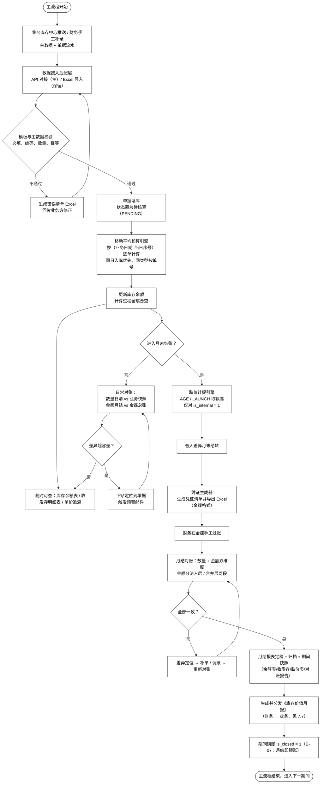
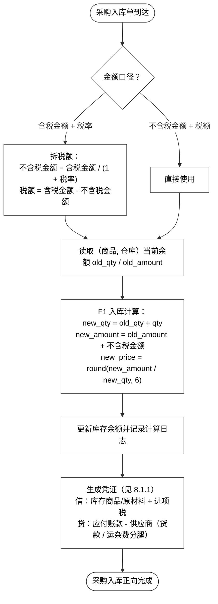
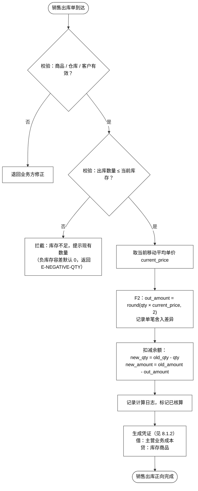
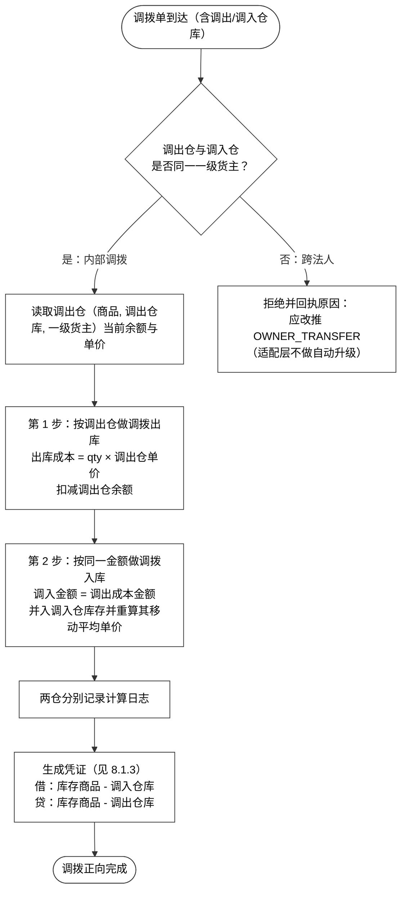

# 财务库存中心（一期）需求文档 1.0

## 一、文档信息

### 1. 项目背景

#### 1.1 建设背景

在传统的供应链与 ERP 体系中，仓储物理作业（库位管理、拣货打包、批次移动）与逻辑资产核算（法定纳税主体、内部产权人毛利、单品移动均价）长期强耦合于单一 WMS，导致以下核心矛盾：

| 矛盾 | 具体表现 |
|---|---|
| 权责与货位绑定 | 多法人实体、多内部产权人团队共用仓库时，实物移位频繁导致账面货权错乱 |
| 成本与毛利失真 | 数码 3C 价格波动剧烈、二手商品"一机一况一价"、车架号溯源强监管，传统加权平均无法反映单机真实利润 |
| 跨法人财税合规风险 | 跨公司调拨、代售在物理出库时未及时生成合规交易流水与开票依据，引发税务合规隐患 |
| 系统架构已达承载上限 | 实物作业高并发与财务核算强一致性相互制约，月结关账时无法阻断动态作业，历史报表无法定格 |

#### 1.2 系统定位

财务库存中心的核心定位是 **存货核算**。业务库存中心由另一团队负责搭建，与本系统同步建设。

1. ERP（金蝶）现有存货核算功能无法满足精细化成本管理需求；
2. 业务库存中心管"实物"，财务库存中心管"价值"，二者职责分离；
3. 财务部需要独立、灵活、可追溯的成本计算与凭证生成能力。

#### 1.3 四层解耦架构

系统实现"作业、可用量、资产、凭证"的彻底分离：

| 系统层级 | 关注核心 | 系统职责与核心能力 | 关键数据指标 |
|---|---|---|---|
| 物理仓储中心（WMS） | 实物位置与作业效率 | 库位分配、波次拣货、实物盘点、SN/IMEI 扫描采集、交接装车 | 物理在架量、货位占用率 |
| 业务库存中心（IMS） | 销售调度与可用量控制 | 可用量计算、渠道配额切分、销售预占锁定、履约寻仓路由 | 业务可用量、预占量、在途量 |
| **财务库存中心（本系统）** | **存货资产、货权与核算** | **法人与内部管理账户、移动加权核算、负库存补差、内部转价、月结关账** | **账面结存量、结存均价、结存总金额、内部毛利** |
| 财务总账系统（金蝶） | 法定总账与报表凭证 | 接收本系统导出的标准凭证底稿、总账科目汇总、出具法定资产负债表与利润表 | 会计科目借贷余额、总账资产 |

#### 1.4 关键约束

- **独立模块**：不依赖金蝶存货核算，数据自己接、自己算、自己存；
- **并行搭建**：业务库存中心同期在建，财务需应对"接口未就绪"的过渡期；
- **工期约束**：必须按 MVP 思维取舍范围，一期与二期严格分期。

---

### 2. 项目价值

| 价值维度 | 一期要解决的问题 | 交付物 |
|---|---|---|
| **资产真实** | 存货账面数量、金额、均价在四轴维度上可查、可对、可追溯 | 存货实时余额、结存流水数据、库龄表 |
| **成本可算** | 按核算单元 `(商品, 仓库, 一级货主)` 维护均价池 / 成本层，三种计价方法（`MA` / `SI` / `FIFO`）的入库定价、出库结转规则固定且可复现 | 计价模型配置、核算引擎、存货计价批次追踪 |
| **货权清晰** | 一级货主（法人）与二级货主（内部管理维度）分层记账，两级作价口径分离 | 货权转移出入库、原始数据处理流水 |
| **风险可控** | 成本波动预警、三账一致性核对、负库存闸门，异常不静默 | 成本波动表、核对表、负库存管理配置 |
| **月结可锁** | 引入会计期间与锁账，日结只校验、月结锁账，历史报表可定格 | 进销存周期表、期初数据维护 |
| **价值可回传** | 成本单价、库存金额、库龄、跌价准备等核算结果按口径标注后回传业务侧 | 库存价值月报 |

---

### 3. 一期范围

> 本表是研发的施工图。**表中每一行都必须能在正文找到对应设计**。

| 维度 | 一期范围 |
|---|---|
| **库存维度** | **四轴**：`(商品, 仓库, 批次, 一级货主)`；**存货核算单元** = `(商品, 仓库, 一级货主)`（**MA** 下批次不进均价池，只影响库龄与跌价；**SI / FIFO** 下批次 / 成本层即成本单元，见成本层 `t_inventory_layer`） |
| **货主分层** | 一级货主 = **法人主体**（`owner_l1`：一级货主，与账套是同一概念）；二级货主 = **二级产权人** = 内部管理维度（**产权人可为个人，也可为部门 / 事业部 / 代采项目**），**不进存货总额**；二级层另维护**管理口径**的**二级自有均价池**（见 `§一.5.2`），**不影响会计** |
| **核算主体** | **多法人**（已确认存在集团内跨法人转移） |
| **计价方法** | **三种并发**：**移动加权平均法 `MA`（全局默认）** / **个别计价法 `SI`** / **先入先出法 `FIFO`**，按核算单元 `(商品, 仓库, 一级货主)` 粒度在 `t_price_method_config` 配置（缺失回落全局默认 `MA` 并告警）；`SI` / `FIFO` 另启用**成本层** `t_inventory_layer` 承载批次 / SN 级成本，**余额与全部报表口径不变** |
| **作价来源** | 一级 `transfer_price`（一级货权转移价）：**交易数据**，不配置，只取价 + 校验；二级 `internal_price`（内部结算价）：**政策数据**，带生效期的价目表（固定价 / 成本加成率两种） |
| **跌价准备** | **库龄法 + 3C 上市周期法双轨，取孰高**（按商品类别配置）；**计提范围仅 `is_internal = 1`** |
| **会计期间** | 引入 `t_period`（会计期间表） + `is_closed`（是否已锁账）；**日结只校验、月结锁账**；反结账须走审批并留痕；跨期补记走当期补录单 |
| **凭证处理** | 生成凭证清单 + Excel 导出（一期不直推金蝶）；含货权转移与集团内抵消，**不含二级内部结算价差** |
| **主数据** | 业务库存中心推送为主，财务可补维护；**一级货主编码 A 级、二级货主必须业务给** |
| **数据接入** | **直接 API 对接为主**（协议与鉴权待定），**Excel/CSV 导入保留**（过渡与手工补录）；两条通道**共用同一套字段 / 校验 / 幂等 / 错误回执** |
| **单据类型** | **11 类**：采购入库 `PO_IN`（采购入库）、采购退货出库 `PO_RET`（采购退货出库）、销售出库 `SO_OUT`（销售出库）、销售退货入库 `SO_RET`（销售退货入库）、调拨 `TRANSFER`（调拨）、盘点 `STOCKTAKE`（盘点）、其他入库 `OTHER_IN`（其他入库）、其他出库 `OTHER_OUT`（其他出库）、一级货权转移 `OWNER_TRANSFER`（一级货权转移）、二级货权重分配 `OWNER_REASSIGN`（二级货权重分配）、跨期补录 `PERIOD_ADJUST`（跨期补录单） |
| **输出报表** | 库存余额表、收发存明细表、跌价表（双轨分列）、凭证清单、**库存价值月报（对外分发）** |
| **审批流** | **不建审批流引擎**，保留单据「待审 / 已审核」状态位 + 一个**审核动作**（记 `approved_by`：审核人 / `approved_at`：审核时间）；预留 `ApprovalGateway`（审批网关接口）接口，一期单点直通实现 |

**明确不做（一期）**：

| 不做项 | 一期承载方式 / 后置说明 |
|---|---|
| 产权交易中心落地 | 由库存中心出临时货权变更单承载，二期搬迁 |
| 多层级货主 | 一期两级（一级货主 + 二级内部管理维度） |
| 二级层会计凭证 | 二级只做管理口径，不出凭证 |
| 货押融资相关库存状态 | 一期范围外 |
| 标准成本 | 纯贸易 / 零售模式无生产环节，不引入 |
| 直推金蝶总账 | 二期（凭证自动过账） |

---

### 4. 术语表

| 术语 | 含义 |
|---|---|
| **一级货主** | **法人主体（公司主体）**，与 `owner_l1`（一级货主） / 账套是同一概念。存货均价池、凭证、损益、跌价基数都以它为准 |
| **二级货主（二级产权人）** | 内部管理维度，即页面上的 **二级产权人**——**产权人可以是个人，也可以是部门 / 事业部 / 代采项目**。**不是法人、不是会计主体**，不进存货总额；在**二级分摊账**（会计口径）与**二级自有均价池**（管理口径，`own_amount` / `own_unit_price`）两处体现 |
| **二级自有均价池** | **管理口径**：每个二级产权人**自己的一本**移动加权平均账（`own_amount`）。入池按**实际成本**、出池按**该二级当期自有均价**，二级重分配**同额平移**。与一级层金额的差即**池化差异 `D`**（`§一.5.2`）。**不进存货总额、不进跌价基数、不出凭证**，与会计口径**分成两列并排展示** |
| **存货核算单元** | `(商品, 仓库, 一级货主)`。**计价方法的作用粒度**——均价池、成本层、凭证、跌价基数都属于核算单元，不属于批次行 |
| **库存维度（四轴）** | `(商品, 仓库, 批次, 一级货主)`。余额表的主键；**MA** 下批次只影响库龄与跌价、不进均价池，**SI / FIFO** 下批次即成本层 |
| **作价** | 货权转移时给转移的货定一个价格并生成凭证。一级用 `transfer_price`（一级货权转移价），二级用 `internal_price`（内部结算价） |
| **内部结算价** | 二级重分配用的考核价（`internal_price`：内部结算价），是**政策数据**，来自带生效期的价目表；**不影响会计** |
| **`alloc_amount`（二级分摊金额）** | 二级分摊金额 = 数量 × 一级均价。**能**加总回一级层 |
| **`internal_amount`（二级内部结算金额）** | 二级内部结算金额 = 按 `internal_price`（内部结算价）累计。**不能**加总，差额 = 内部未实现毛利 |
| **货权变更单** | 一期由库存中心出的临时单据：`OWNER_TRANSFER`（一级转移）/ `OWNER_REASSIGN`（二级重分配）。按**可剥离**形态设计，二期搬迁到产权交易中心 |
| **`is_internal`（是否内部交易）** | 是否内部交易标识。存货总额只累加 `is_internal = 1`；跌价只对 `is_internal = 1` 计提 |
| **会计期间** | 财务结账的最小时间单位（`YYYY-MM`：年月格式）。引入 `t_period`（会计期间表） + `is_closed`（是否已锁账）：日结只校验、月结锁账 |
| **反结账** | 重新打开已锁账期间。**允许，但必须走审批并留痕**（谁 / 何时 / 因何 / 重开哪个月）。与补录单语义不同，**不能互相代替** |
| **跨期补录单** | `PERIOD_ADJUST`（跨期补录单）。已结账期间发现遗漏时的唯一通道，**一律按当期口径量价**，原业务日期仅供追溯 |
| **过账顺序** | `(业务日期, 当日序号)`。同日**入库优先**、同类型按单号。`doc_no`（业务单号） **不可**用作排序键 |
| **delta** | 核算引擎返回的是**增量**（数量与金额的变化量），不是新余额；余额 = 累计 delta |
| **幂等（三层）** | 传输幂等 `batch_id + doc_no + line_no`；事件幂等 `(doc_type, doc_no, version_no)`（单据类型 + 业务单号 + 版本号）；结果幂等（纯函数） |
| **移动加权平均法 `MA`** | 每次入库时，用累计金额 ÷ 累计数量 更新单位成本（**在核算单元层**）。**一期全局默认方法** |
| **个别计价法 `SI`** | 每件 / 每批存货按各自实际成本单独结转（**一期启用**，适用于 SN 管理的高值整机） |
| **先入先出法 `FIFO`** | 出库按**最早入库**的成本层逐层结转（**一期启用**） |
| **库龄** | 商品在库天数，从入库日期起算 |
| **上市周期** | 3C 新品自上市日起算的天数，用于新品跌价计提 |
| **单据流水** | 业务系统推送的每一笔出入库记录 |
| **估值** | 用单位成本 × 数量 计算的库存金额 |
| **跌价准备** | 按库龄法 / 上市周期法对呆滞或贬值库存计提的减值 |
| **舍入差异** | 因金额精度处理产生的累计差额，需专门科目归集 |

---

### 5. 全局说明

本节是全文的公共约定，各章节不再重复。**与本节冲突的表述以本节为准。**

#### 5.1 精度与舍入

| 字段类型 | 精度 | 处理 |
|---|---|---|
| 数量 | 4 位小数 | 直接计算，不额外舍入 |
| 金额 | 2 位小数 | 每笔出库按 `round(数量 × 单价, 2)` 计算，差额进舍入差异 |
| 单价 | 6 位小数 | 入库后 `round(金额 ÷ 数量, 6)`，出库不重算 |

**舍入差异只在出库产生**，由专门科目归集，月结时统一结转。

#### 5.2 维度与核算单元

| 概念 | 定义 | 用途 |
|---|---|---|
| 库存维度（四轴） | `(商品, 仓库, 批次, 一级货主)` | 余额表主键 |
| 存货核算单元 | `(商品, 仓库, 一级货主)` | **计价方法的作用粒度**（均价池 / 成本层 / 凭证 / 跌价基数的所有者） |

> 批次只影响库龄与跌价，**一期不进均价池**。

**结存流水页（P05）的五个维度不是五套算法**，而是**同一批数据的五种分组**——数据同源、只有聚合键不同。五者共用同一套查询条件，切换维度只换分组键，**不换数据集、不换取数口径**。

| 维度 tab | 聚合键（分组键） | 取数表 | 跨货主行为 |
|---|---|---|---|
| 集团维度 | `(sku_code, asset_type)` | `t_inventory_balance_unit`（核算单元层库存余额表·均价表） | **跨仓库、跨一级货主、跨二级产权人合并**——各仓库 × 各一级货主 × 各二级产权人的核算单元合并到商品 SKU 一行，合并规则与仓库维度同（见下） |
| 仓库维度 | `(warehouse_code, sku_code, asset_type)` | `t_inventory_balance_unit`（核算单元层库存余额表·均价表） | **跨货主合并**——同仓、同 SKU 下**所有**核算单元（各一级货主）合并为一行；**二级产权人不进核算单元**，不参与本维度合并 |
| 一级货主维度 | `(legal_owner_id, warehouse_code, sku_code, asset_type)` | `t_inventory_balance_unit`（核算单元层库存余额表·均价表） | 不合并——**一个核算单元一行**（核算单元前三个键即本维度的分组键） |
| 二级产权人维度 | `(amiba_owner_id, legal_owner_id, warehouse_code, sku_code, asset_type)` | `t_owner_balance_l2`（二级货主结存表） | 不合并——二级不建核算单元，一行 = 一个二级产权人 × 一级货主 × 仓库 × 商品 × 资产类型 |
| 批次维度 | `(batch_no, warehouse_code, sku_code, asset_type)` | `t_inventory_balance_unit`（核算单元层库存余额表·均价表）＋ `t_owner_allocation`（二级货主分摊账）的 `batch_no` | **跨一级货主、跨二级产权人合并**——同批次、同仓、同 SKU 下各二级产权人的量并成一行，合并规则与仓库维度同；一级货主由**批次本身**确定，不单列 |

**合并行的合并规则（集团维度 / 仓库维度 / 批次维度共用）**（合并行必须可拆回，否则不可审计）：

| 列 | 合并算法 |
|---|---|
| `current_qty`（当前结存数量） | $\sum$ 各核算单元数量，**直接求和** |
| `current_total_cost`（当前结存总额） | $\sum$ 各核算单元金额，**直接求和** |
| `current_unit_cost`（当前结存均价） | $\frac{\sum 金额}{\sum 数量}$——**加权平均，不是各单元均价的算术平均**；分母为 0 时显示 `—` |
| `pricing_method`（计价模式） | 合并行内各核算单元方法**全同** → 显示该方法；**不同** → 显示 `混合`（灰底 Tag） |
| `has_negative`（负库存标记） | **任一**子单元为负即置位 |
| `updated_at`（最后更新时间） | 取子单元中的**最大值** |

**合并行的均价展示按方法分流**（与核算单元同一套规则，混合行取更保守的一档）：

| 合并行内的方法 | `current_unit_cost`（当前结存均价）展示 |
|---|---|
| 全 `MA`（移动加权平均） | 派生均价 |
| 全 `FIFO`（先入先出法） | 派生均价 + 标注「派生 · 非计价依据」 |
| 全 `SI`（个别计价） | `--` |
| 混合、**不含** `SI`（`MA` + `FIFO`） | 派生均价 + 标注「派生 · 混合口径」 |
| 混合、**含** `SI` | **`--`** + Tag「混合口径 · 拆回货主看明细」 |

> **为什么含 `SI` 就压成 `--`**：合并行里 `SI` 单元的量会被一个加权均价掩盖，这正是「`SI` 不显示均价」要避免的误导。宁可少给一个数，也不给一个会被读成「这批货就值这个单价」的数。

> **合并行必须可拆回**：集团维度、仓库维度、批次维度的 `[查看]` 行详情弹窗除当前行字段外，须列出**构成该行的核算单元明细**（仓库 / 一级货主 / 二级产权人 × 数量 / 金额 / 均价 / 计价模式）。没有这个出口，「跨货主合并」在审计上就是一笔糊涂账——金额对不上时无法定位是哪一层货主的问题。

**一级货主维度的聚合算法**（**不做任何合并**——聚合键 = 核算单元前三个键，故**恒等映射**）：

| 列 | 算法 |
|---|---|
| `current_qty`（当前结存数量） | 取核算单元 `(sku_code, warehouse_code, legal_owner_id, asset_type)` 的 `qty`，**一行一个核算单元** |
| `current_total_cost`（当前结存总额） | 取核算单元的 `amount`（**权威金额**，不重估、不派生） |
| `current_unit_cost`（当前结存均价） | 核算单元的**权威均价** = 结存金额 ÷ 结存数量（`MA` 的移动平均单价即此值）；`SI` 单元显示 `--` |
| `pricing_method`（计价模式） | 取该核算单元的计价方法——**不存在「混合」**（一个核算单元只有一种方法） |
| `has_negative`（负库存标记） | 取该核算单元的负库存位 |

**二级产权人维度的聚合算法**（**不做任何合并**——一行 = 一个二级产权人 × 一级货主 × 仓库 × 商品 × 资产类型）：

| 列 | 算法 |
|---|---|
| `current_qty`（当前结存数量） | 取 **`t_owner_balance_l2`**（二级货主结存表）的 `qty`，分组键 `(amiba_owner_id, legal_owner_id, warehouse_code, sku_code, asset_type)`——**直接读现值、不做任何加总**（分摊账的 `qty` 已带符号，重分配的转出行取负即把量扣走） |
| `current_total_cost`（当前结存总额·**会计口径**） | **派生**：`qty ×` 所属一级层核算单元**当期**的一级均价（**不落库**）。派生而非「逐笔分摊金额求和」，是为让 R3 的「同一核算单元内多个二级货主**共用同一个会计口径均价**」**由构造保证**——若改成求和，不同时点进入该单元的二级货主会各自带出隐含的不同单价，等于在二级层偷偷建了第二个**会计**均价池。**该列即 V3 对平的左侧**（见下表 `M3`） |
| `current_unit_cost`（当前结存均价·**会计口径**） | **继承**所属一级层核算单元的均价（**不独立建会计均价池**，R3）；展示按**该核算单元**的方法分流，不因「引用来的」就一律给均价——`MA` 派生均价 / `FIFO` 同显并标注「派生 · 非计价依据」/ **`SI` 显示 `--`** |
| **`own_amount`（二级自有结存金额）** | **新增·管理口径、落库**：二级自有均价池的结存金额（`t_owner_balance_l2.own_amount`，见《详细设计文档》`4.3.7`）。**与上面的 `current_total_cost` 不是同一个数**——两者之差 = 该二级分摊到的**池化差异**（见下方「二级自有均价池 `D`」）。**不进存货总额（R4）、不进跌价基数、不出凭证（R5）** |
| **`own_unit_price`（二级自有均价）** | **新增·管理口径、派生不落库**：`own_amount ÷ qty`（派生 · **非计价依据**），即该二级产权人**自己**的移动加权平均。**与所属核算单元的一级层均价可以不同**——同一核算单元内两个二级产权人各有其价，这正是本列存在的理由（见 `§四.3「一级与二级产权人结存示例」`的价差算例） |
| `pricing_method`（计价模式） | **继承**所属核算单元的方法（二级层不单独配方法） |
| `has_negative`（负库存标记） | `qty < 0` 即置位。二级层的负值是**超分摊**（分摊出去的量超过该货主持有量），**与仓库 / 一级层的负库存语义不同**，Tag 文案应区分 |

> **为什么只有集团维度与仓库维度需要「合并算法」**：另外三个维度都是**恒等映射**——一级货主维度是**一个核算单元一行**、二级产权人维度是**一个二级产权人一行**、批次维度是**一个计价批次 × 一个仓库一行**，聚合即原样映射，没有合并，也就没有加权均价与「混合」降级的问题。这正是本节开头那句「**不是五套算法，而是同一批数据的五种分组**」的落点：**算法分歧只发生在集团维度（跨仓库、跨货主）与仓库维度（跨货主）的合并上**，两者共用同一套合并规则（见上）。批次维度虽也按批次汇总，但**同一批次内不存在跨单元的均价合并**——它的量来自分摊账、价沿用所属核算单元，不产生新的加权。

**维度间对平关系**（五个维度必须能互相验算，不平即数据有问题）：

| # | 等式 | 性质 |
|---|---|---|
| **V1** | $\sum$ 集团维度数量 = $\sum$ 仓库维度数量 = $\sum$ 一级货主维度数量 = $\sum$ 二级产权人维度数量 = $\sum$ 批次维度数量 | **数量守恒**，同一查询范围下五者恒等 |
| **V2** | $\sum$ 仓库维度金额 = $\sum$ 一级货主维度金额 | **一级层金额守恒** |
| **V3** | $\sum$ 二级维度金额（即 $\sum alloc\_amount$）= 一级层金额 | **二级分摊可加总·会计口径**——引擎出口硬校验①，不平整单回滚（见 `§二.2.6「出口硬校验」`）。**对平的是 `alloc_amount`（会计分摊），不是 `own_amount`（自有成本）** |
| **M1** | $\sum$ 二级 `own_amount` + $D$ = 一级层金额 | **管理口径**：池化差异 $D$ 的定义式，**逐核算单元**（$D$ 见下方「二级自有均价池 `D`」）。**日结校验**；与 V3 **并列成立**，不是它的替代 |
| **M3** | 对每个 $(核算单元, 二级产权人)$：`own_amount − alloc_amount` = 该二级分摊到的池化差异 | **管理口径·并排对账**（余额层）。两列**不相等是正常的**，差必须能解释；$\sum$ 该差 = $-D$ |

> **V1 的前提是「同一查询范围」**：集团维度跨仓库 / 跨货主合并、仓库维度跨货主合并，一级货主 / 二级产权人 / 批次维度不合并，只有当五者命中**同一批核算单元**时等式才成立。若在仓库维度按某个货主过滤、在二级维度按另一个货主过滤，两者本就不该相等——**不要跨查询范围对平**。

> **V3 对平的是 `alloc_amount` 口径，不是存货总额口径**，两者范围不同，不要混用：V3 的右侧是一级层**全部**金额（含外部法人的 `is_internal = 0`）；而**存货总额**只累加一级层中 `is_internal = 1` 的金额（R4），**二级层绝不相加**。`internal_amount`（二级内部结算金额）**不在 P05 任何维度展示**，也不参与上述任一等式——它按 `internal_price`（内部结算价）累计，天然加总不回去，差额 = 二级内部未实现毛利（管理口径）。

**维度间的口径差异**（同一列名在不同维度下含义不同，必须按维度读）：

| 列 | 集团维度 | 仓库维度 | 一级货主维度 | 二级产权人维度 | 批次维度 |
|---|---|---|---|---|---|
| `current_unit_cost`（当前结存均价·**会计口径**） | 合并行加权均价（**跨仓库、跨货主**）；**含个别计价单元则 `--`** | 合并行加权均价；**含 `SI` 则 `--`** | 核算单元的**权威均价**（`MA` 的移动平均单价即此） | **不独立建会计均价池，继承所属一级层核算单元**（R3）；该单元为 `SI` 时**同样继承 `--`**，不因「引用来的」就显示均价 | 沿用所属核算单元的均价（同 `E-02`：同一核算单元内**所有批次行一律相等**）；**含个别计价单元则 `--`** |
| `current_total_cost`（当前结存总额·**会计口径**） | 各核算单元金额**直接求和** | 各核算单元金额**直接求和** | 核算单元金额（**权威**） | **派生值**：`qty ×` 所属核算单元当期**一级层均价**（R3；不落库、不建会计均价池） | **派生值**：`qty ×` 所属核算单元当期一级层均价（即 `alloc_amount` 口径；不落库） |
| **`own_unit_price`（二级自有均价）** | **无此列** | **无此列** | **无此列** | **管理口径**：**该二级自己的**移动加权平均 = `own_amount ÷ qty`（派生 · 非计价依据）。**与左侧一级层均价可以不同** | **无此列** |
| **`own_amount`（二级自有结存金额）** | **无此列** | **无此列** | **无此列** | **管理口径·落库**：二级自有均价池的结存金额。**与 `current_total_cost` 之差 = 该二级分摊到的池化差异** | **无此列** |
| `legal_owner_id`（一级货主） | **无此列**（已合并掉） | **无此列**（已合并掉） | 分组键 | 归属一级货主 | **无此列**——由**批次本身**确定，不单列 |
| `amiba_owner_id`（二级产权人） | **无此列**（已合并掉） | **无此列**（已合并掉） | 无此列 | 分组键 | **无此列**（已合并掉） |
| `batch_no`（批次号） | 恒为 `—` | 恒为 `—` | 恒为 `—` | 恒为 `—` | **分组键，有值** |

> **批次号在结存余额口径下、除批次维度外都恒为 `—`**：核算单元是三轴聚合，批次不属于聚合键，强行展示会打散聚合。**批次维度本身就是以批次号为分组键**（见 `§三.5` 的 `#### 字段说明（批次维度）`），故该列在本维度下取派生的批次号；**记账流水口径**该列亦有值。

> **二级维度的取数口径（`G-06` 已闭合）**：二级维度的结存数量直接读 **`t_owner_balance_l2`**（二级货主结存表）——它是 `t_owner_allocation`（二级货主分摊账）的**物化投影**，键与本节的二级聚合键逐列一致。分摊账的 `qty`（业务数量）**带符号**（二级层增加为正、减少为负），二级重分配**展开为两行**（转出行 `qty` 取负 / 转入行 `qty` 取正），故 `SUM(qty) GROUP BY` 聚合键**直接就是结存数量**，方向不再有二义。规则细节见《详细设计文档》`4.2.4` / `4.3.7`，校验见 `9.4` 的 `E-12`（二级结存投影不一致）。
>
> **二级维度的会计口径金额只有一列，且是派生值**：`current_total_cost` = `qty ×` 该核算单元当期**一级层均价**——**不落库、不单独建会计均价池**（R3）。因为「同一核算单元内多个二级货主**共用同一个会计口径均价**」，把它定死为派生值才让该规则**由构造保证**，并把 V3 退化为 V1（一条硬校验守住两个等式）。**二级维度不出内部结算口径金额**：`internal_amount` / `internal_pl` 既不展示、也不参与任一等式。二级维度的 `current_unit_cost`（结存单价）**是继承值**——读所属一级层核算单元的均价，**按该核算单元的计价方法分流展示**（`MA` 显示派生均价 / `FIFO` 显示派生均价并标注「派生 · 非计价依据」/ `SI` 显示 `--`）。
>
> **但二级层另有一本管理口径的账**：`own_amount`（二级自有结存金额）与 `own_unit_price`（二级自有均价）——见下方「二级自有均价池」。它与这里的会计口径**并排展示、互不加总**。

> ⚠️ **「数量 × 一级层均价」不是 `alloc_amount` 的通用算式——它只是「结存一侧」的派生写法，「发生额一侧」必须取实际结转额。两侧要分开读**：
> - **结存（报表展示这一侧）**：`current_total_cost` = `qty ×` 该核算单元当期**一级层均价**。这里「一级层均价」的定义就是**结存金额 ÷ 结存数量**，所以这条等式**对三种方法都由构造成立**（`MA` / `SI` / `FIFO` 一样），上一条「V3 退化为 V1」的论证不受影响。
> - **发生额（引擎逐单过账这一侧，即出口硬校验① 真正验的对象）**：`alloc_amount_delta` **必须取该行实际结转的一级层成本**。`MA` 下两种写法等价（一级层金额 ≡ 数量 × 均价）；**`SI` / `FIFO` 下不等价**——一级层金额是各成本层的**和**，派生均价只是它的**商**，用 `delta_qty × 均价` 会算错，出口硬校验①（`Σ alloc_amount_delta == 一级层 amount_delta`）当场不平、**整单回滚**。反例见 `§四.3「一级与二级产权人结存示例」`。
> - 一句话：**结存看派生、发生额看实际**。把结存一侧的派生写法搬去算发生额，是 `SI` / `FIFO` 下最容易犯的错。

**二级自有均价池（管理口径）**

> **要回答的问题**：二级产权人也该有**自己单独的均价**（「我名下这批货值多少钱」），而不是永远借所属核算单元的价。
>
> **为什么不能做在会计口径上**：二级产权人**可为个人 / 部门 / 事业部 / 代采项目**（`§一.4`），**不是法人、不是会计主体**。把均价池做在会计层，等于要求**个人持有会计级存货余额**，并且**存货总额**要在「一级层 $\sum$」与「二级层 $\sum$」之间二选一——与 R3 / R4 正面冲突。**所以会计侧一刀不动**（硬校验① / V3 / 存货总额 / 凭证 / 跌价原样保留），二级层**另开一本管理口径的账**。
>
> **入池 / 出池规则**（**实际成本入池**）
>
> | 事件 | 一级层（会计） | 二级自有池（管理口径） |
> |---|---|---|
> | 采购入库 / 其他入库（挂二级 `i`） | `+A`（实际成本） | `own_amount: +A`（**同额**） |
> | 销售出库 / 其他出库（挂二级 `i`） | `−(q × 一级层当期池均价)` | `own_amount: −(q × 二级 i 当期自有均价)` |
> | **二级重分配（`i → j`）** | `0`（不出凭证、不动一级余额） | `i: −(q × own\_avg_i)`、`j: +(q × own\_avg_i)`（**同额平移**） |
> | 调拨（同法人跨仓） | 调出 `−`、调入 `+同额` | 跟随：调出方二级 `−`、调入方二级 `+` |
> | 一级货权转移（跨法人） | 转出 `−(q × 池均价)`；转入 **`+(q × transfer\_price)`** | 转出方二级 `−(q × own\_avg)`；转入方二级 **`+(q × transfer\_price)`** |
>
> 三条概括：**① 入池额 = 该笔进入本核算单元一级层时的实际成本额；② 出池额 = 出池数量 × 该二级当期自有移动加权均价；③ 二级重分配是唯一例外——转入额直接取转出方的出池额**（保证本核算单元内的差异不因重分配而变动）。
>
> **池化差异 $D$**（**核算单元级**，恒等式、派生、**不落库**）：
>
> $$D = 一级层金额 - \sum_{二级} own\_amount$$
>
> $D$ **只在「二级自有出池价 ≠ 一级层对该笔的出账价」时变动**（出库、跨核算单元动作），**二级重分配不动 $D$**。$D$ **不进存货总额（R4）、不进跌价基数、不出凭证（R5）**——它是**管理口径的解释项**，回答「为什么二级加起来不等于一级」。
>
> **对平式**：会计侧原样（V3 / 硬校验①）；管理侧新增 `M1`（$\sum own\_amount + D$ = 一级层金额，逐核算单元）与 `M3`（并排对账）。**两本账并排展示、互不加总**——`own_amount` 与 `alloc_amount` 的差就是该二级分摊到的池化差异。落库位置见《详细设计文档》`4.2.4`（分摊账 +2 列）/ `4.3.7`（结存表 +1 列），校验见 `9.4` 的 `E-13`；算例见 `§四.3「一级与二级产权人结存示例」`。
>
> ⚠️ **`SI` / `FIFO` 单元下 $D$ 更大**：一级层出池按**成本层逐件**结转，二级自有池按**自有均价**出池，两者的差在这些单元里可能明显大于移动加权平均单元。自有均价仍按 `own_amount ÷ qty` 实算，并标注「**派生 · 非计价依据**」——**它不是计价依据**，只用于二级考核与解释差异。

#### 5.3 货主分层硬约束（R1–R5）

| # | 规则 |
|---|---|
| **R1** | 一级货权转移**必作价、必出凭证、必产生会计损益** |
| **R2** | 二级重分配**必按内部结算价作价**，差额进二级内部损益（**管理口径**）；**不出会计凭证** |
| **R3** | **存货均价池只在一级货主层建立**（**会计口径**）；二级另维护内部结算价，并可另建**管理口径**的**二级自有均价池**（`own_amount` / `own_unit_price`，见 `§一.5.2`） |
| **R4** | 存货总额 = Σ 一级层中 `is_internal = 1` 的金额（**二级层绝不相加**——**含二级自有均价池 `own_amount`**） |
| **R5** | **二级内部结算价与二级自有均价池都不影响会计**——一级层成本、存货总额、凭证、跌价基数均与其无关 |

> **`owner_l2`（二级产权人）必填，但它不是维度轴**：二级货主**每行必填**（缺失即 `E-OWNER-L2-MISSING`：二级货主缺失、行级拒绝），**R3 / R4 / R5 不变**——它**不进四轴** `(商品, 仓库, 批次, 一级货主)`、**不进核算单元键** `(商品, 仓库, 一级货主)`、**不进会计均价池、不进存货总额**。它回答「这笔货归谁经营」，不回答「这笔货值多少钱」——同一核算单元内多个二级货主**在会计口径上共用同一个均价**；而**管理口径上各有其价**（二级自有均价池，`§一.5.2`），两者分开读、互不干扰。
>
> **注意区分两种「必填」**：本节说的是**数据行上的必填**（业务系统必须在每行推 `owner_l2`）；各原型页面「搜索条件」表里 `二级产权人` 的「**非必填**」是**查询语义**（不填 = 不按二级过滤），**两者不冲突，不要改**。

**二级层「一个数量、三个金额」**：

| 金额 | 字段 | 算法 | 能否加总 | 用途 |
|---|---|---|---|---|
| 二级分摊金额 | `alloc_amount`（二级分摊金额） | **结存**：数量 × **一级均价**（派生）；**发生额**：该行**实际结转的一级层成本**（⚠️ 见 `§一.5.2`，`SI` / `FIFO` 不能走派生短路） | **能**——`Σ alloc_amount = 一级层金额`（引擎出口硬校验，不平整单回滚） | 二级数量与金额的成本还原（**会计口径**） |
| 二级内部结算金额 | `internal_amount`（二级内部结算金额） | 按 `internal_price`（内部结算价）逐笔累计 | **不能**——差额 = 内部未实现毛利，**不做等式校验** | 二级内部考核、内部结算损益（**管理口径**） |
| **二级自有结存金额** | **`own_amount`（二级自有结存金额）** | **新增**：二级自有均价池逐笔结转——入池按**实际成本**、出池按**该二级当期自有均价**、二级重分配**同额平移**（`§一.5.2`） | **不能**——与一级层金额之差 = **池化差异 `D`**（`Σ own_amount + D = 一级层金额`，**`M1`**） | **该二级自己的**成本还原与考核（**管理口径**，**不进存货总额、不出凭证**） |

**口径标注**：库存金额标注 `（存货口径·一级货主层·is_internal=1）`；库存数量标注 `（权属口径·一级货主层）` 或 `（物理口径·仓库）`；内部结算损益与二级自有均价标注 `（管理口径·非会计损益）`。任何对外分发的报表与指标**必须带口径标注**。

#### 5.4 取价三条铁律

**按业务日期取价** → **取到即快照**（写进单据行与 `t_calc_log`：计算过程留痕表）→ **调价不追溯**（历史单据不重算）。

#### 5.5 过账顺序与幂等

| 机制 | 约定 |
|---|---|
| 排序键 | `(biz_date, seq_in_day)`，**全流程唯一决定"谁先谁后"的地方**；同日**入库优先**、同类型按单号；`doc_no`（业务单号） **不可**作排序键 |
| 传输幂等 | `batch_id + doc_no + line_no` |
| 事件幂等 | `(doc_type, doc_no, version_no)`（单据类型 + 业务单号 + 版本号） |
| 结果幂等 | 引擎是纯函数，同输入同输出 |

#### 5.6 单据状态位

| 状态位 | 取值 | 说明 |
|---|---|---|
| `biz_status`（业务状态） | `DRAFT`（草稿） / `SUBMITTED`（已提交） / `APPROVED`（已审核） / `EFFECTIVE`（已生效） / `VOID`（已作废） | 业务状态流转 |
| `cost_status`（核算状态） | `PENDING`（待处理·挂起） / `CALCULATED`（已核算） / `ROLLED_BACK`（已回滚） | 核算状态，**作废闸门** |
| `red_flag`（红字冲销标识） | `0` / `1` | 红字冲销标识，为 1 时指向 `red_ref_doc`（红字引用的原单据） |

#### 5.7 期间与锁账

- **日结只校验，月结锁账**；
- 锁账后的三条路**不可互换**：**改单**（未锁账）、**反结账**（已锁账、结错了）、**当期补录单 `PERIOD_ADJUST`（跨期补录单）**（已锁账、漏一笔，一律按当期口径量价）；
- 反结账权限独立，危险动作须**二次确认 + 填写原因 + 审计日志**。

#### 5.8 数据接入双通道

| 通道 | 定位 | 约定 |
|---|---|---|
| **API 对接** | **一期主通道** | 协议与鉴权待定；推模式，不回源拉取 |
| **Excel / CSV 导入** | 过渡与手工补录 | 10 个模板 + 2 个动作文件（`doc_change_{date}.xlsx` / `doc_void_{date}.xlsx`） |

两条通道**共用同一套字段 / 校验 / 幂等 / 错误回执**，字段层以《财务库存中心（一期）通用数据接口字段定义》v1.0 为准。

#### 5.9 契约与回滚口径

- 核算引擎对外契约：`measure(event, ctx) -> Posting`，返回 `delta`（`delta_qty`：数量增量 / `delta_amount`：金额增量 / `rounding_diff`：舍入差异 / `unit_price_after`：本笔过账后单价）、`layer_deltas[]`（**成本层**增量：建层 / 加层 / 耗层 / 关层，仅 `SI` / `FIFO` 单元非空），**不返回余额**；
- 引擎四层：事件 / 计量 / 记账 / 投影；
- 计量层**策略化**：一种计价方法 = 一个策略实现（`MA` / `SI` / `FIFO`）；**按腿解析**——调拨、一级货权转移同时动两个核算单元，两条腿可配不同方法，不接受单一全局策略；新增方法只需加策略实现，**记账层与投影层的对外口径、报表结构不变**；
- **事务回滚 ≠ 事件回滚**：前者是技术手段且必须存在，后者已删除；
- 出口硬校验不平即整单回滚，不允许部分过账。

#### 5.10 一期 / 二期标注

- **一期启用（三种并发）**：**移动加权平均法 `MA`（全局默认）**、**个别计价法 `SI`**、**先入先出法 `FIFO`**；按核算单元 `(商品, 仓库, 一级货主)` 粒度在计价模型配置页选择，缺失回落全局默认 `MA` 并告警；
- **一期硬要求**：SN 管理品类的出库单据行**必须**带 SN（个别计价按 SN 单台结转的前提）；
- **合规**：同类存货的计价方法须一致，变更须披露；方法切换**只对新商品类别自开账日启用，不对存量品类中途切换**；
- **二期**：产权交易中心搬迁、二级作价迁移、直推金蝶、移动加权平均按月结转版本。

全文凡涉及二期能力，均明确标注「二期」，**不得按一期实现**。

#### 5.11 危险动作与统一要求

**危险动作 = 执行后无法用「再执行一次」抵消的动作**：删除、撤销、启用期初、批量重算。这类动作**一律**走同一套流程，各页按钮表不再逐一重复「二次确认 + 原因 + 审计日志」：

| 要求 | 内容 |
|---|---|
| **二次确认** | 弹窗须列出**操作摘要**与**影响范围**（涉及多少行、影响哪些期间 / 核算单元），不允许只有一句「确定要删除吗」 |
| **填写原因** | **原因必填**，随操作写入审计日志（NFR-07） |
| **勾选确认项** | 弹窗内须有一个**必勾的确认项**（如「我已确认删除该规则，操作不可撤销」）；未勾选不可提交 |
| **审计日志** | 记录操作人 / 操作时间 / 原因 / 影响范围。**反结账另须独立权限**（见 `§一.5.7「期间与锁账」`） |

**一期危险动作清单**（新增危险动作须同步登记本表）：

| 页 | 动作 | 不可逆之处 |
|---|---|---|
| P01 计价模型配置 | `[删除 (仅未生效)]` | 删除后只能重建；且删除会改变 `priority`（优先级）序列 |
| P03 原始数据管理 | `[批量重试记账]` | 批量重放记账，失败行的原记账结果被覆盖 |
| P04 原始数据计算 | `[批量执行计算]` / `[重新计算]` | 重算**先回滚已落的过账再重算**，产生新的 `journal_no`（记账流水号） |
| P12 库龄表 | `[重新执行库龄推导 (异步任务)]` / `[生成跌价计提凭证建议]` | 异步重算覆盖当期推导结果 |
| P14 期初数据维护 | `[启用期初]` / `[删除]` | 启用后该期间**锁定**，只能靠反向单修正；删除按 `import_batch_id`（导入批次号）**整批撤销**，不做逐行恢复 |

> **`[反结账]` 同属危险动作**，但它在 §一.5.7 已有完整定义（须审批留痕，记录谁 / 何时 / 因何 / 重开哪个月），**一期不设页面按钮**，此处不重复。

> **删除类动作必须重排序列**：删除落在**有序键**上的记录后，须按列表顺序重排剩余记录，**不允许留下断号**（如 `1, 2, 4, 5`）。`priority`（优先级）是路由排序键（数值越小越优先，见 P01 `priority` 字段说明），断号会让排序比较失去确定含义。P01 `[删除 (仅未生效)]` 即适用本条。

---

## 二、流程图

本章分两块：**业务流程**给出端到端与三类正向单据的流程图；**数据流程**把"所有单据共用的那条管线"拉直成七段，逐段标出这一步做什么、输入输出是什么、对应管线上的哪一段（`FL-xx`：单据处理管线段号·泛指）。

---

### 1. 业务流程

四张图分别回答：整条主线怎么走、采购入库怎么走、销售出库怎么走、调拨怎么走。图取其对应源文件的 Mermaid 原图，图下只说明本图的关键分支。

#### （1）主流程图



本图是端到端主线：数据经适配层一次性落地单据表后，按 `(业务日期, 当日序号)` 逐单核算、更新余额，日常可查。关键分叉有两个：一是**日常对账差异超容差** → 下钻定位到单据、触发预警邮件后复对；二是**月结对账任一段不一致** → 补单 / 调账后重新对账。月结报表定稿后**期间锁账**（`is_closed = 1`），该期间禁止任何重算，之后只有"结错了 → 反结账"与"漏一笔 → 当期补录单"两条路（E-09 / E-10）。

#### （2）采购入库正向流程图



关键分支在"金额口径"：上游给**含税金额 + 税率**就拆税（`不含税金额 = 含税金额 / (1 + 税率)`），给**不含税金额 + 税额**就直接用，两者都进 F1 重算均价。采购入库是**唯一会改变 `MA` 单元移动平均单价的单据方向**（`SI` / `FIFO` 单元则表现为**新建成本层**），且税额单独拆分、只进进项税、不进存货成本。此外还有一条"暂估 / 到票"分支：货到票未到时按暂估价入库（`settle_status = ESTIMATED`），发票到达后**追加反向事件冲掉暂估 + 据实事件**（`settle_status = ADJUSTED`，记 `estimate_ref_doc`：暂估关联单据），不走"直接改暂估金额"。

#### （3）销售出库正向流程图



出库按**出库时点**的移动平均单价结转，**出库本身不改变单价**，且出库是**舍入差异的唯一来源**。关键分支在货主维度：销售签约方 = 实际持仓方走常规直接出库（上图）；带二级货主 `owner_l2`（二级产权人）时触发**二级重分配 `OWNER_REASSIGN`（二级货权重分配）**（只算 `alloc_amount`：二级分摊金额 / `internal_amount`：二级内部结算金额，不动一级余额、不出凭证）；销售签约方 ≠ 实际持仓方即**跨货主穿透**，跨一级货主走**一级货权转移 `OWNER_TRANSFER`（一级货权转移）**（按 `transfer_price`：一级货权转移价 作价、必出凭证、必确认损益）。上游**不给金额**——金额由本系统按当前均价算。

#### （4）调拨正向出库流程图



关键分支有二。其一，**按一级货主判定走哪条路**：调出仓与调入仓**同一一级货主** → 内部调拨 `TRANSFER`（调拨），先调出（按调出仓均价）、再调入（按同额入库并重算调入仓均价），公司层面总库存金额不变；**不同一级货主** → 适配层拒绝并回执 `E-CROSS-LEGAL-ENTITY`（跨法人单据非法），要求改推 `OWNER_TRANSFER`（一级货权转移），**不做自动升级**。其二，**落库形态**：业务侧推 **1 张**调拨单，适配层展开为 **2 行**（调出腿 `is_in = 0` / 调入腿 `is_in = 1`，两行 `doc_type`：单据类型 都是 `TRANSFER`：调拨，**共用同一个 `doc_no`：业务单号**、`line_no`：单据行号 递增），不是拆成两张单据。

---

### 2. 数据流程

以下七步是**所有单据共用的同一条管线**在需求文档上的七个环节，逐段编号 `FL-xx`（单据处理管线段号·泛指）与《单据处理全流程图》一致。

#### 1. 数据接收：推模式

上游业务侧（业务库存中心）主动把报文**推**过来，经协议无关边界 `InventoryDataAdapter.receive(envelope) -> Receipt` 进入；适配层一期主实现为 `BusinessApiAdapter`（业务接口适配器），**REST / MQ / 文件三种绑定都实现同一接口**，一期**以推模式为主、不回源拉取**，接口签名同时含 `receive`（接收报文）与 `pull_*`（`pull_materials`：拉取商品主数据 / `pull_documents`：拉取单据 / `pull_inventory_snapshot`：拉取库存快照），推、拉两个方向都实现，定了之后只是少调一个。

接入段一次性把校验与换算做完：**表头**（列名 / 顺序 / 必填列）→ **行级**（编码存在性、类型、必填、枚举）→ **主数据**（一级货主是否在 `t_cargo_owner`：货主主数据表、仓库能否推导出法人）→ **单位换算**（`qty × convert_rate = base_qty`（数量 × 单位换算率 = 基本单位数量），换算率缺失即拒绝）→ **金额口径判定**（含税拆税 / 不含税直接用，出库单上游不给金额）。信封里的 `record_count`（记录条数）与实际 `records`（记录集）长度不符即**整批拒绝**。落库时执行**传输幂等**（`batch_id + doc_no + line_no`），重复传输直接丢弃、返回上次回执。

| 项 | 内容 |
|---|---|
| 输入 | 上游报文信封（`batch_id`：导入批次号 / `source_system`：来源系统 / `schema_version`：报文版本号 / `object`：对象 / `push_time`：推送时间 / `record_count`：记录条数 / `records`：记录集） |
| 输出 | 已落库、`cost_status = PENDING` 的单据表头与行；校验失败写 `t_import_error_log`（`raw_payload`：原始报文 保留原文，可导出 Excel 给业务修正） |
| 对应段 | `FL-01`（数据到达）· `FL-02`（校验与换算）· `FL-03`（落库与传输去重） |

#### 2. 过期间闸门：然后排队

落库后的单据先读 `t_document_line.period`（记账期间，`YYYYMM`：年月格式），再看 `t_period.is_closed`（会计期间表·是否已锁账）。这是第二道闸，**只读取不修改**——结账锁账是运维动作，引擎只读这个标志并拒绝越界过账，**引擎自己不结账**。

撞上已锁账期间的单据**不是静默丢弃**，而是按两条**不能互相代替**的出口分流（E-09 / E-10）：单据本就属于该期间、当时漏了 → 走**当期补录单 `PERIOD_ADJUST`（跨期补录单）**（必审，按当期口径量价，原业务日期仅供追溯）；上次结账本身结错了 → 走**反结账**（须审批留痕，记录谁 / 何时 / 因何 / 重开哪个月，`reopen_count + 1`（反结账次数 + 1））；两者都不是 → **拒收**，退回业务方。

| 项 | 内容 |
|---|---|
| 输入 | 已落库、`cost_status = PENDING` 的单据行 + `t_period.is_closed`（会计期间表·是否已锁账） |
| 输出 | 放行的待算单据（进 FL-05 排队），或走补录 / 反结账 / 退回 |
| 对应段 | `FL-04`（期间闸门） |

#### 3. 排序键：全流程唯一决定"谁先谁后"的地方

移动平均**结果依赖处理顺序**，所以过账顺序必须在全流程唯一一处定义：**第一段**按 `biz_date`（业务日期）升序（业务日期，不是推送日期）；**第二段**在同一 `biz_date`（业务日期）内分配 `seq_in_day`（当日序号）——先过所有入库，再出库，同类型内部按 `doc_no`（业务单号）。据此落成全局单调递增的 `posting_seq`（过账序号），记录实际生效顺序、不复用。

`doc_no`（业务单号） **不能当排序键**：单号不单调（有补单、有外部系统单号、有前缀差异），业务系统改了单号规则历史数据就乱。同日采用**入库优先**（E-01 方案 B），避免当天补入的货被按旧均价出库——偏差方向**业务可理解**，"按单号"这种规则无法向业务解释。

| 项 | 内容 |
|---|---|
| 输入 | FL-04 放行的待算单据 |
| 输出 | `t_document_header.seq_in_day`（单据头表·当日序号）与 `t_calc_log.posting_seq`（计算过程表·过账序号） |
| 对应段 | `FL-05`（排序键分配，决策 E-01） |

#### 4. 分组、加锁、并行

按**核算单元** `(商品, 仓库, 一级货主)` 分组——**锁的最小单位就是核算单元**：均价池只在这一层建，锁得比它大会让无关仓库互相阻塞，锁得比它小（批次）保护不了均价。**批次不进锁 key**，批次只影响库龄与跌价基数、**不影响均价**。

组内**严格串行**（同一核算单元内均价必须逐笔累进），组间**并行**（不同核算单元互不影响）。一张单动一个单元（采购入库 / 销售出库 / 盘点）单键加锁；动两个单元（调拨 / 一级货权转移）按维度键**排序后依次加锁**，**固定加锁顺序防死锁**。整张单据的全部行在**同一事务**内过账，不能出现半张单。

| 项 | 内容 |
|---|---|
| 输入 | 已定序的待算单据 |
| 输出 | 锁 key 列表（内存）；进入 FL-07 计量 |
| 对应段 | `FL-06`（分核算单元，决策 E-05） |

#### 5. 计量

`measure(event, ctx) -> Posting` 是**纯函数**，`ctx`（计量上下文）是**只读快照、不含余额引用**；它返回的是 **`delta`（数量与金额增量）、不返回余额**。入库走 **F1**（`new_price = round(new_amount / new_qty, 6)`，重算均价），出库走 **F2**（`out_amount = round(out_qty × current_price, 2)`，取当前均价、出库不重算）。

输出是**一个数量、三个金额**：一级层 `delta_qty`（数量增量） / `delta_amount`（会计口径）之外，带二级货主时另派生 `alloc_amount`（二级数量 × **一级层均价**，**能**加总回一级层）、`internal_amount`（二级数量 × `internal_price`：内部结算价 快照，**不能**加总，差额 = `internal_pl`：内部损益 内部未实现毛利）与 `own_amount`（按**该二级当期自有移动加权均价**结转，**不能**加总，差额 = **池化差异** `D`，管理口径、**不影响会计**）。**三列中只有 `alloc_amount` 参与会计对平**（`§一.5.2`）。`rounding_diff`（舍入差异） **只在出库产生**（入库只舍入单价、不回改金额），单笔尾差量级为 ±0.01 或 0，累计进 `t_inventory_balance.rounding_diff_acc`（库存余额表·舍入差异累计），**月末统一结转**（F3）。

| 项 | 内容 |
|---|---|
| 输入 | `event`（单据行 + 已快照的取价）+ `ctx`（只读核算单元快照） |
| 输出 | `Posting`（全部是 delta：`delta_qty`：数量增量 / `delta_amount`：金额增量 / `rounding_diff`：舍入差异 / `unit_price_after`：本笔过账后单价，含 trace） |
| 对应段 | `FL-07`（计量，决策 E-06） |

#### 6. 出口硬校验

这是**唯一的"挡在门外"的地方**——硬校验放在**引擎出口**、不放月末对账：错误数据**根本不落库**，月末对账是第二道网、不是第一道。校验项：① `Σ alloc_amount_delta == 一级层 amount_delta`（二级会计分摊额必须能加总回一级层）；② **数量守恒 F12**（`期末数量 = 期初 + Σ入库 − Σ出库`）；③ **金额守恒 F13**（`期末金额 = 期初金额 + Σ入库金额 − Σ出库金额 + Σ舍入差异`）；④ **批次行均价一致性**（同一核算单元所有批次行 `unit_price`：单价 必须相等，引擎决策 E-02）；⑤ 单据完整性与重复键（调拨单两行共用同一 `doc_no`：业务单号，幂等键唯一）。

任一不平 → **整单回滚**，错误数据不落库，并**告警并列出不平的（商品, 仓库, 一级货主）**。**不是记账后报警**——账已经脏了，报警没有任何补救作用。

| 项 | 内容 |
|---|---|
| 输入 | 尚未落库的 `Posting`（过账结果对象） |
| 输出 | 通过则进 FL-09 记账；不通过则整单回滚 + 告警 |
| 对应段 | `FL-08`（出口硬校验） |

#### 7. 记账

记账层是**账的唯一写入者**，对每个 delta 执行 `balance += delta WHERE 维度键 = key AND version = expected`（**乐观锁 `version`：版本**）。影响行数为 0 说明被并发改过，**重试：重查 → 重算 → 重写**。随后追加二级分摊（写 `t_owner_allocation`：二级货权重分配表）、写凭证草稿，并写 `t_calc_log`（含 `posting_seq`：过账序号 / `price_source`：作价来源 / `price_base`：基准价 / `markup_rate`：成本加成率 / `delta_qty`：数量增量 / `delta_amount`：金额增量 / `before_*` / `after_*`），最后 `mark_posted(idempotency_key)`（**事件幂等**键 `doc_type + doc_no + version_no`（单据类型 + 业务单号 + 版本号）：重复提交返回零 delta、**不报错**）。

**事务回滚 ≠ 事件回滚**：`t_calc_log`（计算过程留痕表）是**只增不删的事件流、是真相源**，余额与报表都只是它的投影；引擎没有"回滚"这个动作，反向调整一律通过**追加反向事件**实现（改单 = `version_no + 1`（版本号 + 1） 新事件；作废 = 追加反向事件 + `red_flag = 1`）。事务提交后进入 FL-10 投影刷新，打 `cost_status = CALCULATED`。

| 项 | 内容 |
|---|---|
| 输入 | FL-08 校验通过的 `Posting`（过账结果对象） |
| 输出 | `t_inventory_balance`（`+= delta` + `version`：版本）、`t_calc_log`（计算过程留痕表）、`t_owner_allocation`（二级货权重分配表）、凭证草稿；提交后进 FL-10 投影刷新 |
| 对应段 | `FL-09`（记账；传输幂等见 `FL-03`：单据处理管线段号，事件 / 结果幂等见 `FL-09`：单据处理管线段号 / `FL-07`：单据处理管线段号，投影刷新见 `FL-10`：单据处理管线段号） |

## 三、原型页面

> **本章读法（两条约定，避免核对时误报）**
>
> **① 命名已统一。** 各页「搜索条件」表的条件名与「字段说明」表的规范名字段名**逐字一致**（如 `对账状态`、`所属记账期间`、`异常标记`），不再是一物两名。仅三处保留差异，因为强行对齐会丢失语义，**实现时请按列名映射、不要新建字段**：
>
> | 页 | 查询条件名 | 对应列 / 字段 | 为何不对齐 |
> |---|---|---|---|
> | P07 | `一级货主`、`二级产权人` | 同一列 `owner_info`（货权主体） | 该列是「一级货主 / 二级产权人」的组合文本，两个条件各自筛其中一段，**不允许并成一个条件** |
> | P08 | `SN / IMEI / 车架号` | `sn_code`（SN/序列号） | 检索需同时支持 IMEI 与车架号，列名窄于检索语义 |
> | P09 | `入库日期范围` | `in_time`（入库时间） | 前者描述控件（区间），后者描述字段 |
>
> **② `[字段与按钮说明]` 是原型的自带说明书，不是独立功能。** 15 个页面工具栏均含该按钮，点开抽屉展示的**就是本章该页的字段说明表与按钮交互表**，供评审时就地查阅。它没有额外业务规则，**不属于「原型有、文档无」的缺口**。
>
> 另注：搜索条件里有两类条件**筛的不是某一列原文，而是由某列算出的量**，实现时须逐行计算——P05 / P06 `库存状态`（按 `current_qty` 正负派生：仅看有库存 / 仅看负库存）、P15 `是否超期`（按 `pending_days` 是否大于该策略 `max_pending_days` 派生）。它们与 `报表聚合维度`、`快照基准日期`、`会计期间` 这类**参数型条件**不是一回事：后者改的是「取哪一期 / 哪一天 / 按什么分组」，不过滤行。

### 1. 计价模型配置

#### 搜索条件

| **查询条件** | **查询控件类型** | **匹配方式** | **必填/默认值** | **说明、取值与联动** |
|---|---|---|---|---|
| 规则编码 / 名称 | 文本输入 | 模糊搜索 | 非必填 | — |
| 适用一级货主 | 下拉单选 | 精确匹配 | 非必填 | — |
| 适用仓库 | 下拉单选 | 精确匹配 | 非必填 | — |
| 计价模式 | 下拉单选 | 精确匹配 | 非必填（默认全部） | 三种一期均可选；取值：全部 / 移动加权平均 / 个别计价 / 先入先出法 |
| 规则状态 | 下拉单选 | 精确匹配 | 非必填（默认全部） | 取值：全部 / 生效中 / 已停用 |
| 业务类型 | 下拉单选 | 精确匹配 | 非必填（默认全部） | 取值：全部 / 自营 / 代销 / 代采 / 寄售 |

#### 按钮交互

| **按钮** | **功能** | **点击后的交互** | **权限、前置条件与结果** |
|---|---|---|---|
| `[查询]` | 按当前搜索条件重新加载计价规则列表 | 重新查询并刷新列表 | 无权限限制 |
| `[重置]` | 清空全部搜索条件 | 清空条件并恢复默认查询 | 无权限限制 |
| `[+ 新建计价规则]` | 新增一条计价规则 | 弹出新建表单，录入规则编码、名称、适用范围、业务类型、计价模式与生效周期 | 保存后新增规则行，状态默认 `ACTIVE`（生效） |
| `[保存优先级重排]` | 保存拖动排序后的优先级顺序 | 提交当前优先级顺序并刷新列表 | 保存后写回 `priority`（优先级） |
| `[编辑]` | 修改规则内容 | 打开编辑表单 | 已生效或未生效规则均可编辑 |
| `[启用]` | 启用规则 | 将该规则状态置为 `ACTIVE`（生效） | 前置：规则当前为停用 |
| `[停用]` | 停用规则 | 将该规则状态置为 `INACTIVE`（停用） | 前置：规则当前为生效 |
| `[删除 (仅未生效)]` | 删除规则 | 危险动作（见 `§一.5.11「危险动作与统一要求」`）：二次确认 + 填写原因（NFR-07）+ 勾选确认项，写审计日志；**删除后按列表顺序重排 `priority`（优先级），不留断号** | 前置：仅未生效规则可删除 |
| `[上移/下移]` | 调整规则优先级顺序 | 将当前行上移或下移一位 | 保存后调整 `priority`（优先级） |
| `[查看]` | 查看该行完整明细 | 打开行详情弹窗，按当前行只读展示该行全部字段 | 无权限限制 |

#### 字段说明

| **页面字段** | **数据来源** | **字段含义、取值和展示规则** |
|---|---|---|
| `priority`（优先级） | `cfg_inventory_pricing_rule`（计价模型配置表） | 数值越小越优先，支持鼠标拖拽排序，数字徽章展现；路由匹配优先级：特定 SKU → 仓库 + 品类 → 商品品类 → 仓库 → 全局默认（移动加权平均 `MA`） |
| `rule_code`（规则编码） | `cfg_inventory_pricing_rule`（计价模型配置表） | 系统唯一编码，纯文本 |
| `rule_name`（规则名称） | `cfg_inventory_pricing_rule`（计价模型配置表） | 财务自定义名称 |
| `legal_owner_id`（适用一级货主） | `cfg_inventory_pricing_rule`（计价模型配置表） | 指定法人（空代表全部） |
| `warehouse_code`（适用仓库） | `cfg_inventory_pricing_rule`（计价模型配置表） | 指定仓库（空代表全部） |
| `category_name`（适用品类） | `cfg_inventory_pricing_rule`（计价模型配置表） | 绑定类目名称（空代表全部） |
| `sku_code`（适用特定 SKU） | `cfg_inventory_pricing_rule`（计价模型配置表） | 绑定 SKU 编码（空代表全部） |
| `biz_type`（业务类型） | `cfg_inventory_pricing_rule`（计价模型配置表） | 本规则适用的业务类型，**非必填**；取值：自营 / 代销 / 代采 / 寄售（空代表全部） |
| `pricing_method`（计价模式） | `cfg_inventory_pricing_rule`（计价模型配置表） | `MOVING_AVG`（移动加权平均） / `INDIVIDUAL`（个别计价） / `FIFO`（先入先出法），**三种取值一期均可选**，三色 Tag 区分（移动加权平均绿底 / 个别计价蓝紫底 / 先入先出法棕金底）；**本列只表达配置意图**，`SI` / `FIFO` 单元的权威成本在成本层 `t_inventory_layer` |
| `sn_mandatory`（强制 SN 开关） | `cfg_inventory_pricing_rule`（计价模型配置表） | `1` 强制采集 / `0` 否（**个别计价锁死为 1**；先入先出法不锁——拣货顺序由系统按入库先后自动决定，无需人工指定 SN） |
| `valid_period`（生效周期） | `cfg_inventory_pricing_rule`（计价模型配置表） | `YYYY-MM-DD ~ YYYY-MM-DD` |
| `status`（状态） | `cfg_inventory_pricing_rule`（计价模型配置表） | `ACTIVE`（生效）生效(绿) / `INACTIVE`（停用）停用(灰) |

### 2. 负库存管理配置

#### 搜索条件

| **查询条件** | **查询控件类型** | **匹配方式** | **必填/默认值** | **说明、取值与联动** |
|---|---|---|---|---|
| 适用一级货主 | 下拉单选 | 精确匹配 | 非必填 | — |
| 适用仓库 | 下拉单选 | 精确匹配 | 非必填 | — |
| 是否允许负库存 | 下拉单选 | 精确匹配 | 非必填（默认全部） | 取值：全部 / 严格禁止 / 允许负库存 |
| 状态 | 下拉单选 | 精确匹配 | 非必填（默认全部） | 取值：全部 / 生效中 / 已停用 |

#### 按钮交互

| **按钮** | **功能** | **点击后的交互** | **权限、前置条件与结果** |
|---|---|---|---|
| `[查询]` | 按当前搜索条件重新加载负库存策略列表 | 重新查询并刷新列表 | 无权限限制 |
| `[重置]` | 清空全部搜索条件 | 清空条件并恢复默认查询 | 无权限限制 |
| `[+ 新建负库存策略]` | 新增一条负库存风控策略 | 弹出新建表单，录入适用一级货主、仓库、品类/SKU、是否允许负库存、缺口上限、最长挂账天数与暂估取价来源。**条件行联动**：「缺口上限件数 / 最长挂账天数 / 暂估单价来源」三项**仅在「是否允许负库存」选「允许负库存」时出现且必填**；选「严格禁止」时三项**隐藏**（不允许负库存则不存在缺口，此三项无意义） | 保存后新增策略行，状态默认 `ACTIVE`（生效） |
| `[编辑]` | 修改策略内容 | 打开编辑表单 | — |
| `[启用]` | 启用策略 | 将该策略状态置为 `ACTIVE`（生效） | 前置：策略当前为停用 |
| `[停用]` | 停用策略 | 将该策略状态置为 `INACTIVE`（停用） | 前置：策略当前为生效 |
| `[查看]` | 查看该行完整明细 | 打开行详情弹窗，按当前行只读展示该行全部字段 | 无权限限制 |

#### 字段说明

| **页面字段** | **数据来源** | **字段含义、取值和展示规则** |
|---|---|---|
| `rule_code`（策略编码） | `cfg_negative_stock_rule`（负库存风控策略配置表） | 唯一策略编码 |
| `legal_owner_id`（适用一级货主） | `cfg_negative_stock_rule`（负库存风控策略配置表） | 法人名称 |
| `warehouse_code`（适用仓库） | `cfg_negative_stock_rule`（负库存风控策略配置表） | 仓库编码与名称 |
| `scope_target`（适用品类/SKU） | `cfg_negative_stock_rule`（负库存风控策略配置表） | 类目名或 SKU（空代表全仓全类目） |
| `allow_negative`（允许负库存） | `cfg_negative_stock_rule`（负库存风控策略配置表） | `0` 严格禁止 (Hard Stop)(红) / `1` 允许负库存(绿)；允许时负库存出库登记挂账表 `inv_negative_stock_log`（负库存挂账表），状态 `OPEN`（挂账中·未冲平），采购到货冲平后置 `RESOLVED`（已冲平） |
| `max_negative_qty`（缺口上限件数） | `cfg_negative_stock_rule`（负库存风控策略配置表） | 允许超卖件数上限，数值（如 `50 件`） |
| `max_pending_days`（最长挂账天数） | `cfg_negative_stock_rule`（负库存风控策略配置表） | 逾期未平阻断出库天数，数值（如 `7 天`） |
| `est_price_source`（暂估单价来源） | `cfg_negative_stock_rule`（负库存风控策略配置表） | `LATEST_PO_PRICE`（最近采购订单价）最近 PO 价 / `BENCHMARK_PRICE`（基准供货价）基准供货价 / `MOVING_AVG_PRICE`（当前移动平均价）当前均价；负库存出库时结存均价强制锁定为暂估单价 P_est，禁止金额除以数量产生数学异常 |
| `alert_email`（告警接收人） | `cfg_negative_stock_rule`（负库存风控策略配置表） | 告警通知推送邮箱 |
| `status`（状态） | `cfg_negative_stock_rule`（负库存风控策略配置表） | `ACTIVE`（生效）生效中 / `INACTIVE`（停用）已停用 |

### 3. 原始数据管理

#### 搜索条件

| **查询条件** | **查询控件类型** | **匹配方式** | **必填/默认值** | **说明、取值与联动** |
|---|---|---|---|---|
| 业务单据号 | 文本输入 | 模糊搜索 | 非必填 | — |
| 单据类型 | 下拉单选 | 精确匹配 | 非必填（默认全部） | 取值：采购入库 / 销退入库 / 调拨入库 / 其他入库 / 货权转移入库 / 销售出库 / 采退出库 / 调拨出库 / 其他出库 / 货权转移出库（**入库 5 类 + 出库 5 类**）。**调拨与货权转移都是双边单据，按其两腿各列一项**——报文与 `doc_type`（单据类型）层各只有**一个**类型（调拨 `TRANSFER`：调拨、一级货权转移 `OWNER_TRANSFER`：一级货权转移），转出 / 转入是**行上的 `is_in`（出入方向·1 入 0 出）**，不拆成两个单据类型。**盘点 `STOCKTAKE`（盘点）、二级货权重分配 `OWNER_REASSIGN`（二级货权重分配）、跨期补录 `PERIOD_ADJUST`（跨期补录单）不在本列表**——它们不是业务推送的出入库报文；盘盈 / 盘亏是盘点单的**派生单据、不是独立 `doc_type`（单据类型）** |
| 一级货主 | 下拉单选 | 精确匹配 | 非必填 | 源自法人主数据 |
| 物理仓库 | 下拉单选 | 精确匹配 | 非必填 | 源自仓库主数据 |
| 商品 SKU | 文本输入 | 精确查询 | 非必填 | — |
| 处理状态 | 下拉单选 | 精确匹配 | 非必填（默认全部） | 取值：全部 / 待处理 / 处理成功 / 处理失败 |
| 接收时间范围 | 日期时间双选框 | 区间 | 非必填 | 快捷项：今日 / 近7天 / 近30天 |

#### 按钮交互

| **按钮** | **功能** | **点击后的交互** | **权限、前置条件与结果** |
|---|---|---|---|
| `[查询]` | 按当前搜索条件重新加载源单台账列表 | 重新查询并刷新列表 | 无权限限制 |
| `[重置]` | 清空全部搜索条件 | 清空条件并恢复默认查询 | 无权限限制 |
| `[导出源单日志]` | 导出当前查询结果 | 点击后下载导出文件 | — |
| `[批量重试记账]` | 对勾选的失败单据批量重试 | 二次确认后批量触发重试 | 前置：选中至少一条失败单据 |
| `[查看原始 JSON 报文]` | 查看该条接入的原始报文 | 抽屉展示原始 JSON 报文 | — |
| `[重试过账]` | 对单条失败单据重试 | 点击后触发重试 | 前置：仅失败单据可点 |
| `[查看生成流水]` | 查看该单据生成的记账明细 | 跳转 P07 原始数据处理流水 | 前置：仅成功单据可点 |
| `[查看]` | 查看该行完整明细 | 打开行详情弹窗，按当前行只读展示该行全部字段 | 无权限限制 |

#### 字段说明

| **页面字段** | **数据来源** | **字段含义、取值和展示规则** |
|---|---|---|
| `raw_id`（接入流水号） | 接入层原始报文 | 数据库自增主键，全局唯一，纯文本展示 |
| `biz_bill_no`（业务单据号） | 接入层原始报文 | 上游推送单号，可点击下钻看详情 |
| `bill_type`（单据类型） | 接入层原始报文 | 上游操作类型，蓝底 Tag 展现 |
| `source_system`（来源系统） | 接入层原始报文 | `WMS`（仓储管理系统） / `OMS`（订单管理系统） / `ERP_PO`（采购订单系统），灰底 Tag 展现 |
| `legal_owner_id`（一级货主） | 接入层原始报文 | 法人编码与简称，如 `LEGAL_SH01(上海公司)` |
| `owner_l2`（二级产权人） | 接入层原始报文 | 二级产权人编码与名称，如 `OWN-A-1(3C 事业部)`；**产权人可为个人，也可为部门 / 事业部 / 代采项目**。**每行必填**，缺失即行级拒绝（`E-OWNER-L2-MISSING`：二级货主缺失） |
| `warehouse_code`（物理仓库） | 接入层原始报文 | 仓库编码与名称，如 `WH_KS01(昆山一号仓)` |
| `sku_code`（商品 SKU） | 接入层原始报文 | 报文中的 SKU 编码 |
| `raw_qty`（原始数量） | 接入层原始报文 | 报文原始申报量，数值保留 4 位小数 |
| `raw_price`（原始单价） | 接入层原始报文 | 报文单价（PO 暂估价），货币格式 `¥#,##0.0000` |
| `received_time`（接收时间） | 接入层原始报文 | 网关接收时间戳，`YYYY-MM-DD HH:mm:ss` |
| `process_status`（处理状态） | 接入层原始报文 | `SUCCESS`（成功）成功(绿) / `FAILED`（失败）失败(红) / `PENDING`（待处理·挂起）处理中(黄) |
| `error_msg`（失败原因） | 接入层原始报文 | 接口校验报错文本，红色文本，超长 Tooltip 提示 |

### 4. 原始数据计算

本页是**接入段（FL-01 – FL-05）与计量段（FL-06 – FL-08）之间的待计算队列**：报文已通过表头校验、行级校验、主数据校验、单位换算校验与传输幂等去重，越过期间闸门并拿到排序键，落成**标准化事件**，等待核算引擎 `measure(event, ctx) -> Posting`（计量） 计量。

与 P03 的分工：**P03 看报文进没进来、能不能进来**（`process_status`：处理状态），**P04 看待计算的数据算没算、算出来是什么**（`cost_status`：核算状态）。队列以**单据行**为单位，同一业务单号的不同行可分开重算。

#### 搜索条件

| **查询条件** | **查询控件类型** | **匹配方式** | **必填/默认值** | **说明、取值与联动** |
|---|---|---|---|---|
| 接入流水号 | 文本输入 | 模糊搜索 | 非必填 | `raw_id`（接入流水号），接入层自增主键，全局唯一 |
| 业务单号 | 文本输入 | 模糊搜索 | 非必填 | — |
| 单据类型 | 下拉单选 | 精确匹配 | 非必填（默认全部） | 取值：采购入库 / 销退入库 / 调拨入库 / 其他入库 / 货权转移入库 / 销售出库 / 采退出库 / 调拨出库 / 其他出库 / 货权转移出库（**入库 5 类 + 出库 5 类**）。**调拨与货权转移都是双边单据，按其两腿各列一项**——报文与 `doc_type`（单据类型）层各只有**一个**类型（调拨 `TRANSFER`：调拨、一级货权转移 `OWNER_TRANSFER`：一级货权转移），转出 / 转入是**行上的 `is_in`（出入方向·1 入 0 出）**，不拆成两个单据类型。**盘点 `STOCKTAKE`（盘点）、二级货权重分配 `OWNER_REASSIGN`（二级货权重分配）、跨期补录 `PERIOD_ADJUST`（跨期补录单）不在本列表**——它们不是业务推送的出入库报文；盘盈 / 盘亏是盘点单的**派生单据、不是独立 `doc_type`（单据类型）** |
| 子场景原因 | 下拉单选 | 精确匹配 | 非必填（默认全部） | 取值：全部 / 借用归还 / 报废毁损 / 赠出送样 / 借出可归还 / 委托代销发出 / 货权已转实物才出。`reason`（子场景原因）；**仅其他出入库有值**，随所选单据类型联动——选 `OTHER_IN` 时列出 7 个入库原因、选 `OTHER_OUT` 时列出 8 个出库原因，其余类型置灰。完整枚举见《通用数据接口字段定义》`§4.3.2` |
| 金额来源 | 下拉单选 | 精确匹配 | 非必填（默认全部） | 取值：全部 / 原单回冲 / 外部给价 / 财务估价。`valuation_source`（金额来源）；**用途：把「待财务估价」的行单独筛出来**——这三类决定财务是「取数」还是「估价」，也决定本单要不要审 |
| 有无实物移动 | 下拉单选 | 精确匹配 | 非必填（默认全部） | 取值：全部 / 有 / 无。`has_physical_movement`（有无实物移动）；**用途：虚进虚出的排查入口** |
| 一级货主 | 下拉单选 | 精确匹配 | 非必填 | 源自法人主数据 |
| 二级产权人 | 下拉单选 | 精确匹配 | 非必填 | 源自二级货主主数据，随所选一级货主联动 |
| 物理仓库 | 下拉单选 | 精确匹配 | 非必填 | 源自仓库主数据 |
| 商品 SKU | 文本输入 | 精确查询 | 非必填 | — |
| 核算状态 | 下拉单选 | 精确匹配 | 非必填（默认全部） | `cost_status`（核算状态） 取值：全部 / 待计算 / 已计算 / 已回滚；常用筛选为「待计算」 |
| 所属记账期间 | 下拉单选 | 精确匹配 | 非必填（默认当前期间） | `period`（所属记账期间），`YYYYMM`（年月格式） |
| 业务日期范围 | 日期范围选择框 | 区间 | 非必填 | 排序键第一段 `biz_date`（业务日期）；快捷项：今日 / 近7天 / 近30天 |
| 接收时间范围 | 日期时间双选框 | 区间 | 非必填 | `received_time`（接收时间），网关接收时间戳 |

#### 按钮交互

| **按钮** | **功能** | **点击后的交互** | **权限、前置条件与结果** |
|---|---|---|---|
| `[查询]` | 按当前搜索条件重新加载待计算队列 | 重新查询并刷新列表 | 无权限限制 |
| `[重置]` | 清空全部搜索条件 | 清空条件并恢复默认查询 | 无权限限制 |
| `[导出待计算清单]` | 导出当前查询结果 | 点击后下载导出文件 | — |
| `[批量执行计算]` | 对勾选的数据批量触发引擎计量 | 二次确认后按排序键 `(biz_date, seq_in_day)`（业务日期 + 当日序号） 顺序逐单调度 | 前置：选中至少一条「待计算」数据；出口硬校验不平整单回滚，`cost_status`（核算状态） 置 `ROLLED_BACK`（已回滚） |
| `[执行计算]` | 对单条数据触发计量 | 点击后即时调用 `measure(event, ctx) -> Posting`（计量） | 前置：仅「待计算」可点 |
| `[重新计算]` | 对已回滚的数据重算 | 二次确认后重新触发计量 | 前置：仅「已回滚」可点；同一事件幂等键 `(doc_type, doc_no, version_no)`（单据类型 + 业务单号 + 版本号） 重复执行结果一致 |
| `[查看计量结果]` | 查看 `measure()`（计量） 返回的 `Posting`（记账结果） | 抽屉展示 `delta_qty`（数量增量） / `delta_amount`（金额增量） / `rounding_diff`（舍入差异） / `unit_price_after`（本笔过账后单价） | 前置：仅「已计算」可点 |
| `[查看标准化事件]` | 查看映射后的标准事件结构 | 右侧滑出抽屉展示 | — |
| `[报文对照]` | 原始报文与标准化事件逐字段对照 | 抽屉左右分栏对照 | 用于排查字段映射与单位换算 |
| `[查看原始报文]` | 查看该条接入的原始 JSON 报文 | 抽屉展示原始 JSON 报文 | — |

#### 字段说明

| **页面字段** | **数据来源** | **字段含义、取值和展示规则** |
|---|---|---|
| `raw_id`（接入流水号） | 接入层原始报文 | 数据库自增主键，全局唯一，纯文本展示 |
| `doc_no`（业务单号） | 标准化事件 | 上游推送单号，链接文本，点击回跳 P03 看原始报文 |
| `doc_type`（单据类型） | 标准化事件 | 标准化后的单据类型，蓝底 Tag 展现 |
| `line_no`（单据行号） | 标准化事件 | 同一业务单号内从 1 递增；重算的最小单位 |
| `version_no`（版本号） | 标准化事件 | 改单后递增，与 `doc_type`（单据类型） 、`doc_no`（业务单号） 共同构成事件幂等键 |
| `biz_date`（业务日期） | 标准化事件 | 排序键第一段，`YYYY-MM-DD`（日期格式）；跨期补录单填补录归属日 |
| `seq_in_day`（当日序号） | 标准化事件 | 排序键第二段，由引擎按「同日入库优先、同类型按单号」分配 |
| `period`（所属记账期间） | 标准化事件 | `YYYYMM`（年月格式），由 `biz_date`（业务日期） 推导 |
| `legal_owner_id`（一级货主） | 标准化事件 | 法人编码与名称，如 `OWN-A(上海醒市供应链有限公司)` |
| `amiba_owner_id`（二级产权人） | 标准化事件 | 产权人编码与名称（**个人或部门**）；不进余额表主键、不进存货总额 |
| `warehouse_code`（仓库） | 标准化事件 | 核算单元（均价池）键之一，仓库编码与名称 |
| `sku_code`（商品 SKU） | 标准化事件 | 商品编码，四轴之一 |
| `batch_no`（批次号） | 标准化事件 | 空 = 不按批次管理；批次一期不进均价池 |
| `is_in`（出入方向·1 入 0 出） | 标准化事件 | `1`（入）入库(绿) / `0`（出）出库(橙) |
| `qty`（数量） | 标准化事件 | 业务单位数量（展示用），数值保留 4 位小数 |
| `unit`（单位） | 标准化事件 | 业务单位 |
| `base_qty`（基本单位数量） | 标准化事件 | 核算唯一口径，`qty × convert_rate = base_qty`（数量 × 单位换算率 = 基本单位数量） 对不上即在接入段被拒 |
| `amount_ex_tax`（不含税金额） | 标准化事件 | 入账基数，货币格式 `¥#,##0.00` |
| `price_source`（取价来源） | 标准化事件 | 取价在事件层完成并随单据快照进来，引擎不查价目表 |
| `reason`（子场景原因） | 标准化事件 | **L4 子场景的钥匙**，仅 `OTHER_IN` / `OTHER_OUT` 有值，其余类型显示 `—`。彩色 Tag（蓝底）；**未列入枚举的取值在接入段即被拒**（`E-ENUM-INVALID` 枚举取值非法）。取值见《通用数据接口字段定义》`§4.3.2` |
| `valuation_source`（金额来源） | 标准化事件 | **决定财务是「取数」还是「估价」**，也决定本单要不要审：`ORIG_DOC`（原单回冲）/ `EXTERNAL`（外部给价）/ `FINANCE_ESTIMATE`（财务估价，须含估价人）。仅其他出入库有值 |
| `orig_doc_no`（原单号） | 标准化事件 | 本行回冲 / 归还所依据的原单号（如 `OT-202601-0005`）。仅原物归还、退货类有值；链接文本，点击跳 P03 看原单报文 |
| `has_physical_movement`（有无实物移动） | 标准化事件 | `1`（有）/ `0`（无）。**事实声明**，由业务推单时声明、财务侧不采信真伪只留痕；`0` 时本行在「虚实」排查中需人工确认 |
| `link_doc_no`（直发配对键） | 标准化事件 | 直发业务「入库 + 出库」两笔的配对键；**没有它「入库数量 = 出库数量」这条校验做不了**。非直发为空 |
| `cost_status`（核算状态） | 标准化事件 | `PENDING`（待处理·挂起）待计算(黄) / `CALCULATED`（已核算）已计算(绿) / `ROLLED_BACK`（已回滚）已回滚(红) |
| `delta_qty`（数量增量） | 计量结果 `Posting`（记账结果） | `measure()`（计量） 返回，数值保留 4 位小数；余额由投影层累加，引擎**不返回余额** |
| `delta_amount`（金额增量） | 计量结果 `Posting`（记账结果） | `measure()`（计量） 返回，货币格式 `¥#,##0.00` |
| `unit_price_after`（本笔过账后单价） | 计量结果 `Posting`（记账结果） | 该笔过账后核算单元的派生单价（= 结存金额 ÷ 结存数量）；`MA` 下即移动平均单价、为计价输入，`SI` / `FIFO` 下仅供展示，货币格式 `¥#,##0.000000` |
| `rounding_diff`（舍入差异） | 计量结果 `Posting`（记账结果） | 单价除不尽的残差归集到本笔，货币格式 `¥#,##0.00` |
| `received_time`（接收时间） | 接入层原始报文 | 网关接收时间戳，`YYYY-MM-DD HH:mm:ss` |
| `error_msg`（失败原因） | 计量结果 `Posting`（记账结果） | 出口硬校验不平的报错文本（如 `E-NEGATIVE-QTY`（负库存）），红色文本，超长 Tooltip 提示 |

### 5. 结存流水数据

> 本页有**集团 / 仓库 / 一级货主 / 二级产权人 / 批次五个维度页签**，五者是同一批数据的五种分组。**聚合键、跨货主合并规则、维度间对平等式与各维度口径差异统一见 `§一.5.2「维度与核算单元」`**，本节不重复。

#### 搜索条件

| **查询条件** | **查询控件类型** | **匹配方式** | **必填/默认值** | **说明、取值与联动** |
|---|---|---|---|---|
| 一级货主 | 下拉单选 | 精确匹配 | 非必填（默认全部） | **不填 = 全部一级货主**：集团维度与仓库维度即**跨货主合并**（见 `§一.5.2`），一级货主维度即每个一级货主各自成组；填了即在该一级货主范围内缩小 |
| 二级产权人 | 下拉联动（支持多选） | 精确匹配 | 非必填 | 二级产权人维度按二级产权人分组显示（集团维度、仓库维度、一级货主维度跨二级产权人合并，本条件用于限定参与合并的范围）；结存余额口径支持多选、记账流水口径为单选 |
| 物理仓库 | 下拉选择（支持多选） | 精确匹配 | 非必填 | 仓库维度、批次维度按仓库编码分组显示（集团维度跨仓库合并，本条件用于限定参与合并的仓库范围）；结存余额口径支持多选、记账流水口径为单选 |
| 商品 SKU / 名称 | 文本输入 | 模糊搜索 | 非必填 | 结存余额口径按 SKU / 名称模糊；记账流水口径为商品 SKU 文本输入 |
| 资产类型 | 下拉单选 | 精确匹配 | 非必填（默认全部） | 取值：全部 / 自有资产 OWN / 受托代管 CONSIGNMENT（结存余额口径） |
| 计价模式 | 下拉单选 | 精确匹配 | 非必填（默认全部） | 结存余额口径，三种一期均可选；取值：全部 / 移动加权平均 / 个别计价 / 先入先出法 |
| 库存状态 | 下拉单选 | 精确匹配 | 非必填（默认全部） | 取值：全部 / 仅看有库存 / 仅看负库存（结存余额口径） |
| 会计期间 | 下拉单选 | 精确匹配 | 非必填 | 取值 `YYYY-MM`（记账流水口径） |
| 记账日期范围 | 日期范围选择框 | 区间 | 非必填 | 记账流水口径 |
| 单据类型 | 下拉多选 | 精确匹配 | 非必填 | 取值：采购入库 / 销退入库 / 调拨入库 / 其他入库 / 货权转移入库 / 销售出库 / 采退出库 / 调拨出库 / 其他出库 / 货权转移出库（记账流水口径）（**入库 5 类 + 出库 5 类**）。**调拨与货权转移都是双边单据，按其两腿各列一项**——报文与 `doc_type`（单据类型）层各只有**一个**类型（调拨 `TRANSFER`：调拨、一级货权转移 `OWNER_TRANSFER`：一级货权转移），转出 / 转入是**行上的 `is_in`（出入方向·1 入 0 出）**。**盘点 `STOCKTAKE`（盘点）、二级货权重分配 `OWNER_REASSIGN`（二级货权重分配）、跨期补录 `PERIOD_ADJUST`（跨期补录单）不在本列表**，盘盈 / 盘亏是盘点单的**派生单据、不是独立 `doc_type`（单据类型）** |
| 子场景原因 | 下拉多选 | 精确匹配 | 非必填 | 取值：全部 / 借用归还 / 报废毁损 / 赠出送样 / 借出可归还 / 委托代销发出 / 货权已转实物才出。`reason`（子场景原因），**记账流水口径**；仅其他出入库有值，完整枚举见《通用数据接口字段定义》`§4.3.2` |
| 金额来源 | 下拉单选 | 精确匹配 | 非必填（默认全部） | 取值：全部 / 原单回冲 / 外部给价 / 财务估价。`valuation_source`（金额来源），**记账流水口径**；仅其他出入库有值 |
| 有无实物移动 | 下拉单选 | 精确匹配 | 非必填（默认全部） | 取值：全部 / 有 / 无。`has_physical_movement`（有无实物移动），**记账流水口径** |
| 业务单据号 | 文本输入 | 模糊搜索 | 非必填 | 记账流水口径 |
| 批次号 | 文本输入 | 精确匹配 | 非必填 | 记账流水口径；**结存余额口径无批次维度，不展示本条件**（核算单元是三轴聚合）；**批次维度页签下本条件生效** |
| 异常标记 | 下拉单选 | 精确匹配 | 非必填（默认全部） | 取值：全部 / 正常 / 负库存过账 / 尾差平账（记账流水口径） |

#### 按钮交互

| **按钮** | **功能** | **点击后的交互** | **权限、前置条件与结果** |
|---|---|---|---|
| `[查询]` | 按当前搜索条件在当前维度 tab 内重新加载数据 | 重新查询并刷新当前 tab 列表 | 无权限限制 |
| `[重置]` | 清空全部搜索条件 | 清空条件并恢复默认查询 | 无权限限制 |
| `[导出 Excel]` | 导出结存余额结果 | 点击后下载导出文件 | 结存余额口径 |
| `[导出流水报表]` | 导出记账流水结果 | 点击后下载导出文件 | 记账流水口径 |
| `[查看收发流水]` | 查看该行对应的收发流水明细 | 跳转 P07 原始数据处理流水 | 结存余额口径 |
| `[计价批次]` | 查看该行对应的计价批次 | 跳转 P09 存货计价批次追踪 | 结存余额口径 |
| `[穿透详情]` | 穿透查看核算结果、凭证分录与原始报文 | 右侧滑出抽屉展示核算结果、凭证分录、原始报文 JSON | 记账流水口径 |
| `[查看]` | 查看该行完整明细 | 打开行详情弹窗，按当前行只读展示该行全部字段。**集团维度、仓库维度、批次维度下另需列出构成该合并行的核算单元明细**（仓库 / 一级货主 / 二级产权人 × 数量 / 金额 / 均价 / 计价模式），使合并行可拆回、可审计（见 `§一.5.2`） | 无权限限制 |

#### 字段说明（集团维度）

| **页面字段** | **数据来源** | **字段含义、取值和展示规则** |
|---|---|---|
| `sku_code`（商品 SKU） | `t_inventory_balance_unit`（核算单元层库存余额表·均价表） | 商品编码。**本维度跨仓库、跨一级货主、跨二级产权人合并到商品 SKU 一行**：各仓库 × 各一级货主 × 各二级产权人的核算单元合并为一行，数量与金额求和、均价 = Σ金额 ÷ Σ数量（**加权而非算术平均**），合并与降级规则见 `§一.5.2` |
| `sku_name`（商品品名） | `t_inventory_balance_unit`（核算单元层库存余额表·均价表） | 商品主数据全称 |
| `asset_type`（资产类型） | `t_inventory_balance_unit`（核算单元层库存余额表·均价表） | `OWN`（货权变更单号前缀）自有(蓝) / `CONSIGNMENT`（寄售）受托代管(橙) |
| `pricing_method`（计价模式） | `t_inventory_balance_unit`（核算单元层库存余额表·均价表） | `MOVING_AVG`（移动加权平均） / `INDIVIDUAL`（个别计价） / `FIFO`（先入先出法），灰底 Tag（**三种一期均可选**，取自计价模型配置） |
| `current_qty`（当前结存数量） | `t_inventory_balance_unit`（核算单元层库存余额表·均价表） | 账面结余量，数值展现，小于 0 标红加粗 |
| `current_unit_cost`（当前结存均价） | `t_inventory_balance_unit`（核算单元层库存余额表·均价表） | **按方法分流**：`MOVING_AVG`（移动加权平均） 显示派生均价（= 结存金额 ÷ 结存数量，即移动平均单价）；`FIFO`（先入先出法） 同显派生均价并标注「派生 · 非计价依据」；`INDIVIDUAL`（个别计价） 显示 `--`（逐件成本差异最大，均价最误导，下钻至序列号资产台账）。货币格式 `¥#,##0.000000`；均价池（核算单元）按 `(商品, 仓库, 一级货主)` 建立。**本列已合并多仓库、多货主，取值是加权均价而非任一单元的均价；合并行含 `INDIVIDUAL`（个别计价） 单元时降级为 `--`**——见 `§一.5.2` 的合并规则与降级表 |
| `current_total_cost`（当前结存总额） | `t_inventory_balance_unit`（核算单元层库存余额表·均价表） | 在库总成本 qty × cost，货币格式 `¥#,##0.00` |
| `has_negative`（负库存标记） | `t_inventory_balance_unit`（核算单元层库存余额表·均价表） | `1` 时显示红色闪烁 Tag `负库存异常`；**负库存期间本行均价同时显示 `—`**（负库存期间均价不可对外）；**负库存期间本行均价同时显示 `—`**（负库存期间均价不可对外） |
| `updated_at`（最后更新时间） | `t_inventory_balance_unit`（核算单元层库存余额表·均价表） | 最后流水变动时间戳，`YYYY-MM-DD HH:mm:ss` |
| `journal_no`（流水号） | `t_calc_log`（计算过程留痕表） | 唯一记账流水号 |
| `posting_seq`（全局过账序号） | `t_calc_log`（计算过程留痕表） | **全局单调递增**的过账序号，记录实际生效顺序（同一天内也按它排序，而非 `biz_date + seq_in_day`）。**审计追溯与事件重放的对齐依据**：排障时按它复现过账次序、核对 `before_* / after_*` 快照链是否连续。纯数字，等宽字体右对齐 |
| `batch_no`（批次号） | 标准化事件（**展示层派生**） | 本笔流水所归属的批次号；**空 = 该商品不按批次管理**。**派生方式**：按幂等键 `(doc_type, doc_no, version_no, line_no)` 反查标准化事件取 `batch_no`，**不落 `t_calc_log`**（字段层已冻结，故为展示层派生而非新字段）。**仅记账流水口径有值**：结存余额口径的核算单元是 `(商品, 仓库, 一级货主)` 三轴聚合，批次不属于聚合键，强行展示会打散聚合，故该口径下恒为 `—`。口径说明：`SI`（个别计价）单元的批次 = 序列号；`FIFO`（先入先出法）单元的批次 = 每次入库形成的层 |
| `biz_bill_no`（业务单据号） | `t_calc_log`（计算过程留痕表） | 上游单据编号 |
| `bill_type`（单据类型） | `t_calc_log`（计算过程留痕表） | 业务操作类型，彩色 Tag |
| `fiscal_period`（会计期间） | `t_calc_log`（计算过程留痕表） | 归属账期，如 `2026-09` |
| `posting_date`（记账日期） | `t_calc_log`（计算过程留痕表） | 财务记账日，`YYYY-MM-DD`（日期格式） |
| `direction`（变动方向） | `t_calc_log`（计算过程留痕表） | `1` 入库(绿+) / `-1` 出库(橙-) / `0` 纯金额调整(蓝调) |
| `change_qty`（发生数量） | `t_calc_log`（计算过程留痕表） | 本次出入库量，数值保留 4 位小数 |
| `unit_cost`（核算单价） | `t_calc_log`（计算过程留痕表） | 本次不含税成本，货币格式 `¥#,##0.000000` |
| `total_cost`（发生总成本） | `t_calc_log`（计算过程留痕表） | change_qty × unit_cost，货币格式 `¥#,##0.00` |
| `bal_qty_snapshot`（结存数量快照） | `t_calc_log`（计算过程留痕表） | 过账后在库量快照 |
| `bal_price_snapshot`（结存均价快照） | `t_calc_log`（计算过程留痕表） | 过账后均价快照，货币格式 `¥#,##0.000000` |
| `bal_cost_snapshot`（结存金额快照） | `t_calc_log`（计算过程留痕表） | 过账后总额快照，货币格式 `¥#,##0.00` |
| `is_abnormal`（异常标记） | `t_calc_log`（计算过程留痕表） | `0` 正常 / `1` 负库存 / `2` 尾差清零 |
| `reason`（子场景原因） | 标准化事件（**展示层派生**） | **L4 子场景的钥匙**，仅 `OTHER_IN` / `OTHER_OUT` 有值，其余类型恒为 `—`。彩色 Tag（蓝底），与 `bill_type` 并列展示使「其他出入库」不再是一团糊。**派生方式**：按幂等键 `(doc_type, doc_no, version_no, line_no)` 反查标准化事件取 `reason`，**不落 `t_calc_log`**（与 `batch_no` 同）。取值见《通用数据接口字段定义》`§4.3.2` |
| `valuation_source`（金额来源） | 标准化事件（**展示层派生**） | **决定这笔流水的金额是「取数」还是「估价」**：`ORIG_DOC`（原单回冲）/ `EXTERNAL`（外部给价）/ `FINANCE_ESTIMATE`（财务估价，须含估价人）。仅其他出入库有值；**`FINANCE_ESTIMATE` 行加黄底提示「财务估价」**，便于复核时一眼定位 |
| `orig_doc_no`（原单号） | 标准化事件（**展示层派生**） | 本笔流水回冲 / 归还所依据的原单号（如 `OT-202601-0005`）。仅原物归还、退货类有值；链接文本，点击跳 P03 看原单报文 |
| `has_physical_movement`（有无实物移动） | 标准化事件（**展示层派生**） | `1`（有） / `0`（无）。**事实声明**，由业务推单时声明、财务侧不采信真伪只留痕。**`0` 时整行加浅灰底 + 「无实物移动」Tag**——这是把虚进虚出（`XY-1`–`XY-3`）从流水里挑出来的唯一手段 |
| `link_doc_no`（直发配对键） | 标准化事件（**展示层派生**） | 直发业务「入库 + 出库」两笔的配对键，非直发为空。链接文本，点击跳对侧那一笔；**没有它「入库数量 = 出库数量」这条校验做不了** |

#### 字段说明（仓库维度）

| **页面字段** | **数据来源** | **字段含义、取值和展示规则** |
|---|---|---|
| `warehouse_code`（仓库） | `t_inventory_balance_unit`（核算单元层库存余额表·均价表） | 物理仓编码及名称，本维度按仓库编码分组。**本维度跨货主合并**：同仓同 SKU 下各一级货主的核算单元合并为一行，**合并规则（数量/金额求和、均价加权、方法混合降级）统一见 `§一.5.2`** |
| `sku_code`（商品 SKU） | `t_inventory_balance_unit`（核算单元层库存余额表·均价表） | 商品编码 |
| `sku_name`（商品品名） | `t_inventory_balance_unit`（核算单元层库存余额表·均价表） | 商品主数据全称 |
| `asset_type`（资产类型） | `t_inventory_balance_unit`（核算单元层库存余额表·均价表） | `OWN`（货权变更单号前缀）自有(蓝) / `CONSIGNMENT`（寄售）受托代管(橙) |
| `pricing_method`（计价模式） | `t_inventory_balance_unit`（核算单元层库存余额表·均价表） | `MOVING_AVG`（移动加权平均） / `INDIVIDUAL`（个别计价） / `FIFO`（先入先出法），灰底 Tag（**三种一期均可选**，取自计价模型配置） |
| `current_qty`（当前结存数量） | `t_inventory_balance_unit`（核算单元层库存余额表·均价表） | 账面结余量，数值展现，小于 0 标红加粗 |
| `current_unit_cost`（当前结存均价） | `t_inventory_balance_unit`（核算单元层库存余额表·均价表） | **按方法分流**：`MA` 显示派生均价（= 结存金额 ÷ 结存数量，即移动平均单价）；`FIFO` 同显派生均价并标注「派生 · 非计价依据」；`SI` 显示 `--`（逐件成本差异最大，均价最误导，下钻至序列号资产台账）。货币格式 `¥#,##0.000000`；均价池（核算单元）按 `(商品, 仓库, 一级货主)` 建立。**本列已合并多货主，取值是加权均价而非任一单元的均价；合并行含 `SI` 单元时降级为 `--`**——见 `§一.5.2` 的合并规则与降级表 |
| `current_total_cost`（当前结存总额） | `t_inventory_balance_unit`（核算单元层库存余额表·均价表） | 在库总成本 qty × cost，货币格式 `¥#,##0.00` |
| `has_negative`（负库存标记） | `t_inventory_balance_unit`（核算单元层库存余额表·均价表） | `1` 时显示红色闪烁 Tag `负库存异常`；**负库存期间本行均价同时显示 `—`**（负库存期间均价不可对外） |
| `updated_at`（最后更新时间） | `t_inventory_balance_unit`（核算单元层库存余额表·均价表） | 最后流水变动时间戳，`YYYY-MM-DD HH:mm:ss` |
| `journal_no`（流水号） | `t_calc_log`（计算过程留痕表） | 唯一记账流水号 |
| `posting_seq`（全局过账序号） | `t_calc_log`（计算过程留痕表） | **全局单调递增**的过账序号，记录实际生效顺序（同一天内也按它排序，而非 `biz_date + seq_in_day`）。**审计追溯与事件重放的对齐依据**：排障时按它复现过账次序、核对 `before_* / after_*` 快照链是否连续。纯数字，等宽字体右对齐 |
| `batch_no`（批次号） | 标准化事件（**展示层派生**） | 本笔流水所归属的批次号；**空 = 该商品不按批次管理**。**派生方式**：按幂等键 `(doc_type, doc_no, version_no, line_no)` 反查标准化事件取 `batch_no`，**不落 `t_calc_log`**（字段层已冻结，故为展示层派生而非新字段）。**仅记账流水口径有值**：结存余额口径的核算单元是 `(商品, 仓库, 一级货主)` 三轴聚合，批次不属于聚合键，强行展示会打散聚合，故该口径下恒为 `—`。口径说明：`SI`（个别计价）单元的批次 = 序列号；`FIFO`（先入先出法）单元的批次 = 每次入库形成的层 |
| `biz_bill_no`（业务单据号） | `t_calc_log`（计算过程留痕表） | 上游单据编号 |
| `bill_type`（单据类型） | `t_calc_log`（计算过程留痕表） | 业务操作类型，彩色 Tag |
| `fiscal_period`（会计期间） | `t_calc_log`（计算过程留痕表） | 归属账期，如 `2026-09` |
| `posting_date`（记账日期） | `t_calc_log`（计算过程留痕表） | 财务记账日，`YYYY-MM-DD`（日期格式） |
| `direction`（变动方向） | `t_calc_log`（计算过程留痕表） | `1` 入库(绿+) / `-1` 出库(橙-) / `0` 纯金额调整(蓝调) |
| `change_qty`（发生数量） | `t_calc_log`（计算过程留痕表） | 本次出入库量，数值保留 4 位小数 |
| `unit_cost`（核算单价） | `t_calc_log`（计算过程留痕表） | 本次不含税成本，货币格式 `¥#,##0.000000` |
| `total_cost`（发生总成本） | `t_calc_log`（计算过程留痕表） | change_qty × unit_cost，货币格式 `¥#,##0.00` |
| `bal_qty_snapshot`（结存数量快照） | `t_calc_log`（计算过程留痕表） | 过账后在库量快照 |
| `bal_price_snapshot`（结存均价快照） | `t_calc_log`（计算过程留痕表） | 过账后均价快照，货币格式 `¥#,##0.000000` |
| `bal_cost_snapshot`（结存金额快照） | `t_calc_log`（计算过程留痕表） | 过账后总额快照，货币格式 `¥#,##0.00` |
| `is_abnormal`（异常标记） | `t_calc_log`（计算过程留痕表） | `0` 正常 / `1` 负库存 / `2` 尾差清零 |
| `reason`（子场景原因） | 标准化事件（**展示层派生**） | **L4 子场景的钥匙**，仅 `OTHER_IN` / `OTHER_OUT` 有值，其余类型恒为 `—`。彩色 Tag（蓝底），与 `bill_type` 并列展示使「其他出入库」不再是一团糊。**派生方式**：按幂等键 `(doc_type, doc_no, version_no, line_no)` 反查标准化事件取 `reason`，**不落 `t_calc_log`**（与 `batch_no` 同）。取值见《通用数据接口字段定义》`§4.3.2` |
| `valuation_source`（金额来源） | 标准化事件（**展示层派生**） | **决定这笔流水的金额是「取数」还是「估价」**：`ORIG_DOC`（原单回冲）/ `EXTERNAL`（外部给价）/ `FINANCE_ESTIMATE`（财务估价，须含估价人）。仅其他出入库有值；**`FINANCE_ESTIMATE` 行加黄底提示「财务估价」**，便于复核时一眼定位 |
| `orig_doc_no`（原单号） | 标准化事件（**展示层派生**） | 本笔流水回冲 / 归还所依据的原单号（如 `OT-202601-0005`）。仅原物归还、退货类有值；链接文本，点击跳 P03 看原单报文 |
| `has_physical_movement`（有无实物移动） | 标准化事件（**展示层派生**） | `1`（有） / `0`（无）。**事实声明**，由业务推单时声明、财务侧不采信真伪只留痕。**`0` 时整行加浅灰底 + 「无实物移动」Tag**——这是把虚进虚出（`XY-1`–`XY-3`）从流水里挑出来的唯一手段 |
| `link_doc_no`（直发配对键） | 标准化事件（**展示层派生**） | 直发业务「入库 + 出库」两笔的配对键，非直发为空。链接文本，点击跳对侧那一笔；**没有它「入库数量 = 出库数量」这条校验做不了** |

#### 字段说明（一级货主维度）

| **页面字段** | **数据来源** | **字段含义、取值和展示规则** |
|---|---|---|
| `legal_owner_id`（一级货主） | `t_inventory_balance_unit`（核算单元层库存余额表·均价表） | 纳税主体法人编码及名称，本维度按一级货主分组（一级货主 = 法人主体），均价池（核算单元）落在一级层 `(商品, 仓库, 一级货主)` |
| `warehouse_code`（仓库） | `t_inventory_balance_unit`（核算单元层库存余额表·均价表） | 物理仓编码及名称 |
| `sku_code`（商品 SKU） | `t_inventory_balance_unit`（核算单元层库存余额表·均价表） | 商品编码 |
| `sku_name`（商品品名） | `t_inventory_balance_unit`（核算单元层库存余额表·均价表） | 商品主数据全称 |
| `asset_type`（资产类型） | `t_inventory_balance_unit`（核算单元层库存余额表·均价表） | `OWN`（货权变更单号前缀）自有(蓝) / `CONSIGNMENT`（寄售）受托代管(橙) |
| `pricing_method`（计价模式） | `t_inventory_balance_unit`（核算单元层库存余额表·均价表） | `MOVING_AVG`（移动加权平均） / `INDIVIDUAL`（个别计价） / `FIFO`（先入先出法），灰底 Tag（**三种一期均可选**，取自计价模型配置） |
| `current_qty`（当前结存数量） | `t_inventory_balance_unit`（核算单元层库存余额表·均价表） | 账面结余量，数值展现，小于 0 标红加粗 |
| `current_unit_cost`（当前结存均价） | `t_inventory_balance_unit`（核算单元层库存余额表·均价表） | **按方法分流**：`MA` 显示派生均价（即移动平均单价）；`FIFO` 同显派生均价并标注「派生 · 非计价依据」；`SI` 显示 `--`。货币格式 `¥#,##0.000000`；均价池（核算单元）只在一级层 `(商品, 仓库, 一级货主)` |
| `current_total_cost`（当前结存总额） | `t_inventory_balance_unit`（核算单元层库存余额表·均价表） | 在库总成本 qty × cost，货币格式 `¥#,##0.00` |
| `has_negative`（负库存标记） | `t_inventory_balance_unit`（核算单元层库存余额表·均价表） | `1` 时显示红色闪烁 Tag `负库存异常`；**负库存期间本行均价同时显示 `—`**（负库存期间均价不可对外） |
| `updated_at`（最后更新时间） | `t_inventory_balance_unit`（核算单元层库存余额表·均价表） | 最后流水变动时间戳，`YYYY-MM-DD HH:mm:ss` |
| `journal_no`（流水号） | `t_calc_log`（计算过程留痕表） | 唯一记账流水号 |
| `posting_seq`（全局过账序号） | `t_calc_log`（计算过程留痕表） | **全局单调递增**的过账序号，记录实际生效顺序（同一天内也按它排序，而非 `biz_date + seq_in_day`）。**审计追溯与事件重放的对齐依据**：排障时按它复现过账次序、核对 `before_* / after_*` 快照链是否连续。纯数字，等宽字体右对齐 |
| `batch_no`（批次号） | 标准化事件（**展示层派生**） | 本笔流水所归属的批次号；**空 = 该商品不按批次管理**。**派生方式**：按幂等键 `(doc_type, doc_no, version_no, line_no)` 反查标准化事件取 `batch_no`，**不落 `t_calc_log`**（字段层已冻结，故为展示层派生而非新字段）。**仅记账流水口径有值**：结存余额口径的核算单元是 `(商品, 仓库, 一级货主)` 三轴聚合，批次不属于聚合键，强行展示会打散聚合，故该口径下恒为 `—`。口径说明：`SI`（个别计价）单元的批次 = 序列号；`FIFO`（先入先出法）单元的批次 = 每次入库形成的层 |
| `biz_bill_no`（业务单据号） | `t_calc_log`（计算过程留痕表） | 上游单据编号 |
| `bill_type`（单据类型） | `t_calc_log`（计算过程留痕表） | 业务操作类型，彩色 Tag |
| `fiscal_period`（会计期间） | `t_calc_log`（计算过程留痕表） | 归属账期，如 `2026-09` |
| `posting_date`（记账日期） | `t_calc_log`（计算过程留痕表） | 财务记账日，`YYYY-MM-DD`（日期格式） |
| `direction`（变动方向） | `t_calc_log`（计算过程留痕表） | `1` 入库(绿+) / `-1` 出库(橙-) / `0` 纯金额调整(蓝调) |
| `change_qty`（发生数量） | `t_calc_log`（计算过程留痕表） | 本次出入库量，数值保留 4 位小数 |
| `unit_cost`（核算单价） | `t_calc_log`（计算过程留痕表） | 本次不含税成本，货币格式 `¥#,##0.000000` |
| `total_cost`（发生总成本） | `t_calc_log`（计算过程留痕表） | change_qty × unit_cost，货币格式 `¥#,##0.00` |
| `bal_qty_snapshot`（结存数量快照） | `t_calc_log`（计算过程留痕表） | 过账后在库量快照 |
| `bal_price_snapshot`（结存均价快照） | `t_calc_log`（计算过程留痕表） | 过账后均价快照，货币格式 `¥#,##0.000000` |
| `bal_cost_snapshot`（结存金额快照） | `t_calc_log`（计算过程留痕表） | 过账后总额快照，货币格式 `¥#,##0.00` |
| `is_abnormal`（异常标记） | `t_calc_log`（计算过程留痕表） | `0` 正常 / `1` 负库存 / `2` 尾差清零 |
| `reason`（子场景原因） | 标准化事件（**展示层派生**） | **L4 子场景的钥匙**，仅 `OTHER_IN` / `OTHER_OUT` 有值，其余类型恒为 `—`。彩色 Tag（蓝底），与 `bill_type` 并列展示使「其他出入库」不再是一团糊。**派生方式**：按幂等键 `(doc_type, doc_no, version_no, line_no)` 反查标准化事件取 `reason`，**不落 `t_calc_log`**（与 `batch_no` 同）。取值见《通用数据接口字段定义》`§4.3.2` |
| `valuation_source`（金额来源） | 标准化事件（**展示层派生**） | **决定这笔流水的金额是「取数」还是「估价」**：`ORIG_DOC`（原单回冲）/ `EXTERNAL`（外部给价）/ `FINANCE_ESTIMATE`（财务估价，须含估价人）。仅其他出入库有值；**`FINANCE_ESTIMATE` 行加黄底提示「财务估价」**，便于复核时一眼定位 |
| `orig_doc_no`（原单号） | 标准化事件（**展示层派生**） | 本笔流水回冲 / 归还所依据的原单号（如 `OT-202601-0005`）。仅原物归还、退货类有值；链接文本，点击跳 P03 看原单报文 |
| `has_physical_movement`（有无实物移动） | 标准化事件（**展示层派生**） | `1`（有） / `0`（无）。**事实声明**，由业务推单时声明、财务侧不采信真伪只留痕。**`0` 时整行加浅灰底 + 「无实物移动」Tag**——这是把虚进虚出（`XY-1`–`XY-3`）从流水里挑出来的唯一手段 |
| `link_doc_no`（直发配对键） | 标准化事件（**展示层派生**） | 直发业务「入库 + 出库」两笔的配对键，非直发为空。链接文本，点击跳对侧那一笔；**没有它「入库数量 = 出库数量」这条校验做不了** |

#### 字段说明（二级产权人维度）

| **页面字段** | **数据来源** | **字段含义、取值和展示规则** |
|---|---|---|
| `amiba_owner_id`（二级产权人） | `t_owner_balance_l2`（二级货主结存表） | 内部利润中心编码及名称（**产权人可为个人或部门**），本维度按二级产权人分组（二级货主 = 内部管理维度）。**二级维度不读四轴余额表**（二级不进余额表主键），读**二级货主结存表**——它是分摊账的**物化投影**，一行 = 一个二级产权人 × 一级货主 × 仓库 × 商品 × 资产类型 |
| `legal_owner_id`（一级货主） | `t_owner_balance_l2`（二级货主结存表） | 纳税主体法人编码及名称（二级货主所属的一级货主） |
| `warehouse_code`（仓库） | `t_owner_balance_l2`（二级货主结存表） | 物理仓编码及名称 |
| `sku_code`（商品 SKU） | `t_owner_balance_l2`（二级货主结存表） | 商品编码 |
| `sku_name`（商品品名） | `t_inventory_balance_unit`（核算单元层库存余额表·均价表） | 商品主数据全称（商品主数据取自余额表同键行） |
| `asset_type`（资产类型） | `t_owner_balance_l2`（二级货主结存表） | `OWN`（货权变更单号前缀）自有(蓝) / `CONSIGNMENT`（寄售）受托代管(橙)。**属于二级维度分组键之一**（见 `§一.5.2`） |
| `pricing_method`（计价模式） | `t_inventory_balance_unit`（核算单元层库存余额表·均价表） | `MOVING_AVG`（移动加权平均） / `INDIVIDUAL`（个别计价） / `FIFO`（先入先出法），灰底 Tag（**三种一期均可选**，取自计价模型配置） |
| `current_qty`（当前结存数量） | `t_owner_balance_l2`（二级货主结存表） | 二级货主结存表的 `qty`（结存数量），数值展现，小于 0 标红加粗。**带符号**（二级层增加为正、减少为负）；**直接读现值、不做加总**——重分配的转出行取负，即把量从该货主扣走（`G-06` **已闭合**，规则见 `§一.5.2`）。负值的语义是**超分摊**（分摊出去的量超过其持有量），与仓库 / 一级层的负库存**不是一回事** |
| `current_unit_cost`（移动平均单价·**一级层**） | `t_inventory_balance_unit`（核算单元层库存余额表·均价表） | 二级货主为内部管理维度，**不独立建会计均价池**；均价引用所属一级层 `(商品, 仓库, 一级货主)` 核算单元，货币格式 `¥#,##0.000000`。**展示规则按该核算单元的方法分流**（与一级层同规则，不因「引用来的」就一律显示均价）：`MA` 显示派生均价 / `FIFO` 同显并标注「派生 · 非计价依据」/ **`SI` 显示 `--`**（逐件成本差异最大，均价最误导，下钻至序列号资产台账 P08）。**列名建议由「当前结存均价」改为「移动平均单价（一级层）」**——它要与下一行的二级自有均价**并排**，不改名就会被拿一级层的价去对二级的数量 |
| `current_total_cost`（当前结存总额·**会计口径**） | `t_owner_balance_l2`（二级货主结存表）·**派生** | **派生值、不落库**：`qty ×` 所属一级层核算单元**当期**均价（即二级分摊金额 `alloc_amount`），货币格式 `¥#,##0.00`。**该列即 V3 对平的左侧**，$\sum$ 应等于一级层金额（见 `§一.5.2`）。派生而非「逐笔分摊金额求和」，是为让 R3 的「同一核算单元内多个二级货主**在会计口径上共用同一个均价**」**由构造保证**。**不含 `internal_amount`**（内部结算金额不展示、不参与对平） |
| **`own_unit_price`（自有均价·二级）** | `t_owner_balance_l2`（二级货主结存表）·**派生** | **管理口径、派生不落库**：`own_amount ÷ qty`，货币格式 `¥#,##0.000000`——该二级产权人**自己的**移动加权平均。**与上一列（一级层均价）并排展示，两列不相等是正常的**，差 = 该二级分摊到的**池化差异**（见 `§一.5.2`）。标注「派生 · 非计价依据」；`qty = 0` 时显示 `—` |
| **`own_amount`（自有结存金额·二级）** | `t_owner_balance_l2`（二级货主结存表）·**落库** | **管理口径、落库字段**（`own_amount`）：二级自有均价池的结存金额，货币格式 `¥#,##0.00`。**与上面的 `current_total_cost` 不是同一个数**——两者之差 = 该二级分摊到的池化差异。**不进存货总额（R4）、不进跌价基数、不出凭证（R5）** |
| `has_negative`（负库存标记） | `t_owner_balance_l2`（二级货主结存表） | 该二级货主结存表的 `qty` 小于 0 时显示红色闪烁 Tag `负库存异常`（二级层语义为**超分摊**）；**负库存期间本行均价同时显示 `—`**（负库存期间均价不可对外） |
| `updated_at`（最后更新时间） | `t_owner_balance_l2`（二级货主结存表） | 该二级货主结存最后一次变更的时间戳，`YYYY-MM-DD HH:mm:ss` |
| `journal_no`（流水号） | `t_calc_log`（计算过程留痕表） | 唯一记账流水号 |
| `posting_seq`（全局过账序号） | `t_calc_log`（计算过程留痕表） | **全局单调递增**的过账序号，记录实际生效顺序（同一天内也按它排序，而非 `biz_date + seq_in_day`）。**审计追溯与事件重放的对齐依据**：排障时按它复现过账次序、核对 `before_* / after_*` 快照链是否连续。纯数字，等宽字体右对齐 |
| `batch_no`（批次号） | 标准化事件（**展示层派生**） | 本笔流水所归属的批次号；**空 = 该商品不按批次管理**。**派生方式**：按幂等键 `(doc_type, doc_no, version_no, line_no)` 反查标准化事件取 `batch_no`，**不落 `t_calc_log`**（字段层已冻结，故为展示层派生而非新字段）。**仅记账流水口径有值**：结存余额口径的核算单元是 `(商品, 仓库, 一级货主)` 三轴聚合，批次不属于聚合键，强行展示会打散聚合，故该口径下恒为 `—`。口径说明：`SI`（个别计价）单元的批次 = 序列号；`FIFO`（先入先出法）单元的批次 = 每次入库形成的层 |
| `biz_bill_no`（业务单据号） | `t_calc_log`（计算过程留痕表） | 上游单据编号 |
| `bill_type`（单据类型） | `t_calc_log`（计算过程留痕表） | 业务操作类型，彩色 Tag |
| `owner_info`（货权主体） | `t_calc_log`（计算过程留痕表） | `一级货主 / 二级产权人` 组合文本 |
| `fiscal_period`（会计期间） | `t_calc_log`（计算过程留痕表） | 归属账期，如 `2026-09` |
| `posting_date`（记账日期） | `t_calc_log`（计算过程留痕表） | 财务记账日，`YYYY-MM-DD`（日期格式） |
| `direction`（变动方向） | `t_calc_log`（计算过程留痕表） | `1` 入库(绿+) / `-1` 出库(橙-) / `0` 纯金额调整(蓝调) |
| `change_qty`（发生数量） | `t_calc_log`（计算过程留痕表） | 本次出入库量，数值保留 4 位小数 |
| `unit_cost`（核算单价） | `t_calc_log`（计算过程留痕表） | 本次不含税成本，货币格式 `¥#,##0.000000` |
| `total_cost`（发生总成本） | `t_calc_log`（计算过程留痕表） | change_qty × unit_cost，货币格式 `¥#,##0.00` |
| `bal_qty_snapshot`（结存数量快照） | `t_calc_log`（计算过程留痕表） | 过账后在库量快照 |
| `bal_price_snapshot`（结存均价快照） | `t_calc_log`（计算过程留痕表） | 过账后均价快照，货币格式 `¥#,##0.000000` |
| `bal_cost_snapshot`（结存金额快照） | `t_calc_log`（计算过程留痕表） | 过账后总额快照，货币格式 `¥#,##0.00` |
| `is_abnormal`（异常标记） | `t_calc_log`（计算过程留痕表） | `0` 正常 / `1` 负库存 / `2` 尾差清零 |
| `reason`（子场景原因） | 标准化事件（**展示层派生**） | **L4 子场景的钥匙**，仅 `OTHER_IN` / `OTHER_OUT` 有值，其余类型恒为 `—`。彩色 Tag（蓝底），与 `bill_type` 并列展示使「其他出入库」不再是一团糊。**派生方式**：按幂等键 `(doc_type, doc_no, version_no, line_no)` 反查标准化事件取 `reason`，**不落 `t_calc_log`**（与 `batch_no` 同）。取值见《通用数据接口字段定义》`§4.3.2` |
| `valuation_source`（金额来源） | 标准化事件（**展示层派生**） | **决定这笔流水的金额是「取数」还是「估价」**：`ORIG_DOC`（原单回冲）/ `EXTERNAL`（外部给价）/ `FINANCE_ESTIMATE`（财务估价，须含估价人）。仅其他出入库有值；**`FINANCE_ESTIMATE` 行加黄底提示「财务估价」**，便于复核时一眼定位 |
| `orig_doc_no`（原单号） | 标准化事件（**展示层派生**） | 本笔流水回冲 / 归还所依据的原单号（如 `OT-202601-0005`）。仅原物归还、退货类有值；链接文本，点击跳 P03 看原单报文 |
| `has_physical_movement`（有无实物移动） | 标准化事件（**展示层派生**） | `1`（有） / `0`（无）。**事实声明**，由业务推单时声明、财务侧不采信真伪只留痕。**`0` 时整行加浅灰底 + 「无实物移动」Tag**——这是把虚进虚出（`XY-1`–`XY-3`）从流水里挑出来的唯一手段 |
| `link_doc_no`（直发配对键） | 标准化事件（**展示层派生**） | 直发业务「入库 + 出库」两笔的配对键，非直发为空。链接文本，点击跳对侧那一笔；**没有它「入库数量 = 出库数量」这条校验做不了** |


> **其余子场景字段不进列表，进 `[穿透详情]` 抽屉。** `is_recoverable`（可否归还）/ `due_date`（应归还日）/ `residual_amount`（残值）/ `residual_source`（残值来源）/ `account_subject`（结转科目）/ `dept_code`（领用部门）/ `orig_owner_transfer_doc`（对应货权转移单）七个字段**只在其他出入库的特定子场景有值**，列表里绝大多数行为空。
> 把它们做成列会把列表撑到 40+ 列且大半是 `—`，**列表的可扫读性比字段完整性更重要**；需要时按行点开 `[穿透详情]` 看全字段。**它们的落库位置是 `t_document_line`**（见《详细设计文档》`§4.2.2`），不是「不落库」。
#### 字段说明（批次维度）

| **页面字段** | **数据来源** | **字段含义、取值和展示规则** |
|---|---|---|
| `batch_no`（批次号） | 标准化事件（**展示层派生**） | 本笔流水所归属的批次号；**空 = 该商品不按批次管理**。**派生方式**：按幂等键 `(doc_type, doc_no, version_no, line_no)` 反查标准化事件取 `batch_no`，**不落 `t_calc_log`**（字段层已冻结，故为展示层派生而非新字段）。**仅记账流水口径有值**：结存余额口径的核算单元是 `(商品, 仓库, 一级货主)` 三轴聚合，批次不属于聚合键，强行展示会打散聚合，故该口径下恒为 `—`。口径说明：`INDIVIDUAL`（个别计价）单元的批次 = 序列号；`FIFO`（先入先出法）单元的批次 = 每次入库形成的层。**本维度即按本列 × 仓库分组**——这是结存流水数据页唯一以批次为分组键的页签，故本列在本维度下不取 `—`，取标准化事件派生值 |
| `warehouse_code`（仓库） | `t_inventory_balance_unit`（核算单元层库存余额表·均价表） | 物理仓编码及名称，本维度按仓库编码分组。**本维度跨货主合并**：同仓同 SKU 下各一级货主的核算单元合并为一行，**合并规则（数量/金额求和、均价加权、方法混合降级）统一见 `§一.5.2`** |
| `sku_code`（商品 SKU） | `t_inventory_balance_unit`（核算单元层库存余额表·均价表） | 商品编码 |
| `sku_name`（商品品名） | `t_inventory_balance_unit`（核算单元层库存余额表·均价表） | 商品主数据全称 |
| `asset_type`（资产类型） | `t_inventory_balance_unit`（核算单元层库存余额表·均价表） | `OWN`（货权变更单号前缀）自有(蓝) / `CONSIGNMENT`（寄售）受托代管(橙) |
| `pricing_method`（计价模式） | `t_inventory_balance_unit`（核算单元层库存余额表·均价表） | `MOVING_AVG`（移动加权平均） / `INDIVIDUAL`（个别计价） / `FIFO`（先入先出法），灰底 Tag（**三种一期均可选**，取自计价模型配置） |
| `current_qty`（当前结存数量） | `t_inventory_balance_unit`（核算单元层库存余额表·均价表） | 账面结余量，数值展现，小于 0 标红加粗 |
| `current_unit_cost`（当前结存均价） | `t_inventory_balance_unit`（核算单元层库存余额表·均价表） | **按方法分流**：`MA` 显示派生均价（= 结存金额 ÷ 结存数量，即移动平均单价）；`FIFO` 同显派生均价并标注「派生 · 非计价依据」；`SI` 显示 `--`（逐件成本差异最大，均价最误导，下钻至序列号资产台账）。货币格式 `¥#,##0.000000`；均价池（核算单元）按 `(商品, 仓库, 一级货主)` 建立。**本列已合并多货主，取值是加权均价而非任一单元的均价；合并行含 `SI` 单元时降级为 `--`**——见 `§一.5.2` 的合并规则与降级表 |
| `current_total_cost`（当前结存总额） | `t_inventory_balance_unit`（核算单元层库存余额表·均价表） | 在库总成本 qty × cost，货币格式 `¥#,##0.00` |
| `has_negative`（负库存标记） | `t_inventory_balance_unit`（核算单元层库存余额表·均价表） | `1` 时显示红色闪烁 Tag `负库存异常`；**负库存期间本行均价同时显示 `—`**（负库存期间均价不可对外）；**负库存期间本行均价同时显示 `—`**（负库存期间均价不可对外） |
| `updated_at`（最后更新时间） | `t_inventory_balance_unit`（核算单元层库存余额表·均价表） | 最后流水变动时间戳，`YYYY-MM-DD HH:mm:ss` |
| `journal_no`（流水号） | `t_calc_log`（计算过程留痕表） | 唯一记账流水号 |
| `posting_seq`（全局过账序号） | `t_calc_log`（计算过程留痕表） | **全局单调递增**的过账序号，记录实际生效顺序（同一天内也按它排序，而非 `biz_date + seq_in_day`）。**审计追溯与事件重放的对齐依据**：排障时按它复现过账次序、核对 `before_* / after_*` 快照链是否连续。纯数字，等宽字体右对齐 |
| `biz_bill_no`（业务单据号） | `t_calc_log`（计算过程留痕表） | 上游单据编号 |
| `bill_type`（单据类型） | `t_calc_log`（计算过程留痕表） | 业务操作类型，彩色 Tag |
| `fiscal_period`（会计期间） | `t_calc_log`（计算过程留痕表） | 归属账期，如 `2026-09` |
| `posting_date`（记账日期） | `t_calc_log`（计算过程留痕表） | 财务记账日，`YYYY-MM-DD`（日期格式） |
| `direction`（变动方向） | `t_calc_log`（计算过程留痕表） | `1` 入库(绿+) / `-1` 出库(橙-) / `0` 纯金额调整(蓝调) |
| `change_qty`（发生数量） | `t_calc_log`（计算过程留痕表） | 本次出入库量，数值保留 4 位小数 |
| `unit_cost`（核算单价） | `t_calc_log`（计算过程留痕表） | 本次不含税成本，货币格式 `¥#,##0.000000` |
| `total_cost`（发生总成本） | `t_calc_log`（计算过程留痕表） | change_qty × unit_cost，货币格式 `¥#,##0.00` |
| `bal_qty_snapshot`（结存数量快照） | `t_calc_log`（计算过程留痕表） | 过账后在库量快照 |
| `bal_price_snapshot`（结存均价快照） | `t_calc_log`（计算过程留痕表） | 过账后均价快照，货币格式 `¥#,##0.000000` |
| `bal_cost_snapshot`（结存金额快照） | `t_calc_log`（计算过程留痕表） | 过账后总额快照，货币格式 `¥#,##0.00` |
| `is_abnormal`（异常标记） | `t_calc_log`（计算过程留痕表） | `0` 正常 / `1` 负库存 / `2` 尾差清零 |
| `reason`（子场景原因） | 标准化事件（**展示层派生**） | **L4 子场景的钥匙**，仅 `OTHER_IN` / `OTHER_OUT` 有值，其余类型恒为 `—`。彩色 Tag（蓝底），与 `bill_type` 并列展示使「其他出入库」不再是一团糊。**派生方式**：按幂等键 `(doc_type, doc_no, version_no, line_no)` 反查标准化事件取 `reason`，**不落 `t_calc_log`**（与 `batch_no` 同）。取值见《通用数据接口字段定义》`§4.3.2` |
| `valuation_source`（金额来源） | 标准化事件（**展示层派生**） | **决定这笔流水的金额是「取数」还是「估价」**：`ORIG_DOC`（原单回冲）/ `EXTERNAL`（外部给价）/ `FINANCE_ESTIMATE`（财务估价，须含估价人）。仅其他出入库有值；**`FINANCE_ESTIMATE` 行加黄底提示「财务估价」**，便于复核时一眼定位 |
| `orig_doc_no`（原单号） | 标准化事件（**展示层派生**） | 本笔流水回冲 / 归还所依据的原单号（如 `OT-202601-0005`）。仅原物归还、退货类有值；链接文本，点击跳 P03 看原单报文 |
| `has_physical_movement`（有无实物移动） | 标准化事件（**展示层派生**） | `1`（有） / `0`（无）。**事实声明**，由业务推单时声明、财务侧不采信真伪只留痕。**`0` 时整行加浅灰底 + 「无实物移动」Tag**——这是把虚进虚出（`XY-1`–`XY-3`）从流水里挑出来的唯一手段 |
| `link_doc_no`（直发配对键） | 标准化事件（**展示层派生**） | 直发业务「入库 + 出库」两笔的配对键，非直发为空。链接文本，点击跳对侧那一笔；**没有它「入库数量 = 出库数量」这条校验做不了** |

### 6. 存货实时余额

> **本页的行粒度是二级产权人**：一行 = $(二级产权人, 一级货主, 仓库, 商品, 资产类型)$，取数走**二级货主结存表**（`t_owner_balance_l2`，二级分摊账的物化投影）；一级层的均价与计价方法从所属**核算单元**继承（二级不独立建会计均价池，R3）。**一级货主必填**——先定法人，再看该法人下各二级产权人的结存。
>
> **本页与 `§三.16 余额管理报表` 的分工**：本页是**单法人、二级粒度的快查与异常定位入口**（一级货主必填、`二级产权人` 支持多选、独有 `仅看负库存` 筛选与 `[计价批次]` 跳 P09）；`§三.16` 是**跨法人全景**（五个分组页签、批次轴、以及管理口径的自有均价 / 自有结存金额两列）。**本页不展示管理口径的 `own_unit_price` / `own_amount`**，要看这两列请去 `§三.16` 的二级产权人余额页签；两页在**二级产权人粒度上的行必须逐行对得上**。
>
> **维度定义、聚合键、对平等式统一见 `§一.5.2「维度与核算单元」`**，本节不重复。

#### 搜索条件

| **查询条件** | **查询控件类型** | **匹配方式** | **必填/默认值** | **说明、取值与联动** |
|---|---|---|---|---|
| 一级货主 | 下拉单选 | 精确匹配 | 必填 | — |
| 二级产权人 | 下拉联动（支持多选） | 精确匹配 | 非必填 | 与一级货主联动 |
| 物理仓库 | 下拉选择（支持多选） | 精确匹配 | 非必填 | — |
| 商品 SKU / 名称 | 文本输入 | 模糊搜索 | 非必填 | — |
| 资产类型 | 下拉单选 | 精确匹配 | 非必填（默认全部） | 取值：全部 / 自有资产 OWN / 受托代管 CONSIGNMENT |
| 计价模式 | 下拉单选 | 精确匹配 | 非必填（默认全部） | 三种一期均可选；取值：全部 / 移动加权平均 / 个别计价 / 先入先出法 |
| 库存状态 | 下拉单选 | 精确匹配 | 非必填（默认全部） | 取值：全部 / 仅看有库存 / 仅看负库存 |

#### 按钮交互

| **按钮** | **功能** | **点击后的交互** | **权限、前置条件与结果** |
|---|---|---|---|
| `[查询]` | 按当前搜索条件重新加载实时余额列表 | 重新查询并刷新列表 | 无权限限制 |
| `[重置]` | 清空全部搜索条件 | 清空条件并恢复默认查询 | 无权限限制 |
| `[导出 Excel]` | 导出当前查询结果 | 点击后下载导出文件 | — |
| `[查看收发流水]` | 查看该行对应的收发流水明细 | 跳转 P07 原始数据处理流水 | — |
| `[计价批次]` | 查看该行对应的计价批次 | 跳转 P09 存货计价批次追踪 | — |
| `[查看]` | 查看该行完整明细 | 打开行详情弹窗，按当前行只读展示该行全部字段 | 无权限限制 |

#### 字段说明

| **页面字段** | **数据来源** | **字段含义、取值和展示规则** |
|---|---|---|
| `legal_owner_id`（一级货主） | `t_owner_balance_l2`（二级货主结存表） | 纳税主体法人编码及名称（该二级产权人所属的一级货主）。**本页一级货主必填**——先定法人，再看该法人下各二级产权人的结存 |
| `amiba_owner_id`（二级产权人） | `t_owner_balance_l2`（二级货主结存表） | 内部利润中心编码及名称（**产权人可为个人，也可为部门 / 事业部 / 代采项目**）。**本页按二级产权人分组**，一行 = 一个二级产权人 × 一级货主 × 仓库 × 商品 × 资产类型。二级产权人**不进核算单元、不进会计均价池**（R3）——同一核算单元内多个二级产权人**在会计口径上共用同一个一级层均价** |
| `warehouse_code`（仓库） | `t_owner_balance_l2`（二级货主结存表） | 物理仓编码及名称 |
| `sku_code`（商品 SKU） | `t_owner_balance_l2`（二级货主结存表） | 商品编码 |
| `sku_name`（商品品名） | 商品主数据（经 `t_inventory_balance_unit`（核算单元层库存余额表·均价表）同键行取） | 商品主数据全称 |
| `asset_type`（资产类型） | `t_owner_balance_l2`（二级货主结存表） | `OWN`（货权变更单号前缀）自有(蓝) / `CONSIGNMENT`（寄售）受托代管(橙)。**属于二级维度分组键之一**（见 `§一.5.2`） |
| `pricing_method`（计价模式） | `t_inventory_balance_unit`（核算单元层库存余额表·均价表） | `MOVING_AVG`（移动加权平均） / `INDIVIDUAL`（个别计价） / `FIFO`（先入先出法），灰底 Tag（**三种一期均可选**，取自计价模型配置）。**继承**所属一级层核算单元的方法，二级层不单独配方法 |
| `current_qty`（当前结存数量） | `t_owner_balance_l2`（二级货主结存表） | 二级货主结存表的 `qty`（结存数量），数值展现，小于 0 标红加粗。**带符号**（二级层增加为正、减少为负）；**直接读现值、不做加总**——重分配的转出行取负，即把量从该货主扣走（`G-06` **已闭合**，规则见 `§一.5.2`）。负值的语义是**超分摊**（分摊出去的量超过该货主持有量），**与仓库 / 一级层的负库存不是一回事** |
| `current_unit_cost`（当前结存均价） | `t_inventory_balance_unit`（核算单元层库存余额表·均价表） | 二级货主为内部管理维度，**不独立建会计均价池**（R3）；均价**继承**所属一级层 $(商品, 仓库, 一级货主)$ 核算单元。**按方法分流**：`MA` 显示派生均价（即移动平均单价）；`FIFO` 同显派生均价并标注「派生 · 非计价依据」；`SI` 显示 `--`（逐件成本差异最大，均价最误导，下钻至序列号资产台账 P08）。货币格式 `¥#,##0.000000` |
| `current_total_cost`（当前结存总额·**会计口径**） | `t_owner_balance_l2`（二级货主结存表）·**派生** | **派生值、不落库**：`qty ×` 所属一级层核算单元**当期**均价（即二级分摊金额 `alloc_amount`），货币格式 `¥#,##0.00`。派生而非「逐笔分摊金额求和」，是为让 R3 的「同一核算单元内多个二级货主**在会计口径上共用同一个均价**」**由构造保证**。$\sum$ 本列 = 一级层金额（V3 对平）。**不含 `internal_amount`**（内部结算金额不展示、不参与对平） |
| `has_negative`（负库存标记） | `t_owner_balance_l2`（二级货主结存表） | 该二级货主结存表的 `qty` 小于 0 时显示红色闪烁 Tag「负库存异常」（二级层语义为**超分摊**，Tag 文案与仓库 / 一级层区分）。**负库存期间本行均价同时显示 `—`** |
| `updated_at`（最后更新时间） | `t_owner_balance_l2`（二级货主结存表） | 该二级货主结存最后一次变更的时间戳，`YYYY-MM-DD HH:mm:ss` |

### 7. 原始数据处理流水

#### 搜索条件

| **查询条件** | **查询控件类型** | **匹配方式** | **必填/默认值** | **说明、取值与联动** |
|---|---|---|---|---|
| 会计期间 | 下拉单选 | 精确匹配 | 非必填 | 取值 `YYYY-MM`（年月格式） |
| 记账日期范围 | 日期范围选择框 | 区间 | 非必填 | — |
| 单据类型 | 下拉多选 | 精确匹配 | 非必填 | 取值：采购入库 / 销退入库 / 调拨入库 / 其他入库 / 货权转移入库 / 销售出库 / 采退出库 / 调拨出库 / 其他出库 / 货权转移出库（**入库 5 类 + 出库 5 类**）。**调拨与货权转移都是双边单据，按其两腿各列一项**——报文与 `doc_type`（单据类型）层各只有**一个**类型（调拨 `TRANSFER`：调拨、一级货权转移 `OWNER_TRANSFER`：一级货权转移），转出 / 转入是**行上的 `is_in`（出入方向·1 入 0 出）**。**盘点 `STOCKTAKE`（盘点）、二级货权重分配 `OWNER_REASSIGN`（二级货权重分配）、跨期补录 `PERIOD_ADJUST`（跨期补录单）不在本列表**，盘盈 / 盘亏是盘点单的**派生单据、不是独立 `doc_type`（单据类型）** |
| 业务单据号 | 文本输入 | 模糊搜索 | 非必填 | — |
| 一级货主 | 下拉单选 | 精确匹配 | 非必填 | — |
| 二级产权人 | 下拉单选 | 精确匹配 | 非必填 | — |
| 物理仓库 | 下拉单选 | 精确匹配 | 非必填 | — |
| 商品 SKU | 文本输入 | 精确查询 | 非必填 | — |
| 批次号 | 文本输入 | 精确匹配 | 非必填 | 取值为标准化事件**派生**的批次号（详见字段说明），**非落库字段**，故不做模糊匹配；空 = 该商品不按批次管理 |
| 异常标记 | 下拉单选 | 精确匹配 | 非必填（默认全部） | 取值：全部 / 正常 / 负库存过账 / 尾差平账 |

> **`一级货主` 与 `二级产权人` 两个条件，筛的是同一列 `owner_info`（货权主体）。** 该列的取值是「一级货主 / 二级产权人」的组合文本（见字段说明）：**只填 `一级货主` 时按组合文本的前段匹配；只填 `二级产权人` 时按后段匹配；两个都填时须同时命中。** 两者**不是**两个独立列，不得拆成两个字段建表。

#### 按钮交互

| **按钮** | **功能** | **点击后的交互** | **权限、前置条件与结果** |
|---|---|---|---|
| `[查询]` | 按当前搜索条件重新加载记账流水列表 | 重新查询并刷新列表 | 无权限限制 |
| `[重置]` | 清空全部搜索条件 | 清空条件并恢复默认查询 | 无权限限制 |
| `[导出流水报表]` | 导出当前查询结果 | 点击后下载导出文件 | — |
| `[穿透详情]` | 穿透查看该笔流水的核算全过程 | 右侧滑出抽屉：展示核算结果、凭证分录、原始报文 JSON | 本页为只读流水，无写操作 |
| `[查看]` | 查看该行完整明细 | 打开行详情弹窗，按当前行只读展示该行全部字段 | 无权限限制 |

#### 字段说明

| **页面字段** | **数据来源** | **字段含义、取值和展示规则** |
|---|---|---|
| `journal_no`（流水号） | `t_calc_log`（计算过程留痕表） | 唯一记账流水号 |
| `posting_seq`（全局过账序号） | `t_calc_log`（计算过程留痕表） | **全局单调递增**的过账序号，记录实际生效顺序（同一天内也按它排序，而非 `biz_date + seq_in_day`）。**审计追溯与事件重放的对齐依据**：排障时按它复现过账次序、核对 `before_* / after_*` 快照链是否连续。纯数字，等宽字体右对齐 |
| `batch_no`（批次号） | 标准化事件（**展示层派生**） | 本笔流水所归属的批次号；**空 = 该商品不按批次管理**。**派生方式**：按幂等键 `(doc_type, doc_no, version_no, line_no)` 反查标准化事件取 `batch_no`，**不落 `t_calc_log`**（字段层已冻结，故为展示层派生而非新字段）。**仅记账流水口径有值**：结存余额口径的核算单元是 `(商品, 仓库, 一级货主)` 三轴聚合，批次不属于聚合键，强行展示会打散聚合，故该口径下恒为 `—`。口径说明：`SI`（个别计价）单元的批次 = 序列号；`FIFO`（先入先出法）单元的批次 = 每次入库形成的层 |
| `biz_bill_no`（业务单据号） | `t_calc_log`（计算过程留痕表） | 上游单据编号 |
| `bill_type`（单据类型） | `t_calc_log`（计算过程留痕表） | 业务操作类型，彩色 Tag |
| `source_bill_no`（溯源原单号） | `t_calc_log`（计算过程留痕表） | 退货/调拨原单号 |
| `fiscal_period`（会计期间） | `t_calc_log`（计算过程留痕表） | 归属账期，如 `2026-09` |
| `posting_date`（记账日期） | `t_calc_log`（计算过程留痕表） | 财务记账日，`YYYY-MM-DD`（日期格式） |
| `owner_info`（货权主体） | `t_calc_log`（计算过程留痕表） | `一级货主 / 二级产权人` 组合文本 |
| `warehouse_code`（仓库） | `t_calc_log`（计算过程留痕表） | 仓库编码 |
| `sku_code`（商品 SKU） | `t_calc_log`（计算过程留痕表） | 商品编码 |
| `direction`（变动方向） | `t_calc_log`（计算过程留痕表） | `1` 入库(绿+) / `-1` 出库(橙-) / `0` 纯金额调整(蓝调) |
| `change_qty`（发生数量） | `t_calc_log`（计算过程留痕表） | 本次出入库量，数值保留 4 位小数 |
| `unit_cost`（核算单价） | `t_calc_log`（计算过程留痕表） | 本次不含税成本，货币格式 `¥#,##0.000000` |
| `total_cost`（发生总成本） | `t_calc_log`（计算过程留痕表） | change_qty × unit_cost，货币格式 `¥#,##0.00` |
| `bal_qty_snapshot`（结存数量快照） | `t_calc_log`（计算过程留痕表） | 过账后在库量快照 |
| `bal_price_snapshot`（结存均价快照） | `t_calc_log`（计算过程留痕表） | 过账后均价快照，货币格式 `¥#,##0.000000` |
| `bal_cost_snapshot`（结存金额快照） | `t_calc_log`（计算过程留痕表） | 过账后总额快照，货币格式 `¥#,##0.00` |
| `is_abnormal`（异常标记） | `t_calc_log`（计算过程留痕表） | `0` 正常 / `1` 负库存 / `2` 尾差清零 |


### 8. 序列号资产台账

#### 搜索条件

| **查询条件** | **查询控件类型** | **匹配方式** | **必填/默认值** | **说明、取值与联动** |
|---|---|---|---|---|
| `SN / IMEI / 车架号` | 文本输入 | 模糊搜索 | 非必填 | 设备唯一码，支持批量粘贴。 |
| `商品 SKU` | 文本输入 | 模糊搜索 | 非必填 | 所属商品编码。 |
| `当前状态` | 下拉单选 | 精确查询 | 非必填 | 全部 / 在库 IN_STOCK / 已售 SOLD / 已退供 RETURNED / 已报损 SCRAPPED。 |
| `一级货主` | 下拉单选 | 精确查询 | 非必填 | 产权所属一级货主。 |
| `所在仓库` | 下拉单选 | 精确查询 | 非必填 | 设备当前所在物理仓。 |
| `入库单号` | 文本输入 | 模糊搜索 | 非必填 | 采购入库单号。 |
| `销售单号` | 文本输入 | 模糊搜索 | 非必填 | 销售订单号。 |
| `入库时间范围` | 日期范围选择框 | 区间 | 非必填 | 按验收入库时间过滤。 |

#### 按钮交互

| **按钮** | **功能** | **点击后的交互** | **权限、前置条件与结果** |
|---|---|---|---|
| `[查询]` | 按当前搜索条件加载 SN 资产列表 | 重新查询并刷新列表 | 无权限限制 |
| `[重置]` | 清空全部搜索条件 | 清空条件并恢复默认查询 | 无权限限制 |
| `[导出 SN 资产表]` | 导出 SN 资产台账 | 按当前筛选条件导出 SN 资产表 | 无权限限制 |
| `[全生命周期轨迹]` | 查看单台设备全生命周期足迹 | 抽屉展示时间轴：入库、调拨、销售、退货足迹 | 行级操作，无权限限制 |
| `[查看]` | 查看该行完整明细 | 打开行详情弹窗，按当前行只读展示该行全部字段 | 无权限限制 |

#### 字段说明

| **页面字段** | **数据来源** | **字段含义、取值和展示规则** |
|---|---|---|
| `sn_code`（SN/序列号） | SN 资产档案 | 设备唯一码，加粗可复制文本。 |
| `sku_code`（商品 SKU） | 商品主数据 | 所属商品编码。 |
| `sku_name`（商品名称） | 商品主数据 | 商品名称规格。 |
| `quality_grade`（成色等级） | SN 资产档案 | 二手等级，如 `A级 99新`，浅蓝 Tag。 |
| `sn_status`（当前状态） | SN 资产档案 | `IN_STOCK`（绿） / `SOLD`（灰） / `RETURNED`（橙） / `SCRAPPED`（红）。 |
| `legal_owner_id`（一级货主） | 货主主数据（一级） | 产权所属一级货主。 |
| `amiba_owner_id`（二级产权人） | 货主主数据（二级） | 资产所属二级产权人（**可为个人，也可为部门**）。 |
| `warehouse_code`（所在仓库） | 仓库主数据 | 当前所在物理仓。 |
| `initial_cost`（采购入账成本） | 采购入库单（PO_IN）核算结果 | 采购原值，货币格式 `¥#,##0.00`。 |
| `in_bill_no`（入库单号） | 采购入库单（PO_IN） | 采购/调入单号。 |
| `in_time`（入库时间） | 采购入库单（PO_IN） | 验收入库时间，`YYYY-MM-DD HH:mm:ss`。 |
| `out_cost`（销售出库成本） | 销售出库单（SO_OUT）核算结果 | 出库成本（在库为空），货币格式 `¥#,##0.00`。 |
| `out_bill_no`（销售单号） | 销售出库单（SO_OUT） | 销售订单号。 |
| `gross_profit`（单机毛利额） | 派生 | $售价 - out\_cost$，绿色/红色货币格式。 |

### 9. 存货计价批次追踪

#### 搜索条件

| **查询条件** | **查询控件类型** | **匹配方式** | **必填/默认值** | **说明、取值与联动** |
|---|---|---|---|---|
| `计价批次号` | 文本输入 | 模糊搜索 | 非必填 | 采购批次号。 |
| `采购入库单号` | 文本输入 | 模糊搜索 | 非必填 | 来源入库单号。 |
| `商品 SKU` | 文本输入 | 模糊搜索 | 非必填 | 商品编码。 |
| `一级货主` | 下拉单选 | 精确查询 | 非必填 | 采购法人。 |
| `到票状态` | 下拉单选 | 精确查询 | 非必填 | 全部 / 暂估中 ESTIMATED / 已到票 INVOICED。 |
| `入库日期范围` | 日期范围选择框 | 区间 | 非必填 | 按批次入库日期过滤。 |

#### 按钮交互

| **按钮** | **功能** | **点击后的交互** | **权限、前置条件与结果** |
|---|---|---|---|
| `[查询]` | 按当前搜索条件加载批次列表 | 重新查询并刷新列表 | 无权限限制 |
| `[重置]` | 清空全部搜索条件 | 清空条件并恢复默认查询 | 无权限限制 |
| `[导出批次报表]` | 导出批次追踪报表 | 按当前筛选条件导出批次报表 | 无权限限制 |
| `[查看分摊与出库明细]` | 查看该批次的分摊与出库明细 | 滑出抽屉：展示费用分摊与出库明细 | 行级操作，无权限限制 |
| `[查看]` | 查看该行完整明细 | 打开行详情弹窗，按当前行只读展示该行全部字段 | 无权限限制 |

#### 字段说明

| **页面字段** | **数据来源** | **字段含义、取值和展示规则** |
|---|---|---|
| `batch_no`（计价批次号） | 计价批次（`t_inventory_balance_batch`：批次层库存余额表） | 采购批次号。 |
| `in_biz_bill_no`（采购入库单号） | 采购入库单（PO_IN） | 来源入库单号。 |
| `sku_code`（商品 SKU） | 商品主数据 | 商品编码。 |
| `sku_name`（商品名称） | 商品主数据 | 商品品名规格。 |
| `legal_owner_id`（一级货主） | 货主主数据（一级） | 采购法人。 |
| `warehouse_code`（仓库） | 仓库主数据 | 入库仓库。 |
| `init_qty`（批次初始量） | 计价批次（`t_inventory_balance_batch`：批次层库存余额表） | 入库初始总数，数值展现。 |
| `remain_qty`（在库剩余量） | 计价批次（`t_inventory_balance_batch`：批次层库存余额表） | 未售结存件数，数值展现。 |
| `sold_qty`（已售出数量） | 派生 | $init\_qty - remain\_qty$，数值展现。 |
| `po_est_cost`（PO暂估单价） | 采购入库单（PO_IN）核算结果 | 暂估不含税价，货币格式 `¥#,##0.000000`。 |
| `actual_cost`（发票最终单价） | 供应商到票价差回传 | 到票最终价，货币格式 `¥#,##0.000000`（未到票显示 `--`）。 |
| `diff_unit_cost`（单位价差） | 派生 | $actual - po\_est$，正差红字，负差绿字。 |
| `invoice_status`（到票状态） | 供应商到票价差回传 | `ESTIMATED`（暂估）暂估中(橙) / `INVOICED`（已开票）已到票(绿)。 |
| `in_time`（入库时间） | 采购入库单（PO_IN） | 批次入库时间戳，`YYYY-MM-DD HH:mm:ss`。 |

### 10. 核对表

#### 搜索条件

| **查询条件** | **查询控件类型** | **匹配方式** | **必填/默认值** | **说明、取值与联动** |
|---|---|---|---|---|
| `核对日期` | 单选日期选择器 | 精确查询 | 默认今日 | 对账日期。 |
| `物理仓库` | 下拉单选 | 精确查询 | 非必填 | 仓库编码。 |
| `商品 SKU` | 文本输入 | 模糊搜索 | 非必填 | 商品编码。 |
| `对账状态` | 下拉单选 | 精确查询 | 非必填 | 全部 / 存在差异 UNBALANCED / 完全一致 BALANCED。 |

#### 按钮交互

| **按钮** | **功能** | **点击后的交互** | **权限、前置条件与结果** |
|---|---|---|---|
| `[查询]` | 按当前搜索条件加载对账结果 | 重新查询并刷新列表 | 无权限限制 |
| `[重置]` | 清空全部搜索条件 | 清空条件并恢复默认查询 | 无权限限制 |
| `[执行全仓手动对账任务]` | 手工触发一次全仓三账对账 | **重算三方差、不改变差异事实**：重新比对全仓 `wms_qty` / `biz_inv_qty` / `fin_inv_qty` 三方差并刷新 `diff_type`（差异根因初步研判）与 `status`（对账状态）。**只有时点差会自然收敛**——`diff_type` 为 `WMS已发货财务未过账`（WMS 已发货财务未过账）或 `在途调拨`（在途调拨）的行，在补齐过账后由「不平」转「平账」；**根因为真实差异的行（如 `负库存挂账`，负库存挂账）重跑后仍为「不平」**，并保留在导出清单。**不得实现为「点一下全部平账」** | —（源文未规定权限） |
| `[导出对账异常清单]` | 导出差异明细 | 按当前筛选条件导出对账异常清单 | 无权限限制 |
| `[差异链路排查]` | 定位差异发生的报文链路 | 抽屉按毫秒展示 24 小时报文流水时间线 | 行级操作，无权限限制 |
| `[查看]` | 查看该行完整明细 | 打开行详情弹窗，按当前行只读展示该行全部字段 | 无权限限制 |

#### 字段说明

| **页面字段** | **数据来源** | **字段含义、取值和展示规则** |
|---|---|---|
| `recon_date`（核对日期） | 对账结果表（`t_reconcile_result`） | 对账日期，`YYYY-MM-DD`（日期格式）。 |
| `warehouse_code`（仓库） | 对账结果表（`t_reconcile_result`） | 仓库编码。 |
| `sku_code`（商品 SKU） | 对账结果表（`t_reconcile_result`） | 商品编码。 |
| `sku_name`（商品名称） | 商品主数据 | 商品品名。 |
| `wms_qty`（WMS物理在架数） | WMS 物理在架数 | WMS 物理在架库存总量。 |
| `biz_inv_qty`（业务库存可用总数） | 业务库存中心 | 业务库存（可用量+预占锁定）。 |
| `fin_inv_qty`（财务账面结存数） | 财务库存余额表 `current_qty`（当前结存数量） | 财务库存余额表 `current_qty`（当前结存数量）。 |
| `wms_diff`（实物 vs 财务差异） | 派生（F14） | `diff = 本系统账面值 − 业务系统值`（账实差异） 的实物侧：$wms - fin$，不为 0 红色高亮（如 `+2.0000`）。 |
| `biz_diff`（业务 vs 财务差异） | 派生（F14） | `diff = 本系统账面值 − 业务系统值`（账实差异） 的业务侧：$biz - fin$，不为 0 红色高亮。 |
| `diff_type`（差异根因初步研判） | 对账结果表（`t_reconcile_result`） | `WMS已发货财务未过账` / `在途调拨` / `负库存挂账`。 |
| `status`（对账状态） | 对账结果表（`t_reconcile_result`） | `BALANCED`（平账）平账(绿) / `UNBALANCED`（不平）不平(红)；平账判定引用守恒校验 F12（数量守恒：期末数量 = 期初数量 + Σ入库数量 − Σ出库数量）与 F13（金额守恒：期末金额 = 期初金额 + Σ入库金额 − Σ出库金额 + Σ舍入差异），行级差异按 F14 口径 `diff = 本系统账面值 − 业务系统值`（账实差异） 计算，$\lvert diff \rvert$ 在容差内取 OK，否则按方向分类 DIFF / MISS / EXTRA。 |

### 11. 成本波动表

#### 搜索条件

| **查询条件** | **查询控件类型** | **匹配方式** | **必填/默认值** | **说明、取值与联动** |
|---|---|---|---|---|
| `商品 SKU` | 文本输入 | 模糊搜索 | 非必填 | 商品编码。 |
| `单据类型` | 下拉单选 | 精确查询 | 非必填 | 采购入库 / 成本调整 / 调拨入库等。 |
| `预警级别` | 下拉单选 | 精确查询 | 非必填 | 全部 / 无预警 NONE / 黄色预警 WARN / 红色阻断 CRITICAL。 |
| `复核状态` | 下拉单选 | 精确查询 | 非必填 | 全部 / 免审 PASSED / 待复核 PENDING / 已驳回 REJECTED。 |
| `发生时间范围` | 日期范围选择框 | 区间 | 非必填 | 按记录发生时间过滤。 |

#### 按钮交互

| **按钮** | **功能** | **点击后的交互** | **权限、前置条件与结果** |
|---|---|---|---|
| `[查询]` | 按当前搜索条件加载波动记录 | 重新查询并刷新列表 | 无权限限制 |
| `[重置]` | 清空全部搜索条件 | 清空条件并恢复默认查询 | 无权限限制 |
| `[导出波动底稿]` | 导出成本波动底稿 | 按当前筛选条件导出波动底稿 | 无权限限制 |
| `[复核审批 (限主管)]` | 对红色阻断记录放行或驳回 | 抽屉展示 30 天走势图，提交放行/驳回意见 | 仅限财务主管；红色阻断记录进入"财务待复核单据池"后需主管审核审批放行 |
| `[查看]` | 查看该行完整明细 | 打开行详情弹窗，按当前行只读展示该行全部字段 | 无权限限制 |

#### 字段说明

| **页面字段** | **数据来源** | **字段含义、取值和展示规则** |
|---|---|---|
| `journal_no`（变动流水号） | 成本波动日志（`inv_cost_fluctuation_log`） | 触发单价变动的流水号。 |
| `biz_bill_no`（业务单号） | 成本波动日志（`inv_cost_fluctuation_log`） | 引发变动的单据号。 |
| `bill_type`（单据类型） | 成本波动日志（`inv_cost_fluctuation_log`） | 采购入库 / 成本调整 / 调拨入库等。 |
| `legal_owner_id`（一级货主） | 成本波动日志（`inv_cost_fluctuation_log`） | 法人编码。 |
| `warehouse_code`（仓库） | 成本波动日志（`inv_cost_fluctuation_log`） | 仓库编码。 |
| `sku_code`（商品 SKU） | 成本波动日志（`inv_cost_fluctuation_log`） | 商品编码。 |
| `sku_name`（商品名称） | 商品主数据 | 商品名称规格。 |
| `prev_unit_cost`（变动前均价） | 成本波动日志（`inv_cost_fluctuation_log`） | 记账前均价，货币格式 `¥#,##0.0000`。 |
| `curr_unit_cost`（变动后均价） | 成本波动日志（`inv_cost_fluctuation_log`） | 记账后新均价，货币格式 `¥#,##0.0000`。 |
| `cost_diff_abs`（单价变动绝对值） | 成本波动日志（`inv_cost_fluctuation_log`） | $curr - prev$，货币格式 `¥#,##0.0000`。 |
| `fluctuation_rate`（波动幅度） | 成本波动日志（`inv_cost_fluctuation_log`） | $\frac{curr - prev}{prev} \times 100\%$，涨幅红字 `+X%`，跌幅绿字 `-X%`。 |
| `alert_level`（预警级别） | 成本波动日志（`inv_cost_fluctuation_log`） | $\ge 10\%$ 黄色预警，$\ge 30\%$ 红色阻断；黄色 WARN 为 $\lvert Ratio \rvert \ge 10\%$ 且 $\lvert \Delta P \rvert \ge 20$ 元，红色 CRITICAL 为 $\lvert Ratio \rvert \ge 30\%$ 且 $\lvert \Delta P \rvert \ge 100$ 元，红色阻断过账并进入"财务待复核单据池"。 |
| `review_status`（复核状态） | 成本波动日志（`inv_cost_fluctuation_log`） | `PASSED`（通过）通过 / `PENDING`（待处理·挂起）待审 / `REJECTED`（拒收）驳回。 |
| `created_at`（发生时间） | 成本波动日志（`inv_cost_fluctuation_log`） | 记录时间戳，`YYYY-MM-DD HH:mm:ss`。 |

### 12. 库龄表

#### 搜索条件

| **查询条件** | **查询控件类型** | **匹配方式** | **必填/默认值** | **说明、取值与联动** |
|---|---|---|---|---|
| `快照基准日期` | 单选日期选择器 | 精确查询 | 必填 | 库龄推演的统计基准日。 |
| `一级货主` | 下拉单选 | 精确查询 | 非必填 | 法人主体。 |
| `二级产权人` | 下拉单选 | 精确查询 | 非必填 | 产权人（**个人或部门**）。 |
| `物理仓库` | 下拉单选 | 精确查询 | 非必填 | 物理仓库。 |
| `商品品类` | 商品类目树选择器 | 精确查询 | 非必填 | 三级品类。 |
| `商品 SKU` | 文本输入 | 模糊搜索 | 非必填 | 商品编码。 |

#### 按钮交互

| **按钮** | **功能** | **点击后的交互** | **权限、前置条件与结果** |
|---|---|---|---|
| `[查询]` | 按当前搜索条件加载库龄与跌价看板 | 重新查询并刷新列表 | 无权限限制 |
| `[重置]` | 清空全部搜索条件 | 清空条件并恢复默认查询 | 无权限限制 |
| `[重新执行库龄推导 (异步任务)]` | 按快照基准日期重跑库龄推导 | 触发异步任务，任务完成后刷新看板 | —（源文未规定权限） |
| `[导出资产减值测试底稿 (Excel)]` | 导出资产减值测试底稿 | 按当前筛选条件导出 Excel 底稿 | 无权限限制 |
| `[生成跌价计提凭证建议]` | 生成跌价计提凭证建议 | 依据跌价测算结果生成计提凭证建议 | —（源文未规定权限） |
| `[查看]` | 查看该行完整明细 | 打开行详情弹窗，按当前行只读展示该行全部字段 | 无权限限制 |

#### 字段说明

| **页面字段** | **数据来源** | **字段含义、取值和展示规则** |
|---|---|---|
| `legal_owner_id`（一级货主） | 货主主数据（一级） | 法人名称。 |
| `amiba_owner_id`（二级产权人） | 货主主数据（二级） | 产权人全称（**个人姓名或部门名称**）。 |
| `warehouse_code`（仓库） | 仓库主数据 | 仓库名称。 |
| `category_name`（商品品类） | 商品主数据 | 三级品类。 |
| `sku_code`（商品 SKU） | 商品主数据 | 商品编码。 |
| `sku_name`（商品名称） | 商品主数据 | 商品名称规格。 |
| `total_stock_qty`（在库总数量） | 库龄分析模型（`inv_stock_aging`：存货库龄分析表） | 结存总件数。 |
| `total_stock_cost`（在库总成本） | 库龄分析模型（`inv_stock_aging`：存货库龄分析表） | 结存总金额，货币格式 `¥#,##0.00`。 |
| `aging_0_30`（0-30天量/额） | 库龄分析模型（`inv_stock_aging`：存货库龄分析表） | 30天内数量与金额；库龄推导口径：SN 管理商品（`SI` 单元）按单台 SN 绝对天数 $AgeDay = DATEDIFF(Now(), InTime)$；标品（`MA` 单元）按**入库批次逆向倒扣法**，从统计日倒序遍历历史采购批次、从未售结存量中依次扣减，将结存量还原至各历史入库日推导各区间账龄分布（此处「倒扣」是**库龄推导手法**，与计价方法先入先出法 `FIFO` 无关）。 |
| `aging_31_60`（31-60天量/额） | 库龄分析模型（`inv_stock_aging`：存货库龄分析表） | 31~60天数量与金额。 |
| `aging_61_90`（61-90天量/额） | 库龄分析模型（`inv_stock_aging`：存货库龄分析表） | 61~90天数量与金额。 |
| `aging_91_180`（91-180天量/额） | 库龄分析模型（`inv_stock_aging`：存货库龄分析表） | 91~180天数量与金额。 |
| `aging_181_360`（181-360天量/额） | 库龄分析模型（`inv_stock_aging`：存货库龄分析表） | 181~360天数量与金额。 |
| `aging_360_plus`（360天以上量/额） | 库龄分析模型（`inv_stock_aging`：存货库龄分析表） | 超 1 年呆滞品数量与金额，标红加粗。 |
| `provision_amount`（建议跌价准备额） | 跌价计提结果表（`t_depreciation_result`） | $\sum (在库金额 \times 跌价比例)$，橙色货币格式 `¥#,##0.00`；跌价准备建议测算仅对 `is_internal = 1` 计提，自动出具资产减值测试建议表，辅助财务计提资产减值准备。 |

### 13. 进销存周期表

#### 搜索条件

| **查询条件** | **查询控件类型** | **匹配方式** | **必填/默认值** | **说明、取值与联动** |
|---|---|---|---|---|
| `会计期间` | 下拉单选 | 精确查询 | 必选（如 `2026-09`） | 月报所属会计期间。 |
| `一级货主` | 下拉单选 | 精确查询 | 必选 | 法人主体。 |
| `二级产权人` | 下拉多选 | 精确查询 | 非必填 | 产权人（**个人或部门**）。 |
| `物理仓库` | 下拉多选 | 精确查询 | 非必填 | 物理仓库。 |
| `商品品类` | 商品类目选择器 | 精确查询 | 非必填 | 商品品类。 |
| `商品 SKU/名称` | 文本输入 | 模糊搜索 | 非必填 | 商品编码或品名。 |
| `报表聚合维度` | 单选框组 | 精确查询 | 非必填 | 按 SKU 汇总 / 按类目汇总 / 按仓库汇总 / 按产权人汇总。 |

#### 按钮交互

| **按钮** | **功能** | **点击后的交互** | **权限、前置条件与结果** |
|---|---|---|---|
| `[查询]` | 按当前搜索条件加载收发存月报 | 重新查询并刷新报表 | 无权限限制 |
| `[重置]` | 清空全部搜索条件 | 清空条件并恢复默认查询 | 无权限限制 |
| `[导出标准收发存报表 (Excel/PDF)]` | 导出标准收发存报表 | 按当前筛选条件导出 Excel / PDF | 无权限限制 |
| `[★ 导出金蝶标准凭证引入表 (Excel)]` | 一键导出金蝶标准凭证引入模板 | 按当前筛选条件导出金蝶标准凭证引入表 Excel | 无权限限制 |
| `[查看]` | 查看该行完整明细 | 打开行详情弹窗，按当前行只读展示该行全部字段 | 无权限限制 |

#### 字段说明

| **页面字段** | **数据来源** | **字段含义、取值和展示规则** |
|---|---|---|
| `legal_owner_id`（一级货主） | 期间收发存汇总（`inv_period_balance`） | 法人名称。 |
| `amiba_owner_id`（二级产权人） | 期间收发存汇总（`inv_period_balance`） | 产权人名称（**个人姓名或部门名称**）。 |
| `warehouse_code`（仓库） | 期间收发存汇总（`inv_period_balance`） | 仓库名称。 |
| `sku_info`（商品 SKU/名称） | 商品主数据 | 商品编码 + 品名规格。 |
| `unit_code`（计量单位） | 商品主数据 | 基础单位（如 `PCS`：件·计量单位）。 |
| `begin_qty`（期初数量） | 期间收发存汇总（`inv_period_balance`） | 上期期末结存数量。 |
| `begin_unit_cost`（期初单价） | 期间收发存汇总（`inv_period_balance`） | $\frac{begin\_cost}{begin\_qty}$，货币格式 `¥#,##0.000000`。 |
| `begin_total_cost`（期初金额） | 期间收发存汇总（`inv_period_balance`） | 上期期末结存总金额。 |
| `in_purchase`（采购入库量/额） | 期间收发存汇总（`inv_period_balance`） | 本期采购入库暂估量与金额。 |
| `in_sale_return`（销退入库量/额） | 期间收发存汇总（`inv_period_balance`） | 本期退货原单溯源量与金额。 |
| `in_transfer`（调拨调入量/额） | 期间收发存汇总（`inv_period_balance`） | 本期调拨验收入库量与金额。 |
| `in_profit`（盘盈入库量/额） | 期间收发存汇总（`inv_period_balance`） | 本期盘盈入账量与金额。 |
| `in_total`（入库小计量/额） | 期间收发存汇总（`inv_period_balance`） | $\sum InQty$ / $\sum InCost$。 |
| `out_sale`（销售出库量/额） | 期间收发存汇总（`inv_period_balance`） | 本期销售发货结转量与成本。 |
| `out_purchase_return`（采退出库量/额） | 期间收发存汇总（`inv_period_balance`） | 本期退供不良品量与金额。 |
| `out_transfer`（调拨调出量/额） | 期间收发存汇总（`inv_period_balance`） | 本期调拨发出量与原成本。 |
| `out_loss`（盘亏出库量/额） | 期间收发存汇总（`inv_period_balance`） | 本期盘亏结转量与成本。 |
| `out_total`（出库小计量/额） | 期间收发存汇总（`inv_period_balance`） | $\sum OutQty$ / $\sum OutCost$。 |
| `cost_adjust_amount`（纯成本调整额） | 期间收发存汇总（`inv_period_balance`） | 发票差、运费摊、负库存补差纯金额合计（数量为0）。 |
| `end_qty`（期末数量） | 期间收发存汇总（`inv_period_balance`） | $begin + in - out$，数值展现；满足数量守恒 F12：期末数量 $EndQty = BeginQty + InTotalQty - OutTotalQty$，关账时引擎自动执行恒等式检验，差额不为 0 则阻断月结。 |
| `end_unit_cost`（期末单价） | 期间收发存汇总（`inv_period_balance`） | $\frac{end\_cost}{end\_qty}$，货币格式 `¥#,##0.000000`。 |
| `end_total_cost`（期末金额） | 期间收发存汇总（`inv_period_balance`） | $begin + in - out + adjust$，货币格式 `¥#,##0.00`；满足金额守恒 F13：期末金额 $EndCost = BeginCost + InTotalCost - OutTotalCost + CostAdjustAmount$，关账时引擎自动执行恒等式检验，差额不为 0 则阻断月结。 |

### 14. 期初数据维护

#### 搜索条件

| **查询条件** | **查询控件类型** | **匹配方式** | **必填/默认值** | **说明、取值与联动** |
|---|---|---|---|---|
| `所属记账期间` | 下拉单选 | 精确查询 | 非必填 | 启用期间，格式 `YYYYMM`（年月格式），如 `202601`。 |
| `仓库编码` | 下拉单选 | 精确查询 | 非必填 | 仓库编码，四轴之一。 |
| `一级货主` | 下拉单选 | 精确查询 | 非必填 | 一级货主（法人 / 账套），四轴之一，主数据须为 A 级编码。 |
| `商品编码` | 文本输入 | 模糊搜索 | 非必填 | 商品编码。 |
| `导入状态` | 下拉单选 | 精确查询 | 非必填 | 全部 / 待校验 / 校验通过 / 校验失败 / 已启用。 |

#### 按钮交互

| **按钮** | **功能** | **点击后的交互** | **权限、前置条件与结果** |
|---|---|---|---|
| `[查询]` | 按当前搜索条件重新加载期初数据列表 | 重新查询并刷新列表 | 无权限限制 |
| `[重置]` | 清空全部搜索条件 | 清空条件并恢复默认查询 | 无权限限制 |
| `[下载期初导入模板]` | 下载期初数据导入模板 | 下载 `initial_balance_import_template.xlsx`（期初数据导入模板文件）模板，列名与顺序即表头校验判据 | 无权限限制 |
| `[导入]` | 上传并生成导入批次 | 打开 `modal-file`（模板下拉 + 拖拽上传），上传后生成导入批次 `import_batch_id`（导入批次号），逐行落 `t_initial_balance`（期初余额表），失败行写 `t_import_error_log`（导入错误日志表） | —（源文未规定权限） |
| `[校验]` | 对已导入期初数据执行校验 | 逐行跑 **5 项**校验，返回通过 / 失败行清单：① **四轴完整性**（商品 · 仓库 · 批次 · 一级货主）；② **货主维度**——`owner_l2`（二级产权人）必填；③ **精度**——数量 4 位 / 金额 2 位 / 单价 6 位；④ **行内恒等式**——`init_qty × init_unit_price = init_amount`（期初数量 × 期初单价 = 期初金额）；⑤ **期间未锁账**——`E-PERIOD-CLOSED`（期间已锁账）。失败行写 `t_import_error_log`（导入错误日志表） | 前置：**仅「待校验」行参与定级**；「已启用」行**跳过**——该期间已锁定，不得被复检拉回 |
| `[启用期初]` | 将校验通过的期初作为存量成本的第一笔事件启用 | **只启用「校验通过」行**；「校验失败」与「待校验」行**不启用**，保持原状并留在 `t_import_error_log`（导入错误日志表）。启用后该期间期初**锁定**，作为 `PO_IN`（采购入库）的第一笔事件 | 危险动作（见 `§一.5.11「危险动作与统一要求」`）：**前置：至少一行「校验通过」，否则不可启用**；二次确认 + 填原因 + 勾选确认项 + 审计日志（NFR-07） |
| `[查看导入日志]` | 查看导入批次与错误明细 | 打开 `drawer-err`（失败明细 + 导出清单 + 标记重推），可整批撤销重导 | 无权限限制 |
| `[删除]` | 按导入批次整批撤销期初数据 | 二次确认 + 填写原因（NFR-07）+ 勾选确认项，写审计日志；按 `import_batch_id`（导入批次号）整批撤销，不做人工逐行改 | 危险动作（见 `§一.5.11「危险动作与统一要求」`）：须二次确认 + 填原因 + 勾选确认项 + 审计日志（NFR-07） |
| `[查看]` | 查看该行完整明细 | 打开行详情弹窗，按当前行只读展示该行全部字段 | 无权限限制 |

#### 字段说明

| **页面字段** | **数据来源** | **字段含义、取值和展示规则** |
|---|---|---|
| `period`（所属记账期间） | 期初余额表（`t_initial_balance`） | 联合主键，启用期间，`YYYYMM`（年月格式）。 |
| `material_code`（商品编码） | 期初余额表（`t_initial_balance`） | 联合主键，核算单元第 1 轴 / 库存维度第 1 轴。 |
| `warehouse_code`（仓库编码） | 期初余额表（`t_initial_balance`） | 联合主键，核算单元第 2 轴 / 库存维度第 2 轴。 |
| `batch_no`（批次号） | 期初余额表（`t_initial_balance`） | 联合主键，库存维度第 3 轴；均价行时为空（`batch_no IS NULL`），批次只影响库龄与跌价，一期不进均价池。 |
| `owner_l1`（一级货主） | 期初余额表（`t_initial_balance`） | 联合主键，核算单元第 3 轴 / 库存维度第 4 轴；货主维度必须导，缺失即四轴从第一天就是坏的。 |
| `init_qty`（期初数量） | 期初余额表（`t_initial_balance`） | `DECIMAL(18,4)`，数量精度 4 位。 |
| `init_amount`（期初金额） | 期初余额表（`t_initial_balance`） | `DECIMAL(18,2)`，金额精度 2 位。 |
| `init_unit_price`（期初单价） | 期初余额表（`t_initial_balance`） | `DECIMAL(18,6)`，单价精度 6 位。 |
| `batch_no_origin`（原始批次号） | 期初余额表（`t_initial_balance`） | 原始批次号（上游口径）。 |
| `import_batch_id`（导入批次） | 期初余额表（`t_initial_balance`） | 导入批次（可追溯、可整批撤销），与 `idempotency_key`（幂等键）前缀一致。 |
| `created_at`（创建时间） | 期初余额表（`t_initial_balance`） | 创建时间。 |
| `row_no`（出错行号） | 导入错误日志（`t_import_error_log`） | 出错行号。 |
| `error_code`（错误码） | 导入错误日志（`t_import_error_log`） | 错误码，如 `E-MASTER-MISSING`（主数据缺失） / `E-OWNER-L1-MISSING`（一级货主缺失） / `E-OWNER-L2-MISSING`（二级货主缺失） / `E-ENUM-INVALID`（枚举取值非法） / `E-PERIOD-CLOSED`（期间已锁账）。 |
| `error_msg`（错误说明） | 导入错误日志（`t_import_error_log`） | 错误说明。 |
| `raw_payload`（原始报文） | 导入错误日志（`t_import_error_log`） | 原始报文（便于业务修正后重推）。 |
| `resolved`（是否已处理） | 导入错误日志（`t_import_error_log`） | 是否已处理。 |
| `导入状态` | 派生 | 待校验 / 校验通过 / 校验失败 / 已启用。 |

> **期初导入行同样必带二级货主**：`t_initial_balance`（期初余额表）是**四轴**表，`owner_l2`（二级产权人）**不在其主键中**、也不在本表列里——但**导入文件的每一行必须携带 `owner_l2`**，缺失即 `E-OWNER-L2-MISSING`（二级货主缺失）、该行拒绝。二级货主的期初归属落**二级分摊账**，使「一级货主数量 = Σ 二级货主数量」这条层间守恒关系**从启用期第一天起就成立**（见《货主分层口径分析与表述框架》R1–R5）。

### 15. 负库存挂账表

#### 搜索条件

| **查询条件** | **查询控件类型** | **匹配方式** | **必填/默认值** | **说明、取值与联动** |
|---|---|---|---|---|
| `出库流水号` | 文本输入 | 模糊搜索 | 非必填 | 缺货暂估出库的流水号，如 `OUT-202603-0007`。 |
| `商品 SKU` | 文本输入 | 模糊搜索 | 非必填 | 商品编码。 |
| `一级货主` | 下拉单选 | 精确查询 | 非必填 | 法人主体。 |
| `物理仓库` | 下拉单选 | 精确查询 | 非必填 | 缺货出库仓。 |
| `冲平状态` | 下拉单选 | 精确查询 | 非必填（默认全部） | `resolve_status`（冲平状态） 取值：全部 / 待冲平挂账中 OPEN / 已冲平补差 RESOLVED |
| `是否超期` | 下拉单选 | 精确查询 | 非必填（默认全部） | 取值：全部 / 正常挂账 / 超期预警；超期预警 = `pending_days`（挂账天数）> 该策略的 `max_pending_days`（最长挂账天数），逾期未冲平即阻断后续出库 |

#### 按钮交互

| **按钮** | **功能** | **点击后的交互** | **权限、前置条件与结果** |
|---|---|---|---|
| `[查询]` | 按当前搜索条件重新加载挂账台账 | 重新查询并刷新列表 | 无权限限制 |
| `[重置]` | 清空全部搜索条件 | 清空条件并恢复默认查询 | 无权限限制 |
| `[导出负库存监控台账]` | 导出当前筛选条件下的挂账明细 | 按当前条件导出 Excel | 无权限限制 |
| `[强制手动匹配采购单]` | 对挂账中的记录手工指定采购入库单完成冲平 | 弹出采购入库单选择框，**候选单按下述 5 条筛选**，选定后按该单实际单价冲平缺口，回写 `in_journal_no`（冲平采购流水号） / `actual_in_cost`（采购实际单价） / `cost_diff_amount`（成本补差金额） / `resolved_time`（冲平解决时间），状态置 `RESOLVED`（已冲平）。**候选筛选**：① **同商品**——`sku_code` 一致；② **同一级货主**——`legal_owner_id` 一致（不得用他人货权冲自己的缺口）；③ **同仓库**——`warehouse_code` 一致；**跨仓须在弹窗内显式勾选「允许跨仓冲平」并写审计日志**（跨仓会使 P05 仓库维度与一级货主维度的对平关系 V1 / V2 在该查询范围内不平，必须留痕可查）；④ **入库日期 ≥ 挂账出库日期**——后到货才能填补先前缺货；⑤ **未被他行占用、且数量 ≥ 缺口量**——`in_journal_no`（冲平采购流水号）是单值列，**一条挂账行只能对一张采购入库单、一期不做部分冲平** | 前置：记录 `resolve_status`（冲平状态）为 `OPEN`（待冲平挂账中）；自动冲平失败或到货单据未接入报表时的人工兜底入口；`cost_diff_amount`（成本补差金额）非零时同步出成本调整单 `COST_ADJUST`（成本调整单）计损益 |
| `[查看补差明细]` | 查看该笔挂账的冲平全过程 | 打开明细抽屉：暂估出库流水 → 冲平采购入库流水 → 单价与金额差异 | 权限：`resolve_status` 为 `RESOLVED` 时展示完整链路，为 `OPEN` 时仅展示暂估侧 |
| `[查看]` | 查看该行完整明细 | 打开行详情弹窗，按当前行只读展示该行全部字段 | 无权限限制 |

#### 字段说明

| **页面字段** | **数据来源** | **字段含义、取值和展示规则** |
|---|---|---|
| `out_journal_no`（出库流水号） | 负库存挂账表（`inv_negative_stock_log`） | 缺货暂估出库的流水号，与结存流水的 `journal_no`（流水号）一致。 |
| `biz_bill_no`（关联销售单号） | 负库存挂账表（`inv_negative_stock_log`） | 触发该次缺货出库的销售订单号，便于反向催货与催票。 |
| `legal_owner_id`（一级货主） | 负库存挂账表（`inv_negative_stock_log`） | 法人编码与名称，缺货出库方。 |
| `amiba_owner_id`（二级产权人） | 负库存挂账表（`inv_negative_stock_log`） | 该笔挂账挂在哪位产权人账下（**个人或部门**）；不进存货总额，只影响二级考核口径。 |
| `warehouse_code`（仓库） | 负库存挂账表（`inv_negative_stock_log`） | 缺货出库仓。 |
| `sku_code`（商品 SKU） | 负库存挂账表（`inv_negative_stock_log`） | 商品编码。 |
| `sku_name`（商品名称） | 商品主数据 | 商品名称规格。 |
| `negative_qty`（负库存缺口量） | 负库存挂账表（`inv_negative_stock_log`） | 缺口件数，恒为负值（如 `-5.0000`），**红色显示**。 |
| `est_out_cost`（暂估出库单价） | 负库存挂账表（`inv_negative_stock_log`） | 出库时锁定的暂估单价 P_est（取自策略配置的暂估取价来源），货币格式 `¥#,##0.0000`。 |
| `est_price_source`（暂估取价来源） | 负库存挂账表（`inv_negative_stock_log`） | 该笔暂估单价的取值来源：最近采购订单价 / 基准供货价 / 当前均价；来源决定暂估与实际的偏差量级，是成本波动表的输入之一。 |
| `pending_days`（挂账天数） | 派生（当前日期 − 出库日期） | 自暂估出库日起的挂账天数；超过策略 `max_pending_days`（最长挂账天数）时**红色预警**。 |
| `resolve_status`（冲平状态） | 负库存挂账表（`inv_negative_stock_log`） | `OPEN`（待冲平挂账中）(红) / `RESOLVED`（已冲平补差）(绿)。**一条记录只能从 `OPEN` 单向走到 `RESOLVED`**，不允许手工改回。 |
| `in_journal_no`（冲平采购流水号） | 负库存挂账表（`inv_negative_stock_log`） | 冲平该缺口的采购入库流水号；`OPEN` 时为空。 |
| `actual_in_cost`（采购实际单价） | 负库存挂账表（`inv_negative_stock_log`） | 后续到货的实际单价 P_actual，货币格式 `¥#,##0.0000`；`OPEN` 时为空。 |
| `cost_diff_amount`（成本补差金额） | 负库存挂账表（`inv_negative_stock_log`） | 补差金额 = (P_actual − P_est) × \|缺口量\|，货币格式 `¥#,##0.00`；正数为补提成本、负数为冲减，非零即触发出成本调整单 `COST_ADJUST`（成本调整单）。 |
| `resolved_time`（冲平解决时间） | 负库存挂账表（`inv_negative_stock_log`） | 冲平时间戳，`YYYY-MM-DD HH:mm:ss`。 |

> **与负库存管理配置的关系**：本页只承载**记录与监控**；「是否允许负库存 / 缺口上限 / 最长挂账天数 / 暂估取价来源」由 P02 负库存管理配置的 `cfg_negative_stock_rule`（负库存风控策略配置表）决定。**一期 `NEGATIVE_STOCK_TOLERANCE`（负库存容差参数）默认 `0`**，即默认禁止负库存，本页默认为空；调高容差后本页才有数据。
>
> **不允许出负数量且无任何记录**——负库存必须**可见、可查、可催票**。本页就是"可见"的载体：一条负库存记录从 `OPEN`（待冲平挂账中）走到 `RESOLVED`（已冲平补差），中间每一步都在台账上留痕。

### 16. 余额管理报表

> 本页有**五个页签**：**集团余额 / 仓库余额 / 一级货主余额 / 二级产权人余额 / 批次余额**。五者是**同一份现时余额的五种分组**——**前四个页签就是 P05 结存余额口径的四种分组视图**（商品 SKU / 仓库 / 一级货主 / 二级产权人），**批次余额页签在核算单元之上再切一刀批次轴**：P05 的核算单元是 $(商品, 仓库, 一级货主)$ 三轴聚合，批次不属于聚合键（P05 结存余额口径下 `batch_no` 恒为 `—`，其批次维度只能由标准化事件派生、不能作余额落点），**批次层的现时存量在 P05 没有按 $(计价批次号, 仓库)$ 的落点**，本页签补的正是这个缺口。
>
> **页签间的口径差异、聚合键、跨货主合并规则、维度间对平等式与降级规则统一见 `§一.5.2「维度与核算单元」`**，本节不重复；各页签的取数表与粒度见下方对应的 `#### 字段说明` 段。

#### 搜索条件

| **查询条件** | **查询控件类型** | **匹配方式** | **必填/默认值** | **说明、取值与联动** |
|---|---|---|---|---|
| `商品 SKU` | 文本输入 | 模糊搜索 | 非必填 | 商品编码。**五个页签均生效**。 |
| `批次号` | 文本输入 | 模糊搜索 | 非必填 | 计价批次号。**非批次管理品类不出现在「批次余额」页签**。**仅「批次余额」页签生效**——批次不是另外四个页签的聚合键。 |
| `物理仓库` | 下拉单选 | 精确查询 | 非必填 | 仓库编码。**五个页签均生效**。 |
| `一级货主` | 下拉单选 | 精确查询 | 非必填 | 法人主体，即核算单元的货主轴。**五个页签均生效**。 |
| `二级产权人` | 下拉单选 | 精确查询 | 非必填 | 内部管理维度（二级货主），即页面上的二级产权人——**可为个人，也可为部门 / 事业部 / 代采项目**。源自二级货主主数据，随所选一级货主联动。**不进核算单元、不进会计均价池**（另有管理口径的二级自有均价池，见 `§一.5.2`），用于把一级层结存拆到二级、并给出该二级自己的价。**在「集团余额」「批次余额」与「二级产权人余额」三个页签生效**——集团余额页签跨二级产权人合并，本条件用于限定参与合并的范围。 |
| `资产类型` | 下拉单选 | 精确查询 | 非必填（默认全部） | `asset_type`（资产类型）取值：全部 / `OWN`（货权变更单号前缀）自有 / `CONSIGNMENT`（寄售）受托代管。**五个页签均生效**。 |
| `计价模式` | 下拉单选 | 精确查询 | 非必填（默认全部） | `pricing_method`（计价模式）取值：全部 / 移动加权平均 / 个别计价 / 先入先出法。取该行所属**核算单元**的配置，不是批次自身的属性。**五个页签均生效**。 |
| `库龄区间` | 下拉单选 | 精确查询 | 非必填（默认全部） | 取值：全部 / 0-30 天 / 31-60 天 / 61-90 天 / 91-180 天 / 181-360 天 / 360 天以上；区间口径与 P12 库龄表的六桶一致，不另立边界。**仅「批次余额」页签生效**——库龄以批次入库日起算，另外四个页签没有批次维度。 |
| `仅看有余额` | 下拉单选 | 精确查询 | 非必填（默认全部） | 取值：全部 / 仅有余额 / 仅零余额。**零余额行仍然保留**（`qty = 0`，在「仅有余额」筛选下不出现），用于追溯已出清的对象。**五个页签均生效**。 |

> **五个页签共用同一套搜索条件**，切换页签不改变已填的条件，只按当前条件重新查询该页签的数据。上表逐条标注了**该条件在哪些页签生效**；不适用的条件在该页签内不参与查询。

#### 按钮交互

| **按钮** | **功能** | **点击后的交互** | **权限、前置条件与结果** |
|---|---|---|---|
| `[查询]` | 按当前搜索条件重新加载**当前页签**的余额 | 重新查询并刷新当前页签列表 | 无权限限制 |
| `[重置]` | 清空全部搜索条件 | 清空条件并恢复默认查询 | 无权限限制 |
| `[导出余额报表]` | 导出**当前页签**当前筛选条件下的余额明细 | 按当前条件与页签导出 Excel | 无权限限制 |
| `[查看收发流水]` | 查看该行对象对应的收发流水明细 | 跳转 P07 原始数据处理流水 | 集团余额 / 仓库余额 / 一级货主余额 / 二级产权人余额四个页签 |
| `[查看批次层成本]` | 查看该批次的成本层构成 | 打开明细抽屉：按 `layer_id`（成本层标识）逐层列出 `layer_qty`（层剩余数量） / `layer_unit_cost`（层单价） / `layer_amount`（层金额） / `is_open`（是否未耗尽）。**个别计价**逐台一层（按 SN 定位）、**先入先出法**按入库先后逐层；**移动加权平均**单元不写成本层，抽屉内提示「本单元按移动加权平均计价，无成本层」 | 批次余额页签 |
| `[查看]` | 查看该行完整明细 | 打开行详情弹窗，按当前行只读展示该行全部字段。**集团余额、仓库余额、批次余额三个页签下另需列出构成该合并行的核算单元明细**（仓库 / 一级货主 / 二级产权人 × 数量 / 金额 / 均价 / 计价模式），使合并行可拆回、可审计（见 `§一.5.2`） | 无权限限制 |


#### 字段说明（集团余额）

| **页面字段** | **数据来源** | **字段含义、取值和展示规则** |
|---|---|---|
| `sku_code`（商品 SKU） | `t_inventory_balance_unit`（核算单元层库存余额表·均价表） | 商品编码。**本页签跨仓库、跨一级货主、跨二级产权人合并到商品 SKU 一行**：各仓库 × 各一级货主 × 各二级产权人的核算单元合并为一行，数量与金额求和、均价 = Σ金额 ÷ Σ数量（**加权而非算术平均**），合并与降级规则见 `§一.5.2`。 |
| `sku_name`（商品品名） | `t_inventory_balance_unit`（核算单元层库存余额表·均价表） | 商品主数据全称。 |
| `asset_type`（资产类型） | `t_inventory_balance_unit`（核算单元层库存余额表·均价表） | `OWN`（货权变更单号前缀）自有(蓝) / `CONSIGNMENT`（寄售）受托代管(橙)。 |
| `pricing_method`（计价模式） | `t_inventory_balance_unit`（核算单元层库存余额表·均价表） | `MOVING_AVG`（移动加权平均） / `INDIVIDUAL`（个别计价） / `FIFO`（先入先出法），灰底 Tag（**三种一期均可选**，取自计价模型配置）。**合并行含个别计价单元时均价降级为 `—`**（见 `§一.5.2`）。 |
| `current_qty`（当前结存数量） | `t_inventory_balance_unit`（核算单元层库存余额表·均价表） | 账面结余量，数值展现，小于 0 标红加粗。 |
| `current_unit_cost`（当前结存均价） | `t_inventory_balance_unit`（核算单元层库存余额表·均价表） | **按方法分流**：移动加权平均显示派生均价（= 结存金额 ÷ 结存数量，即移动平均单价）；先入先出法同显派生均价并标注「派生 · 非计价依据」；个别计价显示 `—`（逐件成本差异最大，均价最误导，下钻至序列号资产台账 P08）。货币格式 `¥#,##0.000000`。**本列已合并多仓库、多货主，取值是加权均价而非任一单元的均价**——见 `§一.5.2` 的合并规则与降级表。 |
| `current_total_cost`（当前结存总额） | `t_inventory_balance_unit`（核算单元层库存余额表·均价表） | 在库总成本 = 数量 × 均价，货币格式 `¥#,##0.00`。**$\sum$ 本列 = P05 集团维度的结存总额**（同一份数据，同一种分组）。 |
| `has_negative`（负库存标记） | `t_inventory_balance_unit`（核算单元层库存余额表·均价表） | `has_negative = 1` 时显示红色闪烁 Tag「负库存异常」；**负库存期间本行均价同时显示 `—`**（负库存期间均价不可对外）。 |
| `updated_at`（最后更新时间） | `t_inventory_balance_unit`（核算单元层库存余额表·均价表） | 最后流水变动时间戳，`YYYY-MM-DD HH:mm:ss`。 |

#### 字段说明（仓库余额）

| **页面字段** | **数据来源** | **字段含义、取值和展示规则** |
|---|---|---|
| `warehouse_code`（仓库） | `t_inventory_balance_unit`（核算单元层库存余额表·均价表） | 物理仓编码及名称，本页签按仓库编码分组。**本页签跨货主合并**：同仓同 SKU 下各一级货主的核算单元**合并为一行**，合并规则（数量 / 金额求和、均价加权、方法混合降级）统一见 `§一.5.2`。 |
| `sku_code`（商品 SKU） | `t_inventory_balance_unit`（核算单元层库存余额表·均价表） | 商品编码。 |
| `sku_name`（商品品名） | `t_inventory_balance_unit`（核算单元层库存余额表·均价表） | 商品主数据全称。 |
| `asset_type`（资产类型） | `t_inventory_balance_unit`（核算单元层库存余额表·均价表） | `OWN`（货权变更单号前缀）自有(蓝) / `CONSIGNMENT`（寄售）受托代管(橙)。 |
| `pricing_method`（计价模式） | `t_inventory_balance_unit`（核算单元层库存余额表·均价表） | `MOVING_AVG`（移动加权平均） / `INDIVIDUAL`（个别计价） / `FIFO`（先入先出法），灰底 Tag（**三种一期均可选**，取自计价模型配置）。**合并行含个别计价单元时均价降级为 `—`**（见 `§一.5.2`）。 |
| `current_qty`（当前结存数量） | `t_inventory_balance_unit`（核算单元层库存余额表·均价表） | 账面结余量，数值展现，小于 0 标红加粗。 |
| `current_unit_cost`（当前结存均价） | `t_inventory_balance_unit`（核算单元层库存余额表·均价表） | **按方法分流**：移动加权平均显示派生均价（= 结存金额 ÷ 结存数量，即移动平均单价）；先入先出法同显派生均价并标注「派生 · 非计价依据」；个别计价显示 `—`（逐件成本差异最大，均价最误导，下钻至序列号资产台账 P08）。货币格式 `¥#,##0.000000`。**本列已合并多货主，取值是加权均价而非任一单元的均价**——见 `§一.5.2` 的合并规则与降级表。 |
| `current_total_cost`（当前结存总额） | `t_inventory_balance_unit`（核算单元层库存余额表·均价表） | 在库总成本 = 数量 × 均价，货币格式 `¥#,##0.00`。 |
| `has_negative`（负库存标记） | `t_inventory_balance_unit`（核算单元层库存余额表·均价表） | `has_negative = 1` 时显示红色闪烁 Tag「负库存异常」；**负库存期间本行均价同时显示 `—`**（负库存期间均价不可对外）。 |
| `updated_at`（最后更新时间） | `t_inventory_balance_unit`（核算单元层库存余额表·均价表） | 最后流水变动时间戳，`YYYY-MM-DD HH:mm:ss`。 |

#### 字段说明（一级货主余额）

| **页面字段** | **数据来源** | **字段含义、取值和展示规则** |
|---|---|---|
| `legal_owner_id`（一级货主） | `t_inventory_balance_unit`（核算单元层库存余额表·均价表） | 纳税主体法人编码及名称，本页签按一级货主分组（一级货主 = 法人主体）。**本页签一行 = 一个核算单元 = $(商品, 仓库, 一级货主)$**，不做跨货主合并，故不存在均价降级问题。 |
| `warehouse_code`（仓库） | `t_inventory_balance_unit`（核算单元层库存余额表·均价表） | 物理仓编码及名称。 |
| `sku_code`（商品 SKU） | `t_inventory_balance_unit`（核算单元层库存余额表·均价表） | 商品编码。 |
| `sku_name`（商品品名） | `t_inventory_balance_unit`（核算单元层库存余额表·均价表） | 商品主数据全称。 |
| `asset_type`（资产类型） | `t_inventory_balance_unit`（核算单元层库存余额表·均价表） | `OWN`（货权变更单号前缀）自有(蓝) / `CONSIGNMENT`（寄售）受托代管(橙)。 |
| `pricing_method`（计价模式） | `t_inventory_balance_unit`（核算单元层库存余额表·均价表） | `MOVING_AVG`（移动加权平均） / `INDIVIDUAL`（个别计价） / `FIFO`（先入先出法），灰底 Tag（**三种一期均可选**，取自计价模型配置）。 |
| `current_qty`（当前结存数量） | `t_inventory_balance_unit`（核算单元层库存余额表·均价表） | 账面结余量，数值展现，小于 0 标红加粗。 |
| `current_unit_cost`（当前结存均价） | `t_inventory_balance_unit`（核算单元层库存余额表·均价表） | **按方法分流**：移动加权平均显示派生均价（即移动平均单价）；先入先出法同显派生均价并标注「派生 · 非计价依据」；个别计价显示 `—`。货币格式 `¥#,##0.000000`。**均价池（核算单元）就落在一级层 $(商品, 仓库, 一级货主)$，故本列即该核算单元的现行均价**，不跨货主合并。 |
| `current_total_cost`（当前结存总额） | `t_inventory_balance_unit`（核算单元层库存余额表·均价表） | 在库总成本 = 数量 × 均价，货币格式 `¥#,##0.00`。**$\sum$ 本列 = P05 一级货主维度的结存总额**（同一份数据，同一种分组）。 |
| `has_negative`（负库存标记） | `t_inventory_balance_unit`（核算单元层库存余额表·均价表） | `has_negative = 1` 时显示红色闪烁 Tag「负库存异常」；**负库存期间本行均价同时显示 `—`**（负库存期间均价不可对外）。 |
| `updated_at`（最后更新时间） | `t_inventory_balance_unit`（核算单元层库存余额表·均价表） | 最后流水变动时间戳，`YYYY-MM-DD HH:mm:ss`。 |

#### 字段说明（二级产权人余额）

| **页面字段** | **数据来源** | **字段含义、取值和展示规则** |
|---|---|---|
| `amiba_owner_id`（二级产权人） | `t_owner_balance_l2`（二级货主结存表） | 内部利润中心编码及名称（**产权人可为个人或部门 / 事业部 / 代采项目**），本页签按二级产权人分组。**二级维度不读四轴余额表**（二级不进余额表主键），读**二级货主结存表**——它是分摊账的**物化投影**，一行 = 一个二级产权人 × 一级货主 × 仓库 × 商品 × 资产类型。 |
| `legal_owner_id`（一级货主） | `t_owner_balance_l2`（二级货主结存表） | 纳税主体法人编码及名称（该二级货主所属的一级货主）。 |
| `warehouse_code`（仓库） | `t_owner_balance_l2`（二级货主结存表） | 物理仓编码及名称。 |
| `sku_code`（商品 SKU） | `t_owner_balance_l2`（二级货主结存表） | 商品编码。 |
| `sku_name`（商品品名） | `t_inventory_balance_unit`（核算单元层库存余额表·均价表） | 商品主数据全称（商品主数据取自余额表同键行）。 |
| `asset_type`（资产类型） | `t_owner_balance_l2`（二级货主结存表） | `OWN`（货权变更单号前缀）自有(蓝) / `CONSIGNMENT`（寄售）受托代管(橙)。**属于二级维度分组键之一**（见 `§一.5.2`）。 |
| `pricing_method`（计价模式） | `t_inventory_balance_unit`（核算单元层库存余额表·均价表） | `MOVING_AVG`（移动加权平均） / `INDIVIDUAL`（个别计价） / `FIFO`（先入先出法），灰底 Tag（**三种一期均可选**，取自计价模型配置）。 |
| `current_qty`（当前结存数量） | `t_owner_balance_l2`（二级货主结存表） | 二级货主结存表的 `qty`（结存数量），数值展现，小于 0 标红加粗。**带符号**（二级层增加为正、减少为负）；**直接读现值、不做加总**——重分配的转出行取负，即把量从该货主扣走（`G-06` **已闭合**，规则见 `§一.5.2`）。负值的语义是**超分摊**（分摊出去的量超过其持有量），与仓库 / 一级层的负库存**不是一回事**。 |
| `current_unit_cost`（移动平均单价·**一级层**） | `t_inventory_balance_unit`（核算单元层库存余额表·均价表） | 二级货主为内部管理维度，**不独立建会计均价池**；均价引用所属一级层 $(商品, 仓库, 一级货主)$ 核算单元，货币格式 `¥#,##0.000000`。**展示规则按该核算单元的方法分流**（与一级层同规则，不因「引用来的」就一律显示均价）：移动加权平均显示派生均价 / 先入先出法同显并标注「派生 · 非计价依据」/ **个别计价显示 `—`**（逐件成本差异最大，均价最误导，下钻至序列号资产台账 P08）。**列名带「一级层」是为了与右侧的自有均价并排时不致混淆**——它要与自有均价并排，不改名就会被拿一级层的价去对二级的数量。 |
| `current_total_cost`（当前结存总额·**会计口径**） | `t_owner_balance_l2`（二级货主结存表）·**派生** | **派生值、不落库**：`qty ×` 所属一级层核算单元**当期**均价（即二级分摊金额 `alloc_amount`），货币格式 `¥#,##0.00`。**该列即 V3 对平的左侧**，$\sum$ 应等于一级层金额（见 `§一.5.2`）。派生而非「逐笔分摊金额求和」，是为让 R3 的「同一核算单元内多个二级货主**在会计口径上共用同一个均价**」**由构造保证**。**不含 `internal_amount`**（内部结算金额不展示、不参与对平）。 |
| **`own_unit_price`（自有均价·二级）** | `t_owner_balance_l2`（二级货主结存表）·**派生** | **管理口径、派生不落库**：`own_amount ÷ qty`，货币格式 `¥#,##0.000000`——该二级产权人**自己的**移动加权平均。**与左侧的一级层均价并排展示，两列不相等是正常的**，差 = 该二级分摊到的**池化差异**（见 `§一.5.2`）。标注「派生 · 非计价依据」；`qty = 0` 时显示 `—`。**不进存货总额、不进跌价基数、不出凭证**。 |
| **`own_amount`（自有结存金额·二级）** | `t_owner_balance_l2`（二级货主结存表）·**落库** | **管理口径、落库字段**（`own_amount`）：二级自有均价池的结存金额，货币格式 `¥#,##0.00`。**与上面的 `current_total_cost`（会计口径）不是同一个数**——两者之差 = 该二级分摊到的池化差异。**不进存货总额（R4）、不进跌价基数、不出凭证（R5）**。 |
| `has_negative`（负库存标记） | `t_owner_balance_l2`（二级货主结存表） | 该二级货主结存表的 `qty` 小于 0 时显示红色闪烁 Tag「负库存异常」（二级层语义为**超分摊**）；**负库存期间本行均价同时显示 `—`**（负库存期间均价不可对外）。 |
| `updated_at`（最后更新时间） | `t_owner_balance_l2`（二级货主结存表） | 该二级货主结存最后一次变更的时间戳，`YYYY-MM-DD HH:mm:ss`。 |

#### 字段说明（批次余额）

| **页面字段** | **数据来源** | **字段含义、取值和展示规则** |
|---|---|---|
| `batch_no`（计价批次号） | 批次层库存余额表（`t_inventory_balance_batch`） | 计价批次号，四轴之**批次轴**。**本页签一行 = 一个计价批次 × 一个仓库**——二级产权人**不进**本页签的分组键（其管理口径两列见「二级产权人余额」页签）。 |
| `sku_code`（商品 SKU） | 批次层库存余额表（`t_inventory_balance_batch`） | 商品编码。 |
| `sku_name`（商品名称） | 商品主数据 | 商品名称规格。 |
| `warehouse_code`（仓库） | 批次层库存余额表（`t_inventory_balance_batch`） | 批次所在仓库。**与计价批次号共同构成本页签的分组键**——同一批次分散在多个仓库时**拆成多行**。 |
| `pricing_method`（计价模式） | 计价规则配置（`t_price_method_config`） | 该批次所属**核算单元**的计价方法，取值：移动加权平均 / 个别计价 / 先入先出法；未匹配到规则时回落全局默认并告警。**展示层派生**（按核算单元关联查询），不是本表列。 |
| `qty`（批次结存数量） | 二级货主分摊账（`t_owner_allocation`）按 $(核算单元, batch\_no)$ 归集、对各 `owner_l2` 求和 | 该计价批次在该仓库的结存数量，数量格式 `#,##0.0000`。**本页签按 $(计价批次号, 仓库)$ 聚合**：同一批次号原先散在各二级产权人名下的行已合为一行，故本列 = 该批次该仓库下各二级产权人数量之和。$\sum_{batch\_no}$ 本列（同一核算单元内）= 该核算单元的 `t_inventory_balance_unit.qty`（核算单元层库存余额表·均价表），日结校验。 |
| `amount`（批次结存金额·**会计口径**） | **派生**：`qty` × 该核算单元当期一级层均价（口径即二级分摊金额 `alloc_amount`，**不落库**） | 该批次在该仓库的结存金额，货币格式 `¥#,##0.00`。**派生而非「逐笔分摊金额求和」**，是为让 R3 的「同一核算单元内多个二级货主**在会计口径上共用同一个均价**」**由构造保证**。**Σ 本列（按仓库或按一级货主聚合）= P05 对应维度的结存金额**；两页必须对得上。 |
| `unit_price`（移动平均单价·**一级层**） | 批次层库存余额表（`t_inventory_balance_batch`） | $\frac{amount}{qty}$，货币格式 `¥#,##0.000000`；**恒等于同一核算单元均价行的 `unit_price`**（`t_inventory_balance_unit`），日结逐行校验 `E-02`——对三种方法一律生效。**`E-02` 的作用域是「批次行」**：同一核算单元内所有**批次行**恒等（共用同一个一级层均价）；**不含二级产权人行**——二级产权人有自己的价（见「二级产权人余额」页签的 `own_unit_price`），`E-02` 不覆盖它。 |
| `layer_unit_cost`（成本层单价） | 库存成本层（`t_inventory_layer`） | 成本层的实际入账单价，货币格式 `¥#,##0.000000`。**仅个别计价 / 先入先出法单元有值**；移动加权平均单元不写成本层，该列恒为 `—`。 |
| `updated_at`（更新时间） | 批次层库存余额表（`t_inventory_balance_batch`）与二级货主分摊账（`t_owner_allocation`）取**较晚者** | 该行（计价批次号 × 仓库）的最后更新时间戳。 |

> **本页签按「计价批次号 × 仓库」分组**：同一批次号原先散在各二级产权人名下的量已合为一行，一行 = 一个计价批次 × 一个仓库；同一批次分散在多个仓库时**拆成多行**。**二级产权人不在本页签的分组键里**——二级是内部管理维度，其自有均价与自有结存金额两列只在「二级产权人余额」页签展示（见该页签的 `#### 字段说明`）。
>
> **与 P09 的分工**：P09 追「采购批次的暂估 → 到票」（一进一出对账），本页签看「批次现在剩多少、值多少钱」。同一张 `t_inventory_balance_batch`（批次层库存余额表），两个视角。
>
> **批次不是新的核算轴**：核算单元仍是 $(商品, 仓库, 一级货主)$——批次只是**核算单元内部的成本明细**，**不进核算单元、不进会计均价池**，加锁、凭证、跌价计提一概不受影响。**本页签不出内部结算口径金额**：`internal_amount`（二级内部结算金额）/ `internal_pl`（二级内部损益）既不展示、也不参与任何对平；**本页签也不再出现管理口径的 `own_amount` / `own_unit_price` 两列**——本页签的分组键已不含二级产权人，带上这两列会与分组粒度自相矛盾；这两列改由「二级产权人余额」页签承载（`§一.5.2`）。
>
> **为什么本页签的数量要取二级货主分摊账**：带 `batch_no`（计价批次号）轴的只有 `t_owner_allocation`（二级货主分摊账）——批次层库存余额表（`t_inventory_balance_batch`）的 `qty` 已是核算单元口径、二级货主结存表（`t_owner_balance_l2`）没有批次轴。按 $(核算单元, batch\_no)$ 归集分摊账并对各 `owner_l2` 求和，即得本页签每一行的数量，等价于**把二级层的批次明细收回 $(计价批次号, 仓库)$ 粒度**。**恒等式须在日结校验**：① $\sum_{batch\_no}$ 本页签 `qty`（同一核算单元内）= 该核算单元的 `t_inventory_balance_unit.qty`（核算单元层库存余额表·均价表）——**批次轴上的对平**；② 本页签 `qty` 与 `amount` 按仓库 / 按一级货主聚合的合计 = P05 对应维度的结存数量与金额。**两条等式都只对批次管理品类成立**——`is_batch_managed`（是否批次管理）是**物料主数据属性**，非批次管理品类不进批次层、也不出现在本页签。
>
> **会计口径的金额仍是一列派生值**：`amount` = `qty` × 所属核算单元当期**一级层均价**（R3），与 P05 二级产权人维度同一算法——**不落库、不建会计均价池**，故同一核算单元内所有**批次行**共用同一个 `unit_price`（`E-02` 要求逐行恒等）。
>
> **`unit_price` 与 `layer_unit_cost` 并存不是冗余**：前者是派生加权平均，用于对账与展示（`E-02` 要求同一核算单元内所有批次行相等）；后者只在个别计价 / 先入先出法单元有值，才是这些单元的**计价依据**。
>
> **零余额批次行仍然保留**（`qty = 0`，在「仅有余额」筛选下不出现）：批次出清后行不删除，用于追溯「这批货当初入了多少、什么时候出完的」。

> **其余四个页签（集团余额 / 仓库余额 / 一级货主余额 / 二级产权人余额）与 `§5 结存流水数据` 的关系**：四者**就是 P05 结存余额口径的四种分组视图**，只是把 P05 的四个分组挪到本页——**列集与取数表完全一致**（集团 / 仓库 / 一级货主三个页签取 `t_inventory_balance_unit`（核算单元层库存余额表·均价表），二级产权人页签取 `t_owner_balance_l2`（二级货主结存表）），**本页不新增口径**。**集团余额与仓库余额两个页签跨货主合并**（集团余额还跨仓库；同 SKU 下各核算单元合并为一行，数量 / 金额求和、均价加权、方法混合时降级），合并与降级规则见 `§一.5.2`；**一级货主余额页签就是核算单元本身**（一行 = 一个 $(商品, 仓库, 一级货主)$），不做合并，均价无降级问题。
>
> **二级产权人余额页签保留「两个金额」并排**：`current_total_cost`（当前结存总额·**会计口径**）是**派生值、不落库**（`qty ×` 所属一级层核算单元当期均价，即二级分摊金额 `alloc_amount`），`own_amount`（自有结存金额·二级）是**落库值**（二级自有均价池，见 `§一.5.2`）。**两者之差 = 该二级分摊到的池化差异**，日结须逐行校验；**管理口径的两列不进存货总额、不进跌价基数、不出凭证**（R4 / R5）。
>
> **五个页签的数量与金额必须互相对得上**：同一筛选条件下，集团余额（按商品 SKU 合并）的合计 = 按仓库分组的合计 = 按一级货主分组的合计 = 按二级产权人分组的合计；**批次余额页签按仓库 / 按一级货主聚合后的合计**也应与之相等（即上文那两条恒等式）。对不上就是投影不一致，日结须校验。
>
> **页签不是新增的核算轴**：五个页签共用 `(商品, 仓库, 一级货主)` 这一套核算单元，批次只是**核算单元内部的成本明细**、二级产权人只是**内部管理维度**，加锁、凭证、跌价计提一概不受影响（见 R1–R5）。
> **与 `§三.6 存货实时余额` 的分工**：`§三.6` 是**单法人、二级粒度的快查与异常定位入口**（一级货主必填、`二级产权人` 支持多选、独有 `仅看负库存` 筛选与 `[计价批次]` 跳 P09），**不展示**管理口径的自有均价 / 自有结存金额两列；本页是**跨法人全景**（五个分组页签 + 批次轴 + `own_unit_price` / `own_amount` 两列）。**本页的二级产权人余额页签去掉 `own_unit_price` / `own_amount` 两列后，字段集与 `§三.6` 完全一致**——两页在二级产权人粒度上必须逐行对得上。

## 四、核算引擎

### 1. 接口数据

本节按单据类型给出接入字段。字段名沿用《通用数据接口字段定义》v1.0 的**规范字段名**（API 侧绑定）；文件绑定的中文列名由 `FileAdapter`（文件导入适配器）映射，与 API 通道**共用同一套校验、幂等与错误回执**。

**本节读法**：字段分两层看——**公共接口字段**（10 类单据全部适用，见下）与**单据独有字段**（某类单据才有的，见下）。两者相加即该单据类型的**完整报文字段集**。其后各类型的字段表是**展开后的完整清单**（公共 + 独有逐行列出），便于单表对读，不是另一套定义。

> **各节的「核算动作」按 `MA` 口径书写**（一期全局默认，也是迁就存量口径的通用叙述）。`SI` 单元另需出库行携带 SN、按 SN 定位成本层结转；`FIFO` 单元按 `in_date`（入库日期）顺序逐层消耗。三者的差异只体现在**计量层**，接入字段、校验、幂等与错误回执完全一致——详见 §四.3「计价方式具体逻辑」。

#### 公共接口字段

**适用范围**：10 类单据类型**全部适用**，无须逐类重述。分两段——**单据头**（一单一份）10 个、**单据行**（一行一份，可多行）10 个。

| 层级 | 字段 | 类型 | 必填 | 说明 |
|---|---|---|---|---|
| 头 | `doc_no`（业务单号） | string(64) | Y | 业务单号。同一 `doc_type`（单据类型）内唯一，是全流程幂等排重键之一。**双边单据（调拨 / 货权转移）的两条腿共用同一个 `doc_no`**，不得拆成两张单 |
| 头 | `doc_type`（单据类型） | enum | Y | 单据类型。取值见下方「各单据类型的取值差异」 |
| 头 | `biz_date`（业务日期） | date | Y | 业务日期（A 级）。排序键第一段，**填推送日即错**；落在已锁账期间即被拒收 |
| 头 | `seq_in_day`（当日序号） | int | Y | 当日序号。排序键第二段，由引擎按「同日入库优先、同类型按单号」分配 |
| 头 | `biz_status`（业务状态） | enum | Y | `DRAFT`（草稿）/`SUBMITTED`（已提交）/`APPROVED`（已审核）/`EFFECTIVE`（已生效）/`VOID`（已作废），缺省 `EFFECTIVE`（已生效） |
| 头 | `legal_entity`（法人） | string | Y | 法人。行级可不同法人，故也允许行级覆盖 |
| 头 | `counterparty_code`（往来单位编码） | string | 条件 | 往来单位编码。**传谁随单据类型**（见下方差异表）。「条件」= 按场景必填，非本类型恒定 |
| 头 | `approved_by`（审核人） | string | 条件 | 审核人。「必审」= 单点审核动作 + 留痕 |
| 头 | `approved_at`（审核时间） | datetime | 条件 | 审核时间 |
| 头 | `period`（所属记账期间） | char(6) | Y | 所属记账期间 `YYYYMM`（年月格式），由 `biz_date`（业务日期）推导 |
| 行 | `line_no`（单据行号） | int | Y | 行号。单腿单在同一 `doc_no`（业务单号）内从 1 递增；**双边单据展开后两行连续**（第一腿 1、第二腿 2） |
| 行 | `material_code`（商品编码） | string | Y | 商品编码。四轴之一 |
| 行 | `warehouse_code`（仓库编码） | string | Y | 仓库编码。核算单元（均价池）键之一。**双边单据按腿写入对应仓**（见下方差异表） |
| 行 | `is_in`（出入方向·1 入 0 出） | bool | Y | 出入方向：`0` = 出 / `1` = 入。**取值随单据类型与腿**（见下方差异表） |
| 行 | `owner_l1`（一级货主） | string | Y | 一级货主（= 法人）。四轴之一，缺失拒绝入账 |
| 行 | `owner_l2`（二级产权人） | string | **Y** | 二级货主（**行级必填**，缺失即 `E-OWNER-L2-MISSING`：二级货主缺失）（内部管理维度）。不进余额表主键、不进存货总额 |
| 行 | `batch_no`（批次号） | string | N | 批次号。空 = 不按批次管理；批次一期不进均价池 |
| 行 | `qty`（数量） | decimal(18,4) | Y | 业务单位数量（展示用） |
| 行 | `unit`（单位） | string | Y | 业务单位 |
| 行 | `base_qty`（基本单位数量） | decimal(18,4) | Y | 基本单位数量。核算唯一口径，`qty × convert_rate`（数量 × 单位换算率） 对不上即拒 |

**各单据类型的取值差异**（只列公共字段中随类型变化的部分，其余字段各类型含义一致）：

| 单据类型 | `doc_type`（单据类型） | `is_in`（出入方向） | 其他取值差异 |
|---|---|---|---|
| 采购入库 | `PO_IN` | 恒 `1` | 无 |
| 采退出库 | `PO_RET` | 恒 `0` | 无 |
| 销售出库 | `SO_OUT` | 恒 `0` | `owner_l2`（二级产权人）另同步派生二级分摊（`alloc_amount`：二级分摊金额 / `internal_amount`：二级内部结算金额） |
| 销退入库 | `SO_RET` | 恒 `1` | 无 |
| 调拨出库 | `TRANSFER` | 取 `0` | `line_no` 两行连续；`warehouse_code` 写出调仓；`owner_l1` 与调入腿**必须同一** |
| 调拨入库 | `TRANSFER` | 取 `1` | `line_no` 两行连续；`warehouse_code` 写入调仓；`owner_l1` 与调出腿**必须同一** |
| 其他出库 | `OTHER_OUT` | 恒 `0` | `owner_l1` 借出 / 委托代销等场景可为外部法人（其 `is_internal = 0`） |
| 其他入库 | `OTHER_IN` | 恒 `1` | `owner_l1` 受托代销 / 借入他方货物**必须填外部法人**（其 `is_internal = 0`） |
| 货权转移出库 | `OWNER_TRANSFER` | 取 `0` | `line_no` 两行连续；`owner_l1` / `warehouse_code` 写**转出侧** |
| 货权转移入库 | `OWNER_TRANSFER` | 取 `1` | `line_no` 两行连续；`owner_l1` / `warehouse_code` 写**转入侧** |

`counterparty_code`（往来单位编码）的传值口径：采购入库 / 采退出库传**供应商**；销售出库 / 销退入库传**客户 / 平台**；其他入库传**赠送方（受赠）或委托方（受托代销）**；调拨与货权转移传**往来单位**；其他出库传**往来单位**。

#### 单据独有字段

**适用范围**：仅该类单据需要，公共字段之外补齐。**「独有」不等于「公共字段不存在」**——每张单都是「公共 + 独有」的并集。

| 单据类型 | 字段 | 类型 | 必填 | 说明 |
|---|---|---|---|---|
| **采购入库**（`PO_IN`） | `supplier_code`（供应商编码） | string(32) | Y | 供应商编码（本类型差异化必填） |
| | `amount_ex_tax`（不含税金额） | decimal(18,2) | Y | 金额（不含税）。本单入账基数 |
| | `tax_rate`（税率） | decimal(10,6) | N | 税率，缺省 `0.13`——这是唯一的缺省值 |
| | `tax_amount`（税额） | decimal(18,2) | N | 税额。单独拆出进进项税额，绝不进 `amount_ex_tax`（不含税金额） |
| | `allocated_cost`（已分摊成本） | decimal(18,2) | N | 本行分摊的运费 / 关税 / 其他费用（按 `t_cost_allocation_rule`：费用分摊规则表 分摊） |
| | `settle_status`（结算状态） | enum | 条件 | `ESTIMATED`（暂估） / `SETTLED`（已结算） / `ADJUSTED`（已调整）——暂估冲回的入口 |
| | `estimate_ref_doc`（暂估关联单据） | string(64) | 条件 | 暂估引用单号，暂估与据实配对用 |
| **采退出库**（`PO_RET`） | `supplier_code`（供应商编码） | string(32) | Y | 供应商编码 |
| | `orig_po_doc`（原始采购订单号） | string(64) | Y | 原采购入库单号。**必须可追溯原单**，定位不到即 `E-SRC-DOC-MISSING`（源单缺失） |
| | `amount_ex_tax`（不含税金额） | decimal(18,2) | Y | 金额（不含税），取负入账 |
| **销售出库**（`SO_OUT`） | `customer_code`（客户编码） | string(32) | Y | 客户编码（本类型差异化必填） |
| | `is_related_party`（是否关联方） | bool | N | 是否关联方，决定合并抵消 |
| **销退入库**（`SO_RET`） | `customer_code`（客户编码） | string(32) | Y | 客户编码 |
| | `orig_so_doc`（原始销售出库单号） | string(64) | Y | 原销售出库单号。**必须可追溯原单**，定位不到即 `E-SRC-DOC-MISSING`（源单缺失） |
| **调拨出库 / 调拨入库**（`TRANSFER`） | `out_warehouse_code`（出库仓库编码） | string(32) | Y | 调出仓库编码（报文侧字段） |
| | `in_warehouse_code`（入库仓库编码） | string(32) | Y | 调入仓库编码（报文侧字段）。调出仓与调入仓不属同一一级货主即拒绝，回执 `E-CROSS-LEGAL-ENTITY`（跨法人单据非法），要求改推 `OWNER_TRANSFER`（一级货权转移）；适配层**不做自动升级** |
| **其他出库**（`OTHER_OUT`） | `reason`（原因） | string | Y | 原因标记（本类型差异化必填）。六类分界点见「是否回来」轴 |
| | `amount_ex_tax`（不含税金额） | decimal(18,2) | 条件 | 出库金额标记；`0` 是「只减数量、不减金额」的标记（第 6 类「货权已转实物才出库」） |
| **其他入库**（`OTHER_IN`） | `reason`（原因） | string | Y | 原因标记（本类型差异化必填）。五类按「金额从哪来」分 |
| | `amount_ex_tax`（不含税金额） | decimal(18,2) | 条件 | 入账金额，来源随 `reason`（原因）而定：原物归还取原结转金额回冲、受赠取不含税公允价值、受托代销 / 借入取对方给价、无对价杂项用财务手工估价 |
| **货权转移出库 / 货权转移入库**（`OWNER_TRANSFER`） | `from_owner_l1`（转出一级货主） | string(32) | Y | 转出一级货主（法人），本类型差异化必填 |
| | `to_owner_l1`（转入一级货主） | string(32) | Y | 转入一级货主（法人），本类型差异化必填 |
| | `transfer_price`（一级货权转移价） | decimal(18,6) | Y | 一级转移作价。**交易数据、不配置**，来自销售单 / 合同；缺失回 `E-PRICE-MISSING`（取价缺失） |
| | `price_source`（作价来源） | char(2) | Y | 价格来源（一级为 `TRANSFER`：调拨） |
| | `price_value`（取价结果） | decimal(18,6) | Y | 实际取价（快照）。取到即快照、调价不追溯 |
| | `is_related_party`（是否关联方） | bool | Y | 是否关联方，决定是否需合并抵消 |
| | `is_accounting_event`（是否会计事件） | tinyint | Y | `1` = 产生会计影响（出凭证）；一级转移恒为 `1` |

**独有字段的语义要点**（详细说明见各类型小节）：

- `amount_ex_tax`（不含税金额）**不是公共字段**——出库方向中只有采购退货与其他出库带金额（销售出库由本系统算成本、不采信传入成本），故按类型单列。
- `reason`（原因）在出库 / 入库两类里都是**分场景的判别键**：其他出库六类按「是否回来」轴分、其他入库五类按「金额从哪来」分。
- 调拨与货权转移的独有字段**由两条腿共享**（一次报全），不按腿拆表——腿的区分靠公共字段 `is_in` 与 `warehouse_code`。
- `price_source`（作价来源）/ `price_value`（取价结果）**只在一级货权转移出现**；二级重分配（`OWNER_REASSIGN`：二级货权重分配）复用同一张单与同一套字段，差别在作价取 `internal_price`（内部结算价）、`is_accounting_event = 0`。

#### 采购入库

方向：业务库存中心 → 财务库存中心（推模式 `receive`：接收报文 / 拉模式 `pull_documents`：拉取单据；API 为主通道，Excel 走 `FileAdapter`：文件导入适配器）。触发场景：外部采购到货、WMS 采购入库作业完成，业务侧推送采购入库流水。

| 字段 | 类型 | 必填 | 说明 |
|---|---|---|---|
| `doc_no`（业务单号） | string(64) | Y | 业务单号。同一 `doc_type`（单据类型）内唯一，是全流程幂等排重键之一 |
| `doc_type`（单据类型） | enum | Y | 单据类型，本表固定 `PO_IN`（采购入库） |
| `biz_date`（业务日期） | date | Y | 业务日期（A 级）。排序键第一段，填推送日即错；落在已锁账期间即被拒收 |
| `seq_in_day`（当日序号） | int | Y | 当日序号。排序键第二段，由引擎按「同日入库优先、同类型按单号」分配 |
| `biz_status`（业务状态） | enum | Y | 业务状态：`DRAFT`（草稿）/`SUBMITTED`（已提交）/`APPROVED`（已审核）/`EFFECTIVE`（已生效）/`VOID`（已作废），缺省 `EFFECTIVE`（已生效） |
| `legal_entity`（法人） | string | Y | 法人。行级可不同法人，故也允许行级覆盖 |
| `counterparty_code`（往来单位编码） | string | 条件 | 供应商 / 客户 / 往来单位编码 |
| `approved_by`（审核人） | string | 条件 | 审核人。「必审」= 单点审核动作 + 留痕 |
| `approved_at`（审核时间） | datetime | 条件 | 审核时间 |
| `period`（所属记账期间） | char(6) | Y | 所属记账期间 `YYYYMM`（年月格式），由 `biz_date`（业务日期）推导 |
| `line_no`（单据行号） | int | Y | 行号。同一 `doc_no`（业务单号）内从 1 递增 |
| `material_code`（商品编码） | string | Y | 商品编码。四轴之一 |
| `warehouse_code`（仓库编码） | string | Y | 仓库编码。核算单元（均价池）键之一 |
| `is_in`（出入方向·1 入 0 出） | bool | Y | 出入方向：`0` = 出 / `1` = 入。本类型恒为 `1` |
| `owner_l1`（一级货主） | string | Y | 一级货主（= 法人）。四轴之一，缺失拒绝入账 |
| `owner_l2`（二级产权人） | string | **Y** | 二级货主（**行级必填**，缺失即 `E-OWNER-L2-MISSING`：二级货主缺失）（内部管理维度）。不进余额表主键、不进存货总额 |
| `batch_no`（批次号） | string | N | 批次号。空 = 不按批次管理；批次一期不进均价池 |
| `qty`（数量） | decimal(18,4) | Y | 业务单位数量（展示用） |
| `unit`（单位） | string | Y | 业务单位 |
| `base_qty`（基本单位数量） | decimal(18,4) | Y | 基本单位数量。核算唯一口径，`qty × convert_rate`（数量 × 单位换算率） 对不上即拒 |
| `supplier_code`（供应商编码） | string(32) | Y | 供应商编码（本类型差异化必填） |
| `amount_ex_tax`（不含税金额） | decimal(18,2) | Y | 金额（不含税）。本单入账基数 |
| `tax_rate`（税率） | decimal(10,6) | N | 税率，缺省 `0.13`——这是唯一的缺省值 |
| `tax_amount`（税额） | decimal(18,2) | N | 税额。单独拆出进进项税额，绝不进 `amount_ex_tax`（不含税金额） |
| `allocated_cost`（已分摊成本） | decimal(18,2) | N | 本行分摊的运费 / 关税 / 其他费用（按 `t_cost_allocation_rule`：费用分摊规则表 分摊） |
| `settle_status`（结算状态） | enum | 条件 | `ESTIMATED`（暂估） / `SETTLED`（已结算） / `ADJUSTED`（已调整）——暂估冲回的入口 |
| `estimate_ref_doc`（暂估关联单据） | string(64) | 条件 | 暂估引用单号，暂估与据实配对用 |

核算动作：**唯一会改变 `MA` 单元移动平均单价的日常单据方向之一**（`SI` / `FIFO` 单元为**新建成本层**，不改均价）——按 F1 并入核算单元 `(商品, 仓库, 一级货主)` 的均价池、重算移动平均单价；入账金额 = 不含税金额 + 本行分摊附加费用；含税金额只用于核对。生成采购入库凭证（模板 `8.1.1`），暂估（`settle_status = ESTIMATED`）走同一模板，发票到达后按暂估冲回处理。

#### 采退出库

方向：业务库存中心 → 财务库存中心。触发场景：退货给供应商、退供不良品出库，业务侧推送采购退货出库流水。

| 字段 | 类型 | 必填 | 说明 |
|---|---|---|---|
| `doc_no`（业务单号） | string(64) | Y | 业务单号。同一 `doc_type`（单据类型）内唯一 |
| `doc_type`（单据类型） | enum | Y | 单据类型，本表固定 `PO_RET`（采购退货出库） |
| `biz_date`（业务日期） | date | Y | 业务日期（A 级）。排序键第一段 |
| `seq_in_day`（当日序号） | int | Y | 当日序号。排序键第二段 |
| `biz_status`（业务状态） | enum | Y | 业务状态，缺省 `EFFECTIVE`（已生效） |
| `legal_entity`（法人） | string | Y | 法人 |
| `counterparty_code`（往来单位编码） | string | 条件 | 往来单位编码 |
| `approved_by`（审核人） | string | 条件 | 审核人 |
| `approved_at`（审核时间） | datetime | 条件 | 审核时间 |
| `period`（所属记账期间） | char(6) | Y | 所属记账期间 `YYYYMM`（年月格式） |
| `line_no`（单据行号） | int | Y | 行号，`doc_no`（业务单号）内从 1 递增 |
| `material_code`（商品编码） | string | Y | 商品编码。四轴之一 |
| `warehouse_code`（仓库编码） | string | Y | 仓库编码。核算单元键之一 |
| `is_in`（出入方向·1 入 0 出） | bool | Y | 出入方向，本类型恒为 `0`（出） |
| `owner_l1`（一级货主） | string | Y | 一级货主（= 法人） |
| `owner_l2`（二级产权人） | string | **Y** | 二级货主（**行级必填**，缺失即 `E-OWNER-L2-MISSING`：二级货主缺失） |
| `batch_no`（批次号） | string | N | 批次号 |
| `qty`（数量） | decimal(18,4) | Y | 业务单位数量（展示用） |
| `unit`（单位） | string | Y | 业务单位 |
| `base_qty`（基本单位数量） | decimal(18,4) | Y | 基本单位数量。核算唯一口径 |
| `supplier_code`（供应商编码） | string(32) | Y | 供应商编码 |
| `orig_po_doc`（原始采购订单号） | string(64) | Y | 原采购入库单号。**必须可追溯原单**，定位不到即 `E-SRC-DOC-MISSING`（源单缺失） |
| `amount_ex_tax`（不含税金额） | decimal(18,2) | Y | 金额（不含税），取负入账 |

核算动作：按 F2 从核算单元 `(商品, 仓库, 一级货主)` 均价池**按当前均价**结转（不是原采购价），余额扣减；原采购期间若已锁账，走 `PERIOD_ADJUST`（跨期补录单）。生成采购退货出库凭证（模板 `8.1.8`）。

#### 销售出库

方向：业务库存中心 → 财务库存中心。触发场景：对客销售发货、平台自营渠道出库，业务侧推送销售出库流水（**不出库金额**——业务侧没有金额权威）。

| 字段 | 类型 | 必填 | 说明 |
|---|---|---|---|
| `doc_no`（业务单号） | string(64) | Y | 业务单号。同一 `doc_type`（单据类型）内唯一 |
| `doc_type`（单据类型） | enum | Y | 单据类型，本表固定 `SO_OUT`（销售出库） |
| `biz_date`（业务日期） | date | Y | 业务日期（A 级）。排序键第一段 |
| `seq_in_day`（当日序号） | int | Y | 当日序号。排序键第二段 |
| `biz_status`（业务状态） | enum | Y | 业务状态，缺省 `EFFECTIVE`（已生效） |
| `legal_entity`（法人） | string | Y | 法人 |
| `counterparty_code`（往来单位编码） | string | 条件 | 客户 / 平台编码 |
| `approved_by`（审核人） | string | 条件 | 审核人 |
| `approved_at`（审核时间） | datetime | 条件 | 审核时间 |
| `period`（所属记账期间） | char(6) | Y | 所属记账期间 `YYYYMM`（年月格式） |
| `line_no`（单据行号） | int | Y | 行号，`doc_no`（业务单号）内从 1 递增 |
| `material_code`（商品编码） | string | Y | 商品编码。四轴之一 |
| `warehouse_code`（仓库编码） | string | Y | 仓库编码。核算单元键之一 |
| `is_in`（出入方向·1 入 0 出） | bool | Y | 出入方向，本类型恒为 `0`（出） |
| `owner_l1`（一级货主） | string | Y | 一级货主（= 法人） |
| `owner_l2`（二级产权人） | string | **Y** | 二级货主，**行级必填**。同步派生二级分摊（`alloc_amount`：二级分摊金额 / `internal_amount`：二级内部结算金额） |
| `batch_no`（批次号） | string | N | 批次号 |
| `qty`（数量） | decimal(18,4) | Y | 业务单位数量（展示用） |
| `unit`（单位） | string | Y | 业务单位 |
| `base_qty`（基本单位数量） | decimal(18,4) | Y | 基本单位数量。核算唯一口径 |
| `customer_code`（客户编码） | string(32) | Y | 客户编码（本类型差异化必填） |
| `is_related_party`（是否关联方） | bool | N | 是否关联方，决定合并抵消 |

核算动作：按 F2 取当前核算单元 `(商品, 仓库, 一级货主)` 移动平均单价结转成本，**出库成本由本系统算、不采信传入成本**；带 `owner_l2`（二级产权人）时同时派生二级分摊，且 `Σ alloc_amount_delta`（二级分摊金额增量合计） 必须加总回一级层。生成销售出库凭证（模板 `8.1.2`）。

#### 销退入库

方向：业务库存中心 → 财务库存中心。触发场景：客户退货、售后退回入库，业务侧推送销售退货入库流水。

| 字段 | 类型 | 必填 | 说明 |
|---|---|---|---|
| `doc_no`（业务单号） | string(64) | Y | 业务单号。同一 `doc_type`（单据类型）内唯一 |
| `doc_type`（单据类型） | enum | Y | 单据类型，本表固定 `SO_RET`（销售退货入库） |
| `biz_date`（业务日期） | date | Y | 业务日期（A 级）。排序键第一段 |
| `seq_in_day`（当日序号） | int | Y | 当日序号。排序键第二段 |
| `biz_status`（业务状态） | enum | Y | 业务状态，缺省 `EFFECTIVE`（已生效） |
| `legal_entity`（法人） | string | Y | 法人 |
| `counterparty_code`（往来单位编码） | string | 条件 | 客户 / 平台编码 |
| `approved_by`（审核人） | string | 条件 | 审核人 |
| `approved_at`（审核时间） | datetime | 条件 | 审核时间 |
| `period`（所属记账期间） | char(6) | Y | 所属记账期间 `YYYYMM`（年月格式） |
| `line_no`（单据行号） | int | Y | 行号，`doc_no`（业务单号）内从 1 递增 |
| `material_code`（商品编码） | string | Y | 商品编码。四轴之一 |
| `warehouse_code`（仓库编码） | string | Y | 仓库编码。核算单元键之一 |
| `is_in`（出入方向·1 入 0 出） | bool | Y | 出入方向，本类型恒为 `1`（入） |
| `owner_l1`（一级货主） | string | Y | 一级货主（= 法人） |
| `owner_l2`（二级产权人） | string | **Y** | 二级货主（**行级必填**，缺失即 `E-OWNER-L2-MISSING`：二级货主缺失） |
| `batch_no`（批次号） | string | N | 批次号 |
| `qty`（数量） | decimal(18,4) | Y | 业务单位数量（展示用） |
| `unit`（单位） | string | Y | 业务单位 |
| `base_qty`（基本单位数量） | decimal(18,4) | Y | 基本单位数量。核算唯一口径 |
| `customer_code`（客户编码） | string(32) | Y | 客户编码 |
| `orig_so_doc`（原始销售出库单号） | string(64) | Y | 原销售出库单号。**必须可追溯原单**，定位不到即 `E-SRC-DOC-MISSING`（源单缺失） |

核算动作：走 F1 的**入库路径但金额按原销售出库成本回冲、不重算**——退货入库时必须取原销售出库时的成本单价（经 `orig_so_doc`：原始销售出库单号 追溯）；若按当前均价重算，一次退货会改变已结转的历史成本，当期损益被退货「重写」。并入核算单元均价池。生成销售退货入库凭证（模板 `8.1.9`）。

#### 调拨出库

方向：业务库存中心 → 财务库存中心。触发场景：同法人主体下仓库之间的实物调拨，业务侧推 **1 张单、2 个仓**，适配层展开为 **2 行**（调出腿 + 调入腿，两行 `doc_type`：单据类型 都是 `TRANSFER`：调拨、共用同一个 `doc_no`：业务单号，靠 `warehouse_code`：仓库编码 + `is_in`：出入方向·1 入 0 出 区分）。

| 字段 | 类型 | 必填 | 说明 |
|---|---|---|---|
| `doc_no`（业务单号） | string(64) | Y | 业务单号。调出腿与调入腿**共用同一 `doc_no`（业务单号）** |
| `doc_type`（单据类型） | enum | Y | 单据类型，本表固定 `TRANSFER`（调拨不设 `TRANSFER_OUT`：调拨出库腿 / `TRANSFER_IN`：调拨入库腿） |
| `biz_date`（业务日期） | date | Y | 业务日期（A 级）。排序键第一段 |
| `seq_in_day`（当日序号） | int | Y | 当日序号。排序键第二段 |
| `biz_status`（业务状态） | enum | Y | 业务状态，缺省 `EFFECTIVE`（已生效） |
| `legal_entity`（法人） | string | Y | 法人 |
| `counterparty_code`（往来单位编码） | string | 条件 | 往来单位编码 |
| `approved_by`（审核人） | string | 条件 | 审核人 |
| `approved_at`（审核时间） | datetime | 条件 | 审核时间 |
| `period`（所属记账期间） | char(6) | Y | 所属记账期间 `YYYYMM`（年月格式） |
| `line_no`（单据行号） | int | Y | 行号。展开后两行 `line_no`（单据行号）连续（调出腿 1、调入腿 2） |
| `material_code`（商品编码） | string | Y | 商品编码。四轴之一 |
| `warehouse_code`（仓库编码） | string | Y | 仓库编码（展开后写入：调出腿 = 调出仓，调入腿 = 调入仓） |
| `is_in`（出入方向·1 入 0 出） | bool | Y | 出入方向。**本表（调拨出库）取 `0`**——出方向 |
| `owner_l1`（一级货主） | string | Y | 一级货主。**调出与调入必须同一 `owner_l1`（一级货主）** |
| `owner_l2`（二级产权人） | string | **Y** | 二级货主（**行级必填**，缺失即 `E-OWNER-L2-MISSING`：二级货主缺失） |
| `batch_no`（批次号） | string | N | 批次号 |
| `qty`（数量） | decimal(18,4) | Y | 业务单位数量（展示用） |
| `unit`（单位） | string | Y | 业务单位 |
| `base_qty`（基本单位数量） | decimal(18,4) | Y | 基本单位数量。核算唯一口径 |
| `out_warehouse_code`（出库仓库编码） | string(32) | Y | 调出仓库编码（报文侧字段） |
| `in_warehouse_code`（入库仓库编码） | string(32) | Y | 调入仓库编码（报文侧字段）。调出仓与调入仓不属同一一级货主即拒绝，回执 `E-CROSS-LEGAL-ENTITY`（跨法人单据非法），要求改推 `OWNER_TRANSFER`（一级货权转移）；适配层**不做自动升级** |

核算动作：调拨是**两条腿的计量**——第 1 步按 F2 取调出仓核算单元均价做调拨出库、扣减调出仓余额；第 2 步按**同一金额**做调拨入库、并入调入仓均价池并重算调入仓 F1 均价。跨法人不是调拨，直接拒绝。调拨不影响公司整体库存总额（同额一出一入）。

#### 调拨入库

方向、触发场景、报文字段与「调拨出库」**完全共用同一套报文与同一张表**（调拨不拆两张单，`out_warehouse_code`：出库仓库编码 / `in_warehouse_code`：入库仓库编码 一次报全）。

**差异只在 `is_in`（出入方向·1 入 0 出）取值**：本表（调拨入库）取 `is_in = 1`（入方向），`warehouse_code`（仓库编码）写调入仓；「调拨出库」取 `is_in = 0`（出方向），`warehouse_code`（仓库编码）写调出仓。两行共用 `doc_no`（业务单号），**不能拆成两张单**——拆单会破坏 `doc_no`（业务单号）唯一性，且传输幂等键 `batch_id + doc_no + line_no` 对不上，重推即重复入账。

| 字段 | 类型 | 必填 | 说明 |
|---|---|---|---|
| `doc_no`（业务单号） | string(64) | Y | 业务单号。调出腿与调入腿**共用同一 `doc_no`（业务单号）** |
| `doc_type`（单据类型） | enum | Y | 单据类型，固定 `TRANSFER`（调拨） |
| `biz_date`（业务日期） | date | Y | 业务日期（A 级）。排序键第一段 |
| `seq_in_day`（当日序号） | int | Y | 当日序号。排序键第二段 |
| `biz_status`（业务状态） | enum | Y | 业务状态，缺省 `EFFECTIVE`（已生效） |
| `legal_entity`（法人） | string | Y | 法人 |
| `counterparty_code`（往来单位编码） | string | 条件 | 往来单位编码 |
| `approved_by`（审核人） | string | 条件 | 审核人 |
| `approved_at`（审核时间） | datetime | 条件 | 审核时间 |
| `period`（所属记账期间） | char(6) | Y | 所属记账期间 `YYYYMM`（年月格式） |
| `line_no`（单据行号） | int | Y | 行号。两行连续，调入腿为 2 |
| `material_code`（商品编码） | string | Y | 商品编码。四轴之一 |
| `warehouse_code`（仓库编码） | string | Y | 仓库编码（调入腿 = 调入仓） |
| `is_in`（出入方向·1 入 0 出） | bool | Y | 出入方向。**本表取 `1`**——入方向 |
| `owner_l1`（一级货主） | string | Y | 一级货主。与调出腿必须同一 |
| `owner_l2`（二级产权人） | string | **Y** | 二级货主（**行级必填**，缺失即 `E-OWNER-L2-MISSING`：二级货主缺失） |
| `batch_no`（批次号） | string | N | 批次号 |
| `qty`（数量） | decimal(18,4) | Y | 业务单位数量（展示用） |
| `unit`（单位） | string | Y | 业务单位 |
| `base_qty`（基本单位数量） | decimal(18,4) | Y | 基本单位数量。核算唯一口径 |
| `out_warehouse_code`（出库仓库编码） | string(32) | Y | 调出仓库编码（报文侧字段） |
| `in_warehouse_code`（入库仓库编码） | string(32) | Y | 调入仓库编码（报文侧字段） |

核算动作：按**调出仓出库计算的成本金额同额**并入调入仓核算单元 `(商品, 仓库, 一级货主)` 均价池，走 F1 重算调入仓移动平均单价；必须等来源仓计算完成才能入库，同额、无损益。生成调拨凭证（模板 `8.1.3`，一张单两行、同法人同额结转、不产生损益但**仍出凭证**）。

#### 其他出库

方向：业务库存中心 → 财务库存中心。触发场景：非销售、非采购退货的实物出库——内部领用、报废毁损、赠出送样、借出、委托代销发出、「货权已转、实物才出库」六类。

| 字段 | 类型 | 必填 | 说明 |
|---|---|---|---|
| `doc_no`（业务单号） | string(64) | Y | 业务单号。同一 `doc_type`（单据类型）内唯一 |
| `doc_type`（单据类型） | enum | Y | 单据类型，本表固定 `OTHER_OUT`（其他出库） |
| `biz_date`（业务日期） | date | Y | 业务日期（A 级）。排序键第一段 |
| `seq_in_day`（当日序号） | int | Y | 当日序号。排序键第二段 |
| `biz_status`（业务状态） | enum | Y | 业务状态，缺省 `EFFECTIVE`（已生效） |
| `legal_entity`（法人） | string | Y | 法人 |
| `counterparty_code`（往来单位编码） | string | 条件 | 往来单位编码 |
| `approved_by`（审核人） | string | 条件 | 审核人 |
| `approved_at`（审核时间） | datetime | 条件 | 审核时间 |
| `period`（所属记账期间） | char(6) | Y | 所属记账期间 `YYYYMM`（年月格式） |
| `line_no`（单据行号） | int | Y | 行号，`doc_no`（业务单号）内从 1 递增 |
| `material_code`（商品编码） | string | Y | 商品编码。四轴之一 |
| `warehouse_code`（仓库编码） | string | Y | 仓库编码。核算单元键之一 |
| `is_in`（出入方向·1 入 0 出） | bool | Y | 出入方向。**本表取 `0`**——出方向 |
| `owner_l1`（一级货主） | string | Y | 一级货主（= 法人）。借出 / 委托代销等场景可为外部法人（其 `is_internal = 0`） |
| `owner_l2`（二级产权人） | string | **Y** | 二级货主（**行级必填**，缺失即 `E-OWNER-L2-MISSING`：二级货主缺失） |
| `batch_no`（批次号） | string | N | 批次号 |
| `qty`（数量） | decimal(18,4) | Y | 业务单位数量（展示用） |
| `unit`（单位） | string | Y | 业务单位 |
| `base_qty`（基本单位数量） | decimal(18,4) | Y | 基本单位数量。核算唯一口径 |
| `reason`（原因） | string | Y | 原因标记（本类型差异化必填）。六类分界点见「是否回来」轴 |
| `amount_ex_tax`（不含税金额） | decimal(18,2) | 条件 | 出库金额标记；`0` 是「只减数量、不减金额」的标记（第 6 类「货权已转实物才出库」） |

核算动作：按 F2 取核算单元 `(商品, 仓库, 一级货主)` 当前均价结转；**只有内部领用、报废毁损、赠出送样三类是真费用**，生成其他出库凭证（模板 `8.1.13`）；借出为暂挂、委托代销发出走「库存商品→发出商品」、货权已转实物才出库金额为 0 不出凭证（会计影响已在一级货权转移出账时发生）。字段层尚有契约缺口 **G-08**（缺金额来源标记 `valuation_source`：估价来源 / `valuation_basis`：估价依据、原单号等），待 W1 按出库六类逐类补齐后解冻。

#### 其他入库

方向：业务库存中心 → 财务库存中心（无对价杂项场景可由财务侧补录，走同一字段集与同一套校验）。触发场景：不属于采购、但实物确实入库——原物归还、受赠入库、受托代销寄售、借入他方货物、无对价杂项五类。

| 字段 | 类型 | 必填 | 说明 |
|---|---|---|---|
| `doc_no`（业务单号） | string(64) | Y | 业务单号。同一 `doc_type`（单据类型）内唯一 |
| `doc_type`（单据类型） | enum | Y | 单据类型，本表固定 `OTHER_IN`（其他入库） |
| `biz_date`（业务日期） | date | Y | 业务日期（A 级）。排序键第一段 |
| `seq_in_day`（当日序号） | int | Y | 当日序号。排序键第二段 |
| `biz_status`（业务状态） | enum | Y | 业务状态，缺省 `EFFECTIVE`（已生效） |
| `legal_entity`（法人） | string | Y | 法人 |
| `counterparty_code`（往来单位编码） | string | 条件 | 往来单位编码（受赠传赠送方、受托代销传委托方） |
| `approved_by`（审核人） | string | 条件 | 审核人 |
| `approved_at`（审核时间） | datetime | 条件 | 审核时间 |
| `period`（所属记账期间） | char(6) | Y | 所属记账期间 `YYYYMM`（年月格式） |
| `line_no`（单据行号） | int | Y | 行号，`doc_no`（业务单号）内从 1 递增 |
| `material_code`（商品编码） | string | Y | 商品编码。四轴之一 |
| `warehouse_code`（仓库编码） | string | Y | 仓库编码。核算单元键之一 |
| `is_in`（出入方向·1 入 0 出） | bool | Y | 出入方向。**本表取 `1`**——入方向 |
| `owner_l1`（一级货主） | string | Y | 一级货主（= 法人）。**受托代销 / 借入他方货物必须填外部法人**（其 `is_internal = 0`） |
| `owner_l2`（二级产权人） | string | **Y** | 二级货主（**行级必填**，缺失即 `E-OWNER-L2-MISSING`：二级货主缺失） |
| `batch_no`（批次号） | string | N | 批次号 |
| `qty`（数量） | decimal(18,4) | Y | 业务单位数量（展示用） |
| `unit`（单位） | string | Y | 业务单位 |
| `base_qty`（基本单位数量） | decimal(18,4) | Y | 基本单位数量。核算唯一口径 |
| `reason`（原因） | string | Y | 原因标记（本类型差异化必填）。五类按「金额从哪来」分 |
| `amount_ex_tax`（不含税金额） | decimal(18,2) | 条件 | 入账金额，来源随 `reason`（原因）而定：原物归还取原结转金额回冲、受赠取不含税公允价值、受托代销 / 借入取对方给价、无对价杂项用财务手工估价 |

核算动作：原物归还、受赠、无对价杂项三类按金额走 F1 并入核算单元 `(商品, 仓库, 一级货主)` 均价池、重算均价（**归还按原额回冲、不重估**），受赠生成其他入库凭证（模板 `8.1.12`，借库存商品（不含税公允价值）／贷营业外收入）；**受托代销寄售与借入他方货物虽建四轴余额、记数量记金额，但 `is_internal = 0`，不计入存货总额、不进跌价基数、不出凭证（仅备查登记）**。字段层契约缺口同 **G-08**（缺 `valuation_source`：估价来源 / `valuation_basis`：估价依据 / `orig_doc_no`：原始单据号 等），待 W1 按入库五类补齐。

#### 货权转移出库

方向：业务库存中心 → 财务库存中心。触发场景：**一级货权转移**（法人之间的货权变更），跨法人转移必须改推本类型（不能推 `TRANSFER`：调拨）。同样展开为 **2 行**（转出腿 + 转入腿，共用同一 `doc_no`：业务单号）。

| 字段 | 类型 | 必填 | 说明 |
|---|---|---|---|
| `doc_no`（业务单号） | string(64) | Y | 业务单号。转出腿与转入腿共用同一 `doc_no`（业务单号） |
| `doc_type`（单据类型） | enum | Y | 单据类型，本表固定 `OWNER_TRANSFER`（一级货权转移） |
| `biz_date`（业务日期） | date | Y | 业务日期（A 级）。排序键第一段 |
| `seq_in_day`（当日序号） | int | Y | 当日序号。排序键第二段 |
| `biz_status`（业务状态） | enum | Y | 业务状态，缺省 `EFFECTIVE`（已生效） |
| `legal_entity`（法人） | string | Y | 法人 |
| `counterparty_code`（往来单位编码） | string | 条件 | 往来单位编码 |
| `approved_by`（审核人） | string | 条件 | 审核人 |
| `approved_at`（审核时间） | datetime | 条件 | 审核时间 |
| `period`（所属记账期间） | char(6) | Y | 所属记账期间 `YYYYMM`（年月格式） |
| `line_no`（单据行号） | int | Y | 行号。两行连续 |
| `material_code`（商品编码） | string | Y | 商品编码。四轴之一 |
| `warehouse_code`（仓库编码） | string | Y | 仓库编码。核算单元键之一 |
| `is_in`（出入方向·1 入 0 出） | bool | Y | 出入方向。**本表（转移出库）取 `0`**——出方向 |
| `owner_l1`（一级货主） | string | Y | 一级货主（= 法人）。转出侧法人 |
| `owner_l2`（二级产权人） | string | **Y** | 二级货主（**行级必填**，缺失即 `E-OWNER-L2-MISSING`：二级货主缺失） |
| `batch_no`（批次号） | string | N | 批次号 |
| `qty`（数量） | decimal(18,4) | Y | 业务单位数量（展示用） |
| `unit`（单位） | string | Y | 业务单位 |
| `base_qty`（基本单位数量） | decimal(18,4) | Y | 基本单位数量。核算唯一口径 |
| `from_owner_l1`（转出一级货主） | string(32) | Y | 转出一级货主（法人），本类型差异化必填 |
| `to_owner_l1`（转入一级货主） | string(32) | Y | 转入一级货主（法人），本类型差异化必填 |
| `transfer_price`（一级货权转移价） | decimal(18,6) | Y | 一级转移作价。**交易数据、不配置**，来自销售单 / 合同；缺失回 `E-PRICE-MISSING`（取价缺失） |
| `price_source`（作价来源） | char(2) | Y | 价格来源（一级为 `TRANSFER`：调拨） |
| `price_value`（取价结果） | decimal(18,6) | Y | 实际取价（快照）。取到即快照、调价不追溯 |
| `is_related_party`（是否关联方） | bool | Y | 是否关联方，决定是否需合并抵消 |
| `is_accounting_event`（是否会计事件） | tinyint | Y | `1` = 产生会计影响（出凭证）；一级转移恒为 1 |

核算动作：按 F2 用**当前核算单元均价**结转成本，同时按 `transfer_price`（一级货权转移价） **作价**——两者不同，差额即毛利；两侧均价都重算。**唯一同时改会计损益与均价的单据**：必出凭证（视同销售 + 成本结转，模板 `8.1.10`），集团内加合并抵消（模板 `8.1.11`）。

#### 货权转移入库

方向、触发场景、报文字段与「货权转移出库」**完全共用同一套报文与同一张表**（`OWNER_TRANSFER`：一级货权转移 是双边单据，一次报全 `from_owner_l1`：转出一级货主 / `to_owner_l1`：转入一级货主）。

**差异只在 `is_in`（出入方向·1 入 0 出）取值**：本表（转移入库）取 `is_in = 1`，`owner_l1`（一级货主）与 `warehouse_code`（仓库编码）写**转入侧**法人仓；「货权转移出库」取 `is_in = 0`，写**转出侧**。两行共用 `doc_no`（业务单号），不拆两张单——理由同调拨（拆单破坏 `doc_no`：业务单号 唯一性与传输幂等键）。

| 字段 | 类型 | 必填 | 说明 |
|---|---|---|---|
| `doc_no`（业务单号） | string(64) | Y | 业务单号。转出腿与转入腿共用同一 `doc_no`（业务单号） |
| `doc_type`（单据类型） | enum | Y | 单据类型，固定 `OWNER_TRANSFER`（一级货权转移） |
| `biz_date`（业务日期） | date | Y | 业务日期（A 级）。排序键第一段 |
| `seq_in_day`（当日序号） | int | Y | 当日序号。排序键第二段 |
| `biz_status`（业务状态） | enum | Y | 业务状态，缺省 `EFFECTIVE`（已生效） |
| `legal_entity`（法人） | string | Y | 法人 |
| `counterparty_code`（往来单位编码） | string | 条件 | 往来单位编码 |
| `approved_by`（审核人） | string | 条件 | 审核人 |
| `approved_at`（审核时间） | datetime | 条件 | 审核时间 |
| `period`（所属记账期间） | char(6) | Y | 所属记账期间 `YYYYMM`（年月格式） |
| `line_no`（单据行号） | int | Y | 行号。两行连续 |
| `material_code`（商品编码） | string | Y | 商品编码。四轴之一 |
| `warehouse_code`（仓库编码） | string | Y | 仓库编码（转入侧仓） |
| `is_in`（出入方向·1 入 0 出） | bool | Y | 出入方向。**本表取 `1`**——入方向 |
| `owner_l1`（一级货主） | string | Y | 一级货主（= 法人）。**转入侧法人** |
| `owner_l2`（二级产权人） | string | **Y** | 二级货主（**行级必填**，缺失即 `E-OWNER-L2-MISSING`：二级货主缺失） |
| `batch_no`（批次号） | string | N | 批次号 |
| `qty`（数量） | decimal(18,4) | Y | 业务单位数量（展示用） |
| `unit`（单位） | string | Y | 业务单位 |
| `base_qty`（基本单位数量） | decimal(18,4) | Y | 基本单位数量。核算唯一口径 |
| `from_owner_l1`（转出一级货主） | string(32) | Y | 转出一级货主（法人） |
| `to_owner_l1`（转入一级货主） | string(32) | Y | 转入一级货主（法人） |
| `transfer_price`（一级货权转移价） | decimal(18,6) | Y | 一级转移作价（交易数据，不配置） |
| `price_source`（作价来源） | char(2) | Y | 价格来源（一级为 `TRANSFER`：调拨） |
| `price_value`（取价结果） | decimal(18,6) | Y | 实际取价（快照） |
| `is_related_party`（是否关联方） | bool | Y | 是否关联方，决定是否需合并抵消 |
| `is_accounting_event`（是否会计事件） | tinyint | Y | `1` = 产生会计影响（出凭证） |

核算动作：按 `transfer_price`（一级货权转移价）走 F1 **重建转入侧核算单元 `(商品, 仓库, 一级货主)` 均价**；与转出腿同属一张凭证（模板 `8.1.10`），集团内跨主体加合并抵消（模板 `8.1.11`）。二级重分配（`OWNER_REASSIGN`：二级货权重分配）复用同一张货权变更单、走同一套字段，但**作价取 `internal_price`（内部结算价）、`is_accounting_event = 0`、不出凭证**——一级与二级的差别在作价来源与是否出凭证，不在报文结构。

### 2. 单据处理

#### 检验规则

**定义**：入参完整性、主数据存在性、期间闸门、负库存闸门、四轴必填、二级货主必填、幂等校验、出口硬校验**八道检查**，全部在**数据接入校验层**与**引擎出口**完成。核心口径是**校验前移**——硬校验放在引擎出口，错误数据根本不落库；月末对账是第二道网，不是第一道。

**怎么执行（按管线段）**：

1. **入参完整性（FL-02 表头 + 行级）**：表头校验列名 / 顺序 / 必填列 / `record_count`（记录条数）与实际条数是否相符；行级校验编码存在性、数量与金额类型、必填、枚举；金额口径判定（含税 + 税率拆税，或不含税 + 税额直接用）。**表头不合法整批拒绝，行列校验不过整单拒收**——一张单据的行之间有原子性，不做「跳过错误行继续」，否则单据残缺却看起来合法。
2. **主数据存在性（FL-02）**：商品 / 仓库 / 货主 / 批次编码须存在；一级货主须在 `t_cargo_owner`（货主主数据表）且为 A 级主数据（两级清单不一致时单据拒绝入账）；仓库须能推导出法人。
3. **期间闸门（FL-04，只读不修改）**：读 `t_period.is_closed`（会计期间表·是否已锁账），`= 1` 即拒收、不发事件。结账锁账是运维动作，引擎只读标志并拒绝越界过账，**引擎自己不结账**。两条出口语义不同、不能互相代替：结错了走**反结账**（须批：谁 / 何时 / 因何 / 重开哪个月，`reopen_count + 1`（反结账次数 + 1））；漏了一笔走**当期补录单 `PERIOD_ADJUST`（跨期补录单）**（必审，一律按当期口径量价，原业务日期仅供追溯）。
4. **负库存闸门（计量前置闸门，不占管线段号）**：按参数 `NEGATIVE_STOCK_TOLERANCE`（负库存容差参数）控制，**一期默认 0（即默认禁止负库存）**。出库数量 > 当前库存且**在容差内**：允许过账 + 出 `NEGATIVE_STOCK`（负库存）告警（X-09），成本按当前均价结转、余额可为负；**超容差**：`RejectError`（拒收异常）拒绝过账，返回 `E-NEGATIVE-QTY`（附现有数量）。入库后总数量为 0 同样拒绝过账（X-10）。
5. **四轴必填校验**：逻辑余额为四轴 `(商品, 仓库, 批次, 一级货主)`，均价池为核算单元三轴 `(商品, 仓库, 一级货主)`——**四轴缺一轴不可入账**（`owner_l1`：一级货主 缺失或非 A 级编码即 `E-OWNER-L1-MISSING`：一级货主缺失）；未管理维度传 `null`（空值），`"N/A"` / `"-"` 等占位符一律视为非法值；换算率未维护**必须报错拒绝，不做 1:1 兜底**。
6. **二级货主必填（行级属性，非维度）**：`owner_l2`（二级产权人）**每行必填**，缺失即 `E-OWNER-L2-MISSING`（二级货主缺失）、行级拒绝。**注意与上一条的区别**：二级货主是**行的必填属性**，不是**余额的维度**——它**不进**四轴 `(商品, 仓库, 批次, 一级货主)`、**不进**核算单元三轴 `(商品, 仓库, 一级货主)`、**不进**会计均价池、**不进**存货总额（R3 / R4 / O-02 均不变）。二级货主只回答「这笔货归谁经营」，不回答「这笔货值多少钱」——同一核算单元内多个二级货主**在会计口径上共用同一个均价**；管理口径上则各有其价（二级自有均价池，`§一.5.2`）。
7. **幂等校验（FL-03 / FL-09，三层不是一件事）**：**传输幂等** `batch_id + doc_no + line_no`，同一批推两次**行集合相同则自动跳过、返回上次回执**（计入去重而非失败）；**事件幂等** `(doc_type, doc_no, version_no)`（单据类型 + 业务单号 + 版本号），同一事件重放返回**零 delta 且不报错**；**结果幂等** 引擎纯函数 + 顺序确定，重放逐位相同。键命中后必须再判行集合：**行集合相同 → 零 delta**，**行集合不同 → 冲突错误**（一期无专用码，暂用 `E-HEADER-INVALID`：单头字段不完整，`suggestion`：建议 指明疑似改单未走 `CHANGE`：改单 动作；建议二期增设 `E-IDEMPOTENT-KEY-CONFLICT`：幂等键冲突）。**幂等不是「拒绝重复请求」，而是「重复请求返回与第一次相同的结果」**——返回错误会让上游以为失败而无限重试。
8. **出口硬校验（FL-08，唯一的「挡在门外」的地方）**：① `Σ alloc_amount_delta == 一级层 amount_delta`（二级分摊金额增量合计 = 一级层金额增量）；② 数量守恒 F12；③ 金额守恒 F13；④ 批次行均价一致性（引擎 `E-02`：引擎决策项·批次行均价一致性校验，同一核算单元内所有批次行 `unit_price`：单价 必须相等）；⑤ 单据完整性与重复键（调拨单两行共用同一 `doc_no`：业务单号、幂等键唯一）。**不平则整单回滚 + 告警（列出不平的核算单元），错误数据根本不落库**——不是记账后报警。

**违反了会怎样（错误码全集）**：**14 个码全部在过账之前产生**——13 个在数据接入校验层（`FL-02` 校验与换算 / `FL-04` 期间闸门），`E-NEGATIVE-QTY` 在计量前的负库存闸门（见本条第 4 项），**都进不了账**。

| 错误码 | 触发条件 | 处理 |
|---|---|---|
| `E-HEADER-INVALID`（单头字段不完整） | ① 报文字段名 / 顺序 / `record_count`（记录条数）不符；② 幂等键命中但行集合不同 | ① 整批拒绝；② 返回冲突错误 |
| `E-SCHEMA-VERSION`（报文版本不支持） | `schema_version`（报文版本号）不匹配 | 整批拒绝 |
| `E-MASTER-MISSING`（主数据缺失） | 商品 / 仓库 / 货主主数据不存在 | 行级拒绝 |
| `E-OWNER-L1-MISSING`（一级货主缺失） | `owner_l1`（一级货主）缺失或非 A 级编码 | 行级拒绝（四轴缺一轴不可入账） |
| `E-OWNER-L2-ORPHAN`（二级货主无所属） | 二级货主无有效上级 | 行级拒绝 |
| `E-OWNER-L2-MISSING`（二级货主缺失） | `owner_l2`（二级产权人）缺失 | 行级拒绝（**行级必填属性，不进四轴**） |
| `E-ENUM-INVALID`（枚举取值非法） | 枚举值不在字典内 | 行级拒绝 |
| `E-UNIT-CONV-MISSING`（单位换算缺失） | 换算率未维护 | 行级拒绝，不做 1:1 兜底 |
| `E-QTY-MISMATCH`（数量不匹配） | `qty × convert_rate ≠ base_qty`（数量 × 单位换算率 与 基本单位数量 不符） | 行级拒绝 |
| `E-CROSS-LEGAL-ENTITY`（跨法人单据非法） | 跨法人推 `TRANSFER`（调拨） | 行级拒绝，要求改推 `OWNER_TRANSFER`（一级货权转移） |
| `E-PRICE-MISSING`（取价缺失） | 一级转移缺 `transfer_price`（一级货权转移价），或二级缺 `internal_price`（内部结算价） | 行级拒绝 |
| `E-PERIOD-CLOSED`（期间已锁账） | `biz_date`（业务日期）落在已锁账期间 | 行级拒绝；漏记只能开当期补录单 |
| `E-NEGATIVE-QTY`（负库存超容差） | 出库导致负库存且超出容差 | 行级拒绝或预警（按容差配置） |
| `E-SRC-DOC-MISSING`（源单缺失） | 退货单的 `orig_doc`（原始单据号）无法定位 | 行级拒绝 |

#### 排序规则

**定义**：过账顺序 = `(biz_date, seq_in_day)`。**这是全流程唯一决定「谁先谁后」的地方**，由引擎在过账时分配 `seq_in_day`（当日序号）并落 `posting_seq`（全局单调递增、记录实际生效顺序、不复用）。

**怎么执行（FL-05 两段）**：

1. **第一段按 `biz_date`（业务日期）升序**——业务日期，不是推送日期。
2. **第二段同日分配 `seq_in_day`（当日序号）**——先过所有入库，再过出库；**同类型内部按 `doc_no`（业务单号）升序**。
3. **`doc_no`（业务单号）不可用作排序键**：单号不单调（有补单、有外部系统单号、有前缀差异），业务系统改了单号规则历史数据就乱。
4. **同日「入库优先」的依据（E-01，采用方案 B）**：一期数据来自 Excel / 业务系统推送，**时刻字段不可靠**；而「当天进的货当天出、按含当日入库的新均价结转」是业务可以理解的偏差方向，比「按单号」这种无法向业务解释的规则强。

**为什么必须定义**：移动加权平均是**顺序依赖**的。同一业务日两张单，谁先过账决定当日均价——这不是实现细节，是口径。同日有出库单 `D-003`（示例出库单号）与入库单 `Z-009`（示例入库单号）时：按单号序（已否决）得到「先出后入」，出库只能按入库前的旧均价结转；**入库优先**得到「先入后出」，出库按含当日入库的新均价结转。**同一批单据、两种规则、两个结果**——同日先入后出与先出后入会算出**不同均价 → 不同存货金额 → 对账永远差一点，且差得没规律**。

**违反了会怎样**：

- **乱序输入结果必须与顺序输入一致**：同日打乱输入顺序后，`seq_in_day`（当日序号）按上述规则重排，结果应与有序输入**完全相同**（FR-24 验收断言）；若不同，说明排序键没生效。
- **一期采用入库优先，二期切方案 A（业务时刻）必须伴随历史重算**，不能一期 B、二期 A 混用——两期数据会不可比，同一批历史单据在两种规则下均价不同，对账会永远差。
- 已结账期间的迟到单据**不许改历史**（`E-04`：引擎决策项编号 采用禁止 + 当期补录单通道），跨期回填复原不出当日序号。

#### 分组规则

**定义**：按**核算单元** `(商品, 仓库, 一级货主)` 分组。**核算单元就是计价粒度**——均价 / 成本层的所有者是核算单元，不属于批次行。**`MA` 下批次不进均价池**（批次只影响库龄与跌价基数，不影响均价）；**`SI` / `FIFO` 下批次即成本层**，但核算单元仍是外层分组。

**怎么执行（FL-06）**：

1. **同一核算单元内严格串行**——均价必须逐笔累进，这是锁的最小单位，也是唯一需要的锁。
2. **不同核算单元之间并行**——整批导入时按核算单元分组，**组内串行、组间并行**；批量导入与实时过账走同一个 `measure`（计量函数），不许两套实现（`E-05`：引擎决策项编号）。
3. **跨单元单据固定加锁顺序**：调拨、货权转移同时动 from / to 两个单元，必须**按维度键排序后依次加锁**，固定加锁顺序防死锁。
4. **整张单据的全部行在同一事务内过账**——不能出现「入库行过了、出库行没过」的半张单。

**违反了会怎样**：

- **锁粒度错**：锁得比核算单元大（整商品）会让无关仓库互相阻塞；锁得比它小（批次）保护不了均价。
- **跨单元单据不排序加锁**：并发下若 A 先锁 WH01 再锁 WH02、B 反向，直接死锁（X-13 走乐观锁 `version`：版本 不匹配则重查重算重写，但死锁必须靠加锁顺序避免）。
- **批次进了 key**：会造出一堆互相独立的均价——那已经不是移动平均了。方案 (a)（保留批次行、`unit_price`：单价 作派生值）下必须多加一条一致性校验：**同一核算单元内所有批次行的 `unit_price`（单价）必须相等**（引擎 `E-02`：引擎决策项·批次行均价一致性校验），日结时校验、不等即报错。**注意别借用错误码**：这是引擎侧日结硬校验，不属 14 个报文错误码，不要写成 `E-QTY-MISMATCH`（该码指单位换算不平，与均价无关）。
  > **为什么三种方法都要校验 `E-02`**：`unit_price` 的所有者是**核算单元**，三种方法下它**都是派生值**（= 核算单元结存金额 ÷ 核算单元结存数量）。`MA` 下该派生值就是移动平均单价、是计价输入；`SI` / `FIFO` 下它只是对账与展示用的加权平均、**不参与计价**（权威成本在成本层 `t_inventory_layer.layer_unit_cost`）。因此「同核算单元内批次行 `unit_price` 必须相等」与「批次行金额之和 = 均价行金额」是同一个等式，**不缩小到 `MA`**——缩小会让 `SI` / `FIFO` 单元的批次表与均价表失去等式约束、各自漂移。
- **`SI` / `FIFO` 单元的层与余额必须对平**（引擎 `E-11`：引擎决策项·成本层与核算单元一致性校验，日结时与 `E-02` 同批跑）：

  ```
  Σ{is_open=1} layer_qty    = t_inventory_balance_unit.qty
  Σ{is_open=1} layer_amount = t_inventory_balance_unit.amount
  ```

  `MA` 单元不写成本层，该式平凡成立（0 = 0），不校验。**`F3`（出库舍入差异）必须定义在层成本上**（`Σ 各层被消耗数量 × 各层单价`），**不能**用核算单元派生均价算——否则等于偷偷回到 `MA`。

**分组决定加锁粒度与并行度**：锁的最小单位 = 核算单元，并行度 = 核算单元个数。

### 3. 计算逻辑

#### 计价方式具体逻辑

##### 移动加权平均法

**定义**：每个**核算单元** `(商品, 仓库, 一级货主)` 维护一个移动平均均价池。每发生一笔入库，用「(原金额 + 本笔入账金额) ÷ (原数量 + 本笔数量)」重算均价；出库按**当前均价**结转金额、**不重算均价**。均价池只在**一级货主层**建立，二级货主与批次都**不进会计均价池**（R3）——二级产权人另有一本**管理口径**的**二级自有均价池**（`§一.5.2`）。

**适用场景**：通用标品、不要求逐件溯源成本的品类。**一期默认启用**的计价法（全局默认）。

**入库怎么算（F1）**

```
new_qty    = old_qty + base_qty
new_amount = old_amount + (不含税金额 + 本行分摊费用)        ← in_amount 定义见 F5a
new_price  = round(new_amount / new_qty, 6)
```

> **变量说明**：`F5a`（采购行成本公式） · `base_qty`（基本单位数量） · `in_amount`（入库金额） · `new_amount`（结存金额） · `new_price`（结存单价） · `new_qty`（结存数量） · `old_amount`（原金额） · `old_qty`（原数量） · `round`（四舍五入函数）

- `base_qty`（基本单位数量）一律取**基本单位**数量（业务单位只作展示）；`in_amount`（入库金额）是**不含税**口径，税额只进「应交税费 - 应交增值税（进项税额）」，**绝不进成本**（F5b）。
- 入库**只舍入单价、不回改金额**：入库金额是确定的入账数（不含税金额 + 分摊费用）；若回改它去消尾差，等于凭空调整入库金额，会破坏金额守恒（期初 + 入 − 出 = 期末）。
- 边界：`old_qty = 0` 时 `new_price = round(in_amount / in_qty, 6)`（结存单价 = 入库金额 ÷ 入库数量，四舍五入保留 6 位）；`new_qty = 0` 时**禁止入库**（系统拒绝）。

**出库怎么算（F2 / F3）**

```
F2  out_amount = round(out_qty × current_price, 2)      ← current_price 取核算单元当前均价
    new_qty    = old_qty − out_qty
    new_amount = old_amount − out_amount
    new_price  = current_price                          ← 出库不重算单价
F3  rounding_diff = out_amount − out_qty × current_price
```

> **变量说明**：`F2`（出库结转公式） · `F3`（出库舍入差异） · `current_price`（当前均价） · `new_amount`（结存金额） · `new_price`（结存单价） · `new_qty`（结存数量） · `old_amount`（原金额） · `old_qty`（原数量） · `out_amount`（出库金额） · `out_qty`（出库数量） · `round`（四舍五入函数） · `rounding_diff`（舍入差异）

- **出库不重算单价**：出库只是消费核算单元已有的均价，不改写它——这是 MA 与 FIFO / SI 在"谁能改均价"上的根本分界。
- **舍入差异只在出库产生**：入库金额是确定的入账数；出库金额是**算出来的**（数量 × 6 位单价），落在 2 位上必然有尾差。单笔尾差累加进 `rounding_diff_acc`（舍入差异累计），月末由一张独立凭证结转（模板 8.1.7）。

**出清处理（F4）**

```
F4  若出库后 new_qty = 0 且 new_amount ≠ 0，
    将剩余金额全额结转（或转入舍入差异账户）并把余额清零
```

> **变量说明**：`F4`（出清处理） · `new_amount`（结存金额） · `new_qty`（结存数量）

**一期是否启用**：**是**——**一期默认启用**的计价法（全局默认）。均价池、余额、凭证、跌价基数全部建在核算单元上；同一核算单元内 `unit_price`（单价）是派生值（结存金额 ÷ 结存数量），是 `F1` / `F2` 的计价输入，为本单元唯一权威。

##### 个别计价法

**定义**：按业务指定的**批次 / 序列号（SN）**逐件（逐批）结转成本——成本跟着被指定的那一件走，件与件之间不互相拉平。

**适用场景**：3C 高值整机、二手数码等「一机一价、需逐台溯源成本」的品类（**一期启用**，3C 整机按 SN 单台结转优先级最高）。

**入库怎么算（F1）**：不并入均价池，而是按该件（批）的实际成本**单独建立成本层 / 资产档案**——同商品不同 SN 各自持成本，互不平均。入库金额口径仍按 F5a（不含税金额 + 分摊费用）。

**出库怎么算（F2 / F3）**：不取核算单元均价，而取**拣货回传（或业务指定）的 SN / 批次**对应成本求和结转；舍入差异与 MA 同源，仍在出库产生。

> **一期硬要求**：`SN 号必须出现在出库单据行上`——个别计价按 SN 单台结转成本的前提。SN 管理品类（如 3C 整机）的出库单据行缺 SN 即校验不通过。

**出清处理（F4）**：结存只剩未被指定出库的批次 / SN 的成本层；数量清零时若仍有残留金额，按 F4 全额结转。

**一期是否启用**：**是**（`SI`：个别计价法，出入库对照 v1.0 §2.0 已定）。

##### 先入先出法

**定义**：按**入库先后**形成成本层（层内数量 + 层单价），出库时从**最早**的成本层起逐层消耗，出完一层再消耗下一层。

**适用场景**：有保质期 / 时效性，或希望出库成本贴近最早采购价的品类（**一期启用**）。

**入库怎么算（F1）**：每笔入库形成一个**新的成本层**，不与他人拉平；入库金额仍按 F5a 确定，单价舍入到 6 位。

**出库怎么算（F2 / F3）**：`出库成本 = Σ 各层被消耗数量 × 各层单价`，逐层结转；MA 意义上的"核算单元均价"不参与结转。舍入差异仍在出库产生。

**出清处理（F4）**：逐层消耗，最后一层消耗完即结存清零；若数量清零仍有残留金额，按 F4 全额结转。

**一期是否启用**：**是**（`FIFO`：先入先出法）。FIFO 单元的商品一律按**批次 / 入库层**管理（每次入库形成一层），否则成本层与批次余额表对不上。

**三法对照（同一批单据、同样出 150 台）**

| 计价方法 | 出库成本（150 台） | 结存数量 | 结存金额 | 结存单位成本 | 一期是否启用 |
|---|---|---|---|---|---|
| **移动加权平均** `MA`（移动加权平均法） | **1,650.00** | 50 | 550.00 | 11.000000 | **是（全局默认）** |
| 先入先出 `FIFO`（先入先出法） | 1,600.00 | 50 | 600.00 | 12.000000 | **是** |
| 个别计价 `SI`（个别计价法） | 1,640.00 | 50 | 560.00 | 11.200000 | **是** |

> **结存单位成本为派生值**：该列 = 结存金额 ÷ 结存数量，三种方法下含义不同——`MA` 下即移动平均单价（计价输入）；`SI` / `FIFO` 下仅用于对账与展示，**不参与计价**，权威成本在成本层 `t_inventory_layer.layer_unit_cost`（成本层层单价）。
>
> 同一批采购单、同样出 150 台，三种方法当期出库成本最多相差 50.00，差额全部落在当期主营业务成本，期末存货金额也相差同额。**三种方法一期都已启用**，但**方法一经选定即锁定**：同类存货方法须一致，变更须披露；切换只对新商品类别自开账日启用，**不对存量品类中途切换**——换一次方法，历史每一期的成本、毛利、存货余额都会变。

#### 入库示例

> **本节是一级层（会计口径）的单层示例**：入库只往核算单元均价池里加，没有出库 / 转出，所以二级自有池跟着**同额进**（`own_amount` = `alloc_amount`），池化差异 $D$ 恒为 0.00。二级层三个金额（`alloc_amount` / `internal_amount` / `own_amount`）真正分叉的形态见「出库示例 · 销售出库」两小节，以及 `§四.3` 的「一级与二级产权人结存示例」。

##### 采购入库

**起点**：`M0001`（示例商品编码） @ `WH01`（示例仓库·一号仓） / `OWN-A`（示例一级货主 A），期初 **0 台 / 0.00**。

**单据序列**

| 序 | 业务日期 | 单号 | 类型 | 数量 | 单价（不含税） | 金额 |
|---|---|---|---|---|---|---|
| 1 | 2026-03-01 | `PO-202603-0001`（示例采购入库单号） | `PO_IN`（采购入库） | +100 | 10.00 | 1,000.00 |
| 2 | 2026-03-05 | `PO-202603-0002`（示例采购入库单号） | `PO_IN`（采购入库） | +100 | 12.00 | 1,200.00 |
| 3 | 2026-03-10 | `SO-202603-0001`（示例销售出库单号） | `SO_OUT`（销售出库） | −150 | — | 财务按均价结转 |

**计算逻辑**

```
03-01  F1 入库
       new_qty    = 0 + 100 = 100
       new_amount = 0.00 + 1,000.00 = 1,000.00
       new_price  = round(1,000.00 / 100, 6) = 10.000000

03-05  F1 入库
       new_qty    = 100 + 100 = 200
       new_amount = 1,000.00 + 1,200.00 = 2,200.00
       new_price  = round(2,200.00 / 200, 6) = 11.000000      ← 均价被第二笔采购拉高

03-10  F2 出库（不改变单价）
       amount_delta = round(150 × 11.000000, 2) = 1,650.00
       new_qty      = 200 − 150 = 50
       new_amount   = 2,200.00 − 1,650.00 = 550.00
       new_price    = 11.000000                                ← 出库不重算
```

> **变量说明**：`F1`（入库均重公式） · `F2`（出库结转公式） · `amount_delta`（金额增量） · `new_amount`（结存金额） · `new_price`（结存单价） · `new_qty`（结存数量） · `round`（四舍五入函数）

**结存流水**

| 日期 | 单据 | 方向 | 数量 | 单价 | 金额 | 结存数量 | 结存金额 | 结存均价 |
|---|---|---|---|---|---|---|---|---|
| 03-01 | `PO-202603-0001`（示例采购入库单号） | 入 | +100 | 10.000000 | 1,000.00 | 100 | 1,000.00 | 10.000000 |
| 03-05 | `PO-202603-0002`（示例采购入库单号） | 入 | +100 | 12.000000 | 1,200.00 | 200 | 2,200.00 | **11.000000** |
| 03-10 | `SO-202603-0001`（示例销售出库单号） | 出 | −150 | 11.000000 | 1,650.00 | 50 | 550.00 | 11.000000 |

> **要点**：`PO_IN`（采购入库）是**唯一会改变 `MA` 单元移动平均单价的单据方向**（`SI` / `FIFO` 单元则**新建成本层**，均价本身不是计价依据）。其余所有场景都在**消费**这个价，只有采购在**生产**它。

**补充算例：含税拆税 + 采购附加费用分摊（MA 入库的完整形态）**

**起点**：复用共用起点（上例跑完 03-01 / 03-05 两张采购单后的状态）——`M0001`（示例商品编码） @ `WH01`（示例仓库·一号仓） / `OWN-A`（示例一级货主 A），**200 台 / 2,200.00 / 均价 11.000000**。

**单据序列**

| 序 | 业务日期 | 单号 | 类型 | 数量 | 单价（不含税） | 金额 |
|---|---|---|---|---|---|---|
| 1 | 2026-03-06 | `PO-202603-0003`（示例采购入库单号） | `PO_IN`（采购入库） | +50 | 100.00 | 5,000.00 |

> 本单含税金额 **5,650.00**（税率 **13%**），另有运费 **300.00**（分摊基准 `AMOUNT`：金额方向标识）。表中金额列是不含税金额；运费分摊入本行后，**行入账金额为 5,300.00**（见下式第 2 步 F5a）。

**计算逻辑**

```
1  拆税（F5）
       不含税金额 = 5,650.00 / 1.13 = 5,000.00
       税额       = 5,650.00 − 5,000.00 = 650.00      ← 只进进项税，不进成本
       不含税单价 = round(5,000.00 / 50, 6) = 100.000000

2  F5a 入账基数
       allocated_cost = 300.00（一票一料，全额归本行；一经落行即入成本，不再回改）
       行入账金额 = 不含税金额 + 本行分摊费用 = 5,000.00 + 300.00 = 5,300.00

3  F1 移动平均入库
       new_qty    = 200 + 50 = 250
       new_amount = 2,200.00 + 5,300.00 = 7,500.00
       new_price  = round(7,500.00 / 250, 6) = 30.000000
```

> **变量说明**：`F1`（入库均重公式） · `F5`（含税换算） · `F5a`（采购行成本公式） · `allocated_cost`（已分摊成本） · `new_amount`（结存金额） · `new_price`（结存单价） · `new_qty`（结存数量） · `round`（四舍五入函数）

**结存流水**

| 日期 | 单据 | 方向 | 数量 | 单价 | 金额 | 结存数量 | 结存金额 | 结存均价 |
|---|---|---|---|---|---|---|---|---|
| 03-06 | `PO-202603-0003`（示例采购入库单号） | 入 | +50 | 106.000000 | 5,300.00 | 250 | 7,500.00 | **30.000000** |

> 本行「单价」列取**入账成本单价** `5,300.00 ÷ 50 = 106.000000`（含分摊运费 300.00）；与不含税单价 100.000000 的差即分摊费用。

> **要点**
> 1. **含税金额绝不进成本** —— 含税入成本会同时虚增存货、少计进项税，**两个错一起犯**。
> 2. **运费 / 关税一类分摊费用必须先把口径谈死** —— 漏掉这一项，采购入库成本必然对不上，且发现时往往已经跨月。
> 3. `base_qty`（基本单位数量）是**核算口径**（不是 `qty`：数量）：换算率缺失时**拒绝入账，不做 1:1 兜底**。

##### 采购入库（个别计价）

> **本节起，全部「（个别计价）」小节统一使用另一套示例数据**：`M0002`（示例商品编码 · 3C 高值整机，**序列号管理品类**，计价方法 = `SI`（个别计价）），`WH01`（示例仓库·一号仓） / `OWN-A`（示例一级货主 A） / `OWN-A-1`（示例二级货主 A-1）。
>
> **数量均为个位数**——`SI` 按「一台一层」建成本层，**单据行上必须一台一个 `sn_no`（序列号）**。「200 台共用一个均价」是 `MA`（移动加权平均）的形态，不是 `SI` 的形态。

**起点**：`M0002`（示例商品编码） @ `WH01`（示例仓库·一号仓） / `OWN-A`（示例一级货主 A），期初 **0 台 / 0.00 / 无成本层**。

**单据序列**

| 序 | 业务日期 | 单号 | 类型 | 数量 | 序列号（`sn_no`） | 单价（不含税） | 金额 |
|---|---|---|---|---|---|---|---|
| 1 | 2026-03-01 | `PO-202603-0101`（示例采购入库单号） | `PO_IN`（采购入库） | +1 | `SN-0001` | 12,000.00 | 12,000.00 |
| 2 | 2026-03-02 | `PO-202603-0102`（示例采购入库单号） | `PO_IN`（采购入库） | +1 | `SN-0002` | 13,000.00 | 13,000.00 |
| 3 | 2026-03-03 | `PO-202603-0103`（示例采购入库单号） | `PO_IN`（采购入库） | +1 | `SN-0003` | 11,500.00 | 11,500.00 |
| 4 | 2026-03-04 | `PO-202603-0104`（示例采购入库单号） | `PO_IN`（采购入库） | +1 | `SN-0004` | 12,500.00 | 12,500.00 |

**计算逻辑**

```
每张采购入库单 → 建一个成本层（一台一层），【不并进均价池】

03-01  SN-0001  layer_qty = 1  layer_amount = 12,000.00  layer_unit_cost = 12,000.000000
03-02  SN-0002  layer_qty = 1  layer_amount = 13,000.00  layer_unit_cost = 13,000.000000
03-03  SN-0003  layer_qty = 1  layer_amount = 11,500.00  layer_unit_cost = 11,500.000000
03-04  SN-0004  layer_qty = 1  layer_amount = 12,500.00  layer_unit_cost = 12,500.000000

核算单元余额（三轴 · 只有汇总，无「均价」这个量）
       new_qty    = 0 + 4 = 4
       new_amount = 0.00 + 49,000.00 = 49,000.00
       派生结存单价 = round(49,000.00 / 4, 6) = 12,250.000000   ← 派生值，不参与算价

日结 E-11（成本层与核算单元一致性·仅 SI / FIFO 单元）
       Σ{is_open=1} layer_qty    = 4           = 核算单元 qty    = 4            ✓
       Σ{is_open=1} layer_amount = 49,000.00   = 核算单元 amount = 49,000.00    ✓
```

> **变量说明**：`M0002`（示例商品编码） · `OWN-A`（示例一级货主 A） · `WH01`（示例仓库·一号仓） · `sn_no`（序列号） · `t_inventory_layer`（成本层） · `layer_qty`（层数量） · `layer_amount`（层金额） · `layer_unit_cost`（层单价） · `is_open`（是否未耗尽） · `E-11`（引擎决策项·成本层与核算单元一致性） · `F1`（入库均重公式） · `new_amount`（结存金额） · `new_qty`（结存数量） · `round`（四舍五入函数）

**结存流水（核算单元汇总）**

| 日期 | 单据 | 方向 | 数量 | 序列号 | 单价 | 金额 | 结存数量 | 结存金额 | 结存均价（派生） |
|---|---|---|---|---|---|---|---|---|---|
| 03-01 | `PO-202603-0101`（示例采购入库单号） | 入 | +1 | `SN-0001` | 12,000.000000 | 12,000.00 | 1 | 12,000.00 | 12,000.000000 |
| 03-02 | `PO-202603-0102`（示例采购入库单号） | 入 | +1 | `SN-0002` | 13,000.000000 | 13,000.00 | 2 | 25,000.00 | 12,500.000000 |
| 03-03 | `PO-202603-0103`（示例采购入库单号） | 入 | +1 | `SN-0003` | 11,500.000000 | 11,500.00 | 3 | 36,500.00 | 12,166.666667 |
| 03-04 | `PO-202603-0104`（示例采购入库单号） | 入 | +1 | `SN-0004` | 12,500.000000 | 12,500.00 | 4 | 49,000.00 | **12,250.000000** |

**成本层现状（`t_inventory_layer`，四层均 `is_open = 1`）**

| 序列号 | 层数量 | 层金额 | 层单价 |
|---|---|---|---|
| `SN-0001` | 1 | 12,000.00 | 12,000.000000 |
| `SN-0002` | 1 | 13,000.00 | 13,000.000000 |
| `SN-0003` | 1 | 11,500.00 | 11,500.000000 |
| `SN-0004` | 1 | 12,500.00 | 12,500.000000 |

> **要点**
> 1. `SI`（个别计价）入库**不重算均价** —— 与 `MA` 的根本分界。同样四笔采购，`MA` 拉平为单一均价 12,250.000000，此后不论出哪一台均按此价结转；`SI` **每台保留自己的进价**，出 `SN-0003` 结 11,500.00、出 `SN-0001` 结 12,000.00。
> 2. **`SI` 单元的结存均价是派生值、不参与算价**：作用是维持「结存金额 ÷ 结存数量」恒等式以便对账；权威成本在 `layer_unit_cost`（层单价）。**界面结存单价列 `SI` 单元显示 `--`**（三法显示口径见 §5.2）。
> 3. **`E-11` 层与余额对平**：`Σ{is_open=1} layer_qty = 核算单元 qty`、`Σ{is_open=1} layer_amount = 核算单元 amount`，日结与 `E-02` 同批跑，不平报错 + 告警。`MA` 单元不建层，该式平凡成立。
> 4. **出库取「被点名序列号」的层成本**，不取任何均价。

##### 销退入库

**起点**：`M0001`（示例商品编码） @ `WH01`（示例仓库·一号仓） / `OWN-A`（示例一级货主 A） / `OWN-A-1`（示例二级货主 A-1），**200 台 / 2,200.00 / 均价 11.000000**。

**单据序列**

| 序 | 业务日期 | 单号 | 类型 | 数量 | 单价（不含税） | 金额 |
|---|---|---|---|---|---|---|
| 1 | 2026-03-08 | `SO-202603-0001`（示例销售出库单号） | `SO_OUT`（销售出库） | −40 | — | 财务按均价结转 |
| 2 | 2026-03-12 | `PO-202603-0009`（示例采购入库单号） | `PO_IN`（采购入库） | +50 | 14.00 | 700.00 |
| 3 | 2026-03-15 | `SR-202603-0001`（示例销售退货单号） | `SO_RET`（销售退货入库） | +10 | 11.00 | 110.00 |

> 第 3 行 `orig_so_doc = SO-202603-0001`（原销售出库单号）**必填**——回冲金额靠它查。

**计算逻辑**

```
03-08  F2 出库
       amount_delta = round(40 × 11.000000, 2) = 440.00
       new_qty      = 200 − 40 = 160
       new_amount   = 2,200.00 − 440.00 = 1,760.00
       new_price    = 11.000000（出库不重算）

03-12  F1 入库
       new_qty    = 160 + 50 = 210
       new_amount = 1,760.00 + 700.00 = 2,460.00
       new_price  = round(2,460.00 / 210, 6) = 11.714286

03-15  【正确】SO_RET 按【原出库成本 11.000000】回冲，不按当前均价
       amount_delta = round(10 × 11.000000, 2) = 110.00
       new_qty      = 210 + 10 = 220
       new_amount   = 2,460.00 + 110.00 = 2,570.00
       new_price    = round(2,570.00 / 220, 6) = 11.681818

       【错误算法】若误按当前均价 11.714286 入库
       amount_delta = round(10 × 11.714286, 2) = 117.14
       new_amount   = 2,460.00 + 117.14 = 2,577.14
       凭空多出的差额 = 117.14 − 110.00 = 7.14
       验算：10 × (11.714286 − 11.000000) = 7.14 ✓
```

> **变量说明**：`F1`（入库均重公式） · `F2`（出库结转公式） · `SO_RET`（销售退货入库） · `amount_delta`（金额增量） · `new_amount`（结存金额） · `new_price`（结存单价） · `new_qty`（结存数量） · `round`（四舍五入函数）

**结存流水**

| 日期 | 单据 | 方向 | 数量 | 单价 | 金额 | 结存数量 | 结存金额 | 结存均价 |
|---|---|---|---|---|---|---|---|---|
| 03-08 | `SO-202603-0001`（示例销售出库单号） | 出 | −40 | 11.000000 | 440.00 | 160 | 1,760.00 | 11.000000 |
| 03-12 | `PO-202603-0009`（示例采购入库单号） | 入 | +50 | 14.000000 | 700.00 | 210 | 2,460.00 | 11.714286 |
| 03-15 | `SR-202603-0001`（示例销售退货单号） | 入 | +10 | 11.000000 | 110.00 | 220 | 2,570.00 | **11.681818** |

> **要点**
> 1. **按原出库成本冲回，不按当前均价重算。** 按当前均价重算，一次退货就会把**已结转的历史成本**改写，当期损益被退货"重写"，前期报表也跟着变（上面 7.14 就是被重写出来的假数）。
> 2. `orig_so_doc`（原销售出库单号）**必填**，缺它整行拒绝入账。
> 3. 入数量，但**不重算成本层**——用原价：数量 ↑、金额 ↑（按原成本），**不回改已结转的历史成本**。

##### 销退入库（个别计价）

**起点**：`M0002`（示例商品编码） @ `WH01`（示例仓库·一号仓） / `OWN-A`（示例一级货主 A），**4 台 / 49,000.00**，四个成本层彼此独立：`SN-0001` 12,000.00 · `SN-0002` 13,000.00 · `SN-0003` 11,500.00 · `SN-0004` 12,500.00。

**单据序列**

| 序 | 业务日期 | 单号 | 类型 | 数量 | 序列号（`sn_no`） | 单价（不含税） | 金额 |
|---|---|---|---|---|---|---|---|
| 1 | 2026-03-08 | `SO-202603-0101`（示例销售出库单号） | `SO_OUT`（销售出库） | −1 | `SN-0002` | — | 财务按该序列号的层成本结转 |
| 2 | 2026-03-12 | `PO-202603-0105`（示例采购入库单号） | `PO_IN`（采购入库） | +1 | `SN-0005` | 14,000.00 | 14,000.00 |
| 3 | 2026-03-15 | `SR-202603-0101`（示例销售退货单号） | `SO_RET`（销售退货入库） | +1 | `SN-0002`（原序列号退回） | 13,000.00 | 13,000.00 |

> 第 3 行 `orig_so_doc`（原销售出库单号）= `SO-202603-0101`，**必填**——定位原 `sn_no`（序列号）与原层全靠它。

**计算逻辑**

```
03-08  F2 出库（SI：取【被点名序列号】的层成本）
       取 SN-0002 层 → layer_unit_cost = 13,000.000000
       amount_delta = 13,000.00 ；该层 layer_qty 1 → 0，is_open = 0
       new_qty = 4 − 1 = 3    new_amount = 49,000.00 − 13,000.00 = 36,000.00

03-12  F1 入库（建新层）
       新建层 SN-0005：layer_qty = 1, layer_amount = 14,000.00, is_open = 1
       new_qty = 3 + 1 = 4    new_amount = 36,000.00 + 14,000.00 = 50,000.00

03-15  SO_RET：【重新打开原层】，不按当前任何均价
       原 sn_no = SN-0002 → 按【原层单价 13,000.000000】恢复该层
       layer_qty 0 → 1，layer_amount 0.00 → 13,000.00，is_open = 1
       new_qty = 4 + 1 = 5    new_amount = 50,000.00 + 13,000.00 = 63,000.00
       派生结存单价 = round(63,000.00 / 5, 6) = 12,600.000000
       ★ SI 下本步【不产生任何差额】——恢复的正是被消耗掉的那一层

日结 E-11
       Σ{is_open=1} layer_qty    = 5        = qty    = 5            ✓
       Σ{is_open=1} layer_amount = 63,000.00 = amount = 63,000.00   ✓
```

> **变量说明**：`SO_RET`（销售退货入库） · `orig_so_doc`（原销售出库单号） · `sn_no`（序列号） · `t_inventory_layer`（成本层） · `layer_qty`（层数量） · `layer_amount`（层金额） · `layer_unit_cost`（层单价） · `is_open`（是否未耗尽） · `amount_delta`（金额增量） · `E-11`（引擎决策项·成本层与核算单元一致性） · `F1`（入库均重公式） · `F2`（出库结转公式） · `new_amount`（结存金额） · `new_qty`（结存数量） · `round`（四舍五入函数）

**结存流水**

| 日期 | 单据 | 方向 | 数量 | 序列号 | 单价 | 金额 | 结存数量 | 结存金额 | 结存均价（派生） |
|---|---|---|---|---|---|---|---|---|---|
| 03-08 | `SO-202603-0101`（示例销售出库单号） | 出 | −1 | `SN-0002` | 13,000.000000 | 13,000.00 | 3 | 36,000.00 | 12,000.000000 |
| 03-12 | `PO-202603-0105`（示例采购入库单号） | 入 | +1 | `SN-0005` | 14,000.000000 | 14,000.00 | 4 | 50,000.00 | 12,500.000000 |
| 03-15 | `SR-202603-0101`（示例销售退货单号） | 入 | +1 | `SN-0002` | 13,000.000000 | 13,000.00 | 5 | 63,000.00 | **12,600.000000** |

> **要点**
> 1. **`SI` 的销退入库等价于「把被消耗的那一层原样放回来」**（同 `sn_no`、同 `layer_unit_cost`），比 `MA` 的「按原出库成本回冲」更天然——无需靠原出库单反查成本、也不会误按当前均价。
> 2. **`orig_so_doc` 必填**，否则无法定位原 `sn_no` 与原层，整行拒绝入账。
> 3. **前提是该 `SN` 的原层已被本单元消耗过（`is_open = 0`）**；层从未出过、或已被其他路径（报废、赠出等）关闭的，均不适用本场景。
> 4. **`E-11` 仍需对平**：退货重新打开层，层数量 / 层金额同步回涨，核算单元余额同步回涨。

##### 调拨入库

**起点**：调入仓 `WH02`（示例仓库·二号仓）已有同商品库存——`M0001`（示例商品编码） @ `WH02`（示例仓库·二号仓） / `OWN-A`（示例一级货主 A），**40 台 / 400.00 / 均价 10.000000**；调出仓 `WH01`（示例仓库·一号仓）同为 `M0001`（示例商品编码） / `OWN-A`（示例一级货主 A），**200 台 / 2,200.00 / 均价 11.000000**。

**单据序列**

| 序 | 业务日期 | 单号 | 类型 | 数量 | 单价（不含税） | 金额 |
|---|---|---|---|---|---|---|
| 1 | 2026-03-10 | `TR-202603-0001`（示例调拨单号） | `TRANSFER`（出库腿 `is_in = 0`，`WH01`：示例仓库·一号仓） | −10 | — | 按调出仓均价结转 110.00 |
| 2 | 2026-03-10 | `TR-202603-0001`（示例调拨单号） | `TRANSFER`（入库腿 `is_in = 1`，`WH02`：示例仓库·二号仓） | +10 | 11.00 | 110.00 |

> 业务侧推 **1 张单、2 个仓**；适配层展开为 **2 行**（`doc_no`：业务单号 相同，靠 `warehouse_code`：仓库编码 + `is_in`：出入方向·1 入 0 出 区分）。

**计算逻辑**

```
出库腿（WH01，is_in = 0）
       出库成本 = round(10 × 调出仓均价 11.000000, 2) = 110.00
       WH01：200 − 10 = 190 台；2,200.00 − 110.00 = 2,090.00；均价 11.000000（不变）

入库腿（WH02，is_in = 1）—— 硬规则：调入金额 = 调出成本金额，同额
       F1 入库
       new_qty    = 40 + 10 = 50
       new_amount = 400.00 + 110.00 = 510.00
       new_price  = round(510.00 / 50, 6) = 10.200000      ← 调入后 WH02 均价被拉高
```

> **变量说明**：`F1`（入库均重公式） · `WH01`（示例仓库·一号仓） · `WH02`（示例仓库·二号仓） · `is_in`（出入方向·1 入 0 出） · `new_amount`（结存金额） · `new_price`（结存单价） · `new_qty`（结存数量） · `round`（四舍五入函数）

**结存流水（`WH02`：示例仓库·二号仓 调入侧）**

| 日期 | 单据 | 方向 | 数量 | 单价 | 金额 | 结存数量 | 结存金额 | 结存均价 |
|---|---|---|---|---|---|---|---|---|
| 03-10 | `TR-202603-0001`（示例调拨单号） | 入 | +10 | 11.000000 | 110.00 | 50 | 510.00 | **10.200000** |

**两仓并排看**

| 侧 | 数量 | 金额 | 结存数量 | 结存金额 | 均价 |
|---|---|---|---|---|---|
| `WH01`（示例仓库·一号仓）调出 | −10 | 110.00 | 190 | 2,090.00 | 11.000000 |
| `WH02`（示例仓库·二号仓）调入 | +10 | 110.00 | 50 | 510.00 | **10.200000** |

> **要点**
> 1. **先出后入、金额同额 → 公司层面总库存金额不变**（调拨前 2,200.00 + 400.00 = 2,600.00；调拨后 2,090.00 + 510.00 = 2,600.00）。
> 2. **调拨不产生任何损益** —— 调拨是「货动了、权属没动」，与一级货权转移（权属动了）形成鲜明对比。
> 3. 调出仓与调入仓**必须同一 `owner_l1`（一级货主）**；不同即拒绝入账，要求改推 `OWNER_TRANSFER`（**不自动升级**）。
> 4. **若调入仓原无此料**（场景 A）：`new_qty = 0 + 10 = 10`、`new_amount = 0.00 + 110.00 = 110.00`、`new_price = round(110.00 / 10, 6) = 11.000000`，调入仓均价等于调出仓均价。

##### 调拨入库（个别计价）

**起点**：调出仓 `WH01`（示例仓库·一号仓）有 `M0002`（示例商品编码）@ `OWN-A`（示例一级货主 A），**4 台 / 49,000.00**（`SN-0001` 12,000.00 · `SN-0002` 13,000.00 · `SN-0003` 11,500.00 · `SN-0004` 12,500.00）；调入仓 `WH02`（示例仓库·二号仓）**该商品核算单元尚不存在（0 台 / 0.00）**。

**单据序列**

| 序 | 业务日期 | 单号 | 类型 | 数量 | 序列号（`sn_no`） | 单价（不含税） | 金额 |
|---|---|---|---|---|---|---|---|
| 1 | 2026-03-10 | `TR-202603-0101`（示例调拨单号） | `TRANSFER`（调拨）（出库腿 `is_in = 0`，`WH01`：示例仓库·一号仓） | −2 | `SN-0001`、`SN-0002` | — | 按该两层层成本结转 25,000.00 |
| 2 | 2026-03-10 | `TR-202603-0101`（示例调拨单号） | `TRANSFER`（调拨）（入库腿 `is_in = 1`，`WH02`：示例仓库·二号仓） | +2 | `SN-0001`、`SN-0002` | 12,000.00 / 13,000.00 | 25,000.00 |

**计算逻辑**

```
出库腿（WH01，is_in = 0）——SI：搬的是【层】，不是均价
       取 SN-0001 层 → 12,000.00 ；取 SN-0002 层 → 13,000.00
       amount_delta = 25,000.00 ；两层 is_open = 0
       WH01：4 − 2 = 2 台；49,000.00 − 25,000.00 = 24,000.00（剩 SN-0003、SN-0004）

入库腿（WH02，is_in = 1）——硬规则：调入层金额合计 = 调出层成本合计，同额
       ★ 层原样搬入新核算单元，【层单价原样带入，不重算、不拉平】
       新建层 (M0002, WH02, OWN-A, SN-0001)：layer_amount = 12,000.00, layer_unit_cost = 12,000.000000
       新建层 (M0002, WH02, OWN-A, SN-0002)：layer_amount = 13,000.00, layer_unit_cost = 13,000.000000
       WH02：new_qty = 0 + 2 = 2 ；new_amount = 0.00 + 25,000.00 = 25,000.00
       派生结存单价 = round(25,000.00 / 2, 6) = 12,500.000000
       ★ 与 MA 的分界：MA 下 WH02 只得到一个被拉平的均价；SI 下两层单价各自保留

E-11 两仓各自对平
       WH01：Σ layer_qty = 2 = qty ✓   Σ layer_amount = 24,000.00 = amount ✓
       WH02：Σ layer_qty = 2 = qty ✓   Σ layer_amount = 25,000.00 = amount ✓
```

> **变量说明**：`WH01`（示例仓库·一号仓） · `WH02`（示例仓库·二号仓） · `is_in`（出入方向·1 入 0 出） · `sn_no`（序列号） · `t_inventory_layer`（成本层） · `layer_amount`（层金额） · `layer_unit_cost`（层单价） · `is_open`（是否未耗尽） · `E-11`（引擎决策项·成本层与核算单元一致性） · `amount_delta`（金额增量） · `new_amount`（结存金额） · `new_qty`（结存数量） · `round`（四舍五入函数）

**结存流水（`WH02`：示例仓库·二号仓 调入侧）**

| 日期 | 单据 | 方向 | 数量 | 序列号 | 单价 | 金额 | 结存数量 | 结存金额 | 结存均价（派生） |
|---|---|---|---|---|---|---|---|---|---|
| 03-10 | `TR-202603-0101`（示例调拨单号） | 入 | +2 | `SN-0001`、`SN-0002` | 12,000.000000 / 13,000.000000 | 25,000.00 | 2 | 25,000.00 | **12,500.000000** |

**两仓并排看**

| 侧 | 数量 | 金额 | 结存数量 | 结存金额 | 均价（派生） | 结转的层 |
|---|---|---|---|---|---|---|
| `WH01`（示例仓库·一号仓）调出 | −2 | 25,000.00 | 2 | 24,000.00 | 12,000.000000 | `SN-0001` 12,000.00 + `SN-0002` 13,000.00 |
| `WH02`（示例仓库·二号仓）调入 | +2 | 25,000.00 | 2 | 25,000.00 | **12,500.000000** | 同上两层，单价原样带入 |

> **要点**
> 1. **`SI` 调拨搬的是「层」、不是「均价」**——`MA` 下调入会拉平调入仓均价，`SI` 下每台带着自己的层成本原样搬入。
> 2. **先出后入、金额同额 → 公司层面总库存金额不变**（调拨前 49,000.00 + 0.00 = 49,000.00；调拨后 24,000.00 + 25,000.00 = 49,000.00）。
> 3. **调拨不产生任何损益**——调拨是「货动了、权属没动」，与一级货权转移（权属动了）形成对比。
> 4. **调出仓与调入仓必须是同一 `owner_l1`（一级货主）**；不同则拒绝入账、要求改推 `OWNER_TRANSFER`（一级货权转移）（**不自动升级**）。
> 5. **调入仓原本无该料（场景 A）**：按调出层层成本**新建层**；**两仓各自的 `E-11` 都要对平**。

##### 其它入库

> `OTHER_IN`（其他入库） **不是一类，是五类**——五类的**金额来源不同、权属不同、出不出凭证也不同**。下表主算例为 `IN-2`（其他入库·受赠）受赠；其余四类随附简版，最后以五类对照表收尾。

**起点**：`M0001`（示例商品编码） @ `WH01`（示例仓库·一号仓） / `OWN-A`（示例一级货主 A），**200 台 / 2,200.00 / 均价 11.000000**。

**单据序列**

| 序 | 业务日期 | 单号 | 类型 | 数量 | 单价（不含税） | 金额 |
|---|---|---|---|---|---|---|
| 1 | 2026-03-21 | `OT-202603-0001`（示例其他出入库单号） | `OTHER_IN`（`IN-2`：其他入库·受赠 受赠） | +20 | 10.00 | 200.00 |

**计算逻辑**

```
2026-03-21  供应商赠送 20 台，开票价不含税 200.00（单价 10.00/台）
       valuation_source = EXTERNAL（外部给价）
       valuation_basis  = 供应商开票价 200.00

       F1 入库
       new_qty    = 200 + 20 = 220
       new_amount = 2,200.00 + 200.00 = 2,400.00
       new_price  = round(2,400.00 / 220, 6) = 10.909091     ← 受赠价低于均价，均价被拉低
```

> **变量说明**：`EXTERNAL`（外部） · `F1`（入库均重公式） · `new_amount`（结存金额） · `new_price`（结存单价） · `new_qty`（结存数量） · `round`（四舍五入函数） · `valuation_basis`（估价依据） · `valuation_source`（估价来源）

**结存流水**

| 日期 | 单据 | 方向 | 数量 | 单价 | 金额 | 结存数量 | 结存金额 | 结存均价 |
|---|---|---|---|---|---|---|---|---|
| 03-21 | `OT-202603-0001`（示例其他出入库单号） | 入 | +20 | 10.000000 | 200.00 | 220 | 2,400.00 | **10.909091** |

> **要点**
> 1. **受赠要不要确认进项税、赠出要不要视同销售，都是税务判断，不是会计判断。** 会计上受赠侧按公允价值进存货、赠出侧进成本费用；税务上按税法另行判断，**两者不要互相推导**。
> 2. 对方不开票的，**依据由业务提供、财务复核**——不是「财务拍一个数」。
> 3. 「必须有估价金额」**只对 `IN-5`（其他入库·无对价杂项·唯一需财务估价）成立**；`IN-2`（其他入库·受赠）是外部给价（供应商开票价），不必财务估价。

**其余四类（各自从同一起点独立演算，不是一条连续流水）**

**起点**：`M0001`（示例商品编码） @ `WH01`（示例仓库·一号仓） / `OWN-A`（示例一级货主 A），**200 台 / 2,200.00 / 均价 11.000000**（`IN-3`：其他入库·受托代销寄售 / `IN-4`：其他入库·借入 落外部货主 `OWN-D`：示例外部货主 D，不动本层）。

**计算逻辑**

```
IN-1 原物归还（按原结转金额回冲，不重估）
       前置：03-08 借出 10 台，按当时均价 11.000000 结转 110.00（is_recoverable = 1，暂挂，不是费用）
       03-20 归还 8 台：amount_delta = round(8 × 11.000000, 2) = 88.00（按原结转单价，不重估）
       new_qty    = 200 + 8 = 208
       new_amount = 2,200.00 + 88.00 = 2,288.00
       new_price  = round(2,288.00 / 208, 6) = 11.000000
       orig_doc_no = OT-202601-0005（原借出单）、orig_qty = 10.0000
       剩余 2 台未归还 → 转费用出库（走 OUT-1），不能无限期挂在「借出」上

IN-3 受托代销·寄售（落外部货主，不动本层均价）
       03-22 受托代销 OWN-D 的货 30 台，对账单单价 10.00 → 金额 300.00
       落四轴余额 (M0001, WH01, 批次 B-2603D, 一级货主 OWN-D)，is_internal = 0
       ★ OWN-A 核算单元 (M0001, WH01, OWN-A)：数量、金额、均价【三项全不变】

IN-4 借入他方货物（同 IN-3，落外部货主）
       03-22 借入 OWN-D 的货 5 台，出借方作价 10.00 → 金额 50.00
       落 (M0001, WH01, 一级货主 OWN-D)，is_internal = 0；不动 OWN-A 本层

IN-5 无对价杂项（全五类里唯一用财务估价的一类）
       03-24 找回货 3 台，无来源单、无对价
       valuation_source = FINANCE_ESTIMATE
       valuation_basis  = 按最近一次采购价 12.00/台，估价人 李四
       F1  new_qty    = 200 + 3 = 203
           new_amount = 2,200.00 + 36.00 = 2,236.00
           new_price  = round(2,236.00 / 203, 6) = 11.014778
```

> **变量说明**：`F1`（入库均重公式） · `FINANCE_ESTIMATE`（财务估价） · `IN-1`（其他入库·原物归还） · `IN-3`（其他入库·受托代销寄售） · `IN-4`（其他入库·借入） · `IN-5`（其他入库·无对价杂项·唯一需财务估价） · `M0001`（示例商品编码） · `OT-202601-0005`（示例其他出入库单号） · `OUT-1`（其他出库·内部领用自用） · `OWN-A`（示例一级货主 A） · `OWN-D`（示例外部货主 D） · `WH01`（示例仓库·一号仓） · `amount_delta`（金额增量） · `is_internal`（是否内部交易） · `is_recoverable`（是否可收回） · `new_amount`（结存金额） · `new_price`（结存单价） · `new_qty`（结存数量） · `orig_doc_no`（原始单据号） · `round`（四舍五入函数） · `valuation_basis`（估价依据） · `valuation_source`（估价来源）

**结存流水**

| 类 | 方向 | 数量 | 单价 | 金额 | 结存数量 | 结存金额 | 结存均价 |
|---|---|---|---|---|---|---|---|
| `IN-1`（其他入库·原物归还）原物归还 | 入 | +8 | 11.000000 | 88.00 | 208 | 2,288.00 | 11.000000 |
| `IN-3`（其他入库·受托代销寄售）受托代销 | 入 | +30 | 10.000000 | 300.00 | 30 | 300.00 | 10.000000 |
| `IN-4`（其他入库·借入）借入他方货物 | 入 | +5 | 10.000000 | 50.00 | 5 | 50.00 | 10.000000 |
| `IN-5`（其他入库·无对价杂项·唯一需财务估价）无对价杂项 | 入 | +3 | 12.000000 | 36.00 | 203 | 2,236.00 | 11.014778 |

> `IN-3`（其他入库·受托代销寄售） / `IN-4`（其他入库·借入）的结存是**外部货主 `OWN-D`（示例外部货主 D）自己的均价池**（`is_internal = 0`）——它不算进存货总额、不进跌价基数、不参与 `OWN-A`（示例一级货主 A）的均价池，连「拉低均价」都做不到。

**五类对照**

| 判据 | IN-1 原物归还 | IN-2 受赠 | IN-3 受托代销 | IN-4 借入 | IN-5 无对价杂项 |
|---|---|---|---|---|---|
| 金额来源 | 原单回冲 | 外部给价 | 外部给价 | 外部给价 | 财务估价 |
| `valuation_source`（估价来源） | `ORIG_DOC`（原始单据） | `EXTERNAL`（外部） | `EXTERNAL`（外部） | `EXTERNAL`（外部） | `FINANCE_ESTIMATE`（财务估价） |
| 一级货主 | 我方 | 我方 | 外部 | 外部 | 我方 |
| 计入存货总额 | 是 | 是 | 否 | 否 | 是 |
| 出凭证 | 出（原科目反向） | 出（营业外） | 不出 | 不出 | 出（营业外 / 待处理） |
| 是否重估 | 不重估 | 公允价值 | 对账价 | 作价 | 财务估价 |
| 动本层均价 | 按原价回冲 | 重算 | 否（另一均价池） | 否 | 重算 |

> **一句话**：「必须有估价金额」**只对 `IN-5`（其他入库·无对价杂项·唯一需财务估价）成立**。前四类都有真实金额——要么我方账上已有（`IN-1`：其他入库·原物归还），要么是别人给的（`IN-2`：其他入库·受赠 / `IN-3`：其他入库·受托代销寄售 / `IN-4`：其他入库·借入）。若一律要求手工估价，估出来的数与真实发生额对不上，还会凭空多出一笔损益。

##### 其它入库（个别计价）

> `OTHER_IN`（其他入库） **不是一类，是五类**——五类的**金额来源不同、权属不同、出不出凭证也不同**。下表主算例为 `IN-2`（其他入库·受赠）受赠；其余四类随附简版，最后以五类对照表收尾。

**起点**：`M0002`（示例商品编码） @ `WH01`（示例仓库·一号仓） / `OWN-A`（示例一级货主 A），**4 台 / 49,000.00**（`SN-0001` 12,000.00 · `SN-0002` 13,000.00 · `SN-0003` 11,500.00 · `SN-0004` 12,500.00）。

**单据序列**

| 序 | 业务日期 | 单号 | 类型 | 数量 | 序列号（`sn_no`） | 单价（不含税） | 金额 |
|---|---|---|---|---|---|---|---|
| 1 | 2026-03-21 | `OT-202603-0101`（示例其他出入库单号） | `OTHER_IN`（其他入库）· `IN-2`（其他入库·受赠 受赠） | +1 | `SN-0006` | 11,000.00 | 11,000.00 |

**计算逻辑**

```
2026-03-21  供应商赠送 1 台（SN-0006），开票价不含税 11,000.00
       valuation_source = EXTERNAL（外部给价）
       valuation_basis  = 供应商开票价 11,000.00

       ★ SI：建【新层】，层单价 = 该台实际进价
       新建层 (M0002, WH01, OWN-A, SN-0006)：layer_qty = 1, layer_amount = 11,000.00,
                                            layer_unit_cost = 11,000.000000, is_open = 1
       new_qty    = 4 + 1 = 5
       new_amount = 49,000.00 + 11,000.00 = 60,000.00
       派生结存单价 = round(60,000.00 / 5, 6) = 12,000.000000
       ★ 与 MA 的分界：MA 下受赠价会拉低整池均价；SI 下【只影响 SN-0006 这一层】
```

> **变量说明**：`EXTERNAL`（外部） · `sn_no`（序列号） · `t_inventory_layer`（成本层） · `layer_qty`（层数量） · `layer_amount`（层金额） · `layer_unit_cost`（层单价） · `is_open`（是否未耗尽） · `valuation_source`（估价来源） · `valuation_basis`（估价依据） · `new_amount`（结存金额） · `new_qty`（结存数量） · `round`（四舍五入函数）

**结存流水**

| 日期 | 单据 | 方向 | 数量 | 序列号 | 单价 | 金额 | 结存数量 | 结存金额 | 结存均价（派生） |
|---|---|---|---|---|---|---|---|---|---|
| 03-21 | `OT-202603-0101`（示例其他出入库单号） | 入 | +1 | `SN-0006` | 11,000.000000 | 11,000.00 | 5 | 60,000.00 | **12,000.000000** |

> **要点**
> 1. **受赠是否确认进项税、赠出是否视同销售，均属税务判断，非会计判断**。会计上受赠按公允价值进存货、赠出进成本费用；税务按税法另判，**两者不互相推导**。
> 2. 对方不开票的，**依据由业务提供、财务复核**——不是「财务自行拍价」。
> 3. **`SI` 下受赠价只影响其自身那一层**——外来低价货**污染不了**其余层的成本，这是逐台建层的附带收益。
> 4. 「必须有估价金额」**仅对 `IN-5`（其他入库·无对价杂项·唯一需财务估价）成立**；`IN-2` 属外部给价。

**其余四类（各自从同一起点独立演算，非连续流水）**

**起点**：`M0002`（示例商品编码） @ `WH01`（示例仓库·一号仓） / `OWN-A`（示例一级货主 A），**4 台 / 49,000.00**（`SN-0001` 12,000.00 · `SN-0002` 13,000.00 · `SN-0003` 11,500.00 · `SN-0004` 12,500.00；其中 `IN-3`（其他入库·受托代销寄售）/ `IN-4`（其他入库·借入）落外部货主 `OWN-D`（示例外部货主 D），不动本层）。

**计算逻辑**

```
IN-1 原物归还（重新打开原层，不重估）
       前置：03-08 借出 1 台 SN-0003，按该层层成本 11,500.00 结转（is_recoverable = 1，暂挂）
             该层 layer_qty 1 → 0，is_open = 0
       03-20 归还 SN-0003：layer_qty 0 → 1、layer_amount 0.00 → 11,500.00、is_open = 1
       新_qty = 4 + 1 = 5；new_amount = 49,000.00 + 11,500.00 = 60,500.00
       orig_doc_no = OT-202601-0005（原借出单）、orig_qty = 1.0000

IN-3 受托代销·寄售（落外部货主，不动本层）
       03-22 受托代销 OWN-D 的货 1 台（SN-0007），对账单单价 10,000.00
       新建层 (M0002, WH01, OWN-D, SN-0007)：layer_qty = 1, layer_amount = 10,000.00, is_open = 1
       落四轴余额 (M0002, WH01, 批次 B-2603D, OWN-D)，is_internal = 0
       ★ OWN-A 核算单元 (M0002, WH01, OWN-A)：数量、金额、派生均价、四个层【全部不变】

IN-4 借入他方货物（同 IN-3，落外部货主）
       03-22 借入 OWN-D 的货 1 台（SN-0008），出借方作价 10,000.00
       新建层 (M0002, WH01, OWN-D, SN-0008)：layer_qty = 1, layer_amount = 10,000.00, is_open = 1

IN-5 无对价杂项（五类中唯一使用财务估价者）
       03-24 找回 1 台（SN-0009），无来源单、无对价
       valuation_source = FINANCE_ESTIMATE
       valuation_basis  = 按最近一次采购价 12,000.00/台，估价人 李四
       新建层 (M0002, WH01, OWN-A, SN-0009)：layer_qty = 1, layer_amount = 12,000.00, is_open = 1
       new_qty = 5；new_amount = 61,000.00；派生结存单价 = round(61,000.00 / 5, 6) = 12,200.000000
```

> **变量说明**：`FINANCE_ESTIMATE`（财务估价） · `IN-1`（其他入库·原物归还） · `IN-3`（其他入库·受托代销寄售） · `IN-4`（其他入库·借入） · `IN-5`（其他入库·无对价杂项·唯一需财务估价） · `M0002`（示例商品编码） · `OT-202601-0005`（示例其他出入库单号） · `OUT-1`（其他出库·内部领用自用） · `OWN-A`（示例一级货主 A） · `OWN-D`（示例外部货主 D） · `WH01`（示例仓库·一号仓） · `sn_no`（序列号） · `t_inventory_layer`（成本层） · `layer_qty`（层数量） · `layer_amount`（层金额） · `layer_unit_cost`（层单价） · `is_open`（是否未耗尽） · `is_internal`（是否内部交易） · `is_recoverable`（是否可收回） · `orig_doc_no`（原始单据号） · `new_amount`（结存金额） · `new_qty`（结存数量）

**结存流水**

| 类 | 方向 | 数量 | 序列号 | 单价 | 金额 | 结存数量 | 结存金额 | 结存均价（派生） |
|---|---|---|---|---|---|---|---|---|
| `IN-1`（其他入库·原物归还）原物归还 | 入 | +1 | `SN-0003` | 11,500.000000 | 11,500.00 | 5 | 60,500.00 | 12,100.000000 |
| `IN-3`（其他入库·受托代销寄售）受托代销 | 入 | +1 | `SN-0007` | 10,000.000000 | 10,000.00 | 1 | 10,000.00 | 10,000.000000 |
| `IN-4`（其他入库·借入）借入他方货物 | 入 | +1 | `SN-0008` | 10,000.000000 | 10,000.00 | 1 | 10,000.00 | 10,000.000000 |
| `IN-5`（其他入库·无对价杂项·唯一需财务估价）无对价杂项 | 入 | +1 | `SN-0009` | 12,000.000000 | 12,000.00 | 5 | 61,000.00 | 12,200.000000 |

> `IN-3` / `IN-4` 的结存是**外部货主 `OWN-D`（示例外部货主 D）自己的层与金额**（`is_internal = 0`）——不计入存货总额、不进跌价基数、不参与 `OWN-A` 的成本层。

**五类对照**

| 判据 | IN-1 原物归还 | IN-2 受赠 | IN-3 受托代销 | IN-4 借入 | IN-5 无对价杂项 |
|---|---|---|---|---|---|
| 金额来源 | 原单回冲 | 外部给价 | 外部给价 | 外部给价 | 财务估价 |
| `valuation_source`（估价来源） | `ORIG_DOC`（原始单据） | `EXTERNAL`（外部） | `EXTERNAL`（外部） | `EXTERNAL`（外部） | `FINANCE_ESTIMATE`（财务估价） |
| 一级货主 | 我方 | 我方 | 外部 | 外部 | 我方 |
| 计入存货总额 | 是 | 是 | 否 | 否 | 是 |
| 出凭证 | 出（原科目反向） | 出（营业外） | 不出 | 不出 | 出（营业外 / 待处理） |
| 是否重估 | 不重估 | 公允价值 | 对账价 | 作价 | 财务估价 |
| 动本层成本层 | 重新打开原层 | 新建层 | 否（另一货主的层） | 否 | 新建层 |

> **一句话**：「必须有估价金额」**仅对 `IN-5` 成立**。`SI` 下五类落地物都是一个成本层（新建 / 重新打开），**层单价取自何处，那一层就是什么价，不外溢至别层**；`MA` 下 `IN-1` / `IN-2` / `IN-5` 均需重算整池均价。**五类差别只在「层单价从哪来」，「动了谁」永远是「那一层」。**

##### 货权转移入库

> 一级货权转移（`OWNER_TRANSFER`）是**跨法人**的真实交易：转出方按**本层成本**结转、转入方按**作价**建层。本小节取**转入方（入库侧）**视角。

**起点**：转入方 `OWN-B`（示例一级货主 B）此时**该核算单元尚不存在**（`(M0001, WH01, OWN-B)` 无余额）；转出方 `OWN-A`（示例一级货主 A）此时 **200 台 / 2,200.00 / 均价 11.000000**。

**单据序列**

| 序 | 业务日期 | 单号 | 类型 | 数量 | 单价（不含税） | 金额 |
|---|---|---|---|---|---|---|
| 1 | 2026-03-10 | `OT-202603-0010`（示例货权转移单号） | `OWNER_TRANSFER`（转入侧 `is_in = 1`，`OWN-B`：示例一级货主 B） | +40 | 14.00 | 560.00 |

**计算逻辑**

```
取价  按 biz_date 取 transfer_price = 14.00，price_source = TRANSFER
      取价三条铁律：按业务日期取价 → 取到即快照 → 调价不追溯
      （transfer_price 是【交易数据】——不配置，只取价 + 校验）

转出方 OWN-A（is_internal = 1）—— 按【本层成本】结转，不看作价
       结转成本 = round(40 × 本层均价 11.000000, 2) = 440.00
       new_qty    = 200 − 40 = 160
       new_amount = 2,200.00 − 440.00 = 1,760.00
       均价 = 11.000000（不变——按本层成本全额转出，剩余库存均价不受影响）

转入方 OWN-B（is_internal = 1）—— 按【作价】建层
       F1 入库
       new_qty    = 0 + 40 = 40
       new_amount = 0.00 + 560.00 = 560.00
       new_price  = round(560.00 / 40, 6) = 14.000000
       新建四轴记录 (M0001, WH01, 批次 B-2603U, OWN-B)

会计损益（转出方，已实现毛利）= 560.00 − 440.00 = 120.00
判断  is_internal = 1（集团内）→ 出凭证（模板 8.1.10）+ 合并抵消（模板 8.1.11）
```

> **变量说明**：`B-2603U`（示例批次号） · `F1`（入库均重公式） · `M0001`（示例商品编码） · `OWN-A`（示例一级货主 A） · `OWN-B`（示例一级货主 B） · `TRANSFER`（调拨） · `WH01`（示例仓库·一号仓） · `biz_date`（业务日期） · `is_internal`（是否内部交易） · `new_amount`（结存金额） · `new_price`（结存单价） · `new_qty`（结存数量） · `price_source`（作价来源） · `round`（四舍五入函数） · `transfer_price`（一级货权转移价）

**结存流水（`OWN-B`：示例一级货主 B 转入侧）**

| 日期 | 单据 | 方向 | 数量 | 单价 | 金额 | 结存数量 | 结存金额 | 结存均价 |
|---|---|---|---|---|---|---|---|---|
| 03-10 | `OT-202603-0010`（示例货权转移单号） | 入 | +40 | 14.000000 | 560.00 | 40 | 560.00 | **14.000000** |

**两侧并排看**

| 项 | 转出方 `OWN-A`（示例一级货主 A） | 转入方 `OWN-B`（示例一级货主 B） |
|---|---|---|
| 数量 | **−40** | **+40** |
| 作价 | `transfer_price = 14.00`（交易数据） | 同左 |
| 结转成本 / 入库金额 | 40 × 11.00 = **440.00** | 40 × 14.00 = **560.00** |
| 转入后均价 | 160 台 / 1,760.00 → **11.000000**（不变） | **14.000000** |
| 会计损益 | **+120.00**（已实现毛利） | — |

> **要点**
> 1. **作价与成本是两个价、两笔分录，不要合并成一个。** 转出方按**本层成本**结转（`cost`：成本），转入方按**作价**建层（`transfer_price`：一级货权转移价）——两者差额（本例 120.00）就是转出方当期已实现毛利。
> 2. **R1**：一级货权转移**必作价、必出凭证、必产生会计损益**——一级是法人，跨法人转移即真实交易（模板 8.1.10）。
> 3. **R3**：转入方按作价在**自己的**核算单元 `(M0001, WH01, OWN-B)` 重建均价池，**均价池只在一级货主层**——`OWN-A`（示例一级货主 A）与 `OWN-B`（示例一级货主 B）是两个互相独立的均价池，转移后各算各的。
> 4. **R4**：转入方 `is_internal = 1`，故这 40 台 / 560.00 计入存货总额（`Σ` 一级层中 `is_internal = 1` 的金额）；若转入方为外部法人（`is_internal = 0`），则不计入存货总额。
> 5. **R2 / R5**：转移完成后若 `OWN-B`（示例一级货主 B）内部再发生二级重分配（`OWNER_REASSIGN`：二级货权重分配），按 `internal_price`（内部结算价）计 `internal_amount`（二级内部结算金额），差额 `internal_pl`（内部损益）进**二级内部损益（管理口径·非会计）**，**不出凭证**、**不动一级层**——内部结算价不影响会计。
> 6. **合并层抵消**：`OWN-B`（示例一级货主 B）侧 40 台成本 560.00 中含 120.00 未实现毛利（货仍在集团内），集团口径须抵消至 440.00，与 `OWN-A`（示例一级货主 A）转出成本一致；不抵消则集团存货虚增 120.00。

##### 货权转移入库（个别计价）

> 一级货权转移（`OWNER_TRANSFER`）是**跨法人**的真实交易：转出方按**本层成本**结转、转入方按**作价**建层。本小节取**转入方（入库侧）**视角。

**起点**：`OWN-B`（示例一级货主 B） @ `WH01`（示例仓库·一号仓）对 `M0002`（示例商品编码），期初 **0 台 / 0.00 / 无成本层**。同批实物在转出方 `OWN-A`（示例一级货主 A）侧为 **2 台 / 25,000.00**（`SN-0001` 12,000.00 · `SN-0002` 13,000.00）。

**单据序列**

| 序 | 业务日期 | 单号 | 类型 | 数量 | 序列号（`sn_no`） | 单价（不含税） | 金额 |
|---|---|---|---|---|---|---|---|
| 1 | 2026-03-25 | `OT-202603-0201`（示例其他出入库单号） | `OWNER_TRANSFER`（一级货权转移） | +2 | `SN-0001` · `SN-0002` | 13,500.00 | 27,000.00 |

**计算逻辑**

```
2026-03-25  一级货权转移转入 2 台（SN-0001 · SN-0002），transfer_price = 13,500.00/台
       ★ 两笔分录、两个价，不要合并：
         转出方 OWN-A：按【本层成本】结转 12,000.00 + 13,000.00 = 25,000.00
         转入方 OWN-B：按【作价】建层     2 × 13,500.00 = 27,000.00
         差额 2,000.00 = 转出方当期已实现毛利（is_internal = 1 时集团口径须抵消）

       ★ SI：转入方【逐台建层】，层单价一律 = transfer_price，与转出方原层单价无关
       新建层 (M0002, WH01, OWN-B, SN-0001)：layer_qty = 1, layer_amount = 13,500.00, is_open = 1
       新建层 (M0002, WH01, OWN-B, SN-0002)：layer_qty = 1, layer_amount = 13,500.00, is_open = 1
       new_qty    = 0 + 2 = 2
       new_amount = 0.00 + 27,000.00 = 27,000.00
       派生结存单价 = round(27,000.00 / 2, 6) = 13,500.000000
       ★ SN 跟着实物走：货主从 OWN-A 变成 OWN-B，SN-0001 / SN-0002 两个号不变
```

> **变量说明**：`OWN-A`（示例一级货主 A） · `OWN-B`（示例一级货主 B） · `OWNER_TRANSFER`（一级货权转移） · `M0002`（示例商品编码） · `OT-202603-0201`（示例其他出入库单号） · `transfer_price`（一级货权转移价） · `sn_no`（序列号） · `t_inventory_layer`（成本层） · `layer_qty`（层数量） · `layer_amount`（层金额） · `layer_unit_cost`（层单价） · `is_open`（是否未耗尽） · `is_internal`（是否内部交易） · `new_amount`（结存金额） · `new_qty`（结存数量） · `round`（四舍五入函数）

**结存流水**

| 日期 | 单据 | 方向 | 数量 | 序列号 | 单价 | 金额 | 结存数量 | 结存金额 | 结存均价（派生） |
|---|---|---|---|---|---|---|---|---|---|
| 03-25 | `OT-202603-0201`（示例其他出入库单号） | 入 | +2 | `SN-0001` | 13,500.000000 | 13,500.00 | 1 | 13,500.00 | 13,500.000000 |
| 03-25 | `OT-202603-0201`（示例其他出入库单号） | 入 | +2 | `SN-0002` | 13,500.000000 | 13,500.00 | 2 | 27,000.00 | **13,500.000000** |

**两侧对照**

| 项 | 转出方 `OWN-A`（示例一级货主 A） | 转入方 `OWN-B`（示例一级货主 B） |
|---|---|---|
| 数量 | **−2** | **+2** |
| 逐台成本 / 作价 | `SN-0001` 12,000.00 · `SN-0002` 13,000.00 | `transfer_price = 13,500.00` |
| 结转成本 / 入库金额 | 1 × 12,000.00 + 1 × 13,000.00 = **25,000.00** | 2 × 13,500.00 = **27,000.00** |
| 层数变化 | 两层各 `layer_qty 1 → 0`、`is_open = 0` | **新建两层**，各 1 台 / 13,500.00 |
| 转入后均价 | 视剩余层而定 | **13,500.000000** |
| 会计损益 | **+2,000.00**（已实现毛利） | — |

> **要点**
> 1. **作价与成本是两个价、两笔分录，不要合并成一个。** 转出方按**本层成本**结转（`cost`：成本）、转入方按**作价**建层（`transfer_price`：一级货权转移价）——两者差额（本例 2,000.00）就是转出方当期已实现毛利。
> 2. **R1**：一级货权转移**必作价、必出凭证、必产生会计损益**——一级是法人，跨法人转移即真实交易（模板 8.1.10）。
> 3. **R3**：转入方按作价在**自己的**核算单元 `(M0002, WH01, OWN-B)` 重建成本层，**均价池只在一级货主层**——`OWN-A` 与 `OWN-B` 是两个互相独立的核算单元，转移后各算各的。
> 4. **R4**：转入方 `is_internal = 1`，故这 2 台 / 27,000.00 计入存货总额（`Σ` 一级层中 `is_internal = 1` 的金额）；若转入方为外部法人（`is_internal = 0`），则不计入存货总额。
> 5. **★ SI 与 MA 的分界**：MA 下转入方按**单一均价** 13,500.00 建一个池，后续出库分不出哪台；SI 下**逐台建层**，`SN-0001` 与 `SN-0002` 各是一层——**「两台都一样贵」只是巧合（本例作价相同），一旦作价按机况分档，层与层就分得开**。
> 6. **SN 跟着实物走**：货主从 `OWN-A` 变成 `OWN-B`，`SN-0001` / `SN-0002` 两个序列号**不变**——序列号标识的是**那台机器**，不是权属。转入方后续出库、再转移、报废，查的都是同一条 SN。
> 7. **合并层抵消**：`OWN-B` 侧成本 27,000.00 中含 2,000.00 未实现毛利（货仍在集团内），集团口径须抵消至 25,000.00，与 `OWN-A` 转出成本一致；不抵消则集团存货虚增 2,000.00。**SI 下这一条更好核**——逐台对得上 `SN-0001` 12,000.00 / `SN-0002` 13,000.00，不需要按均价反推。

#### 出库示例

> 出库一律走 **F2**（按核算单元当前均价结转、**不重算均价**），且是**舍入差异的唯一来源**（出库金额是"数量 × 6 位单价"算出来的，落在 2 位上必然有尾差，累加进 `rounding_diff_acc`：舍入差异累计，月末一张独立凭证结转）。下面五类出库各给一套完整算例，数字逐行可手核。
>
> **本节各小节的结存流水仍是一级层（会计口径）的**；二级层的 `alloc_amount` / `own_amount` 两列与池化差异 $D$，只在「销售出库」两小节里随情形一 / 二 / 三展开，完整形态见 `§四.3` 的「一级与二级产权人结存示例」。

##### 销售出库

**主算例取情形三（不同一级货主 + 不同二级货主）**——它同时体现"一级作价"与"二级内部结算"两层。

**起点**：`M0001`（示例商品编码） @ `WH01`（示例仓库·一号仓） / `OWN-A`（二级挂 `OWN-A-1`：示例二级货主 A-1），期初 **200 台 / 2,200.00 / 均价 11.000000**。

**单据序列**

| 序 | 业务日期 | 单号 | 类型 | 数量 | 单价（不含税） | 金额 |
|---|---|---|---|---|---|---|
| 1 | 2026-03-10 | `OT-202603-0003`（示例其他出入库单号） | `OWNER_TRANSFER`（一级货权转移） | −40（转出）/ +40（转入） | 12.00 | 转出按本层成本、转入按作价 |
| 2 | 2026-03-10 | `SO-202603-0003`（示例销售出库单号） | `SO_OUT`（销售出库） | −40 | — | 财务按均价结转 |

**计算逻辑**

```
第一步：一级货权转移 OT-202603-0003（OWN-A → OWN-B，转入侧落 OWN-B-2）
取价  按 biz_date 取 transfer_price = 12.00，price_source = TRANSFER
      三条铁律：按业务日期取价 → 取到即快照 → 调价不追溯

转出方 OWN-A（is_internal = 1）
      amount_delta = round(40 × 11.000000, 2) = 440.00    ← 按【本层成本】，不看作价
      new_qty      = 200 − 40 = 160
      new_amount   = 2,200.00 − 440.00 = 1,760.00
      new_price    = 11.000000（按本层成本全额转出，剩余均价不变）
      会计损益     = 40 × 12.00 − 440.00 = 480.00 − 440.00 = 40.00（已实现毛利）

转入方 OWN-B（is_internal = 1）
      入库金额 = 40 × 12.00 = 480.00                      ← 按【作价】建层
      new_qty      = 40
      new_amount   = 480.00
      new_price    = round(480.00 / 40, 6) = 12.000000
      转入侧二级归属落 OWN-B-2；判断 is_internal = 1（集团内）→ 标记需合并抵消

第二步：销售出库 SO-202603-0003（OWN-B 层，客户 C003）
F2  取核算单元 (M0001, WH01, OWN-B) 的均价 = 12.000000
    amount_delta = round(40 × 12.000000, 2) = 480.00
    new_qty      = 40 − 40 = 0
    new_amount   = 480.00 − 480.00 = 0.00
    new_price    = 12.000000（出库不重算）
```

> **变量说明**：`F2`（出库结转公式） · `M0001`（示例商品编码） · `OT-202603-0003`（示例其他出入库单号） · `OWN-A`（示例一级货主 A） · `OWN-B`（示例一级货主 B） · `OWN-B-2`（示例二级货主 B-2） · `SO-202603-0003`（示例销售出库单号） · `TRANSFER`（调拨） · `WH01`（示例仓库·一号仓） · `amount_delta`（金额增量） · `biz_date`（业务日期） · `is_internal`（是否内部交易） · `new_amount`（结存金额） · `new_price`（结存单价） · `new_qty`（结存数量） · `price_source`（作价来源） · `round`（四舍五入函数） · `transfer_price`（一级货权转移价）

**结存流水**

`OWN-A`（示例一级货主 A）层（转出方）

| 日期 | 单据 | 方向 | 数量 | 单价 | 金额 | 结存数量 | 结存金额 | 结存均价 |
|---|---|---|---|---|---|---|---|---|
| 03-10 | `OT-202603-0003`（示例其他出入库单号） | 出 | −40 | 11.000000 | 440.00 | 160 | 1,760.00 | 11.000000 |

`OWN-B`（示例一级货主 B）层（转入方）

| 日期 | 单据 | 方向 | 数量 | 单价 | 金额 | 结存数量 | 结存金额 | 结存均价 |
|---|---|---|---|---|---|---|---|---|
| 03-10 | `OT-202603-0003`（示例其他出入库单号） | 入 | +40 | 12.000000 | 480.00 | 40 | 480.00 | 12.000000 |
| 03-10 | `SO-202603-0003`（示例销售出库单号） | 出 | −40 | 12.000000 | 480.00 | 0 | 0.00 | — |

> **要点**
> 1. **一级货权转移必作价、必出凭证、必产生会计损益（R1）。** 一级是**法人主体** → 跨法人转移即**真实交易**。
> 2. **作价与成本是两个价、两笔分录，不要合并成一个。** 转出方按**本层成本**结转（440.00），转入方按**作价**建层（480.00）；作价只落在收入侧。
> 3. **出库永远只在一个核算单元上结转成本**；"不同货主"带来的复杂度全部落在**出库之前那张货权变更单**上。
> 4. **二级不进会计均价池（R3）**——核算单元 = `(商品, 仓库, 一级货主)`，二级货主只作管理维度；**管理口径另有二级自有均价池**（`§一.5.2`）。
> 5. 凭证：转出方按模板 **8.1.10**（视同销售 + 成本结转），确认毛利 40.00；因 `is_internal = 1`，**合并层按 8.1.11 抵消**（集团存货：480.00 − 40.00 = 440.00，与转出成本一致）。
> 6. **已核算的一律不可撤，只能反向货权变更单 + 红字凭证。**

**情形一（同一级货主、同一二级货主）—— 简版**

**起点**：`M0001`（示例商品编码） @ `WH01`（示例仓库·一号仓） / `OWN-A`（示例一级货主 A） / `OWN-A-1`（示例二级货主 A-1），**200 台 / 2,200.00 / 均价 11.000000**。单据 `SO-202603-0001`（03-10，客户 `C001`：示例客户编码，`owner_l1 = OWN-A`，`owner_l2 = OWN-A-1`，40 台）。

**计算逻辑**

```
F2  取核算单元 (M0001, WH01, OWN-A) 的均价 = 11.000000
    amount_delta = round(40 × 11.000000, 2) = 440.00
    new_qty      = 200 − 40 = 160
    new_amount   = 2,200.00 − 440.00 = 1,760.00
    new_price    = 11.000000（出库不重算）

二级分摊  alloc_amount = 40 × 11.000000 = 440.00
硬校验    Σ alloc_amount = 440.00  =  一级层金额 440.00    ✓ 通过
```

> **变量说明**：`F2`（出库结转公式） · `M0001`（示例商品编码） · `OWN-A`（示例一级货主 A） · `WH01`（示例仓库·一号仓） · `alloc_amount`（二级分摊金额） · `amount_delta`（金额增量） · `new_amount`（结存金额） · `new_price`（结存单价） · `new_qty`（结存数量） · `round`（四舍五入函数）

**结存流水**

| 日期 | 单据 | 方向 | 数量 | 单价 | 金额 | 结存数量 | 结存金额 | 结存均价 |
|---|---|---|---|---|---|---|---|---|
| 03-10 | `SO-202603-0001`（示例销售出库单号） | 出 | −40 | 11.000000 | 440.00 | 160 | 1,760.00 | 11.000000 |

**情形二（同一级货主、不同二级货主）—— 简版**

**起点**：同上（200 台 / 2,200.00 / 均价 11.000000）。业务由 `OWN-A-2`（示例二级货主 A-2）承接，货却挂在 `OWN-A-1`（示例二级货主 A-1）名下——**两步**：① 二级重分配 `OT-202603-0002`（示例其他出入库单号）；② 销售出库 `SO-202603-0002`（示例销售出库单号）。

**计算逻辑**

```
第一步：二级重分配 OT-202603-0002（OWN-A-1 → OWN-A-2，internal_price = 12.00，price_type = FIXED）
1  取价  FIXED → price_value = 12.000000
2  读一级层均价（是 OWN-A 的 11.000000）
        alloc_amount    = 40 × 11.000000 = 440.00        ← 会计分摊额
3  internal_amount = 40 × 12.000000 = 480.00             ← 内部结算额（快照价）
4  硬校验  Σ alloc_amount = 440.00 = 一级层金额  ✓   （不平则整单回滚 + 告警）
5  internal_pl = 480.00 − 440.00 = 40.00                 ← 二级内部未实现毛利（管理口径）
6  一级层：数量 200、金额 2,200.00、均价 11.000000 ——【三项全不变】
   凭证：【不出】（R2）

第二步：销售出库 SO-202603-0002（owner_l1 = OWN-A，owner_l2 = OWN-A-2，40 台）
F2  取核算单元 (M0001, WH01, OWN-A) 的均价 = 11.000000
    amount_delta = round(40 × 11.000000, 2) = 440.00
    new_qty      = 200 − 40 = 160
    new_amount   = 2,200.00 − 440.00 = 1,760.00
    new_price    = 11.000000（出库不重算）
```

> **变量说明**：`F2`（出库结转公式） · `FIXED`（固定价） · `M0001`（示例商品编码） · `OT-202603-0002`（示例其他出入库单号） · `OWN-A`（示例一级货主 A） · `OWN-A-1`（示例二级货主 A-1） · `OWN-A-2`（示例二级货主 A-2） · `R2`（二级按内部结算价、差额进管理口径、不出凭证） · `SO-202603-0002`（示例销售出库单号） · `WH01`（示例仓库·一号仓） · `alloc_amount`（二级分摊金额） · `amount_delta`（金额增量） · `internal_amount`（二级内部结算金额） · `internal_pl`（内部损益） · `internal_price`（内部结算价） · `new_amount`（结存金额） · `new_price`（结存单价） · `new_qty`（结存数量） · `owner_l1`（一级货主） · `owner_l2`（二级产权人） · `price_value`（取价结果） · `round`（四舍五入函数）

**结存流水**

| 日期 | 单据 | 方向 | 数量 | 单价 | 金额 | 结存数量 | 结存金额 | 结存均价 |
|---|---|---|---|---|---|---|---|---|
| 03-10 | `SO-202603-0002`（示例销售出库单号） | 出 | −40 | 11.000000 | 440.00 | 160 | 1,760.00 | 11.000000 |

> **要点**：情形二与情形一**对会计完全等价**（出库成本都是 440.00）——差别只在**二级考核口径**（`OWN-A-1`：示例二级货主 A-1 让出 `alloc`：分摊 440.00 / `internal`：内部 480.00，`OWN-A-2`：示例二级货主 A-2 承接同样的数，中间 40.00 记为二级内部未实现毛利）。⚠️ **最容易犯的错：对 `internal_amount`（二级内部结算金额）做等式校验**——那是把**管理口径当会计口径**用，它天然不等于一级层金额，做成告警会天天误报。**凭证里绝不出现二级货主**（R5）。

**三种情形横向对比**（40 台同样的货、卖给同样类型的客户）

| | 情形一 | 情形二 | 情形三 |
|---|---|---|---|
| 出库行 `owner_l1`（一级货主） | `OWN-A`（示例一级货主 A） | `OWN-A`（示例一级货主 A） | **`OWN-B`（示例一级货主 B）** |
| 出库行 `owner_l2`（二级产权人） | `OWN-A-1`（示例二级货主 A-1） | **`OWN-A-2`（示例二级货主 A-2）** | **`OWN-B-2`（示例二级货主 B-2）** |
| 中间单据 | —— | `OWNER_REASSIGN`（二级货权重分配） | `OWNER_TRANSFER`（一级货权转移） |
| 中间单据出凭证 | — | **不出** | **出（8.1.10）** |
| 中间单据出会计损益 | — | **不出**（仅二级内部损益 40.00） | **出（+40.00）** |
| **销售出库成本** | **440.00** | **440.00** | **480.00** |
| 出库后 `OWN-A`（示例一级货主 A）层结存 | 160 / 1,760.00 | 160 / 1,760.00 | 160 / 1,760.00 |
| 出库后 `OWN-B`（示例一级货主 B）层结存 | — | — | 0 / 0.00 |
| 集团存货总额变化 | −440.00 | −440.00 | −440.00（= −480.00 + 抵消 40.00） |

**二级分摊与自有池**

以上三种情形都只走到**一级层的两个金额**（`alloc_amount`：二级分摊金额 / `internal_amount`：二级内部结算金额）。二级层还有**第三个金额**——`own_amount`（二级自有结存金额）：它是**管理口径**，按**该二级自己的移动加权平均池**结转，与会计口径**并排展示、互不加总**（入池 / 出池规则见 `§一.5.2`；三个金额谁参与对平见 `V3` / `M1` / `M3`）。

**发生额层**（一行三个金额：会计分摊 / 内部结算 / 自有结转）

| 序 | 单号 · 动作 | 挂的二级 | 数量增量 | `alloc_amount_delta` | `internal_amount_delta` | `own_amount_delta` | 差（自有 − 会计） |
|---|---|---|---|---|---|---|---|
| 1 | `SO-202603-0001` · 出 ｜ 情形一 | `OWN-A-1`（示例二级货主 A-1） | −40 | 440.00 | 440.00 | 440.00 | 0.00 |
| 2 | `OT-202603-0002` · **二级重分配** ｜ 情形二 | `OWN-A-1` → `OWN-A-2`（示例二级货主 A-2） | 40 | 440.00 | **480.00** | 440.00 | 0.00 |
| 3 | `SO-202603-0002` · 出 ｜ 情形二 | `OWN-A-2` | −40 | 440.00 | 440.00 | 440.00 | 0.00 |
| 4 | `OT-202603-0003` · 一级货权转移（转出 `OWN-A`）｜ 情形三 | `OWN-A-1` | −40 | 440.00 | — | 440.00 | 0.00 |
| 5 | `OT-202603-0003` · 一级货权转移（转入 `OWN-B`）｜ 情形三 | `OWN-B-2`（示例二级货主 B-2） | +40 | 480.00 | — | 480.00 | 0.00 |
| 6 | `SO-202603-0003` · 出（`OWN-B`）｜ 情形三 | `OWN-B-2` | −40 | 480.00 | 480.00 | 480.00 | 0.00 |

**结存层**（报表上并排展示的两列 ＋ 一列算出来的自有均价）

| 二级产权人 | 结存数量 | `alloc_amount` | `own_amount` | `own_unit_price`（二级自有均价 · 派生） | 自有 − 会计 |
|---|---|---|---|---|---|
| 情形一 · `OWN-A-1` | 160 | 1,760.00 | 1,760.00 | 11.000000 | 0.00 |
| 情形二 · `OWN-A-1` | 160 | 1,760.00 | 1,760.00 | 11.000000 | 0.00 |
| 情形二 · `OWN-A-2` | 0 | 0.00 | 0.00 | — | 0.00 |
| 情形三 · `OWN-A-1` | 160 | 1,760.00 | 1,760.00 | 11.000000 | 0.00 |
| 情形三 · `OWN-B-2` | 0 | 0.00 | 0.00 | — | 0.00 |

> **三种情形的池化差异 $D$ 都是 0.00**——移动加权平均单元下，二级的进货价就是单元的建层价，自有池与一级池同进同出（$\sum own\_amount + D$ = 一级层金额，`M1` 成立）。
>
> **本节唯一 `internal_amount` ≠ `alloc_amount` 的地方在第 2 行**：二级重分配按内部结算价 12.000000 作价，`internal_amount` 480.00、`alloc_amount` 440.00，差 **40.00** 记 `internal_pl`（二级内部损益 · 内部未实现毛利）——**管理口径、不出凭证**，它**不参与** `V1` / `V2` / `V3` 任何一个等式。
>
> **$D$ 不因二级重分配而变化**：自有池是**同额平移**的——转出方按自有均价 11.000000 出 440.00、转入方同额进 440.00，两行一模一样的数，差合计仍是 0.00。$D$ ≠ 0 的形态（同一核算单元内两个二级各有其价）见 `§四.3` 的「一级与二级产权人结存示例」。

##### 销售出库（个别计价）

**主算例取情形三（不同一级货主 + 不同二级货主）**——它同时体现"一级作价"与"二级内部结算"两层。

**起点**：`M0002`（示例商品编码） @ `WH01`（示例仓库·一号仓） / `OWN-A`（二级挂 `OWN-A-1`：示例二级货主 A-1），期初 **4 台 / 49,000.00**（`SN-0001` 12,000.00 · `SN-0002` 13,000.00 · `SN-0003` 11,500.00 · `SN-0004` 12,500.00），派生均价 **12,250.000000**。

**单据序列**

| 序 | 业务日期 | 单号 | 类型 | 数量 | 序列号（`sn_no`） | 单价（不含税） | 金额 |
|---|---|---|---|---|---|---|---|
| 1 | 2026-03-26 | `OT-202603-0301`（示例其他出入库单号） | `OWNER_TRANSFER`（一级货权转移） | −2（转出）/ +2（转入） | `SN-0001` · `SN-0002` | 13,500.00 | 转出按本层成本、转入按作价 |
| 2 | 2026-03-26 | `SO-202603-0301`（示例销售出库单号） | `SO_OUT`（销售出库） | −1 | `SN-0001` | — | 按该 SN 所在层结转 |

**计算逻辑**

```
第一步：一级货权转移 OT-202603-0301（OWN-A → OWN-B，转入侧落 OWN-B-2）
转出方 OWN-A（is_internal = 1）
      逐台归集本层成本：SN-0001 12,000.00 + SN-0002 13,000.00 = 25,000.00
      new_qty      = 4 − 2 = 2
      new_amount   = 49,000.00 − 25,000.00 = 24,000.00
      剩余层       ：SN-0003 1 台 / 11,500.00、SN-0004 1 台 / 12,500.00，is_open = 1
      派生均价     = round(24,000.00 / 2, 6) = 12,000.000000（派生值，非计价依据）
      会计损益     = 2 × 13,500.00 − 25,000.00 = 27,000.00 − 25,000.00 = 2,000.00（已实现毛利）

转入方 OWN-B（is_internal = 1）
      逐台建层，层单价一律 = transfer_price 13,500.00
      新建层 (M0002, WH01, OWN-B, SN-0001)：layer_qty = 1, layer_amount = 13,500.00, is_open = 1
      新建层 (M0002, WH01, OWN-B, SN-0002)：layer_qty = 1, layer_amount = 13,500.00, is_open = 1
      new_qty      = 2；new_amount = 27,000.00；派生均价 = 13,500.000000
      转入侧二级归属落 OWN-B-2；is_internal = 1 → 标记需合并抵消

第二步：销售出库 SO-202603-0301（OWN-B 层，客户 C003，1 台 SN-0001）
SI  按出库行 sn_no = SN-0001 定位该核算单元 (M0002, WH01, OWN-B) 的【那一层】
    amount_delta = layer_amount = 13,500.00                ← 按层金额全额结转，不乘任何均价
    该层 layer_qty 1 → 0、layer_amount 13,500.00 → 0.00、is_open = 0
    new_qty      = 2 − 1 = 1
    new_amount   = 27,000.00 − 13,500.00 = 13,500.00
    派生均价     = round(13,500.00 / 1, 6) = 13,500.000000（派生值）
    残留层       ：SN-0002 1 台 / 13,500.00，is_open = 1
```

> **变量说明**：`OWN-A`（示例一级货主 A） · `OWN-B`（示例一级货主 B） · `OWN-B-2`（示例二级货主 B-2） · `OWNER_TRANSFER`（一级货权转移） · `SO_OUT`（销售出库） · `M0002`（示例商品编码） · `OT-202603-0301`（示例其他出入库单号） · `SO-202603-0301`（示例销售出库单号） · `SN-0001`（示例序列号） · `sn_no`（序列号） · `transfer_price`（一级货权转移价） · `t_inventory_layer`（成本层） · `layer_qty`（层数量） · `layer_amount`（层金额） · `is_open`（是否未耗尽） · `is_internal`（是否内部交易） · `amount_delta`（金额增量） · `new_amount`（结存金额） · `round`（四舍五入函数）

**结存流水**

`OWN-A`（示例一级货主 A）层（转出方）

| 日期 | 单据 | 方向 | 数量 | 序列号 | 单价 | 金额 | 结存数量 | 结存金额 | 结存均价（派生） |
|---|---|---|---|---|---|---|---|---|---|
| 03-26 | `OT-202603-0301`（示例其他出入库单号） | 出 | −1 | `SN-0001` | 12,000.000000 | 12,000.00 | 3 | 37,000.00 | 12,333.333333 |
| 03-26 | `OT-202603-0301`（示例其他出入库单号） | 出 | −1 | `SN-0002` | 13,000.000000 | 13,000.00 | 2 | 24,000.00 | **12,000.000000** |

`OWN-B`（示例一级货主 B）层（转入方）

| 日期 | 单据 | 方向 | 数量 | 序列号 | 单价 | 金额 | 结存数量 | 结存金额 | 结存均价（派生） |
|---|---|---|---|---|---|---|---|---|---|
| 03-26 | `OT-202603-0301`（示例其他出入库单号） | 入 | +1 | `SN-0001` | 13,500.000000 | 13,500.00 | 1 | 13,500.00 | 13,500.000000 |
| 03-26 | `OT-202603-0301`（示例其他出入库单号） | 入 | +1 | `SN-0002` | 13,500.000000 | 13,500.00 | 2 | 27,000.00 | 13,500.000000 |
| 03-26 | `SO-202603-0301`（示例销售出库单号） | 出 | −1 | `SN-0001` | 13,500.000000 | 13,500.00 | 1 | 13,500.00 | **13,500.000000** |

> **要点**
> 1. **`SI` 下出库行必须带 `sn_no`**——没有它，引擎不知道要结转哪一层，「个别计价」无从成立。
> 2. **一级货权转移必作价、必出凭证、必产生会计损益（R1）。** 一级是**法人主体** → 跨法人转移即**真实交易**。
> 3. **作价与成本是两个价、两笔分录，不要合并成一个。** 转出方按**本层成本**结转（25,000.00），转入方按**作价**建层（27,000.00）。
> 4. **出库永远只在一个核算单元上结转成本**；"不同货主"带来的复杂度全部落在**出库之前那张货权变更单**上。
> 5. **二级不进会计均价池（R3）**——核算单元 = `(商品, 仓库, 一级货主)`，二级货主只作管理维度；**管理口径另有二级自有均价池**（`§一.5.2`）。
> 6. 凭证：转出方按模板 **8.1.10**（视同销售 + 成本结转），确认毛利 2,000.00；因 `is_internal = 1`，**合并层按 8.1.11 抵消**（集团存货：27,000.00 − 2,000.00 = 25,000.00，与转出成本一致）。
> 7. **`SI` 下转出方「转哪两台」直接决定当期损益。** 本例转出 `SN-0001`（12,000.00）+ `SN-0002`（13,000.00）= 25,000.00；若改转 `SN-0003`（11,500.00）+ `SN-0004`（12,500.00）= 24,000.00，则毛利变成 3,000.00。**MA 下没有这个选择**——均价池只有一个价。

**情形一（同一级货主、同一二级货主）—— 简版**

**起点**：`M0002`（示例商品编码） @ `WH01`（示例仓库·一号仓） / `OWN-A`（示例一级货主 A） / `OWN-A-1`（示例二级货主 A-1），**4 台 / 49,000.00**（`SN-0001` 12,000.00 · `SN-0002` 13,000.00 · `SN-0003` 11,500.00 · `SN-0004` 12,500.00），派生均价 **12,250.000000**。单据 `SO-202603-0302`（03-26，客户 `C001`：示例客户编码，`owner_l1 = OWN-A`，`owner_l2 = OWN-A-1`，1 台 `SN-0003`）。

**计算逻辑**

```
SI  按出库行 sn_no = SN-0003 定位层
    amount_delta = 11,500.00
    该层 layer_qty 1 → 0、is_open = 0
    new_qty      = 4 − 1 = 3
    new_amount   = 49,000.00 − 11,500.00 = 37,500.00
    派生均价     = round(37,500.00 / 3, 6) = 12,500.000000（派生值）

二级分摊  alloc_amount = 11,500.00          ← 【该行实际结转的一级层成本】，不是数量 × 派生均价
硬校验    Σ alloc_amount = 11,500.00  =  一级层金额增量 11,500.00    ✓ 通过
```

> **变量说明**：`M0002`（示例商品编码） · `OWN-A`（示例一级货主 A） · `OWN-A-1`（示例二级货主 A-1） · `SO-202603-0302`（示例销售出库单号） · `SN-0003`（示例序列号） · `sn_no`（序列号） · `WH01`（示例仓库·一号仓） · `alloc_amount`（二级分摊金额） · `amount_delta`（金额增量） · `layer_qty`（层数量） · `is_open`（是否未耗尽） · `owner_l1`（一级货主） · `owner_l2`（二级产权人） · `round`（四舍五入函数）

**结存流水**

| 日期 | 单据 | 方向 | 数量 | 序列号 | 单价 | 金额 | 结存数量 | 结存金额 | 结存均价（派生） |
|---|---|---|---|---|---|---|---|---|---|
| 03-26 | `SO-202603-0302`（示例销售出库单号） | 出 | −1 | `SN-0003` | 11,500.000000 | 11,500.00 | 3 | 37,500.00 | **12,500.000000** |

**情形二（同一级货主、不同二级货主）—— 简版**

**起点**：同上（4 台 / 49,000.00）。业务由 `OWN-A-2`（示例二级货主 A-2）承接，货却挂在 `OWN-A-1`（示例二级货主 A-1）名下——**两步**：① 二级重分配 `OT-202603-0302`（示例其他出入库单号，`SN-0001` · `SN-0002` 两台）；② 销售出库 `SO-202603-0303`（示例销售出库单号，1 台 `SN-0001`）。

**计算逻辑**

```
第一步：二级重分配 OT-202603-0302（OWN-A-1 → OWN-A-2，internal_price = 13.00，price_type = FIXED）
1  取价  FIXED → price_value = 13.000000
2  逐台归集一级层成本
        alloc_amount    = 12,000.00 + 13,000.00 = 25,000.00     ← 会计分摊额
3  internal_amount = 2 × 13.000000 = 26,000.00                   ← 内部结算额（快照价）
4  硬校验  Σ alloc_amount = 25,000.00 = 一级层金额增量  ✓ （不平则整单回滚 + 告警）
5  internal_pl = 26,000.00 − 25,000.00 = 1,000.00               ← 二级内部未实现毛利（管理口径）
6  一级层：数量 4、金额 49,000.00、四个层 ——【全不变】；凭证：【不出】（R2）

第二步：销售出库 SO-202603-0303（owner_l1 = OWN-A，owner_l2 = OWN-A-2，1 台 SN-0001）
SI  按出库行 sn_no = SN-0001 定位层
    amount_delta = 12,000.00
    该层 layer_qty 1 → 0、is_open = 0
    new_qty      = 4 − 1 = 3
    new_amount   = 49,000.00 − 12,000.00 = 37,000.00
    派生均价     = round(37,000.00 / 3, 6) = 12,333.333333（派生值）
```

> **变量说明**：`FIXED`（固定价） · `M0002`（示例商品编码） · `OT-202603-0302`（示例其他出入库单号） · `OWN-A`（示例一级货主 A） · `OWN-A-1`（示例二级货主 A-1） · `OWN-A-2`（示例二级货主 A-2） · `R2`（二级按内部结算价、差额进管理口径、不出凭证） · `SO-202603-0303`（示例销售出库单号） · `SN-0001`（示例序列号） · `sn_no`（序列号） · `WH01`（示例仓库·一号仓） · `alloc_amount`（二级分摊金额） · `amount_delta`（金额增量） · `internal_amount`（二级内部结算金额） · `internal_pl`（内部损益） · `internal_price`（内部结算价） · `layer_qty`（层数量） · `owner_l1`（一级货主） · `owner_l2`（二级产权人） · `price_value`（取价结果） · `round`（四舍五入函数）

**结存流水**

| 日期 | 单据 | 方向 | 数量 | 序列号 | 单价 | 金额 | 结存数量 | 结存金额 | 结存均价（派生） |
|---|---|---|---|---|---|---|---|---|---|
| 03-26 | `SO-202603-0303`（示例销售出库单号） | 出 | −1 | `SN-0001` | 12,000.000000 | 12,000.00 | 3 | 37,000.00 | **12,333.333333** |

> **要点**：情形二与情形一**对会计完全等价**（差别只在**二级考核口径**）。⚠️ **最容易犯的错：对 `internal_amount`（二级内部结算金额）做等式校验**——那是把**管理口径当会计口径**用，它天然不等于一级层金额，做成告警会天天误报。**凭证里绝不出现二级货主**（R5）。

**三种情形横向对比**（1 台同样的货、卖给同样类型的客户）

| | 情形一 | 情形二 | 情形三 |
|---|---|---|---|
| 出库行 `owner_l1`（一级货主） | `OWN-A`（示例一级货主 A） | `OWN-A`（示例一级货主 A） | **`OWN-B`（示例一级货主 B）** |
| 出库行 `owner_l2`（二级产权人） | `OWN-A-1`（示例二级货主 A-1） | **`OWN-A-2`（示例二级货主 A-2）** | **`OWN-B-2`（示例二级货主 B-2）** |
| 中间单据 | —— | `OWNER_REASSIGN`（二级货权重分配） | `OWNER_TRANSFER`（一级货权转移） |
| 中间单据出凭证 | — | **不出** | **出（8.1.10）** |
| 中间单据出会计损益 | — | **不出**（仅二级内部损益 1,000.00） | **出（+2,000.00）** |
| 出库序列号 | `SN-0003` | `SN-0001` | `SN-0001` |
| **销售出库成本** | **11,500.00** | **12,000.00** | **13,500.00** |
| 出库后 `OWN-A` 层结存 | 3 台 / 37,500.00 | 3 台 / 37,000.00 | 2 台 / 24,000.00 |
| 出库后 `OWN-B` 层结存 | — | — | 1 台 / 13,500.00 |
| 集团存货总额变化 | −11,500.00 | −12,000.00 | −13,500.00（= −13,500.00 + 抵消 0.00） |

> ⚠️ **`SI` 下二级分摊的 `alloc_amount` 口径必须写死为「该行实际结转的一级层成本（逐 SN 归集）」**，**不能沿用 `MA` 的 `alloc_amount = 数量 × 一级均价`**。理由：`MA` 下「一级均价 × 数量 = 一级层结转额」天然成立（一级层金额 ≡ 数量 × 均价），所以两种写法等价；**`SI` 下这个等式不再成立**——一级层金额是各层的和，派生均价只是它的商。反例（情形一）：`1 × 派生均价 12,250.000000 = 12,250.00` ≠ 实际结转 `11,500.00`，**出口硬校验 `Σ alloc_amount == 一级层 amount_delta` 立刻不平，整单被回滚**。正确写法只有一种：**逐 SN 归集该行实际结转的层金额**。

**二级分摊与自有池**

**发生额层**（一行三个金额：会计分摊 / 内部结算 / 自有结转）

| 序 | 单号 · 动作 | 挂的二级 | 数量增量 | `alloc_amount_delta` | `internal_amount_delta` | `own_amount_delta` | 差（自有 − 会计） |
|---|---|---|---|---|---|---|---|
| 1 | `SO-202603-0302` · 出 `SN-0003` ｜ 情形一 | `OWN-A-1`（示例二级货主 A-1） | −1 | 11,500.00 | 11,500.00 | 12,250.00 | **−750.00** |
| 2 | `OT-202603-0302` · **二级重分配** `SN-0001`+`SN-0002` ｜ 情形二 | `OWN-A-1` → `OWN-A-2`（示例二级货主 A-2） | 2 | 25,000.00 | **26,000.00** | 24,500.00 | **+500.00** |
| 3 | `SO-202603-0303` · 出 `SN-0001` ｜ 情形二 | `OWN-A-2` | −1 | 12,000.00 | 12,000.00 | 12,250.00 | **−250.00** |
| 4 | `OT-202603-0301` · 一级货权转移（转出 `OWN-A`）｜ 情形三 | `OWN-A-1` | −2 | 25,000.00 | — | 24,500.00 | **+500.00** |
| 5 | `OT-202603-0301` · 一级货权转移（转入 `OWN-B`）｜ 情形三 | `OWN-B-2`（示例二级货主 B-2） | +2 | 27,000.00 | — | 27,000.00 | 0.00 |
| 6 | `SO-202603-0301` · 出 `SN-0001`（`OWN-B` 作价层）｜ 情形三 | `OWN-B-2` | −1 | 13,500.00 | 13,500.00 | 13,500.00 | 0.00 |

**结存层**（报表上并排展示的两列 ＋ 一列算出来的自有均价）

| 二级产权人 | 结存数量 | `alloc_amount` | `own_amount` | `own_unit_price`（二级自有均价 · 派生） | 自有 − 会计 |
|---|---|---|---|---|---|
| 情形一 · `OWN-A-1` | 3 | 37,500.00 | 36,750.00 | 12,250.000000 | **−750.00** |
| 情形二 · `OWN-A-1` | 2 | 24,000.00 | 24,500.00 | 12,250.000000 | **+500.00** |
| 情形二 · `OWN-A-2` | 1 | 13,000.00 | 12,250.00 | 12,250.000000 | **−750.00** |
| 情形二 · **合计** | **3** | **37,000.00** | **36,750.00** | — | **−250.00** |
| 情形三 · `OWN-A-1` | 2 | 24,000.00 | 24,500.00 | 12,250.000000 | **+500.00** |
| 情形三 · `OWN-B-2` | 1 | 13,500.00 | 13,500.00 | 13,500.000000 | 0.00 |
| 情形三 · **合计** | **3** | **37,500.00** | **38,000.00** | — | **+500.00** |

> **个别计价下三种情形都有 $D$，而且三个值互不相同**：情形一 `D` = 37,500.00 − 36,750.00 = **+750.00**；情形二 `D` = 37,000.00 − 36,750.00 = **+250.00**；情形三 `D` = 37,500.00 − 38,000.00 = **−500.00**。三种情形的 `M3`（$\sum 自有 - \sum 会计$ = $-D$）分别是 −750.00 / −250.00 / +500.00，逐行对得上。
>
> **来源只有一个**：自有池是**移动平均**，会计侧是**逐台层成本**。起点四台的自有均价是 12,250.000000，所以只要出的不是恰好在 12,250.000000 那一台，两边就差一次。
>
> **二级重分配在第 2 行**：`internal_amount` 26,000.00 ≠ `alloc_amount` 25,000.00，差 **1,000.00** 进 `internal_pl`。自有池**同额平移 24,500.00**（按转出方自有均价 12,250.000000 × 2 台）——**平移这一笔自身不产生 $D$**（转出行 +500.00、转入行 −500.00，正好相抵）；情形二的 250.00 全部来自第 3 行的出库。
>
> **这也是二级重分配「不动成本层」的原因**：`SN`（序列号）是实物属性，不随二级考核归属变化。

##### 采退出库

**起点**：`M0001`（示例商品编码） @ `WH01`（示例仓库·一号仓） / `OWN-A`（示例一级货主 A），期初 **0 台 / 0.00**（本节从零起算，以便看清"退货按**当前均价**结转、而非按原入库价"这一步）。

**单据序列**

| 序 | 业务日期 | 单号 | 类型 | 数量 | 单价（不含税） | 金额 |
|---|---|---|---|---|---|---|
| 1 | 2026-03-01 | `PO-202603-0011`（示例采购入库单号） | `PO_IN`（采购入库） | +20 | 50.00 | 1,000.00 |
| 2 | 2026-03-10 | `PO-202603-0012`（示例采购入库单号） | `PO_IN`（采购入库） | +20 | 60.00 | 1,200.00 |
| 3 | 2026-03-20 | `PR-202603-0001`（示例采购退货单号） | `PO_RET`（采购退货出库） | −20 | — | 财务按当前均价结转 |

**计算逻辑**

```
03-01  F1 入库
       new_qty    = 0 + 20 = 20
       new_amount = 0.00 + 1,000.00 = 1,000.00
       new_price  = round(1,000.00 / 20, 6) = 50.000000

03-10  F1 入库
       new_qty    = 20 + 20 = 40
       new_amount = 1,000.00 + 1,200.00 = 2,200.00
       new_price  = round(2,200.00 / 40, 6) = 55.000000    ← 均价被第二笔采购拉高

03-20  F2 出库（采购退货，按【当前均价】结转而【不是】原入库价 50.00）
       amount_delta = round(20 × 55.000000, 2) = 1,100.00
       原入库成本   = 20 × 50.00 = 1,000.00
       差额         = 1,100.00 − 1,000.00 = 100.00    ← 已实现退货损失，进当期损益
       new_qty      = 40 − 20 = 20
       new_amount   = 2,200.00 − 1,100.00 = 1,100.00
       new_price    = round(1,100.00 / 20, 6) = 55.000000
```

> **变量说明**：`F1`（入库均重公式） · `F2`（出库结转公式） · `amount_delta`（金额增量） · `new_amount`（结存金额） · `new_price`（结存单价） · `new_qty`（结存数量） · `round`（四舍五入函数）

**结存流水**

| 日期 | 单据 | 方向 | 数量 | 单价 | 金额 | 结存数量 | 结存金额 | 结存均价 |
|---|---|---|---|---|---|---|---|---|
| 03-01 | `PO-202603-0011`（示例采购入库单号） | 入 | +20 | 50.000000 | 1,000.00 | 20 | 1,000.00 | 50.000000 |
| 03-10 | `PO-202603-0012`（示例采购入库单号） | 入 | +20 | 60.000000 | 1,200.00 | 40 | 2,200.00 | **55.000000** |
| 03-20 | `PR-202603-0001`（示例采购退货单号） | 出 | −20 | 55.000000 | 1,100.00 | 20 | 1,100.00 | 55.000000 |

> **要点**：`PO_RET`（采购退货出库） **按当前均价**结转（**不是**按原入库价）。差额 100.00 是**已实现退货损失**，进当期损益，**不做追溯调整**。这与销售退货入库 `SO_RET`（销售退货入库）恰好相反——**这是最容易记混的一对**：

| | **采购退货出库** `PO_RET`（采购退货出库） | **销售退货入库** `SO_RET`（销售退货入库） |
|---|---|---|
| 按哪个价 | **当前均价** | **原出库成本** |
| 与原价的差额 | 已实现退货损失 / 收益，**进当期损益** | **不产生差额**（按原价冲回） |
| 是否做追溯调整 | **不做** | 不适用（本来就是原价） |
| 为什么 | 退货是"现在把这批货卖回给供应商"，**按现价成交** | 退货是"把历史那笔销售撤销"，**不能重写历史** |

##### 采退出库（个别计价）

**起点**：`M0002`（示例商品编码） @ `WH01`（示例仓库·一号仓） / `OWN-A`（示例一级货主 A），期初 **0 台 / 0.00 / 无成本层**（本节从零起算，以便看清"`SI` 下退货**按该 SN 的原层**冲回、而非按当前均价"这一步）。

**单据序列**

| 序 | 业务日期 | 单号 | 类型 | 数量 | 序列号（`sn_no`） | 单价（不含税） | 金额 |
|---|---|---|---|---|---|---|---|
| 1 | 2026-03-01 | `PO-202603-0021`（示例采购入库单号） | `PO_IN`（采购入库） | +1 | `SN-0011` | 12,000.00 | 12,000.00 |
| 2 | 2026-03-10 | `PO-202603-0022`（示例采购入库单号） | `PO_IN`（采购入库） | +1 | `SN-0012` | 13,000.00 | 13,000.00 |
| 3 | 2026-03-20 | `PR-202603-0011`（示例采购退货单号） | `PO_RET`（采购退货出库） | −1 | `SN-0012` | — | 按该 SN 所在层结转 |

**计算逻辑**

```
03-01  SI 入库：新建层 (M0002, WH01, OWN-A, SN-0011)：layer_qty = 1, layer_amount = 12,000.00, is_open = 1
       new_qty    = 0 + 1 = 1
       new_amount = 0.00 + 12,000.00 = 12,000.00
       派生均价   = round(12,000.00 / 1, 6) = 12,000.000000

03-10  SI 入库：新建层 (M0002, WH01, OWN-A, SN-0012)：layer_qty = 1, layer_amount = 13,000.00, is_open = 1
       new_qty    = 1 + 1 = 2
       new_amount = 12,000.00 + 13,000.00 = 25,000.00
       派生均价   = round(25,000.00 / 2, 6) = 12,500.000000   ← 派生值被第二笔采购拉高

03-20  SI 出库（采购退货，按【该 SN 的原层】冲回，【不按】派生均价 12,500.000000）
       出库行 sn_no = SN-0012 → 定位该层
       amount_delta = layer_amount = 13,000.00
       原入库成本   = 13,000.00
       差额         = 13,000.00 − 13,000.00 = 0.00    ★ 不产生任何差额
       该层 layer_qty 1 → 0、layer_amount 13,000.00 → 0.00、is_open = 0
       new_qty      = 2 − 1 = 1
       new_amount   = 25,000.00 − 13,000.00 = 12,000.00
       派生均价     = round(12,000.00 / 1, 6) = 12,000.000000（派生值）
       残留层       ：SN-0011 1 台 / 12,000.00，is_open = 1
       ★ 对比 MA：MA 下按当前均价 12,500.000000 结转，amount_delta = 12,500.00，
                   差额 12,500.00 − 13,000.00 = −500.00，凭空多出 500.00 的"已实现退货收益"
```

> **变量说明**：`SI`（个别计价） · `MA`（移动加权平均） · `M0002`（示例商品编码） · `PO_IN`（采购入库） · `PO_RET`（采购退货出库） · `PO-202603-0021`（示例采购入库单号） · `PO-202603-0022`（示例采购入库单号） · `PR-202603-0011`（示例采购退货单号） · `SN-0011`（示例序列号） · `SN-0012`（示例序列号） · `sn_no`（序列号） · `t_inventory_layer`（成本层） · `layer_qty`（层数量） · `layer_amount`（层金额） · `is_open`（是否未耗尽） · `amount_delta`（金额增量） · `new_amount`（结存金额） · `round`（四舍五入函数）

**结存流水**

| 日期 | 单据 | 方向 | 数量 | 序列号 | 单价 | 金额 | 结存数量 | 结存金额 | 结存均价（派生） |
|---|---|---|---|---|---|---|---|---|---|
| 03-01 | `PO-202603-0021`（示例采购入库单号） | 入 | +1 | `SN-0011` | 12,000.000000 | 12,000.00 | 1 | 12,000.00 | 12,000.000000 |
| 03-10 | `PO-202603-0022`（示例采购入库单号） | 入 | +1 | `SN-0012` | 13,000.000000 | 13,000.00 | 2 | 25,000.00 | 12,500.000000 |
| 03-20 | `PR-202603-0011`（示例采购退货单号） | 出 | −1 | `SN-0012` | 13,000.000000 | 13,000.00 | 1 | 12,000.00 | **12,000.000000** |

**三种方法对照（同一组单据）**

| | `MA`（移动加权平均） | `SI`（个别计价） | `FIFO`（先入先出法） |
|---|---|---|---|
| 03-20 出库结转 | 当前均价 12,500.000000 × 1 = **12,500.00** | `SN-0012` 层 **13,000.00** | 按 `in_date` 顺序取最早层 → `SN-0011` **12,000.00** |
| 与原入库成本的差额 | **−500.00**（凭空多出退货收益） | **0.00** | **−1,000.00**（退了最早那层） |
| 退货选哪件 | 无选择（均价池只有一个价） | **由出库行 `sn_no` 指定** | 系统按入库先后定，业务不指定 |

> **要点**
> 1. **`SI` 下退货退的是「那一台」**——出库行 `sn_no = SN-0012`，冲的就是 `SN-0012` 自己的层，**差额恒为 0.00**。这是「逐台建层」的必然结果：**原价冲回原层，不留差额**。
> 2. **`MA` 与 `SI` 在退货这一步会分道扬镳**：`MA` 按当前均价结转（差额 100.00 量级的"已实现退货损失 / 收益"），`SI` 按原层冲回（差额 0.00）。**差异不是错，是方法差异**——财报附注里「存货计价方法」这一项说的就是这个。
> 3. **`FIFO` 下退货退的是「最早那层」**，业务**无法指定**退哪件——差额大小取决于层与层之间的价差，本例 −1,000.00。若退的是库里只有一层，三法结果一致。
> 4. **与销售退货入库 `SO_RET`（销售退货入库）仍是一对**：`SI` 下两者都**不产生差额**（都按原层 / 原成本冲回），差别只在方向与凭证科目。`MA` 下这一对才是"最容易记混"的——**换到 `SI` 反而变简单了**。
> 5. **派生均价仍然照算、照展示，但它不参与任何结转**——本例结存均价 12,000.000000 只是 12,000.00 ÷ 1 的商。**`SI` 单元的权威成本永远在层上**（`layer_unit_cost`），报表要的是「剩余各层分别是多少」，不是这个商。

##### 调拨出库

**起点**：`M0001`（示例商品编码） @ `WH01`（示例仓库·一号仓） / `OWN-A`（示例一级货主 A），期初 **200 台 / 2,200.00 / 均价 11.000000**。调拨单 `TR-202603-0001`（示例调拨单号） **同一一级货主** `OWN-A`（示例一级货主 A），`WH01`（示例仓库·一号仓） → `WH02`（示例仓库·二号仓），10 台；本节只写**出库腿**（`is_in = 0`，`line_no = 1`）。业务侧推 1 张单、2 个仓，适配层展开为 2 行（`doc_no`：业务单号 同一个，靠 `warehouse_code`：仓库编码 + `is_in`：出入方向·1 入 0 出 区分）。

**单据序列**

| 序 | 业务日期 | 单号 | 类型 | 数量 | 单价（不含税） | 金额 |
|---|---|---|---|---|---|---|
| 1 | 2026-03-12 | `TR-202603-0001`（示例调拨单号） | `TRANSFER`（`is_in = 0`，`WH01`：示例仓库·一号仓） | −10 | — | 财务按调出仓均价结转 |

**计算逻辑**

```
03-12  F2 出库（按调出仓 WH01 的核算单元均价结转，不改变单价）
       amount_delta = round(10 × 11.000000, 2) = 110.00
       new_qty      = 200 − 10 = 190
       new_amount   = 2,200.00 − 110.00 = 2,090.00
       new_price    = 11.000000                ← 出库不重算
```

> **变量说明**：`F2`（出库结转公式） · `WH01`（示例仓库·一号仓） · `amount_delta`（金额增量） · `new_amount`（结存金额） · `new_price`（结存单价） · `new_qty`（结存数量） · `round`（四舍五入函数）

**结存流水**

| 日期 | 单据 | 方向 | 数量 | 单价 | 金额 | 结存数量 | 结存金额 | 结存均价 |
|---|---|---|---|---|---|---|---|---|
| 03-12 | `TR-202603-0001`（示例调拨单号） | 出 | −10 | 11.000000 | 110.00 | 190 | 2,090.00 | 11.000000 |

> **要点**
> 1. **先出后入、金额同额 → 公司层面总库存金额不变。** 调拨入库腿的**硬规则是"调入金额 = 调出成本金额，同额"**（同一单另一行）。
> 2. **调拨不产生任何损益。** 与一级货权转移形成鲜明对比——**调拨是"货动了、权属没动"，货权转移是"权属动了"**。
> 3. **调出仓与调入仓必须同一 `owner_l1`（一级货主）。** 不同即**拒绝入账、回执 `E-CROSS-LEGAL-ENTITY`（跨法人单据非法）**，并要求改推 `OWNER_TRANSFER`（**不自动升级**）。
> 4. **`TRANSFER`（调拨）不拆成** `TRANSFER_OUT`（调拨出库腿） / `TRANSFER_IN`（调拨入库腿）两个 `doc_type`（单据类型）——转出 / 转入是**行上的属性**（`is_in`：出入方向·1 入 0 出），不是两个单据类型。拆单会破坏 `doc_no`（业务单号）唯一性，并使幂等键 `batch_id + doc_no + line_no` 对不上，**重推即重复入账**。

##### 调拨出库（个别计价）

**起点**：`M0002`（示例商品编码） @ `WH01`（示例仓库·一号仓） / `OWN-A`（示例一级货主 A），期初 **4 台 / 49,000.00**（`SN-0001` 12,000.00 · `SN-0002` 13,000.00 · `SN-0003` 11,500.00 · `SN-0004` 12,500.00）。调拨单 `TR-202603-0201`（示例调拨单号） **同一一级货主** `OWN-A`，`WH01` → `WH02`（示例仓库·二号仓），2 台（`SN-0001` · `SN-0002`）；本节只写**出库腿**（`is_in = 0`，`line_no = 1`）。

**单据序列**

| 序 | 业务日期 | 单号 | 类型 | 数量 | 序列号（`sn_no`） | 单价（不含税） | 金额 |
|---|---|---|---|---|---|---|---|
| 1 | 2026-03-27 | `TR-202603-0201`（示例调拨单号） | `TRANSFER`（`is_in = 0`，`WH01`：示例仓库·一号仓） | −2 | `SN-0001` · `SN-0002` | — | 按该 SN 所在层结转 |

**计算逻辑**

```
03-27  SI 出库（按出库行 sn_no 在【调出仓 WH01】定位层，逐台结转）
       出库行 sn_no = SN-0001 → 定位层 (M0002, WH01, OWN-A, SN-0001)
       amount_delta_1 = layer_amount = 12,000.00
       该层 layer_qty 1 → 0、layer_amount 12,000.00 → 0.00、is_open = 0

       出库行 sn_no = SN-0002 → 定位层 (M0002, WH01, OWN-A, SN-0002)
       amount_delta_2 = layer_amount = 13,000.00
       该层 layer_qty 1 → 0、layer_amount 13,000.00 → 0.00、is_open = 0

       amount_delta = 12,000.00 + 13,000.00 = 25,000.00
       new_qty      = 4 − 2 = 2
       new_amount   = 49,000.00 − 25,000.00 = 24,000.00
       派生均价     = round(24,000.00 / 2, 6) = 12,000.000000（派生值）
       残留层       ：SN-0003 1 台 / 11,500.00、SN-0004 1 台 / 12,500.00，is_open = 1

       ★ 调入腿（同一单另一行 is_in = 1，落 WH02）金额【同额】25,000.00
         且在 WH02 侧【逐台新建层】，层单价一律 = 原层层单价：
         (M0002, WH02, OWN-A, SN-0001)：layer_qty = 1, layer_amount = 12,000.00, is_open = 1
         (M0002, WH02, OWN-A, SN-0002)：layer_qty = 1, layer_amount = 13,000.00, is_open = 1
         WH02 侧派生均价 = round(25,000.00 / 2, 6) = 12,500.000000

       ★ 对比 MA：MA 下 WH01 按均价 12,250.000000 结转、WH02 按 12,250.000000 建池，
                  两台到 WH02 后【分不出彼此】；SI 下层原样搬过去，两台各自的价仍在
```

> **变量说明**：`SI`（个别计价） · `MA`（移动加权平均） · `M0002`（示例商品编码） · `TRANSFER`（调拨） · `TR-202603-0201`（示例调拨单号） · `WH01`（示例仓库·一号仓） · `WH02`（示例仓库·二号仓） · `OWN-A`（示例一级货主 A） · `SN-0001`（示例序列号） · `SN-0002`（示例序列号） · `sn_no`（序列号） · `is_in`（出入方向·1 入 0 出） · `line_no`（行号） · `t_inventory_layer`（成本层） · `layer_qty`（层数量） · `layer_amount`（层金额） · `is_open`（是否未耗尽） · `amount_delta`（金额增量） · `new_amount`（结存金额） · `round`（四舍五入函数）

**结存流水**

`WH01`（示例仓库·一号仓）层（调出方）

| 日期 | 单据 | 方向 | 数量 | 序列号 | 单价 | 金额 | 结存数量 | 结存金额 | 结存均价（派生） |
|---|---|---|---|---|---|---|---|---|---|
| 03-27 | `TR-202603-0201`（示例调拨单号） | 出 | −1 | `SN-0001` | 12,000.000000 | 12,000.00 | 3 | 37,000.00 | 12,333.333333 |
| 03-27 | `TR-202603-0201`（示例调拨单号） | 出 | −1 | `SN-0002` | 13,000.000000 | 13,000.00 | 2 | 24,000.00 | **12,000.000000** |

`WH02`（示例仓库·二号仓）层（调入方）—— 同一单 `is_in = 1` 腿

| 日期 | 单据 | 方向 | 数量 | 序列号 | 单价 | 金额 | 结存数量 | 结存金额 | 结存均价（派生） |
|---|---|---|---|---|---|---|---|---|---|
| 03-27 | `TR-202603-0201`（示例调拨单号） | 入 | +1 | `SN-0001` | 12,000.000000 | 12,000.00 | 1 | 12,000.00 | 12,000.000000 |
| 03-27 | `TR-202603-0201`（示例调拨单号） | 入 | +1 | `SN-0002` | 13,000.000000 | 13,000.00 | 2 | 25,000.00 | **12,500.000000** |

> **要点**
> 1. **先出后入、金额同额 → 公司层面总库存金额不变。** 调拨入库腿的**硬规则是"调入金额 = 调出成本金额，同额"**（同一单另一行）；`SI` 下这一条由**逐台搬层**天然满足——`SN-0001` 12,000.00 + `SN-0002` 13,000.00 两边一致。
> 2. **调拨不产生任何损益。** 与一级货权转移形成鲜明对比——**调拨是"货动了、权属没动"，货权转移是"权属动了"**。
> 3. **调出仓与调入仓必须同一 `owner_l1`（一级货主）。** 不同即**拒绝入账、回执 `E-CROSS-LEGAL-ENTITY`（跨法人单据非法）**，并要求改推 `OWNER_TRANSFER`（**不自动升级**）。
> 4. **★ `SI` 调拨是「层搬家」**：层**原样搬过去**，`layer_unit_cost` 一个字都不改。这是 `SI` 与 `MA` 在调拨上最大的差别——**`MA` 调拨后调入仓是一池均价，两台分不出彼此；`SI` 调拨后两台各自的价仍在**，下一手出库仍能分别结转。
> 5. **调出仓与调入仓是两个核算单元**（`(M0002, WH01, OWN-A)` 与 `(M0002, WH02, OWN-A)`），**各自独立校验 `E-11`**（成本层与核算单元一致性）——两侧都必须「Σ 未耗尽层数量 = 核算单元数量、Σ 未耗尽层金额 = 核算单元金额」。
> 6. **`TRANSFER`（调拨）不拆成** `TRANSFER_OUT` / `TRANSFER_IN` 两个 `doc_type`（单据类型）——转出 / 转入是**行上的属性**（`is_in`：出入方向·1 入 0 出），不是两个单据类型。拆单会破坏 `doc_no`（业务单号）唯一性，并使幂等键对不上，**重推即重复入账**。

##### 其它出库

**主算例取 OUT-2 报废 · 毁损**——它是六类里唯一"结转金额 ≠ 净损失"的一类。

**起点**：`M0001`（示例商品编码） @ `WH01`（示例仓库·一号仓） / `OWN-A`（示例一级货主 A），期初 **200 台 / 2,200.00 / 均价 11.000000**。

**单据序列**

| 序 | 业务日期 | 单号 | 类型 | 数量 | 单价（不含税） | 金额 |
|---|---|---|---|---|---|---|
| 1 | 2026-03-16 | `OO-202603-0001`（示例其他出库单号） | `OTHER_OUT`（OUT-2 报废 · 毁损） | −5 | — | 财务按均价结转 |

**计算逻辑**

```
03-16  F2 出库（按当前均价结转，不改变单价）
       amount_delta = round(5 × 11.000000, 2) = 55.00
       new_qty      = 200 − 5 = 195
       new_amount   = 2,200.00 − 55.00 = 2,145.00
       new_price    = 11.000000                ← 出库不重算

残值 / 赔偿（residual_source = SCRAP_SALE）
       residual_amount = 20.00
       净损失 = 55.00 − 20.00 = 35.00          ← 只有"结转金额 − 可收回"才是真损失
       凭证：借 待处理财产损溢 55.00 / 贷 库存商品 55.00
             借 原材料（残料）/ 其他应收款（赔偿）20.00 / 贷 待处理财产损溢 20.00
             查明原因后：借 管理费用 35.00 / 贷 待处理财产损溢 35.00
```

> **变量说明**：`F2`（出库结转公式） · `amount_delta`（金额增量） · `new_amount`（结存金额） · `new_price`（结存单价） · `new_qty`（结存数量） · `round`（四舍五入函数）

**结存流水**

| 日期 | 单据 | 方向 | 数量 | 单价 | 金额 | 结存数量 | 结存金额 | 结存均价 |
|---|---|---|---|---|---|---|---|---|
| 03-16 | `OO-202603-0001`（示例其他出库单号） | 出 | −5 | 11.000000 | 55.00 | 195 | 2,145.00 | 11.000000 |

> **要点**：**按全额 55.00 进损失是错的**——那会把可收回的 20.00 一次性费用化。**报废 ≠ 盘亏**：科目相同（待处理财产损溢），但**来源与单据类型不同**——报废是**业务主动推的单**，盘亏由 `STOCKTAKE`（盘点）派生，**不要合并**。

**六类总览**（下表每一行都从同一起点 200 台 / 2,200.00 / 均价 11.000000 **独立演算**，不是一条连续流水）

| # | 子场景 | 数量 | 金额怎么定 | 结转金额 | 结存（独立演算） | 均价 | 凭证科目 | 是否费用 |
|---|---|---|---|---|---|---|---|---|
| **OUT-1** | 内部领用 · 自用 | −3 | 当前均价 | 33.00 | 197 / 2,167.00 | 11.000000 | 管理费用 / 销售费用 | **是** |
| **OUT-2** | 报废 · 毁损 | −5 | 当前均价，**残值 / 赔偿抵减损失** | 55.00（结转）· 净损失 **35.00** | 195 / 2,145.00 | 11.000000 | 待处理财产损溢 → 费用 | **是** |
| **OUT-3** | 赠出 · 送样 | −2 | 当前均价 | 22.00 | 198 / 2,178.00 | 11.000000 | 销售费用 | **是** |
| **OUT-4** | 借出（可归还） | −10 | 当前均价，**登记可回收** | 110.00 | 190 / 2,090.00 | 11.000000 | 暂挂（**不是费用**） | 否 |
| **OUT-5** | 委托代销发出 | −20 | 当前均价，**转「发出商品」** | 220.00 | 180 / 1,980.00 | 11.000000 | 库存商品 → 发出商品 | 否（**科目位移**） |
| **OUT-6** | 货权已转、实物才出库 | −10 | **不作金额（显式 `0.00`）** | **0.00** | — | — | **不出** | 否 |

> **一句话**：**出库不是"都是费用"。** `OUT-4`（其他出库·借出）借出与 `OUT-5`（其他出库·委托代销发出）委托代销发出，货**还在我方账上**（一个是可回收的暂挂、一个是换个科目放着）——**只有 `OUT-1`（其他出库·内部领用自用） / `OUT-2`（其他出库·报废毁损） / `OUT-3`（其他出库·赠出送样）是真正的费用出库**。把六类都当费用，借出的货一出去就变成成本，回来时又凭空多一笔收益。**借出是可逆的，送样是不可逆的。**

**三个分界点（六类怎么分）**

| 分界字段 | 分开的是 | 取值 |
|---|---|---|
| `is_recoverable`（是否可收回） | **OUT-4 借出** ←→ **OUT-3 送样** | OUT-4 = `1`（可归还） · OUT-3 = `0`（不可回收） |
| `account_subject`（会计科目） | **OUT-5 委托代销** ←→ **OUT-1~3 费用出库** | OUT-5 = `发出商品` · OUT-1~3 = 费用科目 |
| `amount_ex_tax = 0`（显式） | **OUT-6 货权已转** ←→ **其余五类** | OUT-6 = 显式 `0.00` · 其余 = 留空（由财务按均价结转） |

> **OUT-6 的特例**：货权已在**一级货权转移单**上出账（转出方按本层成本结转、作价落在收入侧），物理发货这一步**只结转数量**——`amount_ex_tax`（不含税金额）显式填 `0.00`，**存货金额与总额都不动，凭证不出**。这是"数量口径与金额口径"的分叉点：**在库数量（物理口径·仓库）含这批货，权属数量（权属口径·一级货主）不含**；混用两个口径，对账必然爆出假差异。**留空会被当成"待财务结转"，填 `0.00` 才是"本单不结转金额"。**

##### 其它出库（个别计价）

**主算例取 OUT-2 报废 · 毁损**——它是六类里唯一"结转金额 ≠ 净损失"的一类。

**起点**：`M0002`（示例商品编码） @ `WH01`（示例仓库·一号仓） / `OWN-A`（示例一级货主 A），期初 **4 台 / 49,000.00**（`SN-0001` 12,000.00 · `SN-0002` 13,000.00 · `SN-0003` 11,500.00 · `SN-0004` 12,500.00），派生均价 **12,250.000000**。

**单据序列**

| 序 | 业务日期 | 单号 | 类型 | 数量 | 序列号（`sn_no`） | 单价（不含税） | 金额 |
|---|---|---|---|---|---|---|---|
| 1 | 2026-03-28 | `OO-202603-0101`（示例其他出库单号） | `OTHER_OUT`（OUT-2 报废 · 毁损） | −1 | `SN-0003` | — | 按该 SN 所在层结转 |

**计算逻辑**

```
03-28  SI 出库（按出库行 sn_no = SN-0003 定位层，全额结转）
       amount_delta = layer_amount = 11,500.00
       该层 layer_qty 1 → 0、layer_amount 11,500.00 → 0.00、is_open = 0
       new_qty      = 4 − 1 = 3
       new_amount   = 49,000.00 − 11,500.00 = 37,500.00
       派生均价     = round(37,500.00 / 3, 6) = 12,500.000000（派生值）
       残留层       ：SN-0001 12,000.00 · SN-0002 13,000.00 · SN-0004 12,500.00，is_open = 1

残值 / 赔偿（residual_source = SCRAP_SALE）
       residual_amount = 2,000.00
       净损失 = 11,500.00 − 2,000.00 = 9,500.00      ← 只有"结转金额 − 可收回"才是真损失
       凭证：借 待处理财产损溢 11,500.00 / 贷 库存商品 11,500.00
             借 原材料（残料）/ 其他应收款（赔偿）2,000.00 / 贷 待处理财产损溢 2,000.00
             查明原因后：借 管理费用 9,500.00 / 贷 待处理财产损溢 9,500.00

       ★ 对比 MA：MA 下报废 1 台按派生均价结转 12,250.00、净损失 10,250.00
                  报废哪一台【不影响金额】；SI 下报废哪一台【直接决定金额】
                  —— 报废 SN-0003（11,500.00）与报废 SN-0002（13,000.00）差 1,500.00
```

> **变量说明**：`OTHER_OUT`（其他出库） · `OUT-2`（其他出库·报废毁损） · `M0002`（示例商品编码） · `OO-202603-0101`（示例其他出库单号） · `OWN-A`（示例一级货主 A） · `SN-0003`（示例序列号） · `sn_no`（序列号） · `WH01`（示例仓库·一号仓） · `residual_source`（残值来源） · `residual_amount`（残值金额） · `t_inventory_layer`（成本层） · `layer_qty`（层数量） · `layer_amount`（层金额） · `is_open`（是否未耗尽） · `amount_delta`（金额增量） · `new_amount`（结存金额） · `round`（四舍五入函数）

**结存流水**

| 日期 | 单据 | 方向 | 数量 | 序列号 | 单价 | 金额 | 结存数量 | 结存金额 | 结存均价（派生） |
|---|---|---|---|---|---|---|---|---|---|
| 03-28 | `OO-202603-0101`（示例其他出库单号） | 出 | −1 | `SN-0003` | 11,500.000000 | 11,500.00 | 3 | 37,500.00 | **12,500.000000** |

> **要点**：**按全额 11,500.00 进损失是错的**——那会把可收回的 2,000.00 一次性费用化。**报废 ≠ 盘亏**：科目相同（待处理财产损溢），但**来源与单据类型不同**——报废是**业务主动推的单**，盘亏由 `STOCKTAKE`（盘点）派生，**不要合并**。**`SI` 下"报废哪一台"是一个真实的管理决策**——报损单上必须填 `sn_no`，填哪台就是哪台的价。

**六类总览**（下表每一行都从同一起点 **4 台 / 49,000.00** **独立演算**，不是一条连续流水；每类各报一个具体序列号）

| # | 子场景 | 序列号 | 数量 | 结转金额 | 结存（独立演算） | 派生均价 | 凭证科目 | 是否费用 |
|---|---|---|---|---|---|---|---|---|
| **OUT-1** | 内部领用 · 自用 | `SN-0004` | −1 | **12,500.00** | 3 / 36,500.00 | 12,166.666667 | 管理费用 / 销售费用 | **是** |
| **OUT-2** | 报废 · 毁损 | `SN-0003` | −1 | **11,500.00**（残值 / 赔偿抵减后净损失 **9,500.00**） | 3 / 37,500.00 | 12,500.000000 | 待处理财产损溢 → 费用 | **是** |
| **OUT-3** | 赠出 · 送样 | `SN-0002` | −1 | **13,000.00** | 3 / 36,000.00 | 12,000.000000 | 销售费用 | **是** |
| **OUT-4** | 借出（可归还） | `SN-0001` | −1 | **12,000.00** | 3 / 37,000.00 | 12,333.333333 | 暂挂（**不是费用**） | 否 |
| **OUT-5** | 委托代销发出 | `SN-0004` | −1 | **12,500.00** | 3 / 36,500.00 | 12,166.666667 | 库存商品 → 发出商品 | 否（**科目位移**） |
| **OUT-6** | 货权已转、实物才出库 | `SN-0002` | −1 | **0.00**（显式） | 4 / 49,000.00（**不变**） | 12,250.000000（**不变**） | **不出** | 否 |

> **一句话**：**出库不是"都是费用"。** `OUT-4`（其他出库·借出）借出与 `OUT-5`（其他出库·委托代销发出）委托代销发出，货**还在我方账上**（一个是可回收的暂挂、一个是换个科目放着）——**只有 `OUT-1`（其他出库·内部领用自用） / `OUT-2`（其他出库·报废毁损） / `OUT-3`（其他出库·赠出送样）是真正的费用出库**。把六类都当费用，借出的货一出去就变成成本，回来时又凭空多一笔收益。**借出是可逆的，送样是不可逆的。** ⚠️ **`SI` 下六类的结转金额各不相同（12,500 / 11,500 / 13,000 / 12,000 / 12,500 / 0.00）——差异全部来自"出的是哪一台"，`MA` 下这六个数会完全一样（都是 12,250.00）。**

**三个分界点（六类怎么分）**

| 分界字段 | 分开的是 | 取值 |
|---|---|---|
| `is_recoverable`（是否可收回） | **OUT-4 借出** ←→ **OUT-3 送样** | OUT-4 = `1`（可归还） · OUT-3 = `0`（不可回收） |
| `account_subject`（会计科目） | **OUT-5 委托代销** ←→ **OUT-1~3 费用出库** | OUT-5 = `发出商品` · OUT-1~3 = 费用科目 |
| `amount_ex_tax = 0`（显式） | **OUT-6 货权已转** ←→ **其余五类** | OUT-6 = 显式 `0.00` · 其余 = 留空（由财务按层结转） |

> **OUT-6 的特例**：货权已在**一级货权转移单**上出账（转出方按本层成本结转、作价落在收入侧），物理发货这一步**只结转数量**——`amount_ex_tax`（不含税金额）显式填 `0.00`，**存货金额与总额都不动，凭证不出**。这是"数量口径与金额口径"的分叉点：**在库数量（物理口径·仓库）含这批货，权属数量（权属口径·一级货主）不含**；混用两个口径，对账必然爆出假差异。**留空会被当成"待财务结转"，填 `0.00` 才是"本单不结转金额"。** ⚠️ **`SI` 下 OUT-6 的层也必须跟着走**（物理发货，层随实物搬到权属已转的那一侧），只是 `amount_delta = 0.00`——**层动、金额不动**，这一条要在 `OTHER_OUT` 的出库行上写明 `sn_no`。

##### 货权转移出库

**本节指一级货权转移的"转出方出库腿"**——它同时是"出库"与"作价 + 出凭证 + 进损益"三件事的叠合点。

**起点**：`M0001`（示例商品编码） @ `WH01`（示例仓库·一号仓） / `OWN-A`（示例一级货主 A），期初 **200 台 / 2,200.00 / 均价 11.000000**。

**单据序列**

| 序 | 业务日期 | 单号 | 类型 | 数量 | 单价（不含税） | 金额 |
|---|---|---|---|---|---|---|
| 1 | 2026-03-10 | `OT-202603-0010`（示例货权转移单号） | `OWNER_TRANSFER`（`OWN-A`：示例一级货主 A → `OWN-B`：示例一级货主 B） | −40（转出）/ +40（转入） | 14.00 | 转出按本层成本、转入按作价 |

**计算逻辑**

```
取价  按 biz_date 取 transfer_price = 14.00，price_source = TRANSFER
      三条铁律：按业务日期取价 → 取到即快照 → 调价不追溯
      transfer_price 是【交易数据】——不配置，只取价 + 校验

转出方 OWN-A（is_internal = 1）—— 这就是「货权转移出库腿」
      amount_delta = round(40 × 11.000000, 2) = 440.00    ← 按【本层成本】，不看作价
      new_qty      = 200 − 40 = 160
      new_amount   = 2,200.00 − 440.00 = 1,760.00
      new_price    = 11.000000（按本层成本全额转出，剩余库存均价不受影响）
      已实现毛利   = 40 × 14.00 − 440.00 = 560.00 − 440.00 = 120.00
      判断 is_internal = 1（集团内）→ 标记需合并抵消

转入方 OWN-B（is_internal = 1）—— 同一条单的另一腿
      入库金额 = 40 × 14.00 = 560.00                      ← 按【作价】建层
      新建四轴记录 (M0001, WH01, 批次 B-2603U, OWN-B)，转入侧落 owner_l2 = OWN-B-1
      new_qty = 40；new_amount = 560.00；new_price = round(560.00 / 40, 6) = 14.000000
```

> **变量说明**：`B-2603U`（示例批次号） · `M0001`（示例商品编码） · `OWN-A`（示例一级货主 A） · `OWN-B`（示例一级货主 B） · `TRANSFER`（调拨） · `WH01`（示例仓库·一号仓） · `amount_delta`（金额增量） · `biz_date`（业务日期） · `is_internal`（是否内部交易） · `new_amount`（结存金额） · `new_price`（结存单价） · `new_qty`（结存数量） · `owner_l2`（二级产权人） · `price_source`（作价来源） · `round`（四舍五入函数） · `transfer_price`（一级货权转移价）

**结存流水**

`OWN-A`（示例一级货主 A）层（转出方）

| 日期 | 单据 | 方向 | 数量 | 单价 | 金额 | 结存数量 | 结存金额 | 结存均价 |
|---|---|---|---|---|---|---|---|---|
| 03-10 | `OT-202603-0010`（示例货权转移单号） | 出 | −40 | 11.000000 | 440.00 | 160 | 1,760.00 | 11.000000 |

`OWN-B`（示例一级货主 B）层（转入方）

| 日期 | 单据 | 方向 | 数量 | 单价 | 金额 | 结存数量 | 结存金额 | 结存均价 |
|---|---|---|---|---|---|---|---|---|
| 03-10 | `OT-202603-0010`（示例货权转移单号） | 入 | +40 | 14.000000 | 560.00 | 40 | 560.00 | 14.000000 |

> **要点**
> 1. **R1：一级货权转移必作价、必出凭证、必产生会计损益。** 一级 = **法人主体** → 跨法人转移即**真实交易**，转出方确认已实现毛利 120.00。
> 2. **转出方永远按本层成本结转（440.00），作价只落在收入侧（560.00）**；**转入方按作价建层**——作价就是转入方的取得成本。**两个价、两笔分录，不要合并成一个。**
> 3. **R3 / R5：存货均价池只在核算单元 `(商品, 仓库, 一级货主)` 建立**，二级不进**会计**均价池（管理口径另有**二级自有均价池**，见 `§一.5.2`）；二级按内部结算价（`internal_price`）另记，差额进管理口径，**不出凭证**。
> 4. **R4：存货总额 = Σ 一级层中 `is_internal = 1` 的金额**（二级层绝不相加）。
> 5. 凭证：模板 **8.1.10**（视同销售 + 成本结转，转出方记 `借 应收账款 560.00 / 贷 主营业务收入 560.00`，`借 主营业务成本 440.00 / 贷 库存商品 440.00`）；因 `is_internal = 1`，**合并层按 8.1.11 抵消**（抵消后 `OWN-B`：示例一级货主 B 侧存货 560.00 − 120.00 = 440.00，与 `OWN-A`：示例一级货主 A 转出成本一致）。**不做这步，集团存货虚增 120.00。**
> 6. **已核算的一律不可撤，只能反向货权变更单 + 红字凭证。** 一级的反向会产生红字凭证与一笔反向的关联交易——**这是合规要求，不是实现选择**。
> 7. **一期产权交易中心不落地**，一级货权转移由库存中心出**临时货权变更单** `OWNER_TRANSFER`（一级货权转移）承载；一句话分工：**交易中心决定"交易是否成立"，库存中心决定"会计怎么记"。**

##### 货权转移出库（个别计价）

**本节指一级货权转移的"转出方出库腿"**——它同时是"出库"与"作价 + 出凭证 + 进损益"三件事的叠合点。

**起点**：`M0002`（示例商品编码） @ `WH01`（示例仓库·一号仓） / `OWN-A`（示例一级货主 A），期初 **2 台 / 25,000.00**（`SN-0001` 12,000.00 · `SN-0002` 13,000.00），派生均价 **12,500.000000**。

**单据序列**

| 序 | 业务日期 | 单号 | 类型 | 数量 | 序列号（`sn_no`） | 单价（不含税） | 金额 |
|---|---|---|---|---|---|---|---|
| 1 | 2026-03-29 | `OT-202603-0401`（示例货权转移单号） | `OWNER_TRANSFER`（`OWN-A`：示例一级货主 A → `OWN-B`：示例一级货主 B） | −2（转出）/ +2（转入） | `SN-0001` · `SN-0002` | 13,500.00 | 转出按本层成本、转入按作价 |

**计算逻辑**

```
取价  按 biz_date 取 transfer_price = 13,500.00，price_source = TRANSFER
      三条铁律：按业务日期取价 → 取到即快照 → 调价不追溯
      transfer_price 是【交易数据】——不配置，只取价 + 校验

转出方 OWN-A（is_internal = 1）—— 这就是「货权转移出库腿」
      SI 逐台归集本层成本：SN-0001 12,000.00 + SN-0002 13,000.00 = 25,000.00
      该两层 layer_qty 1 → 0、layer_amount → 0.00、is_open = 0
      new_qty      = 2 − 2 = 0
      new_amount   = 25,000.00 − 25,000.00 = 0.00
      派生均价     = —（无残留层，核算单元清零）
      已实现毛利   = 2 × 13,500.00 − 25,000.00 = 27,000.00 − 25,000.00 = 2,000.00
      判断 is_internal = 1（集团内）→ 标记需合并抵消

转入方 OWN-B（is_internal = 1）—— 同一条单的另一腿
      SI 逐台建层，层单价一律 = transfer_price
      新建层 (M0002, WH01, OWN-B, SN-0001)：layer_qty = 1, layer_amount = 13,500.00, is_open = 1
      新建层 (M0002, WH01, OWN-B, SN-0002)：layer_qty = 1, layer_amount = 13,500.00, is_open = 1
      转入侧落 owner_l2 = OWN-B-1
      new_qty = 2；new_amount = 27,000.00；派生均价 = 13,500.000000

      ★ 对比 MA：MA 下转出方按均价 12,500.000000 结转、毛利 = 27,000.00 − 25,000.00 = 2,000.00
                  —— 本例【恰好相同】（因为派生均价 12,500.00 恰等于两台层成本的平均）
                  —— 但转 SN-0001 一台时立刻分道：MA 结转 12,500.00、SI 结转 12,000.00
```

> **变量说明**：`SI`（个别计价） · `MA`（移动加权平均） · `OWNER_TRANSFER`（一级货权转移） · `M0002`（示例商品编码） · `OT-202603-0401`（示例货权转移单号） · `OWN-A`（示例一级货主 A） · `OWN-B`（示例一级货主 B） · `OWN-B-1`（示例二级货主 B-1） · `SN-0001`（示例序列号） · `SN-0002`（示例序列号） · `sn_no`（序列号） · `WH01`（示例仓库·一号仓） · `TRANSFER`（调拨） · `t_inventory_layer`（成本层） · `layer_qty`（层数量） · `layer_amount`（层金额） · `is_open`（是否未耗尽） · `is_internal`（是否内部交易） · `amount_delta`（金额增量） · `biz_date`（业务日期） · `new_amount`（结存金额） · `owner_l2`（二级产权人） · `price_source`（作价来源） · `round`（四舍五入函数） · `transfer_price`（一级货权转移价）

**结存流水**

`OWN-A`（示例一级货主 A）层（转出方）

| 日期 | 单据 | 方向 | 数量 | 序列号 | 单价 | 金额 | 结存数量 | 结存金额 | 结存均价（派生） |
|---|---|---|---|---|---|---|---|---|---|
| 03-29 | `OT-202603-0401`（示例货权转移单号） | 出 | −1 | `SN-0001` | 12,000.000000 | 12,000.00 | 1 | 13,000.00 | 13,000.000000 |
| 03-29 | `OT-202603-0401`（示例货权转移单号） | 出 | −1 | `SN-0002` | 13,000.000000 | 13,000.00 | 0 | 0.00 | — |

`OWN-B`（示例一级货主 B）层（转入方）

| 日期 | 单据 | 方向 | 数量 | 序列号 | 单价 | 金额 | 结存数量 | 结存金额 | 结存均价（派生） |
|---|---|---|---|---|---|---|---|---|---|
| 03-29 | `OT-202603-0401`（示例货权转移单号） | 入 | +1 | `SN-0001` | 13,500.000000 | 13,500.00 | 1 | 13,500.00 | 13,500.000000 |
| 03-29 | `OT-202603-0401`（示例货权转移单号） | 入 | +1 | `SN-0002` | 13,500.000000 | 13,500.00 | 2 | 27,000.00 | 13,500.000000 |

> **要点**
> 1. **R1：一级货权转移必作价、必出凭证、必产生会计损益。** 一级 = **法人主体** → 跨法人转移即**真实交易**，转出方确认已实现毛利 2,000.00。
> 2. **转出方永远按本层成本结转（25,000.00），作价只落在收入侧（27,000.00）**；**转入方按作价建层**——作价就是转入方的取得成本。**两个价、两笔分录，不要合并成一个。**
> 3. **★ `SI` 下"转的是哪两台"直接决定当期损益。** 本例转 `SN-0001`（12,000.00）+ `SN-0002`（13,000.00）= 25,000.00，毛利 2,000.00；若改转 `SN-0001`（12,000.00）+ `SN-0004`（12,500.00）= 24,500.00，毛利变成 2,500.00。**`MA` 下转出成本恒为「数量 × 派生均价」，与转哪台无关**——这是一级货权转移单上必须写明 `sn_no` 的原因。
> 4. **R3 / R5：存货均价池只在核算单元 `(商品, 仓库, 一级货主)` 建立**，二级不进**会计**均价池（管理口径另有**二级自有均价池**，见 `§一.5.2`）；二级按内部结算价（`internal_price`）另记，差额进管理口径，**不出凭证**。
> 5. **R4：存货总额 = Σ 一级层中 `is_internal = 1` 的金额**（二级层绝不相加）。
> 6. 凭证：模板 **8.1.10**（视同销售 + 成本结转，转出方记 `借 应收账款 27,000.00 / 贷 主营业务收入 27,000.00`，`借 主营业务成本 25,000.00 / 贷 库存商品 25,000.00`）；因 `is_internal = 1`，**合并层按 8.1.11 抵消**（抵消后 `OWN-B` 侧存货 27,000.00 − 2,000.00 = 25,000.00，与 `OWN-A` 转出成本一致）。**不做这步，集团存货虚增 2,000.00。** ⚠️ **`SI` 下这一条更好核**——逐台对得上 `SN-0001` 12,000.00 / `SN-0002` 13,000.00，不需要按均价反推。
> 7. **已核算的一律不可撤，只能反向货权变更单 + 红字凭证。** 一级的反向会产生红字凭证与一笔反向的关联交易——**这是合规要求，不是实现选择**。
> 8. **一期产权交易中心不落地**，一级货权转移由库存中心出**临时货权变更单** `OWNER_TRANSFER`（一级货权转移）承载；一句话分工：**交易中心决定"交易是否成立"，库存中心决定"会计怎么记"。**
> 9. **SN 跟着实物走**：转出方两条层关掉（`is_open = 0`）、转入方两条新层建起，`SN-0001` / `SN-0002` 两个序列号**两端一致**——**序列号标识的是那台机器，不是权属**。

---

#### 一级与二级产权人结存示例

> 前面入库示例、出库示例都是**单个核算单元**的一条线——只看「某核算单元的结存数量 / 金额 / 均价」。这一节换一个视角：**同一批流水，同时从仓库、一级货主、二级产权人三个维度看结存**，再逐条验算 V1 / V2 / V3。R1–R5 的规则条文在这里第一次被完整演算一遍。**移动加权平均为主算例，个别计价在末尾单独做差异对照。**

**起点**：商品 `M0001`（示例商品编码·标品手机），计价方式 **移动加权平均**；仓库 `WH01`（示例仓库·一号仓）/ `WH02`（示例仓库·二号仓）；一级货主 `OWN-A`（示例一级货主 A）/ `OWN-B`（示例一级货主 B）；二级产权人 `OWN-A-1`（A·电商事业部）/ `OWN-A-2`（A·线下事业部）/ `OWN-B-1`（B·直营事业部）；资产类型一律 `OWN`（自有）。三轴核算单元 = `(商品, 仓库, 一级货主)` → 本例共三个：`A@WH01` / `A@WH02` / `B@WH01`。期初三轴余额全部为 0。

##### 单据序列

| 序 | 业务日期 | 单号 | 单据类型 | 数量与动作 |
|---|---|---|---|---|
| 1 | 2026-03-02 | `PO-202603-0001`（示例采购入库单号） | `PO_IN`（采购入库） | `OWN-A` @ `WH01`，+100 台 @ 10.000000 = 1,000.00；二级落 `OWN-A-1` |
| 2 | 2026-03-05 | `PO-202603-0002` | `PO_IN`（采购入库） | `OWN-A` @ `WH02`，+50 台 @ 12.000000 = 600.00；二级落 `OWN-A-1` |
| 3 | 2026-03-08 | `OT-202603-0001` | `OWNER_REASSIGN`（二级重分配） | `OWN-A-1` → `OWN-A-2`，`WH01` 20 台，内部结算价 11.000000 |
| 4 | 2026-03-12 | `SO-202603-0001` | `SO_OUT`（销售出库） | `OWN-A-1` 出 30 台（`WH01`） |
| 5 | 2026-03-18 | `OT-202603-0002` | `OWNER_TRANSFER`（一级货权转移） | `OWN-A` → `OWN-B`，`WH01` 20 台，作价 11.500000 |
| 6 | 2026-03-25 | `SO-202603-0002` | `SO_OUT`（销售出库） | `OWN-B-1` 出 10 台（`WH01`） |

> 六张单正好覆盖三类动作：**只动二级归属、一级余额不动**（第 3 单）、**一级余额与会计都动**（第 5 单）、**只减一级余额**（第 4、6 单）。第 1、2 单是入库侧的基点。

##### 三个核算单元逐笔演算

**核算单元 `A@WH01`**（均价池只在本单元内滚）

```
03-02  PO-202603-0001 入 100 @ 10.000000
       均价 = round(1,000.00 / 100, 6) = 10.000000      结存 100 / 1,000.00
03-12  SO-202603-0001 出 30（F2：按当前均价结转，不重算均价）
       amount_delta = round(30 × 10.000000, 2) = 300.00  结存 70 / 700.00
       均价不变 = 10.000000
03-18  OT-202603-0002 转出 20（转出方永远按【本层成本】结转，不看作价 11.500000）
       amount_delta = round(20 × 10.000000, 2) = 200.00  结存 50 / 500.00
       均价不变 = 10.000000
```

**核算单元 `A@WH02`**

```
03-05  PO-202603-0002 入 50 @ 12.000000
       均价 = round(600.00 / 50, 6) = 12.000000         结存 50 / 600.00
```

**核算单元 `B@WH01`**（转入方**按作价建层**，作价就是取得成本）

```
03-18  OT-202603-0002 转入 20 @ 作价 11.500000
       amount_delta = round(20 × 11.500000, 2) = 230.00  结存 20 / 230.00
       均价 = 11.500000
03-25  SO-202603-0002 出 10（F2）
       amount_delta = round(10 × 11.500000, 2) = 115.00  结存 10 / 115.00
```

##### 仓库维度（跨货主合并）

| 仓库 | 结存数量 | 结存金额 |
|---|---|---|
| `WH01`（一号仓） | 60 | 615.00 |
| `WH02`（二号仓） | 50 | 600.00 |
| **合计** | **110** | **1,215.00** |

> `WH01` = `A@WH01` 50 台 / 500.00 + `B@WH01` 10 台 / 115.00。**仓库维度跨货主合并**，只按物理位置数货、不看权属——这是**物理口径**。
>
> **合并行的结存均价是加权的**：`WH01` = round(615.00 ÷ 60, 6) = **10.250000**（$\frac{\sum 金额}{\sum 数量}$，见 `§一.5.2`）——**不是**两个单元均价的算术平均；按算术平均算是 (10.000000 + 11.500000) ÷ 2 = 10.750000，**错**。两边数量不等时差得更远。

##### 一级货主维度（= 核算单元层）

| 一级货主 | 仓库 | 结存数量 | 结存金额 | 结存均价（派生） |
|---|---|---|---|---|
| `OWN-A` | `WH01` | 50 | 500.00 | 10.000000 |
| `OWN-A` | `WH02` | 50 | 600.00 | 12.000000 |
| **`OWN-A` 小计** | | **100** | **1,100.00** | |
| `OWN-B` | `WH01` | 10 | 115.00 | 11.500000 |
| **合计** | | **110** | **1,215.00** | |

> 这一层就是**核算单元层**：均价池、成本层、加锁、凭证、跌价全部挂在这里（R3）。`OWN-A` 在两个仓库各有一个**独立**的均价池（10.000000 / 12.000000），**跨仓不串价**。金额是**存货口径**，标注应为「一级货主层 · `is_internal = 1`」。

##### 二级产权人维度（一个数量、三个金额）

二级维度的聚合键是 `(amiba_owner_id, legal_owner_id, warehouse_code, sku_code, asset_type)`（二级产权人 / 一级货主 / 仓库 / 商品 / 资产类型）——比一级维度多一个二级产权人、少了均价池。结存数量直接读二级货主结存表（`t_owner_balance_l2`，它是二级货主分摊账 `t_owner_allocation` 的**物化投影**）。**金额有两列**：**会计口径**的是派生值、不落库；**管理口径**的 `own_amount` 落库（逐笔结转，见 `§一.5.2`）。

$$会计口径结存金额 = 结存数量 \times 所属核算单元当期一级均价$$

**二级数量的来龙去脉**（全部落在 `A@WH01` 单元内）：

```
03-02 采购入库 100        →  OWN-A-1  +100
03-08 二级重分配 20       →  OWN-A-1   −20  /  OWN-A-2  +20   ← 重分配展开为两行，转出行取负
03-12 销售出库 30         →  OWN-A-1   −30
03-18 一级货权转移转出 20 →  OWN-A-1   −20
        OWN-A-1 结存 = 100 − 20 − 30 − 20 = 30
        OWN-A-2 结存 = 20
        小计 50 = 该单元一级结存数量 ✓
```

| 二级产权人 | 一级货主 | 仓库 | 结存数量 | 结存金额·**会计口径**（派生） | 派生算式 | 自有均价·**二级** | 自有结存金额·**二级** |
|---|---|---|---|---|---|---|---|
| `OWN-A-1`（电商事业部） | `OWN-A` | `WH01` | 30 | 300.00 | 30 × 10.000000 | 10.000000 | 300.00 |
| `OWN-A-1`（电商事业部） | `OWN-A` | `WH02` | 50 | 600.00 | 50 × 12.000000 | 12.000000 | 600.00 |
| `OWN-A-2`（线下事业部） | `OWN-A` | `WH01` | 20 | 200.00 | 20 × 10.000000 | 10.000000 | 200.00 |
| `OWN-B-1`（直营事业部） | `OWN-B` | `WH01` | 10 | 115.00 | 10 × 11.500000 | 11.500000 | 115.00 |
| **合计** | | | **110** | **1,215.00** | | | **1,215.00** |

> **本例的两列恰好相等，因为两个二级的进货价与所属单元均价一致**——池化差异 $D = 0$。这不是恒等关系：一旦二级的进货价与单元均价出现价差，两列就会不同，见下一小节「**二级自有均价池**」。**上一小节是基准情形，下一小节才是本次新增能力的效果**。
>
> **`OWN-A-1` 横跨两个单元，金额分两行各按本单元均价算**——300.00 + 600.00 = 900.00，不是「80 台 × 某个统一价」。这是二级维度**会计口径**金额**不落库、不建会计均价池**（R3）的直接后果：会计上它自己没有价，只能借所属单元的价。
>
> **二级产权人不进核算单元**：`OWN-A-1` 与 `OWN-A-2` 共享 `A@WH01` 的同一个**会计**均价池（10.000000）与同一把锁——会计口径上二级只是把一级的量**再切一刀**，切的是数量，不是价。**管理口径上它们各有其价**（各自的 `own_amount` / `own_unit_price`），但那是另一本账，**不进存货总额、不出凭证**。

##### 二级自有均价池：同一核算单元内两个二级各有其价

上一小节的两个二级恰好同价，看不出自有均价池的作用。这里换一组流水：**同一个核算单元、同一个一级层均价之下，两个二级的进货价不同**。

> 核算单元 `(M0001, WH01, OWN-A)`，**移动加权平均**；两个二级产权人 `OWN-A-1` / `OWN-A-2`；资产类型一律 `OWN`。期初为 0。**只在二级归属与价差上做文章，一级层与会计的规则一概不动。**

| # | 业务日期 | 单号 | 单据类型 | 数量与动作 | 挂哪个二级 |
|---|---|---|---|---|---|
| 1 | 2026-04-02 | `PO-202604-0001` | `PO_IN`（采购入库） | +100 台 @ 10.000000 = 1,000.00 | `OWN-A-1` |
| 2 | 2026-04-05 | `PO-202604-0002` | `PO_IN`（采购入库） | +100 台 @ 20.000000 = 2,000.00 | `OWN-A-2` |
| 3 | 2026-04-12 | `SO-202604-0001` | `SO_OUT`（销售出库） | −50 台 | `OWN-A-2` |

**逐笔演算**：

```
04-02 入 100 @ 10.000000（挂 A-1）
       一级层  100 / 1,000.00    均价 10.000000
       自有池  A-1 入池 +1,000.00  →  A-1  100 / 1,000.00   自有均价 10.000000

04-05 入 100 @ 20.000000（挂 A-2）
       一级层  200 / 3,000.00    均价 round(3,000.00 / 200, 6) = 15.000000
       自有池  A-2 入池 +2,000.00  →  A-2  100 / 2,000.00   自有均价 20.000000
       ★ 此刻同一核算单元内：一级层均价 15.000000、A-1 自有 10.000000、A-2 自有 20.000000

04-12 出 50（挂 A-2；F2 按当前均价结转）
       一级层  amount_delta = round(50 × 15.000000, 2) =   750.00 → 150 / 2,250.00   均价不变 15.000000
       会计口径 A-2  alloc_amount_delta = round(50 × 15.000000, 2) =   750.00
       自有口径 A-2  own_amount_delta  = round(50 × 20.000000, 2) = 1,000.00
```

**结存与对平**：

| 项 | `OWN-A-1` | `OWN-A-2` | 合计 |
|---|---|---|---|
| 结存数量 | 100 | 50 | **150** |
| 结存金额（**会计口径** `alloc_amount`） | 1,500.00 | 750.00 | **2,250.00** |
| 自有结存金额（**管理口径** `own_amount`） | 1,000.00 | 1,000.00 | **2,000.00** |
| 自有均价（`own_amount ÷ qty`） | 10.000000 | 20.000000 | — |
| `own_amount − alloc_amount` | **−500.00** | **+250.00** | **−250.00** |

**对平验算**：

- **会计侧（一字未改）**：$\sum alloc\_amount$ = 1,500.00 + 750.00 = **2,250.00** = 一级层金额 ✓ ——**V3 / 出口硬校验① 原样成立**。
- **管理侧 `M1`**：$\sum own\_amount$ = **2,000.00**；池化差异 $D$ = 一级层金额 − $\sum own\_amount$ = 2,250.00 − 2,000.00 = **250.00** = $50 \times (20.000000 - 15.000000)$ ✓
- **并排对账 `M3`**：$\sum (own\_amount - alloc\_amount)$ = **−250.00** = $-D$ ✓
  - `OWN-A-1` 差 **−500.00**：它按 10.000000 持有 100 台，而单元均价是 15.000000——**这 100 台在它名下比在单元均价下"便宜" 5.000000 一件**。
  - `OWN-A-2` 差 **+250.00**：它按 20.000000 持有，比单元均价"贵" 5.000000 一件，出库 50 台时按 20.000000 而非 15.000000 结转，会计口径只认 15.000000，**多出来的 250.00 就是它这一侧的差**。
  - 两行相抵 = −500.00 + 250.00 = −250.00 = $-D$。**这就是 `D` 的归属**：不是平均分摊给所有人，而是**逐笔挂在实际进出库的那个二级身上**。

> **这就是本次改动的可见效果**：第 2 行里两个二级在**同一个核算单元**、同一个一级层均价 15.000000 之下，自有均价分别是 **10.000000 与 20.000000**。会计侧一个数字都没变（V3 仍是 2,250.00），变的是二级层**多了一列属于自己的价**。
>
> **`D` 不进存货总额（R4）、不进跌价基数、不出凭证（R5）**——它只是管理口径的解释项，回答「为什么二级加起来不等于一级」。落库位置与校验见《详细设计文档》`4.2.4` / `4.3.7` / `9.4`（`E-13`）。

##### 「一个数量、三个金额」：引擎出口 vs 报表展示

引擎出口的二级结果是**一个数量、三个金额**（见 `§四.1` 销售出库行）：

| 项 | 定义 | 能否加总回一级层 |
|---|---|---|
| `delta_qty`（数量增量） | 二级层的量变动，带符号 | —（V1 用它） |
| `alloc_amount`（二级分摊金额） | 数量 × 所属单元**一级均价** | **能**——`Σ alloc_amount` 恒等于一级层金额（V3 / 出口硬校验①） |
| `internal_amount`（二级内部结算金额） | 按 `internal_price`（内部结算价，来自带生效期的价目表）累计 | **不能**——差额 = 二级内部未实现毛利（管理口径） |
| **`own_amount`（二级自有结存金额）** | **新增**：二级自有均价池逐笔结转——入池按**实际成本**、出池按**该二级当期自有均价**、二级重分配**同额平移** | **不能**——与一级层金额之差 = **池化差异 `D`**（`Σ own_amount + D = 一级层金额`，即 `M1`） |

本例第 3 单按内部结算价 11.000000 作价：`OWN-A-2` 那一行 `internal_amount` = 20 × 11.000000 = **220.00**，而它的 `alloc_amount` = 20 × 10.000000 = **200.00**，差 **20.00** 进二级内部损益（`internal_pl`）。

> **⚠️ `internal_amount` 在结存报表上看不到。** 二级维度**不展示内部结算口径**——它既不进列表、也不参与 V1 / V2 / V3 任一等式（见 `§一.5.2`）。它是**管理口径**：价来自政策数据（`internal_price`），**不影响会计、不出凭证**（R5）。
>
> **`own_amount` 是另一回事——它是展示的**：二级维度**并排给出两列金额**（会计口径的 `alloc_amount` 与自有口径的 `own_amount`），外加一列派生均价 `own_unit_price`。两列**不相等是正常的**，差就是池化差异；`internal_amount` 则始终不展示。**三者的关系**：`alloc_amount` 对会计、`internal_amount` 对内部结算考核、`own_amount` 对「该二级自己这本账」。
>
> 二级重分配的会计侧什么都不动——一级余额不变、凭证不出，只有二级分摊账上两行数量换了个归属；二级自有池则**同额平移**（转出方按自有均价出、转入方同额进，`D` 不变）。
>
> 二级重分配所用的单据类型是 `OWNER_REASSIGN`（二级重分配），与一级货权转移 `OWNER_TRANSFER` 复用同一张货权变更单与同一套字段，但 `is_accounting_event = 0`（非会计事件）——这是「不出凭证」在数据上的落点。

##### 对平验算

| 等式 | 左边 | 右边 | 结论 |
|---|---|---|---|
| **V1** 数量守恒 | Σ 仓库 110 | Σ 一级 110 = Σ 二级 110 | ✓ |
| **V2** 一级层金额守恒 | Σ 仓库 1,215.00 | Σ 一级 1,215.00 | ✓ |
| **V3** 二级分摊可加总·**会计口径** | Σ 二级金额（即 Σ `alloc_amount`）1,215.00 | 一级层金额 1,215.00 | ✓ |
| **`M1`** 自有池 + 池化差异 | Σ 二级自有金额（即 Σ `own_amount`）1,215.00 + $D$ 0.00 | 一级层金额 1,215.00 | ✓ |
| **`M3`** 并排对账 | Σ（`own_amount` − `alloc_amount`）0.00 | $-D$ 0.00 | ✓ |

**V3 就是引擎出口硬校验①**（`Σ alloc_amount_delta == 一级层 amount_delta`）在结存口径下的形态——每一次过账都要过这一关，**不平则整单回滚 + 告警，错误数据根本不落库**。

> **本例的 $D$ 恰好是 0，这不是恒等式。** 三个二级拿到的价与所在核算单元的一级层均价**恰好相同**（`A-1` / `A-2` 都在 10.000000 的单元里，`B-1` 的取得成本 11.500000 就是 `OWN-B`@`WH01` 的建层价），所以自有口径与会计口径逐行重合、$D$ = 0。**一旦同一个核算单元里的两个二级不是同价进来的（或出库价 ≠ 单元均价），$D$ 就不再是 0**——那正是下面那个专门算例要演示的。`M1` / `M3` 是**恒等式**，$D$ = 0 只是本例的一个巧合。
>
> **对平必须同查询范围**：V1 只有在三个维度命中**同一批核算单元**时才成立。若在仓库维度按 `OWN-A` 过滤、二级维度不过滤，两者本就不该相等——**不要跨查询范围对平**。
>
> **V3 对平的是 `alloc_amount` 口径，不是存货总额口径**：V3 的右侧是一级层**全部**金额（含 `is_internal = 0` 的外部法人）；而**存货总额**只累加一级层中 `is_internal = 1` 的金额（R4），**二级层绝不相加**。本例三个层全部 `is_internal = 1`，两个口径恰好重合；一旦有受托代销 / 借入他方货物的层（`is_internal = 0`），V3 仍含它、存货总额不含它，**不要拿两个口径互相验**。

##### 合并口径：跨法人货权转移的抵消

第 5 单是**跨法人**的一级货权转移（R1：必作价、必出凭证、必产生会计损益）：

```
转出方 OWN-A：本层成本结转 200.00（20 × 10.000000），作价收入 230.00（20 × 11.500000）
              确认已实现毛利 30.00；凭证模板 8.1.10
转入方 OWN-B：按作价建层，取得成本 230.00（20 × 11.500000）
```

`OWN-B` 侧 20 台的取得成本 230.00 里，**含 30.00 是集团内部未实现毛利**（货还在集团里）。第 6 单卖出 10 台后：

| 项 | 金额 |
|---|---|
| 已实现（已售 10 台 × 1.500000） | 15.00 |
| **未实现（在库 10 台 × 1.500000）** | **15.00** |
| 集团口径存货 = 1,100.00（`OWN-A`）+ 115.00（`OWN-B`）− 15.00 | **1,200.00** |

> **不做这步，集团存货虚增 15.00。** 抵消后 `OWN-B` 侧存货 = 115.00 − 15.00 = 100.00，正好等于 10 台 × `OWN-A` 原始的 10.000000。
>
> **⚠️ 抵消是「存货总额」口径的事，不是「对平」口径的事。** V1 / V2 / V3 验的是**三个投影是否同源**，用的是一级层账面金额 **1,215.00**（未抵消）；集团存货用的是抵消后的 **1,200.00**。两个数不是一回事，**不要拿 1,200.00 去和 1,215.00 对平**。

##### 个别计价下的差异

同一套流水，若三个核算单元配的是**个别计价**（`INDIVIDUAL`，逐序列号 + 成本层）：

- **出库不按均价结转**，而是按单据行上**点名的序列号**取成本层逐台结转。第 4 单出 30 台、第 6 单出 10 台，都必须写明出的是**哪几台**。
- **一级均价仍是派生值**（结存金额 ÷ 结存数量），仍须满足批次行均价一致性（`E-02`：同一核算单元内所有批次行 `unit_price` 必须相等）——它是对账与展示用的，**不是计价依据**；计价依据是成本层 `t_inventory_layer`。
- **二级维度的「会计均价」在个别计价下不展示**：`current_unit_cost`（一级层均价）按核算单元的方法分流，个别计价单元显示 `--`（`§一.5.2`）——一级那个价在个别计价下不是一个可对外说话的价。**但 `own_unit_price`（二级自有均价）照常展示**：它由自有池实算（`Σ own_amount ÷ qty`），与批次行 `unit_price` 的既有处置一致，标注「**派生 · 非计价依据**」。
- **个别计价 / 先入先出法下的 $D$ 会更大**：会计侧逐件 / 逐层按实际成本结转，自有池却按自有均价出池，两者差可能显著大于移动加权平均。**这是已知并接受的**（口径不变的代价），细节见《二级产权人自有均价池设计方案》`§十.1`。
- **★ 差异落在出库行的 `alloc_amount` 上**。移动加权平均下 `alloc_amount` 可以走「数量 × 一级均价」这条短路；个别计价下**不能**——它必须等于**该行实际结转的一级层成本（逐序列号归集）**，否则出口硬校验① 当场不平：

```
某核算单元 4 台，成本层分别为 12,000.00 / 13,000.00 / 11,500.00 / 12,500.00
结存金额 = 49,000.00，结存数量 = 4，派生均价 = round(49,000.00 / 4, 6) = 12,250.000000

出库 1 台，点名 SN-0003（实际成本 11,500.00）
  alloc_amount_delta 取实际结转            = 11,500.00   ← 正确
  若误按「数量 × 派生均价」算             = 12,250.00   ← 与一级层 amount_delta 11,500.00 差 750.00
  → 出口硬校验① 不平 → 整单回滚 + 告警，错误数据不落库
```

> **一句话**：`alloc_amount` 的定义是「**可加总回一级层**」，不是「数量 × 均价」。「数量 × 均价」只是**移动加权平均下**让前者成立的一条快捷算法；个别计价下这条捷径失效，必须逐序列号归集实际结转成本。
>
> 这也是「先入先出法」同样要小心的地方——它按层序号逐层结转，实际结转金额同样不等于「数量 × 派生均价」，`alloc_amount_delta` 一样要取实际结转值。

##### 要点

> 1. **R3：均价池 / 成本层只在** `(商品, 仓库, 一级货主)` **这个核算单元里建。** 跨仓不串价（`OWN-A` 在 `WH01` / `WH02` 各一个池）；二级产权人**不进会计均价池**——会计口径下二级金额是**派生**的（借所属单元的价）。**但二级层另有一本管理口径的自有均价池**（`own_unit_price` / `own_amount`，见 `§一.5.2`）：入池按实际成本、出池按该二级当期自有均价，落库但不进存货总额、不出凭证。它与一级层的差即**池化差异 $D$**。
> 2. **R4：存货总额 = Σ 一级层中 `is_internal = 1` 的金额**，**二级层绝不相加**。二级维度是同一个一级余额的另一视角（切数量），不是第二份存货。
> 3. **V1 / V2 / V3 验的是三个投影是否同源，必须在同一查询范围内对平**；V3 对的是 `alloc_amount` 口径（一级层全部金额），与存货总额口径（只含 `is_internal = 1`）范围不同。
> 4. **R1：一级货权转移必作价、必出凭证、必产生会计损益**；转出方按本层成本结转、转入方按作价建层，**两个价、两笔分录**。跨法人时合并层按 **8.1.11** 抵消未实现内部损益——**对平用未抵消口径，集团存货用抵消后口径**。
> 5. **R2 / R5：二级重分配必按 `internal_price`（内部结算价）作价，差额进二级内部损益，不出凭证、不影响会计**；单据类型 `OWNER_REASSIGN`，`is_accounting_event = 0`——一级余额与凭证一动不动。
> 6. **二级结果是「一个数量、三个金额」**：`alloc_amount`（会计分摊）**能**加总回一级层（V3 / 硬校验①）；`internal_amount`（内部结算）**不能**（差额 = `internal_pl`）；`own_amount`（自有成本）**不能**（差额 = 池化差异 $D$，对平式 `M1`）。报表上**并排展示两列金额**（`alloc_amount` + `own_amount`）与一列派生自有均价，`internal_amount` 不展示、不参与任何等式。
> 7. **个别计价 / 先入先出法下 `alloc_amount` 逐笔按实际结转归集，不能走「数量 × 均价」**；`unit_price`（移动平均单价）在这两种单元里仍是派生值，`layer_unit_cost`（成本层单价）才是计价依据——这正是 P16 余额管理报表·**批次余额**页签上 `unit_price` 与 `layer_unit_cost` 两列并存的原因。**`E-02`（批次行均价一致性）的作用域是「批次行」，不含二级产权人行**——二级行有自己的 `own_unit_price`，不受这条等式约束。
> 8. **二级结存是分摊账的物化投影**：`t_owner_balance_l2`（二级货主结存表）与 `t_owner_allocation`（二级货主分摊账）逐行一致，日结校验 `E-12`（二级结存投影不一致）。**自有口径同样必须可重放**——`t_owner_balance_l2.own_amount` 由分摊账 `Σ own_amount` 重建，日结校验 `E-13`（二级自有池结转不一致）。分摊账的 `qty` **带符号**，二级重分配展开为两行（转出行负 / 转入行正），所以 `SUM(qty)` 直接就是结存数量；**负值的语义是「超分摊」（分摊出去的量超过该货主持有量），与仓库 / 一级层的负库存不是一回事**——Tag 文案要区分。

---

### 4. 异常处理

#### 负库存处理逻辑

**一、为什么会发生**

| 成因 | 说明 |
|---|---|
| 出库早于入库到账 | "先发货、后到票"在贸易 / 电商场景下真实存在——货已发出，采购单据尚未录入 |
| 排序键把出库排到了入库之前 | 过账顺序 = `(biz_date, seq_in_day)`，同日**入库优先**、同类型按单号；但若真实业务是**先出后入**（入库的业务日期晚于出库），出库那一刻的余额本就不足 |
| 上游漏推 | 业务库存中心漏推一张入库单，财务侧只剩出库腿 |

**二、闸门在哪（计量前即拦截，不进计量）**

出库计量在**算出金额之前**先判余额——**校验前移**，不进计量：

```
measure_outbound(event, ctx)
  assert event.base_qty > 0                              # 数量 ≤ 0 直接拒收
  tolerance = ctx.param("NEGATIVE_STOCK_TOLERANCE")      # 默认 0（= 禁止负库存）
  if ctx.balance.qty − out_qty < −tolerance:
        raise RejectError("E-NEGATIVE-QTY：库存不足且超出负库存容差")
  # 通过后才计算 amount_delta（= round(out_qty × 当前均价, 2)）并写余额
```

> **变量说明**：`E-NEGATIVE-QTY`（负库存超容差） · `NEGATIVE_STOCK_TOLERANCE`（负库存容差参数） · `RejectError`（拒收异常） · `amount_delta`（金额增量） · `ctx`（计量上下文） · `out_qty`（出库数量） · `round`（四舍五入函数） · `tolerance`（容差）

> 14 个错误码**全部在过账之前产生**，拒收时必须能说清**哪一行、哪个字段、错在哪**。

**三、两阶段闭环（容差 > 0 时才走到）**

```
【阶段一：负库存出库】
实物出库缺口 ΔQ ──► 取暂估单价 P_est ──► 记负数量（−ΔQ）与负金额
                ──► 均价强制锁定为 P_est（禁止"金额 ÷ 负数"产生数学异常）
                ──► 写挂账表 inv_negative_stock_log，状态 OPEN
                ──► 单据核算状态 cost_status = PENDING（挂起，未定稿）
                                    │
                                    ▼ 采购补录
【阶段二：采购到货冲平】
采购入库（Q_in, P_actual）──► 冲平缺口 ΔQ ──► 剩余（Q_in − ΔQ）按 P_actual 写入在库均价
                          ──► 价差 ΔCost =（P_actual − P_est）× ΔQ
                          ──► 自动出【成本调整单 COST_ADJUST】计损益
                          ──► 挂账置 RESOLVED，cost_status 转 CALCULATED
```

> **变量说明**：`CALCULATED`（已核算） · `COST_ADJUST`（成本调整单） · `OPEN`（挂账中·未冲平） · `PENDING`（待处理·挂起） · `P_actual`（实际单价） · `P_est`（暂估单价） · `Q`（数量） · `Q_in`（入库数量） · `RESOLVED`（已冲平） · `cost_status`（核算状态） · `inv_negative_stock_log`（负库存挂账表）

> **不允许出负数量且无任何记录**——负库存必须**可见、可查、可催票**。挂账表就是"可见"的载体：一条负库存记录从 `OPEN`（挂账中·未冲平）走到 `RESOLVED`（已冲平），中间每一步都在台账上留痕。

**四、容差参数与系统行为**

| 参数 / 场景 | 取值 | 系统行为 | 结果 |
|---|---|---|---|
| `NEGATIVE_STOCK_TOLERANCE`（负库存容差参数） | **默认 `0`**（一期） | 事务参数，落 `t_system_param`（系统参数表）；由财务部按品类确认后调高 | **一期默认禁止负库存** |
| 出库后余额 ≥ 0 | — | 正常过账 | 余额 ≥ 0，不告警 |
| 余额为负且 \|负数\| ≤ 容差 | 容差 > 0 | **允许过账**，成本按当前均价结转，**出告警**（进对账异常池） | 余额为负但**可见、可查、可催票** |
| 余额为负且 \|负数\| > 容差 | 容差 > 0 | **拒绝过账**，返回 **`E-NEGATIVE-QTY`（负库存超容差）**（附现有数量） | 行级拒收，需人工处置 |

> 一期阈值 = **0**，意味着"任意负余额即超容差 → 拒收"，即**一期默认禁止负库存**；容差不是写死，而是**预留可配、默认关闭**。

**五、人工处置路径**

| 情形 | 处置通道 |
|---|---|
| 上游漏推一张入库单 | 业务**补单**（补推该入库单），重推后按排序键自动重算 |
| 业务日期 / 当日序号有误（出库被排到入库之前） | 业务侧**排序键复核**——按 `(biz_date, seq_in_day)` 核对业务日期，同日入库优先；**`doc_no`（业务单号）不可作排序键** |
| 真实先出后入、财务确认可承受 | 财务部按品类**调高 `NEGATIVE_STOCK_TOLERANCE`（负库存容差参数）**（默认 0），容差内允许 + 告警 |
| 已锁账期间发现漏记 | 走**当期补录单 `PERIOD_ADJUST`（跨期补录单）**（必审，**一律按当期口径量价**，原业务日期仅供追溯） |

> **三条路不可互换**：**改单**（未锁账）、**反结账**（已锁账且结错了，须审批留痕）、**当期补录单 `PERIOD_ADJUST`（跨期补录单）**（已锁账且漏了一笔，必审）。补录是"这笔在原期间从未存在"的语义，**不能用反结账代替补录**——混用会让审计无法区分"错误"与"遗漏"。
