# 保证金系统整理

> 基于 `04_workspace/01_prd/9-保证金/` 文件夹下所有文件内容整理，未做扩展补充。

---

## 一、保证金概述

### 1.1 定义

也叫押金，在客户交易时使用一小部分资金作为担保，目的是提升毁约成本，促使客户完成最终交易，一方面订单时效性的产生的毁约风险。

### 1.2 保证金业务类型（共16种）

| 编号 | 业务类型 | 说明 |
|------|----------|------|
| 0 | 充值 | 保证充值 |
| 1 | 抢单 | 一件代发抢单冻结保证金 |
| 2 | 串码 | 更换串码 |
| 3 | 取消订单 | 撤销订单、毁单 |
| 4 | 物流补贴 | 无 |
| 5 | 撤销订单 | 2022年10月11日之后无数据 |
| 6 | 毁单 | 供应商毁单 |
| 7 | 退货追单 | 采购单撤销导致的退货追单、供应商毁约导致的退货追单 |
| 8 | 物流异常 | 串码异常、物流信息异常等 |
| 9 | 接龙抢单 | 群接龙抢单 |
| 10 | 采购入仓 | 采购入仓订单 |
| 11 | 扣罚订单 | 虚假物流扣罚 |
| 12 | 修改物流 | 修改物流单号保证金扣罚 |
| 13 | 运费 | 电子面单月结 |
| 14 | 转账 | 企业保证金出现账户转移 |
| 15 | 特邀竞价报名 | 暗盘参与竞价冻结保证金 |

### 1.3 保证金状态（共7种）

| 状态编码 | 状态 | 说明 |
|----------|------|------|
| 0 | 充值 | 保证金充值 |
| 1 | 冻结 | 抢单扣除基于合作关系设置的保证金（默认50）；抢单接龙冻结保证金（默认20每台，最大200）；修改物流冻结保证金（30）；采购商退货追单扣除采购1元保证金 |
| 2 | 扣除 | 串码交换扣除保证金；物流申请扣除保证金；电子面单扣除保证金（运费）；超时扣除保证金 |
| 3 | 解冻成功 | 无 |
| 4 | 解冻返回 | 解冻保证金 |
| 5 | 已返还 | 运费返还 |
| 6 | 收入 | 能良-电子面单运费 |

### 1.4 系统脑图

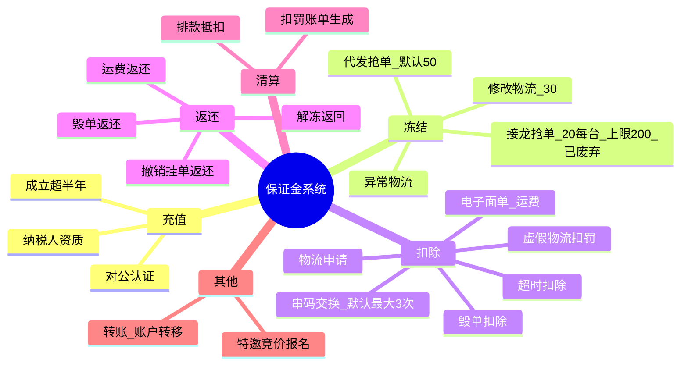

---

## 二、保证金充值

### 2.1 前置条件

1. 企业完成对公认证
2. 企业成立时间大于半年
3. 企业拥有纳税人资质

### 2.2 充值时序图

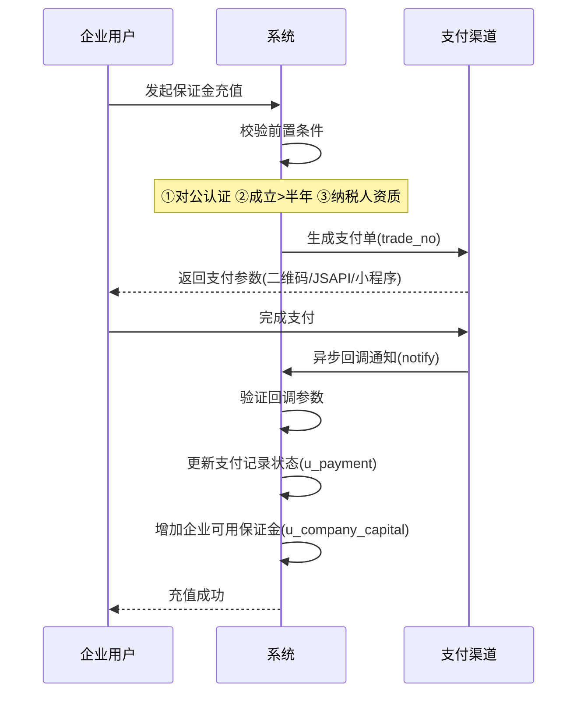

---

## 三、保证金冻结

### 3.1 涉及业务

1. 代发抢单
2. 接龙抢单（已废弃）
3. 异常物流冻结保证金

### 3.2 一件代发保证金冻结

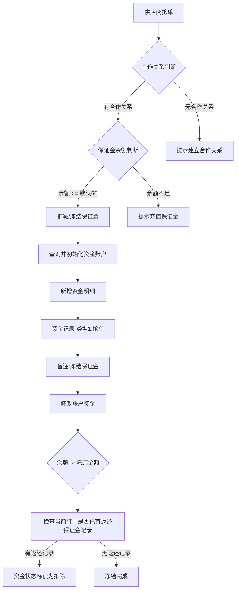

### 3.3 抢单接龙保证金冻结

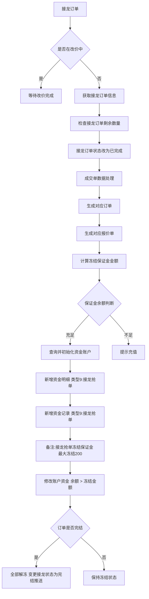

---

## 四、保证金扣除与返还

### 4.1 串码交换扣除保证金

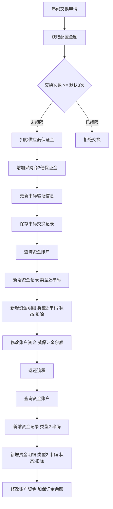

### 4.2 超时扣除保证金

> 原文件包含流程图，信息有限。

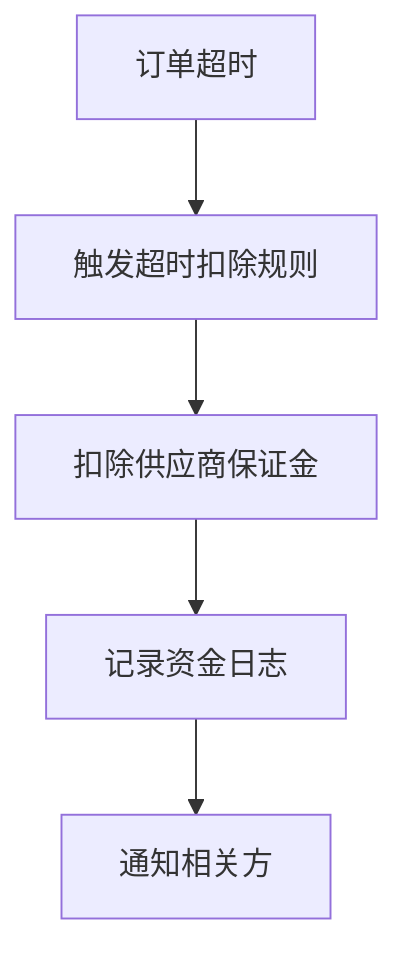

### 4.3 物流申请扣除保证金

> 原文件包含流程图，信息有限。

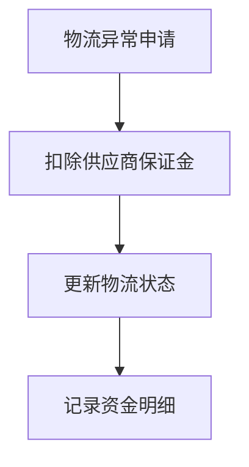

### 4.4 电子面单扣除保证金

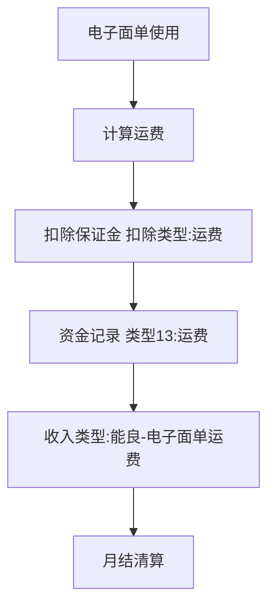

### 4.5 毁单扣除/返还保证金

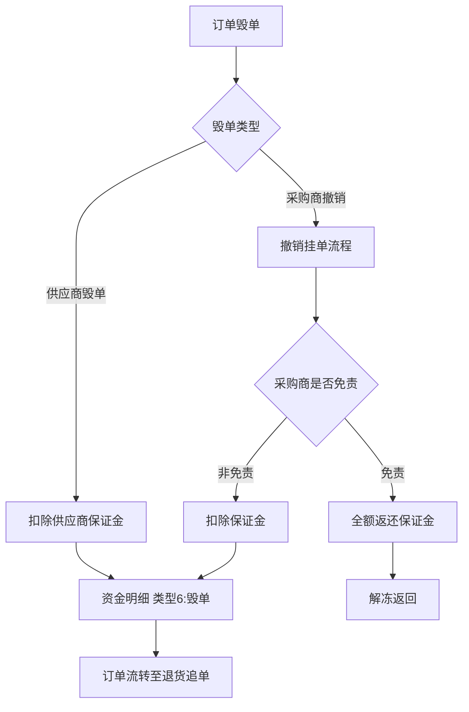

### 4.6 撤销挂单扣除/返还保证金

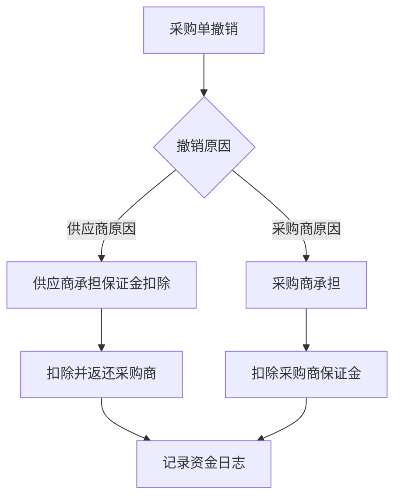

### 4.7 退货追单

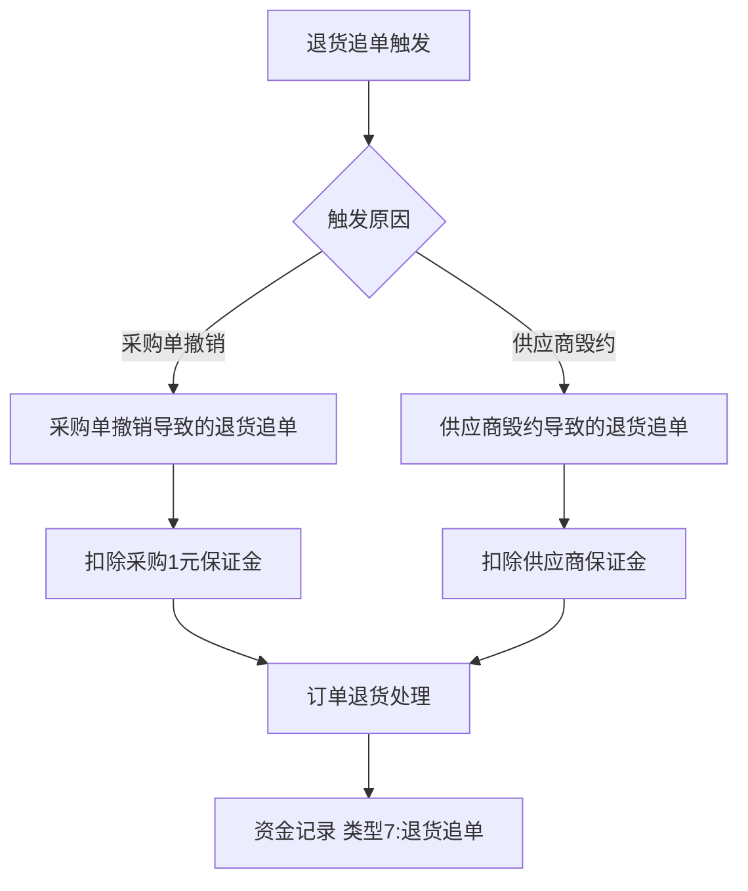

### 4.8 虚假物流扣罚

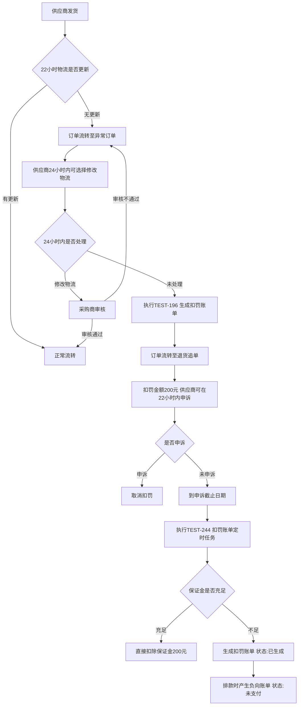

**操作项：**
1. 查询并初始化资金账户
2. 新增资金明细（类型11：扣罚订单，备注：虚假物流扣罚）
3. 新增资金记录
4. 修改账户资金余额 → 冻结金额

### 4.9 手动退款

略。

---

## 五、无仓保证金扣罚（来源：`无仓保证金扣罚 · 云效 Thoughts · 企业级知识库.pdf`）

### 5.1 背景介绍

保证金也叫押金，在客户交易时使用一小部分资金作为担保，目的是提升毁约成本，促使客户完成最终交易。客户需要在钱包里充值保证金，才能进行相应的抢单。

因供应商原因（如虚假物流，货物不对）被平台扣罚时，系统无法对订单发起追缴，只能线下找供应商追缴，存在供应商不缴纳情况，造成业务损失，需要实现全链路合规管控与损失追偿。

### 5.2 保证金余额校验

#### 5.2.1 保证金余额校验业务流程

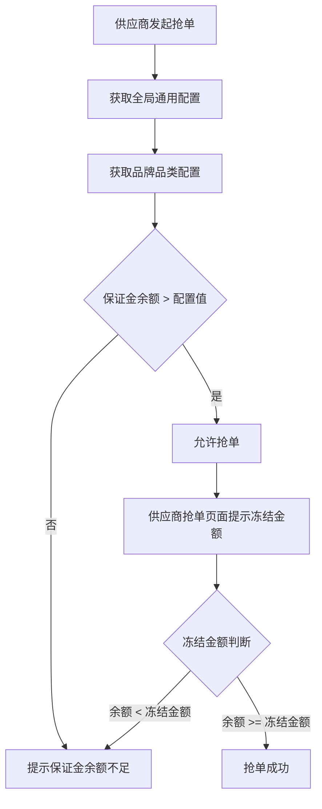

#### 5.2.2 保证金余额第一道校验配置

**可选择条件：**
1. 应用对象：全部、无仓、醒柜（单选）
2. 订单类型：普通订单、加急订单、超时订单、高价订单、推荐给供应商订单、小狮达订单（下拉多选）
3. 品类（下拉多选）
4. 品牌（下拉多选）
5. SPU（下拉多选）
6. SKU（下拉多选）

未填写时的字段默认为【全部】。

输入保证金余额，生成一条规则，此规则下的订单必须满足【保证金余额】大于xx元才能对订单抢单，供应商抢单进行第一次拦截。

**规则生效的优先级：**

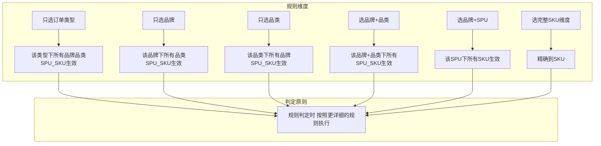

**添加规则约束：**
同一应用对象维度下，不允许存在完全相同的配置规则，重复则提示"同一应用对象的该维度规则已存在，不允许重复创建"。

#### 5.2.3 保证金余额第二道校验配置

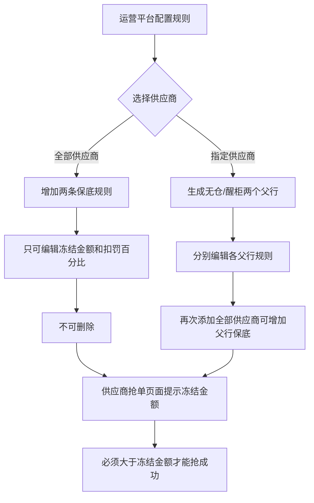

**可选择条件：**
1. 供应商名称（搜索框）
2. 应用对象：无仓、醒柜（单选）
3. 订单类型：普通订单、加急订单、超时订单、高价订单、推荐给供应商订单、小狮达订单（下拉多选）
4. 品类（下拉多选）
5. 品牌（下拉多选）
6. SPU（下拉多选）
7. SKU（下拉多选）

未填写时的字段默认为【全部】。

### 5.3 无仓扣罚

#### 5.3.1 虚假物流扣罚

**扣罚规则：**
- 从发货时间计算，超过24小时物流无流转信息，生成扣罚订单，200元/单
- 扣罚原因：虚假物流-24小时无揽收信息
- 从发货时间计算，超过96小时物流无信息：自动退货追单，不扣除采购方保证金（24小时已经扣过了）

**完整业务流程：**

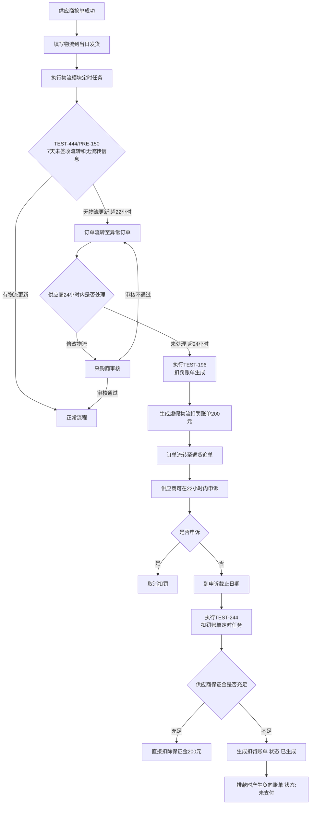

**快速造数据：**
采购方界面，【今日付款】【物流扣罚】选择添加扣罚订单，可直接生成一笔虚假物流扣罚账单。

#### 5.3.2 物流填反扣罚

> 原文件无详细扣罚流程描述。

#### 5.3.3 修改次数扣罚

> 原文件无详细扣罚流程描述。

#### 5.3.4 违规扣罚

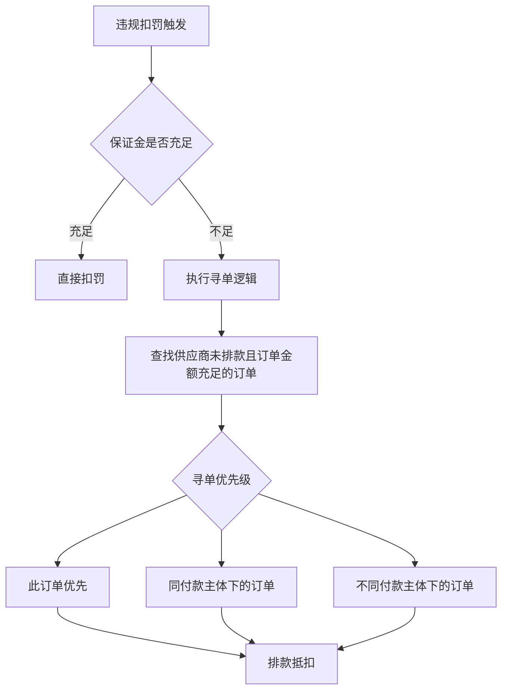

**寻单优先级：** 此订单 > 同付款主体下的订单 > 不同付款主体下的订单

#### 5.3.5 毁单扣罚

> 原文件无详细扣罚流程描述。

#### 5.3.6 超时发货扣罚

> 原文件无详细扣罚流程描述。

---

## 六、无仓扣罚机制规则明细（来源：`无仓扣罚机制`）

### 6.1 物流修改次数扣罚

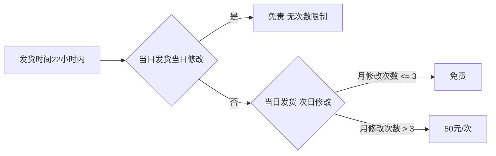

- 扣罚规则：发货时间22个小时内
- 当日发货，当天修改：免责，无次数限制
- 当天发货，次日修改：免责3次/月，超次数50元/次

### 6.2 物流填反申请扣罚

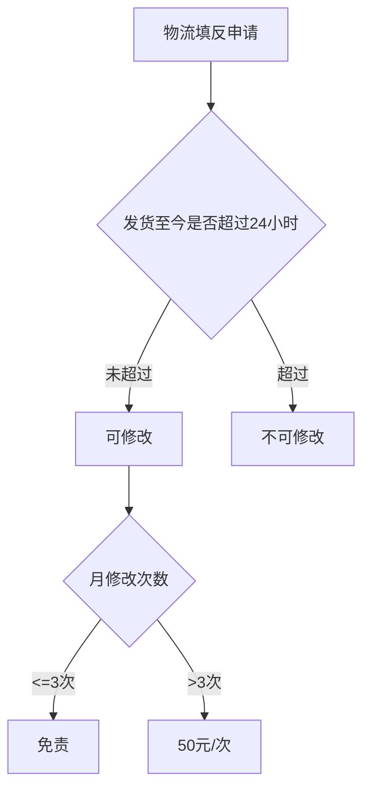

- 该订单发货时间至当前时间，24小时内可修改，若超过24小时，则不可修改
- 按无仓订单1个订单1次，免责3次/月，超次数50元/次，当天也算

### 6.3 虚假物流扣罚

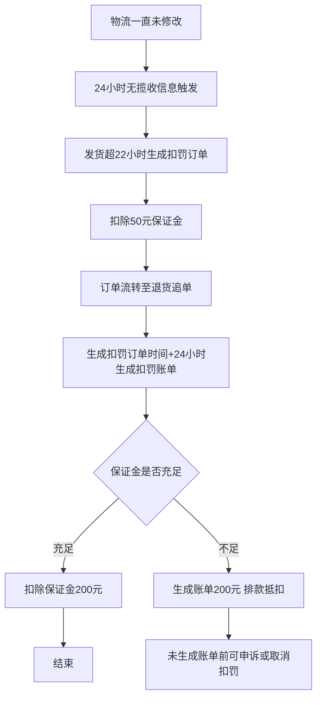

- **触发条件**：物流一直未修改触发（24小时无揽收信息）
- 发货时间超过22小时生成扣罚订单，扣除50元保证金，且订单流转至退货追单
- 生成扣罚订单时间 + 24小时则生成扣罚账单
- 保证金充足：扣除保证金200元
- 保证金不足：生成账单200元，排款抵扣
- （未生成账单前可申诉或者取消扣罚）

### 6.4 违规扣罚（手动添加扣罚）

针对无仓单号选择扣罚类型次数生成的负账单。运营平台配置项错发扣罚详情和扣罚分类。

```mermaid
flowchart TD
    A[违规扣罚类型] --> B[错发]
    A --> C[非新机]
    A --> D[到付件]
    
    B --> B1[1次200元]
    B --> B2[2次300元]
    B --> B3[3次400元]
    B --> B4[>=4次]
    B --> B5[暂停一周接单权限]
    
    C --> C1[1次1万]
    C --> C2[2次2万]
    C --> C3[3次3万]
    C --> C4[4次4万]
    C --> C5[>=5次5万]
    C --> C6[暂停两周接单权限 冻结货款]
    
    D --> D1[1次200元]
    D --> D2[2次300元]
    D --> D3[3次400元]
    D --> D4[>=4次]
    D --> D5[暂停一周接单权限]
```

**错发：**
- 违规次数阶梯：1次200元、2次300元、3次400元、大于等于4次
- 错发详情：串码不符、错发颜色、发错版本、发错产品、发错货、发错内存颜色、发错手机、发错型号、发错颜色、权益版
- **同时暂停一周接单权限**

**非新机：**
- 违规次数阶梯：1次1万、2次2万、3次3万、4次4万、大于等于5次5万
- 非新机详情：三码不一、提前激活、定制机
- **同时暂停两周接单权限，并冻结货款直至平台处罚评估期结束**

**到付件：**
- 违规次数阶梯：1次200元、2次300元、3次400元、大于等于4次
- 到付件详情：到付
- **同时暂停一周接单权限**

### 6.5 违规手动扣罚

针对「已收货」、「售后」、「当日发货」、「在途」、「待发货」等订单进行**指定串码**扣罚和**指定台数**扣罚，实现全链路合规管控与损失追偿。

```mermaid
flowchart LR
    A[违规手动扣罚] --> B[指定串码]
    A --> C[指定台数]
    B --> D[针对已收货/售后/当日发货/在途/待发货订单]
    C --> D
    D --> E[全链路合规管控与损失追偿]
```

### 6.6 扣罚申诉

> 原文件无详细内容。

---

## 七、群接龙冻结保证金（来源：`群接龙冻结保证金（25_11_19） · 云效 Thoughts · 企业级知识库.pdf`）

### 7.1 产品信息

- 原型地址：<http://10.10.10.4/TKUXKU/?id=41gg3n&p=%E6%97%A0%E4%BB%93%E4%BF%9D%E8%AF%81%E9%87%91&g=1&sc=3>
- 飞书文档：<https://z25vwhbapd.feishu.cn/wiki/JEtgwI3E5i9jFakjMlLcDKT5nSc>

### 7.2 整体流程

```mermaid
flowchart TD
    A[集采发布报价] --> B[供应商出价抢单]
    B --> C{判断供应商类型}
    C -->|白名单| D[按参数配置扣除 配置金额即上限]
    C -->|非白名单| E[按30元/单扣除 上限10000]
    D --> F[立即冻结保证金]
    E --> F
    F --> G[运营平台成交]
    G --> H[供应商发货]
    H --> I[执行orderCenterCreate定时任务]
    I --> J[运营平台拣货]
    J --> K{分批入库}
    K -->|是| L[保证金分批解冻]
    K -->|否| M[一次性入库]
    L --> N[入库完成]
    M --> N
    N --> O{完成拣货时判断}
    O -->|入库/成交 >= 50%| P[不扣罚保证金 全部返还]
    O -->|入库/成交 < 50%| Q[按规则扣罚]
    P --> R[退还保证金]
    Q --> R
```

### 7.3 扣费规则

群接龙供应商按照白名单和非白名单计算扣除保证金。

**运营平台字典配置：**
- 保证金扣罚：`marketing_deposit`
- 保证金上限：`marketing_limit_deposit`

**白名单供应商：**
- 按照参数配置扣除（配置内金额就是上限）

**非白名单供应商：**
- 按照每单30元扣除，上限10000

### 7.4 扣费计算场景

```mermaid
flowchart TD
    A[非白名单供应商] --> B[抢单冻结计算]
    B --> C{30*抢单数 >= 10000}
    C -->|是| D[冻结10000 达到上限]
    C -->|否| E[按30*抢单数冻结]
    D --> F[成交后计算]
    E --> F
    F --> G{30*成交数 >= 10000}
    G -->|是 仍达上限| H[按上限10000扣除]
    G -->|否 未达上限| I[按30*成交数扣除]
    H --> J[按比例解冻 10000/成交数*入库数]
    I --> K[剩余部分解冻返还]
    J --> L[完成拣货时]
    K --> L
    L --> M{入库/成交 >= 50%}
    M -->|是| N[不扣罚 全部返还]
    M -->|否| O[按规则扣罚]
```

**场景1：成交前达到上限，成交后未达上限**
按正常扣，剩余全部解冻返还。后续部分拣货也按照正常解冻扣除，比例整体结果向下取整。完成拣货时：拣货入仓数量/成交数量\*100% >= 50%，不扣保证金，余下全部解冻。

例：非白名单——抢单400，冻结保证金30\*400>=10000，冻结10000；成交300，30\*300<=10000，按照30\*300扣除，解冻1000返回保证金。后续部分拣货也按照30\*数量解冻扣除。

**场景2：成交前达到上限，成交后也达到上限**
达到上限时不解冻保证金，后续部分拣货按照比例解冻扣除，比例整体结果向下取整。完成拣货时：拣货入仓数量/成交数量\*100% >= 50%，不扣保证金，余下全部解冻返还。

例：非白名单——抢单400，冻结保证金30\*400>=10000，冻结10000；成交350，30\*350>=10000，按照10000扣除，解冻0返回保证金。后续部分拣货按照比例 10000/350\*数量 解冻扣除。若成交数量350单，拣货入库175单，然后点击【完成拣货】，先把剩余保证金返还，175/350>=0.5则不扣罚保证金。

### 7.5 操作步骤

**整体流程：**
集采报价 → 供应商出价（扣除保证金） → 成交 → 供应商发货 → 执行定时任务 → 运营平台拣货 → 入库完成（退还保证金）

**详细步骤：**
1. 群接龙集采发布报价
2. 供应商抢单
3. 出价后，立即冻结保证金（非白名单商户：30\*数量）
4. 运营平台成交
5. 供应商发货
6. 执行采购单推订单中心定时任务（订单模块——orderCenterCreate）
7. 运营平台拣货：填写串码，可以分批入库，保证金分批解冻

**查看保证金入口：**
供应商平台 → 财务 → 钱包 → 保证金

### 7.6 部分拣货场景

```mermaid
flowchart TD
    A[成交5单 冻结5*30=150元] --> B[拣货入库4单]
    B --> C[解冻4*30=120元]
    C --> D[剩余1单有瑕疵或不想要]
    D --> E[直接点击完成拣货]
    E --> F{4/5*100% >= 50%}
    F -->|是| G[全部返还保证金]
    F -->|否| H[按规则扣罚]
```

**场景1：成交冻结保证金未达上限（1000元）**
成交5单，拣货4单入库，剩余1单有瑕疵（或者不想要），直接完成拣货。
- 本单5\*30=150元冻结保证金
- 入库4单，解冻4\*30=120元
- 剩余1单，直接点击【完成拣货】退还剩余全部保证金
- 因为4/5\*100%>=50%，故全部返还保证金

### 7.7 逆向场景

```mermaid
flowchart TD
    A[逆向场景] --> B[余额不足]
    A --> C[毁单]
    A --> D[免责毁单]
    
    B --> B1[保证金金额 < 抢单数*30]
    B1 --> B2[提示去充值]
    
    C --> C1[立即毁单]
    C1 --> C2[扣除保证金]
    
    D --> D1{拒绝或同意}
    D1 -->|拒绝| D2[保证金流水无变更]
    D1 -->|同意| D3[保证金全额返还 金额同等增加]
```

**余额不足：**
保证金金额 < 抢单数量\*30，提示去充值。

**毁单：**
- 立即毁单：扣除保证金
- 免责毁单——拒绝：拒绝后，保证金流水无变更
- 免责毁单——同意：保证金全额返还，保证金金额同等增加

### 7.8 推金蝶的配置

```mermaid
flowchart LR
    A[u_company_capital_detail] --> B{capital_status = 2}
    B -->|是| C{type = 18}
    B -->|否| E[不推送]
    C -->|是| D[推送到金蝶]
    C -->|否| E
    D --> F[执行定时任务 kingdeeCapitalPushJob]
    F --> G[金蝶地址]
```

**资金状态枚举：**

```java
CODE_1(1, "冻结"),
CODE_2(2, "扣除"),
CODE_3(3, "解冻成功"),
CODE_4(4, "解冻返回"),
CODE_5(5, "已返还"),
CODE_6(6, "收入"),
```

**推送条件：**
- 表：`xswc_user.u_company_capital_detail`
- `capital_status = 2`
- `type = 18` 才会推金蝶

**执行定时任务：**
用户模块——`kingdeeCapitalPushJob`

**金蝶地址：** <http://erp.nengliangtech.com:8022/ierp/?formId=home_page>

---

## 八、数据表设计

来源文件：`保证金`

### 8.1 实体关系图

基于4张表的字段定义与外键关系还原：

```mermaid
erDiagram
    u_company_capital {
        bigint id PK "主键"
        tinyint service_type "服务类型"
        bigint company_id UK "企业id"
        decimal available_amount "可用金额"
        decimal frozen_amount "冻结金额"
        datetime create_time "创建时间"
        datetime update_time "更新时间"
    }

    u_payment {
        bigint id PK "主键"
        bigint company_id FK "企业id"
        varchar trade_no "支付单号"
        tinyint trade_states "支付状态"
        tinyint trade_channel "支付渠道"
        tinyint trade_type "支付类型"
        decimal amount "金额"
        varchar out_no "第三方单号"
        datetime create_time "创建时间"
        datetime notify_time "回调时间"
        bigint create_by "发起支付人"
    }

    u_company_capital_log {
        bigint id PK "主键"
        bigint capital_id FK "资金id"
        bigint company_id FK "企业id"
        bigint trade_order_id "抢单id"
        varchar order_no "业务单号"
        decimal out_amount "出项"
        decimal add_amount "进项"
        decimal subtotal "小计"
        decimal available_amount "可用资金"
        datetime create_time "创建时间"
        datetime update_time "更新时间"
        varchar remark "备注"
        int type "业务类型"
        tinyint processed "是否已处理"
        int handle_num "清算次数"
    }

    u_company_capital_detail {
        bigint id PK "主键"
        bigint capital_id FK "资金id"
        bigint company_id FK "企业id"
        decimal available_amount "可用资金"
        varchar order_no "抢单成功no"
        bigint trade_order_id "抢单成功id"
        decimal amount "金额"
        tinyint capital_status "资金状态"
        int order_status "订单状态"
        bigint create_by "创建者"
        datetime create_time "创建时间"
        bigint update_by "更新者"
        datetime update_time "更新时间"
        varchar remark "备注"
        int type "业务类型"
    }

    %% 关系：一个企业账户对应多条支付记录、流水记录、明细记录
    u_company_capital ||--o{ u_payment : "company_id 企业ID"
    u_company_capital ||--o{ u_company_capital_log : "capital_id 账户ID"
    u_company_capital ||--o{ u_company_capital_detail : "capital_id 账户ID"
```

**表关系说明：**

| 左表（主表） | 关系 | 右表（子表） | 关联字段 |
|------------|------|------------|----------|
| u_company_capital | 1 → N | u_payment | company_id |
| u_company_capital | 1 → N | u_company_capital_log | capital_id → u_company_capital.id |
| u_company_capital | 1 → N | u_company_capital_detail | capital_id → u_company_capital.id |

- **u_company_capital**（企业保证金账户表）是核心表，每个企业一条记录（company_id 唯一），记录可用金额和冻结金额
- **u_payment**（企业支付记录表）记录充值支付单，通过 company_id 关联账户表
- **u_company_capital_log**（保证金记录表）记录资金进出流水（出项/进项/小计/可用资金），通过 capital_id 关联账户表，同时记录业务单号和抢单id
- **u_company_capital_detail**（保证金明细表）记录资金状态变更明细（冻结/扣除/解冻），通过 capital_id 关联账户表，包含 capital_status 状态字段和 amount 金额字段

### 8.2 表结构

#### 8.2.1 企业支付记录表（u_payment）

| 字段 | 类型 | 说明 |
|------|------|------|
| id | bigint | 主键 |
| company_id | bigint | 企业id |
| trade_no | varchar(50) | 支付单号 |
| trade_states | tinyint(1) | 支付状态 |
| trade_channel | tinyint(1) | 支付渠道 |
| trade_type | tinyint(1) | 支付类型：1.二维码支付 2.JSAPI支付 3.小程序支付 |
| amount | decimal(10,2) | 金额 |
| out_no | varchar(50) | 第三方单号 |
| create_time | datetime | 创建时间 |
| notify_time | datetime | 回调时间 |
| create_by | bigint | 发起支付人 |

**索引：** company_id

#### 8.2.2 企业保证金账户表（u_company_capital）

| 字段 | 类型 | 说明 |
|------|------|------|
| id | bigint | 主键 |
| service_type | tinyint | - |
| company_id | bigint | 企业id |
| available_amount | decimal(10,2) | 可用金额 |
| frozen_amount | decimal(10,2) | 冻结金额 |
| create_time | datetime | 创建时间 |
| update_time | datetime | 更新时间 |

**索引：** company_id（唯一）

`AUTO_INCREMENT = 9368`

#### 8.2.3 保证金记录表（u_company_capital_log）

| 字段 | 类型 | 说明 |
|------|------|------|
| id | bigint | 主键 |
| capital_id | bigint | 资金id |
| company_id | bigint | 企业id |
| trade_order_id | bigint | 抢单id |
| order_no | varchar(50) | 业务单号 |
| out_amount | decimal(10,2) | 出项 |
| add_amount | decimal(10,2) | 进项 |
| subtotal | decimal(10,2) | 小计 |
| available_amount | decimal(10,2) | 可用资金 |
| create_time | datetime | 创建时间 |
| update_time | datetime | 更新时间 |
| remark | varchar(255) | 备注 |
| type | int | 业务类型（1.抢单 2.串码） |
| processed | tinyint(1) | 是否已处理（1-已处理 0-未处理），默认已处理 |
| handle_num | int | 清算次数，默认为0，最多2次 |

**索引：** trade_order_id, company_id, order_no, (capital_id, type, create_time)

`AUTO_INCREMENT = 2764066`

#### 8.2.4 保证金明细表（u_company_capital_detail）

| 字段 | 类型 | 说明 |
|------|------|------|
| id | bigint | 主键 |
| capital_id | bigint | 资金id |
| company_id | bigint | 企业id |
| available_amount | decimal(10,2) | 可用资金 |
| order_no | varchar(50) | 抢单成功no |
| trade_order_id | bigint | 抢单成功id |
| amount | decimal(10,2) | 金额 |
| capital_status | tinyint | 资金状态：1冻结 2扣除 3解冻 |
| order_status | int | 订单状态 |
| create_by | bigint | 创建者 |
| create_time | datetime | 创建时间 |
| update_by | bigint | 更新者 |
| update_time | datetime | 更新时间 |
| remark | varchar(255) | 备注 |
| type | int | 业务类型（1.抢单 2.串码） |

**索引：** trade_order_id, company_id, order_no

`AUTO_INCREMENT = 5278683`

---

## 九、当前问题

来源文件：`保证金`

### 9.1 虚入问题

保证金存在虚入问题，导致实际商户余额与保证金账户的余额对不上。

### 9.2 保证金类型问题

存在多套枚举，使用不统一。

---

## 附：文件清单

| 序号 | 文件名 | 说明 | 提取情况 |
|------|--------|------|----------|
| 1 | `保证金` | 主文档：概述、业务类型、状态、充值冻结扣罚流程、数据表设计、当前问题 | 已全文提取 |
| 2 | `无仓扣罚机制` | 无仓相关扣罚规则详细说明 | 已全文提取 |
| 3 | `保证金 · 云效 Thoughts · 企业级知识库.pdf` | 云效知识库导出PDF（20页），内容与`保证金`文件一致，包含脑图和流程图 | 已提取文本，流程图用Mermaid还原 |
| 4 | `无仓保证金扣罚 · 云效 Thoughts · 企业级知识库.pdf` | 无仓扣罚相关PDF（13页），含余额校验配置、扣罚流程、操作步骤 | 已提取文本，流程图用Mermaid还原 |
| 5 | `群接龙冻结保证金（25_11_19） · 云效 Thoughts · 企业级知识库.pdf` | 群接龙冻结保证金PDF（15页），含白名单/非白名单规则、操作步骤、金蝶配置 | 已提取文本，流程图用Mermaid还原 |
| 6 | `whiteboard_exported_image (2).png` | 脑图整理图片 | OCR识别文字，已用Mindmap还原 |
| 7 | `extracted_images/` | 从PDF导出的所有页面图片（用于OCR分析） | - |
